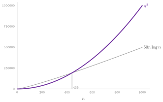

# 1. Introduction {#ch-1}

[Source: `include/ADS/ADT.h`, `Contract.h`, `Iterators.h`, `Portable.h`,
`ADS/sequence/IndexedList.h`, `ADS/set/SetInterfaces.h`, `ADS/set/Bag.h`]

We are concerned in this manual with ADS, a header-only library of C++20 that
realizes the data structures and the algorithms of the textbooks, each in the
form in which a textbook presents it, together with the engineered variants
that the literature on algorithm engineering has proposed for many of them.
This chapter fixes what the other chapters take for granted. We first recall
why the organization of the data matters
([§1.1](01-introduction.md#sec-1-1)), how an abstract data type is specified
and how the library states it as a concept of C++20
([§1.2](01-introduction.md#sec-1-2)), and which interfaces the structures
realize ([§1.3](01-introduction.md#sec-1-3)), together with their simplest
realizations ([§1.4](01-introduction.md#sec-1-4)). Then come the mathematics
of the analyses ([§1.5](01-introduction.md#sec-1-5)), the model of
computation in which the costs are counted
([§1.6](01-introduction.md#sec-1-6)), and the meaning of correctness, time
and space for an operation, with the contracts by which the library checks
correctness ([§1.7](01-introduction.md#sec-1-7)). In the last sections we
describe the iterators ([§1.8](01-introduction.md#sec-1-8)), the two levels
of the library and its conventions ([§1.9](01-introduction.md#sec-1-9)), how
to build, test and use it ([§1.10](01-introduction.md#sec-1-10)), how this
manual is organized ([§1.11](01-introduction.md#sec-1-11)), and the map of
all the classes of the library ([§1.12](01-introduction.md#sec-1-12)).

## 1.1 The need for efficiency {#sec-1-1}

Each of the abstract data types of [§1.3](01-introduction.md#sec-1-3) can be
realized by a vector, or by a list, whose items are examined one by one at
each operation: a search scans them all, an insertion scans them to rule
out a duplicate, and a removal scans them to find its item. Such
realizations are "easy" to write correctly (those of
[§1.4](01-introduction.md#sec-1-4) are of this kind), and one may wonder
whether anything faster is needed on a machine that executes billions of
instructions per second, i.e., on a "fast" one; a rough count shows that it
usually is. Suppose that a program keeps $n = 10^6$ items and looks up each
of them once, i.e., makes $m = 10^6$ searches; if each search examines all
the items, the program makes $n m = 10^{12}$ examinations. A core of a
current processor runs at a few billion cycles per second and makes at most
a few simple operations per cycle, and each examination reads an item,
compares it and moves to the next. Hence, the core makes of the order of
$10^9$ examinations per second, and all the searches take of the order of
$10^3$ seconds, about a quarter of an hour. Doubling $n$ and $m$ makes it an
hour, and a data set of $10^9$ items (which is not "large" by today's
standards) would take decades. We remark that these figures are rather crude
orders of magnitude, not measures (the measures of the library are the
subject of [appendix B](B-benchmarks.md#app-B)); yet, no constant factor of
a faster machine changes the product $n m$.

A remedy (the "right" one, in most cases) is to organize the items so that an
operation need not examine all of them. A hash table (chapter
[7](07-dictionary.md#ch-7)) examines a constant number of items per search on
average, whatever $n$ is, and the $10^6$ searches above then take a few
million examinations, i.e., some milliseconds. A balanced search tree
(chapter [8](08-tree.md#ch-8)) keeps the items in order and examines at most
about $2 \log_2 n$ of them per operation, i.e., about 40 for $n = 10^6$ and
60 for $n = 10^9$. However, on a real machine the cost of an examination is
not uniform: a read that misses all the levels of the caches costs of the
order of a hundred nanoseconds, i.e., some hundreds of operations ([Drepper
2007](Z-bibliography.md#ref-drepper2007)). Two structures that examine the
same number of items may thus differ in running time by one order of
magnitude (typically, not more), according to how the items they examine lie
in memory. In ADS, the textbook structures are written to show the first
effect (the organization of the items), and the engineered ones also take the
second (somewhat harder to predict) into account
([§1.9](01-introduction.md#sec-1-9)).

## 1.2 Abstract data types {#sec-1-2}

A *specification* of an abstract data type is a triple $( D , F
, A )$ ([Montresor 2025,
§3.2](Z-bibliography.md#ref-montresor2025)). Here $D$ is a set
of domains, one of which is the *designated* domain, i.e., the
type being defined (e.g., the stacks), while the others are the
auxiliary ones (e.g., the items and the booleans). Then $F$ is
a set of operations, each a function among the domains of $D$;
$A$ is a set of axioms, which give the meaning of the
operations ([Liskov and Zilles
1974](Z-bibliography.md#ref-liskov1974); [Guttag and Horning
1978](Z-bibliography.md#ref-guttag1978)). The pair $( D , F )$
is the *syntactic* specification, and $A$ the *semantic* one.
The latter may be given in two ways: in the *algebraic* way, it
is a set of equations among the operations, in which those that
observe or remove are written on the terms built by those that
construct, as in $\mathrm{top}( \mathrm{push}( S , v ) ) = v$.
In the *constructive* way, it is the precondition and the
postcondition of each operation, written in terms of a type
already known (e.g., the finite sequences of items). As for the
operations, they are of four kinds, i.e., the *constructors*,
which make a value of the type (`create()`, `insert()`,
`push()`), the *modifiers*, which change it, the *observers*,
which return a property of it (`empty()`, `top()`, `read()`),
and the *iterators*, which visit its items.

A realization of the type meets the requirement of *abstraction* if a
program that uses the type does not depend on how it is realized, and that
of *protection* if only the operations of the type act on its values
([Parnas 1972](Z-bibliography.md#ref-parnas1972); [Liskov and Zilles
1974](Z-bibliography.md#ref-liskov1974)). In ADS we therefore write each
realization as a class whose data are private, and two realizations of the
same type can replace each other in a program. In C++20, the syntactic
specification is a *concept*, i.e., a predicate on types, checked at compile
time, which requires some expressions to be valid and to have some types
([Sutton
and Stroustrup 2012](Z-bibliography.md#ref-sutton2012)). That of the STACK,
in `ADS/ADT.h`, requires a type of the items, an observer `empty()` that
gives a `bool`, and the operations `push()`, `pop()` and `top()`:

```cpp
--8<-- "generated/ADT-Stack.cpp"
```

A class models a concept by having its operations, with no declaration of
the fact. Hence, a realization written outside the library models the
concepts of the library as well as those inside it. A function template
constrained by the concept, e.g., `template< Stack S > void f( S & s )`,
takes any realization. A call that gives it a type that is not a stack
is rejected at the point of the call, with the name of the requirement that
fails. However, a concept checks the syntax and nothing more: two types with
the same operations and different axioms (say, a stack and a queue whose
operations had the same names) model the same concepts, and the compiler
cannot tell them apart. We therefore state the axioms of each type in the
comments of `ADS/ADT.h`, and the library checks them in two ways, i.e., the
tests check them on each realization (the tests `contract_*.*-axioms`), and
the code checks the constructive form, i.e., the preconditions and the
postconditions of the operations ([§1.7](01-introduction.md#sec-1-7)).

We write the axioms of the STACK, with $\mathrm{create}$ the empty stack,
as

$$
\begin{array}{ll}
\mathrm{empty}( \mathrm{create} ) = \mathbf{true} , &
\mathrm{empty}( \mathrm{push}( S , v ) ) = \mathbf{false} , \\
\mathrm{top}( \mathrm{push}( S , v ) ) = v , &
\mathrm{pop}( \mathrm{push}( S , v ) ) = S ,
\end{array} \tag{1.1}
$$

while $\mathrm{top}( \mathrm{create} )$ and $\mathrm{pop}( \mathrm{create}
)$ are undefined, i.e., `top()` and `pop()` are partial operations, whose
precondition is that the stack is not empty. In ADS `pop()` also returns the
item it removes, and the last axiom is about the stack it leaves. As for the
QUEUE, it has `enqueue()`, which adds at the back, `dequeue()`, which
removes from the front, and `top()`, which reads the front; besides
$\mathrm{empty}( \mathrm{create} ) = \mathbf{true}$ and $\mathrm{empty}(
\mathrm{enqueue}( Q , v ) ) = \mathbf{false}$ for any $Q$, its axioms are,
for $Q$ not empty,

$$
\mathrm{top}( \mathrm{enqueue}( Q , v ) ) = \mathrm{top}( Q ) , \qquad
\mathrm{dequeue}( \mathrm{enqueue}( Q , v ) ) =
\mathrm{enqueue}( \mathrm{dequeue}( Q ) , v ) , \tag{1.2}
$$

with $\mathrm{top}( \mathrm{enqueue}( \mathrm{create} , v ) ) = v$ and
$\mathrm{dequeue}( \mathrm{enqueue}( \mathrm{create} , v ) ) =
\mathrm{create}$. Since the syntactic specifications of the two types are
the same up to the names of the operations, (1.1) and (1.2) are the whole
difference between a stack and a queue. Note that the axioms must also
decide the value of each observer on each value of the type, and they are
then *sufficiently complete*, in the terms of [Guttag and Horning
1978](Z-bibliography.md#ref-guttag1978), which makes them a specification
rather than a list of properties; for the stacks this follows from a normal
form of their terms.

<span id="lem-1-1"></span>**Lemma 1.1.** *By (1.1), each stack built by
$\mathrm{create}$, $\mathrm{push}$ and $\mathrm{pop}$, each $\mathrm{pop}$
applied to a stack that is not empty, is equal to a term*

$$
\mathrm{push}( \cdots \mathrm{push}( \mathrm{push}( \mathrm{create} ,
v_1 ) , v_2 ) \cdots , v_k ) , \quad k \ge 0 , \tag{1.3}
$$

*and the observers of a term (1.3) are determined: it is empty if and only
if $k = 0$, and its top is $v_k$.*

*Proof.* By induction on the number of operations of the term, since the
equations of (1.1) may be applied to any subterm. A term with no operation
is $\mathrm{create}$, i.e., (1.3) with $k = 0$. Otherwise, its outermost
operation is applied to a subterm that, by induction, is equal to a term
(1.3); a $\mathrm{push}$ applied to a term (1.3) is a term (1.3), and a
$\mathrm{pop}$ applied to a term (1.3), which has $k \ge 1$ by hypothesis,
is, by the last axiom of (1.1), the term (1.3) of $v_1 , \ldots , v_{k-1}$.
The values of $\mathrm{empty}$ and $\mathrm{top}$ on (1.3) are given by the
first three axioms of (1.1). $\square$

The same argument holds for the queues by (1.2), with a normal form
$\mathrm{enqueue}( \cdots \mathrm{enqueue}( \mathrm{create} , v_1 ) \cdots ,
v_k )$ made of $\mathrm{enqueue}$ only. A $\mathrm{dequeue}$ of such a term
with $k \ge 1$ is, by induction on $k$ (the second axiom of (1.2) for $k \ge
2$, and $\mathrm{dequeue}( \mathrm{enqueue}( \mathrm{create} , v ) ) =
\mathrm{create}$ for $k = 1$), the normal form of $v_2 , \ldots , v_k$. The
axioms on $\mathrm{empty}$ and $\mathrm{top}$ give that the term is empty if
and only if $k = 0$ and that its front is $v_1$. For the sets, the axioms
(1.6) below decide $\mathrm{contains}( x , A )$ for each item $x$ and each
term $A$, by induction on $A$. Hence, if we take two sets as equal when they
contain the same items (the only equality that (1.6) can define, since it has
no equation among sets), each term is equal to a term made of
$\mathrm{insert}$ only, on the distinct items that it contains, in any order.
Of course, the axioms say nothing about the cost of the operations, which is
rather the business of the realizations; a stack on a vector and a stack on a
list satisfy (1.1) in the same way, and differ in time and space
([§3.2](03-stack.md#sec-3-2) and [§3.3](03-stack.md#sec-3-3)).

## 1.3 The interfaces {#sec-1-3}

An *interface* (i.e., an abstract data type, as a program sees it) states
what a structure does, and an *implementation* (or realization) how it does
it. There are typically several realizations of one interface, which differ
in the cost of the operations, and choosing among them is the first decision
in the use of a library ([Morin 2013,
§1.2](Z-bibliography.md#ref-morin-cpp)). ADS has the interfaces of two
textbooks. Those of [Montresor 2025](Z-bibliography.md#ref-montresor2025)
name the operations as its pseudocode does, and are the concepts of
`ADS/ADT.h`. Those of [Morin 2013, §1.2](Z-bibliography.md#ref-morin-cpp)
read the sequences by rank and the sets through the items they find, and are
the concepts of `ADS/sequence/IndexedList.h` and `ADS/set/SetInterfaces.h`,
the latter with two more concepts of the library that view the keys of a
dictionary as such a set. [Table 1.1](01-introduction.md#tab-1-1) lists them,
with the chapters where their realizations are described. The concepts of the
other areas (the PRIORITY QUEUE of `ADS/priority/PriorityQueue.h`, the GRAPH
of `ADS/graph/Graph.h`, the executors of `ADS/parallel/Executor.h`) are
described with their areas instead.

<span id="tab-1-1"></span>**Table 1.1.** The concepts of the interfaces of
chapter 1, their operations and the chapters of their realizations; M is
[Montresor 2025](Z-bibliography.md#ref-montresor2025), O is [Morin
2013](Z-bibliography.md#ref-morin-cpp), and ADS marks a concept of the
library.

| Concept | Interface | Operations | Source | Chapters |
|----------------|------------|---------------------------|-------|------|
| `Sequence` | SEQUENCE | `empty()`, `finished()`, `head()`, `tail()`, `next()`, `prev()`, `insert()`, `remove()`, `read()`, `write()` | M, §3.2.1 | [2](02-sequence.md#ch-2) |
| `Set` | SET | `size()`, `contains()`, `insert()`, `remove()` | M, §3.2.2 | [10](10-set.md#ch-10) |
| `Dictionary` | DICTIONARY | `lookup()`, `insert()`, `remove()` | M, §3.2.3 | [7](07-dictionary.md#ch-7), [8](08-tree.md#ch-8) |
| `Stack` | STACK | `empty()`, `push()`, `pop()`, `top()` | M, §4.3.1 | [3](03-stack.md#ch-3) |
| `Queue` | QUEUE | `empty()`, `enqueue()`, `dequeue()`, `top()` | M, §4.3.1 | [4](04-queue.md#ch-4) |
| `IndexedList` | LIST | `size()`, `operator[]`, `insert( i , x )`, `erase( i )` | O, §1.2.2 | [2](02-sequence.md#ch-2), [4](04-queue.md#ch-4) |
| `IndexedDeque` | DEQUE | `size()`, `push_front()`, `push_back()`, `pop_front()`, `pop_back()`, `front()`, `back()` | O, §1.2.1 | [2](02-sequence.md#ch-2), [4](04-queue.md#ch-4) |
| `USet` | USet | `size()`, `insert()`, `remove()`, `find()` | O, §1.2.3 | [1](01-introduction.md#ch-1) |
| `SSet` | SSet | those of `USet` and `lowerBound()` | O, §1.2.4 | [1](01-introduction.md#ch-1) |
| `KeyedDictionary` | USet of keys | `findKey()`, `insert( k , v )`, `remove( k )` | ADS | [10](10-set.md#sec-10-4) |
| `OrderedDictionary` | SSet of keys | those of `KeyedDictionary` and `lowerBoundKey()` | ADS | [10](10-set.md#sec-10-4) |

### 1.3.1 Stacks, queues and deques {#sec-1-3-1}

A queue, in the wide sense of [Morin 2013,
§1.2.1](Z-bibliography.md#ref-morin-cpp), is a collection to which items are
added and from which the next item is removed, its *queueing discipline*
deciding which item is the next one. A first in, first out discipline (FIFO)
removes the items in the order in which they were added, and gives the QUEUE
of (1.2). A last in, first out discipline (LIFO) removes the item added last,
and gives the STACK of (1.1); a discipline of priorities removes the item of
least priority, and gives the PRIORITY QUEUE of chapter
[9](09-priority.md#ch-9). In ADS we keep the names of [Montresor 2025,
§4.3.1](Z-bibliography.md#ref-montresor2025), i.e., `push()`, `pop()` and
`top()` for the stack and `enqueue()`, `dequeue()` and `top()` for the queue,
while Morin calls both pairs `add()` and `remove()`. A DEQUE is a sequence
changed at both ends, by `push_front()`, `push_back()`, `pop_front()` and
`pop_back()`, and read by `front()` and `back()`; these are the names of
`std::deque` for the `addFirst()`, `addLast()`, `removeFirst()` and
`removeLast()` of Morin, and the concept is `IndexedDeque`. A deque realizes
both of the other two, since `push_front()` and `pop_front()` give a stack,
and `push_back()` with `pop_front()` a queue.

A stack is the "natural" structure of the nested computations, and [Morin
2013, exercises 1.2 and 1.3](Z-bibliography.md#ref-morin-cpp) make this
precise. A *Dyck word* is a sequence $w_1 , \ldots , w_n$ of $+1$ and $-1$
whose prefix sums $s_j = w_1 + \cdots + w_j$ are never negative (with no
condition on $s_n$, as in the exercise). If we read $+1$ as a
$\mathrm{push}$ and $-1$ as a $\mathrm{pop}$, $w$ becomes a sequence of
operations on a stack; by (1.1) each $\mathrm{push}$ adds one item and each
$\mathrm{pop}$ removes one, and hence the height of the stack after $j$
operations is $s_j$. Since the items pushed play no role, the function
`isDyckWord()` of `ADS/stack/StackAlgorithms.h` keeps the stack as its
height $h$ ([Algorithm 1.1](01-introduction.md#alg-1-1)).

<span id="lem-1-2"></span>**Lemma 1.2.** *The sequence $w$ is a Dyck word
if and only if the operations it encodes, applied to an empty stack, never
apply $\mathrm{pop}$ to the empty stack; the stack is empty at the end if
and only if, in addition, $s_n = 0$. Hence `isDyckWord()` decides whether
$w$ is a Dyck word in $O( n )$ time and $O( 1 )$ space.*

*Proof.* Let $h_j$ be the height of the stack after the first $j$
operations. As long as no $\mathrm{pop}$ is applied to the empty stack, one
has $h_j = s_j$, by induction on $j$ and (1.1). The first $\mathrm{pop}$
applied to the empty stack, if any, is thus the operation $j$ for the least
$j$ with $s_{j-1} = 0$ and $w_j = -1$, i.e., for the least $j$ with $s_j <
0$, since the prefix sums change by 1 at each step and the first negative
one is therefore $-1$, reached from 0. Hence no $\mathrm{pop}$ is applied to
the empty stack if and only if no prefix sum is negative, and in that case
the final height is $s_n$, which is 0 exactly when the stack is empty at the
end. Finally, `isDyckWord()` ([Algorithm 1.1](01-introduction.md#alg-1-1))
keeps $h = s_j$ and returns false at the first $j$ with $h = 0$ and $w_j =
-1$; it makes $O( 1 )$ operations per item, and its counter $h \le n$ takes
one word ([§1.6](01-introduction.md#sec-1-6)). $\square$

<span id="alg-1-1"></span>**Algorithm 1.1.** The Dyck words and the
matched strings of brackets by a stack ([Morin 2013, exercises 1.2 and
1.3](Z-bibliography.md#ref-morin-cpp)).

--8<-- "generated/StackAlgorithms-isDyckWord.pseudo.md"

--8<-- "generated/StackAlgorithms-isMatched.pseudo.md"

A string of the brackets `()`, `[]` and `{}` is *matched* when the brackets
pair up properly. For instance, `{{()[]}}` is matched, while `{{()]}` is
not, since its second `{` faces a `]`. Similarly, `isMatched()`
([Algorithm 1.1](01-introduction.md#alg-1-1)) pushes each open bracket and
pops one at each closed bracket, which must be of the same kind, and answers
that the string is matched if no pop fails or mismatches and the stack is
empty at the end, in $O( 1 )$ time per character and $O( n )$ in all. In
fact, read with $+1$ for an open bracket and $-1$ for a closed one, a
matched string is a Dyck word with $s_n = 0$ by [Lemma
1.2](01-introduction.md#lem-1-2); the stack, which here keeps the brackets
themselves, also checks that each pair is of one kind. A third exercise
reverses a stack through a queue (`reverseWithQueue()`). We pop all the
items into the queue, and push them back in the order in which they leave
it. Indeed, the queue keeps the order of the pops, i.e., from the top down,
and the first item pushed back (the old top) ends at the bottom; hence, the
order is reversed, in $O( n )$ time
([Algorithm 3.7](03-stack.md#alg-3-7)).

### 1.3.2 Sequences and lists {#sec-1-3-2}

The SEQUENCE of [Montresor 2025,
§3.2.1](Z-bibliography.md#ref-montresor2025) is a dynamic sequence of items
$s_0 , \ldots , s_{n-1}$ reached through *positions*. Here $\mathit{pos}_i$
is the position of $s_i$, of the type `Pos` of the realization, and two more
positions, $\mathit{pos}_{-1}$ and $\mathit{pos}_n$, come before the first
item and after the last one, the observer `finished( p )` being true on
these two and only on them. The operations `head()`, `tail()`, `next()` and
`prev()` move among the positions, while `read()` and `write()` read and
change the item of a position. With $p = \mathit{pos}_i$, `insert( p , v )`
puts $v$ at the index $i$, the old items from the index $i$ on moving one
place on, and returns the position of the new item. Similarly, `remove( p )`
removes the item of index $i$ and returns the position of the new item of
index $i$; hence the axioms

$$
\mathrm{read}( \mathrm{insert}( p , v ) ) = v , \qquad
\mathrm{remove}( \mathrm{insert}( p , v ) ) = s , \qquad
\mathrm{read}( \mathrm{write}( p , v ) ) = v , \tag{1.4}
$$

the last one with the other items unchanged, together with
$\mathrm{empty}( s ) = \mathrm{finished}( \mathrm{head}( s ) )$, which makes
`empty()` redundant. What a position is depends on the realization (an
index of a vector, the address of a cell, a cursor in a vector of cells),
and so does the cost of each operation, while (1.4) holds on all of them.

The LIST of [Morin 2013, §1.2.2](Z-bibliography.md#ref-morin-cpp) reaches
the items by their *rank* instead: its `get( i )` and `set( i , x )` read
and write $x_i$, its `add( i , x )` sets $x_{j+1} \gets x_j$ for $j = n - 1
, \ldots , i$, then $x_i \gets x$ and $n \gets n + 1$, and its `remove( i
)` sets $x_j \gets x_{j+1}$ for $j = i , \ldots , n - 2$ and $n \gets n - 1$
([Figure 1.1](01-introduction.md#fig-1-1)). The concept `IndexedList` of
`ADS/sequence/IndexedList.h` requires these operations with the names of the
standard library, i.e., `size()`, `operator[]` for both `get()` and `set()`,
`insert( i , x )` and `erase( i )`; it is not called `List`, since that is
the name of the doubly linked list of `ADS/sequence/List.h`. A LIST realizes
a DEQUE by

$$
\begin{array}{ll}
\mathrm{push\_front}( x ) = \mathrm{insert}( 0 , x ) , &
\mathrm{pop\_front}() = \mathrm{erase}( 0 ) , \\
\mathrm{push\_back}( x ) = \mathrm{insert}( n , x ) , &
\mathrm{pop\_back}() = \mathrm{erase}( n - 1 ) ,
\end{array} \tag{1.5}
$$

and a realization whose name contains "stack" or "deque" (e.g.,
`RootishArrayStack`, `DualArrayDeque`) is a LIST that is especially "fast" in
(1.5) at one end or at both. In ADS, the realizations of `IndexedList` are
`RingDeque` (chapter [4](04-queue.md#ch-4)), `DualArrayDeque`, `Treque`,
`ContiguousDeque`, `RootishArrayStack`, `TieredVector`, `CubishArrayStack`,
`SEList`, `SkipListSequence` and `TreapList` (chapter
[2](02-sequence.md#ch-2)), and those of `IndexedDeque` are the first four
of them, together with `TieredVector`, `SEList` and `XorList`. The test
program `ods_lists` checks at compile time that the first eight are models
of `IndexedList` and the seven realizations of the DEQUE models of
`IndexedDeque`, and its test `ods_lists.ods-1.2.interfaces` runs one
function template on those eight lists. Furthermore, the header has two
rotations of a LIST, `rotateArray()` and `rotate()`, which solve [Morin
2013, exercises 2.4 and 2.5](Z-bibliography.md#ref-morin-cpp) and are
described with the sequences in chapter [2](02-sequence.md#ch-2).

![Figure 1.1. A LIST of six items read by rank, `l[2]` reading `c` (in violet), and the same list after `insert(2, x)`, which writes `x` at the rank 2 (in orange) and moves the items from the rank 2 on by one rank; a DEQUE changes the two ends only.](../figures/intro-list.svg){#fig-1-1}

Note that the two interfaces differ somewhat in what is "cheap". A position
of a linked list is the address of its cell, and `insert()` and `remove()` at
a position take $O( 1 )$ time, while reaching the rank $i$ takes $O( 1 +
\min\{ i , n - i \} )$ steps from the nearer end. In a vector, on the other
hand, a rank is an index, reached in $O( 1 )$ time, while an insertion at the
rank $i$ moves $n - i$ items. Roughly speaking, a program that walks a
sequence and changes it where it stands had better use the positions of a
SEQUENCE, and one that jumps among ranks the LIST.

### 1.3.3 Sets, dictionaries and bags {#sec-1-3-3}

The SET of [Montresor 2025, §3.2.2](Z-bibliography.md#ref-montresor2025) is a
finite collection of distinct items, with `size()`, `contains( x )`,
`insert( x )` and `remove( x )`. Its axioms define the observer on each
constructor,

$$
\mathrm{contains}( x , \mathrm{insert}( y , A ) ) =
( x = y ) \lor \mathrm{contains}( x , A ) , \qquad
\mathrm{contains}( x , \mathrm{remove}( y , A ) ) =
( x \ne y ) \land \mathrm{contains}( x , A ) , \tag{1.6}
$$

with $\mathrm{contains}( x , \mathrm{create} ) = \mathbf{false}$; inserting
an item already there, or removing one that is not, thus leaves the set as
it is, and in this way the library relaxes the preconditions $x \notin A$
and $x \in A$ that some specifications state. The DICTIONARY of [Montresor
2025, §3.2.3](Z-bibliography.md#ref-montresor2025) is a univocal relation
from keys to values. Its `lookup( k )` gives the value of the key $k$ or
nothing (the nil of the book, `std::nullopt` in the code), `insert( k , v
)` associates $v$ with $k$, replacing the value that $k$ had, and `remove(
k )` removes $k$. Its axioms are those of (1.6) with `lookup()` in place of
`contains()`, and both `lookup()` and `remove()` are total, i.e., the key
need not be there.

The USet of [Morin 2013, §1.2.3](Z-bibliography.md#ref-morin-cpp) has
`size()` and three more operations. Its `insert( x )` (Morin's `add( x )`)
adds $x$ unless an item equal to $x$ is there, and returns whether it did,
`remove( x )` returns whether it removed an item equal to $x$, and `find( x
)` gives the address of the item $y$ of the set equal to $x$, or nil. The
distinction between $x$ and $y$ matters, since two items may be equal
without being identical. If a pair $( k , v )$ is equal to another when the
keys are equal, the pair stored in a USet is found by $\mathrm{find}( ( k ,
\cdot ) )$ with any value, and the USet then serves as a dictionary. The
SSet of [Morin 2013, §1.2.4](Z-bibliography.md#ref-morin-cpp) keeps items
of a total order, and adds the *successor search* of the least item $y \ge
x$, which is meaningful even when no item equals $x$. It is Morin's `find( x
)` of an SSet, and `lowerBound( x )` in ADS, where `find( x )` keeps the
meaning it has in the USet. Order usually costs something (perhaps more
than one would like): for instance, the search trees of
chapter [8](08-tree.md#ch-8) answer a successor search in $O( \log n )$
time, while a hash table gives the `find()` of a USet in $O( 1 )$ expected
time (chapter [7](07-dictionary.md#ch-7)); a program had better use an
SSet only when it needs the order.

In `ADS/set/SetInterfaces.h`, the concepts `USet` and `SSet` require these
operations, with `insert()` and `remove()` that give a `bool`, and `find()`
and `lowerBound()` that give something convertible to a pointer to a constant
item, nil when there is none; `SSet` refines `USet`, i.e., an `SSet` is also
a `USet`. The same header has two concepts of the library for the
dictionaries that show their keys as a set. A `KeyedDictionary` has the
`insert( k , v )` and the `remove( k )` of a DICTIONARY, and `findKey( k )`,
the address of the key equal to $k$ that it holds, or nil, a search that may
change the representation (as that of a splay tree does) but not the set of
the keys. An `OrderedDictionary` is a `KeyedDictionary` that also has
`lowerBoundKey( k )`, the address of the least key not smaller than $k$, or
nil. On a `KeyedDictionary`, the adaptor `DictionarySet` is a USet, and on
the second an SSet ([§10.4](10-set.md#sec-10-4)), which is how each hash
table, search tree, skip list and B-tree of the library, whose `lowerBound()`
gives a pair or an iterator rather than the address of an item, serves as a
set of Morin. Finally, a BAG is a USet that keeps all the items equal to one
another ([Morin 2013, exercise 1.5](Z-bibliography.md#ref-morin-cpp)). Its
`insert( x )` always adds $x$, `find( x )` gives one of the items equal to
$x$, and `findAll( x )` gives them all. Its realization `Bag` models `USet`,
with an `insert()` that is always true ([§1.4](01-introduction.md#sec-1-4)).

## 1.4 Reference realizations {#sec-1-4}

The simplest realizations of the USet and of the SSet keep
the items in a vector, as [Morin 2013, exercise
1.6](Z-bibliography.md#ref-morin-cpp) suggests. They are
rather "slow", but short enough to be evidently correct, and
the tests use them as oracles for the faster ones.
`ArrayUSet` keeps the $n$ items in the places $0 , \ldots , n
- 1$ of a vector $A$, in no order, with no two of them equal
by its equality `Eq` (`std::equal_to<>` by default). Its
`find( x )` scans $A$, `insert( x )` appends $x$ after a
`find()` has ruled it out, and `remove( x )` moves the last
item into the place of the item it removes, which keeps $A$
without gaps ([Figure 1.2](01-introduction.md#fig-1-2) and
[Algorithm 1.2](01-introduction.md#alg-1-2)).

{#fig-1-2}

<span id="alg-1-2"></span>**Algorithm 1.2.** The removal from an
`ArrayUSet` and the insertion into an `ArraySSet` ([Morin 2013, exercises
1.6 and 1.7](Z-bibliography.md#ref-morin-cpp)).

--8<-- "generated/SetInterfaces-ArrayUSet-remove.pseudo.md"

--8<-- "generated/SetInterfaces-ArraySSet-insert.pseudo.md"

In the code, we move the last item instead of copying it, and we do
not move it at all when the item removed is the last one.

```cpp
--8<-- "generated/SetInterfaces-uset-remove.cpp"
```

`ArraySSet`, instead, keeps the items in strictly increasing
order by the order `C` (`std::less<>` by default), two items
being equal when neither is smaller than the other. This is
the invariant that its contracts check at the level 3
([§1.7](01-introduction.md#sec-1-7)), and both classes give
their vector, read-only, by `items()`. Hence we can make
`lowerBound( x )` a binary search, which [Morin 2013,
exercise 1.7](Z-bibliography.md#ref-morin-cpp) suggests among
the improvements of the realization on a vector, and `find( x
)` is a `lowerBound( x )` followed by a test of equality. We
search for the place of an insertion (or of a removal) in the
same way. Then we move the items after that place by one
place, as a single block, which is the other improvement that
the exercise suggests ([Figure
1.3](01-introduction.md#fig-1-3)); the `insert()` of
`std::vector` makes the move, and it becomes one `memmove()`
when the items are trivially copyable.

```cpp
--8<-- "generated/SetInterfaces-sset-insert.cpp"
```

{#fig-1-3}

<span id="lem-1-3"></span>**Lemma 1.3.** *On a set of $n$ items,
`ArrayUSet` takes $O( n )$ time for `find()`, `insert()` and `remove()`, and
`remove()` takes $O( 1 )$ time after its scan. `ArraySSet` takes at most
$\lceil \log_2 ( n + 1 ) \rceil$ comparisons for `lowerBound()` and
`find()` (one more for the test of equality), and $O( \log n + n - i )$
time for an `insert()` or a `remove()` at the place $i$. Each of the two
takes $\Theta( n )$ space, and $O( 1 )$ amortized time for the growth of its
vector.*

*Proof.* The costs of the scans and of the moves are evident, while a binary
search keeps an interval of candidate places, which is halved at each
comparison ([Lemma 1.5](01-introduction.md#lem-1-5)). Also, the vector is a
`std::vector`, whose growth by a constant factor costs $O( 1 )$ amortized
time per insertion ([Lemma 3.1](03-stack.md#lem-3-1)), and which never
shrinks on a removal. $\square$

A BAG is a USet of groups, as [Morin 2013, exercise
1.5](Z-bibliography.md#ref-morin-cpp) suggests. `Bag` keeps
the number $n$ of its items and a hash table $G$ (a
`FlatHashTable`, chapter [7](07-dictionary.md#ch-7)) from an
item to the vector of the items equal to it, in the order of
their insertions. Its invariant is that no group is empty and
that the groups hold $n$ items in all. An `insert( x )`
appends $x$ to the group of $x$, or makes a new group
$\langle x \rangle$ when there is none. A `remove( x )`
removes the last item of the group, and the group itself when
the item was its only one, and `find( x )` gives the first
item of the group, and `findAll( x )` a copy of the group
([Figure 1.4](01-introduction.md#fig-1-4) and [Algorithm
1.3](01-introduction.md#alg-1-3)). Also, the class gives
`count( x )`, the size of the group, and `distinct()`, the
number of groups, besides `size()` and `empty()`, which take
$O( 1 )$ time.

{#fig-1-4}

<span id="alg-1-3"></span>**Algorithm 1.3.** The operations of `Bag`, with
$G$ the table of the groups ([Morin 2013, exercise
1.5](Z-bibliography.md#ref-morin-cpp)).

--8<-- "generated/Bag-insert.pseudo.md"

--8<-- "generated/Bag-remove.pseudo.md"

```cpp
--8<-- "generated/Bag-insert.cpp"
```

<span id="lem-1-4"></span>**Lemma 1.4.** *If the operations of the table
$G$ take $O( 1 )$ expected amortized time, then `insert()` and `remove()`
of `Bag` take $O( 1 )$ expected amortized time, `find()` and `count()`
$O( 1 )$ expected time, and `findAll( x )` $O( 1 + c )$ expected time,
where $c$ is the number of items equal to $x$; the space is $O( n )$.*

*Proof.* Each operation makes one search in $G$. Besides, `insert()` and
`remove()` make at most one insertion or removal in $G$, and an append or a
removal at the end of one vector, whose amortized cost is $O( 1 )$ ([Lemma
3.1](03-stack.md#lem-3-1)); `findAll()` copies $c$ items. Finally, the groups
hold $n$ items, and there are at most $n$ of them, each with its key in $G$.
$\square$

The hypothesis of [Lemma 1.4](01-introduction.md#lem-1-4) is that of the
hash tables of chapter [7](07-dictionary.md#ch-7), where it is stated with
its assumptions on the hash function. We remark that a group keeps all the
items equal to $x$, not a counter, since equal items need not be identical
(in the test of the exercise they are records equal by their key), which
sets `Bag` apart from the multiset of counters `HashMultiset` of chapter
[10](10-set.md#ch-10).

## 1.5 Mathematical background {#sec-1-5}

We recall here the notation and the few facts that the analyses of the
following chapters use, while the textbooks of [Graham, Knuth and Patashnik
1994](Z-bibliography.md#ref-graham1994) and of [Lehman, Leighton and Meyer
2018](Z-bibliography.md#ref-lehman2018) treat them at length, and [Knuth
1997, §1.2](Z-bibliography.md#ref-knuth1997) gathers those of the analysis
of algorithms.

### 1.5.1 Exponentials and logarithms {#sec-1-5-1}

For a real $b > 0$ and an integer $x > 0$, we denote by $b^x$ the product
of $x$ factors equal to $b$, while $b^0 = 1$ and $b^{-x} = 1 / b^x$; for a real
$x$, $b^x = e^{x \ln b}$, by the exponential function $e^x$. For $b > 1$
and $k > 0$, the logarithm $\log_b k$ is the unique real $x$ such that $b^x
= k$. Two manipulations recur in the analyses, i.e., the removal of a
logarithm from an exponent and the change of its base,

$$
b^{\log_b k} = k , \qquad \log_b k = \frac{\log_a k}{\log_a b} .
\tag{1.7}
$$

In this manual we write $\log k$ for the binary logarithm $\log_2 k$, and
$\ln k$ for the natural one, $\log_e k$, where $e = \lim_{n \to \infty} ( 1 +
1 / n )^n \approx 2.71828$; by (1.7), $\ln k = ( \ln 2 ) \log k \approx 0.693
\log k$. The natural logarithm appears as the integral $\int_1^k \mathrm{d}x
/ x = \ln k$, and the binary one as a number of halvings. Indeed, $\lceil
\log k \rceil$ is the least number of times that $k$ must be halved (rounding
up) to reach 1, and $\lfloor \log k \rfloor + 1$ is the number of bits of the
integer $k \ge 1$. On a word of the machine the latter is one instruction,
which C++20 gives as `std::bit_width( k )`. In ADS it is used wherever one
needs $\lfloor \log k \rfloor$ of an integer, e.g., in the codes of the
integers and in the rank and select of chapters [21](21-compression.md#ch-21)
and [22](22-succinct.md#ch-22).

<span id="lem-1-5"></span>**Lemma 1.5.** *A search that keeps a set of $a
\ge 1$ candidate answers and replaces it, after each comparison, with a set
of at most $\lceil a / 2 \rceil$ of them ends after at most $\lceil \log a
\rceil$ comparisons. Hence the binary search for the place of an item among
$n$ sorted items, which has $a = n + 1$ answers, takes at most $\lceil \log
( n + 1 ) \rceil$ comparisons.*

*Proof.* After $j$ comparisons at most $\lceil a / 2^j \rceil$ candidates
remain, by induction on $j$, since $\lceil \lceil a / 2^j \rceil / 2 \rceil
= \lceil a / 2^{j+1} \rceil$; for $j = \lceil \log a \rceil$ one has $a
\le 2^j$, and hence a single candidate, after which the search makes no more
comparisons. In fact, the search of `std::lower_bound()`, which `ArraySSet`
calls, keeps $c$ places, i.e., $a = c + 1$ answers, makes one comparison
while $c > 0$, and replaces them with $\lfloor c / 2 \rfloor$ or $c -
\lfloor c / 2 \rfloor - 1 \le \lfloor c / 2 \rfloor$ places, i.e., with at
most $\lfloor c / 2 \rfloor + 1 = \lceil a / 2 \rceil$ answers. $\square$

### 1.5.2 Factorials and binomial coefficients {#sec-1-5-2}

For an integer $n \ge 0$, $n! = 1 \cdot 2 \cdots n$ (with $0! = 1$) is the
number of the permutations of $n$ distinct items. Stirling's approximation,
with the bounds of [Robbins 1955](Z-bibliography.md#ref-robbins1955), is

$$
n! = \sqrt{2 \pi n} \left( \frac{n}{e} \right)^n e^{\alpha( n )} , \qquad
\frac{1}{12 n + 1} < \alpha( n ) < \frac{1}{12 n} , \tag{1.8}
$$

for $n \ge 1$. Hence $\ln( n! ) = n \ln n - n + \frac{1}{2} \ln( 2 \pi n ) +
\alpha( n )$, and $\log( n! ) = n \log n - n \log e + O( \log n )$, the form
that gives the lower bound on the comparisons of a sort (chapter
[12](12-sort.md#ch-12)). In fact, a sort by comparisons must distinguish the
$n!$ orders of its input, and each comparison splits the orders still
consistent with its outcomes into two sets, of which an adversary may keep
the larger. After $j$ comparisons at least $\lceil n! / 2^j \rceil$ orders
remain (the converse of [Lemma 1.5](01-introduction.md#lem-1-5)), and the
sort therefore needs at least $\lceil \log( n! ) \rceil$ comparisons in the
worst case. For integers $0 \le k \le n$, the binomial coefficient

$$
\binom{n}{k} = \frac{n!}{k! ( n - k )!} \tag{1.9}
$$

is the number of the subsets of $k$ items of a set of $n$ items (a
"small" number only when $k$ or $n - k$ is "small"), and our analyses use
the identity $\binom{n}{k} = \binom{n-1}{k-1} + \binom{n-1}{k}$
(the subsets with the item $n$ and those without it), together with $k
\binom{n}{k} = n \binom{n-1}{k-1}$ and $\sum_{k=0}^n \binom{n}{k} = 2^n$.
They also use the bounds $( n / k )^k \le \binom{n}{k} \le ( e n / k )^k$
for $1 \le k \le n$ ([Graham, Knuth and Patashnik 1994,
§5.1](Z-bibliography.md#ref-graham1994)). The functions of the library that
compute these numbers exactly, on integers of any length, are in chapter
[17](17-numeric.md#ch-17).

### 1.5.3 Asymptotic notation {#sec-1-5-3}

The running time of an operation depends on the machine, on the compiler
and on the run, and even its count of instructions is hard to compute
exactly. We therefore bound it up to a constant factor, by the
asymptotic notation of [Knuth 1976](Z-bibliography.md#ref-knuth1976). For a
function $f( n )$, one has

$$
O( f( n ) ) = \{ g( n ) : \text{there are } c > 0 \text{ and } n_0
\text{ such that } g( n ) \le c f( n ) \text{ for all } n \ge n_0 \} ,
\tag{1.10}
$$

and $\Omega( f( n ) )$ is defined in the same way with $g( n ) \ge c f( n
)$, while $\Theta( f( n ) ) = O( f( n ) ) \cap \Omega( f( n ) )$, and $o( f(
n ) )$ is the set of the $g( n )$ such that $g( n ) / f( n ) \to 0$. As
usual, we write $g( n ) = O( f( n ) )$ for $g( n ) \in O( f( n ) )$, and an
expression such as $T( n ) = 2 \log n + O( 1 )$ means that $T( n ) - 2 \log
n$ is a function of $O( 1 )$. For instance, $3 n \log n + 10 n + 50 = O( n
\log n )$, since for $n \ge 2$ one has $\log n \ge 1$ and $n \log n \ge 2$,
and hence $3 n \log n + 10 n + 50 \le 3 n \log n + 10 n \log n + 25 n \log n =
38 n \log n$; (1.10) thus holds with $c = 38$ and $n_0 = 2$. The inclusions

$$
O( 1 ) \subset O( \log n ) \subset O( n^b ) \subset O( n^b \log n )
\subset O( n^{b'} ) \subset O( c^n ) , \tag{1.11}
$$

for constants $0 < b < b'$ and $c > 1$, compare the usual costs, and they
hold also when multiplied by a positive function, e.g., by $n$, which gives $O(
n ) \subset O( n \log n )$. With more than one variable, as in the $O( n +
k )$ space of $k$ stacks of $n$ items in all ([§3.4](03-stack.md#sec-3-4)),
$g = O( f )$ means that there are $c > 0$ and $z$ such that $g( n_1 ,
\ldots , n_k ) \le c f( n_1 , \ldots , n_k )$ whenever $g( n_1 , \ldots ,
n_k ) \ge z$, which agrees with (1.10) when $f$ increases, while other texts
define it otherwise ([Morin 2013, §1.3.3](Z-bibliography.md#ref-morin-cpp)).

Two costs of the same order cannot be ranked by their orders, since the
constants hidden by (1.10) depend on the machine. Two costs of different
orders can, but only for $n$ "large" enough, and the threshold may matter in
practice. [Figure 1.5](01-introduction.md#fig-1-5) compares $50 n \log n$,
the count of a sort of order $n \log n$ with a "large" constant, with $n^2$,
that of a quadratic sort with a small one. Here the quadratic sort is the
faster up to $n \approx 439$ (where $n = 50 \log n$), and the slower beyond.
This is why the quicksorts of chapter [12](12-sort.md#ch-12) switch to the
insertion sort on the "short" ranges, where its "small" constant usually
wins.

{#fig-1-5}

### 1.5.4 Randomization and probability {#sec-1-5-4}

We call *randomized* the structures of the library that make random choices
that depend neither on the items they store nor on the operations they
receive (the levels of a skip list, the priorities of a treap, the function
of a universal hash), and the running time of an operation is then a random
variable. For a discrete random variable $X$ on a countable set $U$, its
*expected value* is

$$
\mathrm{E}[ X ] = \sum_{x \in U} x \Pr\{ X = x \} . \tag{1.12}
$$

In the analyses of this manual we take the probabilities over the random
choices of the structure, never over its input, unless the contrary is said
(as for the average cases of chapter [12](12-sort.md#ch-12)). The property
that the analyses use most is the *linearity of expectation*, i.e.,
$\mathrm{E}[ X_1 + \cdots + X_k ] = \mathrm{E}[ X_1 ] + \cdots + \mathrm{E}[
X_k ]$ for any random variables, independent or not ([Motwani and Raghavan
1995, §1.3](Z-bibliography.md#ref-motwani1995)). It is often applied to a
count written as a sum of *indicator variables*, each one 1 when an event
happens and 0 otherwise, whose expected value is the probability of its
event.

<span id="lem-1-6"></span>**Lemma 1.6.** *Let the $n$ distinct items of a
vector be in an order drawn uniformly among the $n!$ orders, and let a scan
keep the least item seen so far. The expected number of times that the
least item changes (the first item included) is the harmonic number $H_n =
1 + 1/2 + \cdots + 1/n$, and $\ln( n + 1 ) \le H_n \le 1 + \ln n$.*

*Proof.* Let $I_i$ be 1 when the item of the place $i$ is smaller than all
the items before it (the places counted from 1, so that $I_1 = 1$). In a
uniform order the relative order of the first $i$ items is uniform, and
their least is in any of the $i$ places with the same probability; hence
$\mathrm{E}[ I_i ] = \Pr\{ I_i = 1 \} = 1 / i$, and by the linearity of
expectation the number of changes $X = I_1 + \cdots + I_n$ has $\mathrm{E}[
X ] = H_n$. The bounds follow by summing $\int_k^{k+1} \mathrm{d}x / x \le 1
/ k$ for $k = 1 , \ldots , n$, which gives $\ln( n + 1 ) \le H_n$, and $1 /
k \le \int_{k-1}^k \mathrm{d}x / x$ for $k = 2 , \ldots , n$, which gives
$H_n - 1 \le \ln n$. $\square$

The proof needs neither the distribution of $X$ nor the independence of the
$I_i$ (which happen to be independent), and the same device also bounds the
expected depth of a node of a treap and the expected cost of a randomized
quicksort (chapters [8](08-tree.md#ch-8) and [12](12-sort.md#ch-12)). A bound
that holds *with high probability* holds with probability at least $1 -
n^{-c}$ for a constant $c > 0$, and it is stronger than a bound on the
expected value (when, as usual, the cost is also bounded in the worst case).
In ADS, the random choices come from the generators of
`ADS/numeric/RandomGenerators.h` (chapter [17](17-numeric.md#ch-17)), seeded
by the caller, and a run can thus be repeated exactly; the tests fix their
seeds.

## 1.6 The model of computation {#sec-1-6}

We count the costs in the *word-RAM* with words of $w$ bits ([Hagerup
1998](Z-bibliography.md#ref-hagerup1998); [Morin 2013,
§1.4](Z-bibliography.md#ref-morin-cpp)). This is a random access machine
([Cook and Reckhow 1973](Z-bibliography.md#ref-cook1973)) whose memory is a
sequence of cells of one word each, any of which is read or written in
constant time. All the operations on words take constant time, i.e., the
arithmetic ($+$, $-$, $\cdot$, the division and the remainder), the
comparisons, the bitwise operations (and, or, exclusive or, negation) and the
shifts. We assume that a block of $k$ words is allocated (and initialized) in
$O( k )$ time, and that its address fits in one word. Our only assumption on
$w$ is $w \ge \log n$, where $n$ is the number of items of the structure at
hand, since otherwise a word could not even count the items. A model in which
$w$ grows with $n$ in this way is called *transdichotomous* ([Fredman and
Willard 1993](Z-bibliography.md#ref-fredman1993)). The space is counted in
words, and an item counts as one word. In ADS an item is of any type `T`, and
the costs count each copy, move or comparison of an item as one operation.
Thus, the cost of a structure of strings, say, is its count of operations
multiplied by the cost of one operation on two strings.

On the machines that the library targets $w = 64$, and the model usually fits
them rather well. There is one exception, which the library meets quite
often: the product of two words is a number of $2 w$ bits, which the
processors give in one instruction and C++20 does not (the integers of 128
bits are an extension of GCC and Clang). In ADS, the header `ADS/Portable.h`
hides the difference behind three tools in the namespace `ADS::detail`, out
of the API reference. These are `wideProduct( a , b , hi )`, the product of
two words of 64 bits, whose low word it returns and whose high word it writes
in `hi`, `byteSwap( x )`, the 8 bytes of a word in the reverse order, and the
signed integer `Int128`. The product is that of `unsigned __int128` where the
compiler has it, the intrinsic of MSVC on x64 and ARM64 otherwise, and a
computation on halves of 32 bits elsewhere (and in a constant expression of
MSVC). The swap is the builtin of GCC and Clang, else the `std::byteswap()`
of C++23, else the intrinsic of MSVC, and else three exchanges by masks (of
the bytes, of the pairs of bytes and of the halves of the word). With $a =
a_1 2^{32} + a_0$ and $b = b_1 2^{32} + b_0$, where $0 \le a_0 , a_1 , b_0 ,
b_1 < 2^{32}$, one has

$$
a b = a_1 b_1 2^{64} + ( a_0 b_1 + a_1 b_0 ) 2^{32} + a_0 b_0 , \tag{1.13}
$$

i.e., four products of 32 bits, each of which fits in a word
([Figure 1.6](01-introduction.md#fig-1-6)).

```cpp
--8<-- "generated/Portable-wideProduct.cpp"
```

{#fig-1-6}

<span id="lem-1-7"></span>**Lemma 1.7.** *The computation of
`wideProduct()` on halves gives the product $a b$ exactly, i.e., its low
word and its high word, with no overflow of an intermediate word.*

*Proof.* Each partial product $p_{ij} = a_i b_j$ is below $( 2^{32} - 1 )^2
< 2^{64}$; write $p_{ij} = h_{ij} 2^{32} + l_{ij}$ with $0 \le h_{ij} ,
l_{ij} < 2^{32}$. The middle sum $\mathit{mid} = h_{00} + l_{01} + l_{10}$
adds three numbers below $2^{32}$, and is thus below $3 \cdot 2^{32} <
2^{64}$; write it as $\mathit{mid} = m_1 2^{32} + m_0$, with $0 \le m_0 <
2^{32}$. Substituting in (1.13), one has
$$
a b = ( p_{11} + h_{01} + h_{10} + m_1 ) 2^{64} + m_0 2^{32} + l_{00} ,
$$
where $m_0 2^{32} + l_{00} < 2^{64}$; hence $m_0 2^{32} + l_{00}$, which the
code returns as `( mid << 32 ) | ( p00 & LOW )`, is the low word of $a b$,
and $p_{11} + h_{01} + h_{10} + m_1$, which it writes in `hi`, is $\lfloor a
b / 2^{64} \rfloor < 2^{64}$, the high word. Since its terms are not
negative, each partial sum of the high word is below $2^{64}$ as well, and
no intermediate word overflows. $\square$

Where the compiler has no `__int128`, the signed integer of 128 bits is a
pair of words in two's complement. It is built from any integer by extending
its sign, and it has the sums, the differences and the products of `__int128`
(those modulo $2^{128}$, exact when the result fits), its equality and its
order (the high words compared as signed and then the low ones as unsigned),
and an explicit conversion to `long double`. Note that a sum carries 1 into
the high word if and only if the sum of the low words, modulo $2^{64}$, is
smaller than either of them, and that the product needs only the low words of
the cross terms, since their high words fall beyond the bit 127. The random
queue of chapter [4](04-queue.md#ch-4) uses `wideProduct()` (for its draw of
an index), the learned index of chapter [6](06-search.md#ch-6) and the branch
and bound of chapter [20](20-complexity.md#ch-20) use `Int128`, and the sorts
of strings of chapter [12](12-sort.md#ch-12) and the search of several
patterns of chapter [15](15-string.md#ch-15) use `byteSwap()`.

The word-RAM ignores the memory hierarchy, which (as
[§1.1](01-introduction.md#sec-1-1) recalls) may make two equal
counts of operations differ by one order of magnitude in time.
Instead, the *external-memory model* of [Aggarwal and Vitter
1988](Z-bibliography.md#ref-aggarwal1988) counts the transfers of
blocks of $B$ words between a memory of $M$ words and a disk.
Furthermore, the *cache-oblivious* model ([Frigo et al.
2012](Z-bibliography.md#ref-frigo2012)) requires algorithms that are
efficient in that model without knowing $B$ and $M$. Chapter
[23](23-external.md#ch-23) uses both, and the engineered structures
of the other chapters cite them where their design follows them,
while the models of the parallel computations (work and span, the
shared memory and the passing of messages) are introduced in
chapters [24](24-concurrent.md#ch-24) to
[26](26-distributed.md#ch-26).

## 1.7 Correctness, time and space {#sec-1-7}

Three properties of a realization matter ([Morin 2013,
§1.5](Z-bibliography.md#ref-morin-cpp)): the first is *correctness*, i.e.,
that it realizes its interface, the second is the *time* of its operations,
and the third its *space*, both of which should be as small as possible. Of
course, the three may conflict, since a structure may be faster in more
space, or smaller and slower. Some structures (e.g., the filters of chapter
[10](10-set.md#ch-10)) even trade a controlled probability of a wrong answer
for space. Apart from those, we take correctness for granted in the analyses,
and the library checks it at run time by contracts.

### 1.7.1 Correctness and contracts {#sec-1-7-1}

A *contract* of an operation $\mathit{op}$ is a pair of a precondition $P$
and a postcondition $Q$, written $\{ P \}\ \mathit{op}\ \{ Q \}$ after [Hoare
1969](Z-bibliography.md#ref-hoare1969). Here the caller ensures $P$, and the
operation, under $P$, ensures $Q$. A structure also has an *invariant* $I$, a
property of its representation that each operation which changes the
structure may assume at its start and must restore at its end, i.e., $\{ P
\land I \}\ \mathit{op}\ \{ Q \land I \}$. In the *design by contract* of
[Meyer 1992](Z-bibliography.md#ref-meyer1992), a violated precondition is a
defect of the caller, and a violated postcondition or invariant a defect of
the operation. In ADS, the header `ADS/Contract.h` checks the contracts at
run time by four macros. They mirror the `pre`, `post` and `contract_assert`
of the contracts of C++26 ([Berne et al.
2025](Z-bibliography.md#ref-berne2025)), by which they can be replaced when
the compilers have them. Among them, `ADS_PRE( c )` states a precondition,
`ADS_POST( c )` a postcondition, `ADS_INVARIANT( c )` the invariant of a
structure, and `ADS_AUDIT( c )` a precondition or a postcondition that costs
more than the operation (e.g., that a vector is sorted, before a binary
search).

Checking a contract costs time, and the costs may differ by orders of
magnitude. For instance, $\mathrm{empty}()$ before a $\mathrm{pop}()$ costs
$O( 1 )$, the order of a heap after an insertion $\Theta( n )$, and the order
of a vector before a binary search $\Theta( n )$ against the $O( \log n )$ of
the search. The library therefore sorts its checks by their cost with respect
to the operation, and the macro `ADS_CONTRACTS` chooses which are evaluated
([Table 1.2](01-introduction.md#tab-1-2)).

<span id="tab-1-2"></span>**Table 1.2.** The contracts of `Contract.h` and
the level of `ADS_CONTRACTS` from which each is evaluated; the default level
is 1, and 0 when `NDEBUG` is defined (as for `assert`).

| Macro | Contract | Its cost | Level |
|---|---|---|---|
| `ADS_PRE` | a precondition | at most that of the operation | 1 |
| `ADS_POST` | a postcondition | at most that of the operation | 2 |
| `ADS_INVARIANT` | the invariant of a structure | usually $\Theta( n )$ | 3 |
| `ADS_AUDIT` | a precondition or a postcondition | more than the operation | 3 |

<span id="lem-1-8"></span>**Lemma 1.8.** *A check of cost $g( n )$ added to
an operation of cost $t( n )$ makes it cost $O( t( n ) + g( n ) )$, which is
$O( t( n ) )$ if and only if $g( n ) = O( t( n ) )$. Hence at the levels 1
and 2 the bounds of the operations hold as stated, while at the level 3 a
sequence of $k$ operations of $O( 1 )$ time that each check an invariant of
$\Theta( n )$ takes $\Theta( k n )$ time.*

*Proof.* The first claim follows from the definition (1.10), since $t( n ) +
g( n ) \le 2 \max\{ t( n ) , g( n ) \}$. The second rests on the rule of
[Table 1.2](01-introduction.md#tab-1-2), which the library follows and its tests cannot prove, i.e., a condition checked by `ADS_PRE` or `ADS_POST` costs at
most as much as its operation. The third follows from the first, with $t(
n ) = O( 1 )$ and $g( n ) = \Theta( n )$, summed over the $k$ operations.
$\square$

The level 3 is thus meant for the tests, which are all compiled at it (both
the CMake files and the makefile define `ADS_CONTRACTS=3` for them), since a
linear algorithm may become quadratic there. Each macro expands to one check,
`ADS_CONTRACT_CHECK( level , kind , cond )`, which calls `detail::violated()`
when the condition is false.

```cpp
--8<-- "generated/Contract-check.cpp"
```

The test of the level is an `if constexpr`. A condition is therefore compiled
at each level, and stays correct C++ (a change of the code that breaks it is
noticed at once), but it is evaluated only from its level up. Hence a
condition must have no side effects, since a program must behave in the same
way at all the levels. A violated contract throws `ADS::contract_violation`,
a `std::logic_error` whose message names the kind of contract, the condition,
the function and the place in the source; a test can thus check that a
precondition is enforced. Two helpers of the namespace `ADS::detail` serve
the conditions. The first, `equal( a , b )`, is `a == b` when the items have
an equality, and true otherwise, two items unequal to themselves (as two NaN)
counting as equal, so that a postcondition on a stored NaN holds. The second,
`snapshot( x )`, is a copy of `x`, wrapped in a `std::optional`, made only at
the level 3 (below it, `std::nullopt`), for the audits that compare a
structure with its state before the operation.

### 1.7.2 Running times {#sec-1-7-2}

We meet three kinds of bounds on the running time ([Morin 2013,
§1.5](Z-bibliography.md#ref-morin-cpp)). A *worst-case* bound $f( n )$ holds
for each single operation, which never takes longer. An *amortized* bound
$f( n )$ holds on average over each sequence of operations: any sequence of
$m$ operations that starts from an empty structure takes at most $m f( n )$
time, although some of its operations may take longer ([Tarjan
1985](Z-bibliography.md#ref-tarjan1985)). An *expected* bound $f( n )$
bounds the expected value of the running time, which is a random variable
over the choices of the structure ([§1.5.4](01-introduction.md#sec-1-5-4)).
These kinds may combine; for instance, the insertion into a hash table that is
rebuilt when it grows takes $O( 1 )$ expected amortized time (chapter
[7](07-dictionary.md#ch-7), and the `Bag` of [Lemma
1.4](01-introduction.md#lem-1-4)).

We usually prove an amortized bound by a *potential*, i.e., a function $\Phi
\ge 0$ of the state of the structure, equal to $0$ on the empty one. If each
operation has the actual cost $c_i$ and changes the potential from
$\Phi_{i-1}$ to $\Phi_i$, with $c_i + \Phi_i - \Phi_{i-1} \le f( n )$ for
each $i$, then the $m$ operations cost $\sum_i c_i \le m f( n ) - \Phi_m +
\Phi_0 \le m f( n )$, since the differences of $\Phi$ telescope. Consider a
vector that starts empty with capacity $c = 0$, and doubles its capacity
when it is full (from 0 to 1 at the first insertion), and its potential
$\Phi = 2 n - c$ (with $n$ items, and $n \le c \le 2 n$ after the first
insertion) pays for each doubling. Indeed, a doubling happens when $n = c
\ge 1$ and moves $n$ items, while the potential drops from $n$ to $0$, and
the insertion that follows costs 1 and raises the potential by 2, as any
other insertion does (the first one costs 1 and leaves $\Phi = 1$); hence
$f( n ) = 3$ (cf. [Lemma 3.1](03-stack.md#lem-3-1)). A worst-case bound is
the strongest of the three, and the other two are accepted since they often
(but not always) give "simpler" structures, or a lower cost on average, or
both. An amortized bound suits a program that needs a bound on the total
time of its operations, not one with a deadline on each response. An
expected bound, on the other hand, may be exceeded by an "unlucky" run, with
a probability that the analysis bounds.

### 1.7.3 Space {#sec-1-7-3}

We count the space of a structure in words. It comprises the space of its
items and that of the data it adds (pointers, indices, capacities, the free
places of a vector), and the latter is its *overhead*. Typically, a list
with pointers takes one or two words per item besides the items, and a
vector that doubles its capacity up to twice the words of its items (cf.
[Lemma 3.1](03-stack.md#lem-3-1)). In chapter [2](02-sequence.md#ch-2) the
rootish and tiered arrays bring the "wasted" free places down to $O(
\sqrt{n} )$, and the blocked lists bring the overhead down to $O( b + n / b
)$, with blocks of $b$ items. On the other hand, the succinct structures of
chapter [22](22-succinct.md#ch-22) count the space in bits, against the
information-theoretic minimum $Z$ of the objects they represent, and take
$Z + o( Z )$ bits, while answering their queries in constant or almost
constant time.

## 1.8 Iterators and the standard interface {#sec-1-8}

Beside the operations of their interfaces, the containers of ADS have the
interface of the standard library, i.e., `begin()` and `end()` of the
same type, the usual member types, and iterators of the strongest
category that the representation allows. An *iterator* is a position in a
container that can be read and moved. The standard library sorts the
iterators into *categories* by the moves they allow in constant time
([Stroustrup 2013, ch. 33](Z-bibliography.md#ref-stroustrup2013)): a
forward iterator moves on, a bidirectional one also back, and a
random-access one by any number of places, while a contiguous one reads
items that lie one after the other in memory. An algorithm states the
category it needs (`std::sort()` a random-access iterator,
`std::reverse()` a bidirectional one). In ADS, the iterators of
`ADS/Iterators.h` give the containers of the library the category of
their representation. Hence the range-for, the algorithms of `std` and of
`std::ranges`, and those of Boost visit them as they visit the containers
of the standard library ([Table 1.3](01-introduction.md#tab-1-3)); the
tests `interop.*` check the category of each container at compile time
and run those algorithms on it.

<span id="tab-1-3"></span>**Table 1.3.** The iterators of `Iterators.h`,
what they walk, their categories and the cost of a step; $m$ is the number
of places of a table, $n$ the number of its occupied places and $h$ the
height of a tree.

| Iterator | Walks | Category | Cost of a step |
|---|---|---|---|
| `LinkedIterator` | cells linked by pointers | forward | $O( 1 )$ |
| `IndexIterator` | cells of a vector linked by indices | forward | $O( 1 )$ |
| `CircularIterator` | a circular vector | random access | $O( 1 )$ |
| `RankIterator` | a container read by rank, `c[ i ]` | random access | that of `c[ i ]` |
| `IndirectIterator` | a vector of pointers, read through them | random access | $O( 1 )$ |
| `SlotIterator` | the occupied places of a table | bidirectional | $O( m / n )$ amortized over a whole visit |
| `KeyIterator` | the keys of the pairs that another iterator reads | that of the other, up to bidirectional | that of the other |
| `PathIterator` | a binary tree in symmetric order, by the path from the root | bidirectional | $O( 1 )$ amortized over a whole visit, $O( h )$ at most |
| `WalkIterator` | the nodes of a tree, by a policy | forward | that of the policy |

`LinkedIterator` walks cells linked by a pointer, its template parameters
naming the members of the link and of the item, with nil as the end. It is
the iterator of the singly linked lists, queues and stacks. In turn,
`IndexIterator` walks cells of a vector linked by an index (an `int`), with
$-1$ as the end, any two ends being equal; it is the iterator of the
structures whose cells are a vector with a free list (e.g., the stacks of
`MultiStack`, [§3.4](03-stack.md#sec-3-4)). `CircularIterator` reads a
circular vector of capacity $c$ whose first item is at the place
$\mathit{head}$, where the item of index $i$, counted from the head, is at
the place

$$
( \mathit{head} + i ) \bmod c , \quad 0 \le i < n \le c . \tag{1.14}
$$

It keeps $i$ instead of the place, and its moves, its differences
and its comparisons are thus those of the integers, and the order of
the items is that of the queue instead of that of the places
([Figure 1.7](01-introduction.md#fig-1-7)). `RankIterator` is a rank
with a pointer to its container, which computes the place of a rank,
as the rootish, dual and cubish arrays of chapter
[2](02-sequence.md#ch-2) do. `IndirectIterator` reads through a
random-access iterator on pointers, smart or not, as the heaps of
handles of chapter [9](09-priority.md#ch-9) need, and `KeyIterator`
reads the member `first` of what a forward iterator reads, i.e., the
keys of a dictionary as the items of a set, with the category of
that iterator up to bidirectional. Each iterator also gives what it
keeps, i.e., `cell()` for `LinkedIterator`, `cells()` and `index()`
for `IndexIterator`, `base()`, `head()`, `capacity()` and `index()`
for `CircularIterator`, `owner()` and `rank()` for `RankIterator`,
`base()` for `IndirectIterator` and `place()` for `SlotIterator`.

![Figure 1.7. A circular vector of capacity $c = 8$ whose head is at the place 5, with the index $i$ of each item from the head; `*it`, with `it` on $i = 2$, reads the place 7, and `it[2]` the place $( 5 + 4 ) \bmod 8 = 1$ (both in violet).](../figures/intro-circular.svg){#fig-1-7}

`SlotIterator` walks the places $0 , \ldots , m - 1$ of a table, skipping
those that a policy declares empty (or deleted, for the open addressing with
lazy deletion), and reads each place through the policy. Since the static
functions `size()`, `occupied()` and `read()` of the policy take the owner
and the place, a policy nested in its owner can read its private fields
([Algorithm 1.4](01-introduction.md#alg-1-4)).

<span id="alg-1-4"></span>**Algorithm 1.4.** The steps of `SlotIterator`,
$i$ the place and $m$ the size of the table.

--8<-- "generated/Iterators-SlotIterator-next.pseudo.md"

--8<-- "generated/Iterators-SlotIterator-prev.pseudo.md"

We remark that a whole visit examines each place once, in $\Theta( m )$ time,
i.e., in $O( m / n )$ amortized time per item. This is $O( 1 )$ when the load
$n / m$ is bounded from below by a constant, as in the hash tables that halve
their table when they get "too empty"; a single step, however, may examine
$\Theta( m )$ places.

`PathIterator` visits a binary tree in symmetric order keeping the
path $\pi$ from the root to the current node, the end being the
empty path. It therefore needs no link to the parent in the nodes,
and it goes both ways (a step back from the end reaching the last
node), and a policy gives the root, the children (nil for none) and
the reading of a node ([Algorithm 1.5](01-introduction.md#alg-1-5)
and [Figure 1.8](01-introduction.md#fig-1-8)).

<span id="alg-1-5"></span>**Algorithm 1.5.** The steps of `PathIterator`,
$\pi$ the path from the root to the current node.

--8<-- "generated/Iterators-PathIterator-next.pseudo.md"

--8<-- "generated/Iterators-PathIterator-prev.pseudo.md"

In the code, we write the two steps once, with the side as a parameter.

```cpp
--8<-- "generated/Iterators-path-step.cpp"
```

{#fig-1-8}

<span id="lem-1-9"></span>**Lemma 1.9.** *The next node in symmetric order
is the leftmost node of the right subtree of the current node $x$ if $x$
has a right child, and otherwise the lowest ancestor of $x$ whose left
subtree contains $x$. A whole visit of a tree of $n$ nodes by `PathIterator`
costs $\Theta( n )$, i.e., $O( 1 )$ amortized per step. A single step makes
at most $h + 1$ pushes or pops, and the path takes $O( h )$ space.*

*Proof.* In symmetric order the nodes of each subtree are consecutive, those
of the left subtree of a node $z$ before $z$ and those of its right subtree
after it. If $x$ has a right child, the nodes that follow $x$ within its
subtree are those of its right subtree, the leftmost first. Otherwise $x$ is
the last node of its own subtree. It stays the last node of the subtree
of each ancestor reached going up from a right child; the first ancestor $y$
reached from a left child has $x$ as the last node of its left subtree, and
hence follows $x$ (if there is no such ancestor, $x$ is the last node of the
tree). The code of `step()` does exactly this. It descends from the right
child pushing the left path (lines 4 and 5 of `next()`), or it pops $\pi$ as
long as the node popped is the right child of the new last node of $\pi$
(lines 7 to 9), leaving $y$ last, or $\pi$ empty at the end. Hence $\pi$ is always the path from the root to the current node. In a whole visit, from
the first node to the end, each node is pushed once, when the visit first
reaches it going down from its parent (or as the root), and popped once,
when the visit leaves its subtree, and the visit therefore makes $n$ pushes and $n$ pops. A single step pushes or pops nodes of one path from the root,
at most $h + 1$ of them, and $\pi$ never holds more. $\square$

The amortized bound holds for a whole visit (or for a visit of $s$
consecutive steps, at $O( s + h )$), not for any sequence of steps, since a
sequence that goes forward and back across the root of a tall subtree pays
$\Theta( h )$ at each step. We note that the path takes $O( h )$ space,
against the $\Theta( n )$ space of the links to the parents that an iterator
without a path needs, and on a balanced tree $h = O( \log n )$. Finally,
`WalkIterator` follows the nodes of a tree (pointers or indices) by a policy,
whose `next( o , n , root )`, with `o` a pointer to the owner (nil if the
nodes need none), gives the node after $n$ in a walk below $\mathit{root}$,
or the end `none`. Such policies give the children of a node, and the
preorder and the symmetric order by the links to the parents, with no stack.

`LinkedIterator`, `IndexIterator`, `CircularIterator` and `RankIterator`
have a constant and a mutable form, by the parameter `Const`, and the
mutable one converts to the constant one. `IndirectIterator`,
`SlotIterator`, `KeyIterator` and `PathIterator` read constant items, while
`WalkIterator` gives the nodes by value. Containers that keep an invariant
on their items (a heap, an ordered set, a dictionary) expose only the
constant form, since the operations of their interfaces are then the only
"safe" way to change them, and an iterator stays valid as long as the cells
(or the vector) it refers to do. In some containers the item read is built
on the fly (a pair of references, a key rebuilt along a trie, the number of
a node). Such an iterator models the concepts of C++20, but it declares
the category of an input iterator to the older algorithms, as the views of
the standard library do; with it, one should use `std::ranges::prev` and
the algorithms of `std::ranges`. Also, the iterators are adaptors with no
contracts, and the containers check theirs.

## 1.9 The two levels of the library {#sec-1-9}

The library has two levels, written to be read and used side by side. At
the *textbook* level, ADS realizes each structure in the form of a
textbook. Our main one is [Montresor
2025](Z-bibliography.md#ref-montresor2025), whose exercises are tests of
the library, followed by [Morin 2013](Z-bibliography.md#ref-morin-cpp),
[Knuth 1997](Z-bibliography.md#ref-knuth1997), [Sedgewick
1998](Z-bibliography.md#ref-sedgewick1998) and [Cormen et al.
2022](Z-bibliography.md#ref-cormen2022) for what that book does not cover.
At this level the names of the operations, the pseudocode in the comments
and the code follow the text line by line, and the contracts state its
preconditions. Its code is written to be portable and readable rather than
"tuned". At the *engineered* level, ADS realizes the variants of the
literature on algorithm engineering ([Ferragina
2023](Z-bibliography.md#ref-ferragina2023); [Sanders et al.
2019](Z-bibliography.md#ref-sanders2019)). These keep the interface of a
textbook structure and change its representation to use the caches, the
instructions on several items at once and the cores of a machine. For
instance, the hash table with open addressing of [Montresor 2025,
§7.2.2](Z-bibliography.md#ref-montresor2025) is `OpenHashTable`. Its
engineered counterpart is `FlatHashTable`, after the tables of Boost, with
groups of 15 places and a byte of fingerprint per place, compared all at
once. Similarly, the quicksort of the book stands beside `ADS::sort`, which
is compared with the sorts of the standard library and of Boost. Each
engineered structure cites the work it follows, and the benchmarks of
`bench/` compare it with the best implementations available ([appendix
B](B-benchmarks.md#app-B)). Each chapter describes both levels, and says
what the second changes and why it is faster.

Also, the code follows a few conventions, which the snippets of this manual
show. We write each realization as one header, included by its path (e.g.,
`#include "ADS/stack/ArrayStack.h"`), which declares its classes and
functions with their contracts. At its end the header includes the
definitions of its templates, in the folder `impl/` next to it (e.g.,
`ADS/stack/impl/ArrayStack.tpp`). All the names are in the namespace `ADS`,
and the details of the implementation in `ADS::detail`, out of the API
reference. Each operation states its cost in its comment, and the operations
of the textbooks also give there their pseudocode, in the conventions of the
front matter of this manual, from which the manual extracts it. Members of
the classes are named `f_` followed by the name of the text, a `return( x );`
has its parentheses, and the code is formatted by the rules of the repository
`code-style`. In the code and in the text we always denote by $n$ the number
of items of the structure at hand.

We test the library with GCC and Clang on Linux, macOS and Windows, and with
MSVC on Windows. Besides `ADS/Portable.h`, the few dependencies on the
platform are optional backends, each used only when it is found, i.e., GMP
for the integers of any length, a CBLAS for the products of matrices, OpenMP,
oneTBB and FastFlow for the parallel executors, and MPI for the distributed
ones. The library is also available as a module of C++20, `ads`, which
exports all the names that the headers declare in the namespace `ADS`.

## 1.10 Building, testing and using the library {#sec-1-10}

The library is header-only, and `include/` is the whole of it. A program
that adds `include/` to its path of headers (`-I`) and is compiled as C++20
can include any header. Its tests and benchmarks are built with CMake
(`cmake -S . -B build`, `cmake --build build`, `ctest --test-dir build`) or
with the makefile (`make -j4 test`). The file `test/tests.txt` lists the
tests, one per line, each with its program, its name and its source, and
`ctest` runs each one as `<program>.<name>`, e.g., `ctest -R
ods_lists.ods-ex1.5.bag`. A test program also runs one test by name and
lists its tests, and the test `<program>.registry` of each program checks
that `tests.txt` and the tests of the program agree. An installation
(`cmake --install build --prefix <dir>`) gives a package of CMake, used by
`find_package(ADS)` and the target `ADS::ADS`, and a file of pkg-config,
while the library is also distributed by several package managers, and can
be taken at configure time by `FetchContent`. Full instructions, with the
options of the backends and of the module, are in the sections Build and
test and Use of the README of the repository
(<https://github.com/dmeoli/ADS#build-and-test>), and the API reference,
generated from the comments of the headers, is at
<https://dmeoli.github.io/ADS/>.

## 1.11 How this manual is organized {#sec-1-11}

In this manual we follow the order in which a course on data structures and
algorithms meets its subjects, in four parts and some appendices. Part I,
the foundations, has this chapter, the sequences (chapter
[2](02-sequence.md#ch-2)), the stacks (chapter [3](03-stack.md#ch-3)), the
queues and the deques (chapter [4](04-queue.md#ch-4)) and the management of
the memory (chapter [5](05-memory.md#ch-5)). Part II, on searching and
ordering, has the searches in sorted data and the learned indexes (chapter
[6](06-search.md#ch-6)), the hash tables, the tries and the structures on
integers (chapter [7](07-dictionary.md#ch-7)), and the trees (chapter
[8](08-tree.md#ch-8)). It goes on with the priority queues (chapter
[9](09-priority.md#ch-9)), the sets and the filters (chapter
[10](10-set.md#ch-10)), the disjoint sets (chapter [11](11-mfset.md#ch-11))
and the sorts (chapter [12](12-sort.md#ch-12)). Part III, on the
algorithms, has the design of algorithms (chapter
[13](13-algorithm.md#ch-13)), the graphs (chapter [14](14-graph.md#ch-14)),
the strings (chapter [15](15-string.md#ch-15)) and the geometry (chapter
[16](16-geometry.md#ch-16)), then the numerical algorithms (chapter
[17](17-numeric.md#ch-17)), the combinatorial generation (chapter
[18](18-combinatorial.md#ch-18)), the backtracking (chapter
[19](19-backtrack.md#ch-19)) and the intractable problems (chapter
[20](20-complexity.md#ch-20)). Part IV, on engineering, has the
compression (chapter [21](21-compression.md#ch-21)), the succinct
structures (chapter [22](22-succinct.md#ch-22)), the external memory
(chapter [23](23-external.md#ch-23)), the concurrency (chapter
[24](24-concurrent.md#ch-24)), the parallelism (chapter
[25](25-parallel.md#ch-25)) and the distributed computations (chapter
[26](26-distributed.md#ch-26)). Then two appendices describe how to write a
new structure ([appendix A](A-writing-structure.md#app-A)) and the
benchmarks ([appendix B](B-benchmarks.md#app-B)), and the bibliography
closes the manual.

Part I is needed by all the others, and Part II by most of Part III. In turn,
the chapters of Part IV need the structures that they compress, store or
share, and say so at their start. Each chapter covers the headers of one area
of `include/ADS`, named under its title (this one covers the headers at the
root of `include/ADS` and the interfaces of Morin), and has the same form.
For each structure it gives the abstract data type and its axioms, the
representation and its invariants, and figures of its state in memory before
and after the operations. Then come the pseudocode of the operations,
extracted from the headers, the analysis of the costs as lemmas with their
proofs, the code of the operations that teach something (also extracted from
the headers), and the engineered variants with what they change. A section of
discussion and references and one of exercises, each solved by a test of the
library, close the chapter.

## 1.12 The map of the structures {#sec-1-12}

In [Table 1.4](01-introduction.md#tab-1-4) we give the costs of the
operations of the realizations of the LIST, of the USet and of the SSet
that correspond to those of [Morin 2013,
§1.7](Z-bibliography.md#ref-morin-cpp), as their headers state them and
their chapters prove them. [Table 1.5](01-introduction.md#tab-1-5) then
maps each class of the library to the chapter that describes it, one row
per header, and [Table 1.6](01-introduction.md#tab-1-6) lists by chapter
the headers that declare functions only. A script,
`manual/build/structmap.py`, writes the two tables from the headers
themselves. It lists a class when the class is defined at the scope of the
namespace `ADS`, or of a namespace nested in it other than `ADS::detail`,
outside the sections hidden from the API reference, and lists an alias of
such a class with it (e.g., `UnionFind`, the `DisjointSets` of the default
parameters). It also checks that each header and class of the tables
appears in this chapter. The tables leave out the concepts, the
enumerations and the aliases of plain types, which are described with their
areas, and the helper structures `AVLTreeNodes`, `JoinTreeNodes`,
`SearchTreeNodes` and `TreapNodes`, which the trees of chapter
[8](08-tree.md#ch-8) define in their files `impl/` to hold the operations
on their nodes.

<span id="tab-1-4"></span>**Table 1.4.** The costs of the realizations of the
LIST, of the USet and of the SSet that correspond to those of [Morin 2013,
§1.7](Z-bibliography.md#ref-morin-cpp); A marks an amortized bound, E an
expected one, $b$ is the size of a block, $w$ the length of a word and $t
\ge 2$ the minimum degree of a B-tree (with $t$ a constant, both bounds are $O(
\log n )$), and
for the USet and the SSet the realizations are those of the DICTIONARY on
the same representation.

| Realization | Read, write | Insert, remove | Chapter |
|---|---|---|---|
| `ArraySequence` | $O( 1 )$ | $O( 1 + n - i )$ A | [2](02-sequence.md#ch-2) |
| `RingDeque` | $O( 1 )$ | $O( 1 + \min\{ i , n - i \} )$ A | [4](04-queue.md#ch-4) |
| `DualArrayDeque` | $O( 1 )$ | $O( 1 + \min\{ i , n - i \} )$ A | [2](02-sequence.md#ch-2) |
| `RootishArrayStack` | $O( 1 )$ | $O( 1 + n - i )$ A | [2](02-sequence.md#ch-2) |
| `List` | $O( 1 + \min\{ i , n - i \} )$ | $O( 1 + \min\{ i , n - i \} )$ | [2](02-sequence.md#ch-2) |
| `SEList` | $O( 1 + \min\{ i , n - i \} / b )$ | $O( b + \min\{ i , n - i \} / b )$ A | [2](02-sequence.md#ch-2) |
| `SkipListSequence` | $O( \log n )$ E | $O( \log n )$ E | [2](02-sequence.md#ch-2) |
| `ChainedHashTable` | $O( 1 )$ E | $O( 1 )$ A, E | [7](07-dictionary.md#ch-7) |
| `OpenHashTable` | $O( 1 )$ E | $O( 1 )$ A, E | [7](07-dictionary.md#ch-7) |
| `SkipList` | $O( \log n )$ E | $O( \log n )$ E | [7](07-dictionary.md#ch-7) |
| `Treap` | $O( \log n )$ E | $O( \log n )$ E | [8](08-tree.md#ch-8) |
| `ScapegoatTree` | $O( \log n )$ | $O( \log n )$ A | [8](08-tree.md#ch-8) |
| `RedBlackTree` | $O( \log n )$ | $O( \log n )$ | [8](08-tree.md#ch-8) |
| `BinaryTrie` | $O( w )$ | $O( w )$ | [7](07-dictionary.md#ch-7) |
| `XFastTrie` | $O( \log w )$ E | $O( w )$ A, E | [7](07-dictionary.md#ch-7) |
| `YFastTrie` | $O( \log w )$ E | $O( \log w )$ A, E | [7](07-dictionary.md#ch-7) |
| `BTree` | $O( t \log_t n )$ | $O( t \log_t n )$ | [8](08-tree.md#ch-8) |

<span id="tab-1-5"></span>**Table 1.5.** Every class of the library, by
header (relative to `include/ADS`), and the chapter that describes it.

| Header | Classes | Chapter |
|-----------------|-------------------------------|-----|
| `Contract.h` | `contract_violation` | [1](01-introduction.md#ch-1) |
| `Iterators.h` | `LinkedIterator`, `IndexIterator`, `CircularIterator`, `RankIterator`, `IndirectIterator`, `SlotIterator`, `KeyIterator`, `PathIterator`, `WalkIterator` | [1](01-introduction.md#ch-1) |
| `set/Bag.h` | `Bag` | [1](01-introduction.md#ch-1) |
| `set/SetInterfaces.h` | `ArrayUSet`, `ArraySSet` | [1](01-introduction.md#ch-1) |
| `sequence/ArraySequence.h` | `ArraySequence` | [2](02-sequence.md#ch-2) |
| `sequence/ContiguousDeque.h` | `ContiguousDeque` | [2](02-sequence.md#ch-2) |
| `sequence/CubishArrayStack.h` | `CubishArrayStack` | [2](02-sequence.md#ch-2) |
| `sequence/CursorList.h` | `CursorSpace`, `CursorList` | [2](02-sequence.md#ch-2) |
| `sequence/DualArrayDeque.h` | `DualArrayDeque` | [2](02-sequence.md#ch-2) |
| `sequence/List.h` | `List` | [2](02-sequence.md#ch-2) |
| `sequence/OrderMaintenanceList.h` | `OrderMaintenanceList` | [2](02-sequence.md#ch-2) |
| `sequence/RootishArrayStack.h` | `RootishArrayStack` | [2](02-sequence.md#ch-2) |
| `sequence/SEList.h` | `SEList` | [2](02-sequence.md#ch-2) |
| `sequence/SequenceRange.h` | `SequenceRange` | [2](02-sequence.md#ch-2) |
| `sequence/SinglyList.h` | `SinglyList` | [2](02-sequence.md#ch-2) |
| `sequence/SkipListSequence.h` | `SkipListSequence` | [2](02-sequence.md#ch-2) |
| `sequence/SmallVector.h` | `SmallVector` | [2](02-sequence.md#ch-2) |
| `sequence/TieredVector.h` | `TieredVector` | [2](02-sequence.md#ch-2) |
| `sequence/TreapList.h` | `TreapList` | [2](02-sequence.md#ch-2) |
| `sequence/Treque.h` | `Treque` | [2](02-sequence.md#ch-2) |
| `sequence/XorList.h` | `XorList` | [2](02-sequence.md#ch-2) |
| `stack/ArrayStack.h` | `ArrayStack` | [3](03-stack.md#ch-3) |
| `stack/MinStack.h` | `MinStack` | [3](03-stack.md#ch-3) |
| `stack/MultiStack.h` | `MultiStack` | [3](03-stack.md#ch-3) |
| `stack/SequenceStack.h` | `SequenceStack` | [3](03-stack.md#ch-3) |
| `queue/ArrayQueue.h` | `ArrayQueue` | [4](04-queue.md#ch-4) |
| `queue/Dequeue.h` | `Dequeue` | [4](04-queue.md#ch-4) |
| `queue/LinkedQueue.h` | `LinkedQueue` | [4](04-queue.md#ch-4) |
| `queue/MinDeque.h` | `MinDeque` | [4](04-queue.md#ch-4) |
| `queue/MinQueue.h` | `MinQueue` | [4](04-queue.md#ch-4) |
| `queue/RandomQueue.h` | `RandomQueue` | [4](04-queue.md#ch-4) |
| `queue/RealTimeMinDeque.h` | `RealTimeMinDeque` | [4](04-queue.md#ch-4) |
| `queue/RealTimeMinQueue.h` | `RealTimeMinQueue` | [4](04-queue.md#ch-4) |
| `queue/RingDeque.h` | `RingDeque` | [4](04-queue.md#ch-4) |
| `queue/UniqueQueue.h` | `UniqueQueue` | [4](04-queue.md#ch-4) |
| `memory/Allocators.h` | `BoundaryTagAllocator`, `BuddyAllocator` | [5](05-memory.md#ch-5) |
| `memory/Arena.h` | `Arena` | [5](05-memory.md#ch-5) |
| `memory/CellHeap.h` | `CellHeap` | [5](05-memory.md#ch-5) |
| `memory/ConcurrentPool.h` | `ConcurrentPoolResource` | [5](05-memory.md#ch-5) |
| `memory/HugePageAllocator.h` | `HugePageAllocator` | [5](05-memory.md#ch-5) |
| `memory/ObjectPool.h` | `ObjectPool` | [5](05-memory.md#ch-5) |
| `memory/PoolAllocator.h` | `PoolResource`, `PoolAllocator` | [5](05-memory.md#ch-5) |
| `memory/SizeClassAllocator.h` | `SizeClassAllocator` | [5](05-memory.md#ch-5) |
| `search/CompressedPGMIndex.h` | `CompressedPGMIndex` | [6](06-search.md#ch-6) |
| `search/DynamicPGMIndex.h` | `DynamicPGMIndex` | [6](06-search.md#ch-6) |
| `search/PGMIndex.h` | `PGMIndex` | [6](06-search.md#ch-6) |
| `search/RangeMinimum.h` | `SparseTable`, `PlusMinusOneRangeMinimum`, `RangeMinimum` | [6](06-search.md#ch-6) |
| `search/StaticSearch.h` | `SPlusTree` | [6](06-search.md#ch-6) |
| `search/WordRangeMinimum.h` | `WordRangeMinimum` | [6](06-search.md#ch-6) |
| `dictionary/AdaptiveRadixTree.h` | `AdaptiveRadixTree` | [7](07-dictionary.md#ch-7) |
| `dictionary/BinaryTrie.h` | `BinaryTrie`, `SimpleBinaryTrie` | [7](07-dictionary.md#ch-7) |
| `dictionary/BitmapTrie.h` | `BitmapTrie` | [7](07-dictionary.md#ch-7) |
| `dictionary/BucketCuckooTable.h` | `BucketCuckooTable` | [7](07-dictionary.md#ch-7) |
| `dictionary/ChainedHashTable.h` | `ChainedHashTable` | [7](07-dictionary.md#ch-7) |
| `dictionary/CuckooHashing.h` | `CuckooHashTable` | [7](07-dictionary.md#ch-7) |
| `dictionary/DenseHashMap.h` | `DenseHashMap` | [7](07-dictionary.md#ch-7) |
| `dictionary/DirectTable.h` | `DirectTable` | [7](07-dictionary.md#ch-7) |
| `dictionary/FastHash.h` | `Product128`, `FastHash` | [7](07-dictionary.md#ch-7) |
| `dictionary/FingerprintPerfectHash.h` | `FingerprintPerfectHash` | [7](07-dictionary.md#ch-7) |
| `dictionary/FlatHashTable.h` | `FlatHashTable` | [7](07-dictionary.md#ch-7) |
| `dictionary/IndexedSkipList.h` | `IndexedSkipList` | [7](07-dictionary.md#ch-7) |
| `dictionary/KnuthHashing.h` | `CoalescedHashTable`, `BrentHashTable` | [7](07-dictionary.md#ch-7) |
| `dictionary/MinimalPerfectHash.h` | `MinimalPerfectHash` | [7](07-dictionary.md#ch-7) |
| `dictionary/OpenHashTable.h` | `Probing`, `OpenHashTable` | [7](07-dictionary.md#ch-7) |
| `dictionary/PatriciaTrie.h` | `PatriciaTrie` | [7](07-dictionary.md#ch-7) |
| `dictionary/PerfectHashing.h` | `PerfectHashTable`, `OrderedMinimalPerfectHash` | [7](07-dictionary.md#ch-7) |
| `dictionary/PointerTable.h` | `StateEqual`, `PointerTable` | [7](07-dictionary.md#ch-7) |
| `dictionary/PositionIndex.h` | `PositionIndex` | [7](07-dictionary.md#ch-7) |
| `dictionary/RandomHashing.h` | `SplitMix64`, `ZobristTable`, `TabulationHash` | [7](07-dictionary.md#ch-7) |
| `dictionary/RecSplit.h` | `RecSplit` | [7](07-dictionary.md#ch-7) |
| `dictionary/SkipList.h` | `SkipList` | [7](07-dictionary.md#ch-7) |
| `dictionary/SortedArrayDictionary.h` | `SortedArrayDictionary` | [7](07-dictionary.md#ch-7) |
| `dictionary/SuccinctPatriciaTrie.h` | `SuccinctPatriciaTrie` | [7](07-dictionary.md#ch-7) |
| `dictionary/Trie.h` | `Trie`, `RadixTree` | [7](07-dictionary.md#ch-7) |
| `dictionary/TwoLevelDictionary.h` | `TwoLevelDictionary` | [7](07-dictionary.md#ch-7) |
| `dictionary/UniversalHashing.h` | `CarterWegmanHash`, `DotProductHash`, `MultiplyShiftHash`, `StringHash`, `MultiplicativeHash`, `CompoundHash`, `SequenceHash`, `DLeftHashTable` | [7](07-dictionary.md#ch-7) |
| `dictionary/XFastTrie.h` | `XFastTrie`, `ListXFastTrie` | [7](07-dictionary.md#ch-7) |
| `dictionary/YFastTrie.h` | `YFastTrie` | [7](07-dictionary.md#ch-7) |
| `tree/AVLTree.h` | `AVLTree` | [8](08-tree.md#ch-8) |
| `tree/ArrayBinaryTree.h` | `ArrayBinaryTree` | [8](08-tree.md#ch-8) |
| `tree/BPlusTree.h` | `BPlusTree` | [8](08-tree.md#ch-8) |
| `tree/BTree.h` | `BTree` | [8](08-tree.md#ch-8) |
| `tree/BTreeMap.h` | `BTreeMap` | [8](08-tree.md#ch-8) |
| `tree/BinaryTree.h` | `BinaryTree` | [8](08-tree.md#ch-8) |
| `tree/ChildListTree.h` | `ChildListTree` | [8](08-tree.md#ch-8) |
| `tree/CursorBinaryTree.h` | `CursorBinaryTree` | [8](08-tree.md#ch-8) |
| `tree/CursorTree.h` | `CursorTree` | [8](08-tree.md#ch-8) |
| `tree/FingerTreap.h` | `FingerTreap` | [8](08-tree.md#ch-8) |
| `tree/HashedTreap.h` | `HashedTreap` | [8](08-tree.md#ch-8) |
| `tree/JoinAlgorithms.h` | `AVLJoin`, `RedBlackJoin`, `WeightBalancedJoin`, `TreapJoin`, `JoinAlgorithms`, `TakeSecond`, `TakeFirst`, `Joinable` | [8](08-tree.md#ch-8) |
| `tree/JoinTree.h` | `AVLBalance`, `RedBlackBalance`, `WeightBalance`, `TreapBalance`, `NoAugmentation`, `SumAugmentation`, `MaxAugmentation`, `JoinTree`, `JoinAVLTree`, `JoinRedBlackTree`, `WeightBalancedTree`, `JoinTreap`, `AugmentedMap` | [8](08-tree.md#ch-8) |
| `tree/LeftLeaningRedBlackTree.h` | `LeftLeaningRedBlackTree` | [8](08-tree.md#ch-8) |
| `tree/LinkCutTree.h` | `LinkCutTree` | [8](08-tree.md#ch-8) |
| `tree/MeasuredSearchTree.h` | `MeasuredSearchTree` | [8](08-tree.md#ch-8) |
| `tree/ParentTree.h` | `ParentTree` | [8](08-tree.md#ch-8) |
| `tree/PartialRebuildingTree.h` | `PartialRebuildingTree`, `WeightRebuildTree`, `CountdownTree`, `DynamiteTree` | [8](08-tree.md#ch-8) |
| `tree/PreorderArrayTree.h` | `PreorderArrayTree` | [8](08-tree.md#ch-8) |
| `tree/RandomizedSearchTree.h` | `RandomizedSearchTree` | [8](08-tree.md#ch-8) |
| `tree/ScapegoatTree.h` | `ScapegoatTree` | [8](08-tree.md#ch-8) |
| `tree/SearchTree.h` | `NotJoinable`, `SearchTree`, `BinarySearchTree`, `RedBlackTree` | [8](08-tree.md#ch-8) |
| `tree/SplayTree.h` | `SplayTree` | [8](08-tree.md#ch-8) |
| `tree/ThreadedTree.h` | `ThreadedTree` | [8](08-tree.md#ch-8) |
| `tree/Treap.h` | `Treap` | [8](08-tree.md#ch-8) |
| `tree/Tree.h` | `Tree` | [8](08-tree.md#ch-8) |
| `priority/BucketQueue.h` | `BucketQueue` | [9](09-priority.md#ch-9) |
| `priority/DaryHeap.h` | `DaryHeap` | [9](09-priority.md#ch-9) |
| `priority/DialQueue.h` | `DialQueue` | [9](09-priority.md#ch-9) |
| `priority/FibonacciHeapPriorityQueue.h` | `FibonacciHeapPriorityQueue` | [9](09-priority.md#ch-9) |
| `priority/HeapPriorityQueue.h` | `HeapPriorityQueue` | [9](09-priority.md#ch-9) |
| `priority/IndexedDaryHeap.h` | `IndexedDaryHeap` | [9](09-priority.md#ch-9) |
| `priority/IndexedHeapPair.h` | `IndexedHeapPair` | [9](09-priority.md#ch-9) |
| `priority/LinkedHeapPriorityQueue.h` | `LinkedHeapPriorityQueue` | [9](09-priority.md#ch-9) |
| `priority/ListPriorityQueue.h` | `ListPriorityQueue` | [9](09-priority.md#ch-9) |
| `priority/LoserTree.h` | `LoserTree` | [9](09-priority.md#ch-9) |
| `priority/MeldableHeap.h` | `MeldableHeap` | [9](09-priority.md#ch-9) |
| `priority/MinMaxHeap.h` | `MinMaxHeap`, `IntervalHeap` | [9](09-priority.md#ch-9) |
| `priority/MultiwayMerge.h` | `FlatLoserTree` | [9](09-priority.md#ch-9) |
| `priority/PairingHeap.h` | `PairingHeap` | [9](09-priority.md#ch-9) |
| `priority/RadixHeap.h` | `RadixHeap` | [9](09-priority.md#ch-9) |
| `priority/SequenceHeap.h` | `SequenceHeap` | [9](09-priority.md#ch-9) |
| `priority/TreePriorityQueue.h` | `TreePriorityQueue` | [9](09-priority.md#ch-9) |
| `set/BinaryFuseFilter.h` | `BinaryFuseFilter` | [10](10-set.md#ch-10) |
| `set/BlockedBloomFilter.h` | `BlockedBloomFilter` | [10](10-set.md#ch-10) |
| `set/BloomFilter.h` | `BloomFilter` | [10](10-set.md#ch-10) |
| `set/BloomVariants.h` | `SpectralBloomFilter`, `PartitionedBloomFilter` | [10](10-set.md#ch-10) |
| `set/BoolSet.h` | `BoolSet` | [10](10-set.md#ch-10) |
| `set/CuckooFilter.h` | `CuckooFilter` | [10](10-set.md#ch-10) |
| `set/DictionarySet.h` | `DictionarySet`, `ChainedHashSet`, `OpenHashSet`, `TreeSet` | [10](10-set.md#ch-10) |
| `set/GrafiteFilter.h` | `GrafiteFilter`, `BucketingFilter` | [10](10-set.md#ch-10) |
| `set/HashMultiset.h` | `HashMultiset` | [10](10-set.md#ch-10) |
| `set/LinkedHashSet.h` | `LinkedHashSet` | [10](10-set.md#ch-10) |
| `set/ListSet.h` | `ListSet` | [10](10-set.md#ch-10) |
| `set/PrefixFilter.h` | `PrefixFilter` | [10](10-set.md#ch-10) |
| `set/RibbonFilter.h` | `RibbonFilter` | [10](10-set.md#ch-10) |
| `set/RoaringBitmap.h` | `RoaringBitmap` | [10](10-set.md#ch-10) |
| `set/SortedIntersection.h` | `PermutedBuckets` | [10](10-set.md#ch-10) |
| `set/SortedListSet.h` | `SortedListSet` | [10](10-set.md#ch-10) |
| `set/SpaceEfficientSortedSet.h` | `SpaceEfficientSortedSet` | [10](10-set.md#ch-10) |
| `mfset/ListMFSet.h` | `ListMFSet` | [11](11-mfset.md#ch-11) |
| `mfset/MFSet.h` | `MFSet` | [11](11-mfset.md#ch-11) |
| `mfset/RemUnionFind.h` | `RemUnionFind` | [11](11-mfset.md#ch-11) |
| `mfset/RollbackUnionFind.h` | `RollbackUnionFind`, `ConnectivityOp` | [11](11-mfset.md#ch-11) |
| `mfset/UnionFind.h` | `DisjointSets`, `UnionFind` | [11](11-mfset.md#ch-11) |
| `sort/QuicksortAdversary.h` | `QuicksortAdversary` | [12](12-sort.md#ch-12) |
| `algorithm/MasterTheorem.h` | `Growth` | [13](13-algorithm.md#ch-13) |
| `algorithm/MaximumSegments.h` | `Segment` | [13](13-algorithm.md#ch-13) |
| `optimization/GridPaths.h` | `GridSquare` | [13](13-algorithm.md#ch-13) |
| `optimization/OptimalSearchTree.h` | `OptimalSearchTree` | [13](13-algorithm.md#ch-13) |
| `optimization/WeightedIntervals.h` | `WeightedInterval` | [13](13-algorithm.md#ch-13) |
| `graph/AllPairsShortestPaths.h` | `AllPairs` | [14](14-graph.md#ch-14) |
| `graph/ArrayGraph.h` | `ArrayGraph` | [14](14-graph.md#ch-14) |
| `graph/Assignment.h` | `Assignment` | [14](14-graph.md#ch-14) |
| `graph/Graph.h` | `GraphNodes` | [14](14-graph.md#ch-14) |
| `graph/GraphBuilder.h` | `GraphBuilder` | [14](14-graph.md#ch-14) |
| `graph/GridGraph.h` | `GridGraph` | [14](14-graph.md#ch-14) |
| `graph/IncidenceGraph.h` | `IncidenceGraph` | [14](14-graph.md#ch-14) |
| `graph/ListGraph.h` | `ListGraph` | [14](14-graph.md#ch-14) |
| `graph/MatrixGraph.h` | `MatrixGraph` | [14](14-graph.md#ch-14) |
| `graph/MaxFlow.h` | `FlowNetwork`, `BoundedEdge` | [14](14-graph.md#ch-14) |
| `graph/MinimumSpanningTree.h` | `WeightedEdge`, `MergeCounts` | [14](14-graph.md#ch-14) |
| `graph/Observable.h` | `NodeInserted`, `NodeDeleted`, `EdgeInserted`, `EdgeDeleted`, `WeightChanged`, `GraphEvents`, `Observable` | [14](14-graph.md#ch-14) |
| `graph/PointerGraph.h` | `PointerGraph` | [14](14-graph.md#ch-14) |
| `graph/Reoptimization.h` | `Reopt`, `EventQueue`, `ShortestPathsObserver`, `SpanningForestObserver`, `MaxFlowObserver`, `AssignmentObserver` | [14](14-graph.md#ch-14) |
| `graph/ShortestPaths.h` | `ShortestPathTree`, `FrontierCounts`, `PriorityFrontier`, `QueueFrontier`, `StackFrontier`, `DequeFrontier` | [14](14-graph.md#ch-14) |
| `graph/StaticGraph.h` | `WeightedArc`, `StaticGraph` | [14](14-graph.md#ch-14) |
| `graph/Visit.h` | `VisitCounts`, `DfsSchema` | [14](14-graph.md#ch-14) |
| `string/AhoCorasick.h` | `AhoCorasick` | [15](15-string.md#ch-15) |
| `string/FrontCoding.h` | `FrontCodedDictionary` | [15](15-string.md#ch-15) |
| `string/LongestCommonExtension.h` | `LceIndex` | [15](15-string.md#ch-15) |
| `string/MultiSearch.h` | `MultiSearcher` | [15](15-string.md#ch-15) |
| `string/Palindromes.h` | `Eertree` | [15](15-string.md#ch-15) |
| `string/PrefixSearch.h` | `BinnedSearch`, `BinnedStringSearch` | [15](15-string.md#ch-15) |
| `string/RearCoding.h` | `RearCodedDictionary` | [15](15-string.md#ch-15) |
| `string/StringSearch.h` | `StringSearcher` | [15](15-string.md#ch-15) |
| `string/SuffixApplications.h` | `CopyPhrase` | [15](15-string.md#ch-15) |
| `string/SuffixArray.h` | `SuffixArray` | [15](15-string.md#ch-15) |
| `string/SuffixAutomaton.h` | `SuffixAutomaton` | [15](15-string.md#ch-15) |
| `string/SuffixTree.h` | `SuffixTree` | [15](15-string.md#ch-15) |
| `geometry/ConvexHull.h` | `Point` | [16](16-geometry.md#ch-16) |
| `geometry/IntervalTree.h` | `IntervalTree` | [16](16-geometry.md#ch-16) |
| `geometry/RangeTree.h` | `RangeTree` | [16](16-geometry.md#ch-16) |
| `numeric/BigInteger.h` | `BigInteger` | [17](17-numeric.md#ch-17) |
| `numeric/Combinatorics.h` | `FibonacciCache` | [17](17-numeric.md#ch-17) |
| `numeric/CsrMatrix.h` | `CsrMatrix` | [17](17-numeric.md#ch-17) |
| `numeric/DenseMatrix.h` | `DenseMatrix` | [17](17-numeric.md#ch-17) |
| `numeric/DynamicCsr.h` | `DynamicCsr`, `DynamicCsc` | [17](17-numeric.md#ch-17) |
| `numeric/NumberTheory.h` | `Montgomery64` | [17](17-numeric.md#ch-17) |
| `numeric/RSA.h` | `RsaKey` | [17](17-numeric.md#ch-17) |
| `numeric/RandomGenerators.h` | `Xoshiro256T`, `WyRand`, `PhiloxT`, `AliasTable`, `Xoshiro256`, `Xoshiro256StarStar`, `Philox4x32`, `Philox4x64` | [17](17-numeric.md#ch-17) |
| `numeric/RandomNumbers.h` | `LinearCongruential`, `LinearCongruentialT`, `MinStd`, `Mmix` | [17](17-numeric.md#ch-17) |
| `numeric/Rational.h` | `Rational` | [17](17-numeric.md#ch-17) |
| `numeric/SellMatrix.h` | `SellMatrix` | [17](17-numeric.md#ch-17) |
| `numeric/SparseAssembly.h` | `AssemblyWorkspace` | [17](17-numeric.md#ch-17) |
| `numeric/SparseMatrix.h` | `SparseMatrix` | [17](17-numeric.md#ch-17) |
| `backtrack/DancingLinks.h` | `ExactCover` | [19](19-backtrack.md#ch-19) |
| `backtrack/FastExactCover.h` | `FastExactCover` | [19](19-backtrack.md#ch-19) |
| `backtrack/SatSolvers.h` | `BasicCdcl`, `Cdcl` | [19](19-backtrack.md#ch-19) |
| `complexity/Domino.h` | `Tile` | [20](20-complexity.md#ch-20) |
| `complexity/Nondeterminism.h` | `Chooser` | [20](20-complexity.md#ch-20) |
| `intractable/Heuristics.h` | `Buckets` | [20](20-complexity.md#ch-20) |
| `intractable/Pseudopolynomial.h` | `Piece` | [20](20-complexity.md#ch-20) |
| `compression/ArithmeticCoding.h` | `RangeEncoder`, `RangeDecoder` | [21](21-compression.md#ch-21) |
| `compression/BurrowsWheeler.h` | `BWT` | [21](21-compression.md#ch-21) |
| `compression/CanonicalHuffman.h` | `CanonicalHuffman` | [21](21-compression.md#ch-21) |
| `compression/DirectAccessCodes.h` | `DirectAccessCodes` | [21](21-compression.md#ch-21) |
| `compression/FMIndex.h` | `FMIndex` | [21](21-compression.md#ch-21) |
| `compression/HuffmanFMIndex.h` | `HuffmanFMIndex` | [21](21-compression.md#ch-21) |
| `compression/IntegerCodes.h` | `PForDeltaBlock` | [21](21-compression.md#ch-21) |
| `compression/LempelZiv.h` | `LZ77Phrase`, `LZSSPhrase`, `LZ78Phrase` | [21](21-compression.md#ch-21) |
| `compression/MoveRIndex.h` | `MoveRIndex` | [21](21-compression.md#ch-21) |
| `compression/PPM.h` | `PPMModel` | [21](21-compression.md#ch-21) |
| `compression/PackedBits.h` | `PackedBitWriter`, `PackedBitReader` | [21](21-compression.md#ch-21) |
| `compression/RIndex.h` | `RIndex` | [21](21-compression.md#ch-21) |
| `succinct/BPTree.h` | `BPTree` | [22](22-succinct.md#ch-22) |
| `succinct/BVGraph.h` | `BVGraph` | [22](22-succinct.md#ch-22) |
| `succinct/BalancedParentheses.h` | `BalancedParentheses` | [22](22-succinct.md#ch-22) |
| `succinct/BitStream.h` | `BitWriter`, `BitReader` | [22](22-succinct.md#ch-22) |
| `succinct/BitVector.h` | `SubscriptIterator`, `BitVector` | [22](22-succinct.md#ch-22) |
| `succinct/CompactRankSelect.h` | `CompactRankSelect` | [22](22-succinct.md#ch-22) |
| `succinct/EliasFano.h` | `BasicEliasFano`, `EliasFano`, `LazyEliasFano` | [22](22-succinct.md#ch-22) |
| `succinct/EliasFanoGraph.h` | `EliasFanoGraph` | [22](22-succinct.md#ch-22) |
| `succinct/HuffmanWaveletTree.h` | `HuffmanWaveletTree` | [22](22-succinct.md#ch-22) |
| `succinct/InterleavedRankSelect.h` | `InterleavedRankSelect` | [22](22-succinct.md#ch-22) |
| `succinct/JacobsonTree.h` | `JacobsonTree` | [22](22-succinct.md#ch-22) |
| `succinct/K2Tree.h` | `K2Tree` | [22](22-succinct.md#ch-22) |
| `succinct/LAVector.h` | `LAVector` | [22](22-succinct.md#ch-22) |
| `succinct/LoudsTree.h` | `LoudsTree` | [22](22-succinct.md#ch-22) |
| `succinct/MoveStructure.h` | `MoveStructure` | [22](22-succinct.md#ch-22) |
| `succinct/PackedArray.h` | `PackedArray`, `TritArray` | [22](22-succinct.md#ch-22) |
| `succinct/PartitionedEliasFano.h` | `PartitionedEliasFano` | [22](22-succinct.md#ch-22) |
| `succinct/RRRBitVector.h` | `RRRBitVector` | [22](22-succinct.md#ch-22) |
| `succinct/RankSelect.h` | `RankSelectOptions`, `BasicRankSelect`, `RankSelect`, `LazyRankSelect` | [22](22-succinct.md#ch-22) |
| `succinct/WaveletMatrix.h` | `WaveletMatrix` | [22](22-succinct.md#ch-22) |
| `external/BlockBTree.h` | `BlockBTree` | [23](23-external.md#ch-23) |
| `external/BlockStore.h` | `BlockStore` | [23](23-external.md#ch-23) |
| `external/RecordFile.h` | `RecordFile`, `RecordWriter`, `TempDirectory` | [23](23-external.md#ch-23) |
| `external/TwoLevelMemory.h` | `TwoLevelMemory`, `MemoryLease`, `DiskFile`, `DiskReader`, `DiskWriter` | [23](23-external.md#ch-23) |
| `concurrent/Backoff.h` | `Backoff` | [24](24-concurrent.md#ch-24) |
| `concurrent/ConcurrentCuckooTable.h` | `ConcurrentCuckooTable` | [24](24-concurrent.md#ch-24) |
| `concurrent/ConcurrentFlatTable.h` | `ConcurrentFlatTable` | [24](24-concurrent.md#ch-24) |
| `concurrent/ConcurrentUnionFind.h` | `ConcurrentUnionFind` | [24](24-concurrent.md#ch-24) |
| `concurrent/EventCount.h` | `EventCount` | [24](24-concurrent.md#ch-24) |
| `concurrent/MPMCQueue.h` | `MPMCQueue` | [24](24-concurrent.md#ch-24) |
| `concurrent/MPSCInbox.h` | `MPSCInbox` | [24](24-concurrent.md#ch-24) |
| `concurrent/MPSCQueue.h` | `MPSCQueue` | [24](24-concurrent.md#ch-24) |
| `concurrent/MultiQueue.h` | `MultiQueue` | [24](24-concurrent.md#ch-24) |
| `concurrent/SPSCQueue.h` | `SPSCQueue` | [24](24-concurrent.md#ch-24) |
| `concurrent/StealablePriorityQueue.h` | `StealablePriorityQueue`, `StealingFrontier` | [24](24-concurrent.md#ch-24) |
| `concurrent/WorkStealingDeque.h` | `WorkStealingDeque` | [24](24-concurrent.md#ch-24) |
| `parallel/Channels.h` | `ChannelPort`, `LockedChannels`, `InboxChannels`, `LaneChannels`, `MeshChannels`, `ChannelsOf` | [25](25-parallel.md#ch-25) |
| `parallel/Executor.h` | `Sequential` | [25](25-parallel.md#ch-25) |
| `parallel/FastFlowExecutor.h` | `FastFlowLock`, `FastFlowExecutor` | [25](25-parallel.md#ch-25) |
| `parallel/Mailbox.h` | `Mailbox` | [25](25-parallel.md#ch-25) |
| `parallel/OpenMPExecutor.h` | `OpenMPLock`, `OpenMPExecutor` | [25](25-parallel.md#ch-25) |
| `parallel/SpeculativeFor.h` | `Reservation`, `SpeculativeCounts` | [25](25-parallel.md#ch-25) |
| `parallel/TBBExecutor.h` | `TBBExecutor` | [25](25-parallel.md#ch-25) |
| `parallel/ThreadPool.h` | `ThreadPool` | [25](25-parallel.md#ch-25) |
| `distributed/MPIExecutor.h` | `MPIEnvironment`, `MPIExecutor`, `DistributedMin` | [26](26-distributed.md#ch-26) |
| `distributed/MPIMailbox.h` | `MPICodec`, `MPIByteMailbox`, `MPIMailbox` | [26](26-distributed.md#ch-26) |

<span id="tab-1-6"></span>**Table 1.6.** The headers that declare functions
only, by chapter.

| Chapter | Headers of functions |
|-----|-----------------------------------------------|
| [1](01-introduction.md#ch-1) | `ADT.h`, `Portable.h` |
| [2](02-sequence.md#ch-2) | `sequence/IndexedList.h`, `sequence/ListSort.h`, `sequence/Rearrangements.h`, `sequence/SequenceAlgorithms.h` |
| [3](03-stack.md#ch-3) | `stack/Expressions.h`, `stack/StackAlgorithms.h` |
| [4](04-queue.md#ch-4) | `queue/QueueAlgorithms.h` |
| [5](05-memory.md#ch-5) | `memory/PageHeap.h` |
| [6](06-search.md#ch-6) | `search/BinarySearch.h`, `search/CountLess.h`, `search/InterpolationSearch.h`, `search/KnuthSearches.h`, `search/LocalOptima.h`, `search/Minimum.h`, `search/MonotoneSearch.h`, `search/NthElement.h`, `search/Selection.h`, `search/SortedSearches.h` |
| [7](07-dictionary.md#ch-7) | `dictionary/HashFunctions.h`, `dictionary/RowFingerprint.h`, `dictionary/TableSize.h` |
| [8](08-tree.md#ch-8) | `tree/BinaryTreeAlgorithms.h`, `tree/ExpressionTree.h`, `tree/HeapByInsertion.h` |
| [9](09-priority.md#ch-9) | `priority/OrderKey.h`, `priority/PriorityQueue.h` |
| [10](10-set.md#ch-10) | `set/SetOperations.h`, `set/VectorIntersection.h` |
| [12](12-sort.md#ch-12) | `sort/CountingSort.h`, `sort/EngineeredQuickSorts.h`, `sort/ExchangeSorts.h`, `sort/ExternalSort.h`, `sort/Heapsort.h`, `sort/InsertionSort.h`, `sort/KnuthSorts.h`, `sort/LearnedSort.h`, `sort/MergeSort.h`, `sort/MultikeyQuickSort.h`, `sort/PigeonholeSort.h`, `sort/QuickSort.h`, `sort/RadixSort.h`, `sort/RunSorts.h`, `sort/SampleSort.h`, `sort/SelectionSort.h`, `sort/ShellSort.h`, `sort/Sort.h`, `sort/Sorted.h`, `sort/SortingNetworks.h`, `sort/StrandSort.h`, `sort/StringSort.h`, `sort/TreeSort.h`, `sort/VectorQuickSort.h` |
| [13](13-algorithm.md#ch-13) | `algorithm/AkraBazzi.h`, `algorithm/BinaryCounter.h`, `algorithm/Hanoi.h`, `algorithm/MonteCarlo.h`, `algorithm/Paradigms.h`, `algorithm/SequenceQueries.h`, `algorithm/Subsequences.h`, `optimization/CoinChange.h`, `optimization/CoinGame.h`, `optimization/FractionalKnapsack.h`, `optimization/HouseProblems.h`, `optimization/IntervalCover.h`, `optimization/Intervals.h`, `optimization/Knapsack.h`, `optimization/KnapsackVariants.h`, `optimization/LinearPartition.h`, `optimization/SequenceProblems.h`, `optimization/ShortestJobFirst.h`, `optimization/StockTrading.h` |
| [14](14-graph.md#ch-14) | `graph/EulerianCycle.h`, `graph/FlowApplications.h`, `graph/Grid.h`, `graph/Matching.h`, `graph/Paths.h`, `graph/Properties.h` |
| [15](15-string.md#ch-15) | `string/Alignment.h`, `string/Anagrams.h`, `string/ApproximateMatching.h`, `string/EditDistance.h`, `string/Huffman.h`, `string/LongestCommonSubsequence.h`, `string/Lyndon.h`, `string/Parentheses.h`, `string/Segmentations.h`, `string/StringBreaking.h`, `string/StringMatching.h`, `string/SubsequenceProblems.h`, `string/SuffixSorting.h`, `string/WordBreak.h` |
| [16](16-geometry.md#ch-16) | `geometry/ClosestPair.h` |
| [17](17-numeric.md#ch-17) | `numeric/BinaryInteger.h`, `numeric/Catalan.h`, `numeric/Matrix.h`, `numeric/MatrixChain.h`, `numeric/Polynomial.h`, `numeric/RandomSampling.h` |
| [18](18-combinatorial.md#ch-18) | `combinatorial/Bitwise.h`, `combinatorial/FastBitwise.h`, `combinatorial/FastGeneration.h`, `combinatorial/Generation.h` |
| [19](19-backtrack.md#ch-19) | `backtrack/Anagrams.h`, `backtrack/Enumeration.h`, `backtrack/KnightTour.h`, `backtrack/NQueens.h`, `backtrack/Sudoku.h` |
| [20](20-complexity.md#ch-20) | `complexity/EasyCases.h`, `complexity/Problems.h`, `complexity/Reductions.h`, `intractable/Approximation.h`, `intractable/BranchAndBound.h`, `intractable/FifteenPuzzle.h` |
| [21](21-compression.md#ch-21) | `compression/BinaryPacking.h`, `compression/Entropy.h`, `compression/HuffmanCoder.h`, `compression/LZ77Linear.h`, `compression/Rans.h`, `compression/StreamVByte.h`, `compression/Tans.h` |
| [23](23-external.md#ch-23) | `external/ExternalSorting.h`, `external/ListRanking.h` |
| [25](25-parallel.md#ch-25) | `parallel/Affinity.h`, `parallel/Farm.h`, `parallel/ParallelGraph.h`, `parallel/ParallelGreedy.h`, `parallel/ParallelMerge.h`, `parallel/ParallelNumeric.h`, `parallel/ParallelShortestPaths.h`, `parallel/ParallelSort.h`, `parallel/ParallelText.h`, `parallel/Scratch.h` |
| [26](26-distributed.md#ch-26) | `distributed/DistributedSort.h` |

## 1.13 Discussion and references {#sec-1-13}

The abstract data types go back to [Liskov and Zilles
1974](Z-bibliography.md#ref-liskov1974), after the principle
of the hiding of information of [Parnas
1972](Z-bibliography.md#ref-parnas1972). Their algebraic
specification, with the sufficient completeness of [Lemma
1.1](01-introduction.md#lem-1-1), goes back to [Guttag and
Horning 1978](Z-bibliography.md#ref-guttag1978). Our
specification by $( D , F , A )$ and the realization of the
types in C++, with the requirements of abstraction and
protection, follow [Montresor 2025,
§3.2](Z-bibliography.md#ref-montresor2025) and [Cadoli et al.
1997](Z-bibliography.md#ref-cadoli1997), while the generic
programming on which the concepts of C++20 rest is that of
[Musser and Stepanov 1989](Z-bibliography.md#ref-musser1989),
and the design of libraries of concepts that of [Sutton and
Stroustrup 2012](Z-bibliography.md#ref-sutton2012). The
interfaces LIST, USet and SSet of [Morin 2013,
§1.2](Z-bibliography.md#ref-morin-cpp) are simplified
versions of those of the Java Collections Framework, and ADS
names them as the standard library of C++ does. Our contracts
follow [Hoare 1969](Z-bibliography.md#ref-hoare1969) and
[Meyer 1992](Z-bibliography.md#ref-meyer1992), and their
levels the proposal of the contracts of C++26 ([Berne et al.
2025](Z-bibliography.md#ref-berne2025)). For the mathematics
of [§1.5](01-introduction.md#sec-1-5) one may see [Graham,
Knuth and Patashnik 1994](Z-bibliography.md#ref-graham1994)
and [Lehman, Leighton and Meyer
2018](Z-bibliography.md#ref-lehman2018), and, for the
probability in the analysis of algorithms, [Motwani and
Raghavan 1995](Z-bibliography.md#ref-motwani1995), while our
asymptotic notation is that of [Knuth
1976](Z-bibliography.md#ref-knuth1976). [Hagerup
1998](Z-bibliography.md#ref-hagerup1998) surveys the word-RAM
and its algorithms, the amortized analysis is that of [Tarjan
1985](Z-bibliography.md#ref-tarjan1985), and the models of
the memory hierarchy are those of [Aggarwal and Vitter
1988](Z-bibliography.md#ref-aggarwal1988) and [Frigo et al.
2012](Z-bibliography.md#ref-frigo2012). Finally, the
iterators and their categories are those of the standard
library ([Stroustrup 2013, ch.
33](Z-bibliography.md#ref-stroustrup2013)).

## 1.14 Exercises {#sec-1-14}

Each exercise names the test of the library that solves it (run it with
`ctest -R <name>`).

1. Solve the nine problems on the lines of a text of [Morin 2013, exercise
   1.1](Z-bibliography.md#ref-morin-cpp), each with the interface it calls
   for. They are (i) the lines in the reverse order, with a stack; (ii) the
   blocks of 50 lines each reversed, keeping at most 50 lines, with a stack
   of 50 places; (iii) at each blank line, the line 42 lines before it,
   keeping at most 43 lines, with a queue; (iv) the first occurrence of each
   line and (v) the later ones, in space proportional to the distinct
   lines, with a USet (here a `Bag`); (vi) the lines sorted by length and
   then in order, each once, with an SSet, and (vii) with their
   repetitions, with a bag; (viii) the lines of even rank and then those of
   odd rank, with two queues; (ix) the lines in a random order, with a
   random queue. Test: `ods_lists.ods-ex1.1.lines`.
2. Describe the relation between the Dyck words and the operations
   `push()` and `pop()` of a stack ([Morin 2013, exercise
   1.2](Z-bibliography.md#ref-morin-cpp); [Lemma
   1.2](01-introduction.md#lem-1-2)). Test: `ods_lists.ods-ex1.2.dyck`.
3. Decide with a stack whether a string of $n$ brackets `()`, `[]` and
   `{}` is matched, in $O( n )$ time ([Morin 2013, exercise
   1.3](Z-bibliography.md#ref-morin-cpp)). Test:
   `ods_lists.ods-ex1.3.matched`.
4. Reverse the order of the items of a stack that has only `push()` and
   `pop()`, using a queue and nothing else ([Morin 2013, exercise
   1.4](Z-bibliography.md#ref-morin-cpp)). Test:
   `ods_lists.ods-ex1.4.reverse-stack`.
5. Using a USet, realize a BAG, whose `find( x )` gives an item equal to
   $x$ and whose `findAll( x )` gives all of them ([Morin 2013, exercise
   1.5](Z-bibliography.md#ref-morin-cpp)). Test: `ods_lists.ods-ex1.5.bag`.
6. Write simple realizations of the LIST, of the USet and of the SSet on a
   vector, to be used as oracles for the faster ones ([Morin 2013, exercise
   1.6](Z-bibliography.md#ref-morin-cpp)). Test:
   `ods_lists.ods-ex1.6.reference-sets`; the LIST on a vector is the
   `ArraySequence` of chapter [2](02-sequence.md#ch-2), checked by
   `ods_lists.ods-2.1.array-stack`.
7. Improve the realizations of the previous exercise, i.e., the `find()`
   of the SSet by a binary search, and the insertions and the removals by
   moving the items as one block ([Morin 2013, exercise
   1.7](Z-bibliography.md#ref-morin-cpp)). Test:
   `ods_lists.ods-ex1.6.reference-sets`, which checks `ArraySSet` against
   `std::set`. Furthermore, the faster LISTs of chapter [2](02-sequence.md#ch-2), whose
   insertions and removals take $O( 1 + \min\{ i , n - i \} )$ amortized
   time, are checked by `ods_lists.ods-2.4.array-deque` and
   `ods_lists.ods-2.5.dual-array-deque`.
8. Check that the realizations of the LIST and of the DEQUE model the
   concepts `IndexedList` and `IndexedDeque` (the `static_assert`s of the
   program `ods_lists`), and run one function template on all the
   realizations of the LIST. Test: `ods_lists.ods-1.2.interfaces`.
9. Check the axioms (1.1), (1.2) and (1.6), and those of the DICTIONARY, on
   all the realizations of the STACK, of the QUEUE, of the SET and of the
   DICTIONARY. Tests: `contract_stack.stack-axioms`,
   `contract_queue.queue-axioms`, `contract_set.set-axioms` and
   `contract_dictionary.dictionary-axioms`.
10. Run the algorithms of `std`, of `std::ranges` and of Boost on the
    containers of the library through their iterators, and check the
    category of each iterator at compile time. Tests: `interop.sequences`,
    `interop.restricted`, `interop.dictionaries`, `interop.trees` and
    `interop.nodes-and-graphs`.
