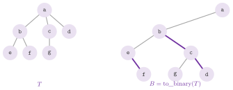
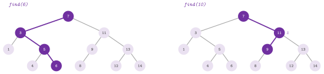
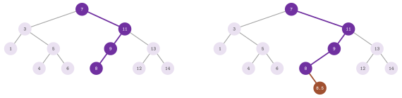
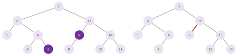
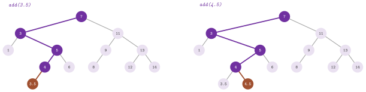
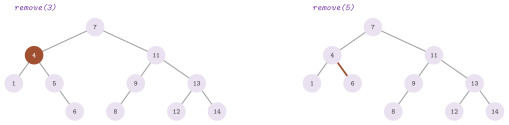
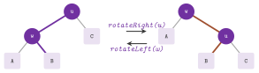
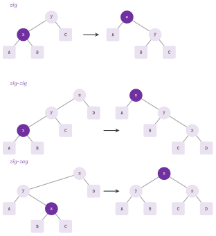

# 8. Trees {#ch-8}

[Source: `include/ADS/tree/Tree.h`, `CursorTree.h`, `ChildListTree.h`,
`ParentTree.h`, `PreorderArrayTree.h`, `BinaryTree.h`,
`CursorBinaryTree.h`, `ArrayBinaryTree.h`, `ThreadedTree.h`,
`ExpressionTree.h`, `HeapByInsertion.h`, `BinaryTreeAlgorithms.h`,
`SearchTree.h`, `MeasuredSearchTree.h`, `Treap.h`, `HashedTreap.h`,
`FingerTreap.h`, `RandomizedSearchTree.h`, `AVLTree.h`, `SplayTree.h`,
`ScapegoatTree.h`, `PartialRebuildingTree.h`,
`LeftLeaningRedBlackTree.h`, `BTree.h`, `BPlusTree.h`, `BTreeMap.h`,
`JoinAlgorithms.h`, `JoinTree.h`, `LinkCutTree.h`]

We are concerned in this chapter with the trees, the largest area of the
library: the rooted and ordered trees of [Montresor 2025,
chapter 5](Z-bibliography.md#ref-montresor2025) with their representations
and visits, the binary trees and the algorithms that work on any
representation of them, and the many ways of keeping a set of keys in a
binary search tree whose height stays logarithmic whatever the sequence of
the operations, i.e., by colors, by heights, by random priorities, by
rotations to the root, by partial rebuilding and by joins, together with
the B-trees of the main memory and the link-cut trees of the forests that
change. The search trees are the subject of chapters 6 to 9 of [Morin
2013](Z-bibliography.md#ref-morin-cpp), whose every section, lemma,
theorem and exercise is here, proved or solved on our code; the exercises
on the illustration of an operation are solved by figures drawn from the
states that the classes of the library reach on the data of his figures.

After the definitions and the interfaces ([§8.1](08-tree.md#sec-8-1)), the
ordered trees and their five representations come in
[§8.2](08-tree.md#sec-8-2), the binary trees in [§8.3](08-tree.md#sec-8-3)
and the algorithms on them in [§8.4](08-tree.md#sec-8-4). The binary search
trees start with the plain and the Red-Black trees
([§8.5](08-tree.md#sec-8-5)), and go on with the random trees and the
treaps ([§8.6](08-tree.md#sec-8-6)), the AVL trees
([§8.7](08-tree.md#sec-8-7)), the splay trees ([§8.8](08-tree.md#sec-8-8)),
the scapegoat trees and the other trees of partial rebuilding
([§8.9](08-tree.md#sec-8-9)), and the 2-4 trees with the left-leaning
red-black trees that simulate them ([§8.10](08-tree.md#sec-8-10)). The
B-trees and the B+-trees of the main memory are in
[§8.11](08-tree.md#sec-8-11) (the B-tree on the blocks of a disk is in
[§23.3](23-external.md#sec-23-3)), the trees whose every operation is
written on a join, with the set operations in parallel and the augmented
maps, in [§8.12](08-tree.md#sec-8-12), and the dynamic trees of Sleator and
Tarjan in [§8.13](08-tree.md#sec-8-13). Finally,
[§8.14](08-tree.md#sec-8-14) shows how every search tree of the area is a
sorted set of Morin, and compares them all in
[Table 8.10](08-tree.md#tab-8-10); the declarations of all the classes and
functions of the area are collected in [§8.16](08-tree.md#sec-8-16).

## 8.1 Definitions and the interfaces {#sec-8-1}

A *rooted tree* is a finite set of nodes which is either empty or holds a
node, its *root*, together with a partition of the other nodes into
subtrees, whose roots are the *children* of the root ([Montresor 2025,
§5.1](Z-bibliography.md#ref-montresor2025)). Each node but the root has
therefore exactly one *parent*, and the tree is *ordered* when the children
of each node are in a sequence, the first of them being the *leftmost*. A
*binary tree* is an ordered tree whose nodes have at most two children,
which are told apart as the *left* and the *right* child even when only one
of them is there. Equivalently ([Morin 2013,
§6](Z-bibliography.md#ref-morin-cpp)), it is a connected acyclic graph with
no vertex of degree larger than three, in which a root of degree at most
two is chosen and the two neighbours of each node other than its parent are
ordered. A node with no child is a *leaf*, the others are *internal*. The
nodes on the path from a node $u$ to the root are the *ancestors* of $u$
(each node being an ancestor of itself), $u$ is a *descendant* of each of
them, and the *subtree* of $u$ is the tree rooted at $u$ that holds all its
descendants. The *depth* $d( u )$ of a node is the number of edges from the
root to it, the nodes of depth $l$ form the *level* $l$, and the *height*
of a node is the number of edges of the longest path from it down to a
leaf. We call the height $h$ of a tree that of its root, and $-1$ for the empty
tree. [Table 8.1](08-tree.md#tab-8-1) collects the symbols that
the chapter uses throughout.

<span id="tab-8-1"></span>**Table 8.1.** The symbols of the
chapter.

| Symbol | Meaning |
|---|---|
| $n$ | the number of nodes, or of keys |
| $h$ | the height of a tree |
| $d( u )$ | the depth of the node $u$ |
| $n_u$ | the number of nodes of the subtree of $u$ |
| $T_1 , \ldots , T_k$ | the subtrees of the children of a node, in their order |
| $p[ i ]$ | the parent of the node $i$ in a vector of parents, $-1$ (`NIL`) at a root |
| $d$ | the degree of a complete $d$-ary tree, or the number of children of a node |
| $\mathit{bh}( u )$ | the black height of the node $u$ of a Red-Black tree |

It is often convenient to complete a binary tree with *external nodes*: a
node with no left child is given an external node as its left child, one
with no right child an external node as its right child, and the nodes of
the tree are then called *real* ([Morin 2013,
§6](Z-bibliography.md#ref-morin-cpp)). In the representations with
pointers the external nodes are the pointers nil, and the parent of the
root is nil as well. [Figure 8.1](08-tree.md#fig-8-1) shows the
binary tree of nine nodes of Morin with its ten external nodes, the count
that [Lemma 8.1](08-tree.md#lem-8-1) proves in general.

).](../figures/tree-external.svg){#fig-8-1}

<span id="lem-8-1"></span>**Lemma 8.1.** *A binary tree of
$n \ge 1$ nodes has $n - 1$ edges and $n + 1$ external nodes, and its
leaves are one more than its nodes with two children. If its root has two
children, then it has at least two leaves.*

*Proof.* Each node but the root is joined by one edge to its parent, and
each edge joins a node to its parent; hence the edges are $n - 1$. Each of
the $n$ real nodes has two places for a child, i.e., $2 n$ places in all,
and $n - 1$ of them hold the real nodes other than the root (one place per
edge); the other $n + 1$ hold external nodes. Let $n_0$, $n_1$ and $n_2$ be
the numbers of the nodes with no child, one child and two children; then
$n = n_0 + n_1 + n_2$ and, counting the edges by their upper nodes,
$n - 1 = n_1 + 2 n_2$, whence $n_0 = n_2 + 1$. Finally, if the root has two
children, $n_2 \ge 1$ and therefore $n_0 \ge 2$. $\square$

The two counts are exercises 6.1 and 6.2 of [Morin
2013](Z-bibliography.md#ref-morin-cpp), and the last claim is his exercise
6.3 (a tree that is not empty always has a leaf, the last node of a longest
path from the root, and one has to show that it has either a root with at
most one child or more than one leaf); the identity of the leaves is
exercise 5.11 of [Montresor 2025](Z-bibliography.md#ref-montresor2025).

The abstract data type TREE of [Montresor 2025,
§5.1](Z-bibliography.md#ref-montresor2025) has the node and its subtree as the
same object. Its operation `Tree(v)` makes a tree of one node of value $v$,
`read()` and `write(v)` access the value of a node, and `parent()`,
`leftmostChild()` and `rightSibling()` move along the tree, returning nil where
there is no such node. Then `insertChild(t)` and `insertSibling(t)` hang a tree
$t$, which must be a root, as the first child or as the next sibling of a node,
and `deleteChild()` and `deleteSibling()` destroy the subtree of the first
child or of the next sibling. Its binary version has `left()` and `right()` in
place of the first child and of the next sibling, and `insertLeft(t)`,
`insertRight(t)`, `deleteLeft()` and `deleteRight()` in place of the insertions
and of the deletions, a child being inserted only where none is. Unlike the
SEQUENCE, the SET and the DICTIONARY, the two data types have no concept in
`ADS/ADT.h`. Instead, the realizations of the next two sections share the names
of the operations (with a node passed explicitly, as an index, when the nodes
live in a vector), and the algorithms of [§8.4](08-tree.md#sec-8-4) are written
once for any node that has the links to its children, by three concepts defined
there.

A *visit* examines each node of a tree once. The *previsit* examines a node
before the subtrees of its children, the *postvisit* after them, the *invisit*
with index $i$ after the first $i$ of them (on a binary tree, with $i = 1$, the
*symmetric* visit). Finally, the visit *by levels* examines the nodes by
increasing depth, from left to right within a level, by a queue ([Montresor
2025, §5.3](Z-bibliography.md#ref-montresor2025)). We prove next that the cost
of all of them is that of [Lemma 8.2](08-tree.md#lem-8-2), on
every representation of the next sections that gives the first child and the
next sibling, or the two children, in constant time.

<span id="lem-8-2"></span>**Lemma 8.2.** *A visit in depth
of a tree of $n$ nodes and height $h$ costs $\Theta( n )$ time and $O( h )$
space for its stack, explicit or of the calls; the visit by levels costs
$\Theta( n )$ time and space for its queue proportional to the largest
level.*

*Proof.* We remark that each node is examined once, and each link is followed
once from the node it leaves: the first child of a node when the node is
entered, and its next sibling when its subtree is over. Its stack holds the
nodes of the path from the root to the current node, i.e., at most $h + 1$ of
them. The queue of the visit by levels holds, at any time, the rest of a level
and a part of the next one, i.e., at most the nodes of two consecutive levels.
$\square$

We keep the stack explicit in the headers, since a tree of height $n - 1$ (a
path) would overflow the stack of the calls of a recursive visit as soon as
$n$ is a few hundred thousand. Their pseudocode is recursive, as in the
book, and the code keeps on an explicit stack the state that the recursion
would keep on the calls.

## 8.2 Ordered trees and their representations {#sec-8-2}

[Table 8.2](08-tree.md#tab-8-2) lists the representations of the
ordered trees and of the binary trees of the area, with the costs of their
operations; the first five are described in this section and the others in
[§8.3](08-tree.md#sec-8-3), and [Lemma 8.3](08-tree.md#lem-8-3)
proves the costs.

<span id="tab-8-2"></span>**Table 8.2.** The representations of
the ordered and of the binary trees, and the cost of their operations
([Montresor 2025, §5.2, §5.4 and
§5.5](Z-bibliography.md#ref-montresor2025)).

| Realization | Representation | Parent | First child, next sibling | Insert a child | Space |
|---|---|---|---|---|---|
| `Tree` | pointers to the parent, the first child and the next sibling | $O( 1 )$ | $O( 1 )$ | $O( 1 )$ | $\Theta( n )$ |
| `CursorTree` | the same links as indices in a vector, with a free list | $O( 1 )$ | $O( 1 )$ | $O( 1 )$ amortized | $\Theta( n )$ |
| `ChildListTree` | a list of the children per node, each node with its cell | $O( 1 )$ | $O( 1 )$ | $O( 1 )$ amortized | $\Theta( n )$ |
| `ParentTree` | a vector of parents | $O( 1 )$ | none | $O( 1 )$, no order among the children | $\Theta( n )$, one integer per node |
| `PreorderArrayTree` | the nodes in a vector in preorder, with their parents | $O( 1 )$ | $O( 1 )$ and $O( n )$ | $O( n )$ | $\Theta( n )$ |
| `BinaryTree` | pointers to the parent and to the two children | $O( 1 )$ | $O( 1 )$ (the two children) | $O( 1 )$ | $\Theta( n )$ |
| `CursorBinaryTree` | the same links as indices in a vector | $O( 1 )$ | $O( 1 )$ | $O( 1 )$ amortized | $\Theta( n )$ |
| `ArrayBinaryTree` | a positional vector, the children of $i$ in $2 i + 1$ and $2 i + 2$ | $O( 1 )$ | $O( 1 )$ | $O( k + g )$, $k$ the places copied and $g$ the growth of the vector | $O( 2^h )$ |

<span id="lem-8-3"></span>**Lemma 8.3.** *The costs of [Table
8.2](08-tree.md#tab-8-2) hold for the code compiled with the contracts of
level 1 and 2. The removal of the subtree of a node $u$ (by `deleteLeft()`,
`deleteRight()`, `deleteChild()`, `deleteSibling()`, `remove()` or the
destructor) costs $O( n_u )$ time, but in `CursorTree`, where it costs
$O( c + n_u )$, $c$ the number of the siblings before $u$, and in
`PreorderArrayTree`, where it costs $O( n )$. At the level 3 an update of
`Tree` and of `BinaryTree` also checks that the children of the node
updated have it as their parent, in time linear in their number. An
insertion of these two classes checks in $O( d( u ) )$ time that the tree inserted is not the
root of the tree of the node $u$; `setParent( i , j )` of `ParentTree`
keeps its vector a forest if and only if $j$ is not below $i$, which it
checks in $O( d( j ) )$ time; each update of the
other five realizations checks the invariant of its class, in time linear
in the size of its vector.*

*Proof.* In `Tree` and `BinaryTree` each link is a field of the node, and an
insertion writes a constant number of fields ([Algorithm
8.1](08-tree.md#alg-8-1)); each node holds its value and three pointers. In
`CursorTree` and `CursorBinaryTree` the links are fields of the place of
the node in a vector, and an insertion takes a place from the head of the
free list in $O( 1 )$ or appends one to the vector, which costs $O( 1 )$
amortized by [Lemma 3.1](03-stack.md#lem-3-1). `ChildListTree` reads the
first child at the head of the list of the node and the next sibling at the
cell after `where` in the list of the parent, and an insertion adds one
node and one cell, both in $O( 1 )$ amortized; its space is that of $n$
nodes and $n - 1$ cells. `ParentTree` reads and writes $p[ i ]$ and gives no
child. In `PreorderArrayTree` the parent is a field, the first child is $i +
1$ if its parent is $i$ ([Lemma 8.5](08-tree.md#lem-8-5)), and the updates
are those of [Lemma 8.6](08-tree.md#lem-8-6). In `ArrayBinaryTree` the
parent of $i > 0$ is $\lfloor ( i - 1 ) / 2 \rfloor$ and its children $2 i
+ 1$ and $2 i + 2$ ([Lemma 8.9](08-tree.md#lem-8-9)). An insertion copies
the $k$ places of the tree inserted, each with one write, after the vector
has grown to the last place written (or copies first the whole vector, when
the tree inserted is the tree itself), and since a node of depth $d$ lies
in a place below $2^{d+1} - 1$ ([Lemma 8.9](08-tree.md#lem-8-9)) the
vector of a tree of height $h$ has at most $2^{h+1} - 1$ places.

A removal of the subtree of $u$ visits that subtree once, with a stack of
its own, and frees (or, in the vectors, returns to the free list or empties)
each of its $n_u$ nodes in $O( 1 )$. It unlinks $u$ from its parent in
$O( 1 )$ in the representations whose parent reaches its child directly, by
a field of the node, by the position `where` of its cell, or by the place
$2 i + 1$ or $2 i + 2$. In `CursorTree` the parent reaches only its first
child, and $u$ is unlinked by a scan of the $c$ siblings before it; in
`PreorderArrayTree` the removal erases the stretch of the subtree and
renumbers the parents after it, in $O( n )$ ([Lemma
8.6](08-tree.md#lem-8-6)). As for the checks, `linked()` of `Tree` and
of `BinaryTree` scans the children of the node, `top()` climbs from $u$ to
its root, the audit of `ParentTree` climbs from $j$ to its root, and the
invariants of the other classes scan the vector of the nodes or visit the
tree from the root, in time linear in the size of the vector. Finally, a
cycle of the vector of `ParentTree` after `setParent( i , j )` must use the
new link from $i$ to $j$ and then the links from $j$ up to $i$. These exist
if and only if $j$ was below $i$ (and never for $j = -1$). $\square$

### 8.2.1 Pointers to the first child and to the next sibling {#sec-8-2-1}

`Tree` (in `ADS/tree/Tree.h`) is the TREE of [Montresor 2025,
§5.2](Z-bibliography.md#ref-montresor2025): each node holds its value and
three pointers, to its parent, to its first child and to its next sibling,
whatever the number of its children. A node owns the subtrees of its
children, so that deleting the root of a tree destroys all of it. The
destructor, `deleteChild()` and `deleteSibling()` take time linear in the
size of the subtree they destroy, by an explicit stack
([Algorithm 8.1](08-tree.md#alg-8-1)), and the copy of a tree is
deep and explicit (`copy()`), the copy constructor being deleted. Its
insertions are a few assignments of pointers
([Figure 8.2](08-tree.md#fig-8-2)): `insertChild(t)` makes $t$ the
first child, whose next sibling is the first child before the call, and
`insertSibling(t)` puts $t$ between a node and its next sibling, both in
$O( 1 )$. Also, `isLeaf()` and `isLastSibling()` test the two pointers to the
children and to the next sibling.

{#fig-8-2}

<span id="alg-8-1"></span>**Algorithm 8.1.** The insertions
and the destruction of `Tree` ([Montresor 2025,
§5.2](Z-bibliography.md#ref-montresor2025)).

--8<-- "generated/Tree-insertChild.pseudo.md"

--8<-- "generated/Tree-insertSibling.pseudo.md"

--8<-- "generated/Tree-destroy.pseudo.md"

We check by the contracts the precondition of the book, i.e., that the tree
inserted is a root ($t$ has no parent), and also that it is neither the node
itself nor the root of the tree of the node, which would close a cycle;
`insertSibling()` needs a node that is not a root. A tree whose insertion is
refused stays the caller's. At the contract level 3 each update also checks
that the children of the node it changes have that node as their parent
(only the links that the update writes, not the whole subtree).

As for the visits, they are free functions on a node: `dfs(t, pre, post)` calls
`pre(u)` on each node before the subtrees of its children and `post(u)` after
them, and `pre_visit()` and `post_visit()` are `dfs()` with one of the two
only. In the same way, `in_visit(t, i, f)` calls `f(u)` after the first $i$
subtrees of $u$ (or after all of them, if $u$ has fewer than $i$ children), and
`bfs(t, f)` visits by levels with a queue ([Algorithm
8.2](08-tree.md#alg-8-2)). Each of them costs what [Lemma
8.2](08-tree.md#lem-8-2) states, the stack holding each node of
the current path with the child it is visiting, which is the state that the
recursion of the pseudocode keeps in its calls.

<span id="alg-8-2"></span>**Algorithm 8.2.** The visits
of an ordered tree ([Montresor 2025,
§5.3](Z-bibliography.md#ref-montresor2025)).

--8<-- "generated/Tree-dfs.pseudo.md"

--8<-- "generated/Tree-in_visit.pseudo.md"

--8<-- "generated/Tree-bfs.pseudo.md"

Several functions are built on the visits. Thus `copy(t)` is a previsit that
makes a copy of each node and hangs the copies of its subtrees in order
(the siblings of $t$ are not copied, and the copy is a root that the caller
owns). Next, `maxWeightLevel(t)` returns the first level of largest weight, the
weight of a level being the sum of the values of its nodes, by a visit by
levels that keeps one level at a time. Finally, `to_list(t)` writes the tree as
a parenthesized list, $( r \, T_1 \cdots T_k )$ for the root $r$ with the
subtrees $T_1 , \ldots , T_k$ (e.g., `( a ( b ( e ) ( f ) ) ( c ( g ) ) )`
for the tree of [Figure 8.2](08-tree.md#fig-8-2)). The list is
read back by `tree_from_list(s)`, a descent on the grammar
$T \to ( \, v \, T^* \, )$, the values being written with `<<` and read
with `>>` ([Algorithm 8.3](08-tree.md#alg-8-3)); [Lemma
8.4](08-tree.md#lem-8-4) below gives the cost of all four.

<span id="alg-8-3"></span>**Algorithm 8.3.** The copy, the
heaviest level and the parenthesized lists of a `Tree`.

--8<-- "generated/Tree-copy.pseudo.md"

--8<-- "generated/Tree-maxWeightLevel.pseudo.md"

--8<-- "generated/Tree-to_list.pseudo.md"

--8<-- "generated/Tree-readTree.pseudo.md"

Finally, the two ranges of the standard interface (cf.
[§1.8](01-introduction.md#sec-1-8)) walk a tree with no stack. The first,
`children(t)`, gives the children of $t$ from the leftmost, by the links to the
next siblings. The second, `preorder(t)`, gives the nodes of the subtree of $t$
in previsit, by the step of [Algorithm
8.4](08-tree.md#alg-8-4), which goes down to the first
child if there is one and otherwise climbs until it finds a next sibling,
never above $t$. A single step may climb $h$ levels; yet, the steps of a
complete visit are few in all, as the following lemma shows.

<span id="alg-8-4"></span>**Algorithm 8.4.** The next
node of the previsit of an ordered tree, by the links to the parents.

--8<-- "generated/Tree-next.pseudo.md"

<span id="lem-8-4"></span>**Lemma 8.4.** *On the subtree of a node $t$
with $n_t$ nodes and height $h_t$, `copy(t)` and `to_list(t)` cost
$O( n_t )$ time and $O( h_t )$ space besides their result, and
`maxWeightLevel(t)` costs $O( n_t )$ time and space proportional to the two
largest consecutive levels, all with the contracts of level 1 and 2 and
with the values copied, added, written and read in constant time;
`tree_from_list(s)` costs time linear in the length of $s$. The range
`children(t)` costs $O( 1 )$ per child, and the range `preorder(t)` gives
the nodes of the subtree of $t$ in previsit in $O( n_t )$ time and
$O( 1 )$ space in all.*

*Proof.* `copy()` and `to_list()` keep on their stack the nodes of the path
from $t$ to the current node, each with its next child. Each node is
pushed once and popped once, with $O( 1 )$ work (a node made and hung by
one insertion, or two tokens written). `maxWeightLevel()` keeps the current
level and the next one, and scans each node once with its children.
`tree_from_list()` splits $s$ into its tokens in one scan, and the descent
of [Algorithm 8.3](08-tree.md#alg-8-3) consumes each token once, a
parenthesis and a value opening a node and a parenthesis closing it. The
range of the children follows one link per child. For the previsit, each
step of [Algorithm 8.4](08-tree.md#alg-8-4) either follows the link from a
node to its first child, or follows the links from a node to its parent
while the node has no next sibling, and then the link to a next sibling. A
node is entered once, by the link to it from its parent or from its
previous sibling; the climb leaves a node $u \ne t$ toward its parent only
after the subtree of $u$ is over and $u$ has no next sibling, which happens
once. Hence the $n_t$ steps follow at most $2 n_t$ links, with $O( 1 )$
work each besides, and keep only the current node. $\square$

A short example of use builds the tree $( a \, ( b ) \, ( c ) )$, writes it as a
parenthesized list and reads it back:

```cpp
#include "ADS/tree/Tree.h"

ADS::Tree< char > a( 'a' );                    // a root that owns its subtree
a.insertChild( new ADS::Tree< char >( 'c' ) );
a.insertChild( new ADS::Tree< char >( 'b' ) );    // b first, c its sibling
const std::string s = ADS::to_list( &a );      // "( a ( b ) ( c ) )"
// the caller owns the tree read back
ADS::Tree< char > * t = ADS::tree_from_list< char >( s );
```

### 8.2.2 Cursors {#sec-8-2-2}

`CursorTree` keeps the same three links as `Tree`, but as indices of a vector
of nodes instead of pointers, `NIL` ($-1$) standing for nil. Each place freed
by a removal is linked in a free list through its field of the next sibling,
and the next insertions take the places from its head before the vector grows
([Figure 8.3](08-tree.md#fig-8-3)). A tree with cursors can thus be
copied, saved and moved in one piece, the indices staying valid when the vector
grows, and its nodes are close in memory, which usually makes the visits faster
than on nodes scattered in the heap. Of course, the price is that an insertion
costs $O( 1 )$ amortized time rather than in the worst case, by the argument of
[Lemma 3.1](03-stack.md#lem-3-1) on the growth of the vector. All the
operations take a node as an index. Here `insertChild(n, v)` and
`insertSibling(n, v)` hang a new node of value $v$ and return its place.
Similarly, `insertChildTree(n, t, s)` and `insertSiblingTree(n, t, s)` hang a
copy of the subtree of the node $s$ of the tree $t$ (which may be the tree
itself, copied as it was before the call), and `remove(n)` removes the subtree
of $n$ ([Algorithm 8.5](08-tree.md#alg-8-5)). Note that the removal
has to unlink $n$ from the list of the children of its parent, which a singly
linked list of siblings allows only by a scan from the first child. Hence it
costs $O( c + n_n )$ time, $c$ the number of the siblings before $n$ and $n_n$
the nodes of its subtree, which return to the free list in postvisit ([Lemma
8.3](08-tree.md#lem-8-3)).

 as a `CursorTree`, one column per place; `remove(1)` unlinks `b` from the children of `a` (in violet, the link changed) and puts the places of `e`, `f` and `b` on the free list 1, 4, 3 (the faint places, linked by their field of the sibling); `insertChild(0,d)` then takes the place 1.](../figures/tree-cursor.svg){#fig-8-3}

<span id="alg-8-5"></span>**Algorithm 8.5.** The insertion, the
removal, the copy and the invisit of `CursorTree`; $N$ is the vector of the
nodes.

--8<-- "generated/CursorTree-insertChild.pseudo.md"

--8<-- "generated/CursorTree-remove.pseudo.md"

--8<-- "generated/CursorTree-copy.pseudo.md"

--8<-- "generated/CursorTree-invisit.pseudo.md"

All the classes of the trees in a vector (`CursorTree`, `ChildListTree`,
`PreorderArrayTree`, `CursorBinaryTree` and `ArrayBinaryTree`) all define
the type `Item` of the values, as `Tree` and `BinaryTree` do, the constant
`NIL`, and `empty()` and `root()`, the root being `NIL` in an empty tree;
all but `ArrayBinaryTree` also give `size()`, the number of nodes. The
visits `previsit()`, `postvisit()` and `invisit(i)` return the places
in the order of the visit, as vectors, and `nodes()` is a range over the
places in use (a `SlotIterator` of [§1.8](01-introduction.md#sec-1-8),
which skips the free ones), and `children(n)` a range over the children of
$n$. Its contracts require that a node be a place in use and that a sibling
not be inserted next to the root; the invariant is that the nodes reached
from the root link back to their parent and are all the nodes in use.

### 8.2.3 Lists of children {#sec-8-2-3}

`ChildListTree` keeps, for each node, the `List` of the places of its children
in their order (the lists of children of [Aho et al. 1983,
§3.3](Z-bibliography.md#ref-aho1983)), the nodes being in a vector with a free
list as in `CursorTree`. Each node also keeps the position `where` of its own
cell in the list of its parent. Hence its next sibling is the next cell of that
list and `rightSibling()` costs $O( 1 )$ time: it returns the place held by
the cell after `where` in the list of the parent, or `NIL` when that cell is
the last one or the node is the root.

In this way the list of the children of a node is returned by `children(n)`,
and it is scanned in $O( 1 )$ time per child, which is what the representation
is for. Furthermore, `insertChild(n, v)` puts the new node at the head of the list
of $n$ and records its cell ([Figure 8.4](08-tree.md#fig-8-4)),
`insertSibling(n, v)` after the cell of $n$. A removal `remove(n)` unlinks the
cell of $n$ in $O( 1 )$ by its position, with no scan of the siblings as in
`CursorTree`, and costs $O( n_n )$ for the subtree ([Lemma
8.3](08-tree.md#lem-8-3)). As for the other
operations, the visits and the copies of subtrees (`insertChildTree(n, t, s)`
and `insertSiblingTree(n, t, s)`) are those of `CursorTree` ([Algorithm
8.6](08-tree.md#alg-8-6)). A copy of the whole tree, by the copy
constructor or by the assignment, gives each node the position of its cell in
the lists of the copy, since a position of the lists of the source would be
wrong there. In terms of space, we pay for $n$ nodes, each with the header of
its list, and for $n - 1$ cells of the lists (one per node but the root), each
cell with its links. This is somewhat more than the three indices per node of
`CursorTree`, the price of the constant time of every step.

 as a `ChildListTree` after `insertChild(0,d)`: the nodes with their parents, and the lists $C_0$, $C_1$, $C_2$ of the children of `a`, `b` and `c`; the new node and its cell, at the head of $C_0$, in orange, and the field `where` of `b`, which points to its cell in $C_0$, in violet.](../figures/tree-childlist.svg){#fig-8-4}

<span id="alg-8-6"></span>**Algorithm 8.6.** The insertion and
the copy of `ChildListTree`; $C_n$ is the list of the children of $n$.

--8<-- "generated/ChildListTree-insertChild.pseudo.md"

--8<-- "generated/ChildListTree-copy.pseudo.md"

Here the invariant, checked at the contract level 3, is that the nodes reached
from the root are in use, sit in the list of their parent at their own
position, and are all the nodes in use.

### 8.2.4 A vector of parents {#sec-8-2-4}

`ParentTree` is the representation of [Montresor 2025,
§5.4](Z-bibliography.md#ref-montresor2025): the nodes are $0 , \ldots , n - 1$,
and $p[ i ]$ is the parent of $i$, or $-1$ when $i$ is a root. It answers
`parent(i)` alone, in $O( 1 )$ time and with one integer per node. This is
often all that is needed when a tree is built and then walked toward the root,
e.g., the trees of the visits of a graph ([§14.5](14-graph.md#sec-14-5)), the
paths of the shortest paths, and the forests of the MFSET
([§11.3](11-mfset.md#sec-11-3)). We lose the order among the siblings (unless
it is that of their numbers), and also the access to the children, which needs
a scan of the vector. Since `setParent(i, j)` may hang any node under any
other, the structure is a forest of $n$ isolated nodes at the start, and it
stays a forest of rooted trees after each call whose $j$ is not a descendant
of $i$ ([Lemma 8.3](08-tree.md#lem-8-3) and [Figure
8.5](08-tree.md#fig-8-5)); `size()` is $n$. Its contracts check that
the nodes are in $[ 0 , n )$, $j$ possibly $-1$, and that a node is not its
own parent; at the contract level 3 they also check, by a walk from $j$ to
its root, that $j$ is not a descendant of $i$. Thus `setParent()` costs
$O( 1 )$ time in the code compiled for production and $O( d( j ) )$ with the
audits.

{#fig-8-5}

### 8.2.5 A vector in preorder {#sec-8-2-5}

`PreorderArrayTree` extends the vector of parents with the values and the order
of the children: the place $i$ holds the value of the $i$-th node of the
previsit and the place of its parent, the root being in the place 0 with the
parent `NIL`. Since the previsit lists each subtree as a contiguous stretch,
the parents alone give the children ([Lemma
8.5](08-tree.md#lem-8-5)).

<span id="lem-8-5"></span>**Lemma 8.5.** *In a vector of the
nodes in preorder with their parents $p$, the subtree of the node $i$ is the
stretch $[ i , e )$, where $e$ is the first place after $i$ whose parent
precedes $i$ (or the size of the vector, if there is none). Hence the first
child of $i$ is $i + 1$ if $e > i + 1$. The next sibling of $i$ is $e$, if $e$
has the parent of $i$.*

*Proof.* The previsit examines $i$ and then its subtree before any other node,
and each place $j$ of the subtree but $i$ has its parent in the subtree, i.e.,
$i \le p[ j ] < j$. Right after the subtree, the place (if any) is the next
node of the previsit outside it, whose parent is an ancestor of $i$ other than
$i$, and therefore precedes $i$. In the subtree, the first node of the previsit
after $i$ is its first child, and the first node after the subtree is the next
sibling of $i$ when $i$ has one. $\square$

Reading and writing a value, and the parent, take $O( 1 )$ time;
`leftmostChild(i)` takes $O( 1 )$ and `rightSibling(i)` the time of
`subtreeEnd(i)`, i.e., the size of the subtree of $i$, and `isLeaf(i)` is $O( 1
)$. Inserting a tree $t$ of $k$ nodes as the first child (`insertChild(i, t)`)
or as the next sibling (`insertSibling(i, t)`) of $i$, and removing a subtree
(`remove(i)`), shift the places after it and renumber the parents that point
beyond it, in $O( n + k )$ time ([Algorithm
8.7](08-tree.md#alg-8-7), [Figure 8.6](08-tree.md#fig-8-6) and [Lemma
8.6](08-tree.md#lem-8-6) below). We expect the vector to suit (typically)
the trees that are read much more often than they change, e.g., the trees
written once and then visited, since the previsit is the order of the vector
(`values()` gives the values in that order, as a view) and it is scanned in
contiguous memory.

 as a `PreorderArrayTree`, before and after `insertChild(1,t)` for $t$ = `( x ( y ) )`: the two places of $t$ (in orange) go after `b` (in violet), the places after them shift by 2, and the parent of `g`, which pointed beyond the place 1, grows from 4 to 6.](../figures/tree-preorder.svg){#fig-8-6}

<span id="alg-8-7"></span>**Algorithm 8.7.** The end of a
subtree, the insertion of a first child and the removal in
`PreorderArrayTree`; $k$ is the number of places inserted or removed.

--8<-- "generated/PreorderArrayTree-subtreeEnd.pseudo.md"

--8<-- "generated/PreorderArrayTree-insertChild.pseudo.md"

--8<-- "generated/PreorderArrayTree-remove.pseudo.md"

<span id="lem-8-6"></span>**Lemma 8.6.** *(i) A vector of parents $p$
on the places $0 , \ldots , n - 1$, with $p[ 0 ] = -1$ and $0 \le p[ j ] <
j$ for $j > 0$, is the previsit of the tree it describes (the children of
each node in the order of their places) if and only if, for each $j > 0$,
$p[ j ]$ is $j - 1$ or an ancestor of $j - 1$. (ii) If the vector is the
previsit of its tree, `insertChild( i , t )`, `insertSibling( i , t )` and
`remove( i )` leave it the previsit of the tree they make, in $O( n + k )$
time, $k$ the number of places inserted or removed.*

*Proof.* (i) In the previsit, the node after $j - 1$ is the first child of
$j - 1$, if any, and otherwise the next sibling of the deepest ancestor of
$j - 1$ (itself included) that has one; its parent is therefore $j - 1$ or
an ancestor of $j - 1$. Conversely, by induction on $n$, let the places
$0 , \ldots , n - 2$ be the previsit of their tree, and let $q = p[ n - 1 ]$
be $n - 2$ or one of its ancestors. The subtree of $q$ is then a stretch
that ends at $n - 2$ ([Lemma 8.5](08-tree.md#lem-8-5)), and $n - 1$, the
last child of $q$ by its place, comes right after it in the previsit, as
the last node. (ii) The previsit of the tree made by `insertChild( i , t )`
is the old one with that of $t$ right after $i$. That of the tree made
by `insertSibling( i , t )` is the old one with that of $t$ right after the
subtree of $i$, which ends at `subtreeEnd( i )` by [Lemma
8.5](08-tree.md#lem-8-5). `splice()` inserts the $k$ places of $t$ there,
gives the root of $t$ its parent and adds the place of the insertion to the
other parents of $t$, and adds $k$ to each parent that points to a place
that has moved. The removal erases the stretch of the subtree of $i$ (again
[Lemma 8.5](08-tree.md#lem-8-5)), whose places no other node has as its
parent, and subtracts $k$ from each parent beyond it. Each of these steps
scans the vector once, and the copy of $t$ costs $O( k )$. $\square$

In this case the invariant, checked at the contract level 3, is that the root
comes first and each other node after its parent ($p[ j ] < j$). This is
necessary but not sufficient for a previsit (part (i) of the lemma), e.g.,
$p = ( -1 , 0 , 0 , 1 )$ passes the check and is no previsit, since $p[ 3 ]
= 1$ is neither 2 nor an ancestor of 2; the operations keep the stronger
condition, by part (ii), but the invariant does not test it.

## 8.3 Binary trees {#sec-8-3}

### 8.3.1 Pointers to the children {#sec-8-3-1}

`BinaryTree` (in `ADS/tree/BinaryTree.h`) is the binary TREE of [Montresor
2025, §5.5](Z-bibliography.md#ref-montresor2025) and the `BinaryTree` of [Morin
2013, §6.1](Z-bibliography.md#ref-morin-cpp): each node holds its value and
three pointers, to its parent and to its left and right children, nil where
there is none. As in `Tree`, a node and its subtree are the same object and a
node owns its subtrees; `parent()`, `left()`, `right()`, `read()`, `write(v)`,
`insertLeft(t)` and `insertRight(t)` take $O( 1 )$ time, while `deleteLeft()`
and `deleteRight()` destroy a subtree in time linear in its size. Beside the
operations of the book, `detachLeft()` and `detachRight()` cut a subtree off
its parent without destroying it, in $O( 1 )$: the subtree becomes a root owned
by the caller, ready to be inserted elsewhere, which moves subtrees (a mirror,
a rotation) with no copy ([Figure 8.7](08-tree.md#fig-8-7)). Its
contracts require that the tree inserted be a root other than the node itself
and than the root of its tree, and that it go where no child is; at the level
3 each update also checks that the two children of the node it changes have
that node as their parent.

{#fig-8-7}

Here the visit `dfs(t, pre, in, post)` examines a node before its subtrees
(`pre`), between them (`in`) and after them (`post`), and `pre_visit()`,
`in_visit()` and `post_visit()` are `dfs()` with one of the three. Also,
`copy(t)` makes a deep copy of a subtree, and `join(v, l, r)` a new root of
value $v$ with the copies of $l$ and $r$ as its subtrees. A parenthesized list of a binary tree has `()` for the
empty tree and $( v \, L \, R )$ for the root $v$ with the subtrees $L$ and $R$
(e.g., `( 8 () ( 5 ( 27 () () ) ( 16 () () ) ) )`). We write it by `to_list(t)`
and read it back by `from_list(s)` ([Algorithm
8.8](08-tree.md#alg-8-8)). None of these functions recurses in the
code, which keeps an explicit stack for the reason given after [Lemma
8.2](08-tree.md#lem-8-2), and their costs are those of [Lemma
8.7](08-tree.md#lem-8-7).

<span id="alg-8-8"></span>**Algorithm 8.8.** The visit in depth,
the join and the reading of a parenthesized list of a `BinaryTree`.

--8<-- "generated/BinaryTree-dfs.pseudo.md"

--8<-- "generated/BinaryTree-join.pseudo.md"

--8<-- "generated/BinaryTree-readTree.pseudo.md"

<span id="lem-8-7"></span>**Lemma 8.7.** *Let the values be copied,
written and read in constant time. Then `dfs()`, `copy(t)` and `to_list(t)`
cost $O( n_t )$ time and $O( h_t )$ space besides their result on the
subtree of $t$, of $n_t$ nodes and height $h_t$, and `join(v, l, r)` costs
$O( n_l + n_r )$; `from_list(s)` costs time linear in the length of $s$.*

*Proof.* Both the visit and the copy keep on their stack the nodes of the path
from $t$ to the current node, each with the number of its subtrees done;
each node is pushed once and popped once, and in between it is examined,
copied and hung under the copy of its parent, or written with its two
parentheses, in $O( 1 )$ (the empty subtrees of the list are written when
their parent is examined). `join()` makes one node and two copies. Finally, the
reading consumes each token of $s$ once, as in [Lemma
8.4](08-tree.md#lem-8-4). $\square$

Three ranges, `preorder(t)`, `inorder(t)` and `postorder(t)`, walk the nodes of
the subtree of $t$ by the links to the parents, with no stack and no recursion,
by the three steps of [Algorithm 8.9](08-tree.md#alg-8-9). The
previsit goes down to the left child, or else to the right one, and otherwise
climbs until it leaves a left child whose parent has a right child. Instead,
the invisit goes to the leftmost node of the right subtree, or else climbs
until it leaves a left child. Finally, the postvisit, which starts at the first
leaf reached by going left when possible and right otherwise, goes from a left
child to the first leaf of the right subtree of its parent, and otherwise to
the parent itself. [Lemma 8.14](08-tree.md#lem-8-14) of
[§8.4](08-tree.md#sec-8-4) shows that a complete walk costs $O( n )$ time and
$O( 1 )$ space, although a single step may cost $\Theta( h )$.

<span id="alg-8-9"></span>**Algorithm 8.9.** The next node
in the previsit, in the invisit and in the postvisit of the subtree of
$t$, by the links to the parents.

--8<-- "generated/BinaryTree-next.pseudo.md"

--8<-- "generated/BinaryTree-next-2.pseudo.md"

--8<-- "generated/BinaryTree-next-3.pseudo.md"

An ordered tree $T$ is represented by a binary tree $B$ whose left child of
a node is its first child in $T$ and whose right child is its next sibling
in $T$ ([Knuth 1997, §2.3.2](Z-bibliography.md#ref-knuth1997); [Montresor
2025, §5.5](Z-bibliography.md#ref-montresor2025)). This is `to_binary(t)`
([Algorithm 8.10](08-tree.md#alg-8-10) and
[Figure 8.8](08-tree.md#fig-8-8)), and it is the reason why the
links of `Tree` are three per node whatever the degrees.

{#fig-8-8}

<span id="alg-8-10"></span>**Algorithm 8.10.** The binary tree
of the first children and of the next siblings.

--8<-- "generated/BinaryTree-to_binary.pseudo.md"

<span id="lem-8-8"></span>**Lemma 8.8.** *The map from the
ordered forests of $n$ nodes to the binary trees of $n$ nodes that makes the
first child the left child and the next sibling the right child is one to
one and onto. The previsit of a forest $F$ is the previsit of its binary
tree $B$, and the postvisit of $F$ is the invisit of $B$; `to_binary(t)`
builds $B$ in $O( n )$ time.*

*Proof.* Let $F = ( T_1 , \ldots , T_k )$, $r$ the root of $T_1$, $F_1$ the
forest of the subtrees of the children of $r$ and $F' = ( T_2 , \ldots ,
T_k )$. Then $B( F )$ has the root $r$, the left subtree $B( F_1 )$ and the
right subtree $B( F' )$, and the converse map reads $F_1$ from the left
subtree and $F'$ from the right one; by induction on $n$ the two maps are
inverse of each other. The previsit of $F$ is $r$, the previsit of $F_1$
and that of $F'$, i.e., the previsit of $B( F )$, and the postvisit of $F$
is the postvisit of $F_1$, then $r$, then the postvisit of $F'$, i.e., the
invisit of $B( F )$. Finally, `to_binary()` is the copy of [Lemma
8.7](08-tree.md#lem-8-7) with the first child and the next sibling read in
place of the two children. Each of these costs $O( 1 )$ by [Lemma
8.3](08-tree.md#lem-8-3). $\square$

A complete $d$-ary tree, whose internal nodes have $d$ children each and
whose levels are all full but possibly the last one, filled from the left,
needs no link at all ([Montresor 2025,
§5.6](Z-bibliography.md#ref-montresor2025)): numbered by levels from 0, the
children of the node $i$ and its parent are

$$
d i + 1 , \ldots , d i + d , \qquad
\text{the parent} \ \lfloor ( i - 1 ) / d \rfloor ,
\tag{8.1}
$$

which `dary_child(i, d, j)` (the child $1 \le j \le d$) and
`dary_parent(i, d)` compute, the contracts requiring $d \ge 1$, $j$ in
$1 , \ldots , d$ and $i > 0$ for the parent. This is how the heaps of
[§9.3](09-priority.md#sec-9-3) and [§9.4](09-priority.md#sec-9-4) are
stored, and the following lemma justifies the numbering.

<span id="lem-8-9"></span>**Lemma 8.9.** *Number the places of an
infinite $d$-ary tree, $d \ge 1$, by levels from 0, from left to right
within a level. Then the level $l$ holds the places $a_l , \ldots ,
a_{l+1} - 1$, with $a_l = 1 + d + \cdots + d^{l-1}$, the children of the
place $i$ are those of (8.1), and the parent of $i > 0$ is
$\lfloor ( i - 1 ) / d \rfloor$. For $d = 2$, a node of depth $l$ lies in
a place between $2^l - 1$ and $2^{l+1} - 2$.*

*Proof.* There are $d^l$ places at the level $l$, after the $a_l$ places of the
levels above. Let $i = a_l + m$ be the place $m$ of the level $l$, $0 \le m
< d^l$; its children are the places $d m + 1 , \ldots , d m + d$ of the
level $l + 1$ (counted from 1), since the $m$ nodes before it have $d m$
children before them. These are $a_{l+1} + d m + j - 1$ for $1 \le j \le
d$, and $a_{l+1} = d a_l + 1$ gives $a_{l+1} + d m + j - 1 = d i + j$.
Conversely, $i = d q + j$ with $1 \le j \le d$ is a child of $q$, and
$\lfloor ( i - 1 ) / d \rfloor = q$. For $d = 2$, $a_l = 2^l - 1$.
$\square$

### 8.3.2 Cursors {#sec-8-3-2}

`CursorBinaryTree` keeps the links of `BinaryTree` as indices of a vector of
nodes, `NIL` where a node is missing, with a free list of the places removed,
linked by their field of the left child; the next insertions reuse them before
the vector grows. As for `CursorTree`, the tree can be copied, saved or moved
in one piece, and the insertions cost $O( 1 )$ amortized time ([Lemma
8.3](08-tree.md#lem-8-3)). Here
`setRoot(v)` makes the root of an empty tree, and `insertLeft(n, v)` and
`insertRight(n, v)` a new child of value $v$ where none is. Similarly,
`insertLeft(n, t, s)` and `insertRight(n, t, s)` make a copy of the subtree of
the node $s$ of the tree $t$ (possibly the tree itself). A removal `remove(n)`
returns the places of the subtree of $n$ to the free list in postvisit, in time
linear in its size ([Figure 8.9](08-tree.md#fig-8-9)). Finally,
`preorder()` returns the places in previsit and `nodes()` is a range over the
places in use. Its contracts require that a node be a place in use, that
`setRoot()` find the tree empty, that a child be inserted where none is and
that the subtree copied be a node of the other tree. As in `CursorTree`, the
invariant is that the nodes reached from the root link back to their parent and
are all the nodes in use.

{#fig-8-9}

<span id="alg-8-11"></span>**Algorithm 8.11.** The insertion of
a left child and the copy of a subtree in `CursorBinaryTree`.

--8<-- "generated/CursorBinaryTree-insertLeft.pseudo.md"

--8<-- "generated/CursorBinaryTree-copy.pseudo.md"

### 8.3.3 A positional vector {#sec-8-3-3}

`ArrayBinaryTree` stores a binary tree in a vector by positions, as (8.1)
with $d = 2$. The root is in the place 0, the children of the place $i$ in $2 i
+ 1$ and $2 i + 2$, its parent in $\lfloor ( i - 1 ) / 2 \rfloor$, and an empty
place where no node is. Moving along the tree, reading and writing take $O( 1
)$ time, with no link at all. Since the vector grows to the deepest place used,
a tree of height $h$ takes $O( 2^h )$ space: $2^{h+1} - 1$ places in the worst
case, which a path of $n = h + 1$ nodes going to the right needs, its last
node being in the place $2^{h+1} - 2$ ([Lemma 8.9](08-tree.md#lem-8-9)),
against the $n$ of a complete tree. We remark that the representation thus suits the trees
that are complete or nearly so, which is usually the case of the heaps. As in
`CursorBinaryTree`, `setRoot(v)` makes the root of an empty tree, and the
constructor with $( v , l , r )$ joins two trees under a new root. Then
`insertLeft(i, t)` and `insertRight(i, t)` copy a tree $t$ under the node $i$,
where no child is, in time linear in the places of $t$ ([Algorithm
8.12](08-tree.md#alg-8-12) and [Figure
8.10](08-tree.md#fig-8-10)), since each node of $t$ moves to the place
that its position below $i$ gives it. Conversely, `remove(i)` empties the
places of the subtree of $i$, and `preorder()` returns the places in previsit
and `nodes()` is a range over the places in use. Its invariant is that each
node but the root has its parent.

{#fig-8-10}

<span id="alg-8-12"></span>**Algorithm 8.12.** The copy of the
subtree of the place $j$ of $t$ into the place $k$, which `insertLeft()`
and `insertRight()` call with $k$ the place of the new child.

--8<-- "generated/ArrayBinaryTree-copy.pseudo.md"

### 8.3.4 Threaded trees {#sec-8-3-4}

A binary tree of $n$ nodes leaves $n + 1$ links nil ([Lemma
8.1](08-tree.md#lem-8-1)), which the *threads* of [Perlis and
Thornton 1960](Z-bibliography.md#ref-perlis1960) put to use. A missing left
child is replaced by a link to the predecessor in the symmetric order, and a
missing right child by a link to the successor, a bit of each node telling a
child from a thread. The successor of a node is then its right thread, or else
the leftmost node of its right subtree (Algorithm S of [Knuth 1997,
§2.3.1](Z-bibliography.md#ref-knuth1997)), and the symmetric visit needs
neither a stack, nor the recursion, nor the links to the parents.
`ThreadedTree` is a binary search tree with threads (search trees are the
subject of [§8.5](08-tree.md#sec-8-5)). As in the representation of Knuth, a
head node, whose left child is the root and which is the predecessor of the
first node and the successor of the last one, closes the threads, so that no
thread is nil ([Figure 8.11](08-tree.md#fig-8-11)). An insertion
`insert(k)` goes down the search path and replaces a thread with a new leaf,
which inherits the thread on its side and takes a thread to its parent on the
other side ([Lemma 8.10](08-tree.md#lem-8-10)). Then `contains(k)` is the search, `size()` the
number of keys, and `forEach(f)` visits the keys in increasing order by the
threads, while `reversed()` returns them in decreasing order by the
predecessors. This class also gives bidirectional iterators (`begin()` and
`end()`), whose steps are `successor()` and `predecessor()`.

{#fig-8-11}

<span id="alg-8-13"></span>**Algorithm 8.13.** The insertion into
a threaded search tree and the successor
([Knuth 1997, §2.3.1](Z-bibliography.md#ref-knuth1997)).

--8<-- "generated/ThreadedTree-insert.pseudo.md"

--8<-- "generated/ThreadedTree-successor.pseudo.md"

<span id="lem-8-10"></span>**Lemma 8.10.** *`insert(k)` keeps the threads
of a threaded tree of height $h$, in $O( h )$ time. A visit of the $n$ keys
by $n$ calls of `successor()` from the head costs $O( n )$ time and $O( 1 )$
space, i.e., $O( 1 )$ amortized time per step, although one step may cost
$\Theta( h )$.*

*Proof.* Let the search for an absent $k$ end at the node $x$ whose left
link is a thread, the case of the right link being symmetric. The new leaf
$\ell$ becomes the left child of $x$, and hence comes right before $x$ in
the symmetric order, after the old predecessor $q$ of $x$; it takes the old
left thread of $x$, to $q$ (or to the head), and a right thread to $x$. No
other thread changes: a right thread to $x$ could only come from the
predecessor of $x$ in its left subtree, which is empty, and $q$, an ancestor
of $x$ whose right subtree holds $x$, has no right thread. In all, the descent
visits at most $h + 1$ nodes. For the visit, each step follows either one
thread or one right child and then left children down to a node whose left
link is a thread. A left child is followed only on the way down to the next
node of the symmetric order, and each left link of a real child is
therefore followed once in the visit; so is each right link of a real
child, and each thread is followed at most once. With the head, the links
are $2 n + 2$. $\square$

Its invariant, an $O( n )$ check at the contract level 3, is that the visit by
threads gives the keys in increasing order, `size()` of them. The destructor
collects the nodes into a vector by the threads, in $O( n )$ time by the
lemma, and then frees them, with no recursion and no stack; a path of $10^4$
keys inserted in decreasing order is thus freed and walked safely.

### 8.3.5 Expression trees {#sec-8-3-5}

The tree of an arithmetic expression (its *parse tree*) is a binary tree whose
leaves are the operands, numbers or names of variables, and whose internal
nodes are the binary operators `+`, `-`, `*`, `/` and `^` (the power), the left
subtree being the left operand ([Montresor 2025, §5.5 and
§5.6](Z-bibliography.md#ref-montresor2025)). In `ExpressionTree.h`,
`expressionTree(e)` builds it as a `BinaryTree< std::string >` from the postfix
form of the expression (cf. [§3.6](03-stack.md#sec-3-6)), with a stack of
trees. An operand is pushed as a leaf, and an operator pops its right and then
its left subtree and pushes the tree they make under it ([Algorithm
8.14](08-tree.md#alg-8-14) and [Figure
8.12](08-tree.md#fig-8-12)). Then `evaluate(t, env)` computes
the value by a postvisit, the values of the variables being given by the
dictionary `env`. We write the expression in prefix form by `prefixForm(t)`,
each subtree in parentheses (e.g.,
`(*(/(3)(+(*(^(x)(2))(y))(*(3)(x))))(-(z)(1)))` for $( 3 / ( x^2 y + 3 x ) ) (
z - 1 )$), and in infix form, fully parenthesized, by `infixForm(t)`, an
invisit. Its contracts require a well formed postfix expression (each operator
finds two subtrees, and one tree is left), a value for each variable, and no
division by 0.

{#fig-8-12}

<span id="alg-8-14"></span>**Algorithm 8.14.** The expression tree
of a postfix expression, its value and its infix form.

--8<-- "generated/ExpressionTree-expressionTree.pseudo.md"

--8<-- "generated/ExpressionTree-evaluate.pseudo.md"

--8<-- "generated/ExpressionTree-infixForm.pseudo.md"

<span id="lem-8-11"></span>**Lemma 8.11.** *On a well formed postfix
expression $e$ of $n$ tokens, `expressionTree(e)` returns the binary tree
whose postvisit is $e$, in time linear in the length of $e$. On a tree of
$n$ nodes, `evaluate()` makes one arithmetic operation per operator and one
lookup in `env` per variable, and `prefixForm()` and `infixForm()` cost time
linear in the length of their result; all of them keep $O( h )$ nodes on
their stack, $h$ the height of the tree.*

*Proof.* We follow the scan of [Lemma 3.3](03-stack.md#lem-3-3) with each value
replaced by a tree. By induction on the structure of an expression $E$ read
from a stack $S$, an operand pushes its leaf, and for $E = E_1 \, E_2 \,
\mathrm{op}$ the scans of $E_1$ and of $E_2$ leave their trees $T_1$ and $T_2$
on $S$, which the operator replaces with the tree of root $\mathrm{op}$ over
$T_1$ and $T_2$, whose postvisit is $E$. Each token costs one or three
operations of the stack and one node, besides the split of $e$ into its
tokens. As for the other three functions, they are visits with a stack of the nodes of
the current path, each node entered once and left once, the leaves reading
a number or the value of a variable and each operator applying itself to
the two values of its subtrees. $\square$

### 8.3.6 Building a heap by insertions {#sec-8-3-6}

A max-heap is a complete binary tree stored as (8.1) with $d = 2$ in
which each item is not smaller than its children (cf.
[§9.3](09-priority.md#sec-9-3)). `HeapByInsertion.h` builds it by
inserting the items one at a time, the construction of [Williams
1964](Z-bibliography.md#ref-williams1964): `maxHeapSiftUp(A, i)` moves the
item of $A[ i ]$ up, swapping it with its parent while it is larger, when
$A[ 0 .. i - 1 ]$ is a max-heap, and `heapBuildByInsertion(A)` calls it on
the places 1 to $n - 1$ ([Algorithm 8.15](08-tree.md#alg-8-15)
and [Figure 8.13](08-tree.md#fig-8-13)). A comparison other than
`std::less` changes the order, `std::greater` giving a min-heap.

![Figure 8.13. The step `maxHeapSiftUp(A,3)` on $A = [ 9 , 4 , 7 , 10 ]$, whose first three places are a max-heap: the item 10 (in orange) climbs the violet path to the root, which gives the heap $[ 10 , 9 , 7 , 4 ]$ that the insertions build from $[ 4 , 7 , 9 , 10 ]$.](../figures/tree-heapins.svg){#fig-8-13}

<span id="alg-8-15"></span>**Algorithm 8.15.** The construction
of a max-heap by insertions ([Montresor 2025,
§10.1](Z-bibliography.md#ref-montresor2025)).

--8<-- "generated/HeapByInsertion-maxHeapSiftUp.pseudo.md"

--8<-- "generated/HeapByInsertion-heapBuildByInsertion.pseudo.md"

<span id="lem-8-12"></span>**Lemma 8.12.** *If
$A[ 0 .. i - 1 ]$ is a max-heap, `maxHeapSiftUp(A, i)` makes
$A[ 0 .. i ]$ a max-heap with at most $\lfloor \log_2( i + 1 ) \rfloor$
swaps. Hence `heapBuildByInsertion()` makes a max-heap of $n$ items in
$O( n \log n )$ time, and in $\Theta( n \log n )$ time on an increasing
vector.*

*Proof.* Let $x$ be the climbing item and $j$ its place. Before each swap,
$A[ 0 .. i ]$ is a max-heap but possibly for the pair of $j$ and its parent
$q$. The swap moves the item $y$ of $q$ down to $j$, where it is not smaller
than the children of $j$ (they were in its subtree, which was a heap), and
puts $x > y$ in the place $q$, above the other child of $q$, which is not
larger than $y$. Hence the only possible fault is again between $x$ and its
new parent, and the climb stops at the root or under a parent not smaller
than $x$, i.e., with a heap. Each swap goes up one level, and the depth of
the place $i$ is $\lfloor \log_2( i + 1 ) \rfloor$. On an
increasing vector each item is the largest so far and climbs to the root,
and $\sum_{i < n} \lfloor \log_2( i + 1 ) \rfloor = \Theta( n \log n )$.
$\square$

By contrast, the bottom-up construction of [Floyd
1964](Z-bibliography.md#ref-floyd1964) costs $O( n )$ instead ([Lemma
9.4](09-priority.md#lem-9-4)). Indeed, its items go down from where most of
them already are, near the leaves; on a random permutation, however, the
insertions take $O( n )$ time on average as well, about $2.28 n$ comparisons
against the $1.88 n$ of the bottom-up construction ([Hayward and McDiarmid
1991](Z-bibliography.md#ref-hayward1991)). We remark that the insertions remain
the method to use when the items arrive one by one and the heap must be valid
after each of them, as in a priority queue (cf.
[§9.3](09-priority.md#sec-9-3)). Note also that the two constructions may give
different heaps of the same items, e.g., $[ 10 , 9 , 7 , 4 ]$ by insertions and
$[ 10 , 7 , 9 , 4 ]$ by the construction of Floyd, both from $[ 4 , 7 , 9 , 10
]$. Its contracts check $i < n$, and at the contract level 3 that the prefix is
a heap before and after the climb; `heapBuildByInsertion()` ends with a heap as
a postcondition.

## 8.4 Algorithms on binary trees {#sec-8-4}

The functions of `ADS/tree/BinaryTreeAlgorithms.h` are written once for any
representation of the nodes. A node is reached by a pointer, nil being
`nullptr`, and its links and its key are read either by the member functions
`left()`, `right()`, `parent()` and `read()` of `BinaryTree`, or by the
fields `left`, `right`, `parent` and `key` of a plain struct, as in the
pseudocode of the books. Three concepts state what each function needs:
`BinaryNode` (the two children), `ParentBinaryNode` (also the parent) and
`KeyedBinaryNode` (also a key). Those that build a tree return a
`BinaryTree`, or take a callable `make(v, l, r)` that makes a node of value
$v$ over the subtrees $l$ and $r$, for any other representation.

### 8.4.1 Recursion and the walk with no stack {#sec-8-4-1}

The size of the subtree of a node is the sum of the sizes of its two subtrees
plus one, and its height the larger of their heights plus one; written
recursively, both visit the nodes in the order of a previsit, with a recursion
as deep as the tree is high ([Morin 2013,
§6.1.1](Z-bibliography.md#ref-morin-cpp)). With the links to the parents, the
recursion is not needed: a walk can decide where to go from the node it comes
from ([Morin 2013, §6.1.2](Z-bibliography.md#ref-morin-cpp) and [Figure
8.14](08-tree.md#fig-8-14)). If it arrives at $u$ from its parent, it
goes on to the left child of $u$, and if it arrives from the left child, it
goes on to the right child. If it arrives from the right child, the subtree of
$u$ is over and it goes back to the parent, a missing child being skipped as if
the walk had come back from it. In this way `subtreeSize(u)` (the `size2(u)` of
exercise 6.4 of [Morin 2013](Z-bibliography.md#ref-morin-cpp)) counts the nodes
entered from their parent, and `subtreeHeight(u)` (the `height2(u)` of his
exercise 6.5) keeps the depth below $u$ and its maximum; both stop when the
walk climbs above $u$, so that they never leave the subtree ([Algorithm
8.16](08-tree.md#alg-8-16)).

): the step that arrives at $u$ in violet and the next one in orange.](../figures/tree-traverse.svg){#fig-8-14}

<span id="alg-8-16"></span>**Algorithm 8.16.** The size of a
subtree by the walk with no stack ([Morin 2013, §6.1.2 and exercise
6.4](Z-bibliography.md#ref-morin-cpp)); $p$ is the node the walk comes
from, and "or" takes the first that is not nil.

--8<-- "generated/BinaryTreeAlgorithms-size2.pseudo.md"

The two functions share the walk of the algorithm, and pass it the action to
take on each node entered from its parent, with its depth below $u$, which
the walk keeps by adding 1 at each step down and subtracting 1 at each step
up.

<span id="lem-8-13"></span>**Lemma 8.13.** *The walk of
[Algorithm 8.16](08-tree.md#alg-8-16) on the subtree of $u$
enters each node of the subtree once from its parent and costs
$O( n_u )$ time and $O( 1 )$ space.*

*Proof.* We argue by induction on $n_u$: the walk enters $u$ from its parent,
walks the subtree of the left child (if any), which by induction ends with a
step from that child back to $u$, then that of the right child, and then leaves
$u$ to its parent, where it stops. Each edge of the subtree is walked once down
and once up, and each step costs $O( 1 )$. $\square$

When the nodes have no link to their parent, a walk of this kind needs a stack
(or a list) of the nodes of the path from $u$, as the visits of
[§8.2](08-tree.md#sec-8-2) keep. The visit by levels, instead, does not
follow the pattern of the visits in depth: it examines the nodes level by
level, from left to right within a level ([Figure
8.15](08-tree.md#fig-8-15)), and it is the `bfs()` of
[§8.2.1](08-tree.md#sec-8-2-1), with its queue.

: each node holds its place in the visit, and the dashed lines separate the levels, as in [Morin 2013, Figure 6.4](Z-bibliography.md#ref-morin-cpp).](../figures/tree-bfs.svg){#fig-8-15}

### 8.4.2 The next node of a visit {#sec-8-4-2}

The functions `nextPreorder(u)`, `nextInorder(u)` and `nextPostorder(u)` return
the node after $u$ in the previsit, in the invisit and in the postvisit of its
tree, nil after the last one, by the links to the parents (exercise 6.8 of
[Morin 2013](Z-bibliography.md#ref-morin-cpp)). They are the steps of the
ranges of [§8.3.1](08-tree.md#sec-8-3-1) without the bound $t$, which here is
the root of the tree ([Algorithm 8.17](08-tree.md#alg-8-17)). The
previsit starts at the root, the invisit at the leftmost node,
`firstInorder(u)`, and the postvisit at the first leaf reached by going left
when possible and right otherwise, `firstPostorder(u)`.

<span id="alg-8-17"></span>**Algorithm 8.17.** The next node in
the three visits of a binary tree, by the links to the parents ([Morin
2013, exercise 6.8](Z-bibliography.md#ref-morin-cpp)).

--8<-- "generated/BinaryTreeAlgorithms-nextPreorder.pseudo.md"

--8<-- "generated/BinaryTreeAlgorithms-nextInorder.pseudo.md"

--8<-- "generated/BinaryTreeAlgorithms-nextPostorder.pseudo.md"

<span id="lem-8-14"></span>**Lemma 8.14.** *Let $t$ be a node of a binary
tree, the root for the functions of [Algorithm 8.17](08-tree.md#alg-8-17),
with $n_t$ nodes and height $h_t$ in its subtree. Then `firstInorder()` and
`firstPostorder()` cost $O( h_t )$, and starting from the first node of a
visit of the subtree and calling the function of the next node until it
returns nil costs $O( n_t )$ time and $O( 1 )$ space in all, i.e., $O( 1 )$
amortized time per call, although a single call may cost $\Theta( h_t )$.*

*Proof.* Each of the two functions of the first node goes down one path of the
subtree. Each call of the next node walks a path made of edges down and
edges up, never above $t$, and we charge each step to the edge it walks. In the previsit an edge is walked down when its
lower node is examined, which happens once, and up only when the subtree of its
lower node has been examined, i.e., once. A similar argument holds in the
invisit, an edge to a right child being walked down on the way to the leftmost
node of that subtree and an edge to a left child on the way to the first node.
In the postvisit an edge is walked down on the way to the first leaf of a
subtree, once, and up when the walk goes from a node to its parent, once. Hence
the $n_t$ calls walk at most $2 ( n_t - 1 )$ edges of the subtree, and each
call costs $O( 1 )$ besides its steps. $\square$

### 8.4.3 The numbers of the three visits {#sec-8-4-3}

Each of the previsit, the invisit and the postvisit numbers the nodes of a tree
with $0 , \ldots , n - 1$ in the order in which it examines them ([Figure
8.16](08-tree.md#fig-8-16)). Our `orderNumbers(t, f)` calls `f(u, pre,
in, post)` on each node with its three numbers, computed in one visit by three
counters ([Algorithm 8.18](08-tree.md#alg-8-18); exercise 6.7 of [Morin
2013](Z-bibliography.md#ref-morin-cpp)). Once they are known, some questions on
the tree are answered in constant time ([Lemma
8.15](08-tree.md#lem-8-15), his exercise 6.9).

.](../figures/tree-numbering.svg){#fig-8-16}

<span id="alg-8-18"></span>**Algorithm 8.18.** The three numbers
of each node in one visit, $a$, $b$ and $c$ being three counters from 0
([Morin 2013, exercise 6.7](Z-bibliography.md#ref-morin-cpp)).

--8<-- "generated/BinaryTreeAlgorithms-number.pseudo.md"

<span id="lem-8-15"></span>**Lemma 8.15.** *`orderNumbers(t, f)` gives
each node its three numbers in $O( n )$ time and $O( h )$ space. Let
$\mathrm{pre}( u )$ and $\mathrm{post}( u )$ be the numbers of the node $u$
in the previsit and in the postvisit. Then $u$ is an ancestor of $w$ if and
only if $\mathrm{pre}( u ) \le \mathrm{pre}( w )$ and
$\mathrm{post}( w ) \le \mathrm{post}( u )$, and*

$$
\mathrm{post}( u ) - \mathrm{pre}( u ) = n_u - 1 - d( u ) ;
\tag{8.2}
$$

*the three numbers of a node, however, determine neither $n_u$ nor
$d( u )$.*

*Proof.* We note that the visit of [Algorithm 8.18](08-tree.md#alg-8-18) keeps on its
stack the nodes of the current path, each with the number of its subtrees
done. It takes the first counter when it enters a node, the second when
the left subtree of the node is done and the third when both are; these are
the moments at which the previsit, the invisit and the postvisit examine the
node, and each node is pushed and popped once. The previsit lists the
subtree of $u$ as a stretch that starts at $u$,
and the postvisit as a stretch that ends at $u$. A node $w$ in the subtree
comes after $u$ in the first and before $u$ in the second. A node out of it,
instead, either precedes $u$ in both (if it comes before the subtree) or
follows $u$ in both, or else it is an ancestor of $u$, which precedes $u$ in
the previsit and follows it in the postvisit. Let $L$ be the nodes that precede
$u$ in both visits, i.e., those of the subtrees hanging to the left of the path
from the root to $u$. The previsit puts before $u$ the $d( u )$ proper
ancestors of $u$ and $L$, i.e., $\mathrm{pre}( u ) = d( u ) + | L |$. Also, the
postvisit puts before $u$ the set $L$ and the $n_u - 1$ proper descendants of
$u$, i.e., $\mathrm{post}( u ) = | L | + n_u - 1$; the difference is
(8.2). For the last claim, consider the tree of the five nodes 0 to 4
along a path of right children, and the tree whose root 0 has the leaf 1 on the
left and the node 2 on the right, 2 with a right leaf 3. Both give the node 2
the numbers $( 2 , 2 , 2 )$ in both, with $n_u = 3$ and $d( u ) = 2$ in the
first and with $n_u = 2$ and $d( u ) = 1$ in the second. $\square$

Hence we can test the ancestors in constant time; however, the size and the
depth need one number more, e.g., the size of each subtree kept in its
root, which gives the depth by (8.2).

### 8.4.4 Balanced sizes {#sec-8-4-4}

A binary tree is *size-balanced* if the two subtrees of each node differ by one
node at most. We test it by `isSizeBalanced(t)`, a postvisit that returns the
size of each subtree, or a mark $\bot$ at the first node that is not balanced,
which stops the visit ([Algorithm
8.19](08-tree.md#alg-8-19)), with an explicit stack, as the height may be $n -
1$ (exercise 6.6 of [Morin 2013](Z-bibliography.md#ref-morin-cpp)). One can
write instead the obvious test, which calls a function of the size at each
node; the following lemma compares the two.

<span id="alg-8-19"></span>**Algorithm 8.19.** The test of
the balance of the sizes ([Morin 2013, exercise
6.6](Z-bibliography.md#ref-morin-cpp)).

--8<-- "generated/BinaryTreeAlgorithms-sizeIfBalanced.pseudo.md"

<span id="lem-8-16"></span>**Lemma 8.16.** *`isSizeBalanced(t)` decides
whether a tree of $n$ nodes and height $h$ is size-balanced in $O( n )$
time and $O( h )$ space. On the other hand, the test that computes the size of the subtree of
each node apart costs $\sum_u n_u = \sum_u ( d( u ) + 1 )$, which is
$\Theta( n \log n )$ on a size-balanced tree and $n ( n + 1 ) / 2$ on a
path.*

*Proof.* By induction on the postvisit, the value returned for a node is the
size of its subtree when the subtree is size-balanced, and $\bot$ otherwise:
the node is balanced exactly when the sizes of its two subtrees differ by
one at most, and its size is their sum plus one. Each node is pushed and
popped once, with the nodes of its path below it on the stack. A node $w$ is
counted in $n_u$ once for each of its $d( w ) + 1$ ancestors $u$, which
gives the identity of the sums, and the depths of a path are
$0 , \ldots , n - 1$. A size-balanced tree has height $\lceil \log_2( n + 1 ) \rceil - 1$,
since its larger subtree has $\lceil ( n - 1 ) / 2 \rceil$ nodes and is
size-balanced, which gives the recurrence of [Lemma
8.21](08-tree.md#lem-8-21); hence the sum is $O( n \log n )$. Conversely, in
any binary tree at most $2^{l+1} - 1$ nodes have depth at most $l$, and with
$l = \lfloor \log_2 n \rfloor - 2$ at least $n / 2$ nodes have depth larger
than $l$, i.e., the sum is $\Omega( n \log n )$. $\square$

### 8.4.5 Rebuilding a tree {#sec-8-4-5}

The previsit and the invisit of a binary tree of distinct values determine it.
Indeed, the first value of the previsit is the root, which splits the invisit
into the values of the left subtree and those of the right one, and the next
values of the previsit are those of the two subtrees, the left one first
(exercise 5.4 of [Montresor 2025](Z-bibliography.md#ref-montresor2025) and
exercise 6.10 of [Morin 2013](Z-bibliography.md#ref-morin-cpp)). A recursion on
this argument would look each root up in the invisit, which costs
$\Theta( n^2 )$ time on a path of left children unless the places of the
values are kept in a table (the root of the subtree of $m$ nodes is then the
last of its $m$ values in the invisit). Instead,
`fromPreorderInorder(pre, in)` keeps a stack $S$ of the nodes whose right
subtree is still open, and needs only the equality of the values ([Algorithm
8.20](08-tree.md#alg-8-20)).

<span id="alg-8-20"></span>**Algorithm 8.20.** The binary tree
of a previsit $P$ and of an invisit $I$ of distinct values; $j$ is the next
place of $I$.

--8<-- "generated/BinaryTreeAlgorithms-fromPreorderInorder.pseudo.md"

<span id="lem-8-17"></span>**Lemma 8.17.** *At most one binary
tree of distinct values has the previsit $P$ and the invisit $I$, and
`fromPreorderInorder()` builds it, if it exists, in $O( n )$ time. For any
$P$, the tree built has the previsit $P$; hence, when the values of $P$ are
distinct, its invisit is $I$ if and only if some binary tree has the two
visits.*

*Proof.* The uniqueness is the argument above, by induction on $n$. For the
algorithm, consider the node $t$ of $P[ i ]$ and the node $\ell$ created last
before it. If the left subtree of $\ell$ is not empty, $t$ is its root, i.e.,
the left child of $\ell$, and $\ell$ is not the next value of the invisit,
which is in that subtree. Otherwise $\ell$ is the next value of the invisit,
$I[ j ]$. So are, one after the other, the ancestors of $\ell$ whose right
subtree is empty. This goes on up to the deepest node $x$ whose value comes in
$I$ before its right subtree begins; the values popped are those nodes, and
$t$, the next value of the previsit, is the root of the right subtree of the
last one popped. Its stack holds, from the bottom up, the nodes created whose
values have not appeared in $I[ 0 .. j )$ yet, and each node is pushed once and
popped once. For the last claim, we remark that the stack holds, for any $P$ and $I$,
the nodes of the path from the root to the node made last from which the
path goes left, and that node. Indeed, a node made as a left child is pushed on the path
of its parent, and a node made as the right child of the last node popped,
$\ell'$, replaces the nodes of the path below $\ell'$, all popped and with no
right child for good. In both cases the new node comes, in the previsit,
right after the node made before it, the left child of a leaf or the right
child of the deepest ancestor whose right subtree is still to come; hence the
previsit of the tree built is $P$. If its invisit is $I$, a tree with the
two visits exists; conversely, by the uniqueness, the tree built is that
tree. $\square$

Its contracts check that the two visits have the same length and, at the end,
that the invisit of the tree built is $I$, which fails, for distinct values,
exactly when no tree has those two visits (the last part of the lemma); with
repeated values the check may pass, e.g., $P = I = ( a , a )$ gives the root
$a$ with the right child $a$. If a comparison of the values throws, the
nodes made so far are freed. [Table 8.3](08-tree.md#tab-8-3)
follows the algorithm on a tree of six nodes.

<span id="tab-8-3"></span>**Table 8.3.**
`fromPreorderInorder()` on $P$ = `a b d c e f` and $I$ = `d b a e c f`,
the tree `( a ( b ( d () () ) () ) ( c ( e () () ) ( f () () ) ) )`: the
values popped, the link made and the stack after each value (its top on the
right).

| $P[ i ]$ | Popped | Link | Stack |
|---|---|---|---|
| `a` | | the root | `a` |
| `b` | | `a.left` | `a b` |
| `d` | | `b.left` | `a b d` |
| `c` | `d b a` | `a.right` | `c` |
| `e` | | `c.left` | `c e` |
| `f` | `e c` | `c.right` | `f` |

We show now that the shape of a binary tree of $n \ge 1$ nodes fits in $2 ( n -
1 )$ bits (exercise 6.11 of [Morin 2013](Z-bibliography.md#ref-morin-cpp)). Our
`shapeCode(t)` writes, for each node in the previsit, whether it has a left
child and whether it has a right child, and drops the two bits of the last
node, which is a leaf ([Figure 8.17](08-tree.md#fig-8-17)).
Conversely, `fromShapeCode(c, n)` reads them back, with a stack of the nodes
whose right child is still due ([Algorithm
8.21](08-tree.md#alg-8-21)), and gives each node the number of
its place in the previsit as its value.

{#fig-8-17}

<span id="alg-8-21"></span>**Algorithm 8.21.** The tree of a
shape code ([Morin 2013, exercise 6.11](Z-bibliography.md#ref-morin-cpp)).

--8<-- "generated/BinaryTreeAlgorithms-fromShapeCode.pseudo.md"

<span id="lem-8-18"></span>**Lemma 8.18.** *The code of
`shapeCode()` determines the shape, and its $2 ( n - 1 )$ bits exceed by
$\frac32 \log_2 n + O( 1 )$ bits the least number of bits that distinguishes all the
shapes of $n$ nodes.*

*Proof.* The previsit examines the left subtree of a node right after the node
and its right subtree after the left one. Hence, reading the nodes in order,
the next node is the left child of the current one if the current one has a
left child, and otherwise the right child of the deepest node read whose right
child is due, which is the top of the stack. Since it is a leaf, the last node
of the previsit has the bits $( 0 , 0 )$. The shapes of $n$ nodes are the
Catalan numbers $C_n = \binom{2 n}{n} / ( n + 1 )$ ([Graham et al. 1994,
§7.5](Z-bibliography.md#ref-graham1994)), and by the approximation of Stirling
$\log_2 C_n = 2 n - \frac32 \log_2 n + O( 1 )$, which is the least length of a
code of all of them. $\square$

### 8.4.6 Ancestors, comparisons and checks {#sec-8-4-6}

By the links to the parents, `lowestCommonAncestor(u, v)` returns the deepest
node that is an ancestor of both $u$ and $v$. The deeper node climbs to the
depth of the other, and then the two climb together until they meet ([Algorithm
8.22](08-tree.md#alg-8-22)), the depths being counted by two climbs to the
root. A usual alternative pushes the
two paths on two stacks and pops them while their tops agree, in $O( h )$
space. With many queries on a fixed tree, the reduction of [Bender and
Farach-Colton 2000](Z-bibliography.md#ref-bender2000) to the range minimum on
the Euler tour answers each in $O( 1 )$ after $O( n )$ preprocessing
([§6.9](06-search.md#sec-6-9)), as the structure of [Harel and Tarjan
1984](Z-bibliography.md#ref-harel1984) did first. Its contracts require two
nodes of the same tree and check that the node returned is a common ancestor
none of whose children is one.

<span id="alg-8-22"></span>**Algorithm 8.22.** The comparisons
and the checks: the lowest common ancestor, the equality of two trees, the
order of a search tree and the coloring of a Red-Black tree.

--8<-- "generated/BinaryTreeAlgorithms-lowestCommonAncestor.pseudo.md"

--8<-- "generated/BinaryTreeAlgorithms-equalTrees.pseudo.md"

--8<-- "generated/BinaryTreeAlgorithms-between.pseudo.md"

--8<-- "generated/BinaryTreeAlgorithms-bh.pseudo.md"

Two trees are compared by `equalTrees(t, s, eq)`, which returns whether they have
the same shape and keys equal by `eq` in the same places. It is a simultaneous
previsit; the two trees may have different
representations, and with a comparison always true it compares the shapes
alone. Similarly, `isSearchTree(t, less)` checks the order of a binary search
tree ([§8.5](08-tree.md#sec-8-5)). Each key must lie in the open interval $( a
, b )$ that its ancestors leave to it, with $a = -\infty$ and $b = +\infty$ at
the root, and the function checks it by a visit that carries the two ends
down. Comparing each node with its children only is not
enough: the root 5 with the left child 3 and the grandchild 7, the right child
of 3, passes that test, and yet 7 is in the left subtree of 5. Finally,
`isRedBlackTree(t, red)`, where `red(u)` returns whether the node $u$ is red,
checks the constraints of a Red-Black coloring ([§8.5](08-tree.md#sec-8-5)).
These are the root black, no red node with a red child and the same number of
black nodes on every path from the root down to a leaf nil. Its check is a
postvisit that returns the black height of each subtree, the leaf nil counted,
or $-1$ at the first violation.

<span id="lem-8-19"></span>**Lemma 8.19.** *On trees of at most $n$ nodes
and height at most $h$: (i) `lowestCommonAncestor(u, v)` returns the deepest
common ancestor of $u$ and $v$ in $O( h )$ time and $O( 1 )$ space; (ii)
`equalTrees(t, s, eq)` decides whether the two trees have the same shape
and keys equal by `eq` in the same places; (iii) `isSearchTree(t, less)`
decides whether each key lies in the open interval that its ancestors leave
to it, which holds if and only if the tree is a binary search tree, and if
and only if its invisit is strictly increasing; (iv) `isRedBlackTree(t,
red)` decides whether the coloring satisfies (V1), (V3) and (V4) of
[§8.5.5](08-tree.md#sec-8-5-5), the leaves nil being black. Each of (ii) to
(iv) costs $O( n )$ time and $O( h )$ space.*

*Proof.* (i) After the first two loops $u$ and $v$ have the same depth $k$.
Their ancestors of depth $k' \le k$ coincide exactly when $k'$ is at most
the depth of the lowest common ancestor, since below it the two paths part,
and therefore the joint climb meets first at that node; each loop climbs at
most $h$ levels and keeps two nodes. (ii) The visit pushes the pairs of the
children of two equal nodes, and stops at the first pair with one node nil
and the other not or with keys not equal; it examines each pair of the
common shape once. (iii) By induction down the tree, the interval carried to
a node has as its ends the keys of the nearest ancestors at which the path
from the root went right and left. Every key in its interval means that each
key is larger than the keys of the ancestors whose right subtree holds it
and smaller than those of the others, i.e., the property of the keys at
every node; and by induction on the structure the invisit, which lists the
left subtree, the node and the right subtree, is strictly increasing exactly
when that property holds. (iv) By induction on the postvisit, the value
returned for a node is the number of black nodes on each path from it down
to a leaf nil (the leaf counted) if its subtree has no red node with a red
child and the same number on every such path, and $-1$ otherwise; the test
of the root adds (V1). In (ii) to (iv) each node is pushed and popped once,
and the stack holds, for each node of the current path, at most one pending
child. $\square$

### 8.4.7 Searches and builders on search trees {#sec-8-4-7}

On a binary search tree, `searchTreeRange(t, lo, hi, f)` calls `f(u)` on the
nodes whose keys are in $[ \mathit{lo} , \mathit{hi} ]$, in increasing order.
The function is an invisit pruned where the keys leave the range ([Algorithm
8.23](08-tree.md#alg-8-23) and [Figure
8.18](08-tree.md#fig-8-18)), and it returns the number of the nodes
it examines; the contracts require $\mathit{lo} \le \mathit{hi}$.

{#fig-8-18}

<span id="alg-8-23"></span>**Algorithm 8.23.** The keys of a
binary search tree in a range, and those not larger than $x$ ([Morin 2013,
exercise 6.14](Z-bibliography.md#ref-morin-cpp)).

--8<-- "generated/BinaryTreeAlgorithms-range.pseudo.md"

--8<-- "generated/BinaryTreeAlgorithms-getLE.pseudo.md"

<span id="lem-8-20"></span>**Lemma 8.20.** *`searchTreeRange()`
examines at most $k + 2 ( h + 1 )$ nodes of a tree of height $h$, $k$ the
number of the keys reported; hence it costs $O( h + k )$ time.
`lessOrEqual( t , x , f )` reports the $n'$ keys not larger than $x$ in
increasing order in $O( n' + h )$ time.*

*Proof.* Let $u$ be a node examined whose key is smaller than
$\mathit{lo}$. At each proper ancestor $a$ of $u$ the visit went toward $u$:
to the right if the key of $a$ is smaller than $\mathit{lo}$, and to the
left if it is not, since $u$ lies then in the left subtree of $a$. These are
the turns of the search for a key smaller than $\mathit{lo}$ and larger than
every key of the tree smaller than $\mathit{lo}$, which therefore passes
through $u$; all the nodes of this kind lie on that single path of at most
$h + 1$ nodes. Symmetrically, the nodes examined whose keys exceed
$\mathit{hi}$ lie on the path of a search for a key just larger than
$\mathit{hi}$, and every other node examined is reported. For
`lessOrEqual()`, the walk goes down the path of $x$; at a node not larger
than $x$ it reports the whole left subtree in invisit, then the node, and
goes right, and at a larger node it goes left. The keys not larger than $x$
are those of the nodes of the first kind and of their left subtrees, since
the subtrees left behind on the right of the path are larger than $x$. They
come in increasing order, since each node of the first kind follows its left
subtree and precedes what the walk meets after it, which lies in its right
subtree. Each subtree visited is reported in full, and the other nodes
examined lie on the path. $\square$

Indeed, the test of the function checks the bound on the count returned, on
trees built by insertions and on plain nodes. The second function is the
`getLE(x)` of exercise 6.14 of [Morin 2013](Z-bibliography.md#ref-morin-cpp),
and it returns the number $n'$ of the keys reported. `MeasuredSearchTree::getLE()` of
[§8.5](08-tree.md#sec-8-5) is this function on its nodes.

Conversely, `minimumHeightSearchTree(A, make)` builds the binary search tree of
the strictly increasing keys of $A$ of the least height, by putting the lower
middle key at the root and the two halves below, recursively ([Algorithm
8.24](08-tree.md#alg-8-24)), with the nodes made by the callable
`make`; the overload without it returns a `BinaryTree`.

<span id="alg-8-24"></span>**Algorithm 8.24.** The search tree of
least height of the keys $A[ i .. j )$, and the Cartesian tree of a vector
([Vuillemin 1980](Z-bibliography.md#ref-vuillemin1980)).

--8<-- "generated/BinaryTreeAlgorithms-build.pseudo.md"

--8<-- "generated/BinaryTreeAlgorithms-cartesianBinaryTree.pseudo.md"

<span id="lem-8-21"></span>**Lemma 8.21.** *A binary tree of $n$
nodes has height at least $\lceil \log_2( n + 1 ) \rceil - 1$, and the tree
of `minimumHeightSearchTree()` has that height; it is built in $O( n )$ time
with a recursion of depth $O( \log n )$.*

*Proof.* A tree of height $h$ has at most $2^l$ nodes at the level $l$, i.e.,
$n \le 2^{h+1} - 1$, which gives the first claim. The build gives the root two
subtrees of $\lfloor ( n - 1 ) / 2 \rfloor$ and $\lceil ( n - 1 ) / 2 \rceil$
nodes. Hence the height $H( n )$ of its tree satisfies $H( 0 ) = -1$ and $H( n
) = 1 + H( \lceil ( n - 1 ) / 2 \rceil )$. Since $\lceil ( n - 1 ) / 2 \rceil +
1 = \lceil ( n + 1 ) / 2 \rceil$ and $\lceil \log_2 \lceil ( n + 1 ) / 2 \rceil
\rceil = \lceil \log_2( n + 1 ) \rceil - 1$, induction gives $H( n ) = \lceil
\log_2( n + 1 ) \rceil - 1$. Its time satisfies $T( n ) = 2 T( n / 2 ) + O( 1
)$, i.e., $T( n ) = O( n )$. $\square$

Note that the keys must be strictly increasing (a precondition), and the height
is checked as an audit. Furthermore, any binary search tree of $n$ nodes can
be rebuilt in place into one of height $\lfloor \log_2 n \rfloor$, in $O( n )$
time and $O( 1 )$ space, by the algorithm of Day, Stout and Warren ([Stout and
Warren 1986](Z-bibliography.md#ref-stout1986)), which turns the tree into a
path of right children and then compresses it by left rotations; the
rebuilds of the scapegoat trees ([§8.9.1](08-tree.md#sec-8-9-1)) reach a
tree of least height in other ways.

Last, `cartesianBinaryTree(A, less)` is the Cartesian tree of [Vuillemin
1980](Z-bibliography.md#ref-vuillemin1980) as a `BinaryTree`. Its root is
the leftmost minimum of $A$ and its subtrees are the Cartesian trees of the
parts before and after it; with `std::greater` it is the maximal
tree, with the maximum at the root. Its parents come from `cartesianTree()`
of `RangeMinimum.h`, which builds them with a stack of the right spine
([Algorithm 6.18](06-search.md#alg-6-18), with the figure of an example
in [§6.9](06-search.md#sec-6-9)), and the invisit of the tree built is
checked to be $A$ as an audit.

<span id="lem-8-22"></span>**Lemma 8.22.** *`cartesianBinaryTree(A, less)`
builds in $O( n )$ time the binary tree whose invisit is $A$ and whose
every node holds the leftmost minimum of the items of its subtree; in it,
the lowest common ancestor of the places $i \le j$ is the leftmost minimum
of $A[ i .. j ]$. By contrast, the recursion of the definition, which scans each part for
its minimum, costs $\Theta( n^2 )$ time on an increasing $A$.*

*Proof.* `cartesianTree()` pushes and pops each place once on its stack
([§6.9](06-search.md#sec-6-9)), and the tree is then linked in one pass over
the parents, each place on the side of its parent that its index gives. By
induction on the definition, the invisit of the tree is the part before the
root, the root and the part after it, i.e., $A$, and the root of each
subtree is the leftmost minimum of its part. For the lowest common
ancestor, the claim is [Lemma 6.12](06-search.md#lem-6-12). On an increasing $A$ the
root of each part is its first item, and the recursion scans parts of
$n , n - 1 , \ldots , 1$ items. $\square$

In this way the lowest common ancestors of the previous pages and the range
minima of [§6.9](06-search.md#sec-6-9) are the same problem.

## 8.5 Binary search trees {#sec-8-5}

[Source: `include/ADS/tree/SearchTree.h`, `MeasuredSearchTree.h`]

A *binary search tree* holds a set of keys, each with its value, in the
nodes of a binary tree, so that for every node $u$ the keys of the left
subtree of $u$ are smaller than the key of $u$ and those of its right
subtree are larger (the *binary search tree property* of [Morin 2013,
§6.2](Z-bibliography.md#ref-morin-cpp), the ABR of [Montresor 2025,
§6.1](Z-bibliography.md#ref-montresor2025)). The search, the insertion and
the removal then go down one path from the root, and their cost is
$O( h )$ for a tree of height $h$ ([Theorem 8.1](08-tree.md#thm-8-1)). What
distinguishes the trees of this section and of the next three is how they
keep $h$ small.

`SearchTree.h` realizes the DICTIONARY of [§7.1](07-dictionary.md#sec-7-1)
on the plain binary search tree and on the Red-Black tree of [Montresor
2025, §6.2](Z-bibliography.md#ref-montresor2025) with one class,
`SearchTree< K , V , RB >`. Its two instances are `BinarySearchTree< K , V >`
(`RB` false) and `RedBlackTree< K , V >` (`RB` true): the procedures of the
book are written once, and the two calls that keep the colors
(`balanceInsert()` and `balanceDelete()`) sit under `if constexpr( RB )`,
where the book prints them in a different font. We describe the search first
([§8.5.1](08-tree.md#sec-8-5-1) and [§8.5.2](08-tree.md#sec-8-5-2)), then
the updates of the plain tree ([§8.5.3](08-tree.md#sec-8-5-3)), the
rotations ([§8.5.4](08-tree.md#sec-8-5-4)) and the Red-Black tree
([§8.5.5](08-tree.md#sec-8-5-5)). Last comes a tree whose nodes keep their
size, depth and height ([§8.5.6](08-tree.md#sec-8-5-6)).

The nodes of `SearchTree` are of two types: a `Link` holds the pointers to
the parent and to the two children, the color (read only when `RB` holds)
and the size of the subtree, and a `Node` adds to it the key and the value.
All the leaves of the book are one sentinel `Link`, black and of size 0,
shared by all the trees of the same type and never written. Hence two trees
made by a split, or joined by two threads at once, may point to it at the
same time; `isNil( u )` is true when $u$ is that sentinel (or the parent of
the root, which is the sentinel too). From `root()` the nodes can be walked
along their fields `parent`, `left` and `right`, as in the book, but not
changed. Also, `key( u )` and `value( u )` read a node (with the
precondition that $u$ is not a null pointer, since a static function cannot
recognize the sentinel), and `size()`, `empty()` and `clear()` are those of
the other containers, the last one an iterative visit, as the height may be
$n - 1$. Copies are made node by node with the same shape and
colors, with an explicit stack; the move leaves the source empty, and the
assignment is by copy and `swap()` ([Theorem 8.1](08-tree.md#thm-8-1) gives
the costs).

Only the Red-Black tree has the operations based on join of
[§8.12](08-tree.md#sec-8-12) (`split()`, `join()`, `join2()`,
`extractRange()`, the set operations, the batches, `filter()` and
`mapReduce()`, sequential or on the threads of an executor). In fact, the
base of `SearchTree` is `Joinable` when `RB` holds, with the adaptor
`SearchTreeNodes`, which gives the join of `RedBlackJoin` by the black
heights. Otherwise it is the empty class `NotJoinable`, since on a plain
tree of height $n - 1$ the recursion of those operations would be as deep
as the tree.

### 8.5.1 The search {#sec-8-5-1}

The property of the keys makes a node $u$ a separator: a key $x$ smaller
than the key of $u$ can only be in the left subtree of $u$, a larger one only
in its right subtree. Hence `lookupNode( x )` starts at the root and, at each
node, either stops on the key $x$ or goes to the child on the side of $x$
([Algorithm 8.25](08-tree.md#alg-8-25)). If it reaches the
sentinel, $x$ is not there. Also, `lookup( k )` returns the value of the node
found, and `contains( k )` whether there is one.
[Figure 8.19](08-tree.md#fig-8-19) shows a successful and an
unsuccessful search on the tree of [Morin 2013, figure
6.5](Z-bibliography.md#ref-morin-cpp). We remark that the unsuccessful search
for $10$ is not wasted: the last node at which it went left, $z = 11$, holds
the smallest key larger than $10$, which is the subject of
[§8.5.2](08-tree.md#sec-8-5-2).

{#fig-8-19}

<span id="alg-8-25"></span>**Algorithm 8.25.** The search
of a binary search tree ([Montresor 2025, §6.1](Z-bibliography.md#ref-montresor2025)).

--8<-- "generated/SearchTree-lookupNode.pseudo.md"

A second consequence of the property is that the visit in symmetric order
examines the keys in increasing order. Hence the smallest key is at the end of the
path of the left children from the root (`min()`), and the largest at the
end of that of the right children (`max()`). Note that the key that follows the one
of a node $t$ is found by `successorNode( t )` along the links to the
parents ([Algorithm 8.26](08-tree.md#alg-8-26)).

<span id="alg-8-26"></span>**Algorithm 8.26.** The successor of
a node in a binary search tree with the links to the parents ([Montresor
2025, §6.1](Z-bibliography.md#ref-montresor2025)).

--8<-- "generated/SearchTree-successorNode.pseudo.md"

<span id="lem-8-23"></span>**Lemma 8.23.** *In a binary search
tree of height $h$, `successorNode( t )` returns the node of the smallest key
larger than that of $t$ (the sentinel if there is none) in $O( h )$ time.
The walk from `min()` along the successors visits the $n$ nodes in
increasing order of the keys in $O( n )$ time in all.*

*Proof.* If $t$ has a right subtree, the keys larger than that of $t$ and
smaller than those of its ancestors on the right are the keys of that
subtree, whose least key is at the end of its left path. Otherwise, no key
of the subtree of $t$ is larger than the key of $t$, and the next key is
that of the first ancestor $p$ whose left subtree contains $t$, i.e., of the
first node reached from a left child on the way up (lines 4 and 5). If there
is none, $t$ holds the largest key. Each step moves one level, whence
$O( h )$; over the whole walk each edge is followed at most once down and
once up, which gives $O( n )$. $\square$

Its mirror, `predecessorNode()`, is the same procedure with left and right
exchanged. Both return the sentinel from the sentinel, and both refuse a
null pointer by their contracts. On them rest `forEach( f )`, the *foreach*
of the book, which calls `f( k , v )` on the pairs in increasing order in
$O( n )$ time, and the constant iterator of the standard interface
([§1.8](01-introduction.md#sec-1-8)). Its `begin()` is `min()`, its `end()`
is the sentinel, `operator++` follows `successorNode()` and `operator--`
follows `predecessorNode()` (from the end, to `max()`). It is bidirectional
for the concepts of C++20, while its `operator*` returns a pair of
references (hence an input iterator for the older algorithms), and `node()`
gives the node it stands on. The class names its types as the containers of
the standard library do (`Key`, `Value`, `value_type`, `reference`,
`const_reference`, `size_type`, `difference_type`, `iterator` and
`const_iterator`, with `iterator_concept` and `iterator_category` in the
iterator), and `cbegin()` and `cend()` are `begin()` and `end()`. Since the trees of the next sections have no link to
the parents, they give the same view by the `PathIterator` of
[§1.8](01-introduction.md#sec-1-8), which keeps the path from the root
instead and reads the tree through a nested `Shape` (its root, the two
children of a node and the pair of a node), with the same aliases.

### 8.5.2 The successor search {#sec-8-5-2}

The sorted set of [Morin 2013, §1.2.4](Z-bibliography.md#ref-morin-cpp) (an
SSET) wants from `find( x )` the smallest key not smaller than $x$, rather
than only whether $x$ is there. On a binary search tree the answer lies on the
path that the search for $x$ follows, and `lowerBoundNode( x )` finds it by
remembering the last node at which that path turned left
([Algorithm 8.27](08-tree.md#alg-8-27)).

<span id="alg-8-27"></span>**Algorithm 8.27.** The successor search
of a binary search tree ([Morin 2013, §6.2.1](Z-bibliography.md#ref-morin-cpp)).

--8<-- "generated/SearchTree-lowerBoundNode.pseudo.md"

<span id="lem-8-24"></span>**Lemma 8.24.** *`lowerBoundNode( x )`
returns the node of the smallest key not smaller than $x$, or the sentinel
when all the keys are smaller than $x$, in $O( h )$ time.*

*Proof.* If the path meets $x$, the answer is that node. Otherwise, a node
$u$ at which the path turns right has a key smaller than $x$, and so have
the keys of its left subtree, which the path leaves. A node at which it
turns left has a key larger than $x$, and the keys of the right subtree that
the path leaves are larger still. Hence every key not smaller than $x$ is
either the key of a node of a left turn or in the right subtree of one. The
nodes of the left turns are nested, each in the left subtree of the previous
one, and their keys therefore decrease along the path. The last of them,
$b$, has the least key among them, and its key is smaller than those of the
right subtrees of the earlier ones and of its own right subtree. If there is
no left turn, no key is larger than $x$; the loop moves one level per
step. $\square$

One search gives the four forms of the answer of the library. Thus,
`lowerBound( k )` returns the pair of the node found (or nothing), as the
`lower_bound` of `std::map` does, while `findKey( k )` and
`lowerBoundKey( k )` return the address of the key in its node, valid until
that key is removed. In particular, the last two are the `find( x )` of the unsorted set (a
USET) and of the sorted set of Morin; they make the adaptor `DictionarySet`
of [§10.4](10-set.md#sec-10-4) a USET and an SSET over the trees of this
chapter, which [§8.14](08-tree.md#sec-8-14) lists. In
[Figure 8.19](08-tree.md#fig-8-19), `lowerBoundKey( 10 )` is
the key $11$, and `lowerBoundKey( 6.5 )` is that of the root, $7$.

### 8.5.3 Insertion and removal {#sec-8-5-3}

To insert a pair $( x , v )$, `insertNode()` searches for $x$, keeping the
parent $p$ of the node it is at. If $x$ is there, its value becomes $v$.
Otherwise, the search ends at the sentinel below $p$, where a new leaf of
$( x , v )$ is hung on the side of $x$
([Figure 8.20](08-tree.md#fig-8-20)). The first seven lines of
[Algorithm 8.28](08-tree.md#alg-8-28) are the insertion of the
plain tree, but for line 6, which concerns the Red-Black tree and is
discussed in [§8.5.5](08-tree.md#sec-8-5-5). In the code, the sizes of the subtrees of
the ancestors of the new leaf are incremented on the way back up, one per
level.

{#fig-8-20}

<span id="alg-8-28"></span>**Algorithm 8.28.** The insertion
in a binary search tree, the balancing of a Red-Black tree and the left
rotation ([Montresor 2025, §6.1 and §6.2](Z-bibliography.md#ref-montresor2025)).

--8<-- "generated/SearchTree-insertNode.pseudo.md"

A removal is the converse, with one more case. If the node $u$ of the key
$x$ is a leaf, it is detached from its parent (the case (1) of Montresor).
If it has one child, the child takes its place under the parent of $u$, a
*splice* (the case (2)). In both cases the subtrees below keep their shape
([Figure 8.21](08-tree.md#fig-8-21)). If $u$ has two children
(the case (3)), the pair of its successor $s$, the leftmost node of its
right subtree, is copied into $u$. Then $s$ is removed instead, and since it
has no left child it falls under the first two cases
([Figure 8.22](08-tree.md#fig-8-22)). The sizes of the
ancestors of the node spliced are decremented on the way;
[Algorithm 8.29](08-tree.md#alg-8-29) shows the procedure with
the balancing of the Red-Black tree, which line 7 calls only when `RB`
holds.

{#fig-8-21}

{#fig-8-22}

<span id="alg-8-29"></span>**Algorithm 8.29.** The removal from
a binary search tree and the balancing of a Red-Black tree, the cases (1) to
(4) of `balanceDelete()` written for $t$ a left child of $p$, and their
mirrors (5) to (8) obtained by exchanging left and right ([Montresor 2025,
§6.1 and §6.2](Z-bibliography.md#ref-montresor2025)).

--8<-- "generated/SearchTree-removeNode.pseudo.md"

We remark that the key $x$ is copied before the removal starts, since the reference that
the caller passes may be the key of a node, and the case (3) overwrites that
key with the one of the successor. Each procedure follows one path from the
root, and the bound of [Morin 2013, Theorem
6.1](Z-bibliography.md#ref-morin-cpp) is therefore the following; its
weakness lies in the height, which nothing keeps small.

<span id="thm-8-1"></span>**Theorem 8.1.** *`BinarySearchTree`
realizes the DICTIONARY and the SSET, with `lookup()`, `insert()`, `remove()`
and `lowerBound()` in $O( h )$ time each, where $h \le n - 1$ is the height
of the tree; hence in $O( n )$ time in the worst case. A copy and `clear()`
cost $O( n )$ time, and a move $O( 1 )$.*

*Proof.* The search keeps the invariant that $x$, if it is in the tree,
lies in the subtree of the current node: at a node of key $y \ne x$ the
property of the keys puts $x$ in the left subtree if $x < y$ and in the
right one if $x > y$, and the search stops at the node of $x$ or at nil,
whose subtree is empty. The insertion follows the same path and hangs the
new leaf at the nil where the search ended, which is the only place where
a leaf of key $x$ keeps the property of the keys at each node of the path.
The removal ([Algorithm 8.29](08-tree.md#alg-8-29)) splices a node with at
most one child, which keeps the order of the other keys, or else gives the
node the key of its successor, the smallest key of its right subtree, which
is larger than the keys of the left subtree and smaller than the other keys
of the right one, and then splices the node of the successor, which has no
left child. `lowerBound()` is correct by [Lemma 8.24](08-tree.md#lem-8-24).
Each procedure follows one path down from the root (the removal goes on from
the node of $x$ to its successor, below it), i.e., at most $h + 1$ nodes,
with $O( 1 )$ work per node and per splice; and since the nodes of a path are
distinct, $h + 1 \le n$. The copy and `clear()` visit each node once, with a
stack of at most two nodes per level, and a move exchanges the root and
the size with those of an empty tree. $\square$

We reach the worst case as soon as the keys arrive in order (e.g., the
increasing integers), since each
new key is then the largest so far and goes at the end of the right path.
In a random order of insertion, instead, the expected depth of a node is
at most $2 \ln n + O( 1 )$, about $1.39 \log_2 n$ ([Lemma
8.31](08-tree.md#lem-8-31) of [§8.6](08-tree.md#sec-8-6)). This is the argument of the quicksort, whose
pivots are the roots of the subtrees ([§12.6](12-sort.md#sec-12-6)); the
trees of the next sections keep a logarithmic height whatever the order.

Our figures also solve the two exercises of [Morin 2013,
§6.3](Z-bibliography.md#ref-morin-cpp) on the illustration of an update on
his figure 6.5, with the states that `BinarySearchTree` produces.
[Figure 8.23](08-tree.md#fig-8-23) is the insertion of $3.5$ and then
of $4.5$ (exercise 6.12): both searches go down $7$, $3$, $5$ and $4$, and
the two keys become the left and the right child of $4$.
[Figure 8.24](08-tree.md#fig-8-24) is the removal of $3$ and then of
$5$ (exercise 6.13). Here $3$ has two children, and its successor $4$, a
leaf, moves into its node; then $5$ has only the right child $6$, which a
splice hangs to the new node $4$.

{#fig-8-23}

{#fig-8-24}

Most other exercises of the chapter of Morin on the binary search tree are
answered by the following lemma (the getLE of exercise 6.14 is `getLE()` of
`BinaryTreeAlgorithms.h`, described in [§8.4](08-tree.md#sec-8-4)). By the
*height* of a node we mean, as Morin does, the height of its subtree.

<span id="lem-8-25"></span>**Lemma 8.25.** *In a binary
search tree on the keys $1 , \ldots , n$:*

1. *the insertions in an empty tree give the height $n - 1$ exactly for the
   $2^{n-1}$ orders in which each key is the smallest or the largest of
   those not yet inserted, itself included, and each path is built by one order
   only, that of its nodes from the root (exercise 6.15);*
2. *`insert( x )` followed by `remove( x )` gives back the tree when $x$
   was not there, while it may differ when $x$ was there (exercise 6.16);*
3. *a `remove()` raises the height of no node (exercise 6.17);*
4. *an `insert()` raises by at most 1 the height of each ancestor of the
   new leaf, and that of no other node, and hence that of the tree by at
   most 1 (exercise 6.18).*

*Proof.* (1) A tree of height $n - 1$ on $n$ nodes is a path, whose root
holds the smallest or the largest key. The first key inserted is the root,
since a node never moves, and the others form a path below it,
recursively; this gives two choices for each of the first $n - 1$ keys and
one for the last, i.e., $2^{n-1}$ orders, and conversely each such order
adds its keys at the end of the path. A node of depth $d$ is inserted after
its $d$ ancestors, and on a path these are the nodes above it; hence the
order is that of the path. (2) If $x$ was not there, `insert( x )` adds a leaf, and the removal
of a leaf detaches it and changes nothing else; if $x$ was there,
`insert()` only changes its value, and `remove()` takes the key away. (3) A
splice moves the subtree of the child up by one level without changing its
shape, and hence the heights of its nodes, while those of the ancestors of
the node removed decrease or stay. In the case (3) the node spliced is the
successor, and the node of $x$ only changes its pair. (4) The new leaf
lengthens by at most one node the paths through its ancestors, and no other
subtree changes. $\square$

The test of exercise 6.19 (`ods_trees.ods-ex6.19.size-depth-height`, on the
tree of [§8.5.6](08-tree.md#sec-8-5-6)) also counts the orders of part 1 for
$n \le 7$, and it checks part 4 at each insertion of a random sequence.

As a DICTIONARY and an SSET, the two trees are used in the same way, e.g.,
for a Red-Black tree:

```cpp
#include "ADS/tree/SearchTree.h"

ADS::RedBlackTree< int , std::string > t;
t.insert( 3 , "three" );
t.insert( 7 , "seven" );
const auto v = t.lookup( 3 );                  // the value "three"
const int * k = t.lowerBoundKey( 4 );          // the smallest key >= 4, 7
t.remove( 3 );
```

### 8.5.4 Rotations {#sec-8-5-4}

A *rotation* changes the shape of a binary search tree locally and keeps
the order of its keys ([Figure 8.25](08-tree.md#fig-8-25), after
Morin's figure 7.6 and Montresor's figure 6.4). The right rotation of a node
$u$ with left child $w$ makes $w$ the root of the subtree and $u$ its right
child, and the right subtree $B$ of $w$ becomes the left subtree of $u$; the
left rotation of $w$ is its inverse, and $A$ is the left subtree of $w$ and
$C$ the right subtree of $u$.

{#fig-8-25}

<span id="lem-8-26"></span>**Lemma 8.26.** *A rotation keeps the
property of the keys. The right rotation of $u$ lifts $w$ and the nodes of
$A$ by one level, lowers $u$ and the nodes of $C$ by one, and leaves the
depths of the nodes of $B$ and of all the other nodes unchanged. Only $u$
and $w$ change their subtrees, so that the size and the height of the
subtree of every other node stay, and those of $u$ and then of $w$ are
recomputed from their children in $O( 1 )$. A rotation may change the
depths of $n - 2$ nodes.*

*Proof.* Before and after, the keys of $A$ are smaller than $w$, those of $B$
lie between $w$ and $u$, and those of $C$ are larger than $u$, and the keys
outside the subtree keep their position with respect to it. Also, the subtree
rooted at the place of $u$ holds the same nodes before and after, and hence
the ancestors of that place keep their subtrees, while the nodes of $A$, of
$B$ and of $C$ keep theirs. As for the depths, that of $A$ falls with that of $w$, the
depth of $C$ grows with that of $u$, and $B$ goes from below $w$ to below
$u$, at the same depth. After the rotation $u$ is the child of $w$, and its
measures are those of its new children; then those of $w$ follow. Finally,
if $u$ is the root and $A$ holds the $n - 2$ nodes other than $u$ and $w$,
all their depths change. $\square$

A rotation rewrites three links, each with its link to the parent, and the
sizes of the two nodes it turns, the lower one first (since the size of the
upper one includes it). The left rotation of `SearchTree`
is the function $\mathrm{rotateLeft}$ of the lines 20 to 23 of [Algorithm
8.28](08-tree.md#alg-8-28), and the right one, `rotateRight()`, is its
mirror. Since the depths of a whole subtree may change, the tree of
[§8.5.6](08-tree.md#sec-8-5-6), which keeps them, has no rotation (cf.
exercise 7.7 of Morin, discussed in [§8.6](08-tree.md#sec-8-6)). The
rotations are the tool of the Red-Black trees, of the AVL trees
([§8.7](08-tree.md#sec-8-7)), of the treaps ([§8.6](08-tree.md#sec-8-6)) and
of the splay trees ([§8.8](08-tree.md#sec-8-8)). Also, the join of
[§8.12](08-tree.md#sec-8-12) rebuilds its nodes by them.

### 8.5.5 Red-Black trees {#sec-8-5-5}

A *Red-Black tree* ([Guibas and Sedgewick 1978](Z-bibliography.md#ref-guibas1978),
after the symmetric binary B-trees of [Bayer 1972](Z-bibliography.md#ref-bayer1972b))
is a binary search tree whose nodes are red or black. Its leaves, the
$n + 1$ sentinels below the nodes with fewer than two children, count as
black nodes with no key, and the constraints of [Montresor 2025,
§6.2](Z-bibliography.md#ref-montresor2025) are the following:

- (V1) the root is black;
- (V2) the leaves are black;
- (V3) both children of a red node are black;
- (V4) all the paths from a node to the leaves below it have the same
  number of black nodes.

The color of a node is a value of the enumeration `Color` (`RED` or
`BLACK`), in the field `color` of its `Link`. The *black height* $b( u )$ of a node $u$ is that number, counted without
$u$ and with the leaf; hence a leaf has $b = 0$, and a black node whose
children are leaves has $b = 1$. [Figure 8.26](08-tree.md#fig-8-26)
shows the tree that `RedBlackTree` builds from the keys of Montresor's
figure 6.3, inserted in previsit, where the black height of the root is 2.
In `SearchTree`, the sentinel is the single black leaf of (V2), and no
procedure writes its color.

{#fig-8-26}

These constraints keep the height logarithmic, by the three theorems of
[Montresor 2025, §6.2](Z-bibliography.md#ref-montresor2025), which we state
in one.

<span id="thm-8-2"></span>**Theorem 8.2.** *In a Red-Black tree
with $n$ nodes and height $h$: (i) the subtree of each node $u$ has at least
$2^{b( u )} - 1$ nodes; (ii) no path from the root to a leaf has more than
twice the nodes of another one; and (iii)*

$$
h + 1 \le 2 \log_2( n + 1 ) . \tag{8.3}
$$

*Proof.* (i) By induction on the height of $u$. A leaf has $b = 0$ and no
node, and a node $u$ has two children whose black height is $b( u )$ if
they are red and $b( u ) - 1$ if they are black; hence it has at least
$2 ( 2^{b( u ) - 1} - 1 ) + 1 = 2^{b( u )} - 1$ nodes. (ii) By (V3), at
most one node in two of a path below the root is red, the leaf being black;
a path has therefore between $b$ and $2 b$ nodes besides the root, $b$ the
black height of the root, by (V4). (iii) The path from the root to the leaf
below a deepest node has $h + 1$ nodes besides the root, at least
$( h + 1 ) / 2$ of which are black by (V1) and (V3). Hence
$b( \mathit{root} ) \ge ( h + 1 ) / 2$, and (i) gives
$n \ge 2^{( h + 1 ) / 2} - 1$, i.e., (8.3). $\square$

The bound $h \le 2 \log_2( n + 1 )$ of Montresor and of the header follows,
with one level to spare, and the tests check the three parts on random trees
of up to 5000 nodes. Searches, successors and successor searches are
those of the plain tree, at the cost $O( \log n )$ by
[Theorem 8.2](08-tree.md#thm-8-2). The updates, instead, must
restore the constraints that they break.

*Insertion.* The new leaf $t$ is colored red, which keeps (V4) and may
break (V1), if $t$ is the root, or (V3), if its parent is red. Then
`balanceInsert( t )` (lines 8 to 19 of
[Algorithm 8.28](08-tree.md#alg-8-28)) repairs the fault, with $p$
the parent of $t$, $n$ its grandparent and $z$ its uncle (the other child of
$n$). In the case (1), $t$ is the root and is painted black, while in the case (2), with $p$
black, there is nothing to repair. When $p$ is red, $n$ exists and is black
by (V1) and (V3). If the uncle $z$ is red (the case (3)), $p$ and $z$ become
black and $n$ red, which keeps (V4) and moves the fault two levels up, to
$n$. If $z$ is black, rotations solve it. When $t$ and $p$ are on different
sides (the case (4a), $t$ the right child of a left child, and its mirror
(4b)), a rotation of $p$ brings them to the same side and exchanges the
roles of $t$ and $p$. Then (the cases (5a) and (5b)) a rotation of $n$ away
from $t$ lifts $p$, which becomes black, with $n$ red below it
([Figure 8.27](08-tree.md#fig-8-27)).

{#fig-8-27}

<span id="lem-8-27"></span>**Lemma 8.27.** *`balanceInsert()`
restores (V1) to (V4) with $O( \log n )$ changes of color and at most two
rotations; hence `insert()` of `RedBlackTree` costs $O( \log n )$ time.*

*Proof.* We show that each case keeps (V4) and leaves at most one fault,
a red node with a red parent or a red root, at the node called $t$ next. In
the case (3), the recoloring adds a black node to each path through $p$ or
$z$ and removes one, the black of $n$, from the same paths, and the only
possible fault is between $n$ and its parent. Next, the case (4a) rotates two red
nodes, which changes no count of black nodes, and leaves the fault between
the new $t$ (the old $p$) and the new $p$ (the old $t$), on the same side.
In the case (5a), before the step each path from $n$ down to the subtrees
counts the black $n$ and no other node among $n$, $p$ and $t$; after it,
each counts the black $p$ and no other, the red $n$ and $t$ being its two
children ([Figure 8.27](08-tree.md#fig-8-27)), and the top of the subtree
is black, so that no fault is left; the mirrors are the same. The case (3)
moves the only fault two levels up, and it cannot happen more than
$h / 2 + 1$ times; (4) leads to (5), which ends the loop, as do (1) and
(2). Each case costs $O( 1 )$, and $h = O( \log n )$ by [Theorem
8.2](08-tree.md#thm-8-2). $\square$

After the loop, the code returns the root by climbing from the new node,
since a rotation of the case (5) may have changed it. Of the four points in
which the procedures of the header mend the pseudocode of the book (each
marked in the code), one is in `insertNode()`, which returns the root also
when the key was already there.

*Removal.* The plain removal splices a node $u$ with at most one child $t$,
possibly the sentinel. If $u$ was red, the constraints hold. If it was
black, the paths through $t$ have lost a black node, and
`balanceDelete( t , p )` (lines 9 to 18 of
[Algorithm 8.29](08-tree.md#alg-8-29)) repairs (V4) by moving up
a *black token* that $t$ carries. A red $t$ absorbs the token by turning
black (the last line); otherwise the sibling $f$ of $t$ and its two
children, the nephews $a$ (near $t$) and $b$ (far from it), decide among
four cases ([Figure 8.28](08-tree.md#fig-8-28)). In the case (1),
$f$ is red: a rotation of $p$ and the exchange of the colors of $p$ and $f$
give $t$ a black sibling, and one of the other cases follows. In the case
(2), $f$ and both nephews are black: $f$ turns red, which removes a black
node from the paths through $f$ as well, and the token moves to $p$. In the
case (3), the near nephew $a$ is red and the far one black; a rotation of
$f$ and an exchange of colors make the far nephew red, for the case (4). In
the case (4), the far nephew $b$ is red, and a rotation of $p$ (with $f$
taking the color of $p$ and both $p$ and $b$ black) adds a black node to the
paths through $t$ and leaves the others as they were, which ends the repair.

{#fig-8-28}

<span id="lem-8-28"></span>**Lemma 8.28.** *`balanceDelete()`
restores (V1) to (V4) with $O( \log n )$ changes of color and at most three
rotations; hence `remove()` of `RedBlackTree` costs $O( \log n )$ time.*

*Proof.* We recall that the token means that each path from $p$ down through $t$ has one
black node fewer than each path from $p$ down through the sibling $f$, all
the other counts being as (V4) wants. Let $c$ be the color of $p$ and count,
for each subtree that hangs below the nodes of the step, the black nodes
among $p$, $f$, $a$ and $b$ on the path from the top of the step to it
([Figure 8.28](08-tree.md#fig-8-28)). In the case (1), $p$ is black and $f$
red; after the rotation of $p$, the black $f$ is on top and the red $p$
below it, so that the paths to $t$, to $a$ and to $b$ count as many black
nodes as before, and the token stays on $t$, whose new sibling $a$ is black. In
the case (2), $f$ turns red and the paths through $f$ lose one black node,
as those through $t$ had; the deficit moves to all the paths through $p$,
i.e., the token moves to $p$, and (V3) holds below $p$, the nephews being
black. In the case (3), the rotation of $f$ puts the red $a$ on top of $f$,
and the exchange makes $a$ black and $f$ red, so that the paths to the two
subtrees of $a$ and to $b$ count as many black nodes as before; the far
nephew of $t$ is now the red $f$. In the case (4), before the step the
paths to $t$ count $\beta = [ c = \mathrm{black} ]$ black nodes, and those
to $a$ and to the subtrees of $b$ count $\beta + 1$, by $f$, $b$ being red.
After the rotation of $p$, with $f$ of color $c$ and $p$ and $b$ black, the
paths to $t$ count $\beta + 1$, by $f$ and $p$, and those to $a$ and to the
subtrees of $b$ count $\beta + 1$, by $f$ and by $p$ or $b$, which clears
the deficit and keeps the other counts. A red $t$
absorbs the token at the last line, and (V3) and (V1) hold at the end since
the only red nodes made are $p$ in (1), above the black $t$ and $a$, $f$ in
(2), above two black nephews, and $f$ in (3), whose children were those of
the red $a$. Only the case (2) moves the token up, one level at a time, and
it can therefore repeat at most $h$ times. After the case (1) the parent
$p$ is red, so that a case (2) that follows passes the token to a red node
and ends; otherwise (3) or (4) follow. The case (3) is followed by (4), and
(4) ends the loop. Thus the sequences with the most rotations are (1), (3),
(4) and its mirror, with three, and $h = O( \log n )$ by [Theorem
8.2](08-tree.md#thm-8-2). $\square$

The other three mended points are here. First, `balanceDelete()` is given
the parent $p$ of $t$ as a second argument, since $t$ may be the sentinel:
the book writes its parent when the removed node had no children, while the
library, whose sentinel is shared, never writes it. Second, the loop stops
when $p$ is nil, i.e., when $t$ is the root, rather than when $t$ is the old
root $T$, which a rotation of the case (1) may have moved down. Third, the
case (4) sets $t$ to the current root by climbing, instead of reading the
old $T$.

We now come to the invariant of the class. Checked by the contracts at the level 3 after
each update, it is the order of the keys, the links to the parents, the sizes
and, for a Red-Black tree, (V1) to (V4). A single function, `valid()`, checks them
in one walk along the links to the parents, with no stack and no recursion,
as the plain tree may be a path of $n$ nodes. A link to a child is checked
when the walk goes down it, and the keys are compared in symmetric order
when the walk comes up from a left subtree. Finally, the black nodes on the
path to each leaf are counted and compared with those of the first leaf;
the contract tests break each condition in turn and check that the walk
sees it (`contract_tree.search-tree-invariant`).

### 8.5.6 A tree that measures its nodes {#sec-8-5-6}

Exercise 6.19 of [Morin 2013](Z-bibliography.md#ref-morin-cpp) wants a
binary search tree whose nodes keep the size of their subtree, their depth
and the height of their subtree. The three measures must be exact after
each update, for a constant factor on the cost of the plain tree.
`MeasuredSearchTree` is that tree: a DICTIONARY with the successor search,
the getLE of exercise 6.14 and the three measures of each node, which
`measures( k )` returns as a `Measures` (with the fields `size`, `depth` and
`height`) after a search, and `height()` reads the height of the root.

The insertion adds a leaf of depth one more than its parent. Only the nodes
of its path change their size (by 1) and possibly their height, which is
recomputed from the children on the way up
([Algorithm 8.30](08-tree.md#alg-8-30)). Removals need more
care, since the splice of the plain tree lifts a whole subtree by one level
and changes the depths of all its nodes, which would cost the size of that
subtree. Here the node that goes is always a leaf: the pair removed is
replaced by that of its successor (or of its predecessor, when there is no
right subtree), whose node is then emptied in the same way. Each step goes
down ([Algorithm 8.31](08-tree.md#alg-8-31)).

<span id="alg-8-30"></span>**Algorithm 8.30.** The insertion in
`MeasuredSearchTree` ([Morin 2013, exercise 6.19](Z-bibliography.md#ref-morin-cpp)),
$s$, $d$ and $h$ the three measures.

--8<-- "generated/MeasuredSearchTree-insert.pseudo.md"

<span id="alg-8-31"></span>**Algorithm 8.31.** The removal from
`MeasuredSearchTree`, by a chain of pairs moved up until a leaf is reached.

--8<-- "generated/MeasuredSearchTree-remove.pseudo.md"

<span id="lem-8-29"></span>**Lemma 8.29.** *`insert()` and
`remove()` of `MeasuredSearchTree` keep the size, the depth and the height
of each node exact, in $O( h )$ time, and no node changes its depth; hence
`measures( k )` costs $O( h )$ and `height()` $O( 1 )$.*

*Proof.* The insertion adds one node to the subtrees of the ancestors of the
new leaf and to no other, and it can change only the heights of those
ancestors. In the removal, the node $w$ chosen at each step is in the
subtree of $u$, strictly below it, and its pair keeps the order when it
moves up, being the successor (or the predecessor) of the pair of $u$. The
chain thus ends at a leaf, and the walks down of all its steps make one path
from the node of $k$, of at most $h$ edges in all. Only the leaf
disappears, and hence no other node moves; the sizes and the heights
change only on its path, which the last loop walks up. Finally,
`measures( k )` reads the node of a search, and `height()` the root.
$\square$

A removal moves up to $h$ pairs instead of one, the price of the depths that
never change. A rotation would keep the sizes and the heights in $O( 1 )$
but not the depths, which change in a whole subtree, and the tree has
therefore no rotation (Morin gives no code for it). Both updates start from
`findLast()`, the search of [Algorithm 8.25](08-tree.md#alg-8-25) that
returns the node of the key if the key is there and otherwise the last node
of the path (nil on the empty tree), i.e., the parent of a new leaf.

All the other operations are those of the plain tree, in $O( h )$ time:
`lookup()`, `contains()`, `lowerBound()`, `findKey()` and `lowerBoundKey()`
as in [§8.5.2](08-tree.md#sec-8-5-2), `forEach()` and the `PathIterator` of
[§1.8](01-introduction.md#sec-1-8). Also, `getLE( x )` returns the pairs
whose keys are not larger than $x$, by the `lessOrEqual()` of
[§8.4](08-tree.md#sec-8-4), in $O( n' + h )$ time for $n'$ pairs ([Lemma
8.20](08-tree.md#lem-8-20)). The tree
cannot be copied (its nodes are linked by pointers), only moved; its
invariant, checked at the level 3, is the order of the keys, the parents
and the three measures of each node.

## 8.6 Random binary search trees and treaps {#sec-8-6}

[Source: `include/ADS/tree/Treap.h`, `HashedTreap.h`, `FingerTreap.h`,
`RandomizedSearchTree.h`]

The binary search tree of [§8.5](08-tree.md#sec-8-5) costs $O( h )$ per
operation, and its height $h$ depends on the order of the insertions:
$n - 1$ for the keys in increasing order, about $1.39 \log_2 n$ in
expectation for a random order. In this section we make the second case hold whatever the order of the operations, by drawing random
numbers instead of assuming random keys; thus each operation costs
$O( \log n )$ expected time, the expectation being over the random choices
of the structure alone. We first study the tree that the insertions in a
random order build ([§8.6.1](08-tree.md#sec-8-6-1), after [Morin 2013,
§7.1](Z-bibliography.md#ref-morin-cpp)). Then we turn to the treap of [Seidel and
Aragon 1996](Z-bibliography.md#ref-seidel1996), which keeps that shape
under insertions and removals by random priorities
([§8.6.2](08-tree.md#sec-8-6-2)), and its operations by rank, its
construction from sorted keys, its split and its join
([§8.6.3](08-tree.md#sec-8-6-3)). Three variants follow: the treap that
stores no priority ([§8.6.4](08-tree.md#sec-8-6-4)), the treap searched
from a finger ([§8.6.5](08-tree.md#sec-8-6-5)) and the randomized binary
search tree of [Martínez and Roura
1998](Z-bibliography.md#ref-martinez1998), which draws its choices from the
sizes of the subtrees ([§8.6.6](08-tree.md#sec-8-6-6)). We remark that none
of them assumes anything about the keys.
[Table 8.4](08-tree.md#tab-8-4) summarizes them.

<span id="tab-8-4"></span>**Table 8.4.** The randomized search
trees of `ADS/tree` and their operations; all the costs are expected, $n$
is the number of keys and $r$ the number of keys between the one searched
and the finger.

| Class | A node holds | Search, insertion, removal | Rank | Other |
|---|---|---|---|---|
| `Treap` | pair, priority, size, 2 links | $O( \log n )$ | $O( \log n )$ | `fromSorted()` in $O( n )$, the operations by join |
| `HashedTreap` | pair, 2 links | $O( \log n )$ | none | priorities hashed from the addresses |
| `FingerTreap` | pair, priority, size, extremes, 3 links | $O( \log n )$ | $O( \log n )$ | search from a finger in $O( 1 + \log r )$ |
| `RandomizedSearchTree` | pair, size, 2 links | $O( \log n )$ | $O( \log n )$ | no priority, random choices by the sizes |

### 8.6.1 Random binary search trees {#sec-8-6-1}

[Figure 8.29](08-tree.md#fig-8-29) shows two binary search trees
on the keys $0 , \ldots , 14$. On the left, the path is built by the
insertions in increasing order and by no other order ([Lemma
8.25](08-tree.md#lem-8-25), part 1). On the right, the complete tree is built, e.g., by $\langle 7 , 3 , 11 , 1 , 5 , 9 , 13 , 0 , 2 ,
4 , 6 , 8 , 10 , 12 , 14 \rangle$, by $\langle 7 , 3 , 1 , 5 , 0 , 2 , 4 , 6 , 11 , 9 , 13 , 8 , 10 , 12 , 14 \rangle$.
In all, 21964800 orders build it
([Lemma 8.32](08-tree.md#lem-8-32) below). Balanced shapes are thus far more likely than the degenerate ones when the order is random,
and the rest of this section makes this precise.

{#fig-8-29}

A *random binary search tree* of size $n$ is the tree built by inserting
into an empty binary search tree the keys $x_0 , \ldots , x_{n-1}$ of a
uniformly random permutation of $0 , \ldots , n - 1$, each of the $n!$
permutations having probability $1 / n!$. Here the keys $0 , \ldots , n - 1$ stand for the ranks of any $n$ distinct keys, since the shape depends only
on the comparisons. Our analysis rests on the *harmonic numbers*
$H_k = 1 + 1 / 2 + \cdots + 1 / k$, with $H_0 = 0$.

<span id="lem-8-30"></span>**Lemma 8.30.** *For every integer
$k \ge 1$, $\ln k < H_k \le 1 + \ln k$.*

*Proof.* Each term $1 / i$ is the area of a rectangle of base $[ i , i + 1 ]$
and height $1 / i$, which lies above the curve $1 / x$ on that base, and
hence
$H_k > \int_1^{k+1} \mathrm{d}x / x = \ln( k + 1 ) > \ln k$. For the upper bound, the rectangle of base $[ i - 1 , i ]$ and height $1 / i$ lies below
the curve for $i \ge 2$. Therefore $H_k - 1 \le \int_1^k \mathrm{d}x / x =
\ln k$, with equality for $k = 1$ only. $\square$

The *search path* of a value $x$ is the sequence of the nodes that a search
for $x$ visits; its length, the number of its nodes, is the cost of the
search, and that of an insertion or of a removal is proportional to it.

<span id="lem-8-31"></span>**Lemma 8.31.** *([Morin 2013, Lemma
7.1](Z-bibliography.md#ref-morin-cpp).) In a random binary search tree of
size $n$:*

1. *for every key $x \in \{ 0 , \ldots , n - 1 \}$, the expected number of
   nodes of the search path for $x$ other than the node of $x$ is
   $H_{x+1} + H_{n-x} - 2$;*
2. *for every $x \in ( -1 , n ) \setminus \{ 0 , \ldots , n - 1 \}$, the
   expected length of the search path for $x$ is
   $H_{\lceil x \rceil} + H_{n - \lceil x \rceil}$.*

*Hence every search path has expected length at most $2 \ln n + O( 1 )$.*

We base the proof on a characterization of the nodes of a search path by the
order of insertion. Let $i < x$ be a key. Until one of the keys
$i , i + 1 , \ldots , \lfloor x \rfloor$ is inserted, the values of the
interval $( i - 1 , \lfloor x \rfloor + 1 )$ compare in the same way with each key of the tree, and therefore have the same search path. Let $j$ be
the first of those keys to be inserted. Its node lies on the search path of $x$, now and later, since the comparisons
above it do not change. If $j \ne i$, the key $i$ comes after $j$ and goes into the left subtree of
$j$, while the search for $x$, larger than $j$ or equal to it, never
enters that subtree ([Figure 8.30](08-tree.md#fig-8-30)).
Hence $i < x$ lies on the search path of $x$ if and only if $i$ comes
first, in the order of insertion, among $i , \ldots , \lfloor x \rfloor$. Symmetrically, a key $i > x$ lies on it if and only if $i$ comes first
among $\lceil x \rceil , \ldots , i$. We remark that the restriction of a
uniformly random permutation to a subset of its items is a uniformly random
permutation of that subset. Each of these events has therefore the
probability that a given item comes first among the items of its interval:

$$
\Pr\{ i \text{ on the search path for } x \} =
\begin{cases}
1 / ( \lfloor x \rfloor - i + 1 ) & \text{if } i < x , \\
1 / ( i - \lceil x \rceil + 1 ) & \text{if } i > x .
\end{cases} \tag{8.4}
$$

{#fig-8-30}

*Proof of [Lemma 8.31](08-tree.md#lem-8-31).* Let $I_i$ be 1 if
the key $i$ is on the search path for $x$ and 0 otherwise. For a key $x$,
the nodes of the path other than that of $x$ number
$\sum_{i \ne x} I_i$. By the linearity of the expectation and by
(8.4), we have

$$
\mathrm{E}\Bigl[ \sum_{i \ne x} I_i \Bigr] =
\sum_{i=0}^{x-1} \frac{1}{x - i + 1} + \sum_{i=x+1}^{n-1}
\frac{1}{i - x + 1} = \Bigl( \frac12 + \cdots + \frac{1}{x+1} \Bigr) +
\Bigl( \frac12 + \cdots + \frac{1}{n-x} \Bigr) = H_{x+1} + H_{n-x} - 2 ,
$$

whose terms are those of the row (a) of
[Figure 8.31](08-tree.md#fig-8-31). For a value $x$ between two
keys, the keys $0 , \ldots , \lfloor x \rfloor$ contribute $1 , 1 / 2 , \ldots , 1 / ( \lfloor x \rfloor + 1 )$, i.e., $H_{\lfloor x \rfloor + 1} = H_{\lceil x \rceil}$. The keys
$\lceil x \rceil , \ldots , n - 1$ contribute $H_{n - \lceil x \rceil}$ (the
row (b)). Finally, the last claim follows from
[Lemma 8.30](08-tree.md#lem-8-30), since $H_a + H_b \le 2 +
\ln a + \ln b \le 2 \ln n + 2$ for $a , b \le n$. $\square$

{#fig-8-31}

By [Lemma 8.31](08-tree.md#lem-8-31), the two kinds of search differ by one node at most, i.e., a search for an absent value costs about as much as a
search for a key. We remark that the bound is the same for all $x$: the expectation is
over the order of insertion, and no assumption is made on the value searched (e.g., the bound holds for the smallest key as well as for a key in the middle).

<span id="thm-8-3"></span>**Theorem 8.3.** *([Morin 2013,
Theorem 7.1](Z-bibliography.md#ref-morin-cpp).) A random binary search tree
of size $n$ is built in $O( n \log n )$ expected time, and a search in it
costs $O( \log n )$ expected time.*

*Proof.* The insertion of $x_i$ costs the length of its search path in the
random binary search tree of $x_0 , \ldots , x_{i-1}$, which is a random
binary search tree of size $i$ (the first $i$ items of a random permutation
are in a random order); by [Lemma 8.31](08-tree.md#lem-8-31), part
2, this costs $O( \log i )$ in expectation, and the sum over $i < n$ is
$O( n \log n )$. A search costs $O( \log n )$ by the same lemma. $\square$

The count of [Figure 8.29](08-tree.md#fig-8-29) is the case $h = 3$
of a recurrence on the complete trees ([Morin 2013, exercise
7.3](Z-bibliography.md#ref-morin-cpp)).

<span id="lem-8-32"></span>**Lemma 8.32.** *Let $f( h )$ be the
number of orders of insertion of $2^{h+1} - 1$ keys that build the complete
binary search tree of height $h$. Then*

$$
f( 0 ) = 1 , \qquad f( h ) = \binom{2^{h+1} - 2}{2^h - 1} f( h - 1 )^2 ,
\tag{8.5}
$$

*whence $f( 1 ) = 2$, $f( 2 ) = 20 \cdot 4 = 80$ and
$f( 3 ) = 3432 \cdot 6400 = 21964800$.*

*Proof.* An order builds the complete tree if and only if its first key is
the middle one, which becomes the root, and each half of the other keys,
taken apart in the order in which they come, builds the complete tree of
height $h - 1$ on its $2^h - 1$ keys. Indeed, the insertions never compare a
key of one half with a key of the other. These halves interleave in any of the
$\binom{2^{h+1} - 2}{2^h - 1}$ ways of choosing the places of the smaller half among the $2^{h+1} - 2$
places after the first. Each half comes
in any of its $f( h - 1 )$ orders, independently. $\square$

### 8.6.2 Treaps {#sec-8-6-2}

A random binary search tree is built once and does not survive the
insertions and the removals that follow. The *treap* of [Seidel and Aragon
1996](Z-bibliography.md#ref-seidel1996) (a tree and a heap) keeps the same
distribution of shapes under any sequence of operations. Each node has, in
addition to its key, a *priority* drawn at random when the key is inserted. The tree is then a binary search tree on the keys and a heap on
the priorities, i.e.,

* (heap property) the priority of each node but the root is smaller than
  that of its parent,

so that the root of each subtree has the largest priority in it. Morin
writes the heap the other way, the smallest priority at the root ([Morin
2013, §7.2](Z-bibliography.md#ref-morin-cpp)); the two are the same up to
the order of the priorities, and `Treap` keeps the largest at the root, as
in the paper of Seidel and Aragon.
[Figure 8.32](08-tree.md#fig-8-32) is the treap of his figure on
the keys $0 , \ldots , 9$, with the priority $100 - p$ in place of each of
his priorities $p$, which gives the same tree.

, so that the heap with the largest priority above gives his tree.](../figures/tree-treap.svg){#fig-8-32}

<span id="lem-8-33"></span>**Lemma 8.33.** *([Vuillemin
1980](Z-bibliography.md#ref-vuillemin1980).) Given $n$ keys and $n$
distinct priorities, exactly one binary search tree on the keys is a heap
on the priorities, and it is the binary search tree built by inserting the
keys by decreasing priority.*

*Proof.* By induction on $n$: the key of largest priority must be the root,
by the heap property, the keys smaller than it must form the left subtree
and the larger the right one, by the order of the keys, and each subtree is
unique by induction. Inserting the keys by decreasing priority puts that key at the root first.
Then each side is built from its keys in the same order, since a key inserted later never moves the keys inserted before. $\square$

The treap of [Figure 8.32](08-tree.md#fig-8-32) is thus the
binary search tree of the insertions of $\langle 3 , 1 , 0 , 5 , 4 , 9 , 7 ,
6 , 8 , 2 \rangle$, the keys by decreasing priority. With the priorities drawn independently from a continuous distribution,
the order of the keys by priority is a uniformly random permutation. Hence
the treap is a random
binary search tree ([§8.6.1](08-tree.md#sec-8-6-1)), whatever the keys and
whatever the sequence of insertions and removals that led to it, as long
as that sequence does not depend on the priorities. Replacing each key by
its rank, [Lemma 8.31](08-tree.md#lem-8-31) becomes the following.

<span id="lem-8-34"></span>**Lemma 8.34.** *([Morin 2013, Lemma
7.2](Z-bibliography.md#ref-morin-cpp).) In a treap of a set $S$ of $n$
keys, let $r( x )$ be the rank of $x$ in $S \cup \{ x \}$. Then the search
path for $x \in S$ has expected length $H_{r(x)+1} + H_{n - r(x)} - 1$; that for $x \notin S$ expected length $H_{r(x)} + H_{n - r(x)}$, both at
most $2 \ln n + O( 1 )$, the expectation being over the priorities alone.*

*Proof.* We take the priorities, as the analysis does, independent and
identically distributed, and condition on the event that no two of them are
equal; by symmetry, all the orders of the $n$ priorities are then equally
likely. By [Lemma 8.33](08-tree.md#lem-8-33) the treap of $S$ is the binary
search tree built by inserting the keys of $S$ by decreasing priority, i.e.,
in a uniformly random order, and it is therefore a random binary search tree
whose shape depends only on the ranks of the keys. Let each key of $S$ be
replaced by its rank $0 , \ldots , n - 1$, and let $r( x )$ be the number of
the keys of $S$ smaller than $x$. When $x \in S$, the search path of $x$
visits the nodes that that of $r( x )$ visits, and part 1 of [Lemma
8.31](08-tree.md#lem-8-31) gives $H_{r(x)+1} + H_{n-r(x)} - 2$ nodes other
than that of $x$, i.e., $H_{r(x)+1} + H_{n-r(x)} - 1$ in all. When $x \notin
S$, it visits the nodes that the search for any $x'$ with $r( x ) - 1 < x' <
r( x )$ visits, since $x'$ compares with each rank as $x$ with each key, and
part 2 of the same lemma, with $\lceil x' \rceil = r( x )$, gives
$H_{r(x)} + H_{n-r(x)}$. Finally, $0 \le r( x ) \le n$, and each of the two
harmonic numbers is at most $1 + \ln n$ by [Lemma
8.30](08-tree.md#lem-8-30). $\square$

`Treap` draws the priorities as the 64-bit words of the generator
`SplitMix64` of `ADS/dictionary/RandomHashing.h` ([Steele et al.
2014](Z-bibliography.md#ref-steele2014); [§7.3.4](07-dictionary.md#sec-7-3-4)),
seeded by the constructor, `Treap( seed )`, and a run can be
reproduced. Our analysis takes the priorities as independent and
uniform, which a deterministic generator only imitates; what the code
guarantees is the following.

<span id="lem-8-35"></span>**Lemma 8.35.** *The words that one `SplitMix64`
returns in its first $2^{64}$ calls are pairwise distinct; hence the
priorities that `Treap( seed )` draws for its insertions are distinct. If
two nodes have equal priorities (e.g., after a join of two treaps of
different seeds), the insertion and `fromSorted()` keep the older node
above, and the tree is still a binary search tree whose every node has a
priority not smaller than those of its children.*

*Proof.* At its call $i$ the generator returns $\mathrm{splitmix64}( s_0 + i \gamma )$, with $s_0$ the seed and $\gamma$ the odd constant
$9\mathrm{e}3779\mathrm{b}97\mathrm{f}4\mathrm{a}7\mathrm{c}15_{16}$, and the states $s_0 + i \gamma \bmod 2^{64}$ are distinct for $0 \le i <
2^{64}$, since $\gamma$ is invertible modulo $2^{64}$. Moreover,
$\mathrm{splitmix64}$ is a composition of bijections of the 64-bit words:
the addition of a constant, the maps $x \mapsto x \oplus ( x \gg s )$ with
$s \ge 1$ (whose inverse recovers the bits from the most significant down),
and the products by two odd constants. For the ties, the insertion rotates
the new node up only while its priority is strictly larger than that of its
parent, and `fromSorted()` pops from its stack only the nodes of strictly
smaller priority. Since the rotations keep the order of the keys ([Lemma
8.26](08-tree.md#lem-8-26)) and leave above each node only nodes of
priorities not smaller. $\square$

Thus the probability $2^{-64}$ that two uniform words collide concerns only
the nodes of different generators, e.g., those of a join and of a batch
([§8.6.3](08-tree.md#sec-8-6-3)), among which some two of $n$ collide with
probability below $n^2 / 2^{65}$ if their words are taken as independent and
uniform; even then the treap stays valid, the only loss being the exact
uniformity of the shape.

Both the insertion and the removal restore the heap property by *rotations*
([§8.5](08-tree.md#sec-8-5)). A right rotation at a node $t$ with left child
$\ell$ makes $\ell$ the root of the subtree and $t$ its right child, and the
left rotation is its mirror. Each keeps the order of the keys, lifts
one node by one level and lowers the other by one. A new key is inserted
at a leaf, as in a binary search tree, with a fresh priority; while its
priority is larger than its parent's, a rotation at the parent lifts it
by one level ([Algorithm 8.32](08-tree.md#alg-8-32)). Morin walks the new node up by the links to the parents. `Treap` has no such
link, and rotates on the way back of the recursive descent, where the test of the line 5 (or of its mirror, after line 6) is made at each level of the path;
above the first level where it fails it fails again ([Theorem
8.4](08-tree.md#thm-8-4) below).

<span id="alg-8-32"></span>**Algorithm 8.32.** The insertion
into a treap ([Seidel and Aragon 1996](Z-bibliography.md#ref-seidel1996));
$p$ is the priority.

--8<-- "generated/Treap-insert.pseudo.md"

In the code, a node keeps also the size of each subtree, which the rotations update
in $O( 1 )$ (cf. [Remark 8.1](08-tree.md#rem-8-1)), and returns whether the key is new. A key already there only takes the new
value.

[Figure 8.33](08-tree.md#fig-8-33) inserts 1.5 with the priority 96
(Morin's 4) into the treap of [Figure 8.32](08-tree.md#fig-8-32):
the new leaf, the left child of 2, goes up past 2 and then past 1, and stops
below the root 3, whose priority is larger.

: (a) the new leaf (in orange); (b) after the right rotation at 2; (c) after the left rotation at 1, the heap property restored ([Morin 2013, figure 7.7](Z-bibliography.md#ref-morin-cpp)).](../figures/tree-treap-insert.svg){#fig-8-33}

An insertion costs the length of the search path plus the number
of rotations, each of which lifts the new node by one level, and therefore
not more than its depth; by [Lemma 8.34](08-tree.md#lem-8-34)
both are $O( \log n )$ in expectation. In fact, the rotations are far fewer
([Morin 2013, exercise 7.5](Z-bibliography.md#ref-morin-cpp)).

<span id="lem-8-36"></span>**Lemma 8.36.** *([Seidel and Aragon
1996](Z-bibliography.md#ref-seidel1996).) An insertion into a treap makes
fewer than 2 rotations in expectation, and so does a removal.*

*Proof.* After the insertion of $x$, let $C$ be the right spine of the left
subtree of $x$ (its root and the right children below it) and $D$ the left
spine of its right subtree. When $x$ is a leaf both are empty. A left rotation at the parent $q$ of $x$ makes $q$, with its left subtree,
the new left child of $x$, and the old left subtree of $x$ the right subtree
of $q$. Thus $C$ gains $q$ at its head; a right rotation adds the parent to $D$
in the same way, and no rotation removes a node from either spine. Hence
the rotations number $| C | + | D |$. A key $y < x$ is on $C$ if and only if $x$ has the largest priority among the
keys $y , \ldots , x$, i.e., $x$ is an ancestor of $y$, and $y$ has the
largest among $y , \ldots , x$ but $x$, i.e., all the keys between them lie
below $y$. Then the ancestors of $y$ below
$x$ are smaller than $y$ and the path from the left child of $x$ to $y$ turns
right only. Let $k$ be the difference of the ranks of $x$ and $y$, i.e., the interval
holds $k + 1$ keys. Since the priorities are independent and identically
distributed, the probability is $\frac{1}{k + 1} \cdot \frac{1}{k}$, and

$$
\mathrm{E}[ | C | ] \le \sum_{k \ge 1} \frac{1}{k ( k + 1 )} =
\sum_{k \ge 1} \Bigl( \frac1k - \frac{1}{k + 1} \Bigr) = 1 ,
$$

with a strict inequality for a finite tree; $\mathrm{E}[ | D | ] < 1$ by
symmetry. Finally, the treap that a removal of $x$ leaves is the treap of the other
keys, into which the insertion of $x$ with the same priority gives back the
treap before the removal. Our removal undoes those rotations in reverse, or fewer of them. $\square$

These are the two parts of [Morin 2013, Lemma
7.2](Z-bibliography.md#ref-morin-cpp) applied to the treap seen from $x$,
the probabilities of the two parts of (8.4) restricted to the keys
that are first and second in their interval. Hence an insertion or a
removal changes $O( 1 )$ links in expectation, as in a skip list
([§7.9](07-dictionary.md#sec-7-9)), the search being the part of the cost
that grows with $n$.

Our removal ([Algorithm 8.33](08-tree.md#alg-8-33)) finds the node
of the key and rotates it down, lifting each time the child of larger priority (which keeps the heap property above), until the node has one
child at most, which takes its place. Morin rotates the node down to a
leaf and then unlinks it; `Treap` stops one or more rotations earlier, when
the node has one child, and the tree that results is the same, the only
treap of the other keys and their priorities
([Lemma 8.33](08-tree.md#lem-8-33)).

<span id="alg-8-33"></span>**Algorithm 8.33.** The removal from
a treap ([Seidel and Aragon 1996](Z-bibliography.md#ref-seidel1996)).

--8<-- "generated/Treap-remove.pseudo.md"

[Figure 8.34](08-tree.md#fig-8-34) removes 9 from the treap of
[Figure 8.32](08-tree.md#fig-8-32). Since the node of 9 has only a left child, 7, the code replaces it with that child, with no rotation;
the treap of Morin makes two rotations, which lead to the same tree.

: (a) the search path (in violet); (b) the node of 9, which has one child, replaced by it ([Morin 2013, figure 7.8](Z-bibliography.md#ref-morin-cpp), which reaches the same tree by two rotations).](../figures/tree-treap-remove.svg){#fig-8-34}

Exercises 7.1 and 7.2 of [Morin 2013](Z-bibliography.md#ref-morin-cpp) follow the operations on the treap of his figure; the figures below
give the states that `Treap` goes through, with the priorities written as
$100 - p$. Inserting 4.5 with his priority 7 (93 here) lifts the
new leaf past 4 and then past 5
([Figure 8.35](08-tree.md#fig-8-35)). Inserting 7.5 with his
priority 20 (80 here) that follows lifts it past 8 and then past 7, and
stops below 9 ([Figure 8.36](08-tree.md#fig-8-36)). Removing 5 from the treap of
[Figure 8.32](08-tree.md#fig-8-32) lifts its left child 4, of
priority 86 against the 83 of 9, and then replaces 5, left with the one
child 9. Removing 7 afterwards lifts 6, of priority 58
against the 51 of 8, and replaces 7 with 8
([Figure 8.37](08-tree.md#fig-8-37)).

, first half: the insertion of 4.5 of priority 93 (his 7) into the treap of [Figure 8.32](08-tree.md#fig-8-32): (a) the new leaf, the right child of 4; (b) after the left rotation at 4; (c) after the right rotation at 5.](../figures/tree-treap-ex71a.svg){#fig-8-35}

, second half: the insertion of 7.5 of priority 80 (his 20) into the treap of [Figure 8.35](08-tree.md#fig-8-35) (c): (a) the new leaf, the left child of 8; (b) after the right rotation at 8; (c) after the left rotation at 7, below 9, of priority 83.](../figures/tree-treap-ex71b.svg){#fig-8-36}

: the removal of 5 and then of 7 from the treap of [Figure 8.32](08-tree.md#fig-8-32): (a) after the right rotation at 5, which lifts 4; (b) 5, left with one child, replaced by it; (c) after the right rotation at 7, which lifts 6; (d) 7 replaced by its one child 8. In violet, the node to remove in (a) and (c), and in (b) and (d) the node whose child changes.](../figures/tree-treap-ex72.svg){#fig-8-37 height=85%}

<span id="thm-8-4"></span>**Theorem 8.4.** *([Morin 2013,
Theorem 7.2](Z-bibliography.md#ref-morin-cpp).) A treap realizes the
DICTIONARY and the SSET with `lookup()`, `insert()`, `remove()` and
`lowerBound()` in $O( \log n )$ expected time each, with fewer than 2
rotations per update in expectation, and space $\Theta( n )$.*

*Proof.* A rotation keeps the order of the keys ([Lemma 8.26](08-tree.md#lem-8-26)).
The insertion rotates the new node up while its priority is larger than its
parent's, and the removal rotates the node of $k$ down, the child of larger
priority going up, until it has one child at most, and then splices it; in
both cases the only pair of a parent and a child that may break the heap
property is the one that the next rotation repairs, and at the end the tree
is a binary search tree and a heap, i.e., the treap of the new set of keys
([Lemma 8.33](08-tree.md#lem-8-33)). In the recursive insertion of the code,
once the new node stops below a parent, the child tested at each level above
is the node that was there before the insertion, whose priority is not
larger than that of its parent by the heap property; hence the test fails
again, and no rotation is made above. `lookup()` follows one search path, and
`lowerBound()` too, with the argument of [Lemma 8.24](08-tree.md#lem-8-24).
The insertion follows the search path of $k$ in the treap before it and then
makes at most one rotation per node of that path; the removal follows the
search path of $k$ and then makes its rotations and the splice. Each step of
a path and each rotation costs $O( 1 )$, each path has expected length at
most $2 \ln n + O( 1 )$ by [Lemma 8.34](08-tree.md#lem-8-34), and the
rotations are fewer than 2 in expectation by [Lemma
8.36](08-tree.md#lem-8-36). Each key has one node of constant size, hence the
space. $\square$

The other operations of the dictionary, which we only list, are `contains()`, `size()`,
`height()` (in $O( n )$, $-1$ for the empty treap) and `forEach( f )`,
which calls `f( k , v )` on the pairs in the order of the keys. Its successor search, `lowerBound( k )`, goes down the path of $k$ and remembers
the last node at which it turned left, as in the binary search tree of
[§8.5](08-tree.md#sec-8-5). In turn, `findKey( k )` and `lowerBoundKey( k )` give the
address of the key found, and with them `DictionarySet` over a treap is a USET and an SSET of Morin ([§10.4](10-set.md#sec-10-4)).

Like the other dictionaries of the library, the class is also a range of the pairs in the order of the keys, with the
constant bidirectional iterators `begin()`, `end()`, `cbegin()` and
`cend()`. Since the nodes have no link to the parent, a `PathIterator` of
`ADS/Iterators.h` ([§1.8](01-introduction.md#sec-1-8)) keeps the path
from the root, reading the tree through the nested `Shape`. Its member types (`value_type`, the pair of references to a key and to its value,
`size_type`, `difference_type`, `reference`, `const_reference`,
`const_iterator` and `iterator`) are those that the standard library
expects; `HashedTreap`, `FingerTreap` and `RandomizedSearchTree` below give
the same range in the same way.

In a treap the expected length of a search path is $2 \ln n + O( 1 ) \approx
1.386 \log_2 n$ ([Lemma 8.34](08-tree.md#lem-8-34)). In a skip list it is
$2 \log_2 n + O( 1 )$ with the probability $1 / 2$ of
promotion, or $e \ln n + O( 1 ) \approx 1.884 \log_2 n$ with the best
probability, $1 / e$ ([§7.9.3](07-dictionary.md#sec-7-9-3)). Both structures
change $O( 1 )$ links per update in expectation; the search paths
decide, and the treap is expected to be the faster of the two; the
benchmarks of the library are meant to measure it
([Morin 2013, §7.2.1](Z-bibliography.md#ref-morin-cpp)).

<span id="rem-8-1"></span>**Remark 8.1.** A rotation changes
the subtrees of the two nodes it turns, and no other: in a right rotation at
$t$ with left child $\ell$, the subtree of $t$ loses $\ell$ and its left
subtree, and that of $\ell$ gains $t$ and its right subtree. Hence the size and the height of each subtree, kept in its root, are restored in
$O( 1 )$ by recomputing them from the children. We recompute first for $t$, which is now
below, and then for $\ell$ (by `update()` of the code, the sizes being
$s( u ) = 1 + s( u.\mathit{left} ) + s( u.\mathit{right} )$ and the
heights $1 + \max$ of those of the children). The depths, however, do not follow. A rotation lifts the whole left subtree of
$\ell$ by one level and lowers the right subtree of $t$ by one, and the
depths of $\Theta( n )$ nodes may change at once ([Morin 2013, exercise
7.7](Z-bibliography.md#ref-morin-cpp)); for this reason the `MeasuredSearchTree` of [§8.5](08-tree.md#sec-8-5), which keeps the depths,
makes no rotation.

### 8.6.3 Ranks, construction, split and join {#sec-8-6-3}

Kept in the nodes at the cost of one addition
per rotation, the sizes of the subtrees give the access by rank ([Morin 2013, exercise
7.10](Z-bibliography.md#ref-morin-cpp)). `select( i )` returns the pair of rank $i$, i.e., with $i$ smaller keys. At a node $t$, the keys of its left
subtree are the $s( t.\mathit{left} )$ smallest of its subtree, and hence the pair is in the left subtree, at $t$, or in the right subtree with the rank
decreased by $s( t.\mathit{left} ) + 1$
([Algorithm 8.34](08-tree.md#alg-8-34)). `rank( k )`, the number
of keys smaller than $k$, adds $s( t.\mathit{left} ) + 1$ at each node of
the path where the path turns right, going left at each node whose key is
not smaller than $k$ (the node of $k$ included). `select()` requires $i < n$,
which its contract checks.

<span id="alg-8-34"></span>**Algorithm 8.34.** The access by rank
([Morin 2013, exercise 7.10](Z-bibliography.md#ref-morin-cpp)); $s$ is the
size of a subtree, 0 for nil.

--8<-- "generated/Treap-select.pseudo.md"

<span id="lem-8-37"></span>**Lemma 8.37.** *In a binary search tree whose
nodes keep the sizes of their subtrees, `select( i )` returns the pair of
rank $i$, $0 \le i < n$, and `rank( k )` the number of the keys smaller than
$k$, each in time proportional to the length of one search path; in a treap,
in $O( \log n )$ expected time.*

*Proof.* At a node $t$ whose subtree holds the pair of rank $i$ among its
keys, the $s( t.\mathit{left} )$ keys of the left subtree are the smallest:
the pair is there if $i < s( t.\mathit{left} )$, it is the pair of $t$ if
$i = s( t.\mathit{left} )$, and otherwise it has the rank $i - s(
t.\mathit{left} ) - 1$ in the right subtree; the descent stops at a node,
since $i < n$ and the rank decreases with the size. `rank( k )` follows the
search path of a value just smaller than $k$ and larger than every key
smaller than $k$, and the keys smaller than $k$ are those of the nodes where
that path turns right, each with its left subtree, since the subtrees left
on the other side of the path hold larger keys. Both walk one search path,
that of the key of rank $i$ and that of a value between two keys, whose
expected length in a treap is $O( \log n )$ by [Lemma
8.34](08-tree.md#lem-8-34). $\square$

One can insert the keys of a sorted vector one by one in
$O( n \log n )$ expected time, but the treap of sorted keys is built in
$O( n )$ in the worst case ([Morin 2013, exercise
7.8](Z-bibliography.md#ref-morin-cpp)) by the construction of the
Cartesian tree of [Vuillemin 1980](Z-bibliography.md#ref-vuillemin1980)
(cf. [§8.4](08-tree.md#sec-8-4)). Since the keys come in increasing order, each new key belongs to the right spine of the tree of the keys read so far,
since it is the largest. `fromSorted()` keeps that spine on a stack $S$, the
root at the bottom. A new node $u$ pops the nodes of smaller priority,
which must go below it, and takes the last one popped, with its subtree, as
its left child, and then becomes the right child of the node left on top
([Algorithm 8.35](08-tree.md#alg-8-35),
[Figure 8.38](08-tree.md#fig-8-38)).

<span id="alg-8-35"></span>**Algorithm 8.35.** The treap of
sorted keys ([Vuillemin 1980](Z-bibliography.md#ref-vuillemin1980);
[Morin 2013, exercise 7.8](Z-bibliography.md#ref-morin-cpp)); $S$ is the
right spine of the treap of the pairs read so far.

--8<-- "generated/Treap-fromSorted.pseudo.md"

In the code, a node on the stack owns its left subtree but not yet its
right child, which is the node above it on the stack; the right links are
set when the nodes are popped, by the loop or at the end. Hence the ownership of the nodes by `std::unique_ptr` is never shared.

: (a) the treap of 0, 1 and 2 and the stack $S$ of its right spine (in violet); (b) after the key 3, of the largest priority, which pops the whole spine and takes it as its left subtree.](../figures/tree-treap-fromsorted.svg){#fig-8-38}

<span id="lem-8-38"></span>**Lemma 8.38.** *`fromSorted( A ,
seed )` builds in $O( n )$ time the treap that the insertions of the pairs of
$A$, in their order, into `Treap( seed )` build.*

*Proof.* After each pair, the nodes popped from $S$ and the subtrees hanging
from them form a treap of the keys read so far whose right spine is $S$,
by induction. Being the largest key, the new node $u$ must lie on the right
spine, below the nodes of larger priority and above those of smaller
priority, which are the ones popped (the priorities decrease along the
spine, from the bottom of $S$ upwards). Of these, the last node popped, i.e., the highest,
becomes its left child with all the keys below it. Each node is pushed and popped once, in $O( n )$ in all. Now the treap of a set of keys and priorities is unique
([Lemma 8.33](08-tree.md#lem-8-33)), and the generator draws the
priorities in the same order in both constructions, the order of $A$.
Hence the two trees are the same. $\square$

The test of the exercise compares the two trees node by node, keys and
sizes, on 5000 keys, and checks that a vector whose keys do not increase
strictly violates the precondition of `fromSorted()`.

Each node keeping its size, the treap also has the operations written on
join ([Morin 2013, exercises 7.12 and 7.13](Z-bibliography.md#ref-morin-cpp);
[Blelloch and Reid-Miller 1998](Z-bibliography.md#ref-blelloch1998)), which
it inherits from `Joinable` of `ADS/tree/JoinAlgorithms.h` and which [§8.12](08-tree.md#sec-8-12) presents for all the balanced trees
together. `split( k )` cuts the treap into the keys smaller than $k$, the pair of $k$
if there, and the larger keys, i.e., the `split(x)` of Morin, and `join2( L , R )` glues two treaps whose
keys are separated, the `absorb(t)` of Morin, both in $O( \log n )$ expected
time ([Lemma 8.83](08-tree.md#lem-8-83)). There are also `join()`,
`extractRange()`, the union, the intersection and the difference of two
treaps, the batches of insertions and of removals, `filter()` and
`mapReduce()`. Joining two treaps merges their two facing spines by the
priorities, which is the removal of an imaginary root between them
([§8.12.2](08-tree.md#sec-8-12-2)). These operations reach the nodes through the adaptor `TreapNodes`. It
exposes a node into its two subtrees, connects a node over two subtrees
updating its size. It also makes the nodes of a batch
with the priorities $\mathrm{splitmix64}( s + i \gamma )$, from a salt $s$
drawn from the generator, the place $i$ in the batch and the odd constant
$\gamma = 9\mathrm{e}3779\mathrm{b}97\mathrm{f}4\mathrm{a}7\mathrm{c}15_{16}$ of SplitMix64. Thus a batch built in parallel draws the same priorities in any order. Finally, the list of [Morin 2013, exercise 7.11](Z-bibliography.md#ref-morin-cpp), a treap whose order is
that of the positions instead of the keys, with `get(i)`, `set(i,x)`,
`add(i,x)` and `remove(i)` in $O( \log n )$ expected time by the sizes,
is `TreapList` of `ADS/sequence` ([Chapter 2](02-sequence.md#ch-2)).

For instance, the ranks of a treap are read as follows:

```cpp
#include "ADS/tree/Treap.h"

ADS::Treap< int , int > t( 42 );               // the seed of the priorities
for( int k = 0 ; k < 10 ; ++k )
 t.insert( k , k * k );
const auto [ k , v ] = t.select( 4 );          // the pair of rank 4, (4, 16)
const std::size_t r = t.rank( 7 );             // the keys smaller than 7
```

### 8.6.4 Treaps that store no priority {#sec-8-6-4}

A priority costs a word per node and has no use other than the balance.
`HashedTreap` stores none ([Morin 2013, exercise
7.6](Z-bibliography.md#ref-morin-cpp)): the priority of a node is computed,
when needed, as a hash of its address, $p( u ) = h( \mathrm{address}( u ) )$,
the address being fixed for the life of the node since the rotations move
the links and not the nodes. A node then holds only its pair and its two
links. Its insertion and removal are those of `Treap` with this $p$. The insertion
returns, besides whether the key is new, whether the new node may
still go up. Once a parent keeps the larger priority, no rotation is
needed above it (its subtree keeps its root, and the heap property held
above that root before the insertion, as in the proof of [Theorem
8.4](08-tree.md#thm-8-4)), and the hashes of the other ancestors are not
computed.

A fixed function of the addresses is not random, and the addresses are
chosen by the allocator, perhaps in increasing order. However, the analysis
of [§8.6.2](08-tree.md#sec-8-6-2) does not need the full independence of
the priorities: an upper bound on the probability that a given key has the
largest priority among the keys of an interval suffices, up to a constant
factor, i.e., the *min-wise independence* that [Morin 2013,
§7.3](Z-bibliography.md#ref-morin-cpp) requires of the hash.

<span id="lem-8-39"></span>**Lemma 8.39.** *Let the priorities of a treap
of the set $S$ of $n$ keys be random, with ties allowed, and let a constant
$c$ exist such that, for each set $B$ of $k$ consecutive keys of $S$ and
each key $i$ of $B$, the priority of $i$ is not smaller than those of all
the other keys of $B$ with probability at most $c / k$. Then the search
path of any value $x$ has expected length at most $2 c ( 1 + \ln n ) + 1$.*

*Proof.* Let $i \in S$ be on the search path for $x$, say $i < x$ (the case
$i > x$ is symmetric, and $i = x$ adds at most one node). The subtree of $i$ holds
the keys of $S$ in the open interval that the ancestors of $i$ leave to it,
and the search for $x$ enters that interval. Hence the subtree holds all the
keys of $S$ between $i$ and $x$, and by the heap property (with ties, each
node has a priority not smaller than its children) the priority of $i$ is
not smaller than those of the keys of the interval $B_i = S \cap [ i , x
)$. If $B_i$ has $k$ keys, this has probability at most $c / k$, and the
keys $i < x$, which give distinct $k = 1 , 2 , \ldots , a$, contribute at
most $c H_a$; with the symmetric sum $c H_b$, the expected length is at most
$c ( H_a + H_b ) + 1$ with $a , b \le n$, i.e., at most
$2 c ( 1 + \ln n ) + 1$ by [Lemma 8.30](08-tree.md#lem-8-30). $\square$

`HashedTreap` takes the simple tabulation hash `TabulationHash` of
`RandomHashing.h` ([§7.3.4](07-dictionary.md#sec-7-3-4)), its tables drawn
from the seed of the constructor. On keys of 8 characters, i.e., the 8 bytes
of an address, it gives each of $k$ keys the minimum hash with probability
$( 1 \pm \epsilon ) / k$, $\epsilon = O( \log^2 k / k^{1/8} )$ ([Pătraşcu
and Thorup 2012, Theorem 3](Z-bibliography.md#ref-patrascu2012)), and the
maximum as well, since the complement of the hash is the hash whose first
table is complemented, again with random tables. Since $\epsilon$ is
bounded for all $k$, the hypothesis of the lemma holds with a constant $c$,
the keys of each interval being read as the addresses of their nodes.
Hence the expected depth of a node stays $O( \log n )$, whatever the keys, the
addresses and the order of the operations, as long as they do not depend on
the tables, and so do the costs of [Theorem 8.4](08-tree.md#thm-8-4) (the
bound of [Lemma 8.36](08-tree.md#lem-8-36) on the rotations, however, rests
on the probability of the first two of an interval, which the theorem does
not give). Since the shape depends on the addresses, two runs may build the
same set into different trees. In exchange for the smaller node, one pays a
hash of 8 lookups in tables of 16 KB per priority read, i.e., two per level
climbed by a new node and two per rotation of a removal. `HashedTreap` has
the operations of the dictionary and of the SSET of `Treap`, its range of
pairs and its contracts, but neither the sizes nor the operations by rank
and by join.

### 8.6.5 Finger search {#sec-8-6-5}

A search that starts from a node near its target, a *finger*, should cost
according to the distance between the two, not to the size of the tree
([Morin 2013, exercise 7.9](Z-bibliography.md#ref-morin-cpp)). In `FingerTreap`, the nodes keep their parent, the size of their subtree and
its smallest and largest nodes, $u.\mathit{lo}$ and $u.\mathit{hi}$, which
bound the keys below $u$. `fingerFind( k , u )` climbs from $u$
to the first ancestor $w$ whose interval holds $k$, and goes down from $w$
as a search does ([Algorithm 8.36](08-tree.md#alg-8-36),
[Figure 8.39](08-tree.md#fig-8-39)). At the latest, the climb stops at the root, from which the descent is the ordinary search.

<span id="alg-8-36"></span>**Algorithm 8.36.** The search from a
finger ([Morin 2013, exercise 7.9](Z-bibliography.md#ref-morin-cpp);
[Seidel and Aragon 1996](Z-bibliography.md#ref-seidel1996)).

--8<-- "generated/FingerTreap-fingerFind.pseudo.md"

, from the node $u$ of 4 (in orange), each node with its interval $[ \mathit{lo} , \mathit{hi} ]$: the climb to 5, the first ancestor whose interval holds 6, and the descent from it through 9 and 7 to 6 (in violet).](../figures/tree-finger.svg){#fig-8-39}

Our analysis rests on the ancestors in a treap, which the priorities
determine.

<span id="lem-8-40"></span>**Lemma 8.40.** *In a treap with distinct
priorities, a node $v$ is an ancestor of a node $u$ if and only if $v$ has
the largest priority among the keys from $v$ to $u$, both included, and the
lowest common ancestor of two nodes is the node of largest priority among
the keys between them, both included.*

*Proof.* By [Lemma 8.33](08-tree.md#lem-8-33) the treap is the binary search
tree of the insertions by decreasing priority, and the ancestors of $u$ are
the nodes of the search path for its key. By the argument before (8.4), a
key $v$ is on that path if and only if it comes first in the order of
insertion, i.e., it has the largest priority, among the keys from $v$ to
$u$. Let $m$ have the largest priority among the keys from $u$ to $w$; it
has the largest among the keys from $m$ to $u$ and from $m$ to $w$, and it
is therefore a common ancestor. A common ancestor $a$ below $m$ would have
both $u$ and $w$, and hence $m$, which lies between them, in its subtree,
and therefore a priority larger than that of $m$, a contradiction.
$\square$

<span id="lem-8-41"></span>**Lemma 8.41.** *([Seidel and Aragon
1996](Z-bibliography.md#ref-seidel1996).) Let $k$ be a key of a
`FingerTreap` and $u$ a node, with $r$ keys strictly between $k$ and the key
of $u$. Then `fingerFind( k , u )` visits $O( 1 + \log r )$ nodes in
expectation, and `insert()` and `remove()` cost $O( \log n )$ expected
time.*

*Proof.* Let $u$ hold the key $x < k$ (the other case is symmetric). Let $a$
be the lowest common ancestor of $u$ and of the node of $k$, i.e., the
node of largest priority among the $r + 2$ keys of $B = [ x , k ]$ ([Lemma
8.40](08-tree.md#lem-8-40)). Our climb stops at $a$: the interval of an ancestor of $u$ below $a$ lies in
the subtree of one child of $a$, the one of $u$, and does not hold $k$,
while the interval of $a$ holds both $x$ and $k$. Then the descent from $a$ to $k$ follows the ancestors of $k$ below $a$. We bound the expected number
of the ancestors of $u$ below $a$; those of $k$ are bounded in the same
way. An ancestor $v$ of $u$ below $a$ either lies in $B$, and there are at
most $H_{r+1}$ of them in expectation by (8.4) on the keys of $B$,
or lies at the distance $d \ge 1$ before $x$, i.e., $v = x - d$ in the
ranks. Such a $v$ is an ancestor of $u$ if its priority is the largest of the
$d + 1$ keys from $v$ to $x$. It is below $a$ if, moreover, the largest priority of the $d + r + 2$ keys from $v$ to $k$ is that of a key of
$B$ other than $x$. This latter event has probability $( r + 1 ) / ( d + r + 2 )$. Given it, the largest priority among the keys from $v$ to $x$ is
equally likely on each of them, i.e., on $v$ with probability $1 / ( d + 1 )$. Hence

$$
\sum_{d \ge 1} \frac{r + 1}{( d + 1 ) ( d + r + 2 )} =
\sum_{d \ge 1} \Bigl( \frac{1}{d + 1} - \frac{1}{d + r + 2} \Bigr) =
H_{r+2} - 1 \le H_{r+1} ,
$$

and the climb and the descent visit $O( 1 + \log r )$ nodes in expectation,
by [Lemma 8.30](08-tree.md#lem-8-30). Both the insertion and the removal make the
rotations of `Treap` ([Theorem 8.4](08-tree.md#thm-8-4)), each updating the
sizes and the extremes of its two nodes in $O( 1 )$ ([Lemma
8.26](08-tree.md#lem-8-26)), and then walk from the place of the change to
the root, along a path of ancestors whose expected length is $O( \log n )$
by [Lemma 8.34](08-tree.md#lem-8-34). $\square$

The same argument bounds the search of an absent key, on the treap of the
keys and of the key searched. `lookupFrom( k , f )` searches from a finger
$f$, an object of the nested class `Finger` that `finger( k )` returns (the
node of $k$, or the last node of its search from the root); a default
`Finger` holds no node, and the search from it starts at the root.
`fingerLookup( k )` starts from the node where the previous
`fingerLookup()` ended and keeps the new one (the third part of the exercise). A sequence of searches of keys near each other then costs $O( 1 + \log r )$ each, $r$ the keys between consecutive ones, instead of
$O( \log n )$. A removal sets the finger back to the root, since it may
remove the node of the finger. A finger stays valid until its node is
removed.

An insertion puts the new node at a leaf and rotates it up by the links to
the parents, each rotation updating the size and the extremes of its two
nodes in $O( 1 )$ as in [Remark 8.1](08-tree.md#rem-8-1). Then it
walks to the root to update those of the ancestors, which the new key
changed. Its removal rotates the node down until it has one child at most, the child
of larger priority going up as in [Algorithm 8.33](08-tree.md#alg-8-33),
splices it, and walks to the root in the same way.

Both cost $O( \log n )$ expected time ([Lemma 8.41](08-tree.md#lem-8-41)).
`lookup()` searches from the root, and `select()` and `rank()`
read the sizes as in `Treap` ([Lemma 8.37](08-tree.md#lem-8-37)). Each node having three links, the class owns its nodes by plain pointers.
Hence it cannot be copied and it can be moved (the source is left empty).
Its destructor frees the nodes by rotations, with no stack: while the current node has a left child it is
rotated right, and otherwise it is freed and its right child becomes
current.

<span id="lem-8-42"></span>**Lemma 8.42.** *The destruction by rotations
of a binary tree of $n$ nodes makes fewer than $n$ rotations and frees the
$n$ nodes, in $O( n )$ time and $O( 1 )$ space, whatever its shape.*

*Proof.* Let the spine be the current node with the chain of the right
children below it. A right rotation at the current node $c$ lifts its left
child $\ell$, which becomes current, and puts $c$ on the spine below it;
the nodes already on the spine stay there. A node freed is the current one,
which leaves the spine at its top, its right child becoming current. Hence
a node enters the spine once, by a rotation or because it was on the right
spine of the root at the start, and the root is never rotated in; the
rotations are at most $n - 1$, and each step costs $O( 1 )$ and keeps one
pointer. $\square$

`SplayTree` frees its nodes in the same way ([§8.8](08-tree.md#sec-8-8)). A
node of `FingerTreap` is three words larger than in `Treap` (the extremes and
the parent), the price of the finger.

### 8.6.6 Randomized binary search trees {#sec-8-6-6}

We turn to the randomized binary search tree of [Martínez and Roura
1998](Z-bibliography.md#ref-martinez1998) (`RandomizedSearchTree`, [Morin
2013, exercise 7.14](Z-bibliography.md#ref-morin-cpp)). It keeps the distribution of a random binary search tree with no priority:
each node
stores the size of its subtree, and the operations make at each node the
choice that the priorities of a treap would make, with the probability that
they would make it. An insertion into a subtree $t$ of $m$ keys makes the
new key the root of $t$ with probability $1 / ( m + 1 )$, the probability that its priority would be the largest of the $m + 1$. Then
it splits $t$ at the key into two trees, which become its subtrees, and otherwise it goes
down into the left or the right subtree
([Algorithm 8.37](08-tree.md#alg-8-37)). Its split goes down the path of the key and cuts each edge of the path that crosses it, with no
rotation. A removal replaces the node with the join of its two subtrees,
whose root is that of the left one, of $a$ keys, with probability
$a / ( a + b )$ and that of the right one, of $b$ keys, otherwise,
recursively along the two facing spines. Its random choices are words of `SplitMix64` turned into an integer below $m + 1$, with no bias, by
`uniformBelow()` of `RandomGenerators.h` ([§17.9](17-numeric.md#sec-17-9)).

<span id="alg-8-37"></span>**Algorithm 8.37.** The insertion and
the join of a randomized binary search tree ([Martínez and Roura
1998](Z-bibliography.md#ref-martinez1998)); $s$ is the size of a subtree,
$\mathrm{below}( m )$ a uniform integer in $[ 0 , m )$, and the insertion
is called after a search that found $k$ absent.

--8<-- "generated/RandomizedSearchTree-insert.pseudo.md"

--8<-- "generated/RandomizedSearchTree-join.pseudo.md"

[Figure 8.40](08-tree.md#fig-8-40) shows an insertion and a
removal on the keys of [Figure 8.32](08-tree.md#fig-8-32). An insertion of 4.5 that stops at the subtree of 5, of 6 keys (which, once the descent has
reached that subtree, happens with the probability $1 / 7$), splits it at 4.5 into the tree of 4 and that of 5, 6, 7, 8 and 9. We obtain the treap of [Figure 8.35](08-tree.md#fig-8-35) (c), the tree in which
4.5 has a priority between those of 3 and of 5. Removing the root 3 joins its subtrees of 3 and 6 keys, and the panel (c) is one outcome of the
random choices.

, each node with the size of its subtree: (a) the subtree of 5 (in violet), at whose root `insert(4.5)` puts the new key with probability $1 / 7$; (b) the tree after it, the subtree split at 4.5 under the new node (in orange); (c) the tree of (a) after `remove(3)`, by the join of the two subtrees of 3, in the outcome where the roots 5, 1 and 2 (in violet) are chosen in turn, with probabilities $6 / 9$, $3 / 4$ and $1 / 2$, and the edges it creates are in orange.](../figures/tree-rbst-ops.svg){#fig-8-40}

A random binary search tree of size $m \ge 1$ has its root uniformly
distributed among its keys and, given the root, its two subtrees are
independent random binary search trees of their keys, since the order of
the keys of each side is the restriction of a random order. We call such a
tree *random* below; the empty tree is random.

<span id="lem-8-43"></span>**Lemma 8.43.** *([Martínez and Roura
1998](Z-bibliography.md#ref-martinez1998).) Let $T$ be a random binary
search tree. Then (i) the two trees of a split of $T$ at a key $k$ not in $T$
are independent random binary search trees; (ii) the insertion of a key not
in $T$ gives a random binary search tree; (iii) the join of two independent
random binary search trees whose keys are separated is a random binary
search tree; and (iv) the removal of a key of $T$ gives a random binary
search tree. Hence `RandomizedSearchTree` is a random binary search tree of
its keys after any sequence of insertions and removals that does not depend
on its random choices.*

*Proof.* (i) A random binary search tree has the distribution of a treap
of its keys with independent and identically distributed priorities, by
[Lemma 8.33](08-tree.md#lem-8-33), and the split cuts edges
without reading any priority; on the treap, the two trees are heaps on the
same priorities, i.e., the treaps of two disjoint sets of keys with
independent priorities, which are independent random binary search trees.
(ii) By induction on the size $m$: the new key $k$ is the root with
probability $1 / ( m + 1 )$, and then its subtrees are those of the split,
independent and random by (i). Otherwise the root is that of $T$, which is
each of the $m$ keys with probability $( 1 - \frac{1}{m + 1} ) \frac1m =
\frac{1}{m + 1}$. Given it, the key goes into one of the two independent
random subtrees, which stays random by induction. Hence each of the $m + 1$
keys is the root with probability $1 / ( m + 1 )$ and the subtrees are
independent and random. (iii) By induction on $a + b$, the sizes: the root of the join is that of $A$
with probability $a / ( a + b )$. That root
is each key of $A$ with probability $1 / a$, i.e., each key of $A$ is the root with probability $1 / ( a + b )$, and
likewise each key of $B$. Given that the root is the key $y$ of $A$, its left subtree is the left subtree of
$y$ in $A$ and its right subtree the join of the right subtree of $y$ with
$B$, three independent random trees, whence the join is random by
induction. (iv) If the key is the root, which has probability $1 / m$, the result is the
join of its two subtrees, random by (iii). Otherwise the root
stays, uniform among the other $m - 1$ keys, and the removal recurs into an
independent random subtree. $\square$

<span id="lem-8-44"></span>**Lemma 8.44.** *Each operation of
`RandomizedSearchTree` on $n$ keys, after any sequence of insertions and
removals that does not depend on its random choices, costs $O( \log n )$
expected time; an insertion draws one random number per level that it
goes down before the coin falls, and a removal one per step of its join.*

*Proof.* By [Lemma 8.43](08-tree.md#lem-8-43) the tree is a random binary
search tree. The searches, `select()` and `rank()` walk one search path
([Lemma 8.37](08-tree.md#lem-8-37)), and an insertion of an absent $k$ follows
the search path of $k$ down to the subtree where the coin falls, and the
split of that subtree goes on along the same path, cutting its edges. The
removal of $k$ follows the search path of $k$, and the join of the two
subtrees of its node walks down the right spine of the left subtree and the
left spine of the right one, which are the nodes below $k$ on the search
paths of a value just smaller and of a value just larger than $k$. Each
step costs $O( 1 )$, and each of these paths has expected length at most
$2 \ln n + O( 1 )$ by [Lemma 8.31](08-tree.md#lem-8-31). $\square$

The test of the exercise checks the distribution on 10000 trees of the keys
1 to 5, each built by the insertions in increasing order and then by the
removal and the reinsertion of 1: a path, of height 4, comes out with a
frequency within 0.02 of $2^4 / 5!$, the probability of a path in a random
binary search tree ([Lemma 8.25](08-tree.md#lem-8-25), part 1). Here
`lookup()`, `contains()`, `lowerBound()`, `findKey()` and `lowerBoundKey()`
are the searches of a binary search tree, and `select()` and `rank()` read
the sizes as in `Treap`, the sizes being kept for the balance; hence the
access by rank comes for free. Morin describes the same choices made by
rotations ([Morin 2013, §7.3](Z-bibliography.md#ref-morin-cpp)), namely the
new leaf rotated up to the root of the subtree where the coin falls, and
the node removed rotated down by the left with probability
$s( u.\mathit{left} ) / ( s( u ) - 1 )$; the split and the join, instead,
are the original form of Martínez and Roura. A node has a size instead of a
priority, the same space. An insertion, however, draws $O( \log n )$ random
numbers in expectation, against one in a treap. This is where it may
lose against the treap in the comparison that the exercise proposes (we
have not measured it).

## 8.7 AVL trees {#sec-8-7}

[Source: `include/ADS/tree/AVLTree.h`]

An *AVL tree* ([Adelson-Velsky and Landis 1962](Z-bibliography.md#ref-adelsonvelsky1962))
is a binary search tree in which the heights of the two subtrees of each
node differ by at most 1, the height of the empty tree being $-1$. It is
the oldest of the balanced trees, and Morin discusses it at the end of his
chapter 9. `AVLTree` keeps in each node the height and the size of its
subtree. It realizes the DICTIONARY with `lookup()`, `insert()`, `remove()`
and `contains()`, the successor search (`lowerBound()`, `findKey()` and
`lowerBoundKey()`, the last two making `DictionarySet` an SSET), `size()`,
`empty()`, `height()` and `forEach()`. Since its nodes have no link to the
parent, its iterator is the `PathIterator` of
[§1.8](01-introduction.md#sec-1-8). Its balance makes it somewhat
lower than a Red-Black tree.

<span id="lem-8-45"></span>**Lemma 8.45.** *An AVL tree of height
$h$ has at least $F_{h+3} - 1$ nodes, $F_k$ the $k$-th number of Fibonacci
($F_1 = F_2 = 1$); hence an AVL tree of $n$ nodes has height*

$$
h < \log_\varphi\bigl( \sqrt{5} ( n + 2 ) \bigr) - 3 <
1.4405 \log_2( n + 2 ) - 1.32 , \tag{8.6}
$$

*where $\varphi = ( 1 + \sqrt{5} ) / 2$ is the golden ratio.*

*Proof.* Let $N_h$ be the fewest nodes of an AVL tree of height $h$. The
root of such a tree has a subtree of height $h - 1$, and the other one, of
height at least $h - 2$ by the balance, has as few nodes as possible. Hence
$N_h = N_{h-1} + N_{h-2} + 1$, with $N_0 = 1$ and $N_1 = 2$, i.e.,
$N_h + 1 = F_{h+3}$. Since $F_k$ is the integer nearest to
$\varphi^k / \sqrt{5}$, one has $F_k > \varphi^k / \sqrt{5} - 1$, and
$n + 1 \ge F_{h+3}$ gives $\varphi^{h+3} < \sqrt{5} ( n + 2 )$. The second
bound follows from $\log_\varphi x = \log_2 x / \log_2 \varphi <
1.4405 \log_2 x$ and $\log_\varphi \sqrt{5} - 3 < -1.32$. $\square$

Those that attain the bound are the *trees of Fibonacci*, whose root has
a tree of Fibonacci of height $h - 1$ on one side and one of height $h - 2$
on the other; they reappear below as the worst case of the removal. In the
worst case, the AVL tree is lower than a Red-Black tree by a factor of about
$0.72$ (against $2 \log_2( n + 1 )$), which shortens the searches, while the price
is paid in the updates.

An insertion and a removal go down recursively, as in the plain tree, and on
the way back they call `balance()` on each node of the path
([Algorithm 8.38](08-tree.md#alg-8-38) and
[Algorithm 8.39](08-tree.md#alg-8-39), after [Knuth 1998,
§6.2.3](Z-bibliography.md#ref-knuth1998v3)). This function recomputes the
height and the size of the node from its children. If the heights of the
subtrees differ by 2, it restores the balance by a single or a double
rotation ([Figure 8.41](08-tree.md#fig-8-41), after Morin's
figure 9.10). When the left subtree is higher, a single right rotation
suffices if the left grandchild is not lower than the right one, i.e., if
the higher grandchild is outside; otherwise a left rotation of the left
child first brings it outside.

<span id="alg-8-38"></span>**Algorithm 8.38.** The insertion
in an AVL tree and the rebalancing of a node ([Knuth 1998,
§6.2.3](Z-bibliography.md#ref-knuth1998v3)).

--8<-- "generated/AVLTree-insert.pseudo.md"

<span id="alg-8-39"></span>**Algorithm 8.39.** The removal
from an AVL tree, with the `balance()` of the insertion on the way back.

--8<-- "generated/AVLTree-remove.pseudo.md"

![Figure 8.41. The rebalancing of a node $z$ of an AVL tree whose left subtree has become higher by 2 after an insertion below $y$ (Morin's figure 9.10): the single rotation when the higher grandchild is outside (top), the double one when it is inside (bottom, one of the two subtrees below $x$ of height $h$ and the other of height $h$ or $h - 1$); the boxes are subtrees with their heights, the nodes rotated in violet, and in both cases the subtree has again the height $h + 2$ that it had before the insertion.](../figures/tree-avl-rebalance.svg){#fig-8-41}

In `AVLTree`, the rotations work on the owning pointers of the children
(`std::unique_ptr`), which free the nodes when the tree goes. Two counters,
which `rebalancings()` returns, hold the nodes found unbalanced so far and
the rotations made to mend them; the tests of exercise 9.12 of Morin read
them, since the number of rebalancings distinguishes an insertion from a
removal.

<span id="lem-8-46"></span>**Lemma 8.46.** *Let the two subtrees of a node
$z$ be AVL trees whose heights differ by at most 2. Then `balance( z )`
makes, in $O( 1 )$ time, an AVL tree of the same keys with the heights and
the sizes stored right; if the heights differ by 2, the higher being $H +
2$, its height is $H + 2$ or $H + 3$, and it is $H + 2$ when a double
rotation is made. Hence, by induction on the path, `insert()` and
`remove()` leave an AVL tree, in $O( \log n )$ time.*

*Proof.* If the heights differ by at most 1, `balance()` only recomputes the
two measures of $z$ from its children. Otherwise, let the left subtree $y$
be the higher, of height $H + 2$, the right one of height $H$, and $y_l$ and
$y_r$ the subtrees of $y$, of heights $H + 1$ and $H$ or $H + 1$ in some
order. If $h( y_l ) \ge h( y_r )$, the right rotation of $z$ makes $y$ the
root, over $y_l$, of height $H + 1$, and over $z$, whose subtrees $y_r$ and
the right one have the heights $H$ or $H + 1$ and $H$; $z$ has height $H +
1$ or $H + 2$, and $y$ is balanced, of height $H + 2$ or $H + 3$. Otherwise
$h( y_l ) = H$ and $h( y_r ) = H + 1$, and the subtrees of the root $x$ of
$y_r$ have the heights $H$ and $H$ or $H - 1$. In this case, the double rotation makes $x$
the root over $y$, with the subtrees $y_l$ and one of $x$, and over $z$,
with the other subtree of $x$ and the right one, so that $y$ and $z$ have
the height $H + 1$ and $x$ the height $H + 2$. Both rotations keep the order
of the keys and recompute the measures of the nodes they move, the lower
first ([Lemma 8.26](08-tree.md#lem-8-26)). For the updates, we show by
induction from the bottom of the path that each subtree on it, once
balanced, has a height at most one more (in an insertion) or at most one
less (in a removal) than before the update. This holds for the new leaf and
for the child that replaces the node removed. Above, one child of the node
has changed its height by at most 1, the subtrees differ by at most 2, and
`balance()` applies. Without a rotation the height changes with that of the
child; with a rotation in an insertion, the subtree $y$ grew from $H + 1$
to $H + 2$ through one child, so that $y_l$ and $y_r$ have the heights $H +
1$ and $H$ and the new height is $H + 2$, as before the insertion; in a
removal the old height was $H + 3$, given by the subtree that did not
change, and the new one is $H + 2$ or $H + 3$. The recursion goes down $O( \log n )$ levels by (8.6). $\square$

<span id="lem-8-47"></span>**Lemma 8.47.** *An insertion in an
AVL tree rebalances at most one node, by one or two rotations, and costs
$O( \log n )$ time (exercise 9.12 of Morin, first part).*

*Proof.* The insertion raises by at most 1 the heights of the nodes of its
path, and no other. Let $z$ be the lowest node of the path left unbalanced,
of height $h + 2$ before the insertion, whose higher subtree $y$ has now
the height $h + 2$ and the other one $h$. Since $y$ is balanced and grew,
its subtrees have the heights $h + 1$ and $h$, the higher one on the side of
the new leaf. If that one is outside, the single rotation of
[Figure 8.41](08-tree.md#fig-8-41) leaves $y$ with two
subtrees of height $h + 1$. If it is inside, its own subtrees have the
heights $h$ and $h$ or $h - 1$, and the double rotation leaves $x$ with two
subtrees of height $h + 1$. In both cases the subtree has again the height
$h + 2$ that it had before the insertion ([Lemma 8.46](08-tree.md#lem-8-46));
hence no ancestor of $z$ changes its height, and none is unbalanced. Finally, the recursion goes down
$h \le 1.4405 \log_2( n + 2 )$ levels by (8.6). $\square$

<span id="lem-8-48"></span>**Lemma 8.48.** *A removal from an
AVL tree costs $O( \log n )$ time and may rebalance every node of its path
but the last. In particular, the removal of the leaf at the end of the path
that goes to the lower subtree at each node of a tree of Fibonacci of
height $h \ge 1$ rebalances $\lfloor h / 2 \rfloor \ge h / 2 - 1$ nodes,
i.e., $\Theta( \log n )$ (exercise 9.12 of Morin, second part).*

*Proof.* A removal lowers by at most 1 the heights on its path, and the
recursion goes down $O( \log n )$ levels by (8.6). Let $\Phi_k$ be a tree of
Fibonacci of height $k$, whose root has the subtrees $\Phi_{k-1}$ and
$\Phi_{k-2}$, $\Phi_0$ being a leaf and $\Phi_{-1}$ the empty tree. The path
to the lower side visits the roots of $\Phi_h , \Phi_{h-2} , \ldots$, and
ends at the leaf $\Phi_0$ if $h$ is even, at the leaf below the root of
$\Phi_1$ if $h$ is odd. We claim that, after the removal, the subtree of
each root of $\Phi_k$ on the path with $k \ge 2$ is rebalanced and leaves
the height $k - 1$. Its lower subtree, of height $k - 2$ before, has lost a
level: for the lowest such $k$ ($k = 2$ or $k = 3$) because the leaf goes
(the root of $\Phi_1$ is left alone, of height 0), above it by induction.
Its higher subtree $\Phi_{k-1}$ has height $k - 1$, and the node is
unbalanced by 2. The subtrees of $\Phi_{k-1}$ have the heights $k - 2$ and
$k - 3$, different, and both the single rotation (when the higher one is
outside) and the double one (when it is inside) then leave a subtree of
height $k - 1$, one less than before, which unbalances the next node above.
The nodes rebalanced are the roots of $\Phi_k$ on the path with $k \ge 2$
and $k \equiv h \pmod 2$, i.e., $\lfloor h / 2 \rfloor$ of them, every node
of the path but the leaf and, for $h$ odd, the root of $\Phi_1$. Finally,
$\Phi_h$ has $n = F_{h+3} - 1$ nodes by [Lemma 8.45](08-tree.md#lem-8-45),
and hence $h = \Theta( \log n )$. $\square$

[Figure 8.42](08-tree.md#fig-8-42) shows the removal of 11
from the tree of Fibonacci of height 4, built by `AVLTree` level by level
(which needs no rotation). Once the leaf goes, 10 is unbalanced and its rotation
lowers its subtree, and then the root 7 is unbalanced in its turn. For exercise 9.12, the test
builds the trees of Fibonacci of heights 6 to 22 in the same
way and checks at least $h / 2 - 1$ rebalancings for their removals. It also
checks at most one rebalancing, with at most two rotations, for each
insertion of 20000 random keys and of 4096 increasing ones.

{#fig-8-42}

Each node of `AVLTree` also keeps the size of its subtree, and the tree
therefore has the operations based on join of [§8.12](08-tree.md#sec-8-12).
Its join (`AVLJoin`, through the adaptor `AVLTreeNodes`) goes down the spine of the higher tree to a subtree of
the height of the other one, in $O( | h_l - h_r | + 1 )$ time ([Lemma
8.82](08-tree.md#lem-8-82)). Its
invariant, checked at the level 3, is the order of the keys, the heights and
the sizes stored, and the balance of each node.

Exercise 9.13 of Morin compares two trees whose searches walk, in the worst
case, paths of at most $1.44 \log_2 n$ and $2 \log_2 n$ nodes. One expects the AVL tree,
lower, to search faster, and the Red-Black tree, which needs $O( 1 )$
rotations per update against the $\Theta( \log n )$ of an AVL removal,
to change faster (possibly, depending on the mix of the operations). For exercise 9.13, the test checks the AVL tree against a
reference on 20000 random operations, and its height within (8.6)
after 4096 increasing insertions. As for the timings of the searches, the
insertions and the removals of the sorted sets of the library on random,
sorted and reversed keys (exercise 9.14) are measured by `bench/ssets.cpp`;
their numbers belong to the campaign on an idle machine of the appendix on
the benchmarks, and are not reported here.

## 8.8 Splay trees {#sec-8-8}

[Source: `include/ADS/tree/SplayTree.h`]

A *splay tree* ([Sleator and Tarjan 1985](Z-bibliography.md#ref-sleator1985))
is a binary search tree that keeps no balance information at all. Each
access moves the node accessed to the root by rotations, and the rotations,
made in pairs, roughly halve the depths of the nodes on its path. No single
operation is cheap in the worst case (a sequence of increasing insertions
leaves a path, by [Lemma 8.49](08-tree.md#lem-8-49)); yet, any sequence of $m$ operations on at most $n$ keys costs
$O( ( m + n ) \log n )$ time, and the keys accessed often (but not always) stay near the root.
`SplayTree` realizes the DICTIONARY. Its `lookup()`, `contains()`,
`findKey()`, `lowerBound()` and `lowerBoundKey()` all splay and change the
shape (not the keys) of the tree, and they are therefore not `const`. This
is why `DictionarySet` holds a splay tree as a `mutable` member
([§10.4](10-set.md#sec-10-4)), so that the constant `find()` of a USET still
splays.

The *splay* of a node $x$ repeats one of three steps until $x$ is the root,
with $y$ its parent and $z$ its grandparent
([Figure 8.43](08-tree.md#fig-8-43)). The *zig*, when
$y$ is the root, is a single rotation of $y$. The *zig-zig*, when $x$ and $y$
are both left (or both right) children, rotates $z$ first and then $y$. The
*zig-zag*, when they are children of different sides, rotates $y$ and then
$z$ (the double rotation of the AVL trees). It is the order of the two rotations
of the zig-zig, from the top, that distinguishes the splay from the plain
rotation of $x$ to the root by single rotations, which does not halve the
depths and has no logarithmic amortized bound, as the second part of the
following lemma shows.

{#fig-8-43}

<span id="lem-8-49"></span>**Lemma 8.49.** *(i) The insertions of
$1 , \ldots , n$ in increasing order into an empty `SplayTree` cost $O( 1 )$
each and leave the path of left children from $n$ down to 1. (ii) With the
rotation of the node accessed to the root by single rotations, the same
insertions followed by the accesses to $1 , 2 , \ldots , n$ cost
$\Theta( n^2 )$ in all, i.e., $\Theta( n )$ amortized per operation.*

*Proof.* (i) Before the insertion of $k$ the root holds $k - 1$, the
largest key, with no right child; the splay of $k$ stops at once, and the
new root $k$ takes the old root as its left child and its empty right
subtree as its right one. (ii) An insertion of the largest key hangs it to
the right of the root, which is the largest key so far, and one rotation
lifts it, which again leaves the left path of (i). Access $1$, at depth
$n - 1$: lifting it by single rotations past $2 , 3 , \ldots , n$ makes
each of them, in turn, the right child of $1$, with the previous one as its
left child, and leaves the root $1$ over the left path from $n$ down to 2.
By induction, after the accesses to $1 , \ldots , k$, $k \ge 1$, the root is
$k$, its left subtree holds $1 , \ldots , k - 1$, and its right subtree is
the left path from $n$ down to $k + 1$; the access to $k + 1$, at depth
$n - k$, rearranges that path in the same way and a last rotation past $k$
gives the same form for $k + 1$. The accesses cost
$( n - 1 ) + \sum_{k=1}^{n-1} ( n - k ) = \Theta( n^2 )$ rotations.
$\square$
The splay of `SplayTree` is *top-down*, in one pass from the root that needs
neither the links to the parents nor a stack. Going down the path of the key
$k$, it sets aside the nodes met into a tree $L$ of the keys smaller than
$k$, which grows at its largest key, and a tree $R$ of the larger ones,
which grows at its smallest, rotating at each zig-zig. At the end, it hangs
the two subtrees of the last node to $L$ and to $R$, and makes $L$ and $R$
the subtrees of that node ([Algorithm 8.40](08-tree.md#alg-8-40)).
This is the simplified top-down splay of [Sleator and Tarjan 1985,
§4](Z-bibliography.md#ref-sleator1985), which treats a zig-zag as a zig
followed by the next step. In the end, the node at the root is $k$, if it is
there, or the last node of its path, i.e., its predecessor or its successor
among the keys.

<span id="alg-8-40"></span>**Algorithm 8.40.** The top-down
splay ([Sleator and Tarjan 1985](Z-bibliography.md#ref-sleator1985)).

--8<-- "generated/SplayTree-splay.pseudo.md"

Instead of the two trees, the code keeps the two places where they grow
(the right child of the largest key of $L$ and the left child of the
smallest of $R$). This saves the head node of the original, which would need
a key and a value.

[Figure 8.44](08-tree.md#fig-8-44) shows the effect on
the worst shape. Inserted in increasing order, the keys $1 , \ldots , 7$
leave a path of left children, and `lookup( 1 )`, which costs 7 steps,
leaves a tree of height 4, in which the other nodes of the path are about
half as deep as before, and `lookup( 4 )` then halves the depths again.

{#fig-8-44}

The amortized analysis of [Sleator and Tarjan 1985](Z-bibliography.md#ref-sleator1985)
gives each node $x$ a positive weight $w( x )$, a *size* $s( x )$, the total
weight of the subtree of $x$, and a *rank* $r( x ) = \log_2 s( x )$. The
potential is the sum of the ranks, $\Phi = \sum_x r( x )$, and we measure
the cost of a splay by its rotations, counting 1 for the last one when the
steps leave a single rotation.

<span id="lem-8-50"></span>**Lemma 8.50** (the access lemma).
*The splay of a node $x$ in a tree of root $t$, by the steps above or by
the top-down pass of `SplayTree` ($x$ the last node of the path of the key),
costs, amortized, at most*

$$
1 + 3 ( r( t ) - r( x ) ) = O\Bigl( \log \frac{ s( t ) }{ w( x ) }
\Bigr) . \tag{8.7}
$$

*Proof.* Let $r$ and $r'$ be the ranks before and after a step, and recall
that, for $a , b > 0$ with $a + b \le c$, the concavity of the logarithm
gives $\log_2 a + \log_2 b \le 2 \log_2( c / 2 ) = 2 \log_2 c - 2$. A zig
costs 1 and changes the ranks of $x$ and $y$ only, with $r'( x ) = r( y )$;
its amortized cost is $1 + r'( y ) - r( x ) \le 1 + r'( x ) - r( x )$. A
zig-zig costs 2 and changes the ranks of $x$, $y$ and $z$, with
$r'( x ) = r( z )$, $r'( y ) \le r'( x )$ and $r( y ) \ge r( x )$. Its
amortized cost is therefore at most $2 + r'( x ) + r'( z ) - 2 r( x )$.
Since the subtrees of $x$ before the step and of $z$ after it are disjoint
parts of that of $x$ after it, $r( x ) + r'( z ) \le 2 r'( x ) - 2$, which
bounds the cost by $3 ( r'( x ) - r( x ) )$. A zig-zag costs 2, and its
amortized cost is at most $2 + r'( y ) + r'( z ) - 2 r( x )$. Here $y$ and
$z$ are the two children of $x$ after the step, so that
$r'( y ) + r'( z ) \le 2 r'( x ) - 2$, and the cost is at most
$2 ( r'( x ) - r( x ) ) \le 3 ( r'( x ) - r( x ) )$. Hence the bounds of the steps
telescope along the splay, the rank of $x$ after the last step being
$r( t )$, and the single zig, if any, adds the 1.

For the top-down pass, let $x_0 = t , x_1 , \ldots , x_d = x$ be the path,
$A_i$ the subtree of $x_i$ and $\sigma_i = r( x_i )$ before the splay, and
count 1 for each of the $d$ nodes above $x$, each of which is linked to $L$
or to $R$ or rotated once. Only these nodes change their subtrees, and at
the end $x$ is the root, with $r'( x ) = \sigma_0$, above $L$, which holds
the keys smaller than that of $x$, and $R$, which holds the larger ones. A
node $x_i$ that goes to $R$ ends with a subtree of nodes of $A_i$ larger
than $x$, one that goes to $L$ with nodes of $A_i$ smaller than $x$, and
thus $r'( x_i ) \le \sigma_i$. The pass consumes the path by zig-zigs (two
nodes on the same side, the upper one $x_i$ ending below the lower one,
with its subtree off the path and that of $x_{i+1}$, which lie in $A_i$
outside $A_{i+2}$, whence $r'( x_i ) + \sigma_{i+2} \le 2 \sigma_i - 2$) and
by single links, a single link of $x_i$ being followed by a turn of the
path at $x_{i+1}$, or by the end of the path. We group each single link
followed by a turn with the step after it, and bound each group from $x_i$
to $x_j$ by $2 ( \sigma_i - \sigma_j )$. A zig-zig costs, amortized, $2 +
r'( x_i ) + r'( x_{i+1} ) - \sigma_i - \sigma_{i+1} \le 2 ( \sigma_i -
\sigma_{i+2} )$, since $r'( x_{i+1} ) \le \sigma_i$ and $\sigma_{i+1} \ge
\sigma_{i+2}$. Two single links go to opposite sides, their final subtrees
are disjoint parts of $A_i$, $r'( x_i ) + r'( x_{i+1} ) \le 2 \sigma_i - 2$,
and they cost at most $\sigma_i - \sigma_{i+1} \le \sigma_i -
\sigma_{i+2}$. A single link of $x_i$ followed by a zig-zig of $x_{i+1}$ and
$x_{i+2}$ on the other side has $r'( x_i ) + r'( x_{i+2} ) \le 2 \sigma_i - 2$
and $r'( x_{i+1} ) + \sigma_{i+3} \le 2 \sigma_{i+1} - 2$, and costs at most
$\sigma_i + \sigma_{i+1} - \sigma_{i+2} - \sigma_{i+3} - 1 \le 2 ( \sigma_i -
\sigma_{i+3} )$. The groups telescope to at most $2 ( \sigma_0 - \sigma_d )$;
the last step, if it is a single link of $x_{d-1}$ or a zig-zig whose lower
node is $x$, costs at most $1 + r'( x_{d-1} ) - \sigma_{d-1} \le 1$; and the
rise of $x$ to the root adds $\sigma_0 - \sigma_d$. In all, the amortized cost
is again at most $1 + 3 ( r( t ) - r( x ) )$. $\square$

The pass of `SplayTree` is the simplified top-down splay of [Sleator and
Tarjan 1985, §4](Z-bibliography.md#ref-sleator1985), and the second half of
the proof gives it the constants of the bottom-up splay. The choice of the
weights, which the tree never stores, gives the following bounds on a
sequence of operations.

<span id="thm-8-5"></span>**Theorem 8.5** (balance). *A
sequence of $m$ accesses, insertions and removals on a splay tree of at most
$n$ keys costs $O( ( m + n ) \log n )$ time, i.e., $O( \log n )$ amortized
per operation.*

*Proof.* With the weights all 1, $r( t ) = \log_2 n$, and the amortized cost
of a splay is at most $1 + 3 \log_2 n$ by (8.7). An insertion makes
a new root, whose rank is at most $\log_2( n + 1 )$, and lowers the rank of
the old root. A removal joins two subtrees by a splay of the left one,
which costs $O( \log n )$ amortized by (8.7), and then raises only
the rank of the new root, to at most that of the root removed. Finally, the
potential is at most $n \log_2 n$ at the start and at least 0 at the end,
which adds $O( n \log n )$ to the sum of the amortized costs. $\square$

<span id="thm-8-6"></span>**Theorem 8.6** (static
optimality). *If each key $x$ of a splay tree of $n$ keys is accessed
$q( x ) \ge 1$ times in a sequence of $m$ accesses, the sequence costs*

$$
O\Bigl( m + \sum_x q( x ) \log \frac{m}{q( x )} \Bigr) ,
$$

*which is within a constant factor of the cost of the best static binary
search tree for those frequencies.*

*Proof.* With $w( x ) = q( x ) / m$ the total weight is 1, and
(8.7) bounds each access of $x$ by $1 + 3 \log_2( m / q( x ) )$.
Over the sequence, the potential falls by at most
$\sum_x \log_2( 1 / w( x ) ) = \sum_x \log_2( m / q( x ) )$, which the bound
absorbs, since $q( x ) \ge 1$. This sum is $m$ times the entropy of the
frequencies, which bounds from below the cost of any static tree, up to a
constant ([Knuth 1998, §6.2.2](Z-bibliography.md#ref-knuth1998v3)). $\square$

Thus the tree adapts to the frequencies without knowing them, and it adapts to
the locality of the accesses as well. By the *working set theorem* of
[Sleator and Tarjan 1985](Z-bibliography.md#ref-sleator1985), proved with
the weights $1 / k^2$ for the key accessed $k$ accesses before, an access to
a key whose last access is followed by $t$ distinct keys costs
$O( \log( t + 1 ) )$ amortized. Whether splay trees are within a constant
factor of the best binary search tree that may rotate (the dynamic
optimality conjecture of the same paper) is, to our knowledge, still open.

The updates use the splay as their first step
([Algorithm 8.41](08-tree.md#alg-8-41)). Thus,
`insert( k , v )` splays $k$, and if $k$ is at the root its value changes.
Otherwise the root holds the predecessor or the successor of $k$, and the
new node of $k$ takes as its two children the root and the subtree of the
root on the side of $k$. Similarly, `remove( k )` splays $k$ and, if it is
there, splays $k$ once more in the left subtree of the root. This brings up
the largest key of that subtree, with no right child, to which the right
subtree of the root removed is hung.

<span id="alg-8-41"></span>**Algorithm 8.41.** The
insertion and the removal of a splay tree ([Sleator and Tarjan
1985](Z-bibliography.md#ref-sleator1985)).

--8<-- "generated/SplayTree-insert.pseudo.md"

--8<-- "generated/SplayTree-remove.pseudo.md"

Note that the successor search needs a second splay when the first one ends at the
predecessor. The private function `lowerBoundNode( k )`, under `lowerBound()`
and `lowerBoundKey()`, splays $k$ and returns the root if its key is not
smaller than $k$. Otherwise it splays $k$ in the right subtree of the root,
whose keys are all larger than $k$, which brings up its smallest key
([Algorithm 8.42](08-tree.md#alg-8-42)).

<span id="alg-8-42"></span>**Algorithm 8.42.** The
successor search of a splay tree.

--8<-- "generated/SplayTree-lowerBoundNode.pseudo.md"

<span id="lem-8-51"></span>**Lemma 8.51.**
*`lowerBoundNode( k )` returns the node of the smallest key not smaller than
$k$, or nil, in $O( \log n )$ amortized time, leaving it at the root or at
the root of the right subtree of the root.*

*Proof.* After the first splay, the root holds $k$ or the last node of its
path. That node is the predecessor or the successor of $k$ among the keys,
since the path turns at it for the last time, and by the argument of
[Lemma 8.24](08-tree.md#lem-8-24) the last left turn is at the
successor and, symmetrically, the last right turn at the predecessor. If its
key is not smaller than $k$, it is $k$ or its successor, i.e., the answer.
If the root $p$ is the predecessor, no key lies between $p$ and $k$, and $k$
is not there; hence the keys of the right subtree of $p$ are all larger than
$k$. Searching $k$ in that subtree goes left at each node and ends at
its smallest key, which the splay lifts, and which is the successor of $k$.
Two splays cost $O( \log n )$ amortized by
[Theorem 8.5](08-tree.md#thm-8-5). $\square$

Little is left to say on the remaining members. `root()` returns the key at the root, if
any, which the tests read to check that the key of each access has reached
it; `size()` and `forEach()` are as in the other trees, the latter by an
iterative visit. Also, the destructor frees the nodes by right rotations at the
root, with no stack and in $O( n )$ time ([Lemma 8.42](08-tree.md#lem-8-42)),
and the invariant, checked at the level 3, is the order of the keys. A splay tree cannot be copied, only moved, and the
`PathIterator` of its standard interface ([§1.8](01-introduction.md#sec-1-8))
is invalidated by any lookup, since the lookup splays.

## 8.9 Scapegoat trees and partial rebuilding {#sec-8-9}

[Source: `include/ADS/tree/ScapegoatTree.h`, `PartialRebuildingTree.h`]

The balanced trees of the previous sections restore their balance by
rotations, each of which changes the subtrees of two nodes only. Those
of this section never rotate. When a subtree has gone out of balance, they
take all its nodes and rebuild it from scratch into a perfectly balanced
one, at a cost linear in its size; and they choose the subtrees to rebuild
in such a way that this cost is paid, in the amortized sense, by the
operations that put the subtree out of balance (the *partial rebuilding*
of [Overmars 1983](Z-bibliography.md#ref-overmars1983)). The scapegoat tree of
[Galperin and Rivest 1993](Z-bibliography.md#ref-galperin1993), found
earlier by [Andersson 1989](Z-bibliography.md#ref-andersson1989) under the
name of general balanced tree, keeps no balance information in its nodes,
but for a counter $q$ in the tree. In the exercises 8.8 to
8.10 of [Morin 2013](Z-bibliography.md#ref-morin-cpp) the three trees keep the size of each
subtree instead, and rebuild by three different rules. A rebuild suits the
data of the nodes that a rotation could not update in constant time and a
rebuild can (e.g., the labels that encode the paths from the root,
[§8.9.6](08-tree.md#sec-8-9-6)). Their price is a cost of the updates that is
amortized only, and the rebuilds of $\Omega( n \log n )$ nodes that some
sequences of $n$ insertions force ([Lemma 8.58](08-tree.md#lem-8-58)).

### 8.9.1 Rebuilding a subtree {#sec-8-9-1}

Both headers rebuild by the functions of `detail::Rebuild` (in
`ScapegoatTree.h`), which take a subtree of nodes with the fields `left`
and `right` and make it *perfectly balanced*: the root of a subtree of $s$
nodes is the node of rank $\lfloor ( s - 1 ) / 2 \rfloor$ in symmetric
order, with the $\lfloor ( s - 1 ) / 2 \rfloor$ nodes before it in its left
subtree and the $\lceil ( s - 1 ) / 2 \rceil$ after it in its right one,
recursively. A callback `set( u , s )` receives each node with the size of
its new subtree, which the trees that keep sizes (and timers) store. The
first way, that of [Morin 2013, §8.1](Z-bibliography.md#ref-morin-cpp),
lays the nodes in a vector $B$ in symmetric order and links the middle one
at the root of each part (`fromArray()`). We fill the vector by
`flatten()`, a visit in symmetric order with no stack (the traversal of
Morris), which threads the rightmost node of each left subtree to its
successor and removes the thread on its way back. This vector is a member of
the tree, kept from one rebuild to the next instead of an array allocated
at each rebuild. Our second way, which [Morin 2013, exercise
8.7](Z-bibliography.md#ref-morin-cpp) requires, needs no vector at all.
`toList()` threads the subtree into a list linked by the right links, in
symmetric order, by a loop down the left spine and a recursion into the
right subtrees, prepending each node to the list built so far. Then
`fromList()` builds the tree of the first $s$ nodes of the list as the tree
of its first $\lfloor ( s - 1 ) / 2 \rfloor$ nodes, the next node as the
root, and the tree of the remaining ones, advancing along the list
([Algorithm 8.43](08-tree.md#alg-8-43)). Finally, `count()`
returns the size of a subtree by a stack of its nodes, for the trees that do
not store the sizes.

<span id="alg-8-43"></span>**Algorithm 8.43.** The two
rebuilds of a subtree: by a vector of its nodes in symmetric order ([Morin
2013, §8.1](Z-bibliography.md#ref-morin-cpp)), and by a list of them linked
by their right links, with no vector ([Morin 2013, exercise
8.7](Z-bibliography.md#ref-morin-cpp)).

--8<-- "generated/ScapegoatTree-Rebuild-fromArray.pseudo.md"

--8<-- "generated/ScapegoatTree-Rebuild-toList.pseudo.md"

<span id="lem-8-52"></span>**Lemma 8.52.** *A rebuild of a
subtree of $s \ge 1$ nodes takes $O( s )$ time, and the tree it builds has
height $\lfloor \log_2 s \rfloor$, the least of all the binary trees of $s$
nodes. Both rebuilds build the same tree. The first uses $s$ places of
memory besides the nodes and a recursion of $\lfloor \log_2 s \rfloor + 2$
calls at most, the second a recursion of at most $\max( h , \lfloor \log_2
s \rfloor ) + 2$ calls, $h$ the height of the subtree before the rebuild.*

*Proof.* In `flatten()` the outer loop follows each edge of the subtree, or
the thread that replaces it, once downward, and the inner loop of a node
$u$ with a left child walks the right spine of the left subtree of $u$
twice, once to make the thread to $u$ and once to remove it. Since an edge
is on the right spine of the left subtree of one node at most (the lowest
ancestor from whose left child it is reached by right links only), the
loops make $O( s )$ steps in all. Each of `fromArray()`, `toList()` and
`fromList()` makes one call per node and at most one per missing child,
i.e., $O( s )$ calls of constant time. Both `fromArray()` and `fromList()`
put at the root of a part of $s$ nodes the node of rank $\lfloor ( s - 1 )
/ 2 \rfloor$ of the part, in symmetric order, and recur on the parts of
$\lfloor ( s - 1 ) / 2 \rfloor$ and $\lceil ( s - 1 ) / 2 \rceil$ nodes
on its two sides; by induction on $s$ they build the same tree. Its height
$H( s )$ satisfies $H( 1 ) = 0$ and $H( s ) = 1 + H( \lceil ( s - 1 ) / 2
\rceil )$ for $s \ge 2$, whence $H( s ) = \lfloor \log_2 s \rfloor$ by
induction, since $\lceil ( s - 1 ) / 2 \rceil = \lfloor s / 2 \rfloor$
and $\lfloor \log_2 \lfloor s / 2 \rfloor \rfloor = \lfloor \log_2 s
\rfloor - 1$ for $s \ge 2$. A binary tree of height $H$ has at most
$2^{H+1} - 1$ nodes, and hence no tree of $s$ nodes is lower. The same
recurrence, with one more call on an empty part at the bottom, bounds the
calls open at once in `fromArray()` and in `fromList()`. Finally, each call
of `toList()` that is open when another one starts has entered the right
subtree of a node of the spine it walks. The calls open at once are thus at
most the right links of a path from the root of the subtree, plus one for
the root and one for an empty subtree, i.e., $h + 2$ at most, and
`fromList()` starts only after `toList()` has returned. $\square$

In the scapegoat trees $h = O( \log n )$ at any time, by the invariant (8.8)
below, and the
recursion of `toList()` is hence as shallow as that of the other functions.
Also, the list saves the vector, while `fromArray()` reads its nodes in the
order of the vector, which we expect to be the faster of the two (the
benchmarks compare them).

### 8.9.2 The scapegoat tree {#sec-8-9-2}

`ScapegoatTree< K , V , StoredSizes >` is a DICTIONARY (and, by
`lowerBound()` and `lowerBoundKey()`, a sorted set, see
[§8.14](08-tree.md#sec-8-14)) on a binary search tree whose nodes hold a
pair and the two links to their children, and nothing else unless
`StoredSizes` is true. Besides the number $n$ of keys it keeps a counter
$q$, an upper bound on $n$, and a parameter $1 < b < 2$ ($b = 3 / 2$ by
default, as in [Morin 2013](Z-bibliography.md#ref-morin-cpp); $b = 1 /
\alpha$ in [Galperin and Rivest 1993](Z-bibliography.md#ref-galperin1993)),
and it keeps at all times the invariants

$$
\frac{q}{2} \le n \le q , \qquad
h \le \log_b q \le \log_b n + \log_b 2 , \tag{8.8}
$$

$h$ the height of the tree. With $b = 3 / 2$ the bound is about $1.709
\log_2 n + 1.71$, not far from the expected depth of a node of a treap
([§8.6](08-tree.md#sec-8-6)). Yet the tree may look unbalanced, as that of
[Figure 8.45](08-tree.md#fig-8-45) (a), of $n = q = 10$ keys and
height $5 < \log_{3/2} 10 \approx 5.68$ ([Morin 2013, figure
8.1](Z-bibliography.md#ref-morin-cpp)). A search is that of a binary search
tree ([§8.5](08-tree.md#sec-8-5)), and costs $O( \log n )$ in the worst
case by (8.8).

An insertion increments $n$ and $q$ and adds a leaf $u$ of the new key as
a plain binary search tree does, at the end of the path $P$ of its
descent, which the class keeps in a vector. If the depth $d$ of $u$
satisfies $d \le \log_b q$, nothing else happens. Otherwise $u$ is the only
node deeper than $\log_b q$, and the insertion climbs from $u$ along $P$ to
an ancestor $w$ of $u$, the *scapegoat*, whose subtree it rebuilds
perfectly balanced ([Algorithm 8.44](08-tree.md#alg-8-44)).
We let the class choose the scapegoat by one of two rules (the enumeration
`Scapegoats`), and the lemmas below prove both correct. Here $s( x )$ is the
number of nodes of the subtree of $x$ after the insertion.

- `HEIGHT` (the default), the rule of [Galperin and Rivest
  1993](Z-bibliography.md#ref-galperin1993): $w$ is the deepest ancestor
  of $u$ below which $u$ is too deep for the size of the subtree, i.e.,
  the first ancestor met on the climb with
  $b^{d - \mathrm{depth}( w )} > s( w )$.
- `WEIGHT`, the rule of [Morin 2013, §8.1](Z-bibliography.md#ref-morin-cpp):
  $w$ is the first ancestor met on the climb whose child $c$ on the path
  holds more than a fraction $1 / b$ of its subtree, i.e.,
  $b \cdot s( c ) > s( w )$.

A removal is that of a binary search tree (cf.
[§8.5](08-tree.md#sec-8-5); the successor takes the place
of a node with two children, and a node with one child at most is
spliced), followed by a decrement of $n$. Here $q$ does not change,
unless $2 n < q$, in which case the tree is rebuilt from its root and
$q \gets n$.

<span id="alg-8-44"></span>**Algorithm 8.44.** The insertion
and the removal of `ScapegoatTree` ([Morin 2013,
§8.1](Z-bibliography.md#ref-morin-cpp), the rule `HEIGHT` from [Galperin
and Rivest 1993](Z-bibliography.md#ref-galperin1993)).

--8<-- "generated/ScapegoatTree-insert.pseudo.md"

--8<-- "generated/ScapegoatTree-remove.pseudo.md"

The code keeps the powers $b^0 , b^1 , \ldots$ in a table that grows with
the largest depth met, and the test $d > \log_b q$ (`tooDeep()`) is thus a
comparison $b^d > q$ rather than a logarithm at each insertion. In the climb, the sizes
are found by one of the ways of the enumeration `Sizes`
([§8.9.4](08-tree.md#sec-8-9-4)).

. (b) `insert(3.5)` adds a leaf (in orange) at the depth $6 > \log_{3/2} 11 \approx 5.91$, and the climb (in violet) reads the sizes beside the nodes. (c) The rule `WEIGHT` stops at 5, whose child 2 holds $6 > \frac23 \cdot 7$ nodes, and rebuilds its subtree (in orange), as in [Morin 2013, figure 8.2](Z-bibliography.md#ref-morin-cpp). (d) The rule `HEIGHT` finds $b^{6 - k} \le s$ at each node of the path below the root, at the depth $k$, and $1.5^6 \approx 11.4 > 11$ at the root, and rebuilds the tree from the root. The trees are those that `ScapegoatTree` prints.](../figures/tree-scapegoat.svg){#fig-8-45}

[Figure 8.45](08-tree.md#fig-8-45) follows the insertion of 3.5 into
the tree of (a) under the two rules. Its leaf goes to the depth 6, above
the bound $\log_{3/2} 11$. Under the rule `WEIGHT` the climb passes the
nodes 3, 4 and 2, whose children on the path hold $1 / 2$, $2 / 3$ and
$3 / 6$ of their subtrees, and stops at 5, where the fraction is
$6 / 7 > 2 / 3$; the subtree of 7 nodes is rebuilt, and the height drops to
4. Under the rule `HEIGHT` no node of the path qualifies below the root,
and the root does, which rebuilds all the 11 nodes into a tree of height 3.
In this example the rule `HEIGHT` stops higher than the rule `WEIGHT`, and
rebuilds a larger subtree (we have not proved that this always happens);
the lemmas that follow show why both rules stop at all.

<span id="lem-8-53"></span>**Lemma 8.53.** *([Morin 2013,
Lemma 8.1](Z-bibliography.md#ref-morin-cpp), with $b$ for $3 / 2$.) Let
$u$ be a node of depth $d > \log_b q$. Then the path from the root to $u$
has a node $w$ whose child $c$ on the path has $s( c ) > s( w ) / b$; hence
the climb of the rule `WEIGHT` ends at a node of the path.*

*Proof.* Let the path be $u_0 , u_1 , \ldots , u_d = u$, $u_0$ the root,
and suppose that $s( u_{i+1} ) \le s( u_i ) / b$ for all $i < d$. Then
$s( u_i ) \le n / b^i$, and $1 \le s( u ) \le n / b^d < n / b^{\log_b q}
= n / q \le 1$, a contradiction. $\square$

<span id="lem-8-54"></span>**Lemma 8.54.** *(The rule
of [Galperin and Rivest 1993](Z-bibliography.md#ref-galperin1993).) Let the
new leaf $u$ have the depth $d > \log_b q$. Then some ancestor $w$ of $u$
has $b^{d - \mathrm{depth}( w )} > s( w )$; the deepest one, the scapegoat
of the rule `HEIGHT`, has a child $c$ on the path with $s( c ) > s( w ) /
b$, and after the rebuild of its subtree no node is deeper than $d - 1$.*

*Proof.* The root qualifies, since $b^d > q \ge n$, while $u$ does not,
since $b^0 = 1 = s( u )$. Hence the climb from $u$ stops at a proper
ancestor of $u$. In turn, the child $c$ of the deepest qualifying ancestor $w$ does
not qualify, i.e., $s( c ) \ge b^{d - \mathrm{depth}( c )} = b^{d -
\mathrm{depth}( w ) - 1} > s( w ) / b$. By
[Lemma 8.52](08-tree.md#lem-8-52) the rebuilt subtree has
height $\lfloor \log_2 s( w ) \rfloor \le \log_b s( w ) < d -
\mathrm{depth}( w )$, since $b < 2$, i.e., at most $d - \mathrm{depth}( w )
- 1$; its nodes are hence at depth at most $d - 1$. $\square$

The argument of [Morin 2013, §8.1](Z-bibliography.md#ref-morin-cpp) for the
rule `WEIGHT` runs as follows. By the choice of $w$, its subtree was not a
complete binary tree before the insertion of $u$, and the rebuild therefore
lowers it by one level at least. We remark that the second step needs a
fact that the argument leaves unstated, which the next lemma makes
explicit.

<span id="lem-8-55"></span>**Lemma 8.55.** *Let the
new leaf $u$ have the depth $d > \log_b q$, and let $w$ be the scapegoat of
the rule `WEIGHT`. Then after the rebuild of the subtree of $w$ no node is
deeper than $d - 1$.*

*Proof.* Before the insertion the tree had height at most $\log_b ( q - 1
) < \log_b q < d$, by (8.8) for the $q - 1$ of then. Hence $u$ is
the only node at the depth $d$, and the subtree of $w$ without $u$ had
height at most $H - 1$, $H = d - \mathrm{depth}( w )$, i.e., at most
$2^H - 1$ nodes. Had it exactly $2^H - 1$ nodes, it would have been
perfect; after the insertion the child $c$ of $w$ on the path would then
hold $2^{H-1}$ of the $s( w ) = 2^H$ nodes, the fraction $1 / 2 < 1 / b$,
and $w$ would not be the scapegoat. Thus $s( w ) \le 2^H - 1$, and the
rebuilt subtree has height $\lfloor \log_2 s( w ) \rfloor \le H - 1$ by
[Lemma 8.52](08-tree.md#lem-8-52). $\square$

<span id="rem-8-2"></span>**Remark 8.2.** It is the fact that
$u$ is the only node at its depth that makes the subtree of $w$, not complete, lose
a level. Without it the argument would fail on a small subtree. Let $w$
have one child $c$, and let $c$ have two leaves, one of which is $u$: then
$s( w ) = 4$, the child holds $3 > \frac23 \cdot 4$ of the nodes, and the
subtree of $w$ before the insertion (a path of three nodes) was not
complete. Yet 4 nodes perfectly balanced still have height 2, and the
rebuild would leave the other leaf, and $u$ with it, where they were. Of
course, this configuration cannot arise, since the other leaf of $c$ would
have had the depth $d$ of $u$ before the insertion, against (8.8).
We remark that Morin's rule therefore keeps the bound with no further check:
the test $i = 0$ of the code, which takes the root when no node of the path
qualifies, is never met by [Lemma 8.53](08-tree.md#lem-8-53), and guards
only against the rounding of the products $b \cdot s( c )$. The invariant
of the class checks $h \le \log_b q$ after each operation at the contract
level 3, and the tests run both rules on random sequences of insertions and
removals with $b = 1.05$, $1.5$ and $1.95$ (`ods_trees.ods8.1.scapegoat`).

### 8.9.3 The analysis {#sec-8-9-3}

The time of an operation is that of its descent, $O( \log n )$ by
(8.8), plus that of the climb to the scapegoat and of the rebuild,
which the next two lemmas bound. We write $w$ for the scapegoat.

<span id="lem-8-56"></span>**Lemma 8.56.** *([Morin 2013,
Lemma 8.2](Z-bibliography.md#ref-morin-cpp), and exercises 8.5 and 8.6.)
With the sizes stored in the nodes, the climb and the rebuild take
$O( s( w ) )$ time. With the sizes counted at each step (`RECOMPUTE`) they
take $O( s( w ) )$ under the rule `WEIGHT` and $O( s( w ) \log s( w ) )$
under the rule `HEIGHT`; with the size of the child on the path reused and
that of the other child counted (`REUSE`, the default) they take
$O( s( w ) )$ under both rules.*

*Proof.* A rebuild takes $O( s( w ) )$ by
[Lemma 8.52](08-tree.md#lem-8-52), and the climb visits the
$k = d - \mathrm{depth}( w )$ nodes $u_1 , \ldots , u_k = w$ of the path
above $u = u_0$, with $k \le s( w )$. Stored sizes are read in $O( 1 )$
each. Under `REUSE` the step to $u_i$ counts the other child of $u_i$, a
subtree disjoint from those counted before; all of them lie in the subtree
of $w$, and the counts sum to less than $s( w )$. Under `RECOMPUTE` the
step to $u_i$ counts $s( u_i )$ nodes. With the rule `WEIGHT` no node below
$w$ is a scapegoat, i.e., $s( u_{i-1} ) \le s( u_i ) / b$ for $i < k$;
hence $s( u_{k-j} ) \le s( w ) / b^j$, and the counts sum to at most
$s( w ) \, b / ( b - 1 ) = O( s( w ) )$. With the rule `HEIGHT` the sizes
need not decrease geometrically, and we only have $s( u_i ) \le s( w )$.
But the child $c = u_{k-1}$ of $w$ does not qualify, i.e., $b^{k-1} \le s(
c ) < s( w )$, whence $k < \log_b s( w ) + 1$ and the counts sum to $O( s(
w ) \log s( w ) )$. $\square$

<span id="lem-8-57"></span>**Lemma 8.57.** *([Morin 2013,
Lemma 8.3](Z-bibliography.md#ref-morin-cpp), with $b$ for $3 / 2$.)
Starting from an empty tree, any sequence of $m$ insertions and removals
spends $O\bigl( \frac{b}{2 - b} \, m \log_b m \bigr)$ time in the
rebuilds, under either rule, if the climbs cost $O( s( w ) )$.*

*Proof.* We use credits, each of which pays a constant amount of the time
of the rebuilds. Each insertion or removal gives $c = b / ( 2 - b )$
credits to each ancestor of the leaf it adds or of the node it splices, at
most $\log_b ( q - 1 ) + 1 \le \log_b m + 1$ of them by (8.8) for the tree
before the operation, and each removal puts one more credit
aside: in all, $O( c \, m \log_b m )$ credits (for $m \ge 2$). A rebuild of the subtree of
$w$ in an insertion is paid by the credits of $w$. Under both rules $w$ has
a child $x$ on the path with $s( x ) > s( w ) / b$
([Lemma 8.54](08-tree.md#lem-8-54), or the rule
`WEIGHT` itself), and the other child $y$ has $s( y ) = s( w ) - 1 - s( x
)$, whence
$$
s( x ) - s( y ) > \Bigl( \frac{2}{b} - 1 \Bigr) s( w ) + 1 .
$$
When $w$ was last rebuilt, by itself or within the subtree of an ancestor (or,
if it never was, when it was inserted as a leaf), its children differed by
one node at most. Each insertion or removal since then that changed one of
the two children went through $w$, gave $w$ its $c$ credits, and changed
$s( x ) - s( y )$ by one. More than $( 2 / b - 1 ) s( w )$ of them did so,
which left $w$ more than $c \, ( 2 / b - 1 ) s( w ) = s( w )$ credits,
enough to pay the rebuild, and the credits of the nodes rebuilt are then
dropped. A rebuild from the root in a removal happens when $2 n < q$, i.e.,
when $q - n > n$ removals have happened since $q$ was last set to $n$ (only
the removals make $q - n$ grow), and their credits put aside pay the
$O( n )$ of the rebuild. $\square$

<span id="thm-8-7"></span>**Theorem 8.7.** *([Morin 2013, Theorem
8.1](Z-bibliography.md#ref-morin-cpp).) `ScapegoatTree` realizes the
DICTIONARY and the sorted set with `lookup()`, `contains()`,
`lowerBound()`, `findKey()` and `lowerBoundKey()` in $O( \log_b n )$ time in
the worst case, and `insert()` and `remove()` in $O\bigl( \frac{b}{2 -
b} \log_b n \bigr)$ amortized time, with the sizes reused or stored (or
counted under the rule `WEIGHT`), on $\Theta( n )$ space and two links per
node.*

*Proof.* Our bounds on the searches follow from (8.8).
Insertions keep it by [Lemma 8.54](08-tree.md#lem-8-54)
and [Lemma 8.55](08-tree.md#lem-8-55): the new leaf has the depth $d \le
\log_b ( q - 1 ) + 1$, and after a rebuild no node is deeper than $d - 1 \le
\log_b ( q - 1 ) < \log_b q$. Removals keep it,
since they never deepen a node, and a rebuild from the root leaves the
height $\lfloor \log_2 n \rfloor \le \log_b n$ with $q = n$. Finally, the updates
add to their descent the climb and the rebuild, which
[Lemma 8.56](08-tree.md#lem-8-56) and
[Lemma 8.57](08-tree.md#lem-8-57) bound in the amortized
sense: an operation gives at most $c \, ( \log_b q + 1 ) \le c \, ( \log_b n
+ \log_b 2 + 1 )$ credits, $n$ and $q$ those of the tree before it, since
$q \le 2 n$. $\square$

We solve the two exercises of [Morin 2013](Z-bibliography.md#ref-morin-cpp)
that require to illustrate the insertions by
[Figure 8.46](08-tree.md#fig-8-46) and
[Figure 8.47](08-tree.md#fig-8-47). Inserted into the tree of
[Figure 8.45](08-tree.md#fig-8-45) (a), 1.5 and 1.6 make two leaves at the depths 5 and 6, which are within $\log_{3/2} 11 \approx
5.91$ and $\log_{3/2} 12 \approx 6.13$. No scapegoat is sought, and the
tree reaches the height 6 with 12 keys. Inserted into an empty tree,
1, 5, 2, 4, 3 build a path, each key going to the end of it, until 3
reaches the depth $4 > \log_{3/2} 5 \approx 3.97$. By then, the credits of the
proof of [Lemma 8.57](08-tree.md#lem-8-57) (in units of the
constant $c = 3$ of $b = 3 / 2$, one per ancestor and per insertion) have
gathered on the ancestors: 4 on the root, 3 on 5, 2 on 2 and 1 on 4.
Under the rule `WEIGHT` the climb stops at 5, whose child 2 holds $3 > \frac23 \cdot 4$ of
its nodes, and rebuilds its subtree of 4 nodes with its 3 credits, more
than the $( 2 / b - 1 ) s( w ) = 4 / 3$ that the proof guarantees. The rule
`HEIGHT` finds $1.5^{4 - k} \le s$ at the depths $k = 3 , 2 , 1$ and
$1.5^4 \approx 5.06 > 5$ at the root, and rebuilds the five nodes with the
4 credits of the root.

: 1.5 and then 1.6 inserted into the tree of [Figure 8.45](08-tree.md#fig-8-45) (a); the leaves added (in orange) are within the bound on the depth, and neither rule rebuilds.](../figures/tree-scapegoat-ex81.svg){#fig-8-46}

: 1, 5, 2, 4, 3 inserted into an empty `ScapegoatTree` with $b = 3 / 2$, the key added at each step in orange and beside each node its credits, in units of $c = b / ( 2 - b ) = 3$; the insertion of 3 goes too deep, the scapegoat of the rule `WEIGHT` is in violet, and the second row shows the trees that the two rules leave, the nodes rebuilt in orange.](../figures/tree-scapegoat-ex82.svg){#fig-8-47}

An amortized bound is all a scapegoat tree can give: some sequences make
it rebuild a lot.

<span id="lem-8-58"></span>**Lemma 8.58.** *([Morin 2013,
exercise 8.3](Z-bibliography.md#ref-morin-cpp).) Under the rule `WEIGHT`
with $\sqrt{2} < b < 2$, the insertions of $1 , 2 , \ldots , n$ into an
empty `ScapegoatTree` rebuild at least*
$$
\frac{b - 1}{b} \Bigl( \bigl( 2 - \frac{1}{\log_2 b} \bigr) \, n \log_2 n
- 3.9 \, n \Bigr) = \Omega( n \log n )
$$
*nodes in all, i.e., at least $0.096 \, n \log_2 n - 1.3 \, n$ for Morin's
$b = 3 / 2$.*

*Proof.* Each key inserted is the largest so far, and becomes the right
child of the last node of the right spine $v_0 , v_1 , \ldots , v_L$ ($v_0$
the root). Let $S_j$ be the size of the subtree of $v_j$. First, $S_j \le 2
S_{j+1} + 1$ at any time: the left subtree of $v_j$ is changed only by the
rebuilds that contain $v_j$, after the last of which $v_j$ is the root of a
perfectly balanced part, with no more nodes on the left than on the right
(or, if $v_j$ was never rebuilt, it has no left child), and its right
subtree only grows since. Since $S_L = 1$, $S_j + 1 \le 2^{L - j + 1}$, and in
particular $L \ge \log_2 ( t + 1 ) - 1$ after $t$ insertions. Next, let
$a( x )$ be the number of the nodes of the spine that are $x$ or an
ancestor of $x$. When $x$ is added, after $x - 1$ insertions, $a( x ) = L +
2 \ge \log_2 x + 1$. An insertion adds no ancestor to any node. A rebuild
of the subtree of $v_k$, of $s$ nodes, changes $a$ only on its nodes; each
of them keeps $v_0 , \ldots , v_{k-1}$ and at least the new root of the
subtree, which is on the spine, and loses at most the nodes $v_j$, $j \ge
k$, that were above it. Its nodes therefore lose at most $\sum_{j \ge k} S_j
- s$ in all. The nodes $v_{k+1} , \ldots , v_{d-1}$ of the climb did not
qualify, i.e., $S_{j+1} \le S_j / b$, whence $\sum_{j > k} S_j \le s \, b /
( b - 1 )$, and the rebuilds of $W$ nodes in all lower the sum of $a$ by at
most $W b / ( b - 1 )$. Finally, at the end a key $x$ lies in the left
subtree of a node $v_j$ of the spine, or is $v_j$, and $a( x ) = j + 1$. The
subtree of $v_j$ holds the keys $x , \ldots , n$, i.e., $S_j \ge n - x + 1$,
and by the bound above and (8.8), $j \le L - \log_2 ( n - x + 2 ) + 1 \le
\log_b n - \log_2 ( n - x + 2 ) + 1$. Summing over the keys the loss of
$a( x )$ from its insertion to the end,
$$
\frac{b}{b - 1} \, W \ge \sum_{x=1}^{n} \bigl( \log_2 x + \log_2 ( n - x +
2 ) - \log_b n - 1 \bigr) \ge 2 \log_2 n ! - n \log_b n - n ,
$$
and $\log_2 n ! \ge n \log_2 n - n \log_2 e$ gives the bound, since
$\log_b n = \log_2 n / \log_2 b$ and $2 \log_2 e + 1 < 3.9$. $\square$

The argument does not cover the other cases, which we leave as measured.
Under the rule `HEIGHT` (the default) the nodes of the climb below the
scapegoat need not shrink by $b$, and our argument bounds the loss of $a$
in a rebuild of $s$ nodes only by $s H$, $H$ the height of the subtree
before it (each node loses at most the ancestors it had inside the subtree).
For $b \le \sqrt{2}$ the spine may be longer than $\log_2 n$ by
a factor $1 / \log_2 b \ge 2$, and the bound on $a( x )$ at the end no
longer falls below its value at the insertion. In both cases one would need
the rebuilds at each depth of the spine, which the simulations show recur
like the carries of a counter, to be proved to move $\Theta( n )$ nodes per
depth. In the test of the exercise we measure the work of the rebuilds, with
the rule `HEIGHT` and $b = 3 / 2$, for $n = 2^8 , 2^{10} , 2^{12}$, and check that its ratio to $n \log_2 n$ stays
within a factor 2 (`ods_trees.ods-ex8.3.rebuild-nlogn`). [Morin 2013,
§8.2](Z-bibliography.md#ref-morin-cpp) relates this behavior to the lower
bound of [Dietz and Zhang 1990](Z-bibliography.md#ref-dietz1990) on the
monotonic list labeling, where a structure that only relabels contiguous
ranges must sometimes spend $\Omega( n \log n )$ in $n$ insertions.

Its base $b$ trades the searches against the updates ([Morin 2013,
exercise 8.4](Z-bibliography.md#ref-morin-cpp)). By (8.8) and
[Theorem 8.7](08-tree.md#thm-8-7) a search costs $\log_b n + O( 1 )
= \ln n / \ln b + O( 1 )$ steps, which grows without bound as $b$ nears 1.
An update costs $O( \log_b n )$ for its descent plus $O\bigl( \frac{b}{2 -
b} \log_b n \bigr)$ for its share of the rebuilds, which grows without bound
as $b$ nears 2. Near 1 the bound $\log_b q$ is far above the height of
most sequences, and the tree rebuilds rarely; near 2 it is close to $\log_2
q$, i.e., the tree must stay nearly perfectly balanced, and the rebuilds
cost more per update by the factor $b / ( 2 - b )$ of
[Lemma 8.57](08-tree.md#lem-8-57). The test of the exercise checks the height bound for $b \in \{ 1.05
, 1.2 , 1.5 , 1.9 \}$, and that the nodes rebuilt by 4000 random insertions
grow with $b$ (`ods_trees.ods-ex8.4.scapegoat-base`).

### 8.9.4 The variants of the exercises {#sec-8-9-4}

The variants that [Morin 2013, exercises 8.5 to
8.7](Z-bibliography.md#ref-morin-cpp) require are options of the same
class, so that the benchmarks compare them on the same code ([Table
8.5](08-tree.md#tab-8-5) lists them). The three
enumerations `Sizes`, `Scapegoats` and `Rebuilds` are arguments of the
constructor, `ScapegoatTree( b , sizes , rebuilds , scapegoats )`, and the
stored sizes are a parameter of the template, since they change the layout
of the nodes.

<span id="tab-8-5"></span>**Table 8.5.** The options of
`ScapegoatTree`, their default and the exercise of [Morin
2013](Z-bibliography.md#ref-morin-cpp) that each realizes.

| Option | Values | Effect | Exercise |
|---|---|---|---|
| `Sizes` | `RECOMPUTE` | each size of the climb counted anew, as Morin's code does | §8.1 |
| | `REUSE` (default) | the child on the path known, the other child counted | 8.5 |
| `StoredSizes` | `true` | a size in each node, updated along each path | 8.6 |
| `Rebuilds` | `ARRAY` (default) | `flatten()` and `fromArray()`, a vector kept | §8.1 |
| | `LIST` | `toList()` and `fromList()`, no vector | 8.7 |
| `Scapegoats` | `HEIGHT` (default) | the rule of Galperin and Rivest | 8.4 |
| | `WEIGHT` | the rule of Morin | §8.1 |
| $b$ | $1 < b < 2$, default $3 / 2$ | the height bound $\log_b q$ | 8.4 |

Sizes stored in the nodes cost one increment (or decrement) per node of
the path of each update, which the climb then saves, whereas sizes counted
cost nothing outside the climbs, which are usually rare. The choice among
the variants changes the time of an operation, and nothing else, as we now
show.

<span id="lem-8-59"></span>**Lemma 8.59.** *For a given $b$ and a given
rule `Scapegoats`, the trees `ScapegoatTree< K , V , S >` with $S$ true or
false, under any choice of `Sizes` and of `Rebuilds`, go through the same
sequence of trees, the same rebuilds and the same counters $n$ and $q$ on
any sequence of operations.*

*Proof.* By induction on the operations. The descent, the leaf added or the
node spliced, the counters and the test $b^d > q$ depend only on the tree
and on $n$ and $q$, which are the same by induction. In the climb, the step
to $u_i$ obtains the number $s( u_i )$, whether it reads it in the node,
counts the subtree, or adds 1 and the count of the other child to the size
of the child on the path, which is $s( u_{i-1} )$ by induction on $i$. The
tests of both rules are then the same comparisons of the same numbers in
floating point, with the same table of the powers of $b$, and they select
the same scapegoat. Last, by [Lemma 8.52](08-tree.md#lem-8-52) the two
rebuilds build the same tree on the same nodes. $\square$

In the test of the exercises we check that all of them, for both rules,
make the same rebuilds of the same numbers of nodes and end with the same
height on a random sequence of 20000 operations
(`ods_trees.ods-ex8.5.scapegoat-variants`). In addition, the counters `rebuilds()` and
`rebuiltNodes()` give the number of the rebuilds and the nodes they moved,
i.e., the work that the lemmas above bound, and `height()` measures the
height by levels in $O( n )$.

Compared with the code of [Morin 2013](Z-bibliography.md#ref-morin-cpp),
the class differs where it is meant to be faster, for the benchmarks to
check. Here the climb follows the path of the descent kept in a vector, and a
node has two links instead of three (Morin's nodes keep their parent); the
test of the depth compares with the table of the powers of $b$; the sizes
are reused; and the vector of the rebuilds is allocated once. Otherwise,
the interface is that of the other dictionaries of the chapter:
`lookup()` returns the value of a key or nothing, `contains()`, `size()`,
`forEach()` and the constant iterators `begin()`, `end()`, `cbegin()` and
`cend()` (a `PathIterator` on the nested `Shape`, see
[§8.3](08-tree.md#sec-8-3)), and `lowerBound()`, `findKey()` and
`lowerBoundKey()` of [§8.14](08-tree.md#sec-8-14). The nested types `Key`,
`Value`, `value_type` (a pair of references to a key and its value),
`const_iterator` and `iterator` are those of the other dictionaries, as
in the two classes that follow. The nodes are linked by
pointers, and the tree can therefore be moved but not copied; the
destructor frees them by rotations to the right, with no stack.

### 8.9.5 Trees of partial rebuilding {#sec-8-9-5}

`PartialRebuildingTree< K , V , P >` is a binary search tree whose nodes
keep the size $s( u )$ of their subtree, updated along the path of each
insertion and removal (which are those of the plain tree), after which a
rule, the parameter `P` of the enumeration `RebuildPolicy`, goes down the
path from the root and rebuilds the subtree of the first node it selects
(`rebalance()`, by `fromArray()` of
[§8.9.1](08-tree.md#sec-8-9-1)). These rules are those of [Morin 2013,
exercises 8.8 to 8.10](Z-bibliography.md#ref-morin-cpp), and three aliases
name the trees:

- `WeightRebuildTree` (`WEIGHT`, exercise 8.8): a node is selected if one
  of its children holds more than $\frac23$ of its subtree,
  $3 \max( s( u.\mathit{left} ) , s( u.\mathit{right} ) ) > 2 s( u )$;
  the balance invariant is that no node is so, i.e., $s( u ) \le \frac23
  s( u.\mathit{parent} )$ for each node but the root;
- `CountdownTree` (`COUNTDOWN`, exercise 8.9): each node has a timer,
  set to $\lfloor s / 3 \rfloor$ when the node is rebuilt with $s$ nodes
  in its subtree (by itself or within the subtree of an ancestor), and
  decremented by each operation whose path the rule goes down through it;
  a node is selected when its timer reaches 0;
- `DynamiteTree` (`DYNAMITE`, exercise 8.10): each node of the path
  *explodes*, i.e., is selected, with probability $1 / s( u )$, its size
  after the operation, drawn by `uniformBelow()` from a `SplitMix64` whose
  seed is the argument of the constructor.

The insertion is then that of [Algorithm 8.45](08-tree.md#alg-8-45), and
the removal is the same with the removal of the plain tree and the sizes
decreased; under `COUNTDOWN` the rule decrements the timer of each node it
passes before it tests it, and under `WEIGHT` and `DYNAMITE` it reads the
sizes after the update.

<span id="alg-8-45"></span>**Algorithm 8.45.** The insertion into a tree
of partial rebuilding ([Morin 2013, exercises 8.8 to
8.10](Z-bibliography.md#ref-morin-cpp)); $P$ is the path of the search from
the root, $s$ the sizes, and the rule is that of the parameter `P`.

--8<-- "generated/PartialRebuildingTree-insert.pseudo.md"

[Figure 8.48](08-tree.md#fig-8-48) shows a rebuild of each
of the first two trees. In the first tree the rule checks both children of each
node of the path, since a removal shrinks the child on the path and may
thus make the other one, off the path, too large. Off the path, the sizes of the nodes
do not change, and these nodes keep their balance. Our
analysis of the three rules rests on one lemma, on how far a subtree can
drift from perfect balance after a number of operations.

![Figure 8.48. The rebuilds of two trees of partial rebuilding. Above, the `WeightRebuildTree` of 0, ..., 5 after the insertion of 6 (in orange), with the size of each subtree beside its node: the root holds 7 nodes and its right child 5, $3 \cdot 5 > 2 \cdot 7$, and the whole tree is rebuilt (right, in orange). Below, the `CountdownTree` of 0, ..., 8 after the insertion of 9, with the size and the timer of each node: the timer of the root, decremented first, reaches 0 and the whole tree is rebuilt, its timers set to a third of the new sizes. The states are those that the code prints.](../figures/tree-partial.svg){#fig-8-48}

<span id="lem-8-60"></span>**Lemma 8.60.** *Let a node be
rebuilt with $s$ nodes in its subtree, and let $k$ insertions and removals
go through it after that, $i$ insertions and $r$ removals. Then each of its
children holds at most $\frac34$ of its subtree if $3 k \le s$, and at most
$\frac23$ of it if $4 k \le s$.*

*Proof.* A child holds at most $\lceil ( s - 1 ) / 2 \rceil \le s / 2$
nodes after the rebuild, and at most $s / 2 + i$ after the $k$ operations,
while the subtree holds at least $s + i - r$. Its fraction is at most
$\beta$ if $s / 2 + i \le \beta ( s + i - r )$. For $\beta = \frac34$ this
reads $i + 3 r \le s$, which holds if $3 k \le s$. For $\beta = \frac23$ it
reads $2 i + 4 r \le s$, which holds if $4 k \le s$. $\square$

<span id="thm-8-8"></span>**Theorem 8.8.** *All three
trees realize the DICTIONARY and the sorted set. A `WeightRebuildTree` has
height at most $\log_{3/2} n$ and a `CountdownTree` at most $\log_{4/3} n +
O( 1 )$. On both, a search costs $O( \log n )$ in the worst case and an
insertion or a removal $O( \log n )$ amortized time. A `DynamiteTree`
spends $O( \delta )$ expected time in the rebuilds of an operation of depth
$\delta$.*

*Proof.* We count a node added as a leaf as rebuilt with one node (its
timer is then 0, as $\lfloor 1 / 3 \rfloor$), and we note that a rebuild
leaves each node of the subtree with children of at most $\lceil ( s - 1 ) /
2 \rceil$ of its $s$ nodes, by [Lemma 8.52](08-tree.md#lem-8-52). In a
`WeightRebuildTree` each node keeps its children within $\frac23$ of its
subtree: a node whose child goes beyond is on the path of the operation
that did it, and the rule rebuilds it, or an ancestor. Hence the sizes
shrink by $\frac32$ at least at each level, and a node at the depth $d$ has
$1 \le ( 2 / 3 )^d n$ nodes in its subtree. A node rebuilt with
$s$ nodes is selected again only after its children go beyond $\frac23$,
i.e., by [Lemma 8.60](08-tree.md#lem-8-60), after more than $s / 4$
operations through it, which leave it with less than $5 k$ nodes, $k$ their
number. Charging the $O( k )$ of the rebuild to them
costs $O( 1 )$ per operation and per node of its path, which has
$O( \log n )$ nodes. In a `CountdownTree` a node rebuilt with $s$ nodes is
selected after at most $\lfloor s / 3 \rfloor$ operations through it (fewer
if an ancestor is rebuilt first, which resets its timer). Its children thus
stay within $\frac34$ of its subtree by
[Lemma 8.60](08-tree.md#lem-8-60), and the height is at most
$\log_{4/3} n$ plus the $O( 1 )$ levels of the subtrees of fewer than 3
nodes, whose timer is 0, and the next operation through them rebuilds them
at a constant cost. Rebuilding a node of $s \ge 3$ nodes costs $O( s
)$, paid by the $\lfloor s / 3 \rfloor$ operations that ran its timer out.
In a `DynamiteTree` the rule rebuilds the highest node that explodes, whose
subtree is not larger than the sum of the subtrees of the nodes that
explode; a node $u$ of the path contributes $s( u ) \cdot 1 / s( u ) = 1$
to the expectation of that sum. $\square$

We have no proof that the depth of a `DynamiteTree` is $O( \log n )$ in
expectation, only a reduction of it to an assumption, which the next lemma
states. Its motivation is [Lemma 8.60](08-tree.md#lem-8-60): a child of a
node rebuilt with $s$ nodes goes past $\frac34$ of its subtree only after $k
> s / 3$ operations through the node, the $t$-th of which leaves it with at
most $s + t$ nodes and explodes it (and rebuilds it, by itself or within an
ancestor) with probability at least $1 / ( s + t )$, independently of the
past. A node fixed in advance thus survives $k$ such operations with
probability at most $\prod_{t=1}^{k} ( 1 - 1 / ( s + t ) ) = s / ( s + k )
< 3 / 4$. We call an edge of a path from the root *bad* when the child holds
more than $\frac34$ of the subtree of the parent, and *good* otherwise.

<span id="lem-8-61"></span>**Lemma 8.61.** *Assume that, on the path from
the root of a `DynamiteTree` of $n \ge 1$ nodes to any of its nodes, each
edge is bad with probability at most $3 / 4$ given the edges above it on the
path and the explosions that made them. Then the expected depth of each
node is at most $4 \log_{4/3} n + 4$, and an operation costs $O( \log n )$
expected time.*

*Proof.* The subtree below a good edge has at most $\frac34$ of the nodes of
the subtree above it, and hence a path from the root has fewer than $L =
\lfloor \log_{4/3} n \rfloor + 1$ good edges. Let us extend the edges of
the path, from the top, by independent trials that are good with
probability $1 / 4$ after its last edge. By the assumption, the number $T$
of edges and trials up to the $L$-th good one is dominated by the number of
independent trials of success probability $1 / 4$ up to the $L$-th success,
whose expectation is $4 L$. The depth is less than $T$, whence the first
claim, and the second follows from it and from
[Theorem 8.8](08-tree.md#thm-8-8). $\square$

The assumption is what we cannot prove: the bound $s / ( s + k )$ holds for
a node fixed in advance, while the node at a given depth of the path, and
the time of its last rebuild, depend on the same explosions, and conditioning
on them may raise the probability that its edge is bad above $3 / 4$.
Our tests check the invariants and a
differential run of 20000 operations against `std::map` for each tree.
They also compare the height of the trees built by $2^{12}$ insertions in
increasing order with the bounds above (with $3 \cdot 12$ for the dynamite
tree), and check, for the countdown and the dynamite trees, that the nodes
rebuilt stay within a constant times $n \log_2 n$
(`ods_trees.ods-ex8.8.weight-rebuild`, `ods_trees.ods-ex8.9.countdown`,
`ods_trees.ods-ex8.10.dynamite`).

The interface is that of `ScapegoatTree` but for the options:
`PartialRebuildingTree( seed )`, `lookup()`, `insert()`, `remove()`,
`contains()`, `size()` (the size of the root), `height()`, `lowerBound()`,
`findKey()`, `lowerBoundKey()`, `forEach()`, the constant iterators and the
counters `rebuilds()` and `rebuiltNodes()`. Morin gives no code for these
trees. In the benchmarks we compare them with `ScapegoatTree`, which pays its
rebuilds by the counter $q$ and needs no field in the nodes, while these
keep a size, and a timer for the countdown tree, in each node. Trees
balanced by weight as in [Nievergelt and Reingold
1973](Z-bibliography.md#ref-nievergelt1973), maintained by rotations, are
in [§8.12](08-tree.md#sec-8-12); `WeightRebuildTree` keeps the same kind
of invariant by partial rebuilding, as in [Overmars and van Leeuwen
1982](Z-bibliography.md#ref-overmars1982).

### 8.9.6 Order maintenance {#sec-8-9-6}

In [Morin 2013, exercise 8.11](Z-bibliography.md#ref-morin-cpp) one wants a
list with `addAfter( e )`, `remove( e )` and `testBefore( e_1 , e_2 )`, the
first two in $O( \log n )$ amortized time and the third in $O( 1 )$, by a
scapegoat tree whose nodes are labelled with the paths from the root,
compared as integers. A rotation would change the labels of all the nodes
of a subtree, while a rebuild rewrites them anyway, at no extra cost. This
is the case where [Morin 2013, §8.2](Z-bibliography.md#ref-morin-cpp)
remarks that partial rebuilding is the right choice. Instead, the library takes
the two-level list labeling of [Bender et al.
2002](Z-bibliography.md#ref-bender2002), which needs no tree and costs
$O( 1 )$ amortized per insertion (`OrderMaintenanceList`, in
[Chapter 2](02-sequence.md#ch-2)). Its tests are those of the exercise
(`ods_trees.ods-ex8.11.order-maintenance`,
`ods_trees.ods-ex8.11.order-constant`).

## 8.10 2-4 trees and left-leaning red-black trees {#sec-8-10}

[Source: `include/ADS/tree/LeftLeaningRedBlackTree.h`]

A red-black tree is a binary search tree that simulates a search tree with
nodes of 2, 3 or 4 children, a *2-4 tree*: each node of the 2-4 tree is a
black node of the binary tree together with its red children, if any. In
[§8.5](08-tree.md#sec-8-5) the Red-Black tree follows the cases of [Montresor
2025, §6.2](Z-bibliography.md#ref-montresor2025). This section follows instead
[Morin 2013, chapter 9](Z-bibliography.md#ref-morin-cpp), whose
`RedBlackTree` adds the left-leaning property of [Sedgewick
2008](Z-bibliography.md#ref-sedgewick2008), which makes the simulation one
to one. It restores the properties bottom up, by operations that are the
splits, the merges and the borrowings of the 2-4 tree. We first
recall the 2-4 trees ([§8.10.1](08-tree.md#sec-8-10-1)), then the
simulation ([§8.10.2](08-tree.md#sec-8-10-2)), the insertion and the
removal ([§8.10.3](08-tree.md#sec-8-10-3) and
[§8.10.4](08-tree.md#sec-8-10-4)), their amortized cost
([§8.10.5](08-tree.md#sec-8-10-5)), and the join and the exercises
([§8.10.6](08-tree.md#sec-8-10-6)).

### 8.10.1 2-4 trees {#sec-8-10-1}

A 2-4 tree is a rooted tree with the *height property*, all the leaves at
the same depth, and the *degree property*, each internal node with 2, 3
or 4 children ([Morin 2013, §9.1](Z-bibliography.md#ref-morin-cpp)). As a
search tree, an internal node of $k$ children holds $k - 1$ keys in
increasing order, which separate the keys of its subtrees, and the leaves
hold no key: with $n$ keys there are $n + 1$ leaves, the places where a
search for an absent key ends. [Figure 8.50](08-tree.md#fig-8-50)
(b) shows a 2-4 tree of height 3, that of [Morin 2013, figure
9.1](Z-bibliography.md#ref-morin-cpp), with the keys of
[Figure 8.50](08-tree.md#fig-8-50) (a) in its nodes.

<span id="lem-8-62"></span>**Lemma 8.62.** *([Morin 2013,
Lemma 9.1](Z-bibliography.md#ref-morin-cpp).) A 2-4 tree with $n_\ell$
leaves has height at most $\log_2 n_\ell$.*

*Proof.* Each internal node has at least two children, and hence a 2-4
tree of height $h$ has at least $2^h$ leaves, i.e., $n_\ell \ge 2^h$.
$\square$

To add a leaf $u$ below a node $w$ of the last internal level, $u$ becomes
a child of $w$. If $w$ then has five children, it is *split* into two nodes
of two and three children, the middle key going up to the parent of $w$,
which may in its turn have five children and be split. Splits go on up
to a node with fewer than four children before the addition, or to the
root, whose split makes a new root of two children, which lowers all the
leaves by one level and keeps the height property. To remove a leaf $u$ of
$w$, $u$ is taken off. If $w$ is left with one child, it *borrows* one from
a sibling $w'$ of three or four children (through the key of the parent
between them); if $w'$ has two children, $w$ is *merged* with $w'$ and the
key between them into a node of three children. Then the parent of $w$, which
loses a child, is treated in the same way, up to a node with more than
two children, or to the root, which is removed when left with one child.
By [Lemma 8.62](08-tree.md#lem-8-62), each process climbs at most
$\log_2 n_\ell$ levels.

`BTree` of minimum degree $t = 2$ ([§8.11](08-tree.md#sec-8-11)) is a 2-4
tree. It restructures in one pass from the root down, however: it splits
each full node (of three keys) that the insertion is about to enter, and
fills each node of one key that the removal is about to enter, so that the
leaf reached can take or give a key without climbing back. Its trees
may differ from those of the bottom-up rules above, while the bounds
on the height are the same. [Figure 8.49](08-tree.md#fig-8-49)
shows its insertions and a removal. The bottom-up rules, on a 2-4 tree
whose nodes fill blocks, are `BlockBTree` with $B = 2$, in
[§23.3](23-external.md#sec-23-3).

![Figure 8.49. A 2-4 tree as a `BTree` of minimum degree 2, built by inserting 1, ..., 9. Above, `insert(6)` splits the full leaf it is about to enter, the middle key 4 going up, and puts 6 into the right half; in the middle, `insert(9)` splits the full root, which is the only way the tree grows; below, `remove(1)` merges the two children of the root, which have one key each, with the key of the root (the tree loses a level), and then merges the leaf of 1 with its sibling and the key 2 between them, before taking 1 out of the leaf. The nodes read in violet, the nodes written in orange.](../figures/tree-24-btree.svg){#fig-8-49}

<span id="thm-8-9"></span>**Theorem 8.9.** *([Morin
2013, §9.3](Z-bibliography.md#ref-morin-cpp); [Huddleston and Mehlhorn
1982](Z-bibliography.md#ref-huddleston1982).) Starting from an empty 2-4
tree, any sequence of $m$ additions and removals of leaves by the bottom-up
rules makes at most $3 m / 2$ splits and merges, and at most $m$
borrowings.*

*Proof.* Let the potential of an internal node be $\Phi = 1$, $0$, $3$ for
two, three and four children, and that of the tree the sum over its nodes,
0 for the empty tree and never negative. A split takes a node that had four
children ($\Phi = 3$) and received a fifth, and leaves two nodes of two and
three children ($\Phi = 1 + 0$); counting the change of the parent at the
next step, it lowers the potential by 2. A merge takes a node that had two
children ($\Phi = 1$) and lost one, and a sibling of two children ($\Phi =
1$), and leaves a node of three ($\Phi = 0$), again a drop of 2. Besides
the splits, an addition either raises by one the degree of the last node
reached, whose potential grows by 3 at most, or creates a new root of two
children, of potential 1. Besides the merges, a removal ends in one of
three ways: at a node that loses a child without underflow (from three to
two children, $+1$, or from four to three, $-3$); at a borrowing, which
leaves the node in underflow with two children as before and takes a child
from a sibling of three ($+1$) or four ($-3$) children; or at the root,
removed when left with one child ($-1$). A removal thus raises the
potential by 1 at most, and borrows once at most. Hence $2 ( S + M ) \le 3
m$, $S$ and $M$ the splits and the merges. $\square$

We do not claim this bound for the top-down passes of `BTree`, where a
split made in advance may not be needed, and an insertion and a removal
next to a full node may split it and merge it back each time. [§23.3.5](23-external.md#sec-23-3-5)
shows the cycle that costs a restructuring per operation even with the
bottom-up rules, when a node is one key from a bound.

### 8.10.2 Red-black trees as 2-4 trees {#sec-8-10-2}

A red-black tree is a binary search tree whose nodes are red or black, the
links to the missing children (the nil) counting as black leaves, with
the two properties ([Morin 2013, §9.2](Z-bibliography.md#ref-morin-cpp)):

- the *black-height property*: all the paths from the root to a nil have the
  same number of black nodes (its black height), i.e., with red as 0 and black
  as 1, the colours sum to the same value along all such paths;
- the *no-red-edge property*: no red node has a red parent, i.e., the
  colours of a node and of its parent sum to 1 at least.

We can always colour the root black, and the algorithms keep it so. Then
removing each red node and hanging its two children on its black parent
turns the tree into a 2-4 tree ([Figure 8.50](08-tree.md#fig-8-50), (a)
and (b), the trees of [Morin 2013, figures 9.4 and
9.5](Z-bibliography.md#ref-morin-cpp)), as the next lemma proves.

<span id="lem-8-63"></span>**Lemma 8.63.** *Let a red-black tree of $n$
nodes have a black root. Grouping each black node with its red children
gives a 2-4 tree whose internal nodes are the groups, whose $n + 1$ leaves
are the nil, and whose keys are those of the group in symmetric order; its
height is the number of black nodes, the nil excluded, on any path from the
root to a nil.*

*Proof.* By the no-red-edge property, and since the root is black, each
red node has a black parent, and the groups partition the nodes. A group of
a black node $x$ with $r \in \{ 0 , 1 , 2 \}$ red children has $1 + r$
keys, and its children in the 2-4 tree are the black children (or nil) of
$x$ and the children of its red children, which are black or nil by the
no-red-edge property, i.e., $2 + r$ of them. The symmetric order of the
binary tree lists the keys of a group between those of its children, which
is the order of a search tree. Finally, a path from the root to a nil
enters a new group at each black node it meets and at nothing else, and by
the black-height property all the nil are at the same depth of the 2-4
tree. $\square$

 with its nodes numbered in symmetric order, which is not left-leaning at 8, whose left child is black and right child red. (b) Its 2-4 tree, of height 3. (c) The left-leaning red-black tree of [Morin 2013, figure 9.11](Z-bibliography.md#ref-morin-cpp), on which the exercises 9.1 to 9.3 are set, built by `LeftLeaningRedBlackTree`. (d) Its 2-4 tree, which [Morin 2013, exercise 9.1](Z-bibliography.md#ref-morin-cpp) requires.](../figures/tree-redblack-24.svg){#fig-8-50}

<span id="lem-8-64"></span>**Lemma 8.64.** *([Morin 2013,
Lemma 9.2](Z-bibliography.md#ref-morin-cpp).) A red-black tree of $n \ge 1$
nodes has height at most $2 \log_2 ( n + 1 ) - 2 \le 2 \log_2 n$.*

*Proof.* Its 2-4 tree of [Lemma 8.63](08-tree.md#lem-8-63) has the $n + 1$
nil as leaves, and hence a height $\hat{b} \le \log_2 ( n + 1 )$ by
[Lemma 8.62](08-tree.md#lem-8-62); i.e., a path from the root to a nil has
$\hat{b}$ black nodes besides the nil. On such a path the first node is
black and each red node follows a black one. Hence the path from the
root to a deepest node, of $B = \hat{b}$ black and $R \le B$ red nodes, has
$B + R - 1 \le 2 \hat{b} - 1$ edges. If $R < B$, the height is at most $2
\hat{b} - 2 \le 2 \log_2 ( n + 1 ) - 2$. Otherwise $R = B = \hat{b} \ge 1$,
and each of the $\hat{b}$ black nodes of the path has a red child on it.
The group of each of them in the 2-4 tree has then at least three children,
two of which are off the path, and by induction from the bottom the subtree
of the group at the height $j$ of the 2-4 tree has at least $2^{j+1} - 1$
leaves, since $2 \cdot 2^{j-1} + ( 2^j - 1 ) = 2^{j+1} - 1$. Hence $n + 1
\ge 2^{\hat{b} + 1} - 1 \ge 2^{\hat{b} + 1 / 2}$ for $\hat{b} \ge 1$,
i.e., $2 \hat{b} - 1 \le 2 \log_2 ( n + 1 ) - 2$. Finally, $2 \log_2 ( n + 1
) - 2 \le 2 \log_2 n$ for $n \ge 1$, since $n + 1 \le 2 n$. $\square$

The same 2-4 tree is represented by many red-black trees, since a node of
three children can be a black node with a red left child or with a red
right child. The *left-leaning property* removes the choice ([Morin 2013,
§9.2.2](Z-bibliography.md#ref-morin-cpp); [Sedgewick
2008](Z-bibliography.md#ref-sedgewick2008)): at each node, if the left
child is black, so is the right one.

<span id="lem-8-65"></span>**Lemma 8.65.** *In a left-leaning red-black tree
with a black root, a node of degree 2 of the 2-4 tree of [Lemma
8.63](08-tree.md#lem-8-63) is a black node with two black children, one of
degree 3 a black node with a red left child and a black right one, and one
of degree 4 a black node with two red children. Hence each 2-4 tree has
exactly one left-leaning representation.*

*Proof.* A group of degree 3 has one red child, which by the left-leaning
property is the left one; the other two degrees follow from the count of
the red children in the proof of [Lemma 8.63](08-tree.md#lem-8-63). Given
the keys of a 2-4 node, the shape of its group is thus fixed. Its black node holds the only key of
a node of degree 2, the larger key of a node of degree 3 (the smaller one in
its red left child), or the middle key of a node of degree 4 (the other two
in its red children); the subtrees of the 2-4 node hang below the group in
their order. By induction on the height of the 2-4 tree, the representation
exists and is unique. $\square$

`LeftLeaningRedBlackTree< K , V >`, the `RedBlackTree` of Morin, keeps the
three properties. Its nodes hold a pair, the three links to the children
and to the parent, and the colour in a byte (0 red, 1 black, and 2 for the
*double black* of the removal). The links to the nil are null pointers,
read as black by `colour()`. `blackHeight()` counts the black nodes on the
path to the leftmost nil, and `twoFourDegrees()` counts the nodes of degree
2, 3 and 4 of the 2-4 tree (the black nodes by the number of their red
children), in $O( n )$.

Four operations of constant time change the colours of a node and of its
children ([Figure 8.51](08-tree.md#fig-8-51)). `pushBlack( u )` takes a
black node with two red children and makes it red and them black, and
`pullBlack( u )` does the converse. `flipLeft( u )` exchanges the colours of
$u$ and of its right child and rotates $u$ to the left, and `flipRight( u
)` is its mirror image. In terms of the 2-4 tree, `pushBlack()` splits a
node and sends its middle key up, and `pullBlack()` merges two nodes with
the key between them. Instead, the flips change only the representation of
a node, or move a key between two nodes when they follow a `pullBlack()`
([Morin 2013, exercise 9.5](Z-bibliography.md#ref-morin-cpp)). In the
proofs we write $c( x )$ for the colour of a node as a number, 0 for red
and 1 for black (2 for the double black of the removal), a nil counting as
1.

<span id="lem-8-66"></span>**Lemma 8.66.** *A `pushBlack()`, a
`pullBlack()`, a flip whose child rotated up is red, and a rotation of two
red nodes keep the sum of the colours along each path from the root to a
nil. Furthermore, `flipLeft( u )` on a node $u$ with a black left child
and a red right child $r$ whose children are black, in a tree with the
no-red-edge property, leaves $r$ in the place of $u$ with the colour of $u$
and the red left child $u$, whose two children are black; no other node
changes its children or its colour.*

*Proof.* A path through a node $u$ of `pushBlack( u )` or of `pullBlack( u
)` goes through exactly one of its children, both of which exist, and the
operation adds $-1$ and $+1$, or $+1$ and $-1$, to the colours of the two.
In `flipLeft( u )`, let $x = c( u )$ and $c( r ) = 0$, and let $A$ be the
left subtree of $u$ and $B$ and $C$ those of $r$. Before it, the paths into
$A$ cross $u$ only, and those into $B$ and $C$ cross $u$ and $r$; both add
$x$ to the sum. After it, $r$ of colour $x$ is above $u$ of colour 0, the
paths into $A$ and $B$ cross both and those into $C$ cross $r$ only, which
again adds $x$. The flip on the right is its mirror image, and a rotation of
two red nodes adds 0 on each path. For the second claim, $u$ was black by
the no-red-edge property, $r$ takes its colour and $u$ takes the red of $r$.
The children of $u$ are now its old left child and the old left child
of $r$, both black. $\square$

{#fig-8-51}

### 8.10.3 Insertion {#sec-8-10-3}

An insertion adds a leaf $u$ of the new key as a binary search tree does,
red, and no black height changes. This leaf may then break the left-leaning
property, if $u$ is a right child, and the no-red-edge property, if the
parent of $u$ is red, and `addFixup( u )` restores them going up
([Algorithm 8.46](08-tree.md#alg-8-46),
[Figure 8.52](08-tree.md#fig-8-52)). At each round $u$ is
red. If it is the root, it becomes black and the round ends. Otherwise, if
the parent $w$ of $u$ has a black left child (i.e., $u$ is its right child
and breaks the left-leaning property at $w$), `flipLeft( w )` makes $u$
the parent of $w$, and we then exchange the names, so that $u$ is again the red
left child of its parent $w$. If $w$ is black, the no-red-edge property
holds and the insertion ends. Otherwise $w$ is red, and its parent $g$ is
black, by the no-red-edge property that held before the insertion. If the
right child of $g$ is black, `flipRight( g )` makes $w$ a black node with
the two red children $u$ and $g$, and the insertion ends. If it is red,
$g$ has two red children (by the left-leaning property), and `pushBlack(
g )` makes $g$ red and its children black. A red $g$ may break the
properties at its own parent, and the round starts again with
$u = g$. In terms of the 2-4 tree, the last case is the split of a node of
five children, while the others end the insertion.

<span id="alg-8-46"></span>**Algorithm 8.46.** The repair of
the insertion of `LeftLeaningRedBlackTree` ([Morin 2013,
§9.2.3](Z-bibliography.md#ref-morin-cpp)).

--8<-- "generated/LeftLeaningRedBlackTree-addFixup.pseudo.md"

{#fig-8-52}

We now prove that the rounds restore the three properties; each flip that
they make rotates up a red child, as the proofs check case by case, and the
rounds thus keep the sums of [Lemma 8.66](08-tree.md#lem-8-66).

<span id="lem-8-67"></span>**Lemma 8.67.** *At the start of each round
of `addFixup( u )`, $u$ is red, the tree has the black-height property, the
root is black unless it is $u$, and the no-red-edge and the left-leaning
properties hold at each node, except possibly the no-red-edge property
between $u$ and its parent and the left-leaning property at the parent of
$u$. When the procedure returns, the tree is a left-leaning red-black tree
with a black root, and the procedure costs $O( \log n )$ time.*

*Proof.* After the insertion of the red leaf $u$, the black heights do not
change and the properties can fail only at $u$ and its parent, so the
invariant holds at the first round. In a round, if $u$ is the root,
blackening it adds 1 to each path, and the procedure ends with no property
broken. Otherwise let $w$ be the parent of $u$. If the left child of $w$ is
black, then $u$ is the right child and `flipLeft( w )` puts $u$, with the
colour of $w$, in the place of $w$ and $w$, red, as its left child; after the
exchange of the names $u$ is a red left child, and the left-leaning
property holds at its parent, whose left child is red. If now $w$ is black,
no property is broken, and the procedure ends. If $w$ is red, then $w$ is
not the root, its parent $g$ is black (the edge from $w$ to $g$ is not that
of $u$), and the right child of $w$ is black. If the right child of $g$ is
black, $w$ is the left child of $g$, and `flipRight( g )` puts $w$, black,
in the place of $g$, with the red children $u$ and $g$, whose own children
are black: all the properties hold, and the procedure ends. Otherwise both
children of $g$ are red (the left one by the left-leaning property at $g$,
if $w$ is the right one), and `pushBlack( g )` makes $g$ red and them
black; the properties now hold everywhere but possibly at the edge from $g$
to its parent and at that parent, i.e., the invariant holds with $u = g$,
two levels higher. Each round costs $O( 1 )$ and either ends or moves $u$
up by two levels, whence $O( h )$ rounds for the height $h \le 2 \log_2 ( n
+ 1 )$ of [Lemma 8.64](08-tree.md#lem-8-64). $\square$

In terms of the 2-4 tree, the round that goes on is the split of a node of
five children, and the others turn a node of three or four children into the
left-leaning representation of a node of four.

### 8.10.4 Removal {#sec-8-10-4}

A removal finds the node of the key and, if it has a right child, the
smallest node $w$ of its right subtree, whose pair it takes (the code moves
the pair rather than the node). Thus the node $w$ to splice has at most one
child $u$, its left child when $w$ is the node of the key and its right
child otherwise. If $w$ is black, splicing it out would remove a black node
from the paths through it. Hence the removal adds the colour of $w$ to
that of $u$, which keeps all the black heights. This may leave $u$ double
black (a black node spliced over a black child), or a black node where a
red one was, which may break the left-leaning property at its parent.
`removeFixup( u )` repairs both ([Algorithm 8.47](08-tree.md#alg-8-47)).
While $u$ is double black, with $w$ its parent and $v$ its sibling, one of
four cases applies ([Morin 2013, §9.2.4](Z-bibliography.md#ref-morin-cpp)):

- case 0, $u$ is the root: it becomes black;
- case 1, $v$ is red: then $v$ is the left child of $w$ (by the
  left-leaning property), and `flipRight( w )` makes $u$ the right child
  of a red $w$ whose left child is black, which leads to case 3 with $w$
  red, and the next round ends;
- case 2, $v$ is black and $u$ is the left child of $w$:
  `pullBlack( w )` makes $u$ black and $v$ red and darkens $w$, and
  `flipLeft( w )` restores the left-leaning property at $w$; if the right
  child $q$ of $w$ is now red, the red edge from $w$ to $q$ is repaired by
  a rotation, a `flipRight()` and a `pushBlack()`, which remove the double
  black, and a last `flipLeft()` if the right child of $v$ is red; otherwise
  the round goes on with $u = v$;
- case 3, $v$ is black and $u$ is the right child of $w$:
  `pullBlack( w )` and `flipRight( w )`; if the left child $q$ of $w$ is
  then red, the repair is the mirror of that of case 2 and ends; if the left child of
  $v$ is red, `pushBlack( v )` ends the round; otherwise `flipLeft( v )`
  restores the left-leaning property at $v$ and the round goes on with
  $u = w$.

At the end, if the node reached is not the root and its parent has a red
right child and a black left one, a `flipLeft()` restores the left-leaning
property there. In terms of the 2-4 tree, `pullBlack()` merges two nodes
and the key between them, the rounds that go on are merges that leave
their parent in underflow, and the cases that end are borrowings from a
sibling, or merges that the parent absorbs (when $w$ is red).

<span id="alg-8-47"></span>**Algorithm 8.47.** The
repair of the removal of `LeftLeaningRedBlackTree` ([Morin 2013,
§9.2.4](Z-bibliography.md#ref-morin-cpp)).

--8<-- "generated/LeftLeaningRedBlackTree-removeFixup.pseudo.md"

A removal that splices a black leaf leaves the double black on a nil. In
Morin's code the nil is a sentinel node shared by all the nodes of the
tree, whose parent the removal sets for `removeFixup()` to climb from it.
This answers [Morin 2013, exercise 9.7](Z-bibliography.md#ref-morin-cpp),
why the assignment `u.parent = w.parent` is needed when `splice( w )` has
already linked $u$: `splice()` does not write the parent of the sentinel,
which `removeFixup()` reads. Here the links to the nil are null pointers,
and a node of no key (the `phantom` of the code, a local variable) stands in
the place of the nil for the time of `removeFixup()`, and is unlinked after
it. No sentinel is shared or written, which keeps the trees independent;
`absorb()` can thus join two of them with no pass over their nodes.
[Figure 8.53](08-tree.md#fig-8-53) follows the steps of
two removals.

 (c), drawn on the subtree that changes; the red nodes in orange, the double black (the node of no key in place of a nil) in violet. Above, `remove(1)`, case 2: `pullBlack(2)` and `flipLeft(2)`, after which the right child of 2 is black and the round goes on with 3, black, so that the repair ends. Below, `remove(5)`: case 1, `flipRight(4)`, and then case 3 with 4 red, `pullBlack(4)`, `flipRight(4)` and, the left child of 3 being black, `flipLeft(3)`, which ends with 4 black. The final states are those that the code prints.](../figures/tree-llrb-removefix.svg){#fig-8-53}

We prove next that the rounds and the line 7 restore the properties.
Here $w$ and $v$ are the parent and the sibling of $u$ at the start of each
round.

<span id="lem-8-68"></span>**Lemma 8.68.** *At the start of each round
of `removeFixup( u )`, $c( u ) = 2$, the sums of the colours along the paths
from the root to the nils are all equal, the no-red-edge property holds, and
the left-leaning property holds at each node, $u$ counting as black. When
the procedure returns, the tree is a left-leaning red-black tree with a
black root, and the procedure costs $O( \log n )$ time.*

*Proof.* The splice of a node $w_0$ of colour $c( w_0 )$ adds $c( w_0 )$ to
the colour of its child $u$, which keeps the sums. If $w_0$ is black and $u$
black, then $c( u ) = 2$, and the left-leaning property holds with $u$ counted
as black, since $u$ is black where the black $w_0$ was; if $w_0$ was the left
child of $w$, the sibling $v$ is black. Otherwise $c( u ) \le 1$, no round is
made, and the only property that may fail is the left-leaning one at $w$,
when a black $u$ replaces a red left child $w_0$ whose sibling is red, which
the line 7 repairs: `flipLeft( w )` puts the red right child $r$ of $w$,
with the colour of $w$, in its place, and $w$, red, as its left child, both
children of $w$ being then black. Each operation of a round keeps the sums by [Lemma
8.66](08-tree.md#lem-8-66), its flips rotating up a red child,
and we check the other properties case by case, $a = c( w )$ before the
round. In case 0, $u$ is the root, and blackening it subtracts 1 from every
sum. In case 1, $v$ is red, hence the left child of $w$ ($u$ counts as black
and the left-leaning property holds at $w$), $w$ is black and the children
of $v$ are black; `flipRight( w )` puts $v$, black, in the place of $w$,
with $w$, red, as its right child, whose children are the black right child
$v'$ of $v$ and $u$. The next round is therefore a case 3 with $a = 0$,
which (as shown below) ends with a node of colour $a + 1 = 1$ or with a red
node in the place of $w$; the left-leaning property, which fails at $v$
meanwhile, then holds, or is repaired by the line 7 as above.

In case 2, $u = w.\mathit{left}$ and $v$ is black; let $q$ be the left child
of $v$, and recall that the right child of $v$ is red only if $q$ is red.
`pullBlack( w )` and `flipLeft( w )` give $c( u ) = 1$, put $v$ with $c( v
) = a + 1$ in the place of $w$, with $w$, red, as its left child and the old
right child of $v$ as its right one, and give $w$ the children $u$ and $q$.
If $q$ is black, the right child of $v$ is black too, and every property
holds but $c( v ) = a + 1$: for $a = 1$ the round goes on with $u = v$, one
level above the old $u$, the invariant holding since $v$ is where the black
$w$ was; for $a = 0$ the loop ends, and the left-leaning property may fail
only at the parent of $v$, if $v$ is its left child (once red) and its right
child is red, which the line 7 repairs. If $q$ is red, `rotateLeft( w )`
(of two red nodes), `flipRight( v )` and `pushBlack( q )` put $q$ with $c(
q ) = a$ in the place of $w$, with the black children $w$ and $v$. Then $w$ has
the black children $u$ and the left child of $q$, and $v$ has the black
right child of $q$ on its left and its old right child on its right, which
may be red, in which case `flipLeft( v )` (the line 12) puts it, black, in
the place of $v$, with $v$, red with two black children, as its left child. All the
properties hold, $q$ having the colour that $w$ had, and the loop ends.

In case 3, $u = w.\mathit{right}$ and $v$ is black; let $q$ be the right
child of $v$, red only if the left child of $v$ is red. `pullBlack( w )`
and `flipRight( w )` put $v$ with $c( v ) = a + 1$ in the place of $w$, with
its old left child on its left and $w$, red, on its right, and give $w$ the
children $q$ and $u$, with $c( u ) = 1$. If $q$ is red, the left child of
$v$ is red too, and `rotateRight( w )` (of two red nodes), `flipLeft( v )`
and `pushBlack( q )` put $q$ with $c( q ) = a$ in the place of $w$, with the
black children $v$ and $w$; $v$ has its red left child and the black left
child of $q$, $w$ the black right child of $q$ and $u$, and every property
holds. If $q$ is black and the left child of $v$ is red, `pushBlack( v )`
gives $c( v ) = a$ and two black children, and all the properties hold. If
both children of $v$ are black, `flipLeft( v )` puts $w$ with $c( w ) = a +
1$ back in its place, with $v$, red with two black children, on its left and
$u$ on its right; for $a = 1$ the round goes on with $u = w$, one level
above the old $u$, and for $a = 0$ the loop ends, with the possible failure
at the parent of $w$ that the line 7 repairs. In each case that ends,
the node in the place of $w$ has colour $a$ or $a + 1 \le 1$, the root is
black, and the sums no longer count a 2; hence the tree is a left-leaning
red-black tree. Each round costs $O( 1 )$, case 1 is followed by a round
that ends, and the rounds that go on move $u$ up by one level, whence $O( h
)$ rounds and $O( \log n )$ time by [Lemma 8.64](08-tree.md#lem-8-64).
$\square$

### 8.10.5 The analysis {#sec-8-10-5}

<span id="thm-8-10"></span>**Theorem 8.10.** *([Morin 2013,
Theorem 9.1](Z-bibliography.md#ref-morin-cpp).) `LeftLeaningRedBlackTree`
realizes the DICTIONARY and the sorted set with `lookup()`, `insert()`,
`remove()` and the searches in $O( \log n )$ time in the worst case, on
$\Theta( n )$ space.*

*Proof.* The insertion and the removal change the tree as a binary search
tree does, which keeps the order of the keys, and the repairs keep it, being
made of rotations; by [Lemma 8.67](08-tree.md#lem-8-67) and [Lemma
8.68](08-tree.md#lem-8-68) they restore the three properties. By [Lemma
8.64](08-tree.md#lem-8-64) the height is at most $2 \log_2 n$, hence each
descent and each search costs $O( \log n )$, and so does each repair, by the
two lemmas. Each node holds one pair and a constant number of links.
$\square$

<span id="thm-8-11"></span>**Theorem 8.11.** *([Morin
2013, Theorem 9.2](Z-bibliography.md#ref-morin-cpp).) Starting from an
empty tree, any sequence of $m$ insertions and removals spends $O( m )$
time in all the calls of `addFixup()` and `removeFixup()`.*

*Proof.* We follow the 2-4 tree that the red-black tree simulates
([§8.10.2](08-tree.md#sec-8-10-2)): a black node with its red children is a
2-4 node. A round of `addFixup()` either ends, after `flipLeft()`,
`flipRight()` or the colouring of the root, or goes on after `pushBlack( g
)`. It does so only when $u$ is red, its parent $w$ red and $g$ black with
two red children, i.e., when the 2-4 node of $g$, of three keys, has
received the key of $u$, and `pushBlack()` splits it into two nodes, the
key of $g$ going up, red, into the node above. An insertion thus runs one
round per split of the 2-4 tree, plus one. A round of `removeFixup()` runs
one of four cases on the double black $u$, the root, case 1 (a red left
sibling, which `flipRight()` turns into case 3 at the next round, so that
case 1 never runs twice in a row), and the cases 2 and 3. These begin by
`pullBlack( w )`, the merge of the 2-4 node of $u$, which has lost a key,
with the key of $w$ and the node of the sibling $v$. Case 2 returns the red
$q$ (and ends) when $v$ had a red left child, i.e., when the merged node
had too many keys and is split back, a borrowing; otherwise it returns $v$,
which after `flipLeft( w )` has the colour of $w$ plus one, and the loop
goes on exactly when $w$ was black. Case 3 likewise ends when $q$ or the
left child of $v$ is red (a borrowing) and returns $w$, with the colour of
$w$ plus one, otherwise. In a case 2 or 3 that goes on, $w$ is black with
a black left child and hence, by the left-leaning property, a black right
child, and the sibling has no red child: both 2-4 nodes had one key, and
the round is the merge of the bottom-up rule that leaves the node above
with one child too few. A removal thus runs at most $2 ( M_o + 1 ) + 1$
rounds, $M_o$ its merges, plus the final `flipLeft()`, and every other
round makes $O( 1 )$ rotations and changes of colour. The 2-4 tree follows
the bottom-up rules of [§8.10.1](08-tree.md#sec-8-10-1), and by
[Theorem 8.9](08-tree.md#thm-8-9) its splits and merges are at most $3 m /
2$ in all. Hence the rounds are at most $( S + m ) + ( 2 M + 3 m ) \le 2 ( S
+ M ) + 3 m \le 6 m$, $S$ and $M$ the splits and the merges. $\square$

As in [Morin 2013, §9.3](Z-bibliography.md#ref-morin-cpp), the constant
is that of the rounds, not of the rotations, which are at most four per
round (in the borrowing of case 2). Neither `AVLTree`
([§8.7](08-tree.md#sec-8-7)) nor the left-leaning trees of
[Sedgewick 2008](Z-bibliography.md#ref-sedgewick2008) or those of
[Andersson 1993](Z-bibliography.md#ref-andersson1993) have such a bound
on their restructuring. Our tests check the three properties, the parents
and the order at each step of a differential run of 30000 operations
against `std::map`. They also check the height of the tree of $2^{12}$ keys
inserted in increasing order against $2 \log_2 ( n + 1 )$, and
`lowerBound()` (`ods_trees.ods9.2.left-leaning-red-black`).

### 8.10.6 The join and the exercises {#sec-8-10-6}

`absorb( t )` appends to the tree the pairs of a tree $t$ whose keys are
all larger, and leaves $t$ empty ([Morin 2013, exercises 9.10 and
9.11](Z-bibliography.md#ref-morin-cpp); [Tarjan 1983, chapter 4](Z-bibliography.md#ref-tarjan1983)).
The smallest key $m$ of $t$ is removed from $t$, and becomes a red node
with two subtrees of the same black height, one of each tree, which keeps
the black heights, and `addFixup()` restores the other two properties
([Algorithm 8.48](08-tree.md#alg-8-48)). If $t$ is the
lower of the two, in black height, $m$ takes the place of the first black
node of that black height on the right spine of this tree, which becomes
the left child of $m$, and the root of $t$ becomes its right child.
Otherwise $m$ takes the place of the first such node on the left spine of
$t$, and the root of this tree is its left child. With equal black heights
$m$ joins the two roots and becomes the root (the case of [Morin 2013,
exercise 9.10](Z-bibliography.md#ref-morin-cpp), in $O( h )$ time), and a
$t$ of one key becomes a red leaf at the end of the right spine.

<span id="alg-8-48"></span>**Algorithm 8.48.** The join of
two left-leaning red-black trees whose keys are separated.

--8<-- "generated/LeftLeaningRedBlackTree-absorb.pseudo.md"

<span id="lem-8-69"></span>**Lemma 8.69.** *`absorb( t )`
leaves a left-leaning red-black tree of all the keys in $O( h_1 + h_2 )$
time, $h_1$ and $h_2$ the heights of the two trees.*

*Proof.* Removing $m$ from $t$ costs $O( h_2 )$. Say that this tree
has the larger black height $b_1 \ge b_2$, that of $t$ after the removal.
Its walk down the right spine passes the red nodes, counts the black ones,
and stops at a black node $c$ whose subtree has black height $b_2$. Such a
node exists, since the spine ends at a nil of black height 0, and the black
height drops by one at each black node. The node $m$ in the place of $c$,
red, has two children of black height $b_2$, and the paths through it keep
the black height of $c$. Also, the order of the keys holds, since $c$ holds the
largest keys of this tree and $m$ is smaller than the rest of $t$. Since the
children of $m$ are black, $m$ keeps the left-leaning property. Hence
the only faults are a red parent of $m$, or $m$ a right child under a
black left sibling, i.e., the faults of an insertion, which `addFixup( m )`
repairs in $O( h_1 )$. By symmetry, the other case is the same. $\square$

The test of the exercises joins random trees of equal and of different
black heights, and checks the order, the sizes, and that a tree with a
smaller key is refused (`ods_trees.ods-ex9.10.red-black-join`). More
general joins of the Red-Black trees, and the operations written on them,
are in [§8.12](08-tree.md#sec-8-12).

Those exercises of [Morin 2013, chapter 9](Z-bibliography.md#ref-morin-cpp)
that require an illustration are solved by figures:
[Figure 8.50](08-tree.md#fig-8-50) (d) is the 2-4 tree of the
tree of his figure 9.11 (exercise 9.1), and
[Figure 8.54](08-tree.md#fig-8-54) and
[Figure 8.55](08-tree.md#fig-8-55) show the
insertions of 13, 3.5 and 3.3 (exercise 9.2) and the removals of 11, 9 and
5 (exercise 9.3) as the code makes them. The insertion of 13 adds a red
right child to 12, whose left child 11 is red: the 2-4 node $\{ 11 , 12 \}$
gets a third key, and no repair is needed. Next, the insertion of 3.5 adds a red
right child to the black leaf 3, which `flipLeft( 3 )` turns into a black
3.5 with a red left child 3. The insertion of 3.3 adds a red right child to
the red 3; `flipLeft( 3 )` puts 3.3 above 3, and `flipRight( 3.5 )` makes
3.3 the black parent of the red 3 and 3.5, a 2-4 node of three keys. As for the removals,
that of 11 splices a red leaf, with no repair. That of 9 splices a black
leaf whose sibling 7 is black (case 3), which merges 7 and 8 into one 2-4
node; that of 5 splices a black leaf whose sibling 2 is red, case 1 and then
case 3, as [Figure 8.53](08-tree.md#fig-8-53) shows.

: 13, 3.5 and 3.3 inserted in turn into the tree of [Figure 8.50](08-tree.md#fig-8-50) (c) by `LeftLeaningRedBlackTree`, the tree after each insertion; red nodes in orange.](../figures/tree-llrb-add.svg){#fig-8-54}

: 11, 9 and 5 removed in turn from the tree of [Figure 8.50](08-tree.md#fig-8-50) (c) by `LeftLeaningRedBlackTree`, the tree after each removal; red nodes in orange.](../figures/tree-llrb-remove.svg){#fig-8-55}

Other exercises of the chapter require proofs, which we give in the
order of the book. Red-black trees of height $2 \log_2 n - O( 1 )$ exist
for arbitrarily large $n$ (exercise 9.4), they are left-leaning, and the
insertions in decreasing order build them (exercise 9.6):

<span id="lem-8-70"></span>**Lemma 8.70.** *For every $b \ge 1$
there is a left-leaning red-black tree of black height $b$ with $n = 2^{b+1}
- 2$ nodes and height $2 b - 1 = 2 \log_2 ( n + 2 ) - 3$. Furthermore, the
insertions of $n , n - 1 , \ldots , 1$ into an empty
`LeftLeaningRedBlackTree` build a tree of the black height $b$ such that
$3 \cdot 2^{b-1} - 2 \le n \le 3 \cdot 2^b - 3$, and of height $2 b - 1$ if
$n \ge 2^{b+1} - 2$, $2 b - 2$ otherwise; hence at least $2 \log_2 ( n + 3 )
- 2 \log_2 3 - 2$, and exactly $2 \log_2 n - 3$ for $n = 2^k$, $k \ge 3$.*

*Proof.* Let $T_b$ have a black root with a red left child $r$ and, as its
right child, a perfect tree of black nodes of black height $b - 1$ (i.e.,
$2^{b-1} - 1$ nodes). Let $r$ have, as its right child, another such perfect
tree, and $T_{b-1}$ as its left child, $T_0$ being the empty tree. All the
paths have the black height $b$, no red node has a red child, and a node
with a black left child has a black right child. Its leftmost path
alternates black and red nodes, $2 b$ of them. The sizes satisfy $N_b = 2 +
2 ( 2^{b-1} - 1 ) + N_{b-1} = 2^b + N_{b-1}$, $N_0 = 0$, i.e., $N_b =
2^{b+1} - 2$.

For the insertions, we follow the 2-4 tree that the red-black tree
simulates ([§8.10.2](08-tree.md#sec-8-10-2)). Each key goes to the leftmost
leaf, as a red left child of the leftmost node $p$, and `addFixup()` acts in
one of three ways: if $p$ is a black 2-node, it stops, and $p$ becomes a
3-node; if $p$ is the red left child of a 3-node, `flipRight()` makes a
4-node; if $p$ is the red left child of a 4-node, `pushBlack()` splits it
into a 3-node of the two smallest keys and a 2-node of the largest, the
middle key going up, red, as the left child of the leftmost node one level
up, where the same three cases repeat (at the root it turns black, a new
2-node). Thus the nodes of the left spine of the 2-4 tree but the root have
three or four children, since a split makes them with three and they only
grow until the next one, and every node off the spine is a 2-node, made by
a split from 2-nodes. Let $e_j \in \{ 2 , 3 \}$ be the keys of the node of
the spine at the height $j$ of the 2-4 tree, $0 \le j < b - 1$, and $e_{b-1}
\in \{ 1 , 2 , 3 \}$ those of the root. Each key of the node at the height
$j$ has at its right a perfect tree of 2-nodes of $2^j - 1$ keys, and hence
$n = \sum_{j=0}^{b-1} e_j 2^j$. For a given $b$ these sums cover the
interval $[ 3 \cdot 2^{b-1} - 2 , 3 \cdot 2^b - 3 ]$, and the intervals of
consecutive $b$ follow each other, which determines $b$; the root has one
key exactly when $n - 2^{b-1} \le 3 ( 2^{b-1} - 1 )$, i.e., $n \le 2^{b+1} -
3$. The leftmost path of the red-black tree has a black node per level and
a red one per node of the spine with two keys or more, and no other path is
longer, since the nodes off the spine are black; hence the height. With $n
= 2^k$, $k \ge 3$, one has $b = k - 1$ and $n \ge 2^{b+1} - 2$. $\square$

We measured the height of the second part for $k$ from 6 to 16, and the
test checks it for $6 \le k \le 12$ (`ods_trees.ods-ex9.1.two-four-tree`).
Other sequences measured, the insertions in increasing order and random
insertions and removals, stayed no higher for $n \ge 256$.
`pushBlack()` splits a 2-4 node of five children into two of
two and three, the middle key going up, and `pullBlack()` merges two 2-4
nodes with the key between them (exercise 9.5, see
[§8.10.2](08-tree.md#sec-8-10-2)). We explain the assignment of the parent in the
removal (exercise 9.7) in [§8.10.4](08-tree.md#sec-8-10-4).

<span id="lem-8-71"></span>**Lemma 8.71.** *([Morin 2013,
exercise 9.8](Z-bibliography.md#ref-morin-cpp).) A 2-4 tree with $n_\ell$
leaves has $( n_\ell - 1 ) / 3 \le n_i \le n_\ell - 1$ internal nodes, and
its left-leaning red-black tree has $n_3 + 2 n_4 = n - n_i$ red nodes,
$n_k$ the internal nodes of $k$ children and $n = n_\ell - 1$ the keys.*

*Proof.* A node of $k$ children holds $k - 1$ keys, whence $n = n_2 + 2 n_3
+ 3 n_4$, between $n_i$ and $3 n_i$. In the red-black tree, the black nodes
are the $n_i$ internal nodes of the 2-4 tree, one per 2-4 node. All other
$n - n_i$ nodes are red, one per node of three children and two per node of
four. Trees of nodes of two children only, and of four children only,
reach the two bounds. $\square$

`twoFourDegrees()` returns $( n_2 , n_3 , n_4 )$. Its test
checks the identity and the bounds at each step of a random sequence of
insertions and removals, and that the height is less than twice the black
height (`ods_trees.ods-ex9.1.two-four-tree`).

The next lemma solves exercise 9.9: a binary search tree of height at most
$2 \log_2 n - 2$ cannot always be coloured, and when it can, the colouring
need not be left-leaning.

<span id="lem-8-72"></span>**Lemma 8.72.** *([Morin 2013, exercise
9.9](Z-bibliography.md#ref-morin-cpp).) For every $H \ge 4$, the binary
search tree of $n = 2^{H+1} + 1$ nodes whose root has a leaf as its left
child and a perfect tree of height $H$ as its right subtree has height $H +
1 \le 2 \log_2 n - 2$ and no red-black colouring. The perfect tree of 7
nodes with one more node as the right child of its largest leaf has height
$3 \le 2 \log_2 8 - 2$ and a red-black colouring, but no left-leaning
one.*

*Proof.* In the first tree, $\log_2 n > H + 1$, and hence $2 \log_2 n - 2 >
2 H \ge H + 1$. A path from the root to a nil through the left leaf has at
most 2 black nodes besides the nil. A path from the root to a nil through
the right subtree has $H + 2$ nodes besides the nil, no two consecutive ones
red, and hence at least $\lfloor ( H + 2 ) / 2 \rfloor \ge 3$ black ones;
thus no colouring gives both the same number of black nodes. In the second
tree, colour all the nodes black but the new one, which is red. Each path
from the root to a nil then has 3 black nodes besides the nil. In any
colouring, the parent $p$ of the new node $x$ has a nil on its left, whose
path has as many black nodes as the path to $p$, and the paths through $x$
have one more if $x$ is black, and therefore $x$ is red, and $p$ has a black
left nil and a red right child, which breaks the left-leaning property.
$\square$

The AVL trees of exercises 9.12 and
9.13 are in [§8.7](08-tree.md#sec-8-7). As for the comparison of the sorted sets
of exercise 9.14, it is the benchmark `bench/ssets.cpp`, whose numbers will
come from a campaign on an idle machine and are not reported here.

Otherwise, the interface of `LeftLeaningRedBlackTree` is that of the other
dictionaries: `lookup()`, `insert()`, `remove()`, `contains()`, `size()`,
`height()`, `blackHeight()`, `twoFourDegrees()`, `lowerBound()`,
`findKey()`, `lowerBoundKey()` (by a descent that remembers the last left
turn, [§8.5](08-tree.md#sec-8-5)), `absorb()`, `forEach()` and the
constant iterators along the path from the root. Like the others, it can be moved but
not copied, and the destructor frees the nodes by rotations, with no stack.
Our class differs from the code of Morin where it is meant to be faster,
for the benchmarks to check. Its colour is a byte, not an integer, and the
nil is a null pointer, read by no load, where his sentinel is a node read
at each test of a colour. Its operations are his, with the same rotations.
At the contract level 3 the class checks, after each operation, the order
of the keys, the parents, the root black and the three properties, in
$O( n )$, and `absorb()` requires the keys of $t$ to be larger than those of
the tree.

## 8.11 B-trees and B+-trees in the main memory {#sec-8-11}

[Source: `include/ADS/tree/BTree.h`, `BPlusTree.h`, `BTreeMap.h`]

A *B-tree* is a search tree whose nodes hold several keys each; the tree is
then shallow, and a search reads few nodes; the binary search trees of the
previous sections are the case of one key per node. What justifies it is the
two-level memory of [Aggarwal and Vitter
1988](Z-bibliography.md#ref-aggarwal1988), where a node fills a block of the
secondary memory and the cost of an operation is the number of the blocks read
and written. Chapter 23 has that model and the B-tree whose nodes are the
blocks of a store ([§23.3](23-external.md#sec-23-3)), with the bottom-up
restructurings and the amortized analysis of [Morin 2013,
§14.2](Z-bibliography.md#ref-morin-cpp). This section is concerned with the
B-trees kept in the main memory, where the same argument applies to the lines
of the cache instead of the blocks of a disk. Here `BTree` is the tree of
[Bayer and McCreight 1972](Z-bibliography.md#ref-bayer1972) with the one-pass
operations of [Cormen et al. 2009, chapter
18](Z-bibliography.md#ref-cormen2009) ([§8.11.1](08-tree.md#sec-8-11-1)),
`BPlusTree` the B+-tree of [Montresor 2025,
§6.3](Z-bibliography.md#ref-montresor2025) with the removal of [Morin 2013,
exercise 14.8](Z-bibliography.md#ref-morin-cpp)
([§8.11.2](08-tree.md#sec-8-11-2)), and `BTreeMap` the engineered ordered map
of the library, a B+-tree whose nodes are a few lines of cache
([§8.11.3](08-tree.md#sec-8-11-3)). [Table
8.6](08-tree.md#tab-8-6) summarizes the three.

<span id="tab-8-6"></span>**Table 8.6.** The B-trees of
`ADS/tree` and the cost of their operations, for $n$ keys, $t$ the minimum
degree, $m$ the order, $L$ and $I$ the pairs of a leaf and the keys of an
internal node of `BTreeMap`, and $k$ the pairs of an interval.

| Header | Values | Search | Insertion, removal | Interval | Node |
|---|---|---|---|---|---|
| `BTree.h` | in every node | $O( \log_t n )$ nodes, $O( \log n + \log t )$ comparisons | $O( t \log_t n )$ | $O( i + k + \log_t n )$ from `begin()`, $i$ the pairs before it | a block |
| `BPlusTree.h` | in the leaves, linked | $O( \log_m n )$ nodes | $O( m \log_m n )$ | $O( \log_m n + k / m )$ nodes, $O( \log n + m + k )$ time | a page |
| `BTreeMap.h` | in the leaves, linked | $O( ( L + I ) \log n )$ | $O( ( L + I ) \log n )$ | $O( ( L + I ) \log n + k )$ | a few lines of cache |

### 8.11.1 The B-tree of minimum degree $t$ {#sec-8-11-1}

A B-tree of *minimum degree* $t \ge 2$ keeps in each node $x$ a sequence of $j$
keys $x.k[ 0 ] < \cdots < x.k[ j - 1 ]$, each with its value. In addition, if
$x$ is not a leaf, $j + 1$ children $x.c[ 0 ] , \ldots , x.c[ j ]$, the child
$x.c[ i ]$ holding the keys between $x.k[ i - 1 ]$ and $x.k[ i ]$ (those
smaller than $x.k[ 0 ]$ for $i = 0$, and those larger than $x.k[ j - 1 ]$ for
$i = j$). We require the invariants

$$
t - 1 \le j \le 2 t - 1 \text{ for every node but the root, }
1 \le j \le 2 t - 1 \text{ for the root, and all the leaves at the same
depth} , \tag{8.9}
$$

which the class checks at the contract level 3 together with the order of the
keys (`valid()`, in $O( n )$ time). For $t = 2$ the nodes have from 2 to 4
children, and the tree is the 2-4 tree of [§8.10](08-tree.md#sec-8-10); in
general, a node has from $t$ to $2 t$ children, which is the B-tree of [Morin
2013, §14.2](Z-bibliography.md#ref-morin-cpp) with $B = t$. In `BTree` a node
holds its keys, its values and its children in three vectors, a leaf having no
child, and the default degree is $t = 3$.

<span id="lem-8-73"></span>**Lemma 8.73.** *(The height of a
B-tree, [Cormen et al. 2009, Theorem 18.1](Z-bibliography.md#ref-cormen2009).)
A B-tree of minimum degree $t$ with $n \ge 1$ keys has height*

$$
h \le \log_t \frac{ n + 1 }{ 2 } . \tag{8.10}
$$

*Proof.* By (8.9) the root has at least one key, hence at least 2
children if it is not a leaf, and every other internal node has at least $t$
children; thus there are at least $2 t^{d-1}$ nodes at the depth $d \ge 1$,
each with at least $t - 1$ keys, and
$n \ge 1 + ( t - 1 ) \sum_{d=1}^{h} 2 t^{d-1} = 2 t^h - 1$, which is
(8.10). $\square$

A search goes down one path from the root. In each node it finds by a binary
search the first place $i$ whose key is not smaller than the one it looks for:
either that key is the one looked for, or the search goes on in the child
$x.c[ i ]$, or it stops at a leaf ([Algorithm
8.49](08-tree.md#alg-8-49)). The successor search of the sorted set of [Morin
2013, §6.2](Z-bibliography.md#ref-morin-cpp), `lowerBound( k )`, remembers on
the same descent the last place not past the end of its node, and stops at a
key equal to $k$. Its variants `findKey()` and `lowerBoundKey()` give the
address of the key instead, which makes the tree a `USet` and an `SSet` of
Morin through `DictionarySet` ([§10.4](10-set.md#sec-10-4) and
[§8.14](08-tree.md#sec-8-14)); `contains()` is `lookup()` with the value
dropped.

<span id="alg-8-49"></span>**Algorithm 8.49.** The search in
a B-tree ([Bayer and McCreight 1972](Z-bibliography.md#ref-bayer1972); [Cormen
et al. 2009, §18.2](Z-bibliography.md#ref-cormen2009)).

--8<-- "generated/BTree-lookup.pseudo.md"

<span id="lem-8-74"></span>**Lemma 8.74.** *On a B-tree of minimum degree $t$
and height $h$, `lookup( k )` returns the value of $k$ if $k$ is in the tree
and nothing otherwise, and `lowerBound( k )` returns the pair of the
smallest key not smaller than $k$, if any. Each reads at most $h + 1 = O(
\log_t n )$ nodes, i.e., $O( \log_t n )$ transfers when a node fills a
block, and makes at most $( h + 1 ) ( \lfloor \log_2( 2 t - 1 ) \rfloor +
2 ) = O( \log n + \log t )$ comparisons.*

*Proof.* Let the descent be in a node $x$ whose subtree holds all the keys of
the tree that may answer, which is true at the root, and let $i$ be the
first place with $x.k[ i ] \ge k$. If $x.k[ i ] = k$, both searches answer
it. Otherwise, by the order of the keys of a B-tree, the keys of the subtree
of $x$ between $x.k[ i - 1 ] < k$ and $x.k[ i ]$ are in the subtree of $x.c[
i ]$, and they are the only ones that can equal $k$, or be not smaller than
$k$ and smaller than $x.k[ i ]$. Hence `lookup()` loses nothing by going down
into it, and `lowerBound()` loses nothing by remembering $x.k[ i ]$ (if $i
< j$, $j$ the keys of $x$), the best answer outside that subtree, which is larger than all the
candidates inside it. At a leaf with no key equal to $k$, `lookup()` answers
nothing, and `lowerBound()` the last place it remembered. One node is read per level, $h + 1$ in all, which is $O( \log_t n )$ by [Lemma
8.73](08-tree.md#lem-8-73). The binary search on at most $2 t - 1$ keys
(`std::lower_bound`) makes at most $\lfloor \log_2( 2 t - 1 ) \rfloor + 1$
comparisons, and the test of equality one more. $\square$

Since a tree of height $h$ holds at most $( 2 t )^{h+1} - 1$ keys, three
levels index up to $256^3 - 1 \approx 1.7 \cdot 10^7$ keys with $t = 128$,
a degree of the order of the keys of a block, and at least $2 \cdot 128^2 -
1 = 32767$ by (8.10).

Both the insertion and the removal keep (8.9) by three operations on a
node and its parent. A *split* of a full child $y = x.c[ i ]$, i.e., of
$2 t - 1$ keys, moves its median key $y.k[ t - 1 ]$ into $x$ at the place $i$
and its last $t - 1$ keys, with their children, into a new node, the child
$x.c[ i + 1 ]$: both halves have $t - 1$ keys, and $x$ has one key more. A
*merge* is the converse, two siblings of $t - 1$ keys each and the key of their
parent between them becoming one node of $2 t - 1$ keys. A *borrowing* moves
the key of the parent down into a node, and a key of a sibling with at least
$t$ keys up in its place, which keeps the order of the keys. The split, which is the core of the
insertion, is the procedure $\mathrm{split}$ of the lines 14 to 17 of
[Algorithm 8.50](08-tree.md#alg-8-50).

`insert( k , v )` goes down from the root and splits each full node it is about
to enter ([Algorithm 8.50](08-tree.md#alg-8-50)), so that the
parent of a node being split always has room for the median. Then the key goes
into the leaf reached, which is not full, and a key already there gets the new
value. A full root is split under a new root, which is the only way the height
grows; since it grows at the top, the leaves stay at one depth. [Figure
8.56](08-tree.md#fig-8-56) solves [Morin 2013, exercise
14.1](Z-bibliography.md#ref-morin-cpp) by `BTree` of degree $t = 2$ on the tree
of his figure 14.2 (the same exercise is solved in
[§23.3.2](23-external.md#sec-23-3-2) by the bottom-up insertion of the block
B-tree, with a different result). Here `insert(1.5)` splits the full leaf
$\{ 0 , 1 , 2 \}$, whose median 1 goes up, and `insert(7.5)` splits first the
full node $\{ 1 , 3 , 6 \}$, whose median 3 goes up into the root, and then the
full leaf $\{ 7 , 8 , 9 \}$. We remark that the one-pass rule splits a full
node on the path even when the leaf reached has room: `insert(4.5)` on the tree
left by `insert(1.5)` splits $\{ 1 , 3 , 6 \}$ although the leaf $\{ 4 , 5 \}$
could take the key, which a bottom-up insertion would not do. This is the price
of a single pass with no parent pointers and no stack of the path, and it is
paid at most once per node of the path.

 by `BTree` of degree $t = 2$ on the tree of his figure 14.2: the tree before, after `insert(1.5)` and after `insert(7.5)`; the nodes that an insertion writes are in orange, those it only reads in violet, and the edges it follows thick.](../figures/tree-btree-insert.svg){#fig-8-56}

<span id="alg-8-50"></span>**Algorithm 8.50.** The insertion
in one pass of a B-tree ([Cormen et al. 2009,
§18.2](Z-bibliography.md#ref-cormen2009)).

--8<-- "generated/BTree-insert.pseudo.md"

`remove( k )` enters only nodes with at least $t$ keys, the root apart, so that
a key can always leave the node entered without breaking (8.9)
([Algorithm 8.51](08-tree.md#alg-8-51)). Before going down
into a child of $t - 1$ keys, `fill()` borrows a key from its left sibling, or
from its right one, if that sibling has $t$ keys or more; otherwise it merges
the child with a sibling of $t - 1$ keys. A key found in an internal node is
replaced by its predecessor, if the child before it has at least $t$ keys, or
by its successor, if the child after it has. Such a predecessor (successor) is
the largest (the smallest) key of that child, in a leaf, and it is then removed
from the child. If both children have $t - 1$ keys, they are merged around the
key, which goes down with them. A root left with no key gives way to its only
child, which is the only way the height falls. The three cases (a borrowing
from the left sibling, one from the right sibling, and a merge) are those of
the function $\mathrm{fill}$ of the lines 12 to 19 of [Algorithm
8.51](08-tree.md#alg-8-51).

[Figure 8.57](08-tree.md#fig-8-57) solves [Morin 2013, exercise
14.2](Z-bibliography.md#ref-morin-cpp) in the same way. Then [Figure
8.58](08-tree.md#fig-8-58) goes on with the three cases of
`fill()`, i.e., a borrowing from the left sibling of a leaf, a merge of two
leaves, and a borrowing from the right sibling of an internal node, in which
the first child of the sibling moves with the key.

 by `BTree` of degree $t = 2$ on the tree of his figure 14.2 (the first tree of [Figure 8.56](08-tree.md#fig-8-56)): `remove(3)` puts in its place the predecessor 2, taken from a leaf of $t + 1$ keys, and `remove(4)` takes 4 out of a leaf of $t$ keys; the nodes written are in orange, those only read in violet.](../figures/tree-btree-remove.svg){#fig-8-57}

: `remove(5)` borrows the key 2 from the left sibling of the leaf $\{ 5 \}$ through their parent, `remove(0)` merges the leaves $\{ 0 \}$ and $\{ 2 \}$ around the key 1, and `remove(6)` borrows the key 10 from the right sibling of the node $\{ 6 \}$, the subtree $\{ 11 , 12 , 13 \}$ moving with it (the edge in orange), and then replaces 6 by its predecessor 2.](../figures/tree-btree-fill.svg){#fig-8-58}

<span id="alg-8-51"></span>**Algorithm 8.51.** The removal
from a B-tree, each node entered having $t$ keys at least ([Cormen et al. 2009,
§18.3](Z-bibliography.md#ref-cormen2009)).

--8<-- "generated/BTree-remove.pseudo.md"

<span id="lem-8-75"></span>**Lemma 8.75.** *`insert()` and
`remove()` of `BTree` keep (8.9); each reads $O( \log_t n )$ nodes and
makes $O( \log_t n )$ splits, merges or borrowings of $O( t )$ time each, i.e.,
it takes $O( t \log_t n )$ time.*

*Proof.* A split is applied to a node of $2 t - 1$ keys whose parent is not
full (the parent was split before being entered, or it is the new root). It
leaves two nodes of $t - 1$ keys and a parent of at most $2 t - 1$; the leaf
reached by the insertion is not full, and takes one key more. Since the root
splits for all the leaves at once, their depth changes only when the root is
split. In the removal, each node entered below the root has at least $t$ keys.
Indeed, `fill()` leaves the child it returns with $t$ keys after a borrowing,
and with $2 t - 1$ after a merge; the sibling that lent a key keeps at least
$t - 1$, and the parent, which had at least $t$ keys (or is the root), keeps at
least $t - 1$ after a merge. Hence the key taken out of a leaf leaves it with
at least $t - 1$ keys, and an internal node that loses its key to a predecessor
or to a successor gets another one in its place. A root emptied by a merge is
replaced by its only child, which lowers all the leaves at once. Each level of
the descent costs one binary search and at most one restructuring of $O( t )$
moves in the vectors of the nodes, and there are $h + 1 = O( \log_t n )$ levels
by [Lemma 8.73](08-tree.md#lem-8-73). $\square$

We say that the removal is in one pass in the sense that no restructuring is
ever undone or propagated upward. It is fair to remark, however, that the
replacement by a predecessor (or by a successor) walks down to its leaf once to
find it and once more to remove it, and a removal may thus read up to
$2 ( h + 1 )$ nodes, still $O( \log_t n )$.

Visiting the pairs by increasing keys takes either `forEach()` or the iterators
of `begin()` and `end()`. Its `forEach()` is the symmetric visit of a node of
many keys (each child $x.c[ i ]$ before the key $x.k[ i ]$, and the last child
at the end, [Algorithm 8.52](08-tree.md#alg-8-52)), and the
iterators keep the path of the places $( x , i )$ from the root. A step goes
into the child after the key, if the node is internal, and down its leftmost
path; in a leaf it moves to the next place, and at the end of a leaf it climbs
to the first ancestor with a key left at its index, whence the costs of
[Lemma 8.76](08-tree.md#lem-8-76) below. The class gives no iterator from a
key, since `lowerBound()` returns a pair, and the $k$ pairs of an interval
are thus reached from `begin()`, after the $i$ pairs before it, in $O( i +
k + \log_t n )$ time. Its iterator is the nested
`const_iterator`, forward, on pairs of constant references. With it the class
gives `begin()`, `end()`, `cbegin()`, `cend()` and the aliases of a container
(`value_type`, `size_type`, `reference`, and so on), as do `BPlusTree` and
`BTreeMap` with their bidirectional iterators, so that the algorithms of the
standard library run on the three. Finally, `size()`, `empty()` and `height()`
(0 for a single leaf, $-1$ for the empty tree) complete the class, a DICTIONARY
of `ADT.h`.

<span id="alg-8-52"></span>**Algorithm 8.52.** The visit of a
B-tree by increasing keys, and the step of its iterator (beyond the book).

--8<-- "generated/BTree-visit.pseudo.md"

--8<-- "generated/BTree-next.pseudo.md"

<span id="lem-8-76"></span>**Lemma 8.76.** *On a B-tree of $n$ keys and
height $h$, the iterators of `begin()` visit the keys in increasing order,
$j$ steps from `begin()` take $O( j + h + 1 )$ time in all, and a single
step takes $O( h + 1 ) = O( \log_t n )$ time; a whole visit, by the
iterators or by `forEach()`, takes $O( n )$.*

*Proof.* The order is that of the symmetric visit, child $x.c[ i ]$, key
$x.k[ i ]$, and so on, which lists the keys of a search tree in increasing
order. A step appends the places of a leftmost path or removes places from
the end of the path, at a constant cost per place, and the path never holds
more than $h + 1$ places, whence the bound on one step. In $j$ steps from
`begin()`, each place appended is the first entry into a node. A node
is entered when the visit reaches its first key and left after its last
one; a node entered and left has given all its keys, at least one, to the
steps, and at most $h + 1$ nodes are entered and not yet left. Hence at most
$j + h + 1$ nodes are entered, and as many places are removed at most. With
$n$ steps the nodes entered are all those of the tree, at most $n$, and
`forEach()` makes one call per node and one per key. $\square$

### 8.11.2 The B+-tree of order $m$ {#sec-8-11-2}

We now turn to the B+-tree of [Montresor 2025,
§6.3](Z-bibliography.md#ref-montresor2025), the search tree of the file systems
and of the databases ([Comer 1979](Z-bibliography.md#ref-comer1979)), which
keeps the values in the leaves only. An internal node with $f$ children,
$\lceil m / 2 \rceil \le f \le m$ for an *order* $m > 2$ (the root at least 2),
holds $f - 1$ keys $k[ 0 ] , \ldots , k[ f - 2 ]$. Its child $p[ i ]$ holds the
keys in $( k[ i - 1 ] , k[ i ] ]$, $p[ 0 ]$ those up to $k[ 0 ]$ and
$p[ f - 1 ]$ those larger than $k[ f - 2 ]$; a key of an internal node is thus
the largest key below its child, a *separator*, rather than a key with a value.
Each leaf holds up to $m$ pairs, the leaves are all on the same level, and they
are linked in a list in both directions by the order of the keys. An internal
node of a page therefore holds more children than the node of a B-tree, which
spends part of the page on the values, and the tree is lower; the list of the
leaves gives the pairs of an interval with no climb.

A search goes down to the first child whose separator is not smaller than the
key, which `leaf( x )` follows to the leaf where $x$ is or would be ([Algorithm
8.53](08-tree.md#alg-8-53)). An insertion puts the pair in that
leaf. A leaf that gets $m + 1$ pairs splits them between a new leaf on its
left, with the first $\lceil ( m + 1 ) / 2 \rceil$, and itself, and the largest
key of the new leaf goes into the parent next to it. A parent that gets $m + 1$
children splits in the same way, the key between the two groups going one level
up, and so on up to the root, which may split under a new root with two
children. `range( A , B )` reaches the leaf of $A$ and walks along the list
until a key larger than $B$, at the cost of [Lemma 8.78](08-tree.md#lem-8-78)
below. [Figure 8.59](08-tree.md#fig-8-59) draws
the last insertion of figure 6.7 of the book, which the test
`ch06.sec6.3.bplus-figure` replays step by step: `insert(6)` fills the leaf
$\{ 8 , 9 , 10 \}$, which splits into $\{ 6 , 8 \}$ and $\{ 9 , 10 \}$, and the
separator 8 makes the root of three keys overflow, and the root splits in turn
under a new root.

 by `BPlusTree` of order $m = 3$: the tree after the insertions of 10, 12, 13, 15, 8, 11 and 9, and after `insert(6)`, which splits a leaf and then the root; the nodes written are in orange, and the arrows are the list of the leaves.](../figures/tree-bplus-insert.svg){#fig-8-59}

<span id="alg-8-53"></span>**Algorithm 8.53.** The search, the
insertion and the interval of a B+-tree ([Montresor 2025,
§6.3](Z-bibliography.md#ref-montresor2025)).

--8<-- "generated/BPlusTree-lookup.pseudo.md"

--8<-- "generated/BPlusTree-insert.pseudo.md"

--8<-- "generated/BPlusTree-range.pseudo.md"

Since the book describes the removal only as a set of cases like those of the
insertion, `remove()` is that of [Morin 2013, exercise
14.8](Z-bibliography.md#ref-morin-cpp) ([Algorithm
8.54](08-tree.md#alg-8-54)), with $h = \lceil m / 2 \rceil$
the least number of pairs of a leaf and of children of an internal node. First
the key goes out of its leaf. A leaf left with fewer than $h$ pairs takes the
nearest pair of a sibling that has more than $h$, through their separator,
which becomes the largest key of the left one of the two, or is merged with it,
the parent losing the separator and a child. An internal node left with fewer
than $h$ children does the same with a sibling, the separator going down
between the two (a rotation through the parent, or a merge). In either case the
climb stops at the first node that a borrowing fixes or that keeps $h$; a root
left with one child gives its place to it. A separator need not be a key that
is still in the tree, only a bound of the keys on its two sides; thus a removal
changes no separator but those of its borrowings and merges. The fix of one
node, which is the core, is a round of the loop of the lines 4 to 7 of
[Algorithm 8.54](08-tree.md#alg-8-54).

[Figure 8.60](08-tree.md#fig-8-60) removes two keys from the tree
of [Figure 8.59](08-tree.md#fig-8-59): `remove(9)` leaves the leaf
$\{ 10 \}$ short, whose sibling $\{ 6 , 8 \}$ has no pair to lend, and the two
merge. Their parent, left with one child, merges with its sibling around the
separator 10 of the root, and the root, left with one child, gives way. Then
`remove(11)` leaves $\{ 12 \}$ short, and its left sibling $\{ 6 , 8 , 10 \}$
lends it 10, the separator becoming 8.

 by `BPlusTree` of order $m = 3$ on the second tree of [Figure 8.59](08-tree.md#fig-8-59): `remove(9)` merges two leaves and then two internal nodes, and the height falls; `remove(11)` borrows a pair from the left sibling; the nodes written are in orange.](../figures/tree-bplus-remove.svg){#fig-8-60}

<span id="alg-8-54"></span>**Algorithm 8.54.** The removal
from a B+-tree by borrowings and merges ([Morin 2013, exercise
14.8](Z-bibliography.md#ref-morin-cpp)).

--8<-- "generated/BPlusTree-remove.pseudo.md"

<span id="lem-8-77"></span>**Lemma 8.77.** *Let
$q = \lceil m / 2 \rceil$. After any sequence of insertions and removals, every
leaf of a B+-tree of order $m$ but the root has at least $q$ pairs, and every
internal node but the root at least $q$ children. Hence a tree of $n$ pairs
with $\ell \ge 2$ leaves has $\ell \le n / q$ and height
$h \le 1 + \log_q( \ell / 2 ) \le \log_q( n / 2 )$; every operation reads
$O( \log_m n )$ nodes and takes $O( m \log_m n )$ time.*

*Proof.* A split of $m + 1$ pairs (or children) leaves
$\lceil ( m + 1 ) / 2 \rceil$ on one side and
$\lfloor ( m + 1 ) / 2 \rfloor = q$ on the other. A borrowing is made only from
a sibling with more than $q$, and it leaves the node short of one item with $q$
of them; a merge joins a node of $q - 1$ with a sibling of $q$, i.e.,
$2 q - 1 \le m$ items. Thus the claim holds by induction on the operations.
The root has at least 2 children and every other internal node at least
$q$; thus there are at least $2 q^{h-1}$ leaves at the depth $h$, each with at
least $q$ pairs; this gives the bound on the height. Each operation follows one
path down and, in the worst case, one path back up, with a restructuring of
$O( m )$ moves per level. $\square$

The address of the smallest key not smaller than $x$, the `find( x )` of the
exercise, is given by `lowerBound( x )`, from the leaf of $x$ and, if none of
its keys qualifies, from the next leaf of the list. The pairs with keys in
$( x , y ]$, the interval of the exercise, are given by `findRange( x , y )`
along the list, and `findKey()` and `lowerBoundKey()` are the addresses that
`DictionarySet` reads. The last point of the exercise asks why the keys
repeated above the leaves cost little. We answer it, with the costs of the
searches by interval, in the next lemma.

<span id="lem-8-78"></span>**Lemma 8.78.** *On a B+-tree of order $m$, $n \ge 1$
pairs and $\ell$ leaves, `lowerBound( x )` reads at most one leaf after that
of $x$, and `range( A , B )` and `findRange( x , y )` return their $k$ pairs
reading at most $h + 2 + k / q$ nodes, $h$ the height and $q = \lceil m / 2
\rceil$, in $O( \log n + m + k )$ time. The separators are $\ell - 1 <
n / q$ keys in all.*

*Proof.* The leaf of $x$ holds all the keys of the tree in the interval of its
separators, and the next leaf only keys larger than its last separator,
which is not smaller than $x$; since no leaf is empty, the first key of the
next leaf qualifies when no key of the leaf of $x$ does. The walk along the
list reads the leaf of the lower end, then leaves all of whose keys it
returns, $k / q$ at most by [Lemma 8.77](08-tree.md#lem-8-77), and at most
one more, where it meets a key above the upper end or the end of the list.
The descent reads $h$ internal nodes. Each internal node costs a binary
search of $O( \log m )$ comparisons. Also, $h \log_2 m = O( \log n )$ by the
bound on $h$ of [Lemma 8.77](08-tree.md#lem-8-77), since $\log_2 m \le 2
\log_2 q$ for $m > 2$; and the walk compares each pair of the leaves it reads
once, i.e., $O( m + k )$ pairs. Finally, an internal node of $f$ children
holds $f - 1$ separators, and the sum of $f - 1$ over the internal nodes is
the number of the nodes but the root, minus the number of the internal
nodes, i.e., $\ell - 1$; by [Lemma 8.77](08-tree.md#lem-8-77), $\ell \le
n / q$ when $\ell \ge 2$. $\square$

The share of the separators among the keys thus vanishes as $m$ grows. Its
iterators are a leaf and a place in it, bidirectional along the list. In
addition, `levels()` gives the keys of the nodes level by level, the shape
of figure 6.7 that the tests compare, `check()` verifies the shape whatever
the level of the contracts (the order and the intervals of the keys, from 1
to $m$ pairs in a leaf, from $q$ to $m$ children in an internal node but
the root, the leaves on one level and their list), and `order()` and
`size()` give $m$ and $n$. Since the nodes are linked by pointers, the class
cannot be copied.

### 8.11.3 An engineered B+-tree in the main memory {#sec-8-11-3}

The ordered dictionary of the library that competes with `std::map` and with
the B-tree maps of other libraries is `BTreeMap< K , V , Less , B , R >`, a
B+-tree whose node holds $B$ bytes of keys and of values or children (512 by
default, 8 lines of cache of 64 bytes), and a few words more for its
links, its size and, with `R`, its counts. Its unit of cost is then the line of the cache, and a node is measured
by the lines that its search reads ([Rao and Ross
2000](Z-bibliography.md#ref-rao2000); [Graefe
2011](Z-bibliography.md#ref-graefe2011)). A leaf holds up to
$L = B / ( \mathrm{sizeof}( K ) + \mathrm{sizeof}( V ) )$ pairs, the keys in
one array and the values in another, so that a search reads only the keys, and
it is linked to its neighbours in both directions. An internal node holds up to
$I = B / ( \mathrm{sizeof}( K ) + \mathrm{sizeof}( \mathit{void}\,* ) )$ keys
and $I + 1$ children, each between 4 and 255, the child $c[ i ]$ having the
keys in $( k[ i - 1 ] , k[ i ] ]$ as in [§8.11.2](08-tree.md#sec-8-11-2). Its
nodes keep no parent and no height (the height is that of the tree, and an
operation that climbs back keeps the path of its descent), and the internal
nodes of a level are linked in a list as the leaves are.

Four choices of engineering make the search faster than that of a binary tree
or of a textbook B-tree. First, the place of a key in a node is the number of
the keys smaller than it. On the arithmetic keys under `std::less` the unused
places of a node hold the largest value of the type (its infinity for the
floating types). The count then runs on all the places at once, with no branch
and no dependence on the number of keys of the node, as a few comparisons of
vectors of `CountLess.h` (four of AVX-512 for 32 keys of 64 bits). On the other
keys it is a binary search.

A binary search on a few lines of cache may mispredict half of its branches,
which usually costs more than the comparisons that the count makes in excess.
Second, on the way down the lines of the keys of the next node are all
prefetched at once, and their misses overlap instead of following one another,
as in the prefetching B+-trees of [Chen, Gibbons and Mowry
2001](Z-bibliography.md#ref-chen2001). A search of a value prefetches the
values of the leaf too, whose line is read right after the keys ([Algorithm
8.55](08-tree.md#alg-8-55)). Third, the nodes come from two
pools of `ObjectPool.h` on huge pages ([chapter 5](05-memory.md#ch-5)), whence
a descent usually misses the TLB once per 2 MB rather than once per node.
Fourth, an iterator steps to the next leaf through the children of the parent
of its leaf (and through the list of the parents), which gives it the leaf 4
places ahead to prefetch with no chase of the links between the leaves. In a
scan of a tree larger than the cache those misses would otherwise follow one
another.

<span id="alg-8-55"></span>**Algorithm 8.55.** The search of
`BTreeMap`, with the prefetching of the next node, and the step of its iterator
(beyond the book).

--8<-- "generated/BTreeMap-lookup.pseudo.md"

--8<-- "generated/BTreeMap-next.pseudo.md"

An insertion ([Algorithm 8.56](08-tree.md#alg-8-56)) splits a
full node into two halves, the largest key of the left one going up into the
parent, which may split in turn, up to the root. On the edges of the tree,
however, the split is uneven. An insertion past the largest key of the tree
splits the last leaf so that the old one stays full and the new one gets only
the new key, and one before the smallest key splits the first leaf
symmetrically. An internal node split on the right edge keeps $I - 1$ of its
keys (and on the left edge 1), since one key must go up and the new node needs
one at least. Furthermore, without the counts of `R`, a key larger than all the
others goes into the last leaf with no descent if the leaf has room, since no
separator of an internal node lies above the largest key. This is the trick of
the B-trees of Abseil and of the bulk loaders, and it fills the nodes that a
sorted sequence builds, instead of leaving them half full ([Figure
8.61](08-tree.md#fig-8-61)). The climb, which carries the rule, is the
procedure $\mathrm{climb}$ of the lines 14 to 19 of [Algorithm
8.56](08-tree.md#alg-8-56).

{#fig-8-61}

<span id="alg-8-56"></span>**Algorithm 8.56.** The insertion
of `BTreeMap`, with the splits on the edges ([Comer
1979](Z-bibliography.md#ref-comer1979), beyond the book).

--8<-- "generated/BTreeMap-insert.pseudo.md"

<span id="lem-8-79"></span>**Lemma 8.79.** *The keys
$k_1 < \cdots < k_n$ inserted in this order into an empty `BTreeMap` leave
every leaf but the last with $L$ pairs and every internal node but the last of
its level with $I - 1$ keys; the same holds, with the first nodes in place of
the last ones, for the keys inserted in decreasing order.*

*Proof.* By induction on $n$. Each key is larger than all the others. It goes
to the last place of the last leaf, either appended, if that leaf has room, or
as the only pair of a new leaf after it, the old leaf being full; hence the
leaves but the last keep $L$ pairs. A split of a leaf sends up its largest key
into the parent along the right edge, at its last place. If the parent is full,
it has $I$ keys and receives one more, keeps $I - 1$ of the $I + 1$, sends up
the key $I - 1$ and gives the last one, with the last two children, to a new
node after it, which is the last of its level. Every node that stops being the
last of its level is thus left with $L$ pairs or $I - 1$ keys, and it never
changes again. For the decreasing order the argument is symmetric, with the
first leaf and the first node of each level. $\square$

With the halving split only, the same sequence would leave each node but the
last one half full, and the tree higher. When a removal leaves a leaf with
fewer than $\lfloor L / 2 \rfloor$ pairs, or an internal node with fewer than
$\lfloor I / 2 \rfloor$ keys ([Algorithm 8.57](08-tree.md#alg-8-57)), it
either merges the node with a sibling, if the two fit in one node, or
moves pairs (or keys and children, through the separator) between them so
that the left one keeps half of the two, rounded down, and the next
restructuring of the pair is postponed. A merge may leave the parent short in
turn, and a root with a single child gives way to it. [Lemma
8.80](08-tree.md#lem-8-80) below bounds the fill of the nodes and the height
that follow.

<span id="alg-8-57"></span>**Algorithm 8.57.** The removal of
`BTreeMap` ([Comer 1979](Z-bibliography.md#ref-comer1979), beyond the book).

--8<-- "generated/BTreeMap-remove.pseudo.md"

`build()` loads a sorted sequence of pairs bottom up
([Algorithm 8.58](08-tree.md#alg-8-58); [Graefe
2011](Z-bibliography.md#ref-graefe2011)). It makes $\lceil n / L \rceil$ leaves
with the pairs spread as evenly as possible, and then the levels of internal
nodes, each with the next nodes of the level below as children and the largest
key below each child but the last as a separator, until a level has one node.
Its keys must increase strictly, an audit. Since the input is read once, into a
vector, any input iterator will do.

<span id="alg-8-58"></span>**Algorithm 8.58.** The bulk loading
of `BTreeMap` ([Graefe 2011](Z-bibliography.md#ref-graefe2011), beyond the
book).

--8<-- "generated/BTreeMap-build.pseudo.md"

With the parameter `R`, each internal node keeps also the number of the pairs
below each of its children, $\mathit{cnt}[ j ]$. An insertion or a removal
increments or decrements these counts along its way, and a split, a merge or a
borrowing counts them again on the nodes it touches, adding for each child
the counts of its own children (or taking the pairs of a leaf).
Then `rank( k )`, the number of the keys smaller than $k$, is the sum of the
counts of the children before the way down plus the place in the leaf.
Conversely, the pair of rank $i$ from 0, `select( i )`, goes down to the child
whose counts pass $i$ ([Algorithm 8.59](08-tree.md#alg-8-59)):
the order-statistic tree of [Cormen et al. 2022, chapter
17](Z-bibliography.md#ref-cormen2022) on a B-tree. We remark that the insertion with no descent is
off when `R` is on, since the counts of the right edge must grow.

<span id="alg-8-59"></span>**Algorithm 8.59.** The rank and the
selection of `BTreeMap` with the counts (beyond the book).

--8<-- "generated/BTreeMap-rank.pseudo.md"

--8<-- "generated/BTreeMap-select.pseudo.md"

We call *edge nodes* the first and the last node of each level, i.e., the
nodes of the leftmost and of the rightmost paths, and we write $\lambda$ for
the number of the levels (the `height()` of the class, 1 for a single leaf),
$\ell = \lfloor L / 2 \rfloor$ and $a = \lfloor I / 2 \rfloor + 1$.

<span id="lem-8-80"></span>**Lemma 8.80.** *After `build()` and any sequence
of insertions and removals, each leaf holds at least one pair and each
leaf but the edge ones at least $\ell$ pairs; each internal node holds at
least one key and each internal node but the root and the edge ones at
least $a - 1$ keys. Hence a tree of $n \ge 2$ pairs has*

$$
\lambda \le 2 + \log_a \Bigl( 1 + \frac{ ( a - 1 ) ( n - 2 ) }{ 2 \ell }
\Bigr) ,
$$

*i.e., at most 6 levels for a million pairs of 64 bits with $L = I = 32$.
A search, an insertion and a removal read $O( \lambda )$ nodes and take $O(
( L + I ) \lambda )$ time, plus $O( I^2 )$ for each node above the last
internal level that a restructuring counts again when `R` is on; `rank()`
and `select()` take $O( I \lambda + L )$, `forRange()` $O( ( L + I )
\lambda + k )$ for $k$ pairs, and `build()` $O( n )$.*

*Proof.* `build()` makes $g = \lceil n / L \rceil$ leaves of $\lfloor n / g
\rfloor$ or $\lceil n / g \rceil$ pairs, and for $g \ge 2$, $n > ( g - 1 ) L$
gives $n / g > L / 2$. A level of $m$ nodes gets $\lceil m / ( I + 1 )
\rceil$ parents of at least $\lceil ( I + 1 ) / 2 \rceil = a$ children each in
the same way when it has more than one. Each node is made once. A level
has at most half the nodes of the level below, whence $O( n )$ (the counts
of `R` add $O( I )$ per node of the last internal level and $O( I^2 )$ per
node above it, fewer by the factor $a$ at each level).

Next, an insertion. An append to the last leaf, or an insertion into a
leaf with room, keeps the claim. A split of a full leaf leaves $\lfloor ( L + 1 ) / 2
\rfloor$ and $\lceil ( L + 1 ) / 2 \rceil$ pairs, unless the new key goes
past the end of the last leaf or before the start of the first one; there,
the old leaf keeps its $L$
pairs and the new one, which becomes the edge node, gets one. A split of an
internal node of $I + 1$ keys keeps $\lfloor ( I + 1 ) / 2 \rfloor$ and gives
$I - \lfloor ( I + 1 ) / 2 \rfloor = \lfloor I / 2 \rfloor$ to the new node,
one key going up. On the right edge the old node keeps $I - 1$ and the new
last node gets 1, and on the left edge the old first node keeps 1 and the
new node after it $I - 1$. A split on an edge happens only when the leaf is
the first or the last, and all its ancestors are then edge nodes. Hence a
node that stops being an edge node holds $L$ pairs or $I - 1 \ge a - 1$
keys, and each node made off the edges holds at least $\ell$ pairs or $a -
1$ keys.

Then a removal. It takes one pair out of a leaf and, at each level of the
climb, one key out of the parent of a merge. A node $x$ off the edges is
restructured only when it holds $\ell - 1$ pairs (or $a - 2$ keys). If it
merges with a sibling, the result holds at least $\ell$ pairs (or $a - 1$
keys), since the sibling holds at least one (and the separator comes
down); it is an edge node if the sibling was. If the two do not fit in
one node, their $p > L$ pairs (or $p \ge I$ keys besides the separator) are
split into $\lfloor p / 2 \rfloor \ge \ell$ (or $a - 1$) and the rest. A root
left with no key gives way to its child, and no other node is emptied: a
leaf of no pair, or an internal node of no key below the root, merges.

For the height, we count the nodes level by level. Let $N_d$ be the number
of the nodes at the depth $d$, so that $N_1 \ge 2$ and, by the bounds on the keys, $N_{d+1} \ge 2 \cdot 2 + a
( N_d - 2 )$ for $1 \le d < \lambda - 1$. With $c = ( 2 a - 4 ) / ( a - 1
)$, $N_{d+1} - c \ge a ( N_d - c )$, and hence $N_d - 2 \ge ( 2 - c ) (
a^{d-1} - 1 ) = 2 ( a^{d-1} - 1 ) / ( a - 1 )$. The leaves, at the depth
$\lambda - 1$, hold $n \ge 2 + \ell ( N_{\lambda - 1} - 2 )$ pairs, which
gives the bound; with $a = 17$, $\ell = 16$ and $n = 10^6$, $\log_{17}(
500000 ) < 4.7$.

Last, the costs. A descent reads one node per level and counts the place of
a key in $O( L )$ or $O( I )$ (all the places with the padded keys, or a
binary search). A split, a merge or a move between two siblings costs $O(
L )$ or $O( I )$, at most one per level. The climb follows the path of
the descent, with a sibling per level for a removal. With `R`, the counts of
the way down change in $O( \lambda )$, and the count of a node of internal
children adds $O( I )$ counts for each of its $O( I )$ children. The sums
of `rank()` and the scans of `select()` read $O( I )$ counts per level and
the place in one leaf. Last, `forRange()` adds to `lowerBound()` the steps of
the iterator, $O( 1 )$ each, since the next leaf is a child of the parent or
of the next node on the level of the parent. $\square$

Otherwise the interface is that of an ordered map. Its searches `lookup()`,
`contains()` and `find()` share one descent, the last giving the value to
change in place. Those of `lowerBound( k )` and `upperBound( k )` are on the
first pair whose key is not smaller (larger) than $k$, the place of $k$ in the
leaf of the descent, and `findKey()` and `lowerBoundKey()` the addresses of the
keys that `DictionarySet` reads. `forRange( lo , hi , f )` calls $f$ on the
pairs with keys in $[ \mathit{lo} , \mathit{hi} )$, by increasing keys, from
`lowerBound( lo )` along the iterators, in $O( ( L + I ) \log n + k )$ time
([Algorithm 8.60](08-tree.md#alg-8-60)), and `forEach()` on all
of them. `erase( it )` is a removal followed by `lowerBound()` of the key of
`it`, and returns the iterator on the next pair; `clear()` removes the pairs,
at once (for keys and values with a trivial destructor the pools give all
their blocks back, otherwise each node goes back to its pool), `swap()`
exchanges two trees, and the copy loads the pairs of the other tree by
`build()`, in $O( n )$. Keys and values must be default
constructible, since the places of a node are built with it, and an insertion
or a removal invalidates all the iterators. Its invariant, checked at the
contract level 3 on the trees of up to 4096 pairs, is the order of the keys and
their bounds, the depth of the leaves, the list of the leaves, the counts and
the padding of the unused places.

<span id="alg-8-60"></span>**Algorithm 8.60.** The visit of an
interval of keys of `BTreeMap` (beyond the book).

--8<-- "generated/BTreeMap-forRange.pseudo.md"

A short example of use of `BTreeMap`, with a scan of a range of keys:

```cpp
#include "ADS/tree/BTreeMap.h"

ADS::BTreeMap< int , double > m;
for( int k = 0 ; k < 1000 ; ++k )
 m.insert( k , 0.5 * k );
double s = 0;
m.forRange( 10 , 20 ,                          // the keys in [10, 20)
            [ & ]( int , double v ) { s += v; } );
```

## 8.12 Join-based trees and the parallel set operations {#sec-8-12}

[Source: `include/ADS/tree/JoinAlgorithms.h`, `JoinTree.h`]

We have seen that the balanced trees of the previous sections restore their
balance inside each insertion and each removal, by rotations whose rules
belong to the scheme. [Blelloch, Ferizovic and Sun
2016](Z-bibliography.md#ref-blelloch2016) showed that a single operation of
the scheme is enough, the *join*. For two balanced trees $L$ and $R$ whose
keys are smaller and larger, respectively, than a key $k$,
$\mathrm{join}( L , k , R )$ returns a balanced tree of the keys of $L$,
the key $k$ and the keys of $R$. Split, insertion, removal, union,
intersection, difference, batches, filters and reductions are then written
once, on join, and they hold for any scheme whose join has the cost of
[Lemma 8.82](08-tree.md#lem-8-82). Furthermore, the two
recursive calls of each bulk operation touch disjoint trees, and we may
run them in parallel. In `JoinAlgorithms.h` are the joins of four schemes
(the AVL trees, the Red-Black trees, the trees balanced by weight and the
treaps) with the algorithms written on them. In `JoinTree.h` is a
dictionary balanced by any of the four joins, whose nodes may keep the
value of a monoid over their subtree (the augmented maps of [Sun,
Ferizovic and Blelloch 2018](Z-bibliography.md#ref-sun2018)). Through an
adaptor of their nodes, the same algorithms run on `AVLTree`
([§8.7](08-tree.md#sec-8-7)), on the `RedBlackTree` of `SearchTree`
([§8.5](08-tree.md#sec-8-5)) and on `Treap` ([§8.6](08-tree.md#sec-8-6)).

### 8.12.1 The join, the rank and the adaptor {#sec-8-12-1}

We write a tree as nil or as a node $( L , k , R )$ of children $L$ and $R$
and key $k$. Then $\mathrm{expose}( T )$ takes $T$ apart into the three,
while $\mathrm{node}( L , k , R )$ hangs $L$ and $R$ under the single node
of $k$ and recomputes what that node keeps of its subtree (its size, its
height or its color, its augmented value). We measure the cost of join by
a *rank* $r( T ) = \Theta( \log n )$ of each tree of $n$ keys. For the AVL
trees the rank is the height $h$. For the Red-Black trees it is the black
height $\hat{h}$, i.e., the black nodes on a path from the root down to a
leaf, the root included if it is black (0 for nil). For the trees balanced
by weight it is $\log_2 w( T )$, where the weight $w$ is the number of
keys plus 1, and for the treaps it is the height again, in expectation.
[Table 8.7](08-tree.md#tab-8-7) collects the four
schemes as `JoinTree` keeps them. Its bounds on the heights are those of
[Lemma 8.45](08-tree.md#lem-8-45) for the AVL trees, of [Lemma
8.64](08-tree.md#lem-8-64) for the Red-Black trees (which have the two
properties of colour of [§8.10.2](08-tree.md#sec-8-10-2)), of
[§8.6](08-tree.md#sec-8-6) for the treaps, and of the next lemma for the
trees balanced by weight.

<span id="lem-8-81"></span>**Lemma 8.81.** *A tree of $n \ge 1$ keys in
which each node satisfies $\alpha ( w_l + w_r ) \le \min( w_l , w_r )$, $w_l$
and $w_r$ the weights of its children, has height at most $\log_{1 / ( 1 -
\alpha )} \frac{ n + 1 }{ 2 }$.*

*Proof.* The weight of a node is $w_l + w_r$, since its size is that of its
children plus 1, and by the invariant each child weighs at most $( 1 -
\alpha )$ times its parent. A node at the depth $d$ thus weighs at most $( 1 -
\alpha )^d ( n + 1 )$, and at least 2, being a node. $\square$

<span id="tab-8-7"></span>**Table 8.7.** The four
balancing schemes of `JoinAlgorithms.h`: the rank by which the cost of
their join is bounded, the invariant that the class checks at the contract
level 3, the bound on the height $h$ of a tree of $n$ keys, and the word
that a node of `JoinTree` keeps for the scheme (besides the size of its
subtree).

| Scheme | Rank $r( T )$ | Invariant | Height | Word of a node |
|---|---|---|---|---|
| `AVLJoin` | $h$ | heights of the children differing by at most 1 | $< 1.4405 \log_2( n + 2 )$ | the height plus 1 |
| `RedBlackJoin` | $\hat{h}$ | no red node with a red child, equal black heights, the root black | $\le 2 \log_2( n + 1 )$ | $2 \hat{h}$, plus 1 if red |
| `WeightBalancedJoin` | $\log_2 w$ | $\alpha ( w_l + w_r ) \le \min( w_l , w_r )$, $\alpha = 0.29$ | $\le \log_{1 / ( 1 - \alpha )} \frac{ n + 1 }{ 2 }$ | none (the weight is the size plus 1) |
| `TreapJoin` | $h$, expected | heap order of the priorities | $O( \log n )$ expected | the priority |

A tree gives its nodes to the algorithms through an adaptor, i.e., a class
of static functions that models the concept `JoinAdaptor`. Some of its
functions read a node: `nil()`, the empty tree, and `left()`, `right()`,
`key()`, `value()` and `size()`, the last 0 on nil. Others take a node
apart, as `expose( t , l , r )`, which takes off the children of $t$, or
put it together, as `connect( m , l , r )`, the $\mathrm{node}( l , m , r
)$ above, which also writes the parents of $l$ and $r$ when the nodes have
them. Last, `dispose()` frees a subtree, `rank()` and `childRank()` give
in $O( 1 )$ the rank of a tree and that of a child of a tree of known rank,
and `join( l , rl , m , r , rr )` is the join of the scheme, which returns
the root and its rank. Over an adaptor `A`, the structs `AVLJoin< A >`,
`RedBlackJoin< A >`, `WeightBalancedJoin< A >` and `TreapJoin< A >` write
the joins, the first three with `joinRight()` and its mirror `joinLeft()`.
Each requires a little more of `A`: `height()` for AVL, `red()` and
`paint()` for Red-Black, `priority()` for the treaps.

On the join of `A`, `JoinAlgorithms< A >` writes the algorithms of
[§8.12.3](08-tree.md#sec-8-12-3) and [§8.12.4](08-tree.md#sec-8-12-4). It
works on trees paired with their ranks, its nested `Tree`, made by
`empty()` or by `whole( t )`, which computes the rank of a root. Its
`expose()` returns an `Exposed`, i.e., the root and the two subtrees with
their ranks, and `firstKey()` and `lastKey()` give the extreme keys of a
subtree. As a base of the class `T` of a tree, `Joinable< T , A , Key ,
Value >` gives to it the algorithms as methods, by the curiously recurring
template pattern. For it `A` gives also the side of the tree: `take()` and
`put()`, which take the root out of the tree and put it back, `peek()`,
`fresh()` (an empty tree like the given one) and `valid()` (the
invariant). Finally, `salt()` and `make()` build the node of a pair; for a
treap, its priority is drawn from the salt of a batch and the place of the
pair in it ([§8.12.5](08-tree.md#sec-8-12-5)). Four classes derive from
`Joinable`: `AVLTree`, `Treap`, `RedBlackTree` and `JoinTree`. Since the
height of `BinarySearchTree` may be $n - 1$, and so would be the depth of
the recursion of the algorithms, it derives instead from the empty struct
`NotJoinable`.

Each operation is destructive: it consumes the trees it is given and
reuses their nodes. Thus no node is copied and no tree is shared between
versions (the persistent trees of PAM, by contrast, copy the path that
changes and count the references to the nodes). A node that changes passes
through `connect()`, which recomputes what it keeps of its subtree, and a
rotation is two calls of `expose()` and two of `connect()`. Hence the
algorithms below keep the sizes, the heights, the colors and the augmented
values, at the cost of one `connect()` per node that join touches.

### 8.12.2 The joins of the four schemes {#sec-8-12-2}

We give each join for the case of the left tree higher, the other case
being its mirror. When $L$ is higher, the join goes down the right spine
of $L$ until it meets a subtree $c$ whose rank is that of $R$, or close to
it, and hangs $k$ there with $c$ and $R$ as its children. On the way back
up, it restores the balance by at most a double rotation per level
([Algorithm 8.61](08-tree.md#alg-8-61)). In [Figure
8.62](08-tree.md#fig-8-62), an AVL join ends with a double
rotation.

<span id="alg-8-61"></span>**Algorithm 8.61.** The joins of
the AVL trees, of the Red-Black trees (after [Tarjan 1983, chapter
4](Z-bibliography.md#ref-tarjan1983)), of the trees balanced by weight
(after [Nievergelt and Reingold 1973](Z-bibliography.md#ref-nievergelt1973))
and of the treaps ([Blelloch and Reid-Miller
1998](Z-bibliography.md#ref-blelloch1998)), as in [Blelloch, Ferizovic
and Sun 2022](Z-bibliography.md#ref-blelloch2022).

--8<-- "generated/JoinAlgorithms-AVLJoin-join.pseudo.md"

--8<-- "generated/JoinAlgorithms-RedBlackJoin-join.pseudo.md"

--8<-- "generated/JoinAlgorithms-WeightBalancedJoin-join.pseudo.md"

--8<-- "generated/JoinAlgorithms-TreapJoin-join.pseudo.md"

{#fig-8-62}

In the Red-Black join, `joinRight()` stops at the first black node of the
spine whose black height is that of $R$. There it makes a red node of $k$,
which keeps the black heights of all the paths. Its only fault may be a
red node with a red child, either $k$ under a red parent or a red root of
$R$ under $k$. On the way back, a black node whose right child $T'$ and
right grandchild are both red rotates $T'$ above its parent and paints the
grandchild black. This leaves a red root with two black children, and the
fault climbs by one level of the spine at a time. At the top, a red root
with a red child is painted black, the only way the black height grows.
Apart from the black heights carried down the spine, the code is the
pseudocode.

For the trees balanced by weight, the join compares the weights through
the predicate $\mathrm{like}( a , b )$, true when $\alpha ( a + b ) \le
\min( a , b )$, i.e., when two subtrees of weights $a$ and $b$ may be the
children of one node. Its class takes $\alpha = 29 / 100$ (the constants
`kAlphaNum` and `kAlphaDen`), within the bound $\alpha \le 1 - 1 /
\sqrt{2} \approx 0.2929$ under which a single or a double rotation per
level is enough to restore the balance ([Blelloch, Ferizovic and Sun
2022](Z-bibliography.md#ref-blelloch2022)); `like()` and `weight()` are
public. A treap needs no rank for its join. Its root is the node of highest
priority among the roots of $L$ and $R$ and the node of $k$, and the
recursion merges the right spine of $L$ with the left spine of $R$ by the
priorities. Meanwhile $k$ goes down until its priority beats those below
it, where an insertion would put it. Since the treap of given keys and
priorities is unique, the join is deterministic.

<span id="lem-8-82"></span>**Lemma 8.82.** *([Blelloch,
Ferizovic and Sun 2022](Z-bibliography.md#ref-blelloch2022)) For the AVL
trees, the Red-Black trees and the trees balanced by weight,
$\mathrm{join}( L , k , R )$ costs $O( | r( L ) - r( R ) | + 1 )$ time,
and the rank of its result lies between $\max( r( L ) , r( R ) )$ and
$\max( r( L ) , r( R ) ) + 1$. For the treaps it costs $O( \log n )$
expected time, $n$ the number of keys of the result, which is distributed
as a treap of random priorities.*

*Proof.* Let $L$ be the higher tree, the other case being symmetric.
(i) For the AVL trees, the heights along the right spine of $L$ decrease
by 1 or by 2 at each step. Hence the first subtree $c$ with $h( c ) \le
h( R ) + 1$ has $h( c ) \in \{ h( R ) , h( R ) + 1 \}$, and it is reached
after at most $h( L ) - h( R )$ steps. The node $( c , k , R )$ is
balanced, of height at most $h( c ) + 1$, and, inductively, the subtree
returned at each level of the spine is at most one higher than the subtree
it replaces, and it leaves its parent with a difference of 2 at most. As
in an insertion ([§8.7](08-tree.md#sec-8-7)), a single or a double
rotation restores the balance with a height at most one more than the old
one, and the result has height $h( L )$ or $h( L ) + 1$. (ii) For the
Red-Black trees, the black height decreases by 1 at each black node of the
spine and by 0 at each red one, and no two red nodes are consecutive.
Hence the black node of black height $\hat{h}( R )$ is reached after at
most $2 ( \hat{h}( L ) - \hat{h}( R ) ) + 1$ steps. The red node of $k$
changes no black height, and each level of the way back costs $O( 1 )$, a
test and possibly a rotation and a recoloring. Its result has black height
$\hat{h}( L )$, or $\hat{h}( L ) + 1$ when the root is painted black at
the end. In the case $\hat{h}( L ) = \hat{h}( R )$ the node of $k$ is red
over two black roots (the rank staying the same), and black otherwise
(the rank growing by one). (iii) For the trees balanced by weight, each child weighs at
most $1 - \alpha$ times its parent, and the weights along the spine
decrease geometrically. We thus reach the first subtree $c$ with
$\mathrm{like}( w( c ) , w( R ) )$ after $O( \log( w( L ) / w( R ) ) + 1
) = O( r( L ) - r( R ) + 1 )$ steps. Each level costs at most a double
rotation by the bound on $\alpha$ above, and the rank of the result is
$\log_2( w( L ) + w( R ) ) \le \log_2( 2 \max( w( L ) , w( R ) ) )$.
(iv) For the treaps, each step of the recursion goes down one level of the
right spine of $L$ or of the left spine of $R$. In a treap of random
priorities both spines have expected length $O( \log n )$ ([Seidel and
Aragon 1996](Z-bibliography.md#ref-seidel1996);
[§8.6](08-tree.md#sec-8-6)), and the result is the treap of all the keys
with their priorities. $\square$

It is worth noting that, without the bound on the rank of the result, the
costs of the joins of a split would not telescope. With it they do, and
this is all that the algorithms of the next sections require of a scheme.
For the treaps the bound by ranks holds in expectation, which is how
[Blelloch, Ferizovic and Sun 2022](Z-bibliography.md#ref-blelloch2022)
carry the bounds below over to them. We state those bounds for the three
deterministic schemes, and in expectation for the treaps.

### 8.12.3 Split, join2 and the operations on one key {#sec-8-12-3}

To split $T$ at $k$, `split( T , k )` exposes the root $( L , m , R )$ of
$T$ and recurs on the side of $k$, and then it joins the other side with
$m$ and with the part of the recursion on that side. It returns the tree of
the keys smaller than $k$, the single node of $k$ (nil if $k$ is not in
$T$) and the tree of the keys larger than $k$ ([Algorithm
8.62](08-tree.md#alg-8-62), [Figure
8.63](08-tree.md#fig-8-63)). In the same way,
`splitLast( T )` takes off the largest key, and a join with no key in
between, `join2( L , R )`, is a `splitLast()` of $L$ followed by a join. To insert
or remove one key, we go down the path of the key and join on the way
back. When the key is found at a node, the removal joins its two subtrees
by `join2()`, while the insertion of a key already there replaces its
value and frees the new node. Finally, `extract( T , lo , hi )` takes the
keys of $[ \mathit{lo} , \mathit{hi} ]$ out of $T$ into a tree, by two
splits, two joins that put back the nodes of the two ends, and a
`join2()` of the two outer parts.

<span id="alg-8-62"></span>**Algorithm 8.62.** Split,
join2 and the operations on one key, on the join of any scheme ([Blelloch,
Ferizovic and Sun 2022](Z-bibliography.md#ref-blelloch2022)).

--8<-- "generated/JoinAlgorithms-split.pseudo.md"

--8<-- "generated/JoinAlgorithms-splitLast.pseudo.md"

--8<-- "generated/JoinAlgorithms-join2.pseudo.md"

--8<-- "generated/JoinAlgorithms-insert.pseudo.md"

--8<-- "generated/JoinAlgorithms-remove.pseudo.md"

--8<-- "generated/JoinAlgorithms-extract.pseudo.md"

. Above, the path of `split( T , 7 )` (violet), which ends at the node of 7. Below, the node $b$ of 7 and the two trees that the joins on the way back make. In $l$, the keys smaller than 7, the joins of 6 with 5 and of 4 with the two sides rebuild the nodes in orange. In $r$, the keys larger than 7, the join of 8 with the right subtree of the root goes down its left spine and hangs 8 under 9, rebuilding 9 and 15.](../figures/tree-join-split.svg){#fig-8-63}

In the code of the split, which is the pseudocode, the ranks of the
subtrees are carried by `Exposed`, and no rank is computed by a walk.

<span id="lem-8-83"></span>**Lemma 8.83.** *On a tree
of $n$ keys balanced by any of the three deterministic schemes, `split()`,
`splitLast()`, `join2()`, `insert()`, `remove()` and `extract()` cost
$O( \log n )$ time (in expectation for the treaps).*

*Proof.* Consider the joins that `split()` makes on its right side as the
recursion returns, the left side being symmetric. Let $m_1 , m_2 , \ldots$
be the nodes of the path at which it turns left, from the bottom up, and
$R_i$ the right subtree of $m_i$. Let $T_i = \mathrm{join}( T_{i-1} , m_i ,
R_i )$ be the tree that the join of $m_i$ returns, with $T_0$ the part
returned by the bottom of the path. By [Lemma
8.82](08-tree.md#lem-8-82), $r( T_{i-1} ) \ge r( R_{i-1}
)$. Also, $T_{i-1}$ is made of keys of the subtree of the left child of
$m_i$. In a balanced tree the two children of $m_i$ have ranks that differ
by $O( 1 )$, and thus the rank of $T_{i-1}$ is at most that of $R_i$ plus
a constant $c$ of the scheme. Hence the join of $m_i$ costs
$O( r( R_i ) - r( T_{i-1} ) + c + 1 ) \le O( r( R_i ) - r( R_{i-1} ) + c +
1 )$. Over the path, the sum telescopes to $O( r( T ) )$ plus a constant
per node of the path, i.e., $O( \log n )$. As the split at a key larger
than all, `splitLast()` costs as much, and `join2()` adds one join of cost
$O( \log n )$. In `insert()` and `remove()`, each subtree returned by the
recursion differs in rank from the one it replaces by $O( 1 )$. Each join
thus costs $O( 1 )$, but for the `join2()` of `remove()`, which costs
$O( \log n )$. Last, `extract()` is two splits, two joins and a
`join2()`. $\square$

As methods of a tree, `Joinable` gives these operations as follows.
Called on an rvalue, e.g., `std::move( t ).split( k )`, `split( k )`
consumes the tree. It returns the tree of the keys before $k$, the value of
$k$ if it was there (a `std::optional`) and the tree of the keys after
$k$. Both the static `join( l , k , v , r )` and `join2( l , r )` consume
their two trees, and they check by `firstKey()` and `lastKey()` the
precondition that the keys are in order. Similarly, `extractRange( lo , hi
)` returns the tree of the pairs taken out. In [§8.6](08-tree.md#sec-8-6)
and in [§8.10](08-tree.md#sec-8-10) we meet other forms of these
operations, on the nodes of those trees. For instance, the `split(x)` and
the `absorb(t)` of the treaps of [Morin 2013, exercises 7.12 and
7.13](Z-bibliography.md#ref-morin-cpp) are the `split()` and the `join2()`
of `Treap`, i.e., those above on `TreapJoin`. Instead, the `absorb()` of
`LeftLeaningRedBlackTree` joins two red-black trees of separated keys
(exercises 9.10 and 9.11) keeping the left-leaning property, which
`RedBlackJoin` does not keep.

### 8.12.4 The set operations and the batches {#sec-8-12-4}

To take the union of $A$ and $B$, we expose the root $( L , k , R )$ of
the smaller tree and split the larger one at $k$. Then we take the union of
the two left sides and that of the two right sides, which are
independent, and join them with $k$. Intersection and difference differ
only in whether $k$ survives; when it does not, they join their two halves
by `join2()` ([Algorithm 8.63](08-tree.md#alg-8-63)). On a
key of both trees, the union and the intersection keep the node of the
smaller tree, with the value $f( a , b )$. Here $a$ is the value in the
first tree and $b$ that in the second, in this order whichever tree is
exposed. Of the two, `TakeSecond` (the default of the union and of the
batches) and `TakeFirst` (that of the intersection) give one. A difference
always splits the larger tree by the keys of the smaller one, and it frees
the nodes of $B$ and those of $A$ that leave. Similarly, an intersection
frees the nodes of both trees that it does not keep.

<span id="alg-8-63"></span>**Algorithm 8.63.** The union,
the intersection and the difference of two trees ([Blelloch, Ferizovic and
Sun 2016](Z-bibliography.md#ref-blelloch2016); [Adams
1993](Z-bibliography.md#ref-adams1993) for the trees balanced by weight).

--8<-- "generated/JoinAlgorithms-union.pseudo.md"

--8<-- "generated/JoinAlgorithms-intersect.pseudo.md"

--8<-- "generated/JoinAlgorithms-difference.pseudo.md"

In the class the union is `unite()`, which follows the pseudocode. Its two
recursive calls go to `fork()`, with the sequential switch of
[§8.12.5](08-tree.md#sec-8-12-5), and the value of a common key is
computed in the order of the arguments.

<span id="lem-8-84"></span>**Lemma 8.84.** *Let the union, the
intersection and the difference of `JoinAlgorithms` be called on two trees
of sizes $m \le n$, balanced by any of the four schemes, and let $D$ be the
depth of their recursion. Then $D = O( \log n )$ (in expectation for the
treaps), and the work is*

$$
W( m , n ) = O\Bigl( m \log\Bigl( \frac{ n }{ m } + 1 \Bigr) + m \log
( D + 1 ) \Bigr) = O\Bigl( m \log\Bigl( \frac{ n }{ m } + 1 \Bigr) + m
\log \log ( n + 2 ) \Bigr) ,
\tag{8.11}
$$

*in expectation for the treaps; with the two recursive calls in parallel,
the span is $O( D \log n ) = O( \log^2 n )$. No algorithm by comparisons
can take less than $\Omega( m \log( n / m + 1 ) )$ work in the worst
case.*

*Proof.* The lower bound first. The union of two sets of sizes $m$ and $n$
must distinguish the $\binom{ m + n }{ m }$ ways of interleaving them, and
a decision tree of comparisons that does so has depth at least $\log_2
\binom{ m + n }{ m } = \Theta( m \log( n / m + 1 ) )$ ([Hwang and Lin
1972](Z-bibliography.md#ref-hwang1972); [Brown and Tarjan
1979](Z-bibliography.md#ref-brown1979)). On disjoint sets, the
intersection and the difference must also certify that no key is in both,
and hence compare each two keys adjacent in the merged order that come
from different sets (otherwise the two could be equal); these comparisons
determine the interleaving, and the same bound follows.

For the upper bound, we call a call of the recursion *internal* if both
its trees are not empty; the others return at once, and there are at most
twice as many of them, plus one, as internal calls. We first count the
internal calls. An internal call on trees of sizes $a \le b$ exposes the
smaller one, of $a$ keys, and its two recursive calls receive the two
subtrees of the exposed root, of $a_1 + a_2 = a - 1$ keys, and the two
pieces of the split of the other tree; hence the smaller sizes of the two
calls add up to at most $a - 1$. By induction on $a$, the internal calls
below (and including) a call whose smaller tree has $a$ keys are at most
$a$: there is none for $a = 0$, and one plus at most $\min( a_1 , \cdot ) +
\min( a_2 , \cdot ) \le a - 1$ for $a \ge 1$. Thus the recursion makes at
most $m$ internal calls.

Next, the cost of an internal call on trees of sizes $a \le b$. Its
expose costs $O( 1 )$, its split $O( \log ( b + 1 ) )$ by [Lemma
8.83](08-tree.md#lem-8-83), and its join (or `join2()`) of two trees of at
most $a + b \le 2 b$ keys costs $O( \log ( b + 1 ) )$ by [Lemma
8.82](08-tree.md#lem-8-82), since the ranks of [Table
8.7](08-tree.md#tab-8-7) are $O( \log )$ of the sizes (in expectation for
the treaps). The calls at the same depth of the recursion work on disjoint
sets of keys, and the larger sizes $b_c$ of the $k_i$ internal calls $c$ at
the depth $i$ add up to at most $N = m + n$; also, $k_i \le 2^i$ and $k_i
\le m$. Since $x \mapsto \log_2( x + 2 )$ is concave, Jensen's inequality
gives for the depth $i$

$$
\sum_c \log_2( b_c + 2 ) \le k_i \log_2\Bigl( \frac{ N }{ k_i } + 2
\Bigr) = \phi( k_i ) ,
$$

where $\phi( k ) = k \log_2( N / k + 2 )$ is increasing and concave in $k$
(it is $k$ times a concave function of $N / k$, and its derivative
$\log_2( x + 2 ) - x / ( ( x + 2 ) \ln 2 )$, $x = N / k$, is at least 1).
Let $\ell = \lfloor \log_2 m \rfloor$, so that $m / 2 < 2^\ell \le m$. The
depths $i \le \ell$ give, with $i = \ell - j$ and $\log_2( 2^j y + 2 ) \le
j + \log_2( y + 2 )$,

$$
\sum_{i \le \ell} \phi( 2^i ) \le \sum_{j \ge 0} 2^{\ell - j} \Bigl( j +
\log_2\Bigl( \frac{ N }{ 2^\ell } + 2 \Bigr) \Bigr) \le 2 m \Bigl( 1 +
\log_2\Bigl( \frac{ 2 N }{ m } + 2 \Bigr) \Bigr) = O\Bigl( m \log\Bigl(
\frac{ n }{ m } + 1 \Bigr) \Bigr) ,
$$

the last step since $2 N / m + 2 \le 4 ( n / m + 1 )$ and $\log_2( n / m +
1 ) \ge 1$. The deeper levels are at most $D$, and their internal calls are
at most $m$ in all; by the concavity of $\phi$ their terms add up to at most
$D \phi( m / D ) = m \log_2( N D / m + 2 ) \le m \bigl( \log_2( N / m + 2 )
+ \log_2( D + 1 ) \bigr)$. With the $O( 1 )$ of each call, this gives
(8.11) up to the bound on $D$.

As for $D$, we use the rank $\rho$ of [Blelloch, Ferizovic and Sun 2016,
§3](Z-bibliography.md#ref-blelloch2016): the height for the AVL trees and
the treaps, $\log_2 w$ for the trees balanced by weight, and $2 ( \hat{h} -
1 )$ or $2 \hat{h} - 1$ for a Red-Black tree with a black or a red root.
Each child of a root has rank at most $\rho - \delta$, with $\delta = 1$ but
for the weights, where $\delta = \log_2( 1 / ( 1 - \alpha ) )$ by their
invariant (for a Red-Black tree, a black root of rank $2 \hat{h} - 2$ has
children of black height $\hat{h} - 1$, of rank $2 \hat{h} - 3$ at most,
and a red root of rank $2 \hat{h} - 1$ has black children of rank $2
\hat{h} - 2$). Also, the two trees of a split of $T$ have rank at most $\rho(
T )$ ([Blelloch, Ferizovic and Sun 2016, Theorem
2](Z-bibliography.md#ref-blelloch2016), whose proof ends on this fact; for
the treaps, the two pieces are treaps of subsets of the keys, no higher than
$T$). Hence the sum of the ranks of the two trees of a call falls by
$\delta$ at least from a call to each of its recursive calls, whichever tree
is exposed, and $D \le ( \rho( A ) + \rho( B ) ) / \delta + 1 = O( \log n
)$; for the treaps $\mathrm{E}[ \log( D + 1 ) ] \le \log( \mathrm{E}[ D ] +
1 )$ by Jensen. Finally, the two calls of each internal call touch disjoint
trees, and a level of the recursion waits for one split and one join of
$O( \log n )$, whence the span. $\square$

The bound (8.11) is that of [Blelloch, Ferizovic and Sun
2016](Z-bibliography.md#ref-blelloch2016) but for the term $m \log
\log n$, which is of lower order when $n / m \ge \log n$. Their algorithm
always exposes the root of the same argument, so that the recursion follows
the levels of that tree, its depth is $O( \log m )$ when that tree is the
smaller one, and their analysis gives $O( m \log( n / m + 1 ) )$ work and
$O( \log m \log n )$ span; the code exposes the smaller tree at each call,
and we do not claim their bounds for it. For sizes of the same order, (8.11)
is thus $O( n \log \log n )$, against $\Theta( n )$ for the merge of two
sorted sequences, and for $m = 1$ it is $O( \log n )$, as for an insertion;
in between it is never worse than $m$ insertions, $O( m \log n )$.

A batch of $m$ pairs sorted by strictly increasing keys is inserted by
`multiInsert()`, the union of the tree with the tree that the batch would
make, which is never built. In place of the split of that tree at the key
$k$ of the root, a binary search finds the first pair of the batch not
smaller than $k$. The two parts of the batch then go to the two subtrees,
with the same work. When the tree is empty, the rest of the batch is built
by `build()`, which joins the middle node with the trees of the two
halves. In the same way, `multiRemove()` is the difference with the batch,
and it counts the keys it removed. To keep the pairs that satisfy a
predicate, `filter( p )` joins the filtered subtrees with the root or by
`join2()`. Last, `mapReduce( map , reduce , id )` combines the values
$\mathrm{map}( k , v )$ of the pairs in the order of the keys. Thus
$\mathrm{reduce}$ needs to be associative only, with identity
$\mathit{id}$ ([Algorithm 8.64](08-tree.md#alg-8-64)).

<span id="alg-8-64"></span>**Algorithm 8.64.** The batches,
the construction from sorted nodes, the filter and the reduction
([Blelloch, Ferizovic and Sun 2022](Z-bibliography.md#ref-blelloch2022)).

--8<-- "generated/JoinAlgorithms-multiInsert.pseudo.md"

--8<-- "generated/JoinAlgorithms-multiRemove.pseudo.md"

--8<-- "generated/JoinAlgorithms-build.pseudo.md"

--8<-- "generated/JoinAlgorithms-filter.pseudo.md"

--8<-- "generated/JoinAlgorithms-mapReduce.pseudo.md"

The batches expose at each call the root of the tree, never a pair of the
batch, and their cost is that of [Lemma 8.85](08-tree.md#lem-8-85); that of
`build()`, `filter()` and `mapReduce()` is that of [Lemma
8.86](08-tree.md#lem-8-86), which follows it. [Table 8.8](08-tree.md#tab-8-8)
collects the operations with their costs.

<span id="lem-8-85"></span>**Lemma 8.85.** *Let a sorted batch of $b$
pairs (or keys) go into (or out of) a tree of $t$ keys balanced by any of
the four schemes, and let $m = \min( b , t )$ and $n = \max( b , t )$.
Then `multiInsert()` takes the work $O( m \log( n / m + 1 ) + b )$ and the
span $O( \log m \log n )$, and `multiRemove()` the work $O( m \log^2( n /
m + 1 ) )$ and the span $O( \log^2 n )$ (in expectation for the treaps).*

*Proof.* `multiInsert()` is the union of [Blelloch, Ferizovic and Sun 2016,
figure 1](Z-bibliography.md#ref-blelloch2016) with the tree as the pivot
tree, whose root is exposed at each call, and the batch as the decomposed
tree, whose split by the key of that root is a binary search of $O( \log(
b_c + 1 ) )$ on the $b_c$ pairs of the call, the bound of their split; the
only other difference is the base case of an empty tree, which builds the
rest of the batch in $O( b_c )$ work, on pieces of the batch that are
disjoint, i.e., $O( b )$ in all. Their Theorems 5 to 8, whose proof is
stated for either tree being the larger (their section 5), give the rest.
For `multiRemove()` we argue directly. Its recursion follows the tree from
the root, each call holding a subtree $T_v$ of a node $v$ and the keys of
the batch that fall in it, and it stops where either is empty; hence the
calls that do work are at the nodes $v$ of the union $P$ of the search paths
of the $b$ keys, at most $\min( 2^i , b )$ at the depth $i$. Such a call
makes a binary search of $O( \log( b_c + 2 ) )$ and a `join()` or a
`join2()` of two trees no larger than the subtrees of the children of $v$,
whose ranks the removals do not increase (a join adds at most 1 to the
larger rank of its arguments, [Lemma 8.82](08-tree.md#lem-8-82), and the
ranks of the children of $v$ are at least 1 below that of $v$, or below by
the constant $\log_2( 1 / ( 1 - \alpha ) )$ for the weights), i.e., $O(
\rho( T_v ) + 1 )$ by [Lemma 8.82](08-tree.md#lem-8-82) and
[Table 8.7](08-tree.md#tab-8-7). The binary searches at the depth $i$ add
up, by the concavity of the logarithm, to $O( k_i \log( b / k_i + 2 ) )$
with $k_i \le \min( 2^i , b , t )$, and over the $O( \log t )$ depths to
$O( m \log( n / m + 1 ) + m )$, by the computation of [Lemma
8.84](08-tree.md#lem-8-84). For the joins, the nodes of rank between $r$
and $r + 1$ are at most $c \, t \, \gamma^{-r}$ for constants $c$ and
$\gamma > 1$ of the scheme, since their subtrees hold at least $\gamma^r$
keys each (by [Lemma 8.45](08-tree.md#lem-8-45) for the heights of the AVL
trees, by the black height for the Red-Black trees, by the weight itself
for the trees balanced by weight) and at most a constant number of them lie
on one path from the root. Hence, with $R = \log_\gamma( t / m + 1 )$,
the joins cost $O( \sum_{r \le R} ( r + 1 ) m + \sum_{r > R} ( r + 1 ) c
\, t \, \gamma^{-r} ) = O( m R^2 + m R + m )$, which is $O( m \log^2( n
/ m + 1 ) )$ for $b \le t$; for $b > t$ the same sum over all the $t$ nodes
is $O( t )$. The recursion has the depth of the tree, $O( \log t )$, and
each level waits for one binary search and one join of $O( \log n )$,
whence the span. For the treaps, the subtrees of height $r$ have in expectation
at least $\gamma^r$ keys for a constant $\gamma > 1$, and the same sums
hold in expectation. $\square$

The bound of `multiRemove()` is a factor $\log( n / m + 1 )$ above that of
`multiInsert()`, since the removals may lower the ranks below a node, and
the join that restores the balance may then cost the rank of the node; we
expect the true cost to be lower, as that of a removal after another, which
amortizes, but we have not proved it.

We now turn to the operations that visit a whole tree. In the proof we use, as in
that of [Lemma 8.85](08-tree.md#lem-8-85), two bounds on the ranks. The rank of a tree of $s$ keys
of any of the three deterministic schemes is at least $\log_2( s + 1 ) / 2 -
1$ and at most $c \log_2( s + 2 )$ for a constant $c$ of the scheme, by
[Table 8.7](08-tree.md#tab-8-7) and since a tree of height $h$ holds at most
$2^{h+1} - 1$ keys and a Red-Black tree has at most twice as many nodes on a
path as its black height.

<span id="lem-8-86"></span>**Lemma 8.86.** *On $n$ nodes sorted by
strictly increasing keys, `build()` takes $O( n )$ work and $O( \log^2 n )$
span. On a tree of $n$ keys, `filter()` takes $O( n )$ work and $O( \log^2 n
)$ span, and `mapReduce()` $O( n )$ work and a span of $O( h + 1 )$, $h$
the height, besides the calls of the predicate, of the map and of the
reduction; all in expectation for the treaps.*

*Proof.* The recursion of `build()` halves its part, $n$ into $\lfloor n / 2
\rfloor$ and $n - \lfloor n / 2 \rfloor - 1$. By induction, the parts at the
depth $i$ have sizes $s_i$ or $s_i + 1$ for some $s_i \le n / 2^i$, since the
two parts of a part of $s$ or $s + 1$ nodes have sizes between $\lfloor ( s
- 1 ) / 2 \rfloor$ and $\lfloor ( s + 1 ) / 2 \rfloor$. The join at a call
of the depth $i$ costs $O( | r( L ) - r( R ) | + 1 ) = O( \log( n / 2^i + 2
) )$ by [Lemma 8.82](08-tree.md#lem-8-82) and the bounds above on the ranks
(in expectation for the treaps), and the calls at the depth $i$ are at most
$2^i$. Hence the work is $O( \sum_{i \le \log_2 n} 2^i \log( n / 2^i + 2 ) )
= O( n \sum_{j \ge 0} ( j + 2 ) / 2^j ) = O( n )$, with $j = \lfloor \log_2
n \rfloor - i$. Its depth is $O( \log n )$ and each level waits for one join
of $O( \log n )$, whence the span; below the grain of
[§8.12.5](08-tree.md#sec-8-12-5) the recursion is sequential on $O( 1 )$
nodes. In `filter()`, the trees that the recursion returns at a node $v$
hold subsets of the keys of the subtrees of the children of $v$, and the
join or the `join2()` of $v$ costs $O( \log( s_v + 2 ) )$, $s_v$ the size of
the subtree of $v$, by [Lemma 8.82](08-tree.md#lem-8-82), [Lemma
8.83](08-tree.md#lem-8-83) and the bounds on the ranks. By the lower bound on
the ranks, $\log( s_v + 2 ) = O( \rho( v ) + 1 )$, $\rho( v )$ the rank of the
subtree of $v$. The nodes of rank between $r$ and $r + 1$ are at most
$c' n \gamma^{-r}$ for constants $c'$ and $\gamma > 1$ of the scheme, as in
the proof of [Lemma 8.85](08-tree.md#lem-8-85); the work is thus $O(
\sum_r ( r + 2 ) c' n \gamma^{-r} ) = O( n )$, and the span is the height of
the tree times $O( \log n )$. For the treaps, the joins of a filtered treap
are those of treaps of random priorities on fewer keys, of expected cost
$O( \log( s_v + 2 ) )$. Furthermore, the $s$ keys of consecutive ranks $i , \ldots ,
i + s - 1$ are a subtree only if the key of rank $i - 1$ or that of rank $i
+ s$, if they exist, has the largest priority of the $s + 2$ keys from $i -
1$ to $i + s$ and the other one the second largest, which has probability
$2 / ( ( s + 2 ) ( s + 1 ) )$ when both exist. The expected number of the
subtrees of $s$ nodes is therefore at most $2 n / s^2 + 2$, and the expected
work is $O( \sum_s \log( s + 2 ) ( n / s^2 + 1 ) ) = O( n )$ (the sum
running on $s \le n$, the second term giving $O( \log^2 n )$). Last,
`mapReduce()` makes one call per node and per nil, with one map and two
reductions each, and the two calls of a node run in parallel. $\square$

<span id="tab-8-8"></span>**Table 8.8.** The operations of
`JoinAlgorithms` and their methods in `Joinable`, for trees of $n$ keys
(sizes $m \le n$ for two trees, $m$ and $n$ the smaller and the larger of
the size $b$ of the batch and of the tree for a batch); the work in
expectation for the treaps.

| Operation | Method of `Joinable` | Work | Span |
|---|---|---|---|
| `join()` | `join( l , k , v , r )` | $O( \lvert r( L ) - r( R ) \rvert + 1 )$ | the same |
| `split()` | `split( k )` | $O( \log n )$ | the same |
| `join2()` | `join2( l , r )` | $O( \log n )$ | the same |
| `extract()` | `extractRange( lo , hi )` | $O( \log n )$ | the same |
| `insert()`, `remove()` | through `insert()` and `remove()` of the class | $O( \log n )$ | the same |
| `unite()`, `intersect()`, `subtract()` | `unionWith()`, `intersectWith()`, `differenceWith()` | (8.11) | $O( \log^2 n )$ |
| `multiInsert()` | `multiInsert( B )` | $O( m \log( n / m + 1 ) + b )$ | $O( \log m \log n )$ |
| `multiRemove()` | `multiRemove( B )` | $O( m \log^2( n / m + 1 ) )$ | $O( \log^2 n )$ |
| `build()` | (through `multiInsert()` on an empty tree) | $O( n )$ | $O( \log^2 n )$ |
| `filter()` | `filter( p )` | $O( n )$ | $O( \log^2 n )$ |
| `mapReduce()` | `mapReduce( map , reduce , id )` | $O( n )$ | $O( \log n )$ |

### 8.12.5 The parallel recursion {#sec-8-12-5}

Each bulk operation takes an executor ([§25.2](25-parallel.md#sec-25-2)),
and `Joinable` gives it also a form without one, which runs on
`Sequential`. At each level, the two recursive calls go to the private
`fork()`, which calls `parallelInvoke()` ([Algorithm
25.1](25-parallel.md#alg-25-1)) or, on `Sequential`, makes the two calls in
order. Below a grain, the fork and join of two calls usually costs more
than the work it shares (cf. [§25.1](25-parallel.md#sec-25-1)). Hence the
private `small()` switches the rest of the recursion to `Sequential` when
the two trees have fewer than `kJoinGrain` keys in all (2048), or when the
executor has one thread. On `Sequential` the test is false, the calls
being in order already.

For a batch of a treap, `make()` draws the priority of the $i$-th pair as
$\mathrm{splitmix64}( s + \varphi_{64} i )$, $s$ the salt of the batch and
$\varphi_{64} = \mathtt{0x9e3779b97f4a7c15}$, so that a `parallelFor()` may
make the nodes in any order.

<span id="lem-8-87"></span>**Lemma 8.87.** *The tree that each operation of
`Joinable` returns, node by node with its keys, values, sizes, words of the
scheme and augmented values, is the same on all executors and for any
number of threads, provided that the functions it is given (the comparison,
the combination of the values, the predicate, the map and the reduction)
are pure. Furthermore, no two calls that run in parallel read or write the
same node.*

*Proof.* The salt of a batch is drawn once, before the recursion. The
priority of each node is then a function of the salt and of the place of its
pair, whichever thread makes it. By induction on the recursion, a call
returns the same tree on all executors: `small()` changes only the executor
of the calls below, the two calls of a `fork()` receive the same arguments
whether they run in order or in parallel, and the split, the joins and the
combination of the values that follow are deterministic functions of their
results. The two calls of a `fork()` receive disjoint subtrees: the two
subtrees of an exposed root, or the two trees of a split, and the two parts
of a sorted batch. Each call reads and writes only the nodes of the
trees it receives and the nodes it makes; hence they share no node, and
`mapReduce()`, which writes nothing, reads disjoint subtrees in its two
calls. $\square$

In the test `join_trees.join-executors`, each operation runs on
`Sequential` and on a `ThreadPool` of 1, 2 and 8 threads, and the results
must be equal node by node.

### 8.12.6 JoinTree and the augmented maps {#sec-8-12-6}

As a DICTIONARY of keys `K` and values `V`, `JoinTree< K , V , B , G >` is
augmented by `G` and balanced by the join of the scheme `B` and by nothing
else. Its scheme is one of the empty tags `AVLBalance` (the default),
`RedBlackBalance`, `WeightBalance` and `TreapBalance`. Four aliases name
the four, `JoinAVLTree`, `JoinRedBlackTree`, `WeightBalancedTree` and
`JoinTreap`, and `AugmentedMap< K , V , G >` is the map augmented by `G`
and balanced by weight, as in PAM. Its insertion and its removal are those
of [Algorithm 8.62](08-tree.md#alg-8-62), i.e., a
descent followed by joins. All the operations of `Joinable` are those of
the four schemes alike.

<span id="alg-8-65"></span>**Algorithm 8.65.** The insertion and the
removal of `JoinTree`, on the functions $\mathrm{insert}( T , \cdot )$ and
$\mathrm{remove}( T , \cdot )$ of [Algorithm 8.62](08-tree.md#alg-8-62); $T$
is the root.

--8<-- "generated/JoinTree-insert.pseudo.md"

--8<-- "generated/JoinTree-remove.pseudo.md"

A node keeps its two children, the size of its subtree, the augmented
value, the pair, and one word `meta` for the scheme. This word is the
height plus 1 for AVL, twice the black height plus 1 if red for
Red-Black, and the priority for a treap; the weights need none, being the
sizes plus 1. In `connect( m , l , r )`, which hangs $l$ and $r$ under
$m$, the adaptor `JoinTreeNodes` recomputes from the children the size, the
augmented value and the word `meta` of $m$ (but the priority of a treap,
which stays).

Besides, the adaptor paints the root black after each operation of a
Red-Black tree (the invariant (V1) of [§8.5.5](08-tree.md#sec-8-5-5)). It makes
the node of a new pair black with black height 1, which a join may then
paint red. For a treap, the priorities come from a `SplitMix64` generator
seeded by the constructor (with 1 by default), one draw per insertion and
one salt per batch, and a run is thus reproducible. As in a binary search
tree, `lookup()`, `contains()` and `lowerBound()` take $O( \log n )$ time,
by a descent from the root. Of these, `lowerBound()` gives the smallest key
not smaller than the one given, with its value (the `find( x )` of a
sorted set of Morin), by the private `lowerBoundNode()`. Likewise,
`findKey()` and `lowerBoundKey()` give the addresses of the key and of that
smallest key. Through them `DictionarySet` makes the tree a `USet` and an
`SSet` (cf. [§10.4](10-set.md#sec-10-4) and [§8.14](08-tree.md#sec-8-14)).
Then `size()` and `empty()` take $O( 1 )$, `height()` takes $O( n )$, and
`clear()` frees the nodes, while, by increasing key, `forEach()` and the constant
iterators of `PathIterator` on `Shape` give the pairs. These iterators
(`begin()`, `end()`, `cbegin()` and `cend()`) come with the types of a
standard container: `value_type`, a pair of references to a key and its
value, `size_type`, `difference_type`, `reference`, `const_reference`,
`iterator` and `const_iterator`. For a reading of the nodes, `root()` gives
the root. A copy constructor copies the tree node by node with the same
shape, in $O( n )$, while the move constructor and `swap()` take
$O( 1 )$; the assignment, by copy and swap, costs a copy or a move of its
argument. After each operation, at the contract level 3, the private
`valid()` verifies in $O( n )$ the order of the keys, the sizes and the
augmented values when they can be compared. It also verifies the invariant
of the scheme of [Table 8.7](08-tree.md#tab-8-7), while
`insert()` ensures that the key is there afterwards, and `remove()` that
it is not.

An augmentation `G` models the concept `Augmentation`. It is a monoid on
the type `G::Value`, of identity `G::identity()` and associative operation
$\otimes$ (`G::combine()`), with a map `G::from( k , v )` of a pair into
it ([Sun, Ferizovic and Blelloch 2018](Z-bibliography.md#ref-sun2018);
[Cormen et al. 2009, chapter 14](Z-bibliography.md#ref-cormen2009) for the
augmentation of the search trees). A node $u$ keeps

$$
\mathit{aug}( u ) = \mathit{aug}( u.\mathit{left} ) \otimes
\mathrm{from}( u.k , u.v ) \otimes \mathit{aug}( u.\mathit{right} ) ,
\tag{8.12}
$$

the identity on nil, i.e., the combination of the values of the pairs of
its subtree by increasing keys, which needs no commutativity. In the
library there are three augmentations. By default, `NoAugmentation` has an
empty value, which takes no space in the node (`[[no_unique_address]]`).
With `SumAugmentation< V >` the value is the sum of the values, of identity
`V()`. With `MaxAugmentation< V >` it is the largest value, of identity
$-\infty$ when the type has it and its least value otherwise.

At the root, `augValue()` reads the value of the whole map in $O( 1 )$, as
an `AugValue`, the type `G::Value`. For a range of keys, `augVisit( lo , hi
, f )` calls `f` on the values of $O( \log n )$ pieces, by increasing keys,
whose union is the set of the keys in $[ \mathit{lo} , \mathit{hi} ]$.
These pieces hang from the node $t$ where the paths to $\mathit{lo}$ and to
$\mathit{hi}$ part. On the path to $\mathit{lo}$, they are the pairs not
smaller than $\mathit{lo}$ and the right subtrees that these pairs leave
behind. Then comes the pair of $t$, and on the path to $\mathit{hi}$ the
pairs not larger than $\mathit{hi}$ and their left subtrees. By combining
those pieces we get `augRange( lo , hi )`; `augPrefix( k )` combines the
pieces of the keys not larger than $k$, along the path to $k$ ([Algorithm
8.66](08-tree.md#alg-8-66), [Figure
8.64](08-tree.md#fig-8-64)).

<span id="alg-8-66"></span>**Algorithm 8.66.** The pieces
of a range and the prefix of an augmented map ([Sun, Ferizovic and
Blelloch 2018](Z-bibliography.md#ref-sun2018)).

--8<-- "generated/JoinTree-augVisit.pseudo.md"

--8<-- "generated/JoinTree-augPrefix.pseudo.md"

{#fig-8-64}

Since the path to $\mathit{lo}$ is walked from $t$ downward, i.e., from the
larger keys to the smaller ones, the code keeps its pieces in a vector, to
give them to `f` in increasing order.

<span id="lem-8-88"></span>**Lemma 8.88.** *Each operation
of `JoinTree` and of `Joinable` keeps (8.12) at all the nodes, at
the cost of one evaluation of $\mathrm{from}$ and two of $\otimes$ per
node that it passes to `connect()`. On a tree of height $h$, `augVisit()`
gives at most $4 h + 1$ pieces, which are disjoint and cover exactly the
keys of $[ \mathit{lo} , \mathit{hi} ]$, and `augPrefix()` makes at most
$2 ( h + 1 )$ combinations; both are $O( \log n )$ on the four schemes.*

*Proof.* A node whose children or pair change is passed to `connect()`,
which recomputes (8.12) from its children, and a rotation is two
`connect()` from the bottom up. The nodes not passed to it keep
their subtrees, hence their values. On the path to $\mathit{lo}$ below $t$, a
node $u < \mathit{lo}$ sends the walk to its right subtree, and its left
subtree is smaller still. A node $u \ge \mathit{lo}$ is in the range,
since it lies in the left subtree of $t$ and is therefore smaller than
$t \le \mathit{hi}$. So is all its right subtree, which the walk leaves
behind as one piece. A symmetric argument holds on the path to
$\mathit{hi}$, and the pieces are disjoint since each key below $t$ is in
at most one subtree left behind or on one path. Each of the two paths
gives at most two pieces per level, and $t$ one. $\square$

Typically, the augmented value summarizes the keys of a subtree for a
query that reads them by pieces. In [§16.4](16-geometry.md#sec-16-4), the
interval tree and the range tree are augmented maps of this kind, balanced
by weight. They keep the largest right end of the intervals of a subtree
(`IntervalTree`) and the sorted ordinates of the points of a subtree
(`RangeTree`, whose `count()` reads the pieces of `augVisit()`). Both are
built by `multiInsert()`, possibly on the threads of an executor.

For instance, a map augmented by the sums of its values answers the sums on
the intervals of keys:

```cpp
#include "ADS/tree/JoinTree.h"

ADS::AugmentedMap< int , int , ADS::SumAugmentation< int > > m;
for( int k = 1 ; k <= 100 ; ++k )
 m.insert( k , k );
const int all = m.augValue();                  // 5050
const int part = m.augRange( 10 , 20 );        // 10 + ... + 20 = 165
```

## 8.13 Dynamic trees {#sec-8-13}

[Source: `include/ADS/tree/LinkCutTree.h`]

### 8.13.1 The problem {#sec-8-13-1}

We are concerned in this section with a forest of rooted trees on the nodes
$0 , \ldots , n - 1$ that changes by the insertion of an edge between two
trees, `link( u , v )`, and by the removal of an edge, `cut( u , v )`. At any
time the forest must answer whether two nodes are in the same tree
(`connected()`) and which is the root of the tree of a node (`findRoot()`). It
must also give the lowest common ancestor of two nodes (`lca()`) and the
aggregate of the values of the nodes on the path between two nodes
(`aggregate()`), the values being combined by a commutative monoid (e.g., the
sum or the maximum). A forest kept as a vector of parents
([§8.2](08-tree.md#sec-8-2)) answers each query in time proportional to the
depths of the nodes, which is $\Theta( n )$ on a path. The jumps of the binary
lifting answer the queries in $O( \log n )$, but they must be computed again,
in $O( n \log n )$, at each change of the shape. The *link-cut trees* of
[Sleator and Tarjan 1983](Z-bibliography.md#ref-sleator1983) do all the
operations in $O( \log n )$ amortized time, by splay trees
([§8.8](08-tree.md#sec-8-8)) over the paths of the forest ([Table
8.9](08-tree.md#tab-8-9)). We have them in `LinkCutTree< T , Op >`,
beyond the books. They serve the dynamic minimum spanning forest of
[§14.13](14-graph.md#sec-14-13), where the heaviest edge of the cycle that a
new edge closes is the aggregate by the maximum of a path, the weight of each
edge being the value of an extra node in the middle of the edge.

<span id="tab-8-9"></span>**Table 8.9.** The operations of
`LinkCutTree` and their cost on the vector of parents, $d$ the depth of the
nodes involved, and on the splay trees, amortized.

| Operation | Effect | Vector of parents | Splay trees |
|---|---|---|---|
| `link( u , v )` | the edge $[ u , v ]$, $u$ made a child of $v$ | $O( d )$ | $O( \log n )$ |
| `cut( u , v )` | the edge $[ u , v ]$ removed | $O( d )$ | $O( \log n )$ |
| `cutParent( v )` | the edge from $v$ to its parent removed | $O( 1 )$ | $O( \log n )$ |
| `evert( v )` | $v$ made the root of its tree | $O( d )$ | $O( \log n )$ |
| `findRoot( v )` | the root of the tree of $v$ | $O( d )$ | $O( \log n )$ |
| `connected( u , v )` | whether $u$ and $v$ are in one tree | $O( d )$ | $O( \log n )$ |
| `lca( u , v )` | their lowest common ancestor | $O( d )$ | $O( \log n )$ |
| `aggregate( u , v )` | the values on the path combined; $u$ becomes the root | $O( d )$ | $O( \log n )$ |
| `setValue( v , x )` | the value of $v$ changed | $O( 1 )$ | $O( \log n )$ |

### 8.13.2 Preferred paths and the access {#sec-8-13-2}

Each node marks at most one of its children as *preferred*, and the forest is
thus split into *preferred paths*, each going down from its top node along
preferred children. Each path is kept by a splay tree whose order is that of
the depths, its leftmost node the shallowest; the root of the splay tree points
to the parent of the top of the path, a *path-parent* pointer, which no child
pointer of that parent matches. A node of the class holds its two children in
the splay tree (the left one shallower), its parent there or its path-parent, a
flag of a reversal still to push, its value and the aggregate of its subtree in
the splay tree. These fields are in one record, so that a rotation reads one
place per node, and the nodes are in a vector indexed by their numbers, with no
allocation per operation. Together with the path-parent pointers, the splay
trees form the *virtual tree*, which represents the forest.

The operation $\mathrm{access}( v )$ makes the path from the root of the tree
of $v$ to $v$ preferred, with $v$ at the root of its splay tree and no deeper
node on its path ([Algorithm
8.67](08-tree.md#alg-8-67)). It splays $v$ and drops
the deeper part of its path, which becomes a separate path whose path-parent is
$v$. Then it climbs, and at each path-parent $x$ it splays $x$ in its splay
tree and replaces the path below $x$ by the one just built, i.e., it makes the
right child of $x$ the splay tree of that path. When the climb reaches the root
of the tree it ends, and a last splay brings $v$ to the root of the whole path.
It returns the last node at which the climb entered a new path, as `lca()`
needs. [Figure 8.65](08-tree.md#fig-8-65) follows an access on a
tree of 10 nodes, with the splay trees that the class leaves after it.

<span id="alg-8-67"></span>**Algorithm 8.67.** The
access of a link-cut tree and the splay of a node in its splay tree ([Sleator
and Tarjan 1983](Z-bibliography.md#ref-sleator1983);
[1985](Z-bibliography.md#ref-sleator1985)).

--8<-- "generated/LinkCutTree-access.pseudo.md"

--8<-- "generated/LinkCutTree-splay.pseudo.md"

![Figure 8.65. A tree of 10 nodes rooted at 0 after `access(6)` and `access(9)`, with its preferred paths $0 , 2 , 5 , 9$ and $1 , 3 , 6$ in violet (a); after `access(7)`, the path $0 , 1 , 4 , 7$ is preferred, the edges that the access made preferred in orange (b); and the splay trees of the paths after the access, the path-parent pointers dashed (c): 7 is the root of the splay tree of its path, whose order of the depths is $0 , 1 , 4 , 7$, and the paths $2 , 5 , 9$ and $3 , 6$ hang from 0 and from 1. The state is the one that the class leaves.](../figures/tree-linkcut-access.svg){#fig-8-65}

The splay of a node of the virtual tree first pushes down the reversals still
pending on the path from the root of its splay tree. Then it rotates by pairs
as in [§8.8](08-tree.md#sec-8-8), a zig-zig when the node and its parent are
children on the same side and a zig-zag otherwise. A rotation recomputes the
aggregates of the two nodes it turns from their children (`pull()`), and it
distinguishes a child pointer from a path-parent pointer by the test that the
parent has the node as a child (`isRoot()`).

### 8.13.3 The operations {#sec-8-13-3}

Each other operation is one or two accesses and a few pointers ([Algorithm
8.68](08-tree.md#alg-8-68)). `evert( v )` makes $v$ the root of its
tree by reversing the path from the root to $v$ after its access, with a flag
on the root of the splay tree that the next splays push down lazily (`push()`
swaps the children and passes the flag on). In this way the trees are unrooted
for `link()`, `cut()` and `aggregate()`. `findRoot( v )` accesses $v$ and goes
down to the leftmost node of its splay tree, the shallowest of the path, which
it splays to pay for the descent. To decide `connected( u , v )` we access $u$,
which leaves $u$ at the root of the splay tree of its path from the root of its
tree, with no parent. Then we access $v$, which gives $u$ a parent if and only
if the climb from $v$ enters that path, i.e., if $v$ is in the same tree.
`link( u , v )` everts $u$ and hangs it under $v$ by a path-parent pointer.
Conversely, `cut( u , v )` everts $u$ and accesses $v$, which leaves the path
made of $u$ and $v$ only, with $u$ the left child of $v$ when the edge is there
(a precondition that the class checks), and the edge goes away with two
pointers. `cutParent( v )` removes the edge from $v$ to its parent in the tree
as rooted now: after the access of $v$, the left subtree of $v$ is the path
above it. `lca( u , v )` accesses $u$ and returns the last node at which the
access of $v$ entered a new path, which is the node where the path from $v$
meets the path from the root to $u$. `aggregate( u , v )` everts $u$, accesses
$v$ and returns the aggregate of the root of the splay tree, which is that of
the path from $u$ to $v$; it makes $u$ the root of its tree. Since the reversal
changes the order of the nodes of a path, whose aggregate is kept in the order
of the depths, the operation of the aggregates must be commutative as well as
associative. `setValue( v , x )` accesses $v$, after which no aggregate above
$v$ needs to change, and recomputes that of $v$; `value()`, `addNode()` (a new
isolated node, with its number) and `n()` complete the class.

<span id="alg-8-68"></span>**Algorithm 8.68.** The operations of a
link-cut tree on the access ([Sleator and Tarjan
1983](Z-bibliography.md#ref-sleator1983)).

--8<-- "generated/LinkCutTree-evert.pseudo.md"

--8<-- "generated/LinkCutTree-findRoot.pseudo.md"

--8<-- "generated/LinkCutTree-connected.pseudo.md"

--8<-- "generated/LinkCutTree-link.pseudo.md"

--8<-- "generated/LinkCutTree-cut.pseudo.md"

--8<-- "generated/LinkCutTree-cutParent.pseudo.md"

--8<-- "generated/LinkCutTree-lca.pseudo.md"

--8<-- "generated/LinkCutTree-aggregate.pseudo.md"

These descriptions rest on two properties of the virtual tree, which the
next lemma proves together with the answers of the operations. The root of
the virtual tree of a tree of the forest is the only node of it whose
parent field is empty; the path-parent of the root of a splay tree is
the parent, in the forest, of the shallowest node of its path.

<span id="lem-8-89"></span>**Lemma 8.89.** *After $\mathrm{access}( v )$, the
splay tree of $v$ holds exactly the path from the root of the tree of $v$
to $v$, with $v$ at its root and no parent field set at $v$, and the access
returns the deepest node of that path that was on the preferred path of the
root before the access. Consequently, `connected()`, `findRoot()`, `lca()`,
`cut()`, `cutParent()` and `aggregate()` give the answers stated above.*

*Proof.* A splay keeps the symmetric order of a splay tree, i.e., the order
of the depths of its path, and the path-parent of its root, which passes to
the new root. The access splays $v$ and cuts off its right subtree, the part
of the path deeper than $v$. At each path-parent $x$ it splays $x$ and makes
the right child of $x$ the splay tree just built, i.e., it replaces the part
of the path of $x$ deeper than $x$ by the path from $x$ down to $v$. By
induction on the climb, the splay tree of the last node $x$ holds the path
from the top of the path of $x$ to $v$. The climb ends at a node with no
parent field, which is the root of the virtual tree, i.e., $x$ is on the
path of the root, whose top is the root of the tree. The final splay brings
$v$ above $x$ with no parent field. The last $x$ is the node where the climb
entered the path of the root, i.e., the deepest node of that path above $v$
(or $v$ itself if $v$ was on it). Hence, after $\mathrm{access}( u )$, the
path of the root is the path from the root to $u$, and `lca( u , v )`
returns its deepest node above $v$, the lowest common ancestor. In
`connected( u , v )`, $u$ is the root of its virtual tree after
$\mathrm{access}( u )$, and $\mathrm{access}( v )$ makes $v$ the root of the
virtual tree of $v$, and splays only in it, so that $u \ne v$ gets a parent
field exactly when it is in that virtual tree, i.e., in the tree of $v$. In
`findRoot( v )`, the shallowest node of the path is the leftmost of the
splay tree, the root of the tree. After `evert( u )` the path from $u$ to the
old root is reversed, i.e., $u$ is the shallowest node of its path and the
root of its tree. In `cut( u , v )`, after `evert( u )` and $\mathrm{access}(
v )$, the splay tree of $v$ holds the path from $u$ to $v$, which is $u , v$
exactly when $[ u , v ]$ is an edge, i.e., when $u$ is the left child of $v$
with no children in the splay tree. Clearing the two links leaves two
virtual trees, rooted at $u$ and at $v$, which are those of the two trees
that the edge joined. In `cutParent( v )`, the left subtree
of $v$ after the access is the path above $v$, whose deepest node is the
parent of $v$, and dropping it separates $v$ and its descendants. In
`aggregate( u , v )` the splay tree of $v$ holds the path from $u$ to $v$.
The aggregate of its root, kept by `pull()` at each rotation and at each
change of a right child, combines the values of all its nodes, in the order
of the depths up to the reversals, which commute with a commutative
operation. $\square$

Its contracts check that the nodes are in $[ 0 , n )$, that `link()` joins two
nodes of two distinct trees, that `cut()` removes an edge that is there, and
that `aggregate()` and `lca()` get two nodes of the same tree. At the level of
the audits each operation checks the parents, the children and the aggregates
of the splay trees it touched (`wellFormed()`).

A short example of use, with the sums of the values on the paths (the
default monoid):

```cpp
#include "ADS/tree/LinkCutTree.h"

ADS::LinkCutTree<> f( 4 );                     // 4 isolated nodes, sums
for( int v = 0 ; v < 4 ; ++v )
 f.setValue( v , 10 * v );
f.link( 1 , 0 );                               // 1 becomes a child of 0
f.link( 2 , 1 );
f.link( 3 , 1 );
const int c = f.lca( 2 , 3 );                  // 1, below the root 0
const long long a = f.aggregate( 2 , 3 );      // 20 + 10 + 30, everts 2
f.cut( 1 , 0 );
```

### 8.13.4 The analysis {#sec-8-13-4}

An access costs its splays plus the changes of the preferred children that it
makes, and the analysis bounds the two parts separately, on the potential of
the access lemma of [§8.8](08-tree.md#sec-8-8) taken over the virtual tree.

<span id="lem-8-90"></span>**Lemma 8.90.** *([Sleator and
Tarjan 1983](Z-bibliography.md#ref-sleator1983); [Tarjan 1983, chapter
5](Z-bibliography.md#ref-tarjan1983).) Let the weight of each node be the
number of its descendants in the forest plus 1, i.e., the size of its subtree
in the virtual tree, and let $k$ be the number of the preferred paths that
$\mathrm{access}( v )$ enters. Then the access costs, amortized,*

$$
O( \log n ) + k , \qquad \text{and} \qquad
\sum k = O( ( m + n ) \log n ) \tag{8.13}
$$

*over any sequence of $m$ operations; hence every operation of `LinkCutTree`
costs $O( \log n )$ amortized time, and a sequence of $m$ of them
$O( ( m + n ) \log n )$.*

*Proof.* Let $s( x )$ be the number of the nodes of the subtree of $x$ in the
virtual tree, $r( x ) = \log_2 s( x )$ and $\Phi = \sum_x r( x )$, which lies
between 0 and $n \log_2 n$. A splay in a splay tree of root $t$ costs,
amortized, at most $1 + 3 ( r( t ) - r( x ) )$ by the access lemma of
[§8.8](08-tree.md#sec-8-8), whose proof uses only the sizes of the subtrees
hanging below the nodes rotated, here including those that hang by path-parent
pointers. In an access, the $k$ splays go up the virtual tree, and the rank of
the root of a splay tree is at most that of the node that its path-parent
points to; hence their terms telescope to $3 \log_2 n + k$. Changing the right
child of a path-parent $x$ changes no size of the virtual tree, hence no
potential, and the final splay of $v$ costs $O( \log n )$ amortized, which
gives the first part of (8.13).

For the second part, we call the edge from a node $u$ to its parent $p$ *heavy*
if $u$ has more than half of the descendants of $p$, and *light* otherwise. A
node has at most one heavy child, and a path from a root crosses at most
$\log_2 n$ light edges, since the descendants at least halve at each. Each new
path entered by an access makes a child preferred. If that child is light, the
access has at most $\log_2 n$ such changes. If it is heavy, the heavy edge was
not preferred before, and it stopped being preferred at an earlier change that
made a light sibling preferred, or at the start of an earlier access (which
drops the preferred child of the node accessed); otherwise it was never
preferred since the start or since it became heavy. A link or a cut changes the
descendants of the nodes of one path only. It makes heavy at most $\log_2 n$
edges: after a link, only the edges of that path that were light before; after
a cut, only siblings of the edges of that path that are light after it. An
evert reverses one path, and the edges that it makes heavy were light on that
path before, at most $\log_2 n$ of them. Hence the changes to heavy children
are at most $n - 1$ (the start) plus $O( \log n )$ per operation (one more per
access); we thus obtain $\sum k = O( ( m + n ) \log n )$. Each operation is
$O( 1 )$ accesses and $O( 1 )$ splays, and the cost of the $k$ rotations of the
climbs is absorbed by doubling the constant of the access lemma. $\square$

We remark that the constant is larger than that of a balanced tree, since each
operation splays and the splays restructure on reads too. In the experiments of
[Tarjan and Werneck 2009](Z-bibliography.md#ref-tarjan2009) the link-cut trees
rank first among the dynamic trees when the operations are mostly links, cuts
and queries on paths. The topology trees of [Frederickson
1985](Z-bibliography.md#ref-frederickson1985) and the top trees of [Alstrup et
al. 2005](Z-bibliography.md#ref-alstrup2005) are preferable for the queries on
subtrees, which the library does not support.

### 8.13.5 Starting from the vector of parents {#sec-8-13-5}

On shallow trees, however, the same experiments find the plain vector of the
parents the fastest of all, an evert being the reversal of a short path.
`LinkCutTree` therefore starts as a vector of parents, with the values in a
separate vector. In this form `findRoot()` and `connected()` walk to the roots,
and `evert( v )` reverses the parents along the path from $v$ to its root. Then
`link( u , v )` everts $u$ and sets its parent to $v$, while `cut( u , v )`
everts $u$ and clears the parent of $v$, `lca()` climbs by the depths and
`aggregate( u , v )` everts $u$ and combines the values from $v$ up to it. Each
costs the depth of the nodes, as in [Table 8.9](08-tree.md#tab-8-9). In
`connected( u , v )` the walk keeps the path from $u$ to its root. An evert of
$u$ that follows with no change in between (e.g., in `link()`, whose
precondition calls `connected()`) then rewrites the parents from that path, and
no load of a parent waits for the one before.

Our class counts the steps of its walks, and every 16 operations it updates
their recent mean per operation, $E \gets \frac34 E + \frac14 g$, $g$ the
mean of the last group of 16. Its bound of 512 steps is about where an
operation on the splay trees costs as much as the walks (a few nanoseconds
a step while the vector stays in the caches of the core, a bound measured).
Once $E$ exceeds it, and at least 64 operations have been counted, the
vector becomes splay trees in $O( n )$ time and stays so; `useSplay()` makes
the change at once, and `splayed()` reports whether it was made. No
restructuring is needed: each node becomes a splay tree by itself, whose
path-parent is its parent, which is a valid virtual tree with no preferred
child. The operations `cutParent()` and `setValue()` take $O( 1 )$ on the
vector and are not counted.

<span id="lem-8-91"></span>**Lemma 8.91.** *Starting from $n$ isolated nodes,
any sequence of $m$ operations of `LinkCutTree` takes $O( ( m + n ) \log n
)$ time, whether and whenever the change of form happens. Before the
change, each group of 16 counted operations but the first three and the
last one makes at most $16 \cdot 2048$ steps; $n$ is the number of the nodes
at the end, `addNode()` included.*

*Proof.* On the vector, an operation costs $O( 1 )$ plus its steps, and a
group $j$ with mean $g_j$ leaves $E_j = \frac34 E_{j-1} + \frac14 g_j$. From
the fourth group on, at least 64 operations have been counted, and a group
that does not make the change leaves $E_j \le 512$, i.e., $g_j \le 4 E_j \le
2048$, since $E_{j-1} \ge 0$. The first three groups, the group that makes
the change and the operations after the last group are at most 79
operations, each of $O( n )$ steps. Indeed, a walk visits each node once at
most, and an operation makes at most four walks. Hence the operations on the vector take $O( m + n )$ time, and
the change $O( n )$. After it, the virtual tree of single nodes has the
potential $\Phi = \sum_x \log_2 s( x ) \le n \log_2 n$ of the proof of
[Lemma 8.90](08-tree.md#lem-8-90) and no preferred child, and that lemma
bounds the rest by $O( ( m + n ) \log n )$. $\square$

Its test `engineered_dynamic.link-cut-tree` runs the same random links,
cuts, everts and queries on the vector of parents, on the splay trees from
the start, and with the change halfway, against a plain vector of parents.
It also builds a path of 3000 nodes on which the walks are long enough to
make the class change without being asked.

## 8.14 Sorted sets on the trees {#sec-8-14}

Every search tree of the chapter is a DICTIONARY of
[§7.1](07-dictionary.md#sec-7-1), with the same names for the same
operations: `lookup( k )` gives the value of the key $k$ or nothing,
`insert( k , v )` associates $v$ with $k$ (replacing the value of a key
already there), `remove( k )` removes $k$ if it is there, `contains( k )`
and `size()` answer as their names say, and `forEach()` and the constant
iterators of `begin()` and `end()` visit the pairs in the increasing order
of the keys. The ordered ones add `lowerBound( k )`, the smallest key not
smaller than $k$ with its value, which is the successor search of
[§8.5](08-tree.md#sec-8-5) and the `find( x )` that [Morin 2013,
§1.2.4](Z-bibliography.md#ref-morin-cpp) gives to his sorted set. The
interfaces of Morin, however, are sets of items rather than maps, and his
`find( x )` returns an item, i.e., the address of something held by the
structure; `ADS/set/SetInterfaces.h` states them as the concepts `USet`,
whose `find( x )` gives the address of the item equal to $x$ or nil, and
`SSet`, a `USet` whose `lowerBound( x )` gives the address of the least
item not smaller than $x$. A dictionary meets them through two more
operations, `findKey( k )`, the address of the key $k$ it holds, and
`lowerBoundKey( k )`, the address of the smallest key not smaller than $k$
(the concepts `KeyedDictionary` and `OrderedDictionary`), both nil when
there is no such key and valid until that key is removed.

The adaptor `DictionarySet< D >` of [§10.4](10-set.md#sec-10-4) turns a
`KeyedDictionary` into a `USet` and an `OrderedDictionary` into an `SSet`,
its items being the keys of `D` and the values ignored. All the search
trees of the chapter, the B-trees and the B+-trees included, are of the
second kind, and the test `ods_trees.ods1.2.dictionary-sets` checks it at
compile time, by `static_assert( SSet< DictionarySet< D > > )` for each of
them, and at run time, by a differential test against `std::set` of
random insertions, removals, searches and successor searches. The cost of
an operation of the set is that of the search of its tree, plus one more
search for `insert()` and `remove()` when the dictionary does not say
whether it changed; a splay tree, whose searches move its nodes, sits in
the adaptor as a `mutable` member, so that the constant `find()` of a
`USet` still splays and keeps the amortized bound of
[§8.8](08-tree.md#sec-8-8). [Table 8.10](08-tree.md#tab-8-10)
collects the trees, the invariant by which each one keeps its height, and
the costs of their operations; the comparison of their running times
belongs to the campaign of benchmarks of Appendix B (exercise 9.14 of
Morin, `bench/ssets.cpp`), and we do not anticipate it here.

<span id="tab-8-10"></span>**Table 8.10.** The search trees of
the chapter as sorted sets: the invariant that bounds the height, the
height, the cost of a search and of an update, and the operations beyond
the dictionary; $n$ is the number of keys, $h$ the height, $t$ the minimum
degree of a B-tree, $r$ the distance in rank from a finger.

| Tree | Section | Invariant | Height | Search, update | Beyond the dictionary |
|---|---|---|---|---|---|
| `BinarySearchTree` | [8.5](08-tree.md#sec-8-5) | none | $n - 1$ at worst | $O( h )$ | none (`NotJoinable`) |
| `RedBlackTree` | [8.5](08-tree.md#sec-8-5) | colors (V1)-(V4) | $\le 2 \log_2( n + 1 )$ | $O( \log n )$ | the operations by join of [§8.12](08-tree.md#sec-8-12) |
| `MeasuredSearchTree` | [8.5](08-tree.md#sec-8-5) | none; size, depth, height kept | $n - 1$ at worst | $O( h )$ | the three measures of each node |
| `Treap` | [8.6](08-tree.md#sec-8-6) | heap of random priorities | $O( \log n )$ expected | $O( \log n )$ expected | `select()`, `rank()`, `fromSorted()`, the operations by join of [§8.12](08-tree.md#sec-8-12) |
| `HashedTreap` | [8.6](08-tree.md#sec-8-6) | heap of hashed priorities | $O( \log n )$ expected | $O( \log n )$ expected | no priority stored |
| `FingerTreap` | [8.6](08-tree.md#sec-8-6) | heap of random priorities | $O( \log n )$ expected | $O( \log n )$ expected, a search from a finger $O( 1 + \log r )$ | `select()`, `rank()`, the searches from a finger |
| `RandomizedSearchTree` | [8.6](08-tree.md#sec-8-6) | sizes, random choices | $O( \log n )$ expected | $O( \log n )$ expected | `select()`, `rank()` |
| `AVLTree` | [8.7](08-tree.md#sec-8-7) | heights of siblings differ by $\le 1$ | $< 1.4405 \log_2( n + 2 )$ | $O( \log n )$ | the operations by join of [§8.12](08-tree.md#sec-8-12) |
| `SplayTree` | [8.8](08-tree.md#sec-8-8) | none | $n - 1$ at worst | $O( \log n )$ amortized | static optimality |
| `ScapegoatTree` | [8.9](08-tree.md#sec-8-9) | depth $\le \log_b q$ | $\le \log_b q$ | $O( \log n )$, updates amortized | the base $b$, sizes stored or not |
| `WeightRebuildTree`, `CountdownTree`, `DynamiteTree` | [8.9](08-tree.md#sec-8-9) | sizes (timers) | $O( \log n )$ (expected for the last, under the assumption of [§8.9.5](08-tree.md#sec-8-9-5)) | $O( \log n )$ amortized or expected | none |
| `LeftLeaningRedBlackTree` | [8.10](08-tree.md#sec-8-10) | a 2-4 tree, left-leaning | $\le 2 \log_2( n + 1 )$ | $O( \log n )$, $O( 1 )$ amortized restructuring | `absorb()` |
| `BTree`, `BPlusTree`, `BTreeMap` | [8.11](08-tree.md#sec-8-11) | node fill, leaves at one depth | $\le \log_t \frac{ n + 1 }{ 2 }$ for `BTree`, [Lemma 8.77](08-tree.md#lem-8-77) and [§8.11.3](08-tree.md#sec-8-11-3) for the others | $O( t \log_t n )$ | intervals; `rank()`, `select()` in `BTreeMap` |
| `JoinAVLTree`, `JoinRedBlackTree`, `WeightBalancedTree`, `JoinTreap` | [8.12](08-tree.md#sec-8-12) | that of the scheme | $O( \log n )$ | $O( \log n )$ | split, join, set operations in parallel, augmentation |

## 8.15 Discussion and references {#sec-8-15}

The trees of this chapter follow, for the representations and the visits,
[Montresor 2025, chapter 5](Z-bibliography.md#ref-montresor2025) and
[Knuth 1997, §2.3](Z-bibliography.md#ref-knuth1997), and, for the search
trees, [Montresor 2025, chapter 6](Z-bibliography.md#ref-montresor2025)
and chapters 6 to 9 of [Morin 2013](Z-bibliography.md#ref-morin-cpp),
whose exercises asking for code are all realized in the library; the
balanced trees as a whole are surveyed in [Knuth 1998,
§6.2.2 and §6.2.3](Z-bibliography.md#ref-knuth1998v3), and the B-trees in
[Cormen et al. 2009, chapter 18](Z-bibliography.md#ref-cormen2009). We
remark that the variety of the trees in the library is deliberate, since
the same interface on many invariants ([Table 8.10](08-tree.md#tab-8-10))
is what allows the benchmarks to compare them on equal terms.

The representations of the ordered trees of [§8.2](08-tree.md#sec-8-2) are
those of [Montresor 2025, §5.2 and §5.4](Z-bibliography.md#ref-montresor2025)
and of [Aho et al. 1983, chapter 3](Z-bibliography.md#ref-aho1983), and the
correspondence between the ordered forests and the binary trees, with the
threads of [Perlis and Thornton 1960](Z-bibliography.md#ref-perlis1960) and
the traversals without a stack, is in [Knuth 1997, §2.3.1 and
§2.3.2](Z-bibliography.md#ref-knuth1997), which also has the
representations of the trees by their previsit with the degrees or the
levels of the nodes, a family to which `PreorderArrayTree` and the shape
code of [Lemma 8.18](08-tree.md#lem-8-18) belong. As [Morin
2013, §6.3](Z-bibliography.md#ref-morin-cpp) remarks, whether a node keeps
the link to its parent is a design decision: the operations that only go
down a path do not need it, and the link costs a word per node, while
without it every walk that comes back up (the visits, the next node, the
rebalancing of [§8.7](08-tree.md#sec-8-7) and of
[§8.10](08-tree.md#sec-8-10)) needs a stack of the path. The library keeps
the link in every tree with pointers, which is what lets
[Algorithm 8.16](08-tree.md#alg-8-16) and the ranges of the
standard interface run with no stack; a traversal with neither the parents
nor a stack is also possible, by threads made temporarily in the nil links
and removed on the way (the traversal of Morris), but the library does not
provide it, since it writes the tree that it reads. Morin also stores the
three links of a node in a vector of three places, so that the next step of
the walk with no stack is the place after the one the walk came from,
modulo 3, and a left and a right version of the same code become one; the
library writes the two cases instead, which costs a few lines and keeps the
fields named.

The Cartesian tree of [Vuillemin 1980](Z-bibliography.md#ref-vuillemin1980)
ties the binary trees to the range minima and to the lowest common
ancestors ([Harel and Tarjan 1984](Z-bibliography.md#ref-harel1984);
[Bender and Farach-Colton 2000](Z-bibliography.md#ref-bender2000)), and it
returns in the treaps of [§8.6](08-tree.md#sec-8-6), which are Cartesian
trees of the keys and of their priorities. The construction of a heap by
insertions is that of [Williams 1964](Z-bibliography.md#ref-williams1964),
whose average was settled by [Hayward and McDiarmid
1991](Z-bibliography.md#ref-hayward1991), against the bottom-up one of
[Floyd 1964](Z-bibliography.md#ref-floyd1964); the search tree of least
height built from a sorted vector is the rebuild of the scapegoat trees, and
the rebalancing in place of [Stout and Warren
1986](Z-bibliography.md#ref-stout1986) does the same with no extra memory.

The binary search trees appear to have been found independently by several
groups in the fifties ([Knuth 1998, §6.2.2](Z-bibliography.md#ref-knuth1998v3)),
where one also finds the analysis of the random insertions and the optimal
static trees against which [Theorem 8.6](08-tree.md#thm-8-6)
measures the splay trees. The Red-Black trees are the dichromatic framework
of [Guibas and Sedgewick 1978](Z-bibliography.md#ref-guibas1978), a binary
form of the symmetric binary B-trees of [Bayer
1972](Z-bibliography.md#ref-bayer1972b) (i.e., of the 2-4 trees of
[§8.10](08-tree.md#sec-8-10)). In the library, the version is that of
[Montresor 2025, §6.2](Z-bibliography.md#ref-montresor2025), close to that of
[Cormen et al. 2009, chapter 13](Z-bibliography.md#ref-cormen2009), with four
points of the pseudocode mended, and its join is the one of [Tarjan 1983,
chapter 4](Z-bibliography.md#ref-tarjan1983) by the black heights. The
left-leaning variants of [Andersson 1993](Z-bibliography.md#ref-andersson1993)
and of [Sedgewick 2008](Z-bibliography.md#ref-sedgewick2008), simpler to
write, are the subject of [§8.10](08-tree.md#sec-8-10); as Morin remarks,
neither they nor the AVL trees guarantee $O( 1 )$ amortized changes per
update, which the Red-Black tree does. The AVL trees ([Adelson-Velsky and
Landis 1962](Z-bibliography.md#ref-adelsonvelsky1962)) are treated in [Knuth
1998, §6.2.3](Z-bibliography.md#ref-knuth1998v3), whose recursive
formulation with the heights in the nodes the library follows, rather than
the balance factors of two bits of the original, which save space at the
price of a longer case analysis.

The splay trees and their analysis by the potential of the ranks are those
of [Sleator and Tarjan 1985](Z-bibliography.md#ref-sleator1985), with the
static optimality, the working set and the static finger theorems, and the
dynamic optimality conjecture, which is open to our knowledge; the amortized
analysis by a potential is that of [Tarjan 1985](Z-bibliography.md#ref-tarjan1985).
Our top-down splay is the simplified one of the same paper,
which the library writes without the head node of the original, and the
splay trees return in the link-cut trees of [§8.13](08-tree.md#sec-8-13),
where each preferred path is one. A comparison of the times of the plain,
Red-Black, AVL and splay trees with the other sorted sets of the library
(exercise 9.14 of Morin, `bench/ssets.cpp`) belongs to the appendix on the
benchmarks. We only remark here that the splay tree pays a rotation per
level even on the searches, and that the AVL tree reads a shorter path on
each search, so that the order of the four depends on the mix of the
operations and on the locality of the keys.

Random binary search trees have been studied at length. The expected depth of [Lemma 8.31](08-tree.md#lem-8-31) is the cost of the
quicksort, whose pivots are the roots of the subtrees ([Knuth 1998,
§6.2.2](Z-bibliography.md#ref-knuth1998v3)), and [Devroye
1988](Z-bibliography.md#ref-devroye1988) derives it, with related results,
from the theory of the records, the argument of
[Figure 8.30](08-tree.md#fig-8-30). Their height is larger than the typical depth: [Reed
2003](Z-bibliography.md#ref-reed2003) shows that its expectation is $\alpha \ln n - \beta \ln \ln n + O( 1 )$, with
$\alpha \approx 4.31107$ the solution in $[ 2 , \infty )$ of
$\alpha \ln( 2 e / \alpha ) = 1$ and $\beta = 3 / ( 2 \ln( \alpha / 2 ) )$. He also shows that its variance is
bounded by a constant. We owe the treap to
[Seidel and Aragon 1996](Z-bibliography.md#ref-seidel1996), who also
analyze the finger searches, the split and the join. However, the tree that
is a heap on one coordinate and a search tree on the other is the Cartesian tree
of [Vuillemin 1980](Z-bibliography.md#ref-vuillemin1980); the set
operations on treaps are those of [Blelloch and Reid-Miller
1998](Z-bibliography.md#ref-blelloch1998) ([§8.12](08-tree.md#sec-8-12)).
With the sizes in place of the priorities, the randomized binary search
trees of [Martínez and Roura 1998](Z-bibliography.md#ref-martinez1998)
obtain the same distribution. Their paper also gives the
randomized split and join as the primitive operations, from which the
insertion and the removal follow, which is the form that
`RandomizedSearchTree` takes. Finally, the min-wise independence that a hashed priority needs, and the proof that the simple tabulation gives it, are in
[Pătraşcu and Thorup 2012](Z-bibliography.md#ref-patrascu2012).

We remark that the treaps of the library draw their priorities from a
seeded generator, and the tree of a sequence of operations is the same at
each run. This makes the construction of
[Lemma 8.38](08-tree.md#lem-8-38) reproduce the insertions
exactly, and the tests rely on it. It also means, however, that an adversary
who knows the seed can choose an order of insertion that makes the tree
deep, the bounds of this section holding only for sequences that do not
depend on the priorities. A different seed, drawn at run time, restores
them against such an adversary. As for the comparisons that the exercises of Morin propose (the treap against the skip list, the randomized binary search tree
against the treap), we leave them to the benchmarks of the library, which are run on an idle
machine. This section gives the counts that they should
reflect, i.e., the lengths of the search paths and the random numbers drawn
per operation, and no measure.

The scapegoat trees are due to [Galperin and Rivest
1993](Z-bibliography.md#ref-galperin1993), from whom the class takes the
rule `HEIGHT`; the same structure had been found by [Andersson
1989](Z-bibliography.md#ref-andersson1989), whose general balanced trees
([Andersson 1999](Z-bibliography.md#ref-andersson1999)) may take any shape
as long as their height is small, and the partial rebuilding behind both
goes back to [Overmars and van Leeuwen
1982](Z-bibliography.md#ref-overmars1982) and [Overmars
1983](Z-bibliography.md#ref-overmars1983). [Morin 2013,
chapter 8](Z-bibliography.md#ref-morin-cpp) follows the rule by the size,
and his argument for it needs the step that
[Lemma 8.55](08-tree.md#lem-8-55) makes explicit;
the trees of his exercises 8.8 to 8.10 have no code in the book, and the
library gives them one, with the analyses of
[§8.9.5](08-tree.md#sec-8-9-5), the last of which rests on an assumption
on the explosions along a path. The lower
bound of $\Omega( n \log n )$ on the rebuilds of $n$ insertions in
increasing order is a case of the bound of [Dietz and Zhang
1990](Z-bibliography.md#ref-dietz1990) on the monotonic list labeling,
which also explains why the order maintenance of the library
([§8.9.6](08-tree.md#sec-8-9-6)) labels on two levels instead of by a
tree.

The red-black trees are those of [Guibas and Sedgewick
1978](Z-bibliography.md#ref-guibas1978), and their reading as 2-4 trees
that of [Bayer 1972](Z-bibliography.md#ref-bayer1972b), whose symmetric
binary B-trees they are; the left-leaning variant is in [Sedgewick
2008](Z-bibliography.md#ref-sedgewick2008), whose code restores the
properties on the way back of a recursive descent and splits and merges
top down, and [Andersson 1993](Z-bibliography.md#ref-andersson1993) allows
at most one red child per node, which simulates the 2-3 trees and makes the
code shorter still. Neither variant, nor the AVL trees, bounds its
restructuring by $O( 1 )$ amortized per update, which the bottom-up rules
of [Morin 2013, chapter 9](Z-bibliography.md#ref-morin-cpp) do by
[Theorem 8.11](08-tree.md#thm-8-11), a bound that
[Huddleston and Mehlhorn 1982](Z-bibliography.md#ref-huddleston1982)
proved for the $( a , b )$-trees with $b \ge 2 a$. The join of two
red-black trees in time proportional to the difference of their black
heights is in [Tarjan 1983, chapter 4](Z-bibliography.md#ref-tarjan1983),
and it is the base of the operations of [§8.12](08-tree.md#sec-8-12).

B-trees are due to [Bayer and McCreight 1972](Z-bibliography.md#ref-bayer1972),
and within ten years [Comer 1979](Z-bibliography.md#ref-comer1979) could call
them ubiquitous. Among their many variants are the B+-trees, the B*-trees
(whose nodes are kept two thirds full by sharing keys with a sibling before
splitting) and the counted B-trees, which the survey of [Graefe
2011](Z-bibliography.md#ref-graefe2011) collects with the techniques of the
databases. `BTree` follows the insertion and the removal in one pass of [Cormen
et al. 2009, chapter 18](Z-bibliography.md#ref-cormen2009), which need neither
parent pointers nor a stack of the path. By contrast, the block B-tree of
[§23.3](23-external.md#sec-23-3) follows the bottom-up restructurings of [Morin
2013, §14.2](Z-bibliography.md#ref-morin-cpp), whose number is $O( 1 )$
amortized per operation by the analysis of [Huddleston and Mehlhorn
1982](Z-bibliography.md#ref-huddleston1982). Our one-pass rule may split more
nodes than needed, as remarked in [§8.11.1](08-tree.md#sec-8-11-1), but it
touches each node of the path once. In the main memory, where the nodes are
lines of the cache rather than blocks of a disk, B-trees were studied by [Rao
and Ross 2000](Z-bibliography.md#ref-rao2000), who remove most of the pointers
of the internal nodes, and by [Chen, Gibbons and Mowry
2001](Z-bibliography.md#ref-chen2001), who prefetch the lines of a wide node at
once. `BTreeMap` takes the second idea, together with the search without
branches in a padded node, the uneven splits on the edges of the B-tree of
Abseil, and the counts of the order-statistic trees of [Cormen et al. 2022,
chapter 17](Z-bibliography.md#ref-cormen2022). We leave the comparison of
`BTreeMap` with `std::map` and with the B-tree maps of other libraries to the
campaign of benchmarks of appendix B.

Dynamic trees are due to [Sleator and Tarjan
1983](Z-bibliography.md#ref-sleator1983), whose self-adjusting version on the
splay trees of [Sleator and Tarjan 1985](Z-bibliography.md#ref-sleator1985) is
the one of `LinkCutTree`, as presented in [Tarjan 1983, chapter
5](Z-bibliography.md#ref-tarjan1983). Both the topology trees of [Frederickson
1985](Z-bibliography.md#ref-frederickson1985) and the top trees of [Alstrup et
al. 2005](Z-bibliography.md#ref-alstrup2005) keep the same forests by a
hierarchy of clusters, and they answer also the queries on subtrees, which the
library does not support. [Tarjan and Werneck
2009](Z-bibliography.md#ref-tarjan2009) compared them experimentally: the
link-cut trees win on links, cuts and queries on paths, and the plain vector of
parents wins on shallow trees, which is why `LinkCutTree` starts from it. As
far as we know, the libraries of graphs (the Boost Graph Library and LEMON)
have no dynamic trees, and those of competitive programming have them for a
number of nodes fixed in advance.

Writing the operations of a balanced tree on one join goes back to [Adams
1993](Z-bibliography.md#ref-adams1993), who wrote the union, the
intersection and the difference by split and join in a functional
language, on the trees of bounded balance of [Nievergelt and Reingold
1973](Z-bibliography.md#ref-nievergelt1973). Which parameters of the
balance of Adams keep it correct was settled by [Hirai and Yamamoto
2011](Z-bibliography.md#ref-hirai2011). We find the join of the Red-Black
trees in [Tarjan 1983, chapter 4](Z-bibliography.md#ref-tarjan1983), and
the set operations on treaps, with their parallel analysis, in [Blelloch
and Reid-Miller 1998](Z-bibliography.md#ref-blelloch1998). [Blelloch,
Ferizovic and Sun 2016](Z-bibliography.md#ref-blelloch2016) proved that the
joins of four schemes give the work $O( m \log( n / m + 1 ) )$, with
polylogarithmic span, when the root of the same argument is exposed at
each call,
which matches the lower bound of the merge ([Hwang and Lin
1972](Z-bibliography.md#ref-hwang1972); [Brown and Tarjan
1979](Z-bibliography.md#ref-brown1979)). In [Blelloch, Ferizovic and Sun
2022](Z-bibliography.md#ref-blelloch2022) are the full proofs, on which
[§8.12](08-tree.md#sec-8-12) relies. Our augmented maps are those of [Sun,
Ferizovic and Blelloch 2018](Z-bibliography.md#ref-sun2018), whose library
PAM is persistent and copies the paths that change; here, instead, the
operations are destructive and never copy a node. On these maps [Sun and
Blelloch 2019](Z-bibliography.md#ref-sun2019) build the range queries of
the geometry. In the PaC-trees of [Dhulipala et al.
2022](Z-bibliography.md#ref-dhulipala2022), blocks of up to $B$ keys,
possibly compressed, sit in the leaves of the same trees, with the same
bounds in less space and with fewer cache misses. On a join of the same
kind, [De Man and Dhulipala 2026](Z-bibliography.md#ref-deman2026) write
batch-parallel treaps, and link-cut and Euler tour trees; neither is in the
library. Among the other libraries, oneTBB (`concurrent_map`) and folly
(`ConcurrentSkipList`) keep concurrent skip lists, with neither bulk set
operations nor split, and Boost.Intrusive has AVL, Red-Black, scapegoat,
splay and treap trees, without the split and the join of trees.

## 8.16 The declarations of the area {#sec-8-16}

We collect here, header by header and in the order of the chapter, the
declarations of the public classes, functions, aliases and concepts of the
area, i.e., what a user calls (the comments, the deleted copies, the
destructors and the member types of the ranges left out); the sections
above describe each of them, and the comments of the headers state their
contracts. The blocks are written from the headers, and each class has been
compiled with all its members.

```cpp
// declarations of <ADS/tree/Tree.h>
template< class T > class Tree {
 public:
  using Item = T;
  explicit Tree( const T & v );
  [[nodiscard]] const T & read( void ) const;
  void write( const T & v );
  [[nodiscard]] Tree * parent( void ) const;
  [[nodiscard]] Tree * leftmostChild( void ) const;
  [[nodiscard]] Tree * rightSibling( void ) const;
  void insertChild( Tree * t );
  void insertSibling( Tree * t );
  [[nodiscard]] bool isLeaf( void ) const;
  [[nodiscard]] bool isLastSibling( void ) const;
  void deleteChild( void );
  void deleteSibling( void );
 };
template< class T , class Pre , class Post > void dfs( Tree< T > * t ,
    Pre && pre , Post && post );
template< class T , class F > void pre_visit( Tree< T > * t , F && f );
template< class T , class F > void post_visit( Tree< T > * t , F && f );
template< class T , class F > void in_visit( Tree< T > * t , int i , F && f );
template< class T > Tree< T > * copy( const Tree< T > * t );
template< class T , class F > void bfs( Tree< T > * t , F && f );
template< class T > int maxWeightLevel( Tree< T > * t );
template< class T > std::string to_list( const Tree< T > * t );
template< class T > Tree< T > * tree_from_list( std::string_view s );
template< class T > auto children( Tree< T > * t );
template< class T > auto preorder( Tree< T > * t );
```

```cpp
// declarations of <ADS/tree/CursorTree.h>
template< class T > class CursorTree {
 public:
  using Item = T;
  static constexpr int NIL = -1;
  CursorTree( void ) = default;
  explicit CursorTree( const T & v );
  [[nodiscard]] bool empty( void ) const;
  [[nodiscard]] int root( void ) const;
  [[nodiscard]] int parent( int n ) const;
  [[nodiscard]] int leftmostChild( int n ) const;
  [[nodiscard]] int rightSibling( int n ) const;
  [[nodiscard]] bool isLeaf( int n ) const;
  [[nodiscard]] bool isLastSibling( int n ) const;
  [[nodiscard]] const T & read( int n ) const;
  void write( int n , const T & v );
  [[nodiscard]] int size( void ) const;
  int insertChild( int n , const T & v );
  int insertSibling( int n , const T & v );
  int insertChildTree( int n , const CursorTree & t , int s );
  int insertSiblingTree( int n , const CursorTree & t , int s );
  void remove( int n );
  [[nodiscard]] std::vector< int > previsit( void ) const;
  [[nodiscard]] std::vector< int > postvisit( void ) const;
  [[nodiscard]] std::vector< int > invisit( int i ) const;
  [[nodiscard]] auto nodes( void ) const;
  [[nodiscard]] auto children( int n ) const;
 };
```

```cpp
// declarations of <ADS/tree/ChildListTree.h>
template< class T > class ChildListTree {
 public:
  using Item = T;
  static constexpr int NIL = -1;
  ChildListTree( void ) = default;
  explicit ChildListTree( const T & v );
  ChildListTree( const ChildListTree & o );
  ChildListTree( ChildListTree && o ) noexcept = default;
  ChildListTree & operator=( const ChildListTree & o );
  ChildListTree & operator=( ChildListTree && o ) noexcept = default;
  [[nodiscard]] bool empty( void ) const;
  [[nodiscard]] int root( void ) const;
  [[nodiscard]] int parent( int n ) const;
  [[nodiscard]] int leftmostChild( int n ) const;
  [[nodiscard]] int rightSibling( int n ) const;
  [[nodiscard]] bool isLeaf( int n ) const;
  [[nodiscard]] bool isLastSibling( int n ) const;
  [[nodiscard]] const List< int > & children( int n ) const;
  [[nodiscard]] const T & read( int n ) const;
  void write( int n , const T & v );
  [[nodiscard]] int size( void ) const;
  int insertChild( int n , const T & v );
  int insertSibling( int n , const T & v );
  int insertChildTree( int n , const ChildListTree & t , int s );
  int insertSiblingTree( int n , const ChildListTree & t , int s );
  void remove( int n );
  [[nodiscard]] std::vector< int > previsit( void ) const;
  [[nodiscard]] std::vector< int > postvisit( void ) const;
  [[nodiscard]] std::vector< int > invisit( int i ) const;
 };
```

```cpp
// declarations of <ADS/tree/ParentTree.h>
class ParentTree {
 public:
  explicit ParentTree( int n );
  [[nodiscard]] int parent( int i ) const;
  void setParent( int i , int j );
  [[nodiscard]] int size( void ) const;
 };
```

```cpp
// declarations of <ADS/tree/PreorderArrayTree.h>
template< class T > class PreorderArrayTree {
 public:
  using Item = T;
  static constexpr int NIL = -1;
  PreorderArrayTree( void ) = default;
  explicit PreorderArrayTree( const T & v );
  [[nodiscard]] bool empty( void ) const;
  [[nodiscard]] int size( void ) const;
  [[nodiscard]] int root( void ) const;
  [[nodiscard]] int parent( int i ) const;
  [[nodiscard]] const T & read( int i ) const;
  void write( int i , const T & v );
  [[nodiscard]] int leftmostChild( int i ) const;
  [[nodiscard]] int rightSibling( int i ) const;
  [[nodiscard]] bool isLeaf( int i ) const;
  [[nodiscard]] int subtreeEnd( int i ) const;
  void insertChild( int i , const PreorderArrayTree & t );
  void insertSibling( int i , const PreorderArrayTree & t );
  void remove( int i );
  [[nodiscard]] auto values( void ) const;
 };
```

```cpp
// declarations of <ADS/tree/BinaryTree.h>
template< class T > class BinaryTree {
 public:
  using Item = T;
  explicit BinaryTree( const T & v );
  [[nodiscard]] const T & read( void ) const;
  void write( const T & v );
  [[nodiscard]] BinaryTree * parent( void ) const;
  [[nodiscard]] BinaryTree * left( void ) const;
  [[nodiscard]] BinaryTree * right( void ) const;
  void insertLeft( BinaryTree * t );
  void insertRight( BinaryTree * t );
  void deleteLeft( void );
  void deleteRight( void );
  [[nodiscard]] BinaryTree * detachLeft( void );
  [[nodiscard]] BinaryTree * detachRight( void );
 };
template< class T , class Pre , class In , class Post > void dfs(
    BinaryTree< T > * t , Pre && pre , In && in , Post && post );
template< class T , class F > void pre_visit( BinaryTree< T > * t , F && f );
template< class T , class F > void in_visit( BinaryTree< T > * t , F && f );
template< class T , class F > void post_visit( BinaryTree< T > * t , F && f );
template< class T > BinaryTree< T > * copy( const BinaryTree< T > * t );
template< class T > BinaryTree< T > * join( const T & v ,
    const BinaryTree< T > * l , const BinaryTree< T > * r );
template< class T > std::string to_list( const BinaryTree< T > * t );
template< class T > BinaryTree< T > * from_list( std::string_view s );
template< class T > BinaryTree< T > * to_binary( const Tree< T > * t );
inline long dary_child( long i , long d , long j );
inline long dary_parent( long i , long d );
template< class T > auto preorder( BinaryTree< T > * t );
template< class T > auto inorder( BinaryTree< T > * t );
template< class T > auto postorder( BinaryTree< T > * t );
```

```cpp
// declarations of <ADS/tree/CursorBinaryTree.h>
template< class T > class CursorBinaryTree {
 public:
  using Item = T;
  static constexpr int NIL = -1;
  CursorBinaryTree( void ) = default;
  explicit CursorBinaryTree( const T & v );
  [[nodiscard]] bool empty( void ) const;
  [[nodiscard]] int root( void ) const;
  [[nodiscard]] int parent( int n ) const;
  [[nodiscard]] int left( int n ) const;
  [[nodiscard]] int right( int n ) const;
  [[nodiscard]] bool isLeaf( int n ) const;
  [[nodiscard]] const T & read( int n ) const;
  void write( int n , const T & v );
  [[nodiscard]] int size( void ) const;
  int setRoot( const T & v );
  int insertLeft( int n , const T & v );
  int insertRight( int n , const T & v );
  int insertLeft( int n , const CursorBinaryTree & t , int s );
  int insertRight( int n , const CursorBinaryTree & t , int s );
  void remove( int n );
  [[nodiscard]] std::vector< int > preorder( void ) const;
  [[nodiscard]] auto nodes( void ) const;
 };
```

```cpp
// declarations of <ADS/tree/ArrayBinaryTree.h>
template< class T > class ArrayBinaryTree {
 public:
  using Item = T;
  static constexpr long NIL = -1;
  ArrayBinaryTree( void ) = default;
  explicit ArrayBinaryTree( const T & v );
  ArrayBinaryTree( const T & v , const ArrayBinaryTree & l ,
      const ArrayBinaryTree & r );
  [[nodiscard]] bool empty( void ) const;
  [[nodiscard]] long root( void ) const;
  [[nodiscard]] long parent( long i ) const;
  [[nodiscard]] long left( long i ) const;
  [[nodiscard]] long right( long i ) const;
  [[nodiscard]] bool isLeaf( long i ) const;
  [[nodiscard]] const T & read( long i ) const;
  void write( long i , const T & v );
  void setRoot( const T & v );
  void insertLeft( long i , const ArrayBinaryTree & t );
  void insertRight( long i , const ArrayBinaryTree & t );
  void remove( long i );
  [[nodiscard]] std::vector< long > preorder( void ) const;
  [[nodiscard]] auto nodes( void ) const;
 };
```

```cpp
// declarations of <ADS/tree/ThreadedTree.h>
template< std::totally_ordered K > class ThreadedTree {
 public:
  ThreadedTree( void );
  void insert( const K & k );
  [[nodiscard]] bool contains( const K & k ) const;
  [[nodiscard]] std::size_t size( void ) const;
  template< class F > void forEach( F && f ) const;
  [[nodiscard]] std::vector< K > reversed( void ) const;
  using value_type = K;
  [[nodiscard]] const_iterator begin( void ) const;
  [[nodiscard]] const_iterator end( void ) const;
 };
```

```cpp
// declarations of <ADS/tree/ExpressionTree.h>
BinaryTree< std::string > * expressionTree( std::string_view e );
double evaluate( const BinaryTree< std::string > * t ,
    const std::map< std::string , double > & env = {} );
std::string prefixForm( const BinaryTree< std::string > * t );
std::string infixForm( const BinaryTree< std::string > * t );
```

```cpp
// declarations of <ADS/tree/HeapByInsertion.h>
template< class T , class C = std::less<> > void maxHeapSiftUp(
    std::vector< T > & A , std::size_t i , C less = C() );
template< class T , class C = std::less<> > void heapBuildByInsertion(
    std::vector< T > & A , C less = C() );
```

```cpp
// declarations of <ADS/tree/BinaryTreeAlgorithms.h>
template< class N > concept BinaryNode = std::is_pointer_v< N > && requires(
    N n ) { ... };
template< class N > concept ParentBinaryNode = BinaryNode< N > && requires(
    N n ) { ... };
template< class N > concept KeyedBinaryNode = BinaryNode< N > && requires(
    N n ) { ... };
template< ParentBinaryNode N > N lowestCommonAncestor( N u , N v );
template< KeyedBinaryNode N , KeyedBinaryNode M ,
    class Equal = std::equal_to<> > [[nodiscard]] bool equalTrees( N t , M s ,
    Equal eq = {} );
template< KeyedBinaryNode N , class Compare = std::less<> >
    [[nodiscard]] bool isSearchTree( N t , Compare less = {} );
template< BinaryNode N , class Red > [[nodiscard]] bool isRedBlackTree( N t ,
    Red red );
template< KeyedBinaryNode N , class K , class F , class Compare = std::less<> >
    std::size_t searchTreeRange( N t , const K & lo , const K & hi , F && f ,
    Compare less = {} );
template< ParentBinaryNode N > [[nodiscard]] N nextPreorder( N u );
template< ParentBinaryNode N > [[nodiscard]] N nextInorder( N u );
template< ParentBinaryNode N > [[nodiscard]] N nextPostorder( N u );
template< BinaryNode N > [[nodiscard]] N firstInorder( N u );
template< BinaryNode N > [[nodiscard]] N firstPostorder( N u );
template< ParentBinaryNode N > [[nodiscard]] std::size_t subtreeSize( N u );
template< ParentBinaryNode N > [[nodiscard]] long subtreeHeight( N u );
template< BinaryNode N > [[nodiscard]] bool isSizeBalanced( N t );
template< BinaryNode N , class F > void orderNumbers( N t , F && f );
template< BinaryNode N > [[nodiscard]] std::vector< bool > shapeCode( N t );
inline BinaryTree< std::size_t > * fromShapeCode(
    const std::vector< bool > & c , std::size_t n );
template< KeyedBinaryNode N , class K , class F , class Compare = std::less<> >
    std::size_t lessOrEqual( N t , const K & x , F && f , Compare less = {} );
template< class T , class Make , class Compare = std::less<> >
    auto minimumHeightSearchTree( const std::vector< T > & A , Make make ,
    Compare less = {} ) -> std::invoke_result_t< Make & , const T & ,
    std::nullptr_t , std::nullptr_t >;
template< class T , class Compare = std::less<> >
    requires std::predicate< Compare & , const T & , const T & >
    BinaryTree< T > * minimumHeightSearchTree( const std::vector< T > & A ,
    Compare less = {} );
template< class T > BinaryTree< T > * fromPreorderInorder(
    const std::vector< T > & pre , const std::vector< T > & in );
template< class T , class Compare = std::less< T > >
    BinaryTree< T > * cartesianBinaryTree( const std::vector< T > & A ,
    Compare less = {} );
```

```cpp
// declarations of <ADS/tree/SearchTree.h>
enum class Color : unsigned char { RED , BLACK };
struct NotJoinable {
 public:
 };
template< std::totally_ordered K , class V , bool RB >
    class SearchTree : public std::conditional_t< RB ,
    Joinable< SearchTree< K , V , RB > , SearchTreeNodes< K , V , RB > , K ,
    V > , NotJoinable > {
 public:
  using Key = K;
  using Value = V;
  SearchTree( void );
  SearchTree( const SearchTree & o );
  SearchTree( SearchTree && o ) noexcept;
  SearchTree & operator=( SearchTree o ) noexcept;
  void swap( SearchTree & o ) noexcept;
  [[nodiscard]] std::optional< V > lookup( const K & k ) const;
  void insert( const K & k , const V & v );
  void remove( const K & k );
  [[nodiscard]] bool contains( const K & k ) const;
  [[nodiscard]] std::optional< std::pair< K , V > > lowerBound(
      const K & k ) const;
  [[nodiscard]] const K * findKey( const K & k ) const;
  [[nodiscard]] const K * lowerBoundKey( const K & k ) const;
  [[nodiscard]] std::size_t size( void ) const;
  [[nodiscard]] bool empty( void ) const;
  void clear( void );
  [[nodiscard]] Link * root( void ) const;
  [[nodiscard]] bool isNil( const Link * u ) const;
  [[nodiscard]] static const K & key( const Link * u );
  [[nodiscard]] static const V & value( const Link * u );
  [[nodiscard]] Link * lookupNode( const K & x ) const;
  [[nodiscard]] Link * lowerBoundNode( const K & x ) const;
  [[nodiscard]] Link * min( void ) const;
  [[nodiscard]] Link * max( void ) const;
  [[nodiscard]] Link * successorNode( Link * t ) const;
  template< class F > void forEach( F && f ) const;
  [[nodiscard]] Link * predecessorNode( Link * t ) const;
  using value_type = std::pair< const K & , const V & >;
  [[nodiscard]] const_iterator begin( void ) const;
  [[nodiscard]] const_iterator end( void ) const;
 };
template< std::totally_ordered K , class V >
    using BinarySearchTree = SearchTree< K , V , false >;
template< std::totally_ordered K , class V >
    using RedBlackTree = SearchTree< K , V , true >;
```

```cpp
// declarations of <ADS/tree/MeasuredSearchTree.h>
template< std::totally_ordered K , class V > class MeasuredSearchTree {
 public:
  using Key = K;
  using Value = V;
  MeasuredSearchTree( void ) = default;
  MeasuredSearchTree( MeasuredSearchTree && other ) noexcept;
  [[nodiscard]] std::optional< V > lookup( const K & k ) const;
  void insert( const K & k , const V & v );
  void remove( const K & k );
  [[nodiscard]] bool contains( const K & k ) const;
  [[nodiscard]] std::size_t size( void ) const;
  [[nodiscard]] long height( void ) const;
  [[nodiscard]] std::optional< Measures > measures( const K & k ) const;
  [[nodiscard]] std::optional< std::pair< K , V > > lowerBound(
      const K & k ) const;
  [[nodiscard]] const K * findKey( const K & k ) const;
  [[nodiscard]] const K * lowerBoundKey( const K & k ) const;
  [[nodiscard]] std::vector< std::pair< K , V > > getLE( const K & x ) const;
  template< class F > void forEach( F && f ) const;
  using value_type = std::pair< const K & , const V & >;
  using const_iterator = PathIterator< MeasuredSearchTree , Shape >;
  [[nodiscard]] const_iterator begin( void ) const;
  [[nodiscard]] const_iterator end( void ) const;
 };
```

```cpp
// declarations of <ADS/tree/Treap.h>
template< std::totally_ordered K , class V >
    class Treap : public Joinable< Treap< K , V > , TreapNodes< K , V > , K ,
    V > {
 public:
  using Key = K;
  using Value = V;
  explicit Treap( std::uint64_t seed = 1 );
  [[nodiscard]] std::optional< V > lookup( const K & k ) const;
  void insert( const K & k , const V & v );
  void remove( const K & k );
  [[nodiscard]] bool contains( const K & k ) const;
  [[nodiscard]] std::size_t size( void ) const;
  [[nodiscard]] int height( void ) const;
  template< class F > void forEach( F && f ) const;
  [[nodiscard]] std::optional< std::pair< K , V > > lowerBound(
      const K & k ) const;
  [[nodiscard]] const K * findKey( const K & k ) const;
  [[nodiscard]] const K * lowerBoundKey( const K & k ) const;
  [[nodiscard]] std::pair< K , V > select( std::size_t i ) const;
  [[nodiscard]] std::size_t rank( const K & k ) const;
  [[nodiscard]] static Treap fromSorted( const std::vector< std::pair< K ,
      V > > & A , std::uint64_t seed = 1 );
  using value_type = std::pair< const K & , const V & >;
  using const_iterator = PathIterator< Treap , Shape >;
  [[nodiscard]] const_iterator begin( void ) const;
  [[nodiscard]] const_iterator end( void ) const;
 };
```

```cpp
// declarations of <ADS/tree/HashedTreap.h>
template< std::totally_ordered K , class V > class HashedTreap {
 public:
  using Key = K;
  using Value = V;
  explicit HashedTreap( std::uint64_t seed = 1 );
  [[nodiscard]] std::optional< V > lookup( const K & k ) const;
  void insert( const K & k , const V & v );
  void remove( const K & k );
  [[nodiscard]] bool contains( const K & k ) const;
  [[nodiscard]] std::size_t size( void ) const;
  [[nodiscard]] int height( void ) const;
  [[nodiscard]] std::optional< std::pair< K , V > > lowerBound(
      const K & k ) const;
  [[nodiscard]] const K * findKey( const K & k ) const;
  [[nodiscard]] const K * lowerBoundKey( const K & k ) const;
  template< class F > void forEach( F && f ) const;
  using value_type = std::pair< const K & , const V & >;
  using const_iterator = PathIterator< HashedTreap , Shape >;
  [[nodiscard]] const_iterator begin( void ) const;
  [[nodiscard]] const_iterator end( void ) const;
 };
```

```cpp
// declarations of <ADS/tree/FingerTreap.h>
template< std::totally_ordered K , class V > class FingerTreap {
 public:
  using Key = K;
  using Value = V;
  explicit FingerTreap( std::uint64_t seed = 1 );
  FingerTreap( FingerTreap && other ) noexcept;
  [[nodiscard]] std::optional< V > lookup( const K & k ) const;
  [[nodiscard]] std::optional< V > fingerLookup( const K & k );
  [[nodiscard]] std::optional< V > lookupFrom( const K & k , Finger f ) const;
  [[nodiscard]] Finger finger( const K & k ) const;
  void insert( const K & k , const V & v );
  void remove( const K & k );
  [[nodiscard]] bool contains( const K & k ) const;
  [[nodiscard]] std::size_t size( void ) const;
  [[nodiscard]] int height( void ) const;
  [[nodiscard]] std::optional< std::pair< K , V > > lowerBound(
      const K & k ) const;
  [[nodiscard]] const K * findKey( const K & k ) const;
  [[nodiscard]] const K * lowerBoundKey( const K & k ) const;
  [[nodiscard]] std::pair< K , V > select( std::size_t i ) const;
  [[nodiscard]] std::size_t rank( const K & k ) const;
  template< class F > void forEach( F && f ) const;
  using value_type = std::pair< const K & , const V & >;
  using const_iterator = PathIterator< FingerTreap , Shape >;
  [[nodiscard]] const_iterator begin( void ) const;
  [[nodiscard]] const_iterator end( void ) const;
 };
```

```cpp
// declarations of <ADS/tree/RandomizedSearchTree.h>
template< std::totally_ordered K , class V > class RandomizedSearchTree {
 public:
  using Key = K;
  using Value = V;
  explicit RandomizedSearchTree( std::uint64_t seed = 1 );
  [[nodiscard]] std::optional< V > lookup( const K & k ) const;
  void insert( const K & k , const V & v );
  void remove( const K & k );
  [[nodiscard]] bool contains( const K & k ) const;
  [[nodiscard]] std::size_t size( void ) const;
  [[nodiscard]] int height( void ) const;
  [[nodiscard]] std::optional< std::pair< K , V > > lowerBound(
      const K & k ) const;
  [[nodiscard]] const K * findKey( const K & k ) const;
  [[nodiscard]] const K * lowerBoundKey( const K & k ) const;
  [[nodiscard]] std::pair< K , V > select( std::size_t i ) const;
  [[nodiscard]] std::size_t rank( const K & k ) const;
  template< class F > void forEach( F && f ) const;
  using value_type = std::pair< const K & , const V & >;
  using const_iterator = PathIterator< RandomizedSearchTree , Shape >;
  [[nodiscard]] const_iterator begin( void ) const;
  [[nodiscard]] const_iterator end( void ) const;
 };
```

```cpp
// declarations of <ADS/tree/AVLTree.h>
template< std::totally_ordered K , class V >
    class AVLTree : public Joinable< AVLTree< K , V > , AVLTreeNodes< K , V > ,
    K , V > {
 public:
  using Key = K;
  using Value = V;
  [[nodiscard]] std::optional< V > lookup( const K & k ) const;
  void insert( const K & k , const V & v );
  void remove( const K & k );
  [[nodiscard]] bool contains( const K & k ) const;
  [[nodiscard]] std::optional< std::pair< K , V > > lowerBound(
      const K & k ) const;
  [[nodiscard]] const K * findKey( const K & k ) const;
  [[nodiscard]] const K * lowerBoundKey( const K & k ) const;
  [[nodiscard]] std::size_t size( void ) const;
  [[nodiscard]] bool empty( void ) const;
  [[nodiscard]] int height( void ) const;
  template< class F > void forEach( F && f ) const;
  [[nodiscard]] std::pair< std::size_t , std::size_t > rebalancings(
      void ) const;
  using value_type = std::pair< const K & , const V & >;
  using const_iterator = PathIterator< AVLTree , Shape >;
  [[nodiscard]] const_iterator begin( void ) const;
  [[nodiscard]] const_iterator end( void ) const;
 };
```

```cpp
// declarations of <ADS/tree/SplayTree.h>
template< std::totally_ordered K , class V > class SplayTree {
 public:
  using Key = K;
  using Value = V;
  SplayTree( void ) = default;
  SplayTree( SplayTree && other ) noexcept;
  [[nodiscard]] std::optional< V > lookup( const K & k );
  void insert( const K & k , const V & v );
  void remove( const K & k );
  [[nodiscard]] bool contains( const K & k );
  [[nodiscard]] std::optional< std::pair< K , V > > lowerBound( const K & k );
  [[nodiscard]] const K * findKey( const K & k );
  [[nodiscard]] const K * lowerBoundKey( const K & k );
  [[nodiscard]] std::size_t size( void ) const;
  [[nodiscard]] std::optional< K > root( void ) const;
  template< class F > void forEach( F && f ) const;
  using value_type = std::pair< const K & , const V & >;
  using const_iterator = PathIterator< SplayTree , Shape >;
  [[nodiscard]] const_iterator begin( void ) const;
  [[nodiscard]] const_iterator end( void ) const;
 };
```

```cpp
// declarations of <ADS/tree/ScapegoatTree.h>
template< std::totally_ordered K , class V , bool StoredSizes = false >
    class ScapegoatTree {
 public:
  using Key = K;
  using Value = V;
  enum class Sizes { RECOMPUTE , REUSE };
  enum class Scapegoats { HEIGHT , WEIGHT };
  enum class Rebuilds { ARRAY , LIST };
  explicit ScapegoatTree( double b = 1.5 , Sizes sizes = Sizes::REUSE ,
      Rebuilds rebuilds = Rebuilds::ARRAY ,
      Scapegoats scapegoats = Scapegoats::HEIGHT );
  ScapegoatTree( ScapegoatTree && other ) noexcept;
  [[nodiscard]] std::optional< V > lookup( const K & k ) const;
  void insert( const K & k , const V & v );
  void remove( const K & k );
  [[nodiscard]] bool contains( const K & k ) const;
  [[nodiscard]] std::size_t size( void ) const;
  [[nodiscard]] long height( void ) const;
  [[nodiscard]] std::optional< std::pair< K , V > > lowerBound(
      const K & k ) const;
  [[nodiscard]] const K * findKey( const K & k ) const;
  [[nodiscard]] const K * lowerBoundKey( const K & k ) const;
  template< class F > void forEach( F && f ) const;
  [[nodiscard]] std::size_t rebuilds( void ) const;
  [[nodiscard]] std::size_t rebuiltNodes( void ) const;
  using value_type = std::pair< const K & , const V & >;
  using const_iterator = PathIterator< ScapegoatTree , Shape >;
  [[nodiscard]] const_iterator begin( void ) const;
  [[nodiscard]] const_iterator end( void ) const;
 };
```

```cpp
// declarations of <ADS/tree/PartialRebuildingTree.h>
enum class RebuildPolicy { WEIGHT , COUNTDOWN , DYNAMITE };
template< std::totally_ordered K , class V , RebuildPolicy P >
    class PartialRebuildingTree {
 public:
  using Key = K;
  using Value = V;
  explicit PartialRebuildingTree( std::uint64_t seed = 1 );
  PartialRebuildingTree( PartialRebuildingTree && other ) noexcept;
  [[nodiscard]] std::optional< V > lookup( const K & k ) const;
  void insert( const K & k , const V & v );
  void remove( const K & k );
  [[nodiscard]] bool contains( const K & k ) const;
  [[nodiscard]] std::size_t size( void ) const;
  [[nodiscard]] long height( void ) const;
  [[nodiscard]] std::optional< std::pair< K , V > > lowerBound(
      const K & k ) const;
  [[nodiscard]] const K * findKey( const K & k ) const;
  [[nodiscard]] const K * lowerBoundKey( const K & k ) const;
  template< class F > void forEach( F && f ) const;
  [[nodiscard]] std::size_t rebuilds( void ) const;
  [[nodiscard]] std::size_t rebuiltNodes( void ) const;
  using value_type = std::pair< const K & , const V & >;
  using const_iterator = PathIterator< PartialRebuildingTree , Shape >;
  [[nodiscard]] const_iterator begin( void ) const;
  [[nodiscard]] const_iterator end( void ) const;
 };
template< std::totally_ordered K , class V >
    using WeightRebuildTree = PartialRebuildingTree< K , V ,
    RebuildPolicy::WEIGHT >;
template< std::totally_ordered K , class V >
    using CountdownTree = PartialRebuildingTree< K , V ,
    RebuildPolicy::COUNTDOWN >;
template< std::totally_ordered K , class V >
    using DynamiteTree = PartialRebuildingTree< K , V ,
    RebuildPolicy::DYNAMITE >;
```

```cpp
// declarations of <ADS/tree/LeftLeaningRedBlackTree.h>
template< std::totally_ordered K , class V > class LeftLeaningRedBlackTree {
 public:
  using Key = K;
  using Value = V;
  LeftLeaningRedBlackTree( void ) = default;
  LeftLeaningRedBlackTree( LeftLeaningRedBlackTree && other ) noexcept;
  [[nodiscard]] std::optional< V > lookup( const K & k ) const;
  void insert( const K & k , const V & v );
  void remove( const K & k );
  [[nodiscard]] bool contains( const K & k ) const;
  [[nodiscard]] std::size_t size( void ) const;
  [[nodiscard]] long height( void ) const;
  [[nodiscard]] long blackHeight( void ) const;
  [[nodiscard]] std::array< std::size_t , 3 > twoFourDegrees( void ) const;
  [[nodiscard]] std::optional< std::pair< K , V > > lowerBound(
      const K & k ) const;
  [[nodiscard]] const K * findKey( const K & k ) const;
  [[nodiscard]] const K * lowerBoundKey( const K & k ) const;
  void absorb( LeftLeaningRedBlackTree & t );
  template< class F > void forEach( F && f ) const;
  using value_type = std::pair< const K & , const V & >;
  using const_iterator = PathIterator< LeftLeaningRedBlackTree , Shape >;
  [[nodiscard]] const_iterator begin( void ) const;
  [[nodiscard]] const_iterator end( void ) const;
 };
```

```cpp
// declarations of <ADS/tree/BTree.h>
template< std::totally_ordered K , class V > class BTree {
 public:
  using Key = K;
  using Value = V;
  explicit BTree( int t = 3 );
  [[nodiscard]] std::optional< V > lookup( const K & k ) const;
  void insert( const K & k , const V & v );
  void remove( const K & k );
  [[nodiscard]] bool contains( const K & k ) const;
  [[nodiscard]] std::optional< std::pair< K , V > > lowerBound(
      const K & k ) const;
  [[nodiscard]] const K * findKey( const K & k ) const;
  [[nodiscard]] const K * lowerBoundKey( const K & k ) const;
  [[nodiscard]] std::size_t size( void ) const;
  [[nodiscard]] bool empty( void ) const;
  [[nodiscard]] int height( void ) const;
  template< class F > void forEach( F && f ) const;
  using value_type = std::pair< const K & , const V & >;
  [[nodiscard]] const_iterator begin( void ) const;
  [[nodiscard]] const_iterator end( void ) const;
 };
```

```cpp
// declarations of <ADS/tree/BPlusTree.h>
template< std::totally_ordered K , class V > class BPlusTree {
 public:
  using Key = K;
  using Value = V;
  explicit BPlusTree( int m );
  [[nodiscard]] std::optional< V > lookup( const K & x ) const;
  void insert( const K & x , const V & v );
  void remove( const K & x );
  [[nodiscard]] bool contains( const K & x ) const;
  [[nodiscard]] const K * lowerBound( const K & x ) const;
  [[nodiscard]] const K * findKey( const K & k ) const;
  [[nodiscard]] const K * lowerBoundKey( const K & k ) const;
  [[nodiscard]] std::vector< std::pair< K , V > > findRange( const K & x ,
      const K & y ) const;
  [[nodiscard]] std::size_t size( void ) const;
  [[nodiscard]] int order( void ) const;
  [[nodiscard]] std::vector< std::pair< K , V > > range( const K & A ,
      const K & B ) const;
  [[nodiscard]] std::vector< std::vector< std::vector< K > > > levels(
      void ) const;
  void check( void ) const;
  using value_type = std::pair< const K & , const V & >;
  [[nodiscard]] const_iterator begin( void ) const;
  [[nodiscard]] const_iterator end( void ) const;
 };
```

```cpp
// declarations of <ADS/tree/BTreeMap.h>
template< class K , class V , class Less = std::less< K > ,
    std::size_t B = 512 , bool R = false >
    requires std::default_initializable< K > && std::default_initializable< V >
    class BTreeMap {
 public:
  using Key = K;
  using Value = V;
  static constexpr std::size_t L = std::clamp< std::size_t >( B / ( sizeof(
      K ) + sizeof( V ) ) , 4 , 255 );
  static constexpr std::size_t I = std::clamp< std::size_t >( B / ( sizeof(
      K ) + sizeof( void * ) ) , 4 , 255 );
  explicit BTreeMap( Less less = Less() );
  BTreeMap( const BTreeMap & o );
  BTreeMap( BTreeMap && o ) noexcept;
  BTreeMap & operator=( BTreeMap o ) noexcept;
  [[nodiscard]] std::optional< V > lookup( const K & k ) const;
  [[nodiscard]] const V * find( const K & k ) const;
  [[nodiscard]] V * find( const K & k );
  bool insert( const K & k , const V & v );
  bool remove( const K & k );
  [[nodiscard]] bool contains( const K & k ) const;
  [[nodiscard]] std::size_t size( void ) const;
  [[nodiscard]] bool empty( void ) const;
  [[nodiscard]] int height( void ) const;
  void clear( void );
  template< std::input_iterator It > void build( It first , It last );
  template< class F > void forEach( F && f ) const;
  template< class F > void forRange( const K & lo , const K & hi ,
      F && f ) const;
  void swap( BTreeMap & o ) noexcept;
  class const_iterator;
  using value_type = std::pair< const K & , const V & >;
  [[nodiscard]] const_iterator begin( void ) const;
  [[nodiscard]] const_iterator end( void ) const;
  [[nodiscard]] const_iterator lowerBound( const K & k ) const;
  [[nodiscard]] const K * findKey( const K & k ) const;
  [[nodiscard]] const K * lowerBoundKey( const K & k ) const;
  [[nodiscard]] const_iterator upperBound( const K & k ) const;
  const_iterator erase( const_iterator it );
  [[nodiscard]] std::size_t rank( const K & k ) const requires R;
  [[nodiscard]] const_iterator select( std::size_t i ) const requires R;
 };
```

```cpp
// declarations of <ADS/tree/JoinAlgorithms.h>
inline constexpr std::size_t kJoinGrain = 2048;
template< class A > concept JoinAdaptor = requires( typename A::Node * t ,
    typename A::Node * & l , const typename A::Key & k ,
    typename A::Rank r ) { ... };
template< class A > struct AVLJoin {
 public:
  using Node = typename A::Node;
  static Node * join( Node * l , Node * m , Node * r );
  static Node * joinRight( Node * l , Node * m , Node * r );
  static Node * joinLeft( Node * l , Node * m , Node * r );
 };
template< class A > struct RedBlackJoin {
 public:
  using Node = typename A::Node;
  static std::pair< Node * , int > join( Node * l , int bl , Node * m ,
      Node * r , int br );
  static Node * joinRight( Node * l , int bl , Node * m , Node * r , int br );
  static Node * joinLeft( Node * l , int bl , Node * m , Node * r , int br );
 };
template< class A > struct WeightBalancedJoin {
 public:
  using Node = typename A::Node;
  static constexpr std::size_t kAlphaNum = 29;
  static constexpr std::size_t kAlphaDen = 100;
  static Node * join( Node * l , Node * m , Node * r );
  static Node * joinRight( Node * l , Node * m , Node * r );
  static Node * joinLeft( Node * l , Node * m , Node * r );
  static bool like( std::size_t a , std::size_t b );
  static std::size_t weight( const Node * t );
 };
template< class A > struct TreapJoin {
 public:
  using Node = typename A::Node;
  static Node * join( Node * l , Node * m , Node * r );
 };
template< JoinAdaptor A > struct JoinAlgorithms {
 public:
  using Node = typename A::Node;
  using Key = typename A::Key;
  using Value = typename A::Value;
  using Rank = typename A::Rank;
  [[nodiscard]] static Tree empty( void );
  [[nodiscard]] static Tree whole( Node * t );
  [[nodiscard]] static Exposed expose( Tree x );
  [[nodiscard]] static Tree join( Tree l , Node * m , Tree r );
  static Node * split( Tree x , const Key & k , Tree & l , Tree & r );
  static Node * splitLast( Tree x , Tree & rest );
  [[nodiscard]] static Tree join2( Tree l , Tree r );
  [[nodiscard]] static Tree insert( Tree x , Node * n , bool & fresh );
  [[nodiscard]] static Tree remove( Tree x , const Key & k , bool & gone );
  template< Executor E , class F > [[nodiscard]] static Tree unite( E & ex ,
      Tree a , Tree b , const F & f );
  template< Executor E , class F > [[nodiscard]] static Tree intersect(
      E & ex , Tree a , Tree b , const F & f );
  template< Executor E > [[nodiscard]] static Tree subtract( E & ex , Tree a ,
      Tree b );
  template< Executor E > [[nodiscard]] static Tree build( E & ex ,
      Node * const * N , std::size_t n );
  template< Executor E , class F > [[nodiscard]] static Tree multiInsert(
      E & ex , Tree x , Node * const * N , std::size_t n , const F & f );
  template< Executor E > [[nodiscard]] static Tree multiRemove( E & ex ,
      Tree x , const Key * K , std::size_t n , std::size_t & gone );
  template< Executor E , class P > [[nodiscard]] static Tree filter( E & ex ,
      Tree x , const P & p );
  template< Executor E , class M , class R , class U >
      [[nodiscard]] static U mapReduce( E & ex , Node * t , const M & map ,
      const R & reduce , const U & id );
  [[nodiscard]] static Tree extract( Tree & x , const Key & lo ,
      const Key & hi );
  [[nodiscard]] static const Key & firstKey( Node * t );
  [[nodiscard]] static const Key & lastKey( Node * t );
 };
struct TakeSecond {
 public:
  template< class V > V operator()( const V & , const V & b ) const;
 };
struct TakeFirst {
 public:
  template< class V > V operator()( const V & a , const V & ) const;
 };
template< class T , class A , class Key , class Value > class Joinable {
 public:
  [[nodiscard]] std::tuple< T , std::optional< Value > , T > split(
      const Key & k ) &&;
  [[nodiscard]] static T join( T && l , const Key & k , const Value & v ,
      T && r );
  [[nodiscard]] static T join2( T && l , T && r );
  [[nodiscard]] T extractRange( const Key & lo , const Key & hi );
  template< class F = TakeSecond > void unionWith( T && o , F f = F() );
  template< Executor E , class F = TakeSecond > void unionWith( E & ex ,
      T && o , F f = F() );
  template< class F = TakeFirst > void intersectWith( T && o , F f = F() );
  template< Executor E , class F = TakeFirst > void intersectWith( E & ex ,
      T && o , F f = F() );
  void differenceWith( T && o );
  template< Executor E > void differenceWith( E & ex , T && o );
  template< class F = TakeSecond > void multiInsert(
      std::span< const std::pair< Key , Value > > B , F f = F() );
  template< Executor E , class F = TakeSecond > void multiInsert( E & ex ,
      std::span< const std::pair< Key , Value > > B , F f = F() );
  void multiRemove( std::span< const Key > B );
  template< Executor E > void multiRemove( E & ex , std::span< const Key > B );
  template< class P > void filter( P p );
  template< Executor E , class P > void filter( E & ex , P p );
  template< class M , class R , class U > [[nodiscard]] U mapReduce( M map ,
      R reduce , U id ) const;
  template< Executor E , class M , class R , class U >
      [[nodiscard]] U mapReduce( E & ex , M map , R reduce , U id ) const;
 };
```

```cpp
// declarations of <ADS/tree/JoinTree.h>
struct AVLBalance {
 public:
 };
struct RedBlackBalance {
 public:
 };
struct WeightBalance {
 public:
 };
struct TreapBalance {
 public:
 };
template< class G , class K , class V > concept Augmentation = requires(
    const K & k , const V & v , const typename G::Value & a ) { ... };
struct NoAugmentation {
 public:
  static Value identity( void );
  template< class K , class V > static Value from( const K & , const V & );
  static Value combine( const Value & , const Value & );
 };
template< class V > struct SumAugmentation {
 public:
  using Value = V;
  static Value identity( void );
  template< class K > static Value from( const K & , const V & v );
  static Value combine( const Value & a , const Value & b );
 };
template< class V > struct MaxAugmentation {
 public:
  using Value = V;
  static Value identity( void );
  template< class K > static Value from( const K & , const V & v );
  static Value combine( const Value & a , const Value & b );
 };
template< std::totally_ordered K , class V , class B , class G >
    requires Augmentation< G , K , V >
    class JoinTree : public Joinable< JoinTree< K , V , B , G > ,
    JoinTreeNodes< K , V , B , G > , K , V > {
 public:
  using Key = K;
  using Value = V;
  using AugValue = typename G::Value;
  using Augmented = G;
  explicit JoinTree( std::uint64_t seed = 1 );
  JoinTree( const JoinTree & o );
  JoinTree( JoinTree && o ) noexcept;
  JoinTree & operator=( JoinTree o ) noexcept;
  void swap( JoinTree & o ) noexcept;
  [[nodiscard]] std::optional< V > lookup( const K & k ) const;
  void insert( const K & k , const V & v );
  void remove( const K & k );
  [[nodiscard]] bool contains( const K & k ) const;
  [[nodiscard]] std::optional< std::pair< K , V > > lowerBound(
      const K & k ) const;
  [[nodiscard]] const K * findKey( const K & k ) const;
  [[nodiscard]] const K * lowerBoundKey( const K & k ) const;
  [[nodiscard]] std::size_t size( void ) const;
  [[nodiscard]] bool empty( void ) const;
  void clear( void );
  [[nodiscard]] int height( void ) const;
  template< class F > void forEach( F && f ) const;
  [[nodiscard]] AugValue augValue( void ) const;
  [[nodiscard]] AugValue augRange( const K & lo , const K & hi ) const;
  [[nodiscard]] AugValue augPrefix( const K & k ) const;
  template< class F > void augVisit( const K & lo , const K & hi ,
      F && f ) const;
  [[nodiscard]] const Node * root( void ) const;
  using value_type = std::pair< const K & , const V & >;
  using const_iterator = PathIterator< JoinTree , Shape >;
  [[nodiscard]] const_iterator begin( void ) const;
  [[nodiscard]] const_iterator end( void ) const;
 };
template< std::totally_ordered K , class V , class G = NoAugmentation >
    using JoinAVLTree = JoinTree< K , V , AVLBalance , G >;
template< std::totally_ordered K , class V , class G = NoAugmentation >
    using JoinRedBlackTree = JoinTree< K , V , RedBlackBalance , G >;
template< std::totally_ordered K , class V , class G = NoAugmentation >
    using WeightBalancedTree = JoinTree< K , V , WeightBalance , G >;
template< std::totally_ordered K , class V , class G = NoAugmentation >
    using JoinTreap = JoinTree< K , V , TreapBalance , G >;
template< std::totally_ordered K , class V , class G >
    using AugmentedMap = JoinTree< K , V , WeightBalance , G >;
```

```cpp
// declarations of <ADS/tree/LinkCutTree.h>
template< class T = long long , class Op = std::plus< T > > class LinkCutTree {
 public:
  using Value = T;
  explicit LinkCutTree( int n = 0 , const T & id = T() , Op op = Op() );
  [[nodiscard]] int n( void ) const;
  int addNode( const T & x );
  [[nodiscard]] const T & value( int v ) const;
  void setValue( int v , const T & x );
  void evert( int v );
  [[nodiscard]] int findRoot( int v );
  void useSplay( void );
  [[nodiscard]] bool splayed( void ) const;
  [[nodiscard]] bool connected( int u , int v );
  void link( int u , int v );
  void cut( int u , int v );
  bool cutParent( int v );
  [[nodiscard]] int lca( int u , int v );
  [[nodiscard]] T aggregate( int u , int v );
 };
```

## 8.17 Exercises {#sec-8-17}

Each exercise names the test of the library that solves it (run it with
`ctest -R <name>`). The exercises of chapters 6 to 9 of [Morin
2013](Z-bibliography.md#ref-morin-cpp) are all here, with the number they
have in the book; those on the illustration of an operation are solved by
the figures of this chapter, drawn from the states that the classes of the
library reach on the data of the figures of the book, and those that require
a proof by the lemmas cited.

1. Prove that a binary tree of $n \ge 1$ nodes has $n - 1$ edges ([Morin
   2013, exercise 6.1](Z-bibliography.md#ref-morin-cpp)). Solved by [Lemma
   8.1](08-tree.md#lem-8-1); the test counts the pairs of
   adjacent nodes of a tree, $n - 1$. Test: `exam_treea.tree-14.2`.
2. Prove that a binary tree of $n \ge 1$ real nodes has $n + 1$ external
   nodes ([Morin 2013, exercise 6.2](Z-bibliography.md#ref-morin-cpp)), and
   that its leaves are its nodes with two children plus one ([Montresor
   2025, exercise 5.11](Z-bibliography.md#ref-montresor2025)). Solved by
   [Lemma 8.1](08-tree.md#lem-8-1). Test: `ch05.ex5.11`.
3. Prove that a binary tree with a leaf has either a root with at most one
   child or more than one leaf ([Morin 2013, exercise
   6.3](Z-bibliography.md#ref-morin-cpp)). Solved by [Lemma
   8.1](08-tree.md#lem-8-1). Test: `ch05.ex5.11`.
4. Compute the size of the subtree of a node with no recursion and no stack
   ([Morin 2013, exercise 6.4](Z-bibliography.md#ref-morin-cpp)), and its
   height in the same way ([Morin 2013, exercise
   6.5](Z-bibliography.md#ref-morin-cpp)), in $O( n_u )$ time and $O( 1 )$
   space, also on a path of $10^5$ nodes (`subtreeSize()`,
   `subtreeHeight()`, [Lemma 8.13](08-tree.md#lem-8-13)). Test:
   `ods_trees.ods-ex6.4.size2-height2`.
5. Test in $O( n )$ time whether the two subtrees of each node of a binary
   tree differ by one node at most, on large trees of different shapes
   ([Morin 2013, exercise 6.6](Z-bibliography.md#ref-morin-cpp),
   `isSizeBalanced()`). Test: `ods_trees.ods-ex6.6.size-balanced`.
6. Give each node its numbers in the previsit, in the invisit and in the
   postvisit in $O( n )$ time ([Morin 2013, exercise
   6.7](Z-bibliography.md#ref-morin-cpp), `orderNumbers()`), and use them
   to tell in constant time whether a node is an ancestor of another, and
   what they say of the size of a subtree and of the depth of a node
   ([Morin 2013, exercise 6.9](Z-bibliography.md#ref-morin-cpp), [Lemma
   8.15](08-tree.md#lem-8-15)). Test:
   `ods_trees.ods-ex6.7.order-numbers`.
7. Find the node after a given one in the previsit, in the invisit and in
   the postvisit by the links to the parents, so that a whole visit costs
   $O( n )$ ([Morin 2013, exercise 6.8](Z-bibliography.md#ref-morin-cpp),
   [Lemma 8.14](08-tree.md#lem-8-14)). Test:
   `ods_trees.ods-ex6.8.next-in-traversals`.
8. Prove that at most one binary tree has a given previsit and a given
   invisit of distinct values, and build it ([Morin 2013, exercise
   6.10](Z-bibliography.md#ref-morin-cpp); [Montresor 2025, exercise
   5.4](Z-bibliography.md#ref-montresor2025)) in $O( n )$ time, freeing the
   nodes made if a comparison throws ([Lemma
   8.17](08-tree.md#lem-8-17)). Tests:
   `ods_trees.ods-ex6.10.pre-in-rebuild`, `ch05.ex5.4`,
   `lib_trees.from-preorder-inorder` and
   `lib_trees.from-preorder-inorder-throwing`.
9. Represent the shape of a binary tree of $n$ nodes in at most $2 ( n - 1
   )$ bits and rebuild it from them ([Morin 2013, exercise
   6.11](Z-bibliography.md#ref-morin-cpp), [Lemma
   8.18](08-tree.md#lem-8-18)), and check that the 5 shapes
   of 3 nodes get 5 different codes. Test:
   `ods_trees.ods-ex6.11.shape-code`.
10. Report the keys of a binary search tree not larger than $x$ in $O( n' +
    h )$ time, $n'$ the number of the keys reported ([Morin 2013, exercise
    6.14](Z-bibliography.md#ref-morin-cpp), `lessOrEqual()`). Test:
    `ods_trees.ods-ex6.14.getLE`.
11. Realize the TREE with pointers to the parent, to the first child and to
    the next sibling, refusing the insertions that would make a cycle, and
    its four visits on the classification of the plants of [Montresor 2025,
    §5.3](Z-bibliography.md#ref-montresor2025). Tests: `ch05.spec.Tree`,
    `ch05.sec5.2.visits`, `contract_tree.tree`.
12. Realize the forest as a vector of parents, refusing a node out of
    range, a node its own parent and a cycle. Tests: `ch05.sec5.4.parents`,
    `contract_tree.parent-tree`.
13. Realize the binary TREE with pointers, with its three visits, on chains
    of $10^5$ nodes, and cut and move subtrees with no copy
    (`detachLeft()`, a mirror in place). Tests: `ch05.spec.BinaryTree`,
    `contract_tree.binary-tree`, `lib_trees.binarytree-detach`.
14. Walk the three visits of a binary tree by the links to the parents,
    with no stack, on a path of $10^5$ nodes. Test:
    `lib_trees.binarytree-postorder`.
15. Build the binary tree of the first children and of the next siblings of
    an ordered tree, and check that it has the previsit of the ordered tree
    and that its invisit is the postvisit of the ordered tree ([Lemma
    8.8](08-tree.md#lem-8-8)). Test:
    `ch05.sec5.5.binary-representation`.
16. Store a complete $d$-ary tree in a vector by (8.1). Test:
    `ch05.sec5.6.dary`.
17. Solve the exercises 5.1 to 5.13 of [Montresor
    2025](Z-bibliography.md#ref-montresor2025): the height, the deletion of
    the leaves whose path sums to $k$, the width, the rebuild from two
    visits, the sizes of the subtrees, the deletion and the insertion of
    leaves, the leaves sorted by their values, the mirror, the sums of the
    paths, the count of the leaves, the size of a complete tree and the
    visits made iterative with a stack. Tests: `ch05.ex5.1`, `ch05.ex5.2`,
    `ch05.ex5.3`, `ch05.ex5.4`, `ch05.ex5.5`, `ch05.ex5.6`, `ch05.ex5.7`,
    `ch05.ex5.8`, `ch05.ex5.9`, `ch05.ex5.10`, `ch05.ex5.11`,
    `ch05.ex5.12`, `ch05.ex5.13`.
18. Realize an ordered tree with cursors, with lists of children and in a
    vector in preorder, and a binary tree with cursors and in a positional
    vector, each against another realization on random insertions and
    removals, with the copies of subtrees and the reuse of the places
    freed. Tests: `beyond.cursor-tree`, `beyond.child-list-tree`,
    `beyond.child-list-tree-copy`, `beyond.preorder-array-tree`,
    `beyond.cursor-binary-tree`, `beyond.array-binary-tree`,
    `contract_tree.tree-realizations`.
19. Copy ordered and binary trees deeply, join two trees under a new root,
    and write and read the parenthesized lists of both kinds of trees,
    rejecting the malformed ones. Tests: `beyond.deep-copy`,
    `beyond.list-forms`.
20. Solve the exercises on the nodes of a binary tree and of an ordered
    tree (the sums of the descendants, the relabeling, the nodes of even
    parent, the levels). Tests: `beyond.binary-tree-exercises`,
    `beyond.tree-exercises`.
21. Build the tree of the choices that sorts three numbers with at most 3
    comparisons, and the decision tree of the binary search on 18 sorted
    names, of height $\lfloor \log_2 18 \rfloor = 4$ (cf.
    [§12.9](12-sort.md#sec-12-9) for the lower bound of the sorts by
    comparisons). Tests: `ch05.sec5.5.choices`, `beyond.decision-tree`.
22. Build the expression tree of a postfix expression and evaluate it, and
    write its prefix and infix forms, rejecting the malformed expressions,
    a variable with no value and a division by 0. Tests:
    `beyond.expression-tree`, `lib_trees.deep-expression-tree`,
    `exam_treea.tree-1`.
23. Build a max-heap by insertions, compare it with the construction of
    Floyd on $[ 4 , 7 , 9 , 10 ]$, and refuse a place out of the vector
    ([Lemma 8.12](08-tree.md#lem-8-12)). Test:
    `lib_trees.heap-by-insertion`.
24. Keep a binary search tree threaded, and visit its keys forward and
    backward by the threads, also on a chain of $10^4$ keys freed with no
    recursion ([Lemma 8.10](08-tree.md#lem-8-10)). Test:
    `taocp.threaded-tree`.
25. Find the lowest common ancestor of two nodes in $O( h )$ time and $O( 1
    )$ space, compare two trees, check the order of a search tree (with a
    violation at a grandchild only) and the coloring of a Red-Black tree.
    Tests: `lib_trees.lowest-common-ancestor`, `lib_trees.equal-trees`,
    `lib_trees.is-search-tree`, `lib_trees.is-red-black-tree`,
    `exam_treea.tree-8`.
26. Report the keys of a search tree in a range examining at most $k + 2 (
    h + 1 )$ nodes ([Lemma 8.20](08-tree.md#lem-8-20)), build
    the search tree of least height of $n$ sorted keys for $n$ from 0 to
    1000 ([Lemma 8.21](08-tree.md#lem-8-21)) and the Cartesian
    tree of a vector with repeated items. Tests:
    `lib_trees.search-tree-range`, `lib_trees.minimum-height-search-tree`,
    `lib_trees.cartesian-binary-tree`.
27. Run every function of [§8.3](08-tree.md#sec-8-3) and
    [§8.4](08-tree.md#sec-8-4) on a path of $10^6$ nodes, and the copies,
    the visits and the removals of the ordered trees on paths, none of them
    by recursion. Tests: `lib_trees.deep-binary-trees`,
    `lib_trees.deep-ordered-trees`.
28. Check the contracts of the algorithms on binary trees and of the
    representations: nil and nodes of different trees, empty ranges, keys
    not increasing, inconsistent visits, malformed expressions and lists.
    Tests: `contract_tree.other-trees`, `interop.trees`.
29. Solve the exercises of the exams on trees that the tests collect:
    visits that compute values of the subtrees (sizes, heights, sums,
    leaves, levels, the widest and the heaviest level), the checks of a
    property (a search tree, a heap, a complete tree, a symmetric tree, a
    balanced tree), the paths between leaves and the distances, and the
    trees of the visits of graphs. Tests: the 55 tests of the programs
    `exam_treea` and `exam_treeb`, from `exam_treea.tree-1` to
    `exam_treeb.tree-55`.
30. Illustrate the insertion of 3.5 and then of 4.5 in the binary search
    tree of Morin's figure 6.5 ([Morin 2013, exercise
    6.12](Z-bibliography.md#ref-morin-cpp)). Solved by [Figure
    8.23](08-tree.md#fig-8-23). Test: `ods_trees.ods-ex6.12.bst-insert-figure`.
31. Illustrate the removal of 3 and then of 5 from the same tree ([Morin
    2013, exercise 6.13](Z-bibliography.md#ref-morin-cpp)). Solved by
    [Figure 8.24](08-tree.md#fig-8-24). Test:
    `ods_trees.ods-ex6.13.bst-remove-figure`.
32. Insert $1 , \ldots , n$ in an empty binary search tree so that its
    height is $n - 1$, and count the orders that do so ([Morin 2013,
    exercise 6.15](Z-bibliography.md#ref-morin-cpp), and [Lemma
    8.25](08-tree.md#lem-8-25)). Test:
    `ods_trees.ods-ex6.19.size-depth-height`, which counts the $2^{n-1}$
    orders for $n \le 7$.
33. Does `insert( x )` followed by `remove( x )` give back the tree ([Morin
    2013, exercise 6.16](Z-bibliography.md#ref-morin-cpp))? Can a removal
    raise the height of a node ([Morin 2013, exercise
    6.17](Z-bibliography.md#ref-morin-cpp))? Solved by [Lemma
    8.25](08-tree.md#lem-8-25), parts 2 and 3; the
    removals of `ch06.sec6.1.remove` exercise the three cases of the
    splice.
34. Can an insertion raise the height of a node, and that of the tree, and
    by how much ([Morin 2013, exercise
    6.18](Z-bibliography.md#ref-morin-cpp))? Solved by [Lemma
    8.25](08-tree.md#lem-8-25), part 4. Test:
    `ods_trees.ods-ex6.19.size-depth-height`, which checks that the height
    grows by at most 1 at each of 2000 random insertions.
35. Keep in each node of a binary search tree the size, the depth and the
    height of its subtree, exact after every insertion and removal, for a
    constant factor on their cost ([Morin 2013, exercise
    6.19](Z-bibliography.md#ref-morin-cpp), `MeasuredSearchTree` of
    [§8.5.6](08-tree.md#sec-8-5-6)). Test:
    `ods_trees.ods-ex6.19.size-depth-height`.
36. Give the smallest key not smaller than $x$ (the `find( x )` of an SSET)
    in $O( h )$ time on the binary search tree and on the Red-Black tree,
    and the address of the key found ([Morin 2013,
    §6.2.1](Z-bibliography.md#ref-morin-cpp), and [Lemma
    8.24](08-tree.md#lem-8-24)). Test:
    `ods_trees.ods6.2.searchtree-lowerbound`.
37. Build a binary search tree from $n$ keys and show that this costs
    $\Omega( n \log n )$ comparisons in the worst case, since the symmetric
    visit then sorts the keys ([Montresor 2025, exercise
    6.1](Z-bibliography.md#ref-montresor2025)). Test: `ch06.ex6.1`.
38. Write the insertion in a binary search tree recursively, and check that
    it builds the same tree as the iterative `insertNode()` ([Montresor
    2025, exercise 6.2](Z-bibliography.md#ref-montresor2025)). Test:
    `ch06.ex6.2`.
39. Decide whether a binary tree is a search tree, comparing each key with
    the interval that its ancestors leave to it and not only with its
    children ([Montresor 2025, exercise
    6.3](Z-bibliography.md#ref-montresor2025), and the function
    `isSearchTree()` of [§8.4](08-tree.md#sec-8-4)). Test: `ch06.ex6.3`.
40. Report the keys of an interval $[ A , B ]$ in increasing order,
    visiting $O( h + k )$ nodes for $k$ keys ([Montresor 2025, exercise
    6.4](Z-bibliography.md#ref-montresor2025), and
    [§8.4](08-tree.md#sec-8-4)). Test: `ch06.ex6.4`.
41. Visit the keys of a binary search tree in increasing order with `min()`
    and `successorNode()`, with no stack, in $\Theta( n )$ time, and in
    decreasing order with `max()` and `predecessorNode()` ([Montresor 2025,
    exercise 6.5](Z-bibliography.md#ref-montresor2025), and [Lemma
    8.23](08-tree.md#lem-8-23)). Test: `ch06.ex6.5`.
42. Concatenate two binary search trees $T_1$ and $T_2$ whose keys are all
    smaller in $T_1$ than in $T_2$, so that the height grows by at most one
    ([Montresor 2025, exercise 6.6](Z-bibliography.md#ref-montresor2025)).
    Test: `ch06.ex6.6`.
43. Compute the union, the intersection and the difference of two sets kept
    as binary search trees, and then as Red-Black trees, with $O( \log n )$
    time per key in the second case ([Montresor 2025, exercises 6.7 and
    6.8](Z-bibliography.md#ref-montresor2025); the algorithms by join of
    [§8.12](08-tree.md#sec-8-12) do better). Tests: `ch06.ex6.7` and
    `ch06.ex6.8`.
44. Decide which of the binary trees of Montresor's figure 6.9 can be
    colored as Red-Black trees, by the depths of their leaves and [Theorem
    8.2](08-tree.md#thm-8-2) ([Montresor 2025, exercise
    6.9](Z-bibliography.md#ref-montresor2025), and the function
    `isRedBlackTree()` of [§8.4](08-tree.md#sec-8-4)). Tests: `ch06.ex6.9`
    and `lib_trees.is-red-black-tree`.
45. Show that a Red-Black tree of black height $b$ has between $2^b - 1$
    and $2^{2 b} - 1$ internal nodes, and that both bounds are attained
    ([Montresor 2025, exercise 6.10](Z-bibliography.md#ref-montresor2025),
    and [Theorem 8.2](08-tree.md#thm-8-2)). Test: `ch06.ex6.10`.
46. Realize the binary search tree and the Red-Black tree of [Montresor
    2025, §6.1 and §6.2](Z-bibliography.md#ref-montresor2025) with the
    procedures of the book written once, and check them on the figures of
    the book (the removals of figure 6.2, the cases of the insertion of
    figure 6.5, the tree of figure 6.3), on the three theorems of the
    height and against `std::map`. Tests: `ch06.sec6.1.search-tree`,
    `ch06.sec6.1.remove`, `ch06.spec.RedBlackTree`, `ch06.sec6.2.figure`,
    `ch06.sec6.2.theorems` and `ch06.sec6.2.against-map`.
47. Check the contracts of the two search trees (the key there after an
    insertion and gone after a removal), and an invariant that sees each of
    its conditions broken in turn: a key out of order, a wrong parent, a
    wrong size, a red child of a red node, a black node more on one path, a
    red root. Tests: `contract_tree.search-tree` and
    `contract_tree.search-tree-invariant`.
48. Check the axioms of the DICTIONARY on the binary search tree, the
    Red-Black tree, the AVL tree and the splay tree. Test:
    `contract_dictionary.dictionary-axioms`.
49. Realize the AVL tree within its height bound and the splay tree, which
    brings each key accessed to the root, on the degenerate cases (the
    empty tree and a key alone), and a splay tree whose values have no
    default constructor ([Knuth 1998,
    §6.2.3](Z-bibliography.md#ref-knuth1998v3), [Sleator and Tarjan
    1985](Z-bibliography.md#ref-sleator1985)). Tests:
    `taocp.balanced-trees` and `taocp.splay-tree-values`.
50. Visit every tree of the area by its iterators, forward and backward,
    after removals that rebalance it, and the binary search tree as a path
    of 2000 keys inserted in order. Test: `interop.trees`.
51. Follow the insertion of 4.5 with the priority 7 and then of 7.5 with
    the priority 20 into the treap of [Morin 2013, figure
    7.5](Z-bibliography.md#ref-morin-cpp) ([Morin 2013, exercise
    7.1](Z-bibliography.md#ref-morin-cpp)). Solved by [Figure
    8.35](08-tree.md#fig-8-35) and [Figure
    8.36](08-tree.md#fig-8-36), the states of `Treap`; the
    insertion is tested by `ods_trees.ods7.2.treap-exercises`.
52. Follow the removal of 5 and then of 7 from the same treap ([Morin 2013,
    exercise 7.2](Z-bibliography.md#ref-morin-cpp)). Solved by [Figure
    8.37](08-tree.md#fig-8-37); the removal is tested by
    `ods_trees.ods7.2.treap-exercises`.
53. Prove that 21964800 orders of insertion build the complete binary
    search tree on $0 , \ldots , 14$, by a recurrence on the height ([Morin
    2013, exercise 7.3](Z-bibliography.md#ref-morin-cpp)). Solved by [Lemma
    8.32](08-tree.md#lem-8-32); the test evaluates (8.5) and
    counts the 80 orders of 7 keys. Test:
    `ods_trees.ods-ex7.3.count-sequences`.
54. Permute a vector of $n$ distinct items uniformly at random in $O( n )$
    time, and prove that the $n!$ permutations are equally likely ([Morin
    2013, exercise 7.4](Z-bibliography.md#ref-morin-cpp)). Solved by
    `shuffleFast()` ([§17.9](17-numeric.md#sec-17-9)), which the test
    checks by the statistic $\chi^2$ on the 24 orders of 4 items. Test:
    `ods_trees.ods-ex7.4.permute`.
55. Prove, from both parts of [Lemma
    8.34](08-tree.md#lem-8-34), that an insertion into a treap,
    and hence a removal, makes $O( 1 )$ rotations in expectation ([Morin
    2013, exercise 7.5](Z-bibliography.md#ref-morin-cpp)). Solved by [Lemma
    8.36](08-tree.md#lem-8-36); the operations whose rotations it
    counts are tested against their axioms by
    `contract_dictionary.dictionary-axioms`.
56. Realize a treap that stores no priority, the priority of a node being a
    hash of its address, with the expected bounds of the treap ([Morin
    2013, exercise 7.6](Z-bibliography.md#ref-morin-cpp)). Solved by
    `HashedTreap` ([§8.6.4](08-tree.md#sec-8-6-4)), tested against a
    reference set and for its height on sorted keys. Test:
    `ods_trees.ods-ex7.6.hashed-treap`.
57. Show that the size and the height of each subtree are restored in $O( 1
    )$ after a rotation, and that the depths are not ([Morin 2013, exercise
    7.7](Z-bibliography.md#ref-morin-cpp)). Solved by [Remark
    8.1](08-tree.md#rem-8-1); the sizes kept through the
    rotations are checked by the invariant of `Treap` at each operation of
    the test `ods_trees.ods7.2.treap-exercises`.
58. Build in $O( n )$ worst-case time, from a sorted vector, the treap that
    the insertions of its keys in order build ([Morin 2013, exercise
    7.8](Z-bibliography.md#ref-morin-cpp)). Solved by `Treap::fromSorted()`
    ([Lemma 8.38](08-tree.md#lem-8-38)), compared node by
    node with the insertions. Test: `ods_trees.ods7.2.treap-exercises`.
59. Keep in each node of a treap the smallest and the largest key of its
    subtree, search from a node $u$ by climbing to the first ancestor whose
    interval holds the key, in $O( 1 + \log r )$ expected time, and start
    each search from the node where the previous one ended ([Morin 2013,
    exercise 7.9](Z-bibliography.md#ref-morin-cpp)). Solved by
    `FingerTreap` ([Lemma 8.41](08-tree.md#lem-8-41)). Test:
    `ods_trees.ods-ex7.9.finger-treap`.
60. Add to a treap the access by rank, `get(i)`, by the sizes of the
    subtrees ([Morin 2013, exercise
    7.10](Z-bibliography.md#ref-morin-cpp)). Solved by `Treap::select()`
    and `Treap::rank()` ([Algorithm 8.34](08-tree.md#alg-8-34)).
    Test: `ods_trees.ods7.2.treap-exercises`.
61. Realize the LIST on a treap ordered by the positions, with `get(i)`,
    `set(i,x)`, `add(i,x)` and `remove(i)` in $O( \log n )$ expected time
    ([Morin 2013, exercise 7.11](Z-bibliography.md#ref-morin-cpp)). Solved
    by `TreapList` ([Chapter 2](02-sequence.md#ch-2)). Test:
    `ods_trees.ods-ex7.11.treap-list`.
62. Split a treap at a key into the keys not larger and the larger ones, in
    $O( \log n )$ expected time ([Morin 2013, exercise
    7.12](Z-bibliography.md#ref-morin-cpp)). Solved by `split()`
    ([§8.6.3](08-tree.md#sec-8-6-3) and [§8.12](08-tree.md#sec-8-12)).
    Tests: `ods_trees.ods7.2.treap-exercises` and
    `join_trees.split-join-random`.
63. Absorb into a treap a treap of larger keys, in $O( \log n )$ expected
    time ([Morin 2013, exercise 7.13](Z-bibliography.md#ref-morin-cpp)).
    Solved by `join2()`. Tests: `ods_trees.ods7.2.treap-exercises` and
    `join_trees.split-join-edges`.
64. Realize the randomized binary search trees of Martínez and Roura and
    compare them with the treap ([Morin 2013, exercise
    7.14](Z-bibliography.md#ref-morin-cpp)). Solved by
    `RandomizedSearchTree` ([Lemma 8.43](08-tree.md#lem-8-43)), whose
    test also checks that the frequency of a path of 5 keys is $2^4 / 5!$
    after a removal and an insertion. Test:
    `ods_trees.ods-ex7.14.randomized-bst`.
65. Check that a treap keeps the axioms of the DICTIONARY, agrees with
    `std::map` on random operations, and stays shallow, below $4 \log_2 n$,
    on $2^{12}$ keys inserted in increasing order. Tests:
    `contract_dictionary.dictionary-axioms` and `taocp.balanced-trees`.
66. Iterate over the pairs of a treap with the algorithms of the standard
    library, through its bidirectional range. Test: `interop.trees`.
67. Realize the scapegoat tree with a height of at most $\log_b q$, $q / 2
    \le n \le q$, choosing the scapegoat by the rule of Galperin and Rivest
    or by that of Morin, and check both on random insertions and removals
    for $b$ from 1.05 to 1.95 ([§8.9.2](08-tree.md#sec-8-9-2)). Test:
    `ods_trees.ods8.1.scapegoat`.
68. Illustrate the insertions of 1.5 and then 1.6 into the scapegoat tree
    of [Morin 2013, figure 8.1](Z-bibliography.md#ref-morin-cpp) ([Morin
    2013, exercise 8.1](Z-bibliography.md#ref-morin-cpp)). Solved by
    [Figure 8.46](08-tree.md#fig-8-46). Test:
    `ods_trees.ods-ex8.1.scapegoat-figure`.
69. Illustrate the insertions of 1, 5, 2, 4, 3 into an empty scapegoat
    tree, and show where the credits of the proof of [Lemma
    8.57](08-tree.md#lem-8-57) go and how they are spent
    ([Morin 2013, exercise 8.2](Z-bibliography.md#ref-morin-cpp)). Solved
    by [Figure 8.47](08-tree.md#fig-8-47). Test:
    `ods_trees.ods-ex8.2.scapegoat-credits`.
70. Show that the insertions of $1 , 2 , \ldots , n$ into an empty
    scapegoat tree spend $\Omega( n \log n )$ time in the rebuilds ([Morin
    2013, exercise 8.3](Z-bibliography.md#ref-morin-cpp), [Lemma
    8.58](08-tree.md#lem-8-58)). Test:
    `ods_trees.ods-ex8.3.rebuild-nlogn`.
71. Generalize the scapegoat tree to the height bound $\log_b q$, $1 < b <
    2$, and give the amortized costs of the operations as functions of $n$
    and $b$ ([Morin 2013, exercise 8.4](Z-bibliography.md#ref-morin-cpp),
    [Theorem 8.7](08-tree.md#thm-8-7)). Test:
    `ods_trees.ods-ex8.4.scapegoat-base`.
72. Find the scapegoat without counting again the sizes already known, so
    that the climb costs $O( s( w ) )$ ([Morin 2013, exercise
    8.5](Z-bibliography.md#ref-morin-cpp), [Lemma
    8.56](08-tree.md#lem-8-56)); keep the sizes in the nodes
    instead ([Morin 2013, exercise 8.6](Z-bibliography.md#ref-morin-cpp));
    rebuild a subtree with no array, by a list of its nodes and recursion
    ([Morin 2013, exercise 8.7](Z-bibliography.md#ref-morin-cpp),
    [Algorithm 8.43](08-tree.md#alg-8-43)); check
    that all the variants make the same rebuilds. Test:
    `ods_trees.ods-ex8.5.scapegoat-variants`.
73. Analyze and realize the tree balanced by weight by partial rebuilding,
    every node but the root with at most $\frac23$ of the nodes of its
    parent's subtree, in $O( \log n )$ amortized time ([Morin 2013,
    exercise 8.8](Z-bibliography.md#ref-morin-cpp), [Theorem
    8.8](08-tree.md#thm-8-8)). Test:
    `ods_trees.ods-ex8.8.weight-rebuild`.
74. Analyze and realize the countdown tree, whose nodes have a timer set to
    a third of their size at each rebuild, in $O( \log n )$ amortized time
    ([Morin 2013, exercise 8.9](Z-bibliography.md#ref-morin-cpp)). Test:
    `ods_trees.ods-ex8.9.countdown`.
75. Analyze and realize the dynamite tree, whose nodes explode with
    probability $1 / s( u )$, in $O( \log n )$ expected time ([Morin 2013,
    exercise 8.10](Z-bibliography.md#ref-morin-cpp)). Test:
    `ods_trees.ods-ex8.10.dynamite`.
76. Maintain a list with `addAfter()`, `remove()` and a `testBefore()` in
    constant time ([Morin 2013, exercise
    8.11](Z-bibliography.md#ref-morin-cpp),
    [§8.9.6](08-tree.md#sec-8-9-6)), and check that the labels written per
    insertion stay bounded as the list grows. Tests:
    `ods_trees.ods-ex8.11.order-maintenance` and
    `ods_trees.ods-ex8.11.order-constant`.
77. Realize the left-leaning red-black tree of [Morin 2013,
    §9.2](Z-bibliography.md#ref-morin-cpp), with its three properties
    checked after each operation. Test:
    `ods_trees.ods9.2.left-leaning-red-black`.
78. Illustrate the 2-4 tree of the red-black tree of [Morin 2013, figure
    9.11](Z-bibliography.md#ref-morin-cpp) ([Morin 2013, exercise
    9.1](Z-bibliography.md#ref-morin-cpp)), and count the nodes of each
    degree of the 2-4 tree of a red-black tree. Solved by [Figure
    8.50](08-tree.md#fig-8-50) (d); test:
    `ods_trees.ods-ex9.1.two-four-tree`.
79. Illustrate the insertions of 13, 3.5 and 3.3 into the same tree ([Morin
    2013, exercise 9.2](Z-bibliography.md#ref-morin-cpp)). Solved by
    [Figure 8.54](08-tree.md#fig-8-54). Test:
    `ods_trees.ods-ex9.2.red-black-insert-figure`.
80. Illustrate the removals of 11, 9 and 5 from the same tree ([Morin 2013,
    exercise 9.3](Z-bibliography.md#ref-morin-cpp)). Solved by [Figure
    8.55](08-tree.md#fig-8-55) and [Figure
    8.53](08-tree.md#fig-8-53). Test:
    `ods_trees.ods-ex9.3.red-black-remove-figure`.
81. Show that there are red-black trees of $n$ nodes and height $2 \log_2 n
    - O( 1 )$ for arbitrarily large $n$, and sequences of insertions and
    removals that build them ([Morin 2013, exercises 9.4 and
    9.6](Z-bibliography.md#ref-morin-cpp), [Lemma
    8.70](08-tree.md#lem-8-70)). Test:
    `ods_trees.ods-ex9.1.two-four-tree`.
82. Say what `pushBlack()` and `pullBlack()` do to the 2-4 tree that the
    red-black tree simulates ([Morin 2013, exercise
    9.5](Z-bibliography.md#ref-morin-cpp),
    [§8.10.2](08-tree.md#sec-8-10-2)). Test:
    `ods_trees.ods9.2.left-leaning-red-black`.
83. Explain why the removal sets the parent of the spliced child ([Morin
    2013, exercise 9.7](Z-bibliography.md#ref-morin-cpp),
    [§8.10.4](08-tree.md#sec-8-10-4)), and realize the removal with no
    shared sentinel. Test: `ods_trees.ods9.2.left-leaning-red-black`.
84. Bound the internal nodes of a 2-4 tree by its leaves and count the red
    nodes of its red-black tree ([Morin 2013, exercise
    9.8](Z-bibliography.md#ref-morin-cpp), [Lemma
    8.71](08-tree.md#lem-8-71)). Test:
    `ods_trees.ods-ex9.1.two-four-tree`.
85. Show that a binary search tree of height at most $2 \log_2 n - 2$
    cannot always be coloured red and black, and that a colourable one need
    not be left-leaning ([Morin 2013, exercise
    9.9](Z-bibliography.md#ref-morin-cpp), [Lemma
    8.72](08-tree.md#lem-8-72)). Solved by the lemma; no test.
86. Join two red-black trees whose keys are separated, in $O( h )$ time
    when their black heights are equal and in $O( \max( h_1 , h_2 ) )$
    otherwise ([Morin 2013, exercises 9.10 and
    9.11](Z-bibliography.md#ref-morin-cpp), [Lemma
    8.69](08-tree.md#lem-8-69)). Test:
    `ods_trees.ods-ex9.10.red-black-join`.
87. Show that an insertion in an AVL tree rebalances at most one node, by
    at most two rotations, and give an AVL tree and a removal that
    rebalance $\Theta( \log n )$ nodes ([Morin 2013, exercise
    9.12](Z-bibliography.md#ref-morin-cpp), and [Lemma
    8.47](08-tree.md#lem-8-47), [Lemma
    8.48](08-tree.md#lem-8-48) and [Figure
    8.42](08-tree.md#fig-8-42)). Test:
    `ods_trees.ods-ex9.12.avl-rebalancing`.
88. Realize the AVL tree and compare it with the Red-Black tree; which one
    searches faster ([Morin 2013, exercise
    9.13](Z-bibliography.md#ref-morin-cpp))? Test:
    `ods_trees.ods-ex9.13.avl`, for the correctness and the bound
    (8.6) on the height; the comparison of the times is the subject
    of the next exercise.
89. Compare the searches, the insertions and the removals of the sorted
    sets of the library on random, sorted and reverse-sorted keys, inserted
    and removed in several orders ([Morin 2013, exercise
    9.14](Z-bibliography.md#ref-morin-cpp)). Solved by the benchmark
    `bench/ssets.cpp`, which is not a ctest; its numbers come from the
    campaign on an idle machine.
90. Show what happens when the keys 1.5 and then 7.5 are added to the
    B-tree of figure 14.2 of [Morin 2013](Z-bibliography.md#ref-morin-cpp)
    by the insertion in one pass, and compare the result with that of the
    bottom-up insertion of [§23.3.2](23-external.md#sec-23-3-2) ([Morin
    2013, exercise 14.1](Z-bibliography.md#ref-morin-cpp)). Solved by
    [Figure 8.56](08-tree.md#fig-8-56); the bottom-up tree is
    checked by `ods_ints.ods.ex14.1.figure`, and the one-pass tree by
    `ods_trees.ods-ex14.1.btree-one-pass` (its keys, height and
    invariant, since `BTree` shows no node).
91. Show what happens when the keys 3 and then 4 are removed from the same
    B-tree by the removal in one pass ([Morin 2013, exercise
    14.2](Z-bibliography.md#ref-morin-cpp)), and then 5, 0 and 6, so that
    every case of the fill occurs. Solved by [Figure
    8.57](08-tree.md#fig-8-57) and [Figure
    8.58](08-tree.md#fig-8-58). Test: `ods_trees.ods-ex14.1.btree-one-pass`.
92. Realize a B+-tree with the removal by borrowings and merges, the search
    of the smallest key not smaller than $x$ and the report of the keys in
    $( x , y ]$, and explain why the keys repeated above the leaves cost
    little for a large order ([Morin 2013, exercise
    14.8](Z-bibliography.md#ref-morin-cpp); [Lemma
    8.77](08-tree.md#lem-8-77)). Test:
    `ods_ints.ods.ex14.8.bplus-tree`; the removals of [Figure
    8.60](08-tree.md#fig-8-60) are solved by the figure.
93. Realize the B-tree of minimum degree $t$ with the insertion and the
    removal in one pass, check it against `std::map` for $t = 2 , 3 , 7$,
    and check the height bound (8.10) after 1000 increasing insertions
    with $t = 2$ ([Lemma 8.73](08-tree.md#lem-8-73) and
    [Lemma 8.75](08-tree.md#lem-8-75)). Tests:
    `taocp.balanced-trees`, `contract_tree.other-trees` and
    `contract_dictionary.dictionary-axioms`.
94. Replay the insertions of figures 6.7 and 6.8 of [Montresor
    2025](Z-bibliography.md#ref-montresor2025) on a B+-tree of order 3,
    comparing the shape after each one, and the intervals at the extremes
    of the keys ([§8.11.2](08-tree.md#sec-8-11-2)). Test:
    `ch06.sec6.3.bplus-figure`.
95. Insert random, increasing and decreasing keys into B+-trees of orders
    3, 4, 5, 8 and 64, check them against `std::map`, and verify the height
    of [Lemma 8.77](08-tree.md#lem-8-77) and that with
    few keys the root stays a leaf. Tests: `ch06.sec6.3.bplus-random` and
    `contract_tree.b-plus-tree`.
96. Realize an ordered map on a B+-tree whose nodes are a few lines of
    cache, with the branch-free count of the place of a key, the splits on
    the edges, the bulk loading and, with the counts of the pairs below
    each child, the rank and the selection; check it against `std::map`
    with several sizes of the nodes, on keys at the limits of their type,
    on the infinities and on strings, and verify that increasing and
    decreasing insertions fill the nodes ([Lemma
    8.79](08-tree.md#lem-8-79)). Test: `ordered.btree-map`.
97. Use the B+-tree of the previous exercise as the ordered frontier of a
    search keyed by triples, reading the first items in order and erasing
    them by their iterators while reading. Test:
    `engineered_search.ordered-frontier`.
98. Show that `BTree`, `BPlusTree` and `BTreeMap` are, through
    `DictionarySet`, `SSet`s of Morin ([§10.4](10-set.md#sec-10-4)), and
    visit their pairs by the iterators of the standard library. Tests:
    `ods_trees.ods1.2.dictionary-sets` and `interop.trees`.
99. Realize the link-cut trees of [Sleator and Tarjan
    1983](Z-bibliography.md#ref-sleator1983), with `link()`, `cut()`,
    `cutParent()`, `evert()`, `findRoot()`, `connected()`, `lca()` and the
    aggregate of a path by a commutative monoid, starting from a vector of
    parents and changing to splay trees when the walks get long; check them
    against a vector of parents on random operations and on a path of 3000
    nodes ([§8.13](08-tree.md#sec-8-13)). Test:
    `engineered_dynamic.link-cut-tree`.
100. Keep the minimum spanning forest of a graph that changes, finding the
     heaviest edge of the cycle that a new edge closes by the aggregate by
     the maximum on a link-cut tree whose edges are extra nodes
     ([§14.13](14-graph.md#sec-14-13)). Test:
     `engineered_dynamic.reopt-spanning-forest`.
101. Split a tree at each key, between its keys and beyond them, and join
     the two parts back with the key, or by `join2()` when the key was
     absent. Do it on the AVL tree, the Red-Black tree and the treap of the
     library and on the four schemes of `JoinTree`, checking the order of
     the keys, the sizes and the bound on the height of each scheme, on the
     empty sides too ([§8.12.3](08-tree.md#sec-8-12-3)). Tests:
     `join_trees.split-join-edges` and `join_trees.split-join-random`.
102. Compute the union, the intersection and the difference of two trees by
     expose, split and join, the value of a common key being chosen by a
     function of the two values. Check them against the same operations on
     `std::map`, on trees of very different sizes and on empty trees
     ([Lemma 8.84](08-tree.md#lem-8-84)). Test:
     `join_trees.set-operations`.
103. Insert a sorted batch of $b$ pairs in $O( m \log( n / m + 1 ) + b )$
     work and remove one in $O( m \log^2( n / m + 1 ) )$ work, $m$ and $n$
     the smaller and the larger of $b$ and of the size of the tree
     ([Lemma 8.85](08-tree.md#lem-8-85)), without building the tree of
     the batch, and keep only the
     pairs that satisfy a predicate ([§8.12.4](08-tree.md#sec-8-12-4)).
     Test: `join_trees.batches`.
104. Take the keys of a range $[ \mathit{lo} , \mathit{hi} ]$ out of a tree
     into a separate tree in $O( \log n )$ time, by two splits, two joins
     and a `join2()`. Test: `join_trees.extract-range`.
105. Realize a DICTIONARY whose only balancing operation is the join of
     each of the four schemes, with its copies and its iterators, and check
     it against `std::map` ([§8.12.6](08-tree.md#sec-8-12-6)). Test:
     `join_trees.join-tree-dictionary`.
106. Keep in each node the sum, or the maximum, of the values of its
     subtree through each join. Answer the aggregate of a range and of a
     prefix in $O( \log n )$ combinations ([Lemma
     8.88](08-tree.md#lem-8-88)); check them against brute
     force on the four schemes, also with the infinite values of the
     floating types. Tests: `join_trees.augmented-maps` and
     `join_trees.infinite-bounds`.
107. Build the interval tree and the range tree of
     [§16.4](16-geometry.md#sec-16-4) as augmented maps balanced by weight,
     and answer the stabbing queries and the counts in the rectangles.
     Tests: `join_trees.interval-tree` and `join_trees.range-tree`.
108. Run every bulk operation on `Sequential` and on a `ThreadPool` of 1, 2
     and 8 threads, and show that the results are equal node by node
     ([§8.12.5](08-tree.md#sec-8-12-5)). Test: `join_trees.join-executors`.
109. Make every search tree of the chapter a USet and an SSet of Morin by
     one adaptor, without copying its keys, and check each one against
     `std::set` on random insertions, removals, searches and successor
     searches ([§8.14](08-tree.md#sec-8-14); [Morin 2013, §1.2.3 and
     §1.2.4](Z-bibliography.md#ref-morin-cpp)). Test:
     `ods_trees.ods1.2.dictionary-sets`.
