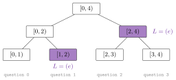

# 11. Disjoint sets {#ch-11}

[Source: `include/ADS/mfset/ListMFSet.h`, `MFSet.h`, `UnionFind.h`,
`RemUnionFind.h`, `RollbackUnionFind.h`]

We are concerned in this chapter with the MFSET (merge-find set), i.e.,
with a partition of a set of elements into disjoint components that only
merge, and with the question of whether two elements are in the same
component. It is the structure that follows the connected components of a
graph whose edges arrive one at a time (the cycles that the algorithm of
Kruskal must refuse, cf. [Chapter 14](14-graph.md#ch-14)), and the classes of an equivalence
relation given by its pairs. In `ADS/mfset` it is realized on lists
([§11.2](11-mfset.md#sec-11-2)) and on a forest of parents with the
heuristics of [Montresor 2025, §10.2](Z-bibliography.md#ref-montresor2025)
([§11.3](11-mfset.md#sec-11-3)). Then come two engineered forests
([§11.4](11-mfset.md#sec-11-4)) and a forest whose merges can be undone,
on which we answer offline the connectivity of a graph whose edges come and
go ([§11.5](11-mfset.md#sec-11-5)). [Table 11.1](11-mfset.md#tab-11-1)
summarizes the costs, and [§11.6](11-mfset.md#sec-11-6) compares the
realizations on what each one is meant for. In the sets of
[§1.9](01-introduction.md#sec-1-9), `ListMFSet.h` and `MFSet.h` are base
and the other headers of this chapter are advanced.

## 11.1 The interface {#sec-11-1}

An MFSET is a partition of the elements $\{ 0 , \ldots , n - 1 \}$ into
disjoint *components*, which starts with the $n$ singletons
$\{ 0 \} , \ldots , \{ n - 1 \}$ (the `Mfset( n )` of [Montresor 2025,
§10.2](Z-bibliography.md#ref-montresor2025)) and changes by two operations.
The first, $\mathrm{find}( x )$, gives the *representative* of the component
of $x$, an element of it that stays the same until the component changes;
hence, $x$ and $y$ are in the same component if and only if

$$
\mathrm{find}( x ) = \mathrm{find}( y ) . \tag{11.1}
$$

The second, $\mathrm{merge}( x , y )$, replaces the components of $x$ and of
$y$ with their union; components are never split. Some specifications require
$x$ and $y$ to be in distinct components; all the realizations of the chapter
relax this precondition, since a `merge()` of two elements already together
returns false and leaves the partition as it was. Each realization also has
`n()`, the number of the elements, and all of them but `ListMFSet` have
`same( x , y )` (cf. (11.1)), and `count()`, the number of the components.
Throughout the chapter $m$ is the number of the operations of a sequence of
finds and merges and $p[ x ]$ the parent of $x$ in a forest. Also,
$\mathit{rank}[ r ]$ and $\mathit{size}[ r ]$ are the rank and the number of
nodes of the tree of the root $r$, and $\alpha( m , n )$ is the inverse of the
function of Ackermann, which is at most 4 for any $m$ and $n$ that fit in a
computer ([Tarjan 1975](Z-bibliography.md#ref-tarjan1975)).

<span id="tab-11-1"></span>**Table 11.1.** The realizations of the MFSET
in `ADS/mfset` and the cost of their operations, for $m \ge n$ operations.

| Realization | Representation | `find()` | `merge()` | $m$ operations |
|---|---|---|---|---|
| `ListMFSet` | a list per component, each element with its head | $O( 1 )$ | $O( n )$, the shorter list relabeled | $O( m + n \log n )$ |
| `MFSet`, no heuristic | a forest of parents | $O( n )$ | that of two finds | $O( m n )$ |
| `MFSet`, union by rank or size | as above | $O( \log n )$ | that of two finds | $O( m \log n )$ |
| `MFSet` by rank or size with compression, `UnionFind` | as above, or one vector with the sizes at the roots | $O( \log n )$ | that of two finds | $O( m \, \alpha( m , n ) )$ |
| `RemUnionFind` | a forest with $p[ x ] \ge x$ | $O( n )$ | one interleaved climb | $O( m \log_{1 + m / n} n )$ |
| `RollbackUnionFind` | a forest by rank, no compression, a stack of the merges | $O( \log n )$ | that of two finds; `undo()` in $O( 1 )$ | $O( m \log n )$ |

## 11.2 Lists {#sec-11-2}

`ListMFSet` keeps a list per component, whose first element (its *head*) is
the representative. Each element keeps the head of its list in the vector
$\mathit{head}$, and hence `find( x )` reads $\mathit{head}[ x ]$ in $O( 1 )$
time. `merge( x , y )` appends the shorter of the two lists to the longer one
and relabels its elements, i.e., writes the new head into their places of
$\mathit{head}$ ([Algorithm 11.1](11-mfset.md#alg-11-1) and [Figure
11.1](11-mfset.md#fig-11-1)). In the code the lists are vectors, and the list
of a head is empty once the head has been merged into another list.

{#fig-11-1}

<span id="alg-11-1"></span>**Algorithm 11.1.** The merge of `ListMFSet`
([Montresor 2025, §10.2.1](Z-bibliography.md#ref-montresor2025));
$\mathit{head}[ x ]$ is the head of the list of $x$ and $L[ a ]$ the list
of the head $a$.

--8<-- "generated/ListMFSet-merge.pseudo.md"

<span id="lem-11-1"></span>**Lemma 11.1.** *If `merge()` relabels the
elements of the shorter list, an element is relabeled at most
$\lfloor \log_2 n \rfloor$ times, and any sequence of $m$ operations costs
$O( m + n \log n )$ time.*

*Proof.* An element is relabeled only when its list is the shorter of the
two, and the list in which it lands is then at least twice as long as its
old one ([Hopcroft and Ullman 1973](Z-bibliography.md#ref-hopcroft1973)).
Since a list has at most $n$ elements, this happens at most
$\lfloor \log_2 n \rfloor$ times per element. Apart from the relabeling,
each operation costs $O( 1 )$ time. $\square$

For $n$ a power of 2 the bound is tight, as the merges of the pairs, then of
the quadruples, and so on, show: each round relabels $n / 2$ elements, and
there are $\log_2 n$ rounds. With the counter `relabels()` one can check
[Lemma 11.1](11-mfset.md#lem-11-1) on any sequence. Also, `members( x )` gives
the elements of the component of $x$, which a forest cannot give without a
visit of all the elements.

The class is declared as follows, in the namespace `ADS` as all those of the chapter.

```cpp
// declarations of <ADS/mfset/ListMFSet.h>
class ListMFSet
{
 public:
 explicit ListMFSet( int n );
 int n( void ) const;
 int find( int x ) const;
 bool merge( int x , int y );
 long relabels( void ) const;
 const std::vector< int > & members( int x ) const;
 };
```

## 11.3 A forest of parents {#sec-11-3}

`MFSet` keeps the components as a forest, a vector $p$ of parents in which the
roots, with $p[ x ] = x$, are the representatives ([Montresor 2025,
§10.2.2](Z-bibliography.md#ref-montresor2025); [Galler and Fischer
1964](Z-bibliography.md#ref-galler1964)). Here `find( x )` climbs from $x$ to
the root of its tree, and `merge( x , y )` makes one of the two roots a child
of the other, after the two finds ([Algorithm 11.2](11-mfset.md#alg-11-2) and
[Figure 11.2](11-mfset.md#fig-11-2)). Lists and forests thus trade one cost
for the other: on lists the finds are cheap and the merges expensive, on a
forest the converse. With no heuristic, the root of $y$ goes under that of
$x$, and $n - 1$ merges may build a path of $n$ nodes, whose deepest node
costs $n - 1$ steps to each find. Two heuristics bound the height of the
trees, and may be switched off to study them (the argument `Union` of the
constructor, `Union::NONE`, `RANK` or `SIZE`, and its argument `compress`).

* The *union by rank* ([Montresor 2025,
  §10.2.3](Z-bibliography.md#ref-montresor2025)) keeps for each root $r$ a
  rank, 0 for a singleton. It puts the root of lower rank under the other
  one, and the rank grows by 1 only when the two ranks are equal.
* The *union by size* puts the tree with fewer nodes under the other one,
  whose size grows by that of the smaller tree (on a tie, the root of $y$
  goes under that of $x$).

{#fig-11-2}

<span id="alg-11-2"></span>**Algorithm 11.2.** The operations of `MFSet`
([Montresor 2025, §10.2.2, §10.2.3 and
§10.2.4](Z-bibliography.md#ref-montresor2025)), `find()` in the iterative
version of exercise 10.8, the root first and then the compression.

--8<-- "generated/MFSet-find.pseudo.md"

--8<-- "generated/MFSet-merge.pseudo.md"

<span id="lem-11-2"></span>**Lemma 11.2.** *With the union by rank, a tree
whose root has rank $r$ has at least $2^r$ nodes and height at most $r$;
hence $r \le \log_2 n$, and `find()` and `merge()` take $O( \log n )$
time ([Montresor 2025, Theorem 10.1](Z-bibliography.md#ref-montresor2025)).
The same bound holds with the union by size, a tree of the root $r$ having
height at most $\log_2 \mathit{size}[ r ]$.*

*Proof.* We first take no compression, and argue by induction on the
merges. A singleton has rank 0, one node and height 0. Let a merge join
the roots $r_x$ and $r_y$ of ranks $\rho_x > \rho_y$: the root $r_x$ keeps
its rank $\rho_x$ and gains nodes, and the tree of $r_y$, of height at most
$\rho_y \le \rho_x - 1$ by induction, goes one level down, and the new
height is thus at most $\rho_x$. If instead $\rho_x = \rho_y = \rho$, the new
root has rank $\rho + 1$, height at most $\rho + 1$ and at least
$2^\rho + 2^\rho = 2^{\rho + 1}$ nodes. With the union by size, the depth
of a node grows by 1 only when the root of its tree goes under a root whose
tree is at least as large (ties included), and the tree that holds the node
then at least doubles, as in the proof of
[Lemma 11.1](11-mfset.md#lem-11-1); hence its depth is at most
$\log_2 \mathit{size}[ r ]$, $r$ its root. Finally, the compression of the
paths (described below) changes no rank, no size and no root. Since it only
gives a node a parent among its ancestors, it never raises a height, and
the bounds hold with it as well. $\square$

A find that has climbed from $x$ to its root $r$ may also make each node
of the path a child of $r$ (the *compression* of [Montresor 2025,
§10.2.4](Z-bibliography.md#ref-montresor2025)); the next finds from
those nodes cost one step ([Figure 11.3](11-mfset.md#fig-11-3)). In
`MFSet` the compression is a second pass over the path, with no recursion
and no stack (lines 3 and 4 of [Algorithm 11.2](11-mfset.md#alg-11-2)).

 (every other node of the way a child of its grandparent); the violet nodes are those whose parent changed.](../figures/mfset-paths.svg){#fig-11-3}

With the compression a rank is no longer the height of its tree, but only
an upper bound to it (exercise 10.7 of [Montresor
2025](Z-bibliography.md#ref-montresor2025)), since the compression lowers
the trees and never changes a rank. Together, the two heuristics give an
amortized cost per operation that is constant for any practical purpose.

<span id="thm-11-1"></span>**Theorem 11.1.** *With the union by rank or by
size, and the compression or the halving of the paths, a sequence of
$m \ge n$ operations on $n$ elements costs*

$$
O( m \, \alpha( m , n ) ) \tag{11.2}
$$

*time, and the bound is tight for each of these combinations ([Tarjan
1975](Z-bibliography.md#ref-tarjan1975); [Tarjan and van Leeuwen
1984](Z-bibliography.md#ref-tarjan1984)).*

These combinations are those of `MFSet` with the union `RANK` or `SIZE`
and `compress` true, and of each instance of `DisjointSets`
([§11.4](11-mfset.md#sec-11-4)); in all of them a link hangs a root under
a root of no smaller rank, or of no smaller size, and a find gives the
nodes of its path only ancestors as parents, which are the hypotheses of
[Tarjan and van Leeuwen 1984](Z-bibliography.md#ref-tarjan1984).

We do not repeat the proof of (11.2), which [Montresor 2025,
§10.2.4](Z-bibliography.md#ref-montresor2025) sketches and [Tarjan and van
Leeuwen 1984](Z-bibliography.md#ref-tarjan1984) give in full. We prove
instead the weaker bound of [Hopcroft and Ullman
1973](Z-bibliography.md#ref-hopcroft1973), whose argument (the charge of
each step of a find either to the operation or to the node, whose parent
then becomes one of larger rank) is the one that the proof of (11.2)
refines over the levels of the function of Ackermann. Let
$T( 0 ) = 1$ and $T( g + 1 ) = 2^{T( g )}$, so that $T( 1 ) = 2$,
$T( 2 ) = 4$, $T( 3 ) = 16$ and $T( 4 ) = 65536$, and let $\log^* n$ be
the least $g$ with $T( g ) \ge n$.

<span id="lem-11-3"></span>**Lemma 11.3.** *With the union by rank and
the compression of the paths, a sequence of $m$ finds and merges on $n$
elements costs $O( ( m + n ) \log^* n )$ time.*

*Proof.* A merge costs two finds and $O( 1 )$; hence it suffices to
count the steps of the finds, a step going from a node $x$ that is not a
root to its parent. Three facts hold throughout. (i) The rank of a node no
longer changes once the node is not a root. (ii) The ranks increase
strictly from a child to its parent, since a merge hangs a root under one
of larger rank or raises the rank of the new parent, and a compression
gives a node a parent among its ancestors. (iii) At most $n / 2^r$ nodes
have rank $r$. Indeed, the ranks are those of the same sequence with no
compression, which finds the same roots and hence makes the same links. In
its forest a node of rank $r$ has at least $2^r$ descendants, by
[Lemma 11.2](11-mfset.md#lem-11-2) at the time it stopped being a root and
since, with no compression, a node never loses a descendant. Moreover, two
nodes of equal rank have disjoint descendants, since a common one would
make one of them an ancestor of the other, of larger rank by (ii).

We put the rank $r$ in the *group* 0 if $r \le 1$, and in the group
$g \ge 1$ if $T( g - 1 ) < r \le T( g )$; since $r \le \log_2 n$, there are
at most $\log^* n + 1$ groups. We charge a step from $x$ to the find if
$x$ is a child of the root, or if the parent of $x$ has a rank of a higher
group than that of $x$. By (ii), the second case happens at most
$\log^* n$ times along a path, and a find thus takes at most
$\log^* n + 1$ such charges. Any other step is charged to $x$, whose
parent $p$ is then not the root; the compression gives $x$ the root as its
parent, of rank larger than that of $p$ by (ii). Hence each charge to $x$
raises the rank of its parent by at least 1, while that of $x$ stays the
same by (i), and once the rank of the parent is in a higher group, $x$ is
never charged again. A node whose rank is in the group $g \ge 1$ is thus
charged fewer than $T( g )$ times, and one of the group 0 at most once
(its rank is 0, and its parent has rank 1 until the first charge). By
(iii) the group $g \ge 1$ has at most
$\sum_{r > T( g - 1 )} n / 2^r \le n / 2^{T( g - 1 )} = n / T( g )$ nodes,
which take fewer than $n$ charges in all, and the group 0 takes at most
$n$. Summing over the at most $\log^* n + 1$ groups, the charges to the
nodes are $O( n \log^* n )$, and those to the finds $O( m \log^* n )$.
$\square$

The same proof holds with the union by size, once the rank of a node is
taken as $\lfloor \log_2 s \rfloor$, $s$ the size of its tree when it was
hung (the current size for a root): a node is hung only under a root
whose tree, after the link, has at least twice its size, which gives (ii),
and a node of rank $r$ has at least $2^r$ descendants, which gives (iii). Since $\log^* n \le 5$
for $n \le 2^{65536}$, [Lemma 11.3](11-mfset.md#lem-11-3) already makes
the amortized cost constant for any practical purpose, and (11.2) improves
it only in theory. We remark that both bounds are amortized: a single find
may still cost $\Theta( \log n )$ time.

Finally, `components( G )` builds the MFSET of the connected components of an
unoriented graph by merging the ends of each edge ([Montresor 2025,
§10.2.5](Z-bibliography.md#ref-montresor2025)), after which it can follow new
edges by more merges ([Algorithm 11.3](11-mfset.md#alg-11-3)). Its elements
are the names $[ 0 , \mathrm{bound}() )$ of the graph; hence a name that is
not a node (e.g., a deleted one) is a component of its own, counted by
`count()`.

<span id="alg-11-3"></span>**Algorithm 11.3.** The connected components of
an unoriented graph $G$ by an MFSET ([Montresor 2025,
§10.2.5](Z-bibliography.md#ref-montresor2025)).

--8<-- "generated/MFSet-components.pseudo.md"

The contracts of `MFSet` check that the parents form a forest of `count()`
trees, that the ranks grow strictly towards the roots with the union by rank,
and that the sizes count the nodes of their trees with the union by size. Its
accessors `parent( x )`, `rank( x )` and `size( x )` read the three vectors (a
size is meaningful only at a root, and with the union by size), and its
counter `steps()` gives the steps of the climbs, on which the bounds above can
be measured. With the compression and no union by rank or by size, a sequence
of $m \ge n$ operations costs $\Theta( m \log_{1 + m / n} n )$ time in the
worst case ([Tarjan and van Leeuwen 1984](Z-bibliography.md#ref-tarjan1984)),
between the two bounds of [Table 11.1](11-mfset.md#tab-11-1).

We declare `MFSet` and `components()` as follows; the example also uses the `UnionFind` of [§11.4](11-mfset.md#sec-11-4).

```cpp
// declarations of <ADS/mfset/MFSet.h>
class MFSet
{
 public:
 enum class Union { NONE , RANK , SIZE };
 explicit MFSet( int n , Union u = Union::RANK , bool compress = true );
 int n( void ) const;
 int count( void ) const;
 int find( int x );
 bool merge( int x , int y );
 bool same( int x , int y );
 int parent( int x ) const;
 int rank( int x ) const;
 int size( int x ) const;
 long steps( void ) const;
 };
template< Graph G >
MFSet components( const G & g );
```

```cpp
ADS::MFSet M( 6 );  // by rank, compressing
M.merge( 0 , 1 );
M.merge( 2 , 3 );
M.merge( 1 , 3 );
const bool together = M.same( 0 , 2 );  // true
const int k = M.count();               // 3 components
ADS::UnionFind U( 6 );
U.merge( 4 , 5 );
const int s = U.size( 5 );  // 2
```

## 11.4 Engineered forests {#sec-11-4}

`DisjointSets< L , C >` (and its instance `UnionFind`, i.e., `DisjointSets<>`,
with the union by size and the halving) keeps the forest in one vector of
integers. A root $r$ holds $-\mathit{size}[ r ]$ (or
$-1 - \mathit{rank}[ r ]$, with `L` equal to `Union::RANK`) in place of a
parent; hence the union needs no second vector, and a find touches one array
only, of $4 n$ bytes. In either encoding the more negative root is the larger
tree, which takes the other one under it; on a tie the root of $x$ goes under
that of $y$ (the converse of `MFSet`). Its `find()` shortens the path by
*halving* it: every other node on the way is made a child of its grandparent,
in the pass that climbs ([Tarjan and van Leeuwen
1984](Z-bibliography.md#ref-tarjan1984); [Figure 11.3](11-mfset.md#fig-11-3)).
This shortening keeps the bound (11.2) of the compression, and a find still
costs $O( \log n )$ in the worst case, by [Lemma 11.2](11-mfset.md#lem-11-2),
since a tree of height $h$ has at least $2^h$ nodes ([Algorithm
11.4](11-mfset.md#alg-11-4)). The full compression, in two passes, is the
alternative `C` equal to `Compression::FULL` (the two enumerations `Union` and
`Compression` of the namespace are distinct from the `MFSet::Union` of
[§11.3](11-mfset.md#sec-11-3)). Besides `find()`, `merge()` and `same()`, the
class has `reset( n )`, which returns to the $n$ singletons in $O( n )$ time.
It also has `n()`, `count()` and, with the union by size only (a constraint
`requires` of the member), `size( x )`, the number of the elements of the
component of $x$. At the highest level, its contracts check that the parents
make a forest of `count()` trees whose roots hold their sizes, or ranks that
bound their heights.

Its declarations are the following.

```cpp
// declarations of <ADS/mfset/UnionFind.h>
enum class Union { SIZE , RANK };
enum class Compression { HALVING , FULL };
template< Union L = Union::SIZE , Compression C = Compression::HALVING >
class DisjointSets
{
 public:
 explicit DisjointSets( int n = 0 );
 void reset( int n );
 int n( void ) const;
 int count( void ) const;
 int find( int x );
 bool merge( int x , int y );
 bool same( int x , int y );
 int size( int x )
  requires( L == Union::SIZE );
 };
using UnionFind = DisjointSets<>;
```

<span id="alg-11-4"></span>**Algorithm 11.4.** The operations of
`UnionFind` (the halving of [Tarjan and van Leeuwen
1984](Z-bibliography.md#ref-tarjan1984) and the union by size); a root $r$
holds $p[ r ] = -\mathit{size}[ r ]$.

--8<-- "generated/UnionFind-DisjointSets-find.pseudo.md"

--8<-- "generated/UnionFind-DisjointSets-merge.pseudo.md"

The two shortenings of the path are chosen at compile time (an
`if constexpr` on `C`), and the loop of a find carries no test of the
variant.

`RemUnionFind` is the algorithm of Rem with *splicing* ([Dijkstra
1976](Z-bibliography.md#ref-dijkstra1976)), which the experiments of
[Patwary et al. 2010](Z-bibliography.md#ref-patwary2010) found among the
fastest sequential algorithms of union and find. Its parents are 32-bit
integers, and a parent is never smaller than its child,

$$
p[ x ] \ge x \quad \text{for each } x , \tag{11.3}
$$

the roots having $p[ x ] = x$; hence, a path increases strictly to its root.
This *link by index* takes the place of the union by rank, with no array of
ranks and no sizes. `merge( x , y )` climbs the two paths from $x$ and $y$
together, always from the node $a$ whose parent is smaller. If $a$ is a root,
it is linked under the parent of the other node $b$, and the two sets are one.
Otherwise, the parent of $a$ is replaced by the larger parent of $b$ (the
splicing), and the climb goes on from the old parent of $a$. When the two
climbs reach the same parent, $x$ and $y$ were already in the same set
([Algorithm 11.5](11-mfset.md#alg-11-5) and [Table
11.2](11-mfset.md#tab-11-2)). Its `find()` halves the path, and the class also
has `same()`, `n()`, `count()` and `parent( x )`; the elements are of type
`std::uint32_t`, and the constructor requires $n < 2^{32}$.

Its declarations are the following.

```cpp
// declarations of <ADS/mfset/RemUnionFind.h>
class RemUnionFind
{
 public:
 explicit RemUnionFind( std::size_t n = 0 );
 std::size_t n( void ) const;
 std::size_t count( void ) const;
 std::uint32_t find( std::uint32_t x );
 bool merge( std::uint32_t x , std::uint32_t y );
 bool same( std::uint32_t x , std::uint32_t y );
 std::uint32_t parent( std::uint32_t x ) const;
 };
```

<span id="alg-11-5"></span>**Algorithm 11.5.** The operations of
`RemUnionFind` (the algorithm of Rem with splicing as [Dijkstra
1976](Z-bibliography.md#ref-dijkstra1976) and [Patwary et al.
2010](Z-bibliography.md#ref-patwary2010) describe it).

--8<-- "generated/RemUnionFind-find.pseudo.md"

--8<-- "generated/RemUnionFind-merge.pseudo.md"

<span id="tab-11-2"></span>**Table 11.2.** The algorithm of Rem on the parents
$p = ( 3 , 4 , 3 , 3 , 5 , 5 )$, i.e., the sets $\{ 0 , 2 , 3 \}$ (root 3) and
$\{ 1 , 4 , 5 \}$ (root 5): `merge( 0 , 1 )` joins them after one splicing,
and `merge( 2 , 0 )` then finds them together after one more.

| Step | $a$, $b$ | $p[ a ]$, $p[ b ]$ | Action | $p$ after |
|---|---|---|---|---|
| `merge(0, 1)` | 0, 1 | 3, 4 | splice: $p[ 0 ] \gets 4$, $a \gets 3$ | $( 4 , 4 , 3 , 3 , 5 , 5 )$ |
| | 3, 1 | 3, 4 | $a$ is a root: $p[ 3 ] \gets 4$, true | $( 4 , 4 , 3 , 4 , 5 , 5 )$ |
| `merge(2, 0)` | 2, 0 | 3, 4 | splice: $p[ 2 ] \gets 4$, $a \gets 3$ | $( 4 , 4 , 4 , 4 , 5 , 5 )$ |
| | 3, 0 | 4, 4 | the same parent: false | $( 4 , 4 , 4 , 4 , 5 , 5 )$ |

<span id="lem-11-4"></span>**Lemma 11.4.** *Each operation of `RemUnionFind`
keeps (11.3), and `merge( x , y )` joins the sets of $x$ and $y$ and returns
true if they were distinct, and returns false otherwise, after at most $2 n$
steps.*

*Proof.* At each step, after the swap, $p[ a ] < p[ b ]$. A root $a$ has
$p[ a ] = a$, and its new parent $p[ b ]$ is thus larger than $a$; a
splicing replaces $p[ a ]$ with the larger $p[ b ]$. Both keep (11.3).
The halving of `find()` replaces a parent with a grandparent, which is
larger by (11.3). Let the sets of $x$ and $y$ be $X$ and $Y$, and let
$X \ne Y$. While the loop runs, $a$ and $b$ stay in two different trees,
one holding the current part of $X$ and the other that of $Y$: a splicing
moves the subtree of $a$ (which contains $a$) into the tree of $b$, but
$a$ then moves to its old parent, which stays in the tree that $a$ left.
Their parents are thus never equal, and the loop ends only by the link of
a root, which joins the two trees. Since the splicings only move elements
of $X \cup Y$ from one of the two trees to the other, and change no parent
in any other tree, the joined tree holds $X \cup Y$, and the other sets are
unchanged. If $X = Y$, no root is ever linked. In fact,
the root $r$ of the tree is its largest element by (11.3); if the node $a$
of smaller parent were a root, then $a = r$, and $p[ b ] \ge p[ a ] = r$
would force $p[ b ] = r = p[ a ]$, which ends the loop. The splicings then
only shorten the paths of the tree, and the loop ends with false. As for
the steps, each one replaces $a$ with its old parent, which is larger than
$a$ by (11.3), while $b$ stays; hence $a + b$ grows by at least 1 per step,
and since $a + b \le 2 ( n - 1 )$, there are fewer than $2 n$ steps.
$\square$

The climb stops as soon as the sets are joined, often well below the
roots, and each step both compresses and moves on; the two finds and the
link of the union by rank thus become the single interleaved walk of the
lines 3 to 6 of [Algorithm 11.5](11-mfset.md#alg-11-5).

Yet, the link by index does not give the bound (11.2) in the worst case:
with the splicing or the halving it gives $O( m \log_{1 + m / n} n )$
time for $m$ operations ([Tarjan and van Leeuwen
1984](Z-bibliography.md#ref-tarjan1984)). When the elements are numbered
in a random order, however, the expected time is $O( m \, \alpha( m , n ) )$,
the bound of the union by rank ([Goel et al.
2014](Z-bibliography.md#ref-goel2014)). After a merge, the contracts check
that $x$ and $y$ have the same root, by climbs that change no parent (a
`find()` would halve the paths, and thus change the forest under check).
At their highest level, and on the sets of up to 4096 elements, they also
check (11.3) and the number of the roots after each merge.

## 11.5 Undo and offline connectivity {#sec-11-5}

`RollbackUnionFind` undoes its merges in the reverse of their order ([Mannila
and Ukkonen 1986](Z-bibliography.md#ref-mannila1986)). Each `merge()` changes
at most three words, i.e., the parent of the root that it hangs and the size
and the rank of the other root. It pushes on a stack $R$ a record with the
root hung, the other root and whether the rank grew. `undo()` pops a record
and puts the words back, in $O( 1 )$ time, and `rollback( t )` undoes the
merges back to the checkpoint $t$, the number of merges done when
`checkpoint()` gave it ([Algorithm 11.6](11-mfset.md#alg-11-6) and [Figure
11.4](11-mfset.md#fig-11-4)). A merge of two elements already together pushes
an empty record, and the checkpoints thus count the calls. Its space is $12 n$
bytes (the parents, the ranks and the sizes), plus 12 bytes per record. The
class also has `same()`, `size( x )` (the number of the elements of the
component of $x$), `n()`, `count()` and `reset( n )`, which returns to the $n$
singletons and empties the stack; `undo( k )` undoes the last $k$ merges, one
by default.

The class, the operations of the offline connectivity and their function are declared as follows.

```cpp
// declarations of <ADS/mfset/RollbackUnionFind.h>
class RollbackUnionFind
{
 public:
 explicit RollbackUnionFind( int n = 0 );
 void reset( int n );
 int n( void ) const;
 int count( void ) const;
 int find( int x ) const;
 bool merge( int x , int y );
 bool same( int x , int y ) const;
 int size( int x ) const;
 int checkpoint( void ) const;
 void undo( int k = 1 );
 void rollback( int t );
 };
struct ConnectivityOp
{
 enum Kind { INSERT , DELETE , CONNECTED , COMPONENTS };
 Kind kind;
 int u = 0;
 int v = 0;
 };
std::vector< int >
offlineConnectivity( int n , const std::vector< ConnectivityOp > & ops );
```

{#fig-11-4}

<span id="alg-11-6"></span>**Algorithm 11.6.** The operations of
`RollbackUnionFind` (the union by rank with no compression, and the stack
$R$ of the merges).

--8<-- "generated/RollbackUnionFind-find.pseudo.md"

--8<-- "generated/RollbackUnionFind-merge.pseudo.md"

--8<-- "generated/RollbackUnionFind-undo.pseudo.md"

This forest keeps the union by rank and gives up any change of the paths.
A compression would change $\Theta( \log n )$ parents per find, all to be
recorded, and its amortized bound (11.2) does not survive the undo: a
sequence that rolls back the merges and does them again can make the same
long find pay each time.

<span id="lem-11-5"></span>**Lemma 11.5.** *In `RollbackUnionFind`,
`undo()` restores the forest, the ranks and the sizes as they were before
the merge that it undoes, and each `find()` costs $O( \log n )$ time in
the worst case.*

*Proof.* With no compression, a merge that joins the roots $x$ and $y$,
$x$ hung under $y$, writes only $p[ x ] \gets y$,
$\mathit{size}[ y ] \gets \mathit{size}[ y ] + \mathit{size}[ x ]$, possibly
$\mathit{rank}[ y ] \gets \mathit{rank}[ y ] + 1$, and the counter of the
components; a merge that joins nothing writes none of them. We show by
induction on the number of the operations that each `undo()` restores the
state before the merge whose record it pops. Since the records are popped
in the reverse of their order, every merge done after that one has already
been undone, and by induction the state is the one just after it. In that
state $x$ is not a root, and no later merge has changed
$\mathit{size}[ x ]$, since a merge writes the size of a root only. Hence
$p[ x ] \gets x$ (the parent of a root being the root itself),
$\mathit{size}[ y ] \gets \mathit{size}[ y ] - \mathit{size}[ x ]$, the
decrement of $\mathit{rank}[ y ]$ when the record marks it as grown, and the
increment of the counter give back the state before the merge, and an empty
record changes nothing, as its merge did not. The forest is thus always
the one that the union by rank builds, with no undo, from the merges not
undone. By [Lemma 11.2](11-mfset.md#lem-11-2) its trees have height at most
$\log_2 n$, and a find climbs at most that many steps. $\square$

It is fair to remark that this is not the best amortized bound with
backtracking: [Westbrook and Tarjan
1989](Z-bibliography.md#ref-westbrook1989) show that some forms of
compression, adapted to the undo, give $O( \log n / \log \log n )$
amortized time per operation, and that no separable algorithm on pointers
does better. We keep the simpler forest, whose bound
$O( \log n )$ holds for each single operation.

With the undo, `offlineConnectivity( n , ops )` answers the questions of
connectivity on a graph whose edges come and go, when the sequence of $k$
insertions, deletions and questions (whether two nodes are connected, or how
many components there are) is known in advance. Each operation is a
`ConnectivityOp`, whose `kind` is `INSERT`, `DELETE`, `CONNECTED` or
`COMPONENTS` and whose `u` and `v` are the two nodes, in $[ 0 , n )$ (0 by
default), which a `COMPONENTS` does not use. The edges are unoriented, i.e.,
$[ v , u ]$ deletes the edge inserted as $[ u , v ]$. The result holds the
answers in the order of the questions, 1 or 0 for `CONNECTED` and the number
of the components for `COMPONENTS`, as in the following use on 3 nodes:

```cpp
using Op = ADS::ConnectivityOp;
const std::vector< Op > ops = { { Op::INSERT , 0 , 1 } ,
                                { Op::CONNECTED , 0 , 1 } ,
                                { Op::DELETE , 1 , 0 } ,
                                { Op::CONNECTED , 0 , 1 } ,
                                { Op::COMPONENTS } };
const auto a = ADS::offlineConnectivity( 3 , ops );  // a = { 1 , 0 , 3 }
```

Each edge lives on an interval of times $[ s , e )$, from its insertion to
its deletion (or to the end), and the times are counted in questions; an
edge inserted and deleted with no question in between thus lives on an
empty interval, and is dropped. The $q$ questions are the leaves of a
segment tree, and its node of the range $[ a , b )$ holds the list $L$ of the
edges that live on all of $[ a , b )$ but not on all of the range of its
parent ([Figure 11.5](11-mfset.md#fig-11-5)). A visit in depth of the
segment tree merges the edges of $L$ when it enters a node, answers the
question when it is at a leaf, and rolls back to its checkpoint when it
leaves the node ([Algorithm 11.7](11-mfset.md#alg-11-7)). Of parallel
edges, the last one inserted dies first, and a loop $[ u , u ]$ is
allowed and joins no component.

{#fig-11-5}

<span id="alg-11-7"></span>**Algorithm 11.7.** The offline connectivity
by the divide and conquer of [Eppstein
1994](Z-bibliography.md#ref-eppstein1994) on the times; $q( t )$ is the
number of the questions before the time $t$ and $L( x )$ the list of the
edges of the node $x$ of the segment tree.

--8<-- "generated/RollbackUnionFind-offlineConnectivity.pseudo.md"

<span id="lem-11-6"></span>**Lemma 11.6.** *An interval of times is held
by at most $\max( 1 , 2 \lceil \log_2 q \rceil )$ nodes of the segment
tree, and when the visit reaches the leaf of a question, the forest holds
exactly the edges alive at its time. Hence the answers are those of a
union-find built again at each question, and the expected time (over the
hash table that pairs each deletion with its insertion) is*

$$
O( k \log q \log n ) = O( k \log k \log n ) . \tag{11.4}
$$

*Proof.* Since the middle $c$ of a range $[ a , b )$ halves it rounding
up, the segment tree has depth at most $\lceil \log_2 q \rceil$, and the
ranges of the nodes of one depth are disjoint. Let $[ s , e )$ be the
interval; a node that `add()` reaches and that neither holds its range in
$[ s , e )$ nor is disjoint from it (a *partial* node) has $s$ or $e$
strictly inside its range, and hence there are at most two partial nodes
per depth, one for $s$ and one for $e$. A node that takes the interval is
a child of a partial node, and a partial node has at most one such child:
if both its children were inside $[ s , e )$, so would be its range. If the
root takes the interval, that is the only node; otherwise the nodes taken
lie at the depths 1 to $\lceil \log_2 q \rceil$, at most two per depth,
since each is the child of one of the at most two partial nodes of the
depth above. As for the leaves, the ranges of the
nodes taken partition $[ s , e )$. Hence exactly one of the ancestors
of the leaf $a$ (the leaf included) holds the edge if $a \in [ s , e )$,
and none otherwise. An edge is alive at the question $a$ exactly when
$s \le a < e$. Indeed, let the question $a$ come at the time $t_a$, so
that $q( t_a ) = a$. Since $q$ does not decrease and grows by 1 just
after $t_a$, an insertion at the time $t \ne t_a$ comes before $t_a$ if and
only if $s = q( t ) \le a$, and a deletion comes after $t_a$ if and only if
$e = q( t ) \ge a + 1$ (and $e = q$ for an edge never deleted). The visit merges at a node the edges
of its list and rolls back to its checkpoint when it leaves it, which by
[Lemma 11.5](11-mfset.md#lem-11-5) restores the forest of the parent;
hence at the leaf $a$ the forest holds the edges of the lists of its
ancestors, i.e., those alive at $a$, each merged once. Each edge is thus
merged and undone at most $\max( 1 , 2 \lceil \log_2 q \rceil )$
times, in $O( \log n )$ and $O( 1 )$ time respectively (by
[Lemma 11.5](11-mfset.md#lem-11-5) for the merge). The calls of `add()`
for one edge reach at most four nodes per depth (the two partial nodes and
their children), i.e., $O( \log q )$ in all. The visit enters $2 q - 1$
nodes, and the $q$ answers cost $O( \log n )$ each, which gives (11.4) with
$q \le k$. Finally, the pairing of each deletion with its insertion,
through a hash table on the unordered pairs of nodes, adds $O( k )$
expected time, and the lists take $O( k \log k )$ space. $\square$

With the contraction of the graph at each level of the divide and conquer
([Eppstein 1994](Z-bibliography.md#ref-eppstein1994); [Peng et al.
2019](Z-bibliography.md#ref-peng2019)) the bound falls to $O( k \log n )$,
at the price of a far longer code; the rollback avoids it.

## 11.6 The realizations compared {#sec-11-6}

`ListMFSet` and `MFSet` are the realizations of the textbook, with the
heuristics that can be switched off, and they are meant to study the
bounds of [Lemma 11.1](11-mfset.md#lem-11-1),
[Lemma 11.2](11-mfset.md#lem-11-2) and
[Theorem 11.1](11-mfset.md#thm-11-1) on the counters `relabels()` and
`steps()`; `ListMFSet` is also the one that lists the members of a
component. Among the engineered forests, `UnionFind` keeps the bound
(11.2) on every sequence in the least memory ($4 n$ bytes); it is the
union-find of the observer of the spanning forests of
[§14.13](14-graph.md#sec-14-13), while `kruskal()` takes any MFSET with
`merge()` (the concept `Mergeable`) and an `MFSet` by default.
`RemUnionFind` has no worst-case guarantee of the same strength; however,
it stops its merges early and takes no sizes. [Patwary et al.
2010](Z-bibliography.md#ref-patwary2010) found the two close to each
other, and the ranking may well depend on the order of the merges and on
the size of the sets; the comparison on the workloads of the library
belongs to the benchmarks `sets` and `graphs` of
[Appendix B](B-benchmarks.md#app-B), which also run `boost::disjoint_sets`.
`RollbackUnionFind` is usually slower per operation, since it gives up
the compression, and we use it only when the merges must be undone.

## 11.7 Discussion and references {#sec-11-7}

The forest of parents is that of [Galler and Fischer
1964](Z-bibliography.md#ref-galler1964), the relabeling of the shorter
list that of [Hopcroft and Ullman 1973](Z-bibliography.md#ref-hopcroft1973),
and the bound (11.2), with its lower bound on the forests of pointers, is
in [Tarjan 1975](Z-bibliography.md#ref-tarjan1975); [Tarjan and van
Leeuwen 1984](Z-bibliography.md#ref-tarjan1984) analyze all the
combinations of linking and of shortening of the paths, the halving and
the splitting included. The algorithm of Rem is in [Dijkstra
1976](Z-bibliography.md#ref-dijkstra1976), its experimental comparison
with the other variants in [Patwary et al.
2010](Z-bibliography.md#ref-patwary2010), and the analysis of the
randomized linking by index in [Goel et al.
2014](Z-bibliography.md#ref-goel2014). The set union with backtracking is
due to [Mannila and Ukkonen 1986](Z-bibliography.md#ref-mannila1986), with
the analysis of [Westbrook and Tarjan
1989](Z-bibliography.md#ref-westbrook1989) and the unlimited backtracking
of [Apostolico et al. 1994](Z-bibliography.md#ref-apostolico1994); the
offline dynamic connectivity is the divide and conquer of [Eppstein
1994](Z-bibliography.md#ref-eppstein1994). A union-find in which several
threads merge at once, by compare-and-swap on the parents, is in
`ADS/concurrent/ConcurrentUnionFind.h` and is treated with the concurrent
structures ([Chapter 24](24-concurrent.md#ch-24)).

## 11.8 Exercises {#sec-11-8}

Each exercise names the test of the library that solves it (run it with
`ctest -R <name>`).

1. Realize the MFSET on lists, with `find()` in $O( 1 )$ time and the
   relabeling of the shorter list, and check that an element is relabeled
   at most $\log_2 n$ times ([Montresor 2025,
   §10.2.1](Z-bibliography.md#ref-montresor2025)). Test:
   `ch10.sec10.2.1.lists`.
2. Realize the MFSET on a forest of parents, and build the forest of
   Figure 10.5 of [Montresor 2025](Z-bibliography.md#ref-montresor2025).
   Test: `ch10.sec10.2.2.forest`.
3. Add the union by rank, and check that a tree of rank $r$ has at least
   $2^r$ nodes (Theorem 10.1); add the union by size, and check the same
   bound on the heights. Test: `ch10.sec10.2.3.rank`.
4. Add the compression of the paths, and check on Figure 10.6 that a find
   flattens its path. Test: `ch10.sec10.2.4.compression`.
5. Show that with the compression the rank of a root is only an upper
   bound to the height of its tree (exercise 10.7), and write the
   compression with no recursion and no stack (exercise 10.8). Tests:
   `ch10.ex10.7`, `ch10.ex10.8`.
6. Follow the connected components of a graph whose edges arrive one at a
   time, and find the edge of least weight of each component (exercise
   10.9). Tests: `ch10.sec10.2.5.incremental`, `ch10.ex10.9`.
7. Check the contracts of the MFSET: the elements out of range, the
   forest of `count()` trees, the merge of two elements already together.
   Test: `contract_mfset.mfset`.
8. Keep the forest in one vector of integers, with the sizes (or the
   ranks) at the roots and the halving of the paths. Test:
   `engineered_graph.union-find`.
9. Realize the algorithm of Rem with splicing, and check it against
   `MFSet` on random sequences of merges and questions. Test:
   `ordered.rem-union-find`.
10. Realize a union-find whose merges can be undone back to a checkpoint
    in $O( 1 )$ time each, and use it to answer offline the questions of
    connectivity of a graph whose edges come and go. Tests:
    `engineered_dynamic.rollback-union-find`,
    `engineered_dynamic.offline-connectivity`.
