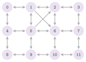
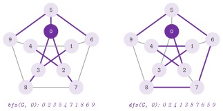

# 14. Graphs {#ch-14}

[Source: `include/ADS/graph/Graph.h`, `MatrixGraph.h`, `ListGraph.h`,
`ArrayGraph.h`, `StaticGraph.h`, `GraphBuilder.h`, `PointerGraph.h`,
`IncidenceGraph.h`, `Visit.h`, `Grid.h`, `GridGraph.h`, `Paths.h`,
`Properties.h`, `ShortestPaths.h`, `AllPairsShortestPaths.h`,
`MinimumSpanningTree.h`, `MaxFlow.h`, `FlowApplications.h`, `Matching.h`,
`Assignment.h`, `EulerianCycle.h`, `Observable.h`, `Reoptimization.h`]

We are concerned in this chapter with the *graph*, i.e., a set of nodes
together with a set of pairs of nodes (the edges). A graph models any binary
relation on a finite set: the links of a network, the streets between the
crossings of a town, the precedences among the jobs of a project, or the
pairs of courses that some student attends (whose exams must therefore
fall on different days). The headers of `ADS/graph` realize the GRAPH of
[Montresor 2025, chapter 9](Z-bibliography.md#ref-montresor2025) in seven
representations, which differ in the space they take and in the cost of
their operations ([§14.1](14-graph.md#sec-14-1) to
[§14.4](14-graph.md#sec-14-4)). They also give the algorithms that work on
it: the visits and the problems that they solve
([§14.5](14-graph.md#sec-14-5) to [§14.7](14-graph.md#sec-14-7)), the
shortest paths ([§14.8](14-graph.md#sec-14-8)), the minimum spanning trees
([§14.9](14-graph.md#sec-14-9)), the flows and the cuts
([§14.10](14-graph.md#sec-14-10)), the matchings and the assignment
([§14.11](14-graph.md#sec-14-11)) and the Eulerian cycles and trails
([§14.12](14-graph.md#sec-14-12)). Finally, [§14.13](14-graph.md#sec-14-13)
describes a wrapper that turns each change of a graph into an event. It
also describes the observers that keep a shortest path tree, a minimum
spanning forest, a maximum flow and an assignment optimal through such
changes, often by a test of the certificate of the previous solution alone.
The adjacency matrix, the lists of adjacency, the matrix of incidence and
the two visits of [Morin 2013, chapter 12](Z-bibliography.md#ref-morin-cpp)
are all here, with each of his exercises solved on the code of the library
([§14.15](14-graph.md#sec-14-15)).

## 14.1 Definitions and the interface {#sec-14-1}

A graph $G = ( V , E )$ has a set $V$ of $n$ nodes and a set $E$ of $m$
edges. An edge of an *oriented* graph is an ordered pair $( u , v )$, which
*leaves* $u$ (its tail, or source) and *enters* $v$ (its head, or target).
An edge of an *unoriented* graph is instead an unordered pair $[ u , v ]$,
which the library stores as the two pairs $( u , v )$ and $( v , u )$
([Montresor 2025, §9.2](Z-bibliography.md#ref-montresor2025)). Thus, in the
terms of [Morin 2013, chapter 12](Z-bibliography.md#ref-morin-cpp), an
unoriented graph is one in which $( i , j )$ is an edge if and only if $( j
, i )$ is. There are no loops $( u , u )$, and hence $0 \le m \le n ( n - 1
)$. A graph is said to be *sparse* when $m$ is of the order of $n$ and
*dense* when it is of the order of $n^2$; this distinction decides among the
representations. A *path* from $u$ to $v$ is a sequence of nodes $u = x_0 ,
x_1 , \ldots , x_k = v$ with $( x_{i-1} , x_i ) \in E$ for $1 \le i \le k$.
It is *simple* if its nodes are distinct, and it is a *cycle* if $k \ge 1$
and $u = v$ ($k \ge 3$ for an unoriented graph); when there is a path from
$u$ to $v$, $v$ is *reachable* from $u$. A graph with no cycle is *acyclic*
(a DAG if oriented, a forest if not, and a free tree if it is also
connected). With the orientation ignored, the nodes reachable from one
another form the *connected components*, and those reachable from one
another along the orientation the *strongly connected components*. [Figure
14.1](14-graph.md#fig-14-1) shows the oriented graph of twelve nodes that
the first sections of the chapter use as their example (the graph of [Morin
2013, figure 12.1](Z-bibliography.md#ref-morin-cpp)).

{#fig-14-1}

The nodes of each graph of the library are named by the integers in
$[ 0 , \mathrm{bound}() )$: `insertNode()` gives the next name, and
`deleteNode()` leaves the name of the node unused. Hence a vector indexed
by the nodes (the distances or the parents of a visit, say) has
$\mathrm{bound}() \ge n$ places, while $n$ itself is `n()`, i.e., the size
of `V()`. Any other datum of a node is kept in such a vector, as
[Morin 2013, chapter 12](Z-bibliography.md#ref-morin-cpp) also suggests,
or in its *label*, of a type `T`. Also, the edges may have a *weight* (a
cost, a length, a capacity) of a type `W`; both types are `std::monostate`
when there is none. [Table 14.1](14-graph.md#tab-14-1) collects the symbols
that the chapter shares with the headers.

<span id="tab-14-1"></span>**Table 14.1.** The symbols of the chapter and
of the headers of `ADS/graph`.

| Symbol | Meaning |
|---|---|
| $\mathrm{adj}( u )$, $d( u )$ | the nodes $v$ with $( u , v ) \in E$, and the (out)degree $d( u ) = \lvert \mathrm{adj}( u ) \rvert$, with $\sum_u d( u ) = m$ ($2 m$ if unoriented) |
| $w( u , v )$ | the weight (cost, length) of the edge $( u , v )$, of the type `W` |
| $\delta( r , v )$, $d[ v ]$ | the distance from $r$ to $v$ (the fewest edges, or the least cost, of a path), and the value an algorithm keeps for it; $\infty$ (`INF`, `infinity()`) if $v$ is not reachable |
| $p[ v ]$, $T[ v ]$ | the parent of $v$ in a tree rooted at the source, `NIL` ($-1$) for the root and for the nodes not reached |
| $\mathit{dt}[ u ]$, $\mathit{ft}[ u ]$ | the discovery and the finish times of $u$ in a visit in depth, on one clock that each event advances by 1 |
| $c( u , v )$, $f( u , v )$, $c_f( u , v )$ | the capacity of an edge of a network, its flow, and its residual capacity $c( u , v ) - f( u , v )$ |
| $( S , V \setminus S )$ | a cut, i.e., the edges with one end in $S$ and the other out of it |

The GRAPH of [Montresor 2025, §9.2](Z-bibliography.md#ref-montresor2025) has
the operations `insertNode()`, `insertEdge(u,v)`, `deleteNode(u)`,
`deleteEdge(u,v)`, `adj(u)`, `V()` and `n()`, and the interface of [Morin
2013, chapter 12](Z-bibliography.md#ref-morin-cpp) adds `hasEdge(i,j)`,
`outEdges(i)` and `inEdges(i)`. Of these, the library calls the last two
`adj(u)` and `inAdj(u)`, and its realizations give all of them where they
make sense. However, the algorithms require much less. Indeed, the concept
`Graph` of `Graph.h` requires `n()`, `bound()`, `directed()`, `hasNode(u)`,
`V()`, `adj(u)` (the adjacent nodes in a vector, as the SET of the book) and
`forEachAdj(u, f)`, which calls $f( v )$ on each adjacent node without
building the vector; the concept `DynamicGraph` adds the four insertions and
deletions. All the algorithms of the chapter are written on these concepts,
and therefore run on any of the realizations (and on any type of another
library that models them). Their bounds hold on the lists or the vectors of
adjacency, where the scan of $\mathrm{adj}( u )$ costs $\Theta( d( u ) + 1
)$.

The realizations relax three preconditions of the specification, which
requires an edge not there in `insertEdge()`, one there in `deleteEdge()`
and an isolated node in `deleteNode()`. In the library, `insertEdge()` of an
edge already there replaces its weight, `deleteEdge()` of one not there has
no effect, and `deleteNode()` also deletes the edges of the node (only
`PointerGraph` keeps the strict `deleteNode()`). Their contracts (cf.
`Contract.h`) check that an operation on a node finds one of the graph and
that an edge joins two distinct nodes. Their invariants, checked on the rows
or the lists that an operation touches, state that the counts `n()` and
`m()` agree with the representation. The class `GraphNodes<T>`, from which
`MatrixGraph` and `ListGraph` derive, holds what these two share: the flag
`directed()`, the counts, the vector of the names in use, and the labels,
with `label(u)` and `setLabel(u, t)`; to the classes derived from it it
gives the checks of a node and of an edge (`check(u)` and `edge(u, v)`),
`addNode(t)`, and `nodesCounted()`, the invariant that `n()` counts the
names in use, each with its label. On that vector, the iterator `nodes()`
visits the nodes in increasing order with no vector built, through the slots
of `Alive` (whose `size()`, `occupied()` and `read()` give the number of the
names, whether a name is in use and its node). The realizations name the
types of their weights and of their labels `Weight` and `Label`.

## 14.2 The adjacency matrix {#sec-14-2}

The adjacency matrix of a graph of $n$ nodes is the $n \times n$ matrix
$M$ whose entry $M[ u ][ v ]$ is the weight of $( u , v )$, or empty when
there is no such edge (the infinity of
[Montresor 2025, §9.3](Z-bibliography.md#ref-montresor2025), or the false
of the boolean matrix of [Morin 2013, §12.1](Z-bibliography.md#ref-morin-cpp)).
`MatrixGraph<W,T>` keeps it as a vector of rows of `std::optional<W>`,
with $\mathrm{bound}()$ rows and columns. Its invariants are that there is
no entry on the diagonal nor in the rows and the columns of the names not
in use, and that $M$ is symmetric for an unoriented graph; an operation
checks them on the rows and the columns that it touches, in $O( n )$.
[Figure 14.2](14-graph.md#fig-14-2) shows the matrix of the graph of
[Figure 14.1](14-graph.md#fig-14-1). The operations `insertEdge(u,v,w)`,
`deleteEdge(u,v)`, `hasEdge(u,v)` and `weight(u,v)` read or write a single
entry, and the first two also the symmetric one when the graph is
unoriented ([Algorithm 14.1](14-graph.md#alg-14-1)). Hence each of them
costs $O( 1 )$ time.

{#fig-14-2}

<span id="alg-14-1"></span>**Algorithm 14.1.** The insertion of an edge
in `MatrixGraph`, and the nodes with an edge to $u$ (the `inEdges(i)` of
[Morin 2013, §12.1](Z-bibliography.md#ref-morin-cpp)).

--8<-- "generated/MatrixGraph-insertEdge.pseudo.md"

--8<-- "generated/MatrixGraph-inAdj.pseudo.md"

The code writes the entry, counts the edge only when the entry was empty
(so that a second insertion only replaces the weight), and mirrors it for
an unoriented graph:

```cpp
--8<-- "generated/MatrixGraph-insertEdge.cpp"
```

However, the adjacent nodes are another matter, since `adj(u)` must scan the
whole row of $u$ to find its $d( u )$ entries, and `inAdj(u)` the whole
column. Also `forEachAdj()`, `forEachEdge()` and the iterator `neighbors(u)`
(through the slots of `Present`) scan the row in the same way. A new node
adds a row and a column, i.e., $\Theta( n )$ time, and `deleteNode(u)`
empties both before it marks the name unused, again in $\Theta( n )$.

<span id="lem-14-1"></span>**Theorem 14.1.** *`MatrixGraph` realizes the
GRAPH in $\Theta( n^2 )$ space, with `insertEdge()`, `deleteEdge()`,
`hasEdge()` and `weight()` in $O( 1 )$ time, `adj()` and `inAdj()` in
$\Theta( n )$ time, and `insertNode()` and `deleteNode()` in $\Theta( n )$
time.*

*Proof.* The matrix has $\mathrm{bound}()^2$ places, one optional weight
each; the costs follow from the number of entries that each operation
reads or writes, as described above (a new row is $n + 1$ places, and a
new column one place in each of the $n$ rows). $\square$

Its main defect is the space: $n^2$ places for any number of edges, i.e.,
$n^2$ optional weights (at least $n^2$ bytes even without weights), where
a matrix of bits would take $n^2 / w$ words of $w$ bits
([Morin 2013, §12.1](Z-bibliography.md#ref-morin-cpp)). On a dense graph
this is no waste, and a matrix is usually preferable whenever `hasEdge()`
dominates; e.g., the universal sink of [§14.7](14-graph.md#sec-14-7) is
found by at most $3 ( n - 1 )$ entries read out of the $n^2$
([Lemma 14.13](14-graph.md#lem-14-13)). On a sparse graph, instead, a
visit on the matrix costs $\Theta( n^2 )$ against the $\Theta( n + m )$
of the lists, since each row is read whole. A further use of the matrix is
algebraic. If the entries are taken as integers, 1 for an edge and 0
otherwise, the square of $M$ has

$$
M^2[ u ][ v ] = \sum_{k} M[ u ][ k ] \, M[ k ][ v ] , \tag{14.1}
$$

i.e., the number of paths of exactly two edges from $u$ to $v$, and in
general $M^\ell[ u ][ v ]$ counts the paths of $\ell$ edges. Therefore the
powers of $M$ (by repeated squaring, $O( \log n )$ products) give the
distances in edges between all the pairs; with a fast product of matrices
(see [chapter 17](17-numeric.md#ch-17)) this beats the $n$ visits of
[§14.5](14-graph.md#sec-14-5) on dense graphs ([Seidel
1995](Z-bibliography.md#ref-seidel1995)). Also, the functions `incidence()`
and `adjFromIncidence()` of `Graph.h`, which build and read the matrix of
incidence, belong to the same algebraic view, and are described in
[§14.4](14-graph.md#sec-14-4).

## 14.3 The lists of adjacency {#sec-14-3}

The lists of adjacency take the view of the nodes: for each node $u$ a list
holds its adjacent nodes, i.e., every $v$ with $( u , v ) \in E$ ([Montresor
2025, §9.4](Z-bibliography.md#ref-montresor2025); [Morin 2013,
§12.2](Z-bibliography.md#ref-morin-cpp)). `ListGraph<W,T>` keeps a vector of
$\mathrm{bound}()$ lists, each a `List` of [chapter 2](02-sequence.md#ch-2)
of pairs (the adjacent node, the weight of the edge), the nodes of a list in
the order in which their edges were inserted. Its invariant is that the
lists hold only nodes of the graph, with no loops nor repetitions and $m$
edges in all (counted twice if unoriented), and that an unoriented edge is
in the lists of both its ends with the same weight. An insertion or a
deletion checks it on the lists of the two ends, in $O( d \log d )$ for $d$
adjacent nodes. [Figure 14.3](14-graph.md#fig-14-3) shows the lists of the
graph of [Figure 14.1](14-graph.md#fig-14-1), in the order of [Morin 2013,
figure 12.4](Z-bibliography.md#ref-morin-cpp).

{#fig-14-3}

In [Morin 2013, §12.2](Z-bibliography.md#ref-morin-cpp) the insertion
appends to the list in $O( 1 )$, and leaves to the caller the precondition
that the edge is not there. Instead, the insertion of `ListGraph` searches
the list first, and an edge already there only gets its new weight
([Algorithm 14.2](14-graph.md#alg-14-2)); the price is $O( d( u ) )$ time
($O( d( u ) + d( v ) )$ if unoriented). Also `deleteEdge()` and `hasEdge()`
make the same search, while `adj(u)` copies the list.

<span id="alg-14-2"></span>**Algorithm 14.2.** The insertion of an edge
in `ListGraph`, and the nodes with an edge to $u$ in an oriented graph (the
`inEdges(i)` of [Morin 2013, §12.2](Z-bibliography.md#ref-morin-cpp)).

--8<-- "generated/ListGraph-insertEdge.pseudo.md"

--8<-- "generated/ListGraph-inAdj.pseudo.md"

```cpp
--8<-- "generated/ListGraph-insertEdge.cpp"
```

Here `set()` searches the list of $u$ and writes the weight if it finds $v$,
and the new pair is inserted after the tail of the list. In this
representation, the edges that enter a node are its defect, since no link
leads from them to their head. Thus `inAdj(u)` of an oriented graph scans
all the lists ([Algorithm 14.2](14-graph.md#alg-14-2)); in an unoriented one
they are the edges that leave $u$, which the list of $u$ gives in $O( d( u )
)$. For the same reason `deleteNode(u)` removes $u$ from the list of each
node before it empties the list of $u$, in $O( n + m )$ time.

--8<-- "generated/ListGraph-deleteNode.pseudo.md"

<span id="lem-14-2"></span>**Theorem 14.2.** *`ListGraph` realizes the
GRAPH in $\Theta( n + m )$ space, with `insertNode()` in $O( 1 )$
amortized time, `insertEdge(u,v)`, `deleteEdge(u,v)`, `hasEdge(u,v)` and
`weight(u,v)` in $O( d( u ) )$ time ($O( d( u ) + d( v ) )$ for the first
two if the graph is unoriented), `adj(u)` in $\Theta( d( u ) + 1 )$ time,
`inAdj(u)` in $O( n + m )$ time ($O( d( u ) \log d( u ) )$ if unoriented,
since the result is sorted), and `deleteNode()` in $O( n + m )$ time.*

*Proof.* Each list has a node per adjacent node, i.e., $m$ list nodes (or
$2 m$) besides the vector of the $\mathrm{bound}()$ heads. The insertion,
the deletion and the search of an edge scan the list of $u$ once (and that
of $v$ if unoriented), and an insertion at the tail of a `List` costs
$O( 1 )$. Also, `inAdj()` of an oriented graph scans each list once, and
that of an unoriented graph copies and sorts the list of $u$. A new node
appends an empty list to the vector, $O( 1 )$ amortized. $\square$

[Morin 2013, §12.2](Z-bibliography.md#ref-morin-cpp) ends with four design
choices of a representation by lists, and the library takes each of them
somewhere. First, the list may be a linked list (`ListGraph`), an array
(`ArrayGraph` and `StaticGraph`, in [§14.4](14-graph.md#sec-14-4)) or a
hash table (the copy of the edges of `SpanningForestObserver`, in
[§14.13](14-graph.md#sec-14-13)). Second, an extra list of the entering edges
makes `inAdj()` fast at the price of a second update per change (cf. the
lists that `ShortestPathsObserver` builds after the first raise of a
weight). Third, the entry of $( u , v )$ in the list of $u$ may be linked
to its twin in the list of $v$ (the residual twins of `FlowNetwork`, in
[§14.10](14-graph.md#sec-14-10)). Finally, the edges may be objects of
their own (the `Edge` of `PointerGraph`, and the numbered edges of
`FlowNetwork`). Each choice trades space and the cost of the updates for
the speed of some query, and none is best for all uses.

## 14.4 Other representations {#sec-14-4}

### 14.4.1 Vectors of adjacency {#sec-14-4-1}

When a graph does not change after it is built, its lists can be packed into
one vector. The adjacent nodes of all the nodes go in a vector $\mathit{to}$
of $a$ places ($a = m$ arcs if oriented and $a = 2 m$ if not). Those of $u$
are in the places $\mathit{off}[ u ] \le k < \mathit{off}[ u + 1 ]$ of a
vector of $n + 1$ offsets, with $\mathit{off}[ 0 ] = 0$ and $\mathit{off}[ n
] = a$ ([Montresor 2025, §9.4](Z-bibliography.md#ref-montresor2025)). This
is the format of the compressed sparse rows of the sparse matrices (see
[chapter 17](17-numeric.md#ch-17) and [Saad 2003,
§3.4](Z-bibliography.md#ref-saad2003)): no pointer, $\Theta( n + a )$ space,
and the adjacent nodes of $u$ in one contiguous run, which a visit reads
with no jump in memory. `ArrayGraph<W>` keeps it with the weights in a
vector parallel to $\mathit{to}$. It builds it from a list of edges by a
counting sort on the tails ([Algorithm 14.3](14-graph.md#alg-14-3)), in
$\Theta( n + a )$ time, since the keys are names of nodes, i.e., integers in
$[ 0 , n )$. This counting sort is stable, and hence each row keeps the
order in which its edges were given. Also, the constructor from any `Graph`
copies its edges, and the names that are not nodes become isolated nodes;
thus each node keeps its name. There is no insertion nor deletion, but
`setWeight(u,v,w)` changes the weight of an edge (of both its arcs if
unoriented) in $O( d( u ) + d( v ) )$, and `weight(u,v)` reads it in $O( d(
u ) )$. Also, `neighbors(u)` gives the row as a `std::span` and `nodes()`
the names as a view of `std::views::iota`.

<span id="alg-14-3"></span>**Algorithm 14.3.** The vectors of adjacency
of `ArrayGraph` by a counting sort on the tails
([Montresor 2025, §9.4](Z-bibliography.md#ref-montresor2025)).

--8<-- "generated/ArrayGraph-build.pseudo.md"

`StaticGraph<W>` is the same format engineered for the algorithms that scan
the arcs many times. First, each arc of a weighted graph is a `WeightedArc`,
i.e., its head next to its weight; hence the scan of the arcs of $u$ reads
one run of pairs instead of two parallel runs. In all, the graph takes $4 (
n + 1 ) + ( 4 + s ) a$ bytes, $s$ the size of a weight (0 if unweighted,
when an arc is an `int`, as the alias `Arc` and the flag `weighted` state).
Second, the arcs of each node are sorted by head. This makes the reads of a
visit that follows them go forward in memory, and lets `weight(u,v)` and
`setWeight()` find an arc by a binary search, in $O( \log d( u ) )$. The
rows come out sorted from two passes of counting sort, the first by head and
the second, stable, by tail ([Algorithm 14.4](14-graph.md#alg-14-4)), again
in $\Theta( n + a )$ time. An unoriented edge $[ u , v ]$ gives the two arcs
$( u , v )$ and $( v , u )$, and parallel arcs are kept. [Figure
14.4](14-graph.md#fig-14-4) compares the two forms on the same edges.

<span id="alg-14-4"></span>**Algorithm 14.4.** The compressed rows of
`StaticGraph`, sorted by two passes of counting sort.

--8<-- "generated/StaticGraph-build.pseudo.md"

```cpp
--8<-- "generated/StaticGraph-build.cpp"
```

![Figure 14.4. The vectors of adjacency of `ArrayGraph` and of `StaticGraph` built from the same eight edges $E$: the former keeps the order of $E$ in each row, the latter sorts each row by head; the row of the node 2, between $\mathit{off}[ 2 ] = 3$ and $\mathit{off}[ 3 ] = 5$, is in violet.](../figures/graph-csr.svg){#fig-14-4}

`StaticGraph` also gives what the engineered algorithms read directly: the arcs
of $u$ as a span (`out(u)`), the raw offsets and arcs (`offsets()` and
`arcData()`), the head of an arc (`head()`) and the degree
(`degree(u)`). The macro `ADS_GRAPH_PREFETCH(p)` hints the processor to
bring the line of $p$ into the cache (it expands to no code
where the compiler has no such builtin). It serves a loop of the caller
that knows which row it will read next, and the library itself does not
call it. `transpose()` builds the graph with the arcs reversed, which the
visits from the bottom up and the strongly connected components of a
reversed graph need, and `relabel(p)` the same graph with the node $u$
renamed $p[ u ]$. Both rebuild the rows by
[Algorithm 14.4](14-graph.md#alg-14-4), in $\Theta( n + a )$ time.

--8<-- "generated/StaticGraph-transpose.pseudo.md"

--8<-- "generated/StaticGraph-relabel.pseudo.md"

A renaming is worth its cost when it puts close together the nodes that an
algorithm visits close in time. `bfsOrder(g, r)` gives the order of a visit
in breadth from $r$, then from the least node not reached, and so on, as a
permutation of the names. This is the ordering of [Cuthill and McKee
1969](Z-bibliography.md#ref-cuthill1969) without its sort by degree; on
the relabelled graph the nodes of one level of a visit, and their rows, are
contiguous.

--8<-- "generated/StaticGraph-bfsOrder.pseudo.md"

`GraphBuilder<W>` covers the case of a graph whose edges come one at a time
and whose number of nodes may grow: `addNode()` gives the next name,
`addEdge(u,v,w)` appends an `Edge` (a tuple of the two ends and the weight)
after those already there, even if parallel to one of them, and `reserve()`,
`edges()`, `n()`, `m()` and `directed()` do what their names suggest. When
the graph is complete, `toStaticGraph()` and `toArrayGraph()` freeze it into
either form in $\Theta( n + a )$ time, by the constructors above. Note that
the two keep a different order of the arcs of a node (the order of insertion
and the order of the heads). One can give a graph whose edges are already in
a vector to the constructors directly: the builder adds only the growth of
the nodes and the checks at each insertion, where the error is made.

--8<-- "generated/GraphBuilder-toStaticGraph.pseudo.md"

--8<-- "generated/GraphBuilder-toArrayGraph.pseudo.md"

### 14.4.2 A graph of objects linked by pointers {#sec-14-4-2}

`PointerGraph<T,W>` is the oriented graph of the textbooks that draw a node
as a record: each `Node` holds its label, the number of edges that enter or
leave it (`degree`), a flag for the visits (`seen`) and the `std::list` of
its edges, each an `Edge` that points to its other end and carries a weight
([Montresor 2025, §9.2](Z-bibliography.md#ref-montresor2025)). A node is
reached by its address, which stays valid until the node is deleted (the
nodes are themselves in a `std::list`, and hence never move), and found by
its label in $O( n )$ by `find()`. Since its nodes point to one another, the
graph cannot be copied. It has neither names nor a bound, and therefore it
does not model the concept `Graph`: its visits `dfs()` and `bfs()` are its
own, and mark the nodes by their flags, cleared at the start of each visit.
`deleteNode(u)` deletes only an isolated node (the strict precondition of
the specification, and returns false otherwise). Instead,
`forceDeleteNode(u)` first removes the edges that enter $u$ from the lists
of the other nodes and the edges of $u$, in $O( n + m )$ ([Figure
14.5](14-graph.md#fig-14-5)). Also, `insertEdge()`, `deleteEdge()`,
`hasEdge()` and `adjacent()` scan the list of the tail. Its invariant is
that the degree of each node counts the edges in and out, and that each edge
leads to a node of the graph (whether a node belongs to the graph costs $O(
n )$, and is checked only at the level of the audits).

{#fig-14-5}

--8<-- "generated/PointerGraph-forceDeleteNode.pseudo.md"

--8<-- "generated/PointerGraph-dfs.pseudo.md"

--8<-- "generated/PointerGraph-bfs.pseudo.md"

### 14.4.3 The matrix of incidence {#sec-14-4-3}

The matrix of incidence of an oriented graph is the $n \times m$ matrix $A$
with a column per edge, and $A_{i,e} = -1$ if the node $i$ is the source of
the edge $e$, $+1$ if it is its target, and 0 otherwise ([Morin 2013,
exercise 12.2](Z-bibliography.md#ref-morin-cpp);
[Montresor 2025, §9.3](Z-bibliography.md#ref-montresor2025), where an
unoriented edge has 1 at both ends). `incidence(g)` of `Graph.h` builds it
from any graph, with the edges in the order of `V()` and of `adj()` and an
unoriented edge met from its smaller end. Conversely, `adjFromIncidence(B,
u, directed)` reads the adjacent nodes of $u$ back from it: each column of
an edge that leaves $u$ (or touches it) leads to the other row with a
nonzero entry.

--8<-- "generated/Graph-incidence.pseudo.md"

--8<-- "generated/Graph-adjFromIncidence.pseudo.md"

`IncidenceGraph` is the oriented graph kept on this matrix, which solves the
second part of [Morin 2013, exercise 12.2](Z-bibliography.md#ref-morin-cpp).
Here the matrix is stored by columns, one column of $n$ bytes
(`std::int8_t`) per edge; thus `bytes()` is $n m$, and `entry(i, e)` reads
$A_{i,e}$. Its nodes are $0 , \ldots , n - 1$, and it models the concept
`Graph`; hence the visits of [§14.5](14-graph.md#sec-14-5) run on it as on
the others. A loop has no column (its $-1$ and $+1$ would fall in one
place), and two parallel edges have two equal columns. Its invariant, one
$-1$ and one $+1$ per column, is checked on the columns that an operation
writes. On this matrix the operations of Morin's interface cost as follows.
The insertion appends a column, in $O( n )$ amortized time. The search of $(
i , j )$ ([Algorithm 14.5](14-graph.md#alg-14-5)) reads the row $i$ and, at
each $-1$ found there, the entry $j$ of that column, i.e., $O( m )$ time.
The deletion finds the column in the same way and copies the last column
over it ([Figure 14.6](14-graph.md#fig-14-6)), in $O( m + n )$ time.
Finally, `adj(i)` reads the row $i$ and searches the column of each $-1$ for
its $+1$, in $O( m + n \, d^+( i ) )$ time, and `inAdj(i)` does the same
with the $+1$ and the $-1$ exchanged, in $O( m + n \, d^-( i ) )$.

<span id="alg-14-5"></span>**Algorithm 14.5.** The search of an edge and
the adjacent nodes in `IncidenceGraph` ([Morin 2013, exercise
12.2](Z-bibliography.md#ref-morin-cpp)).

--8<-- "generated/IncidenceGraph-hasEdge.pseudo.md"

--8<-- "generated/IncidenceGraph-adj.pseudo.md"

In the code, the column of an edge is found by a scan of the row of its
source, and the deletion overwrites it with the last one:

```cpp
--8<-- "generated/IncidenceGraph-IncidenceGraph-column.cpp"
```

```cpp
--8<-- "generated/IncidenceGraph-IncidenceGraph-deleteEdge.cpp"
```

```cpp
--8<-- "generated/IncidenceGraph-IncidenceGraph-adj.cpp"
```

{#fig-14-6}

In all, the matrix takes $n m$ bytes, i.e., $\Theta( n m )$ space, which
exceeds the $\Theta( n^2 )$ of the adjacency matrix as soon as $m > n$.
Also, no operation is faster than on the adjacency matrix or on the lists.
Hence the matrix of incidence serves the algebra of the graph (its rank, its
cycles and cuts, and the flows as the solutions of $A x = b$), rather than
its visits. [Table 14.2](14-graph.md#tab-14-2) summarizes the costs of all
the representations.

<span id="tab-14-2"></span>**Table 14.2.** The realizations of the GRAPH
and the cost of their operations; $d( u )$ is the degree of $u$, and
`GridGraph` is described in [§14.6](14-graph.md#sec-14-6).

| Realization | Space | `hasEdge(u,v)` | scan of `adj(u)` | insert or delete an edge |
|---|---|---|---|---|
| `MatrixGraph` | $\Theta( n^2 )$ | $O( 1 )$ | $\Theta( n )$ | $O( 1 )$ |
| `ListGraph` | $\Theta( n + m )$ | $O( d( u ) )$ | $\Theta( d( u ) + 1 )$ | $O( d( u ) )$ |
| `ArrayGraph` | $\Theta( n + m )$ | $O( d( u ) )$ | $\Theta( d( u ) + 1 )$, contiguous | none |
| `StaticGraph` | $\Theta( n + m )$ | $O( \log d( u ) )$ | $\Theta( d( u ) + 1 )$, contiguous | none |
| `PointerGraph` | $\Theta( n + m )$ | $O( d( u ) )$ | $\Theta( d( u ) + 1 )$ | $O( d( u ) )$ |
| `IncidenceGraph` | $\Theta( n m )$ | $O( m )$ | $O( m + n \, d( u ) )$ | $O( n )$ amortized, $O( m + n )$ |
| `GridGraph` | one cost per cell, or none | $O( 1 )$ | $O( 1 )$, at most 8 cells | none |

## 14.5 Visits {#sec-14-5}

### 14.5.1 The generic visit {#sec-14-5-1}

A *visit* from a node $r$ finds all the nodes reachable from $r$, each once,
along the edges of the graph. The generic visit of [Montresor 2025,
§9.5](Z-bibliography.md#ref-montresor2025) (`genericVisit(g, r, c)` of
`Visit.h`) keeps the set $R$ of the nodes reached, the set $Q \subseteq R$
of the *open* ones, whose edges may still lead to new nodes, and a tree $B$.
At each step it takes a node $j$ of $Q$ and either reaches a node $k \in
\mathrm{adj}( j ) \setminus R$, which joins $R$ and $Q$ while $( j , k )$
joins $B$, or closes $j$, which leaves $Q$ ([Algorithm
14.6](14-graph.md#alg-14-6)). The choice of $j$ is the parameter `Choice`:
the newest node of $Q$ (`NEWEST`) gives the visit in depth, the oldest
(`OLDEST`) the visit in breadth. It returns the nodes in the order in which
they join $R$ and the edges of $B$ in the order in which they join it. A
cursor in the list of each node, which never goes back, makes each edge
examined once from its tail.

<span id="alg-14-6"></span>**Algorithm 14.6.** The generic visit
([Montresor 2025, §9.5](Z-bibliography.md#ref-montresor2025)).

--8<-- "generated/Visit-genericVisit.pseudo.md"

<span id="lem-14-3"></span>**Lemma 14.3.** *At the end of the generic
visit from $r$, $R$ is the set of the nodes reachable from $r$ and $B$ is a
tree rooted in $r$ that spans them, with $\lvert B \rvert = \lvert R
\rvert - 1$; on lists or vectors of adjacency the visit costs
$\Theta( n_r + m_r )$ steps, $n_r$ the nodes reachable from $r$ and $m_r$
the edges that leave them.*

*Proof.* Each edge added to $B$ goes from a node already in $R$ to a node
that joins $R$ at that moment, and hence $B$ is a tree on $R$ with one
edge fewer than $R$ (an invariant of the loop, which the post-condition of
the function checks). Each node of $R$ is reachable, along the edges of
$B$. Conversely, if some reachable node were not in $R$ at the end, some
edge $( x , y )$ of a path from $r$ to it would have $x \in R$ and
$y \notin R$; but $x$ left $Q$ only when all of $\mathrm{adj}( x )$ was in
$R$, a contradiction. A node enters $R$ once, and is taken from $Q$ at
most $1 + d( j )$ times, since each time either its cursor advances or it
is closed; this gives the bound. $\square$

We remark that the functions of `Visit.h` allocate their vectors of
$\mathrm{bound}()$ places (the marks, the distances, the parents) before
they start. Hence the bound of a call is $\Theta( n + n_r + m_r )$, i.e.,
$\Theta( n + m )$ in the worst case. Instead, the finer bound of [Lemma
14.3](14-graph.md#lem-14-3), which [Morin 2013,
§12.4](Z-bibliography.md#ref-morin-cpp) states for his visits as $O( n_r +
m_r )$, holds for the loop of the visit. It is the one that matters when a
sequence of visits shares its marks, as `cc()` and the other functions that
start a visit from each node not yet reached do. The visits in breadth and
in depth below are cases of the generic visit. Therefore each costs $\Theta(
n + m )$ on lists or vectors of adjacency ([Morin 2013, Theorems 12.3 and
12.4](Z-bibliography.md#ref-morin-cpp)), but $\Theta( n^2 )$ on the
adjacency matrix, whose rows are read whole.

### 14.5.2 The visit in breadth {#sec-14-5-2}

The visit in breadth takes the oldest node of $Q$, i.e., $Q$ is a QUEUE.
Thus `bfs(g, r, node, edge)` calls `node(u)` when $u$ leaves the queue and
`edge(u, v)` on each edge it examines, and marks a node when it enters the
queue; hence no node enters it twice
([Algorithm 14.7](14-graph.md#alg-14-7)). It visits first the neighbours
of $r$, then the neighbours of the neighbours, and so on, i.e., in the
order of the distances from $r$. For each node $v$ reached from $u$,
`distance(g, r)` records the distance $d[ v ] = d[ u ] + 1$ and the
parent $p[ v ] = u$; the tree of the parents is then a tree of shortest
paths ([Lemma 14.4](14-graph.md#lem-14-4)). [Figure 14.7](14-graph.md#fig-14-7)
shows it on the graph of [Figure 14.1](14-graph.md#fig-14-1), with the
lists of [Figure 14.3](14-graph.md#fig-14-3), which fix the order in which
the neighbours of a node enter the queue.

<span id="alg-14-7"></span>**Algorithm 14.7.** The visit in breadth, and
the distances and the parents of `distance()`
([Montresor 2025, §9.5](Z-bibliography.md#ref-montresor2025)).

--8<-- "generated/Visit-bfs.pseudo.md"

--8<-- "generated/Visit-distance.pseudo.md"

```cpp
--8<-- "generated/Visit-distance.cpp"
```

{#fig-14-7}

<span id="lem-14-4"></span>**Lemma 14.4.** *At the end of `distance(g,
r)`,*

$$
d[ v ] = \delta( r , v ) \qquad \forall v \in V , \tag{14.2}
$$

*and the parents $p$ form a tree of shortest paths from $r$; the same holds
with a set of sources, all of them at distance 0 in the queue at the
start.*

*Proof.* In the queue, the values of $d$ never decrease from its head to its
tail and differ by at most 1, since a node at the head with value $k$ adds
nodes with value $k + 1$ at the tail (an induction on the steps). Therefore
each node at distance $k$ leaves the queue before any node at distance $k +
1$ is reached. By induction on $k$, a node $v$ with $\delta( r , v ) = k +
1$ has a neighbour $u$ at distance $k$ on a shortest path, which leaves the
queue before any node with value $k + 1$. Thus $v$ is first reached from
such a $u$ or from another node with value $k$, and hence $d[ v ] = k + 1$.
Finally, the nodes not reachable keep $\infty$ by [Lemma
14.3](14-graph.md#lem-14-3). A source set at distance 0 changes only the
base of the induction. $\square$

In `distance()` the queue is an `ArrayQueue` of [chapter
4](04-queue.md#ch-4) by default, and one can give any queue with `enqueue()`
and `dequeue()` in its place. One may also give a `VisitCounts`, which
records the nodes taken out of the queue and the edges examined (these are
the same on all queues). `path(r, s, p)` reads the path from $r$ to $s$
backwards on the tree of the parents, as the procedure printPath of
[Montresor 2025, §9.5](Z-bibliography.md#ref-montresor2025) does. It returns
the path from $r$ to $s$, or an empty one if $s$ is not reached (with a
guard against a vector of parents that holds a cycle).

--8<-- "generated/Visit-path.pseudo.md"

### 14.5.3 The visit in depth {#sec-14-5-3}

The visit in depth takes the newest node of $Q$, which is the order of a
recursion. Thus `dfs(g, u, visited, pre, edge, post)` marks $u$ and calls
`pre(u)`. It then examines the edges of $u$, calling `edge(u, v)` on each
and recursing on each $v$ not yet visited, and calls `post(u)` when all the
edges of $u$ are examined ([Algorithm 14.8](14-graph.md#alg-14-8)). However,
the recursion may be as deep as the longest simple path reached, and a chain
of $10^5$ nodes would overflow the stack of the calls. Therefore the code
keeps it on an explicit stack, each frame holding a node, its adjacent
nodes and the position of the next one to examine.

<span id="alg-14-8"></span>**Algorithm 14.8.** The visit in depth
([Montresor 2025, §9.5](Z-bibliography.md#ref-montresor2025)), recursive
in the pseudocode and on an explicit stack in the code.

--8<-- "generated/Visit-dfs.pseudo.md"

```cpp
--8<-- "generated/Visit-dfs.cpp"
```

A frame is popped (the return of the recursion) when its position reaches
the end of its list, and a new frame is pushed (the call) when the edge
examined leads to a node not visited. Hence the previsits, the edges and the
postvisits come in the order of the recursion. This is not the case for the
second visit of [Morin 2013, §12.3.2](Z-bibliography.md#ref-morin-cpp),
which keeps only nodes on its stack and replaces a node popped by all its
neighbours. There the last neighbour pushed is visited first: on the edges
$( 0 , 1 )$, $( 0 , 2 )$, $( 1 , 2 )$ it visits $0 , 2 , 1$ where the
recursion visits $0 , 1 , 2$ ([Morin 2013, exercise
12.9](Z-bibliography.md#ref-morin-cpp)). A stack of pairs (the node, the
position in its list) makes the two orders the same. Since the frames copy
the list of their node, the stack holds $O( n + m )$ words in the worst
case, against the $O( n )$ of the stack of nodes (which, however, may hold a
node many times). [Figure 14.8](14-graph.md#fig-14-8) shows the visit on the
graph of [Figure 14.1](14-graph.md#fig-14-1).

{#fig-14-8}

`DfsSchema<G>` is the procedure dfs-schema of
[Montresor 2025, §9.5.6](Z-bibliography.md#ref-montresor2025): it numbers
the discovery time $\mathit{dt}[ u ]$ and the finish time
$\mathit{ft}[ u ]$ of each node on one clock, which each of the two events
advances by 1 (0 meaning not yet). It also passes to `edge(u, v, k)` the
kind $k$ of each edge examined, an `EdgeKind` (`TREE`, `BACK`, `FORWARD`
or `CROSS`)
([Algorithm 14.9](14-graph.md#alg-14-9)). Then `visit(u, edge)` visits
from $u$, `visitAll(edge)` from each node not yet discovered in increasing
order, and `dt(u)` and `ft(u)` read the times.

<span id="alg-14-9"></span>**Algorithm 14.9.** The visit in depth with the
times and the kinds of the edges
([Montresor 2025, §9.5.6](Z-bibliography.md#ref-montresor2025)).

--8<-- "generated/Visit-DfsSchema-visit.pseudo.md"

<span id="lem-14-5"></span>**Lemma 14.5.** *In a visit in depth the
intervals $[ \mathit{dt}[ u ] , \mathit{ft}[ u ] ]$ of two nodes are
either disjoint or nested, and $v$ descends from $u$ in the forest of the
visit if and only if its interval lies in that of $u$. Hence an edge
$( u , v )$, when it is examined, is*

$$
\begin{array}{ll}
\text{tree} & \text{if } \mathit{dt}[ v ] = 0 , \cr
\text{back} & \text{if } \mathit{dt}[ u ] > \mathit{dt}[ v ] \text{ and }
\mathit{ft}[ v ] = 0 , \cr
\text{forward} & \text{if } \mathit{dt}[ u ] < \mathit{dt}[ v ] \text{ and }
\mathit{ft}[ v ] \ne 0 , \cr
\text{cross} & \text{otherwise} ,
\end{array} \tag{14.3}
$$

*i.e., it goes to a node not discovered, to an ancestor still on the stack,
to a descendant already finished, or between two subtrees (or two
trees).*

*Proof.* The visit of $v$ either starts and ends while $u$ is on the stack,
when $v$ is discovered after $u$, and then
$\mathit{dt}[ u ] < \mathit{dt}[ v ] < \mathit{ft}[ v ] < \mathit{ft}[ u ]$,
or it does not start before $u$ is finished, when the two intervals are
disjoint. Also, the nodes on the stack at the discovery of $v$ are exactly
its ancestors. When $( u , v )$ is examined $u$ is on the stack. If $v$ is
too ($\mathit{ft}[ v ] = 0$, $\mathit{dt}[ v ] < \mathit{dt}[ u ]$) it is
an ancestor of $u$; if it was discovered after $u$ and is finished it is a
descendant; otherwise its interval ended before that of $u$ began.
$\square$

<span id="lem-14-6"></span>**Lemma 14.6.** *If, when a node $i$ is
discovered, a path of nodes not yet discovered leads from $i$ to $j$, then
$j$ is discovered and finished before $i$ is finished (the white path of
[Tarjan 1972](Z-bibliography.md#ref-tarjan1972)). Hence an oriented graph
has a cycle if and only if a visit in depth finds a back edge.*

*Proof.* If some node of the path were not discovered before $i$ is
finished, let $y$ be the first such node and $x$ its predecessor on the
path, which is discovered after $i$ and hence finished before $i$. However,
$x$ examines $( x , y )$ before it is finished, and $y$ is then
discovered, a contradiction. A back edge $( u , v )$ closes a cycle with
the path of the tree from $v$ down to $u$. Conversely, let $i$ be the first
node of a cycle $C$ to be discovered, and $j$ its predecessor on $C$. The
rest of $C$ is a path of nodes not discovered from $i$ to $j$, and so $j$
is discovered while $i$ is on the stack; thus $( j , i )$ is examined
while $i$ is still on the stack, i.e., it is a back edge. $\square$

[Figure 14.9](14-graph.md#fig-14-9) draws the second part of the proof,
which is the argument of [Morin 2013,
§12.3.2](Z-bibliography.md#ref-morin-cpp). `hasCycle(g)` runs the visits of
`DfsSchema` from each node not yet discovered and returns true at the first
back edge. We remark that on an unoriented graph each edge, met again from
its other end, is a back edge in the sense of (14.3). Hence `hasCycle()` is
true as soon as the graph has an edge, and `isTree()` of
[§14.7](14-graph.md#sec-14-7) decides the acyclicity of an unoriented graph
instead.

{#fig-14-9}

--8<-- "generated/Visit-hasCycle.pseudo.md"

### 14.5.4 Components and topological orders {#sec-14-5-4}

The connected components of an unoriented graph are the sets $R$ of the
visits started from a node not yet reached, each visit numbering the nodes
it reaches. In fact, `cc(g, S)` starts its visits from the nodes in the
order in which they leave the stack $S$ (its last item first), and `cc(g)`
from the nodes in increasing order. Components are numbered from 1, and the
whole costs $\Theta( n + m )$ by [Lemma 14.3](14-graph.md#lem-14-3), since
the visits share their marks. Note that the order of $S$ matters for the
strongly connected components below.

--8<-- "generated/Visit-cc.pseudo.md"

--8<-- "generated/Visit-cc-2.pseudo.md"

A *topological order* of an oriented graph is an order of its nodes in
which each edge $( u , v )$ has $u$ before $v$; it exists if and only if
the graph is acyclic. `isTopologicalOrder(g, S)` checks that $S$ holds each
node once and puts the tail of each edge before its head.

--8<-- "generated/Visit-isTopologicalOrder.pseudo.md"

<span id="lem-14-7"></span>**Lemma 14.7.** *If an oriented graph is
acyclic, every edge $( u , v )$ has*

$$
\mathit{ft}[ v ] < \mathit{ft}[ u ] \tag{14.4}
$$

*in any visit in depth, and so the nodes by decreasing finish time are in a
topological order. Also, the algorithm of [Kahn
1962](Z-bibliography.md#ref-kahn1962), which removes at each step a node
with no entering edge, finds a topological order in $\Theta( n + m )$ time
if the graph is acyclic, and stops with fewer than $n$ nodes if and only if
it has a cycle.*

*Proof.* By [Lemma 14.6](14-graph.md#lem-14-6) there is no back edge, and
by (14.3) a tree edge and a forward edge go to a descendant, finished
before $u$, while a cross edge goes to a node already finished. An
acyclic graph always has a node with no entering edge (otherwise a walk
backwards along entering edges would repeat a node), and removing it
leaves an acyclic graph. With the counts of the entering edges in a
vector, each removal costs the scan of the edges of its node. If a cycle
remains, no node of it ever loses all its entering edges. $\square$

`topsort(g)` gives the nodes by decreasing finish time (the first one is the
top of the stack of [Montresor 2025,
§9.5.8](Z-bibliography.md#ref-montresor2025)). Instead, `topsortKahn(g)`
gives the order of Kahn: the sources in the order of `V()`, and the other
nodes in the order in which they lose their last entering edge. At the level
of the audits both check that their order is topological when the graph is
acyclic.

--8<-- "generated/Visit-topsort.pseudo.md"

--8<-- "generated/Visit-topsortKahn.pseudo.md"

### 14.5.5 Strongly connected components {#sec-14-5-5}

The strongly connected components of an oriented graph are the classes of
the relation "$u$ reaches $v$ and $v$ reaches $u$". Also, the graph of the
components, with an edge from $C$ to $C'$ when some edge goes from a node of
$C$ to a node of $C'$, is acyclic. `scc(g)` finds them by the algorithm of
Kosaraju ([Sharir 1981](Z-bibliography.md#ref-sharir1981); [Montresor 2025,
§9.5.9](Z-bibliography.md#ref-montresor2025)). A first visit gives the nodes
by decreasing finish time; then the visits of `cc()` on the transposed graph
start from them in that order ([Algorithm 14.10](14-graph.md#alg-14-10)),
where `transpose(g)` builds that graph as a `ListGraph` with each edge
reversed.

<span id="alg-14-10"></span>**Algorithm 14.10.** The transposed graph and
the strongly connected components (Kosaraju's algorithm).

--8<-- "generated/Visit-transpose.pseudo.md"

--8<-- "generated/Visit-scc.pseudo.md"

<span id="lem-14-8"></span>**Lemma 14.8.** *Let $\mathit{ft}( C )$ be the
largest finish time of a node of the component $C$ in a visit in depth of
$G$. If an edge goes from the component $C$ to the component $C'$, then
$\mathit{ft}( C ) > \mathit{ft}( C' )$ ([Montresor 2025, Theorem
9.1](Z-bibliography.md#ref-montresor2025)); hence `scc()` numbers the
strongly connected components in $\Theta( n + m )$ time.*

*Proof.* If the visit reaches $C$ first, at a node $x$, all of $C$ and $C'$
is reachable from $x$ through nodes not discovered, and by
[Lemma 14.6](14-graph.md#lem-14-6) it is finished before $x$; hence
$\mathit{ft}( C ) = \mathit{ft}[ x ] > \mathit{ft}( C' )$. If it reaches
$C'$ first, it cannot reach $C$ from $C'$ (the graph of the components is
acyclic), and so all of $C'$ is finished before any node of $C$ is
discovered. In the transposed graph the edges between components are
reversed. The visit started from the node of largest finish time lies in a
component $C$ with no entering edge in $G$; thus it can leave $C$ only
along an edge that enters $C$ in $G$, and there is none. The next visit,
from the largest finish time left, can leave its component only towards a
component already numbered, and so on. Each of the two passes is a
sequence of visits, $\Theta( n + m )$ in all. $\square$

Also, the graph of the components decides a weaker connectivity:
`unilaterallyConnected(g)` is true if for any two nodes there is a path from
one to the other. Since the graph of the components is acyclic, this holds
exactly when it has a path through all of them, i.e., when its topological
order is unique. On that graph, the algorithm of Kahn finds it out by never
having two sources at once.

--8<-- "generated/Visit-unilaterallyConnected.pseudo.md"

One visit in depth suffices, if the components are recognized as the visit
finishes them ([Tarjan 1972](Z-bibliography.md#ref-tarjan1972); beyond the
book). The *root* of a component $C$ is its node $r_C$ discovered first. By
[Lemma 14.6](14-graph.md#lem-14-6) each node of $C$ descends from $r_C$,
since all of them are undiscovered when $r_C$ is discovered and reachable
from it. The visit of `sccTarjan(g)` pushes each node it discovers on a
stack $S$, and keeps $\mathit{low}[ u ]$, the least $\mathit{dt}$ of a node
of $S$ that the subtree of $u$ reaches by its tree edges and one more edge
($\mathit{dt}[ u ]$ itself included).

<span id="lem-14-9"></span>**Lemma 14.9.** *When $u$ finishes, $u$ is a
root if and only if $\mathit{low}[ u ] = \mathit{dt}[ u ]$; the nodes above
$u$ on $S$ are then exactly the nodes of its component.*

*Proof.* If $u$ is not a root, the root $r$ of its component is a proper
ancestor of $u$, still open and on $S$. A path from $u$ to $r$ leaves the
subtree of $u$ by an edge $( x , y )$ whose head $y$ reaches $r$; the
component of $y$ is that of $r$, which is not closed, and so $y$ is on $S$
with $\mathit{dt}[ y ] < \mathit{dt}[ u ]$, whence
$\mathit{low}[ u ] < \mathit{dt}[ u ]$. Conversely, if
$\mathit{low}[ u ] < \mathit{dt}[ u ]$, the subtree of $u$ reaches a node
$y$ of $S$ discovered before $u$. The nodes of $S$ discovered before $u$
are in components still open, whose roots are ancestors of $u$; hence the
root of the component of $y$ reaches $u$ by the tree and is reached from
$u$ through $y$, i.e., $u$ is in a component opened before it, and is not
a root. Finally, when the root $u$ finishes, the nodes above it on $S$ are
its descendants not yet closed, and a descendant in another component would
have a root between $u$ and itself, which would have closed it before.
$\square$

The test of $y \in S$ is that $y$ has no component yet, and so the visit
costs $\Theta( n + m )$: each node is pushed and popped once, and each edge
is examined once. When a component closes, each component that it reaches
is closed already; hence the components close in the reverse of a
topological order of their graph, and `sccTarjan()` numbers them backwards,
as `scc()` numbers them (an edge from $C$ to $C' \ne C$ gives $C < C'$, a
post-condition that both check at the level of the audits).
[Figure 14.10](14-graph.md#fig-14-10) shows a run. The recursion is kept
on a stack of the pairs (node, next edge), and the adjacencies are read
once into compressed rows (the internal class `Rows` of `Graph.h`, which
reads the rows of a `StaticGraph` where they are and copies those of any
other model); thus the cost holds on each model of `Graph`, and a path of
$10^6$ nodes does not overflow the stack of the calls.

<span id="alg-14-11"></span>**Algorithm 14.11.** The strongly connected
components in one visit (Tarjan's algorithm and Pearce's variant, beyond
the book).

--8<-- "generated/Visit-sccTarjan.pseudo.md"

--8<-- "generated/Visit-sccPearce.pseudo.md"

```cpp
--8<-- "generated/Visit-sccTarjan-loop.cpp"
```

{#fig-14-10}

The visit of Tarjan keeps three integers per node ($\mathit{dt}$,
$\mathit{low}$ and the component), whereas the variant of [Pearce
2016](Z-bibliography.md#ref-pearce2016) (`sccPearce(g)`) keeps one
integer and a bit. The integer $\mathit{rindex}[ u ]$ starts as the order
of discovery and takes, in place of $\mathit{low}[ u ]$, each smaller
$\mathit{rindex}$ met, the bit recording whether it took one. When $u$
closes its component, the nodes of the component take its number $c$,
which counts down from $N - 1$ ($N$ the `bound()`), and the counter $i$
of the discoveries goes back by one per node closed.

<span id="lem-14-10"></span>**Lemma 14.10.** *In the visit of
`sccPearce()` the numbers of the open nodes are at most $c + 1$, and those
of the closed nodes at least $c + 1$; hence a comparison of the numbers
alone makes the choices of [Lemma 14.9](14-graph.md#lem-14-9).*

*Proof.* An open node has a number below $i$, and $i - 1$ counts the open
nodes, which are at most the $c + 1$ names of the $N$ not closed, the
closed ones being $N - 1 - c$; the closed nodes have the numbers
$c + 1 , \ldots , N - 1$ of their components. Thus a closed node never
lowers an open one, as the test $y \in S$ of
[Lemma 14.9](14-graph.md#lem-14-9) ensures, and a node of $S$ belongs to
the component of the root $u$ if and only if its number is at least
$\mathit{rindex}[ u ]$. $\square$

The visit therefore makes the same choices as that of Tarjan, in the same
time, with $N$ words and $N$ bits besides the two stacks, and the
components, numbered $\mathit{rindex}[ u ] - c$ at the end, come out in
the order of `sccTarjan()`.

```cpp
--8<-- "generated/Visit-sccPearce-loop.cpp"
```

## 14.6 Graphs on grid maps {#sec-14-6}

### 14.6.1 The visits of a grid {#sec-14-6-1}

A *grid* of $R \times C$ cells, each free or blocked, is the implicit graph
whose nodes are the cells $( r , c )$ and whose edges are the moves from a
cell to the free cells at given differences $( \mathit{dr} , \mathit{dc} )$
inside the grid. A `GridCell` is such a pair, and `insideGrid(rows, cols,
x)` is true if a cell is in the grid. `Grid.h` has the moves to the four
sides of a cell (`FOUR_MOVES`, whose type is `FourMoves`, the default), to
the sides and the corners (`EIGHT_MOVES`, those of the king) and those of
the knight (`KNIGHT_MOVES`). Its functions take the grid as its size, a
predicate of the free cells and any range of moves. In fact, the graph is
never built: the cells are its nodes and the vector of the moves its
adjacency. Thus each visit takes $\Theta( R C )$ time (with $k$ moves per
cell taken as a constant), and saves the $\Theta( R C k )$ space of the
lists of adjacency. `gridDistances()` is the visit in breadth of
[§14.5.2](14-graph.md#sec-14-5-2) from several sources at once, all of them
at distance 0 in the queue. It gives each cell its distance in moves from
the nearest source, `INF` if none reaches it ([Algorithm
14.12](14-graph.md#alg-14-12)). This is the algorithm of [Lee
1961](Z-bibliography.md#ref-lee1961) for the routing of the wires on a
board, after the maze of [Moore 1959](Z-bibliography.md#ref-moore1959). With
the sources a whole set of pixels it is the distance transform of an image;
with no obstacles, the two raster passes of [Rosenfeld and Pfaltz
1966](Z-bibliography.md#ref-rosenfeld1966) compute it for four and eight
moves in the same time with no queue.

<span id="alg-14-12"></span>**Algorithm 14.12.** The distances in moves on
a grid from several sources, and from one cell to another.

--8<-- "generated/Grid-gridDistances.pseudo.md"

--8<-- "generated/Grid-gridDistance.pseudo.md"

`gridDistance()` stops the same visit, from one source, when the target
leaves the queue. The A* of [Hart, Nilsson and Raphael
1968](Z-bibliography.md#ref-hart1968), with the distance of Manhattan as
its heuristic, usually examines fewer cells when the target is far from
the obstacles, with the same bound in the worst case. `floodFill(M, r, c,
color)` is the paint bucket: the cell $( r , c )$ of the matrix $M$ and
each cell joined to it by moves through cells of its colour get the new
colour. It returns the number of cells painted (0 if the colour
is already that of the cell). This visit paints a cell when it enters the
queue; hence the colour itself marks the cells reached, and no other
matrix is needed. The fill by spans of [Smith
1979](Z-bibliography.md#ref-smith1979) pushes a run of a row at a time
instead of a cell, with fewer operations on the queue for the same bound.
Finally, `knightDistance(n, s, t)` gives the fewest moves of a knight
between two squares of an $n \times n$ board by a visit of the graph of the
knight moves, in $\Theta( n^2 )$. It returns `INF` when there is no way
(only on the boards of 1, 2 and 3 squares a side). On the infinite board
the distance has a closed form computable in $O( 1 )$, which differs from
that of a finite board near its corners.

--8<-- "generated/Grid-floodFill.pseudo.md"

--8<-- "generated/Grid-knightDistance.pseudo.md"

### 14.6.2 The grid map as a graph {#sec-14-6-2}

The programs of best-first search on grid maps do not build the graph
either. In particular, the maps of the benchmarks of [Sturtevant
2012](Z-bibliography.md#ref-sturtevant2012) are text files: a header with
the height and the width, followed by one character per cell. The fast
searchers keep them as one flat array of the cells in the order of the rows
(a byte or a bit per cell), name the cell $( r , c )$ by its index $r C +
c$, and compute the neighbours by the offsets $\pm 1$, $\pm C$ and $\pm C
\pm 1$. Jump point search ([Harabor and Grastien
2011](Z-bibliography.md#ref-harabor2011)) prunes the neighbours of a cell by
the direction of the move that reached it, reading only whether a cell is
free. Its improved version reads a word of cells of a row at once from a
bitmap of the map ([Harabor and Grastien
2014](Z-bibliography.md#ref-harabor2014)). Lists of adjacency would hold up
to $8 n$ arcs that the offsets give for free, and would add a read of memory
to each neighbour. `GridGraph<W,C>` is this representation as a GRAPH of the
library, with eight moves or four as the enumeration `GridMoves` names
(`EIGHT`, `FOUR`). Here the map is one vector of the costs of the cells, of
type `C` (the alias `Cost`;
one byte per cell for the maps of the benchmarks, and no vector at all for
a map of free cells of unit cost), and a cell is blocked when its cost is
not positive. The cell $( r , c )$ is the node $u = r C + c$, with no
border, and hence the names are those of the map (`node(r, c)` and `cell(u)`
convert, `cost(u)` and `minCost()` read the costs). The neighbours of $u$
come from its row and its column, one division, and from at most 8 reads of
the vector. Thus the graph takes $s \, R \, C$ bytes ($s$ the size of a
cost, 0 without the vector), against the $4 ( n + 1 ) + ( 4 + s' ) a$ bytes
of a `StaticGraph` of the same grid with $a \le 8 n$ arcs.

A move from $u$ into $v$ costs, with $\gamma( x )$ the cost of the cell $x$,
either $\gamma( v )$ (the cell entered pays, `MoveCost::ENTERED`, the
default) or $\gamma( u )$ (the cell left pays, `MoveCost::LEFT`, which `moveCost()` returns) times the
cost of the move on a map of unit costs. This unit cost is $a$ =
`straight()` for a side and $b$ = `diagonal()` for a corner, by default 1
and $\sqrt{2}$ (the octile costs of the benchmarks). A move to a corner
passes by two sides of the cell. The enumeration `Corners` states whether it
may always cut the corner (`CUT`, as in the first jump point search),
whether one of the two sides must be free (`NO_SQUEEZE`), or whether both
must (`NO_CUT`, the rule of the benchmarks since 2012). [Figure
14.11](14-graph.md#fig-14-11) shows the moves of a cell under the last rule.
All three rules are symmetric in the two ends of a move. Hence the graph is
unoriented when the free cells cost the same and oriented otherwise
(`directed()`), since under either model one of $( u , v )$ and $( v , u )$
is weighed by the cost of $u$ and the other by that of $v$. A path $x_0 ,
\ldots , x_k$ costs $\sum_i \gamma( x_i ) \, w_1( x_{i-1} , x_i )$ when the
cell entered pays and $\sum_i \gamma( x_{i-1} ) \, w_1( x_{i-1} , x_i )$
when the cell left pays, $w_1 \in \{ a , b \}$ the unit cost of a move. Note
that the second is the cost of the reversed path in the first model, and so
the distances from $s$ in the second model are the distances to $s$ in the
first. With four moves each $w_1$ is $a$, and the two costs of a path from
$s$ to $t$ differ by $a ( \gamma( s ) - \gamma( t ) )$, the same for all
such paths; thus the two models have the same shortest paths. With eight
moves, instead, the weight $b$ of a corner falls on a different cell in the
two models, and their shortest paths may differ.

{#fig-14-11}

The nodes are the free cells: `hasNode(u)` is true if $u$ is a cell and
free, `n()` counts the free cells (the invariant), and `bound()` is $R C$.
Hence the visits of [§14.5](14-graph.md#sec-14-5) and the shortest paths of
[§14.8](14-graph.md#sec-14-8) run on the grid unchanged, with vectors of $R
C$ places. `forEachAdj()`, `forEachEdge()` and `forEachMove()` (which also
states whether a move is to a corner) call their function on the neighbours
in increasing order of name, as the rows of a `StaticGraph` are sorted, and
allocate no memory. Also, `adj()` and `V()` build the vectors of the
concept, and `nodes()` is a view of the names that skips the blocked cells.
Since a node is an `int`, the grid has at most $2^{31} - 1$ cells. Also, the
neighbours of $u$ are computed from its row and its column before any offset
is added, and hence no sum leaves $[ 0 , R C )$. `gridDistances(g, S)` is
the visit in breadth from the set $S$ on such a grid, with its distances in
a vector indexed by the names. Finally, `readGridMap(in)` reads a map in the
format of the benchmarks (the lines `type octile`, `height`, `width` and
`map`, then one character per cell, of which the dot, `G` and `S` are free
cells of cost 1 and the others blocked).

--8<-- "generated/GridGraph-gridDistances.pseudo.md"

--8<-- "generated/GridGraph-readGridMap.pseudo.md"

The functions `manhattan(a, b, straight)`, `octile(a, b, straight,
diagonal)` and `chebyshev(a, b, straight)` are the lower bounds on the cost
between two cells that the A* takes as heuristics, and `gridHeuristic(g,
u, t)` is the one of the moves and of the costs of a grid
([Yap 2002](Z-bibliography.md#ref-yap2002)).

<span id="lem-14-11"></span>**Lemma 14.11.** *On a grid with no blocked
cell and eight moves of costs $a$ and $b$ with $a \le b \le 2 a$, let $M$
and $\mu$ be the larger and the smaller of $\lvert r - r' \rvert$ and
$\lvert c - c' \rvert$; the least cost of a path from $( r , c )$ to
$( r' , c' )$ is*

$$
h = a ( M - \mu ) + b \, \mu , \tag{14.5}
$$

*and on any grid of the same moves, with costs
$\gamma( v ) \ge \gamma_{\mathrm{min}}$ of the cells, some of them blocked
and either the cell entered or the cell left paying for a move,
$\gamma_{\mathrm{min}} h$ is a consistent lower bound on the cost to
$( r' , c' )$.*

*Proof.* A path of $x$ moves to a side and $y$ to a corner has
$x + y \ge M$, since each move brings the larger gap down by at most 1, and
$x + 2 y \ge M + \mu$, since a move to a corner brings the sum of the two
gaps down by at most 2 and one to a side by at most 1. The least of
$a x + b y$ on these constraints is at one of the vertices
$( M - \mu , \mu )$, $( M + \mu , 0 )$ and $( 0 , M )$, and
$a \le b \le 2 a$ makes the first one the least; a path of $\mu$ diagonal
moves and $M - \mu$ straight ones attains it. Hence (14.5) is the distance
of a graph, which satisfies the triangle inequality
$h( u ) \le w_1( u , v ) + h( v )$ for each move of unit cost $w_1$. A move
of the weighted grid costs $\gamma( x ) \, w_1( u , v ) \ge
\gamma_{\mathrm{min}} \, w_1( u , v )$, $x$ the cell that pays, and the
blocked cells only remove moves. Thus $\gamma_{\mathrm{min}} h$ is
consistent, and so admissible. $\square$

With $b = a$ (the king) (14.5) is the distance of Chebyshev $a M$, and with
four moves the same argument with $y = 0$ gives that of Manhattan
$a ( M + \mu )$. `gridHeuristic()` takes $\min\{ b , 2 a \}$ as the cost
of a corner; hence the condition of [Lemma 14.11](14-graph.md#lem-14-11)
holds for any diagonal cost at least $a$. An A* with a consistent bound
never takes a node out of its queue twice, and with (14.5) on a map with
few obstacles it usually examines far fewer cells than the algorithm of
Dijkstra, with the same bound in the worst case.

--8<-- "generated/GridGraph-gridHeuristic.pseudo.md"

## 14.7 Problems solved by the visits {#sec-14-7}

### 14.7.1 Paths {#sec-14-7-1}

The functions of `Paths.h` solve problems on the paths of a graph by the
visits and by the topological order, each in $O( n + m )$ time on lists or
vectors of adjacency unless stated otherwise. Also, the type of the lengths
of their paths, `PathLength<G>`, is the weight of the graph, or `int` (each
edge of length 1) when it has none. `countShortestPaths(g, s)` counts the
distinct shortest paths in edges from $s$ to each node by a visit in
breadth. In this visit the count of a node $v$ is the sum of the counts of
the nodes $u$ with an edge $( u , v )$ and $d[ u ] + 1 = d[ v ]$. It is
complete when $v$ leaves the queue, since each node at distance $d[ v ] - 1$
leaves the queue before $v$ ([Lemma 14.4](14-graph.md#lem-14-4)). These
counts grow as $2^{n/3}$ on a chain of diamonds, and are given modulo
$2^{64}$. They are the first pass of the algorithm of [Brandes
2001](Z-bibliography.md#ref-brandes2001) for the betweenness centrality,
which adds a second pass in the reverse order of the visit.

--8<-- "generated/Paths-countShortestPaths.pseudo.md"

`multiSourceDistance(g, S)` is the visit in breadth from all the nodes of
$S$ at once (the visit from a new node joined to the sources, without the
node). It gives the distance from the nearest source and a forest of
shortest paths rooted at the sources. `setDistance(g, A, B)` gives the
fewest edges of a path from a node of $A$ to one of $B$, by the visit from
$A$ stopped at the first node of $B$ (0 if the sets meet); here the sets
are characteristic vectors with a place per name.

--8<-- "generated/Paths-multiSourceDistance.pseudo.md"

--8<-- "generated/Paths-setDistance.pseudo.md"

On an acyclic graph the order of Kahn gives the longest paths.
`longestPathLayering(g)` assigns each node a layer when its last entering
edge is removed, one more than the largest layer of its predecessors, i.e.,
the edges of a longest path ending at it. These layers are antichains. By
the theorem of [Mirsky 1971](Z-bibliography.md#ref-mirsky1971) (the dual of
that of Dilworth) their number, one more than the longest path, is the least
number of antichains that cover the nodes, e.g., the fewest rounds of jobs
with precedences, or the levels of the drawing of [Sugiyama, Tagawa and Toda
1981](Z-bibliography.md#ref-sugiyama1981). A cycle would leave some node
with an entering edge forever, and breaks the precondition.
`dagLongestPaths(g, keep)` gives for each node the largest total length of a
path leaving it along the edges kept by a predicate (all of them by
default). It uses the recurrence $L[ u ] = \max\{ 0 , \max_{( u , v )} ( w(
u , v ) + L[ v ] ) \}$ over the kept edges, computed by a memoized visit in
depth on an explicit stack. Note that the kept edges must make no cycle,
which the predicate can ensure on an unoriented graph (e.g., by keeping the
edges that go downhill on a map of altitudes). This is the critical path
method of [Kelley and Walker 1959](Z-bibliography.md#ref-kelley1959); the
longest path of a graph with cycles is NP-hard (see [chapter
20](20-complexity.md#ch-20)).

--8<-- "generated/Paths-longestPathLayering.pseudo.md"

--8<-- "generated/Paths-dagLongestPaths.pseudo.md"

--8<-- "generated/Paths-dagLongestPaths-2.pseudo.md"

`simpleCycles(g, s, f)` calls $f( C )$ on each simple oriented cycle through
$s$, by the algorithm of [Johnson 1975](Z-bibliography.md#ref-johnson1975):
a visit in depth that blocks the nodes on its stack. It keeps a node
blocked, with the list $B$ of the nodes waiting on it, while no path from it
to $s$ avoids the stack; hence no branch is explored without a cycle at its
end. It takes $O( ( n + m ) ( c + 1 ) )$ time for $c$ cycles, against the
$O( n m ( c + 1 ) )$ of [Tarjan 1973](Z-bibliography.md#ref-tarjan1973) and
the backtracking of [chapter 19](19-backtrack.md#ch-19). This backtracking
tries each simple path from $s$, and may take exponential time between two
cycles; note that the complete oriented graph of $n$ nodes has $\lfloor e (
n - 1 )! \rfloor - 1$ cycles through a node.

--8<-- "generated/Paths-circuit.pseudo.md"

`refuelingStops(D, L, R)` gives the fewest stops of a trip from 0 to $L$
along a line with stations at the sorted positions $D$, where a full tank
lasts $R$, or no value if the trip cannot be made. This is a
shortest path in the graph whose edges join the points at distance at most
$R$. The greedy of [chapter 13](13-algorithm.md#ch-13) finds it in
$O( n )$ by stopping, when the next station is out of reach, at the last
one in reach.
A trip with fewer stops would get past the farthest point of the greedy at
some stop, and so would the greedy (the exchange argument).

--8<-- "generated/Paths-refuelingStops.pseudo.md"

### 14.7.2 Properties of graphs and trees {#sec-14-7-2}

The functions of `Properties.h` decide or measure properties of a graph by
the visits. `isTree(g)` is true if an unoriented graph is a free tree,
i.e., connected with $n - 1$ edges, and needs one visit. `diameter(g)`
gives the largest distance in edges between two nodes by a visit in
breadth from each node, in $O( n ( n + m ) )$; each node is required to
reach all the others. On an unoriented graph one visit from any node $u$
gives the diameter $D$ within a factor 2, since the eccentricity $e( u )$
has $e( u ) \le D \le 2 e( u )$. Also, the product of matrices of [Seidel
1995](Z-bibliography.md#ref-seidel1995) gives all the distances in
$O( n^{\omega} \log n )$, and the iFUB of [Crescenzi et al.
2013](Z-bibliography.md#ref-crescenzi2013) finds the diameter of most real
graphs with few visits.

--8<-- "generated/Properties-isTree.pseudo.md"

--8<-- "generated/Properties-diameter.pseudo.md"

<span id="lem-14-12"></span>**Lemma 14.12.** *In a free tree, the node
$a$ farthest from any node is an end of a longest path, and the node $b$
farthest from $a$ is its other end; hence two visits give the diameter of a
free tree in $O( n )$ time (the double sweep, proved by [Bulterman et al.
2002](Z-bibliography.md#ref-bulterman2002)).*

*Proof.* Let $x$ be the start, $a$ the farthest node from $x$, and $P$ a
longest path, from $p$ to $q$. If the path from $x$ to $a$ meets $P$, at a
node $y$, then $d( y , a ) \ge \max\{ d( y , p ) , d( y , q ) \}$ by the
choice of $a$; thus replacing the end of $P$ farther from $a$ by $a$ gives a
path no shorter, which ends at $a$. If it does not meet $P$, let $y$ be the
node of $P$ nearest to $x$, and $z$ the node where the path from $x$ to $y$
leaves the path from $x$ to $a$. Then $d( z , a ) \ge d( z , y ) + \max\{ d(
y , p ) , d( y , q ) \}$, and again a longest path ends at $a$. $\square$

`treeDiameter(g)` is the double sweep on a free tree. On a binary tree of
[chapter 8](08-tree.md#ch-8), `treeDiameter(t)` returns its height and the
edges of its longest path in a postvisit, in $O( n )$; the longest path is
either within a subtree or through the root, $( h_l + 1 ) + ( h_r + 1 )$.
`treeVertexCover(g)` gives a minimum vertex cover of a forest, i.e., the
fewest nodes that touch all the edges, by the greedy on the leaves. On the
nodes in the reverse order of a visit in breadth, the parent of a leaf not
yet covered is taken, since a cover has the leaf or its parent and the
parent covers more. Its complement is a maximum independent set, and the
time is $O( n )$. A vertex cover is NP-hard on general graphs
([Karp 1972](Z-bibliography.md#ref-karp1972)); however, on a tree with
weights on the nodes a dynamic programming on the subtrees, with the root
taken or not, solves it in $O( n )$.

--8<-- "generated/Properties-treeDiameter.pseudo.md"

--8<-- "generated/Properties-treeDiameter-2.pseudo.md"

--8<-- "generated/Properties-treeVertexCover.pseudo.md"

`countTriangles(g)` counts the triangles of an unoriented graph by the
ordering of [Chiba and Nishizeki 1985](Z-bibliography.md#ref-chiba1985):
each edge goes from the end of smaller degree (the ties by name) to the
other, and each triangle is counted once, at its first node, as an edge
between two of its out-neighbours. Each node then has $O( \sqrt{m} )$
out-neighbours (a node with more than $\sqrt{2 m}$ of them would have as
many neighbours of degree at least its own, more than $2 m$ ends in all).
Hence the time is $O( m \sqrt{m} )$, against the $O( m n )$ of the merge
of the lists of the two ends of each edge and the $\Theta( n^3 )$ on the
matrix; the product of matrices of [Itai and Rodeh
1978](Z-bibliography.md#ref-itai1978) takes $O( n^{\omega} )$.
`twoColoring(g)` gives a colour 0 or 1 to each node of an unoriented graph
with the ends of each edge apart, or no value if there is none. By
the theorem of [König 1931](Z-bibliography.md#ref-konig1931) this is
possible if and only if the graph has no odd cycle. A visit in breadth
from each node not coloured finds such a cycle as an edge between two
nodes of levels of the same parity, in $O( n + m )$ (the `twoColoring()`
of `EasyCases.h`, in [chapter 20](20-complexity.md#ch-20), takes an
adjacency matrix, in $\Theta( n^2 )$).

--8<-- "generated/Properties-countTriangles.pseudo.md"

--8<-- "generated/Properties-twoColoring.pseudo.md"

A *universal sink* of an oriented graph is a node that is the target of
$n - 1$ edges and the source of none (a "celebrity", whom everyone knows
and who knows no one). Computing the in-degrees and the out-degrees takes
$\Theta( n^2 )$ on the matrix, but the entries can rule out the candidates
one at a time ([King and Smith-Thomas 1982](Z-bibliography.md#ref-king1982)).

<span id="lem-14-13"></span>**Lemma 14.13.** *A universal sink is found,
or shown not to exist, with at most $3 ( n - 1 )$ calls of `hasEdge()`,
i.e., $O( n )$ time on the adjacency matrix ([Morin 2013, exercise
12.10](Z-bibliography.md#ref-morin-cpp)).*

*Proof.* The test of $( c , j )$ rules out $c$ if the edge is there, since
a sink has no edge out, and $j$ otherwise, since the sink has an edge from
each other node. A scan of $j = 1 , \ldots , n - 1$ that moves the
candidate $c$ to $j$ at each edge found leaves one candidate after $n - 1$
tests. Then the other $n - 1$ entries of its row and of its column, at most
$2 ( n - 1 )$ more tests, check it. $\square$

`universalSink(A)` makes the elimination on a matrix of entries that
convert to bool (the diagonal is not read), and `universalSink(g)` on any
oriented graph with `hasEdge()`, which is $O( 1 )$ on `MatrixGraph`:

--8<-- "generated/Properties-universalSink.pseudo.md"

```cpp
--8<-- "generated/Properties-universalSink-graph.cpp"
```

Finally, `uniqueTopologicalOrder(g)` gives the topological order of an
oriented graph if it is the only one, and no value if there is a
cycle or more orders. In fact, by the algorithm of Kahn, the order is
unique if and only if the set of the nodes with no entering edge never
holds two nodes. This holds if and only if any two consecutive nodes of
the order are joined by an edge (a Hamiltonian path), and is checked in
$O( n + m )$.

--8<-- "generated/Properties-uniqueTopologicalOrder.pseudo.md"

## 14.8 Shortest paths {#sec-14-8}

### 14.8.1 The prototype and its frontiers {#sec-14-8-1}

Consider a cost $w( u , v )$ on each edge and a source $r$. A tree $T$
rooted in $r$ that spans the nodes reachable from $r$, with $d[ v ]$ the
cost of its path from $r$ to $v$, is a *tree of shortest paths* if no path
from $r$ to any node costs less than its path in $T$
([Montresor 2025, chapter 11](Z-bibliography.md#ref-montresor2025)). With
a cycle of negative cost reachable from $r$ no shortest path exists, since
the cycle can be repeated; without one, optimality is a local condition.

<span id="lem-14-14"></span>**Theorem 14.14.** *If no cycle of negative
cost is reachable from $r$, a tree $T$ rooted in $r$ is a tree of shortest
paths if and only if*

$$
d[ v ] = d[ u ] + w( u , v ) \quad \forall ( u , v ) \in T , \qquad
d[ u ] + w( u , v ) \ge d[ v ] \quad \forall ( u , v ) \in E \tag{14.6}
$$

*(the theorem of [Bellman 1958](Z-bibliography.md#ref-bellman1958);
[Montresor 2025, Theorem 11.1](Z-bibliography.md#ref-montresor2025)).*

*Proof.* By the first condition, $d[ v ]$ is the cost of the path of $T$. If
an edge violated the second, the path to $u$ followed by $( u , v )$ would
cost less than $d[ v ]$. Conversely, along any path $r = x_0 , \ldots , x_k
= v$ the second condition gives $d[ x_i ] \le d[ x_{i-1} ] + w( x_{i-1} ,
x_i )$, and summing, $d[ v ] \le d[ r ] + \sum_i w( x_{i-1} , x_i )$, the
cost of the path ($d[ r ] = 0$, since the root has the empty path and no
negative cycle lowers it). $\square$

The *prototype* of [Montresor 2025, §11.2](Z-bibliography.md#ref-montresor2025)
(`shortestPaths(g, r, S)` of `ShortestPaths.h`) starts from $d[ r ] = 0$
and $d[ v ] = \infty$ elsewhere. While some edge violates (14.6), it sets
$d[ v ] = d[ u ] + w( u , v )$ and makes $u$ the parent of $v$; a
structure $S$, the *frontier*, holds the nodes whose edges have to be
checked again ([Algorithm 14.13](14-graph.md#alg-14-13)). Each $d[ v ]$ is
at all times the cost of some path from $r$, and it only decreases. Hence,
when $S$ is empty, (14.6) holds, and by [Theorem 14.14](14-graph.md#lem-14-14)
$d$ is optimal. The kind of $S$ decides how many times a node is
extracted, and therefore the cost ([Table 14.3](14-graph.md#tab-14-3)).

<span id="alg-14-13"></span>**Algorithm 14.13.** The prototype of the
shortest paths ([Montresor 2025, §11.2](Z-bibliography.md#ref-montresor2025)),
its lines (1) to (4) numbered as in the book.

--8<-- "generated/ShortestPaths-shortestPaths-2.pseudo.md"

--8<-- "generated/ShortestPaths-shortestPaths.pseudo.md"

```cpp
--8<-- "generated/ShortestPaths-prototype.cpp"
```

In the code, the frontier is a type that models the concept
`PrototypeFrontier`: `add(v, d, first)` puts $v$ into $S$ at the distance
$d$ (`first` if $v$ was never reached), and `extract()` takes a node out.
Also, `update(v, d)` records in $S$ that the distance of $v$, already in
$S$, fell to $d$ (the line (4)), and `empty()` completes the concept.
`PriorityFrontier` (whose static `key(v, d)` builds the priority of a node)
adapts any priority queue of [chapter
9](09-priority.md#ch-9), keeping the handle of each node for its decrease.
When the priority is a pair, it is the pair $( d , v )$, which breaks the
ties by the names of the nodes. Thus all the priority queues extract the
same nodes in the same order, and a `FrontierCounts` (the additions, the
extractions, the decreases and the edges examined) measures the same work on
any of them. `QueueFrontier`, `StackFrontier` and `DequeFrontier` adapt a
queue, a stack and a deque, whose order does not depend on the distances.
`DequeFrontier` follows the rule of Pape and D'Esopo: a node goes to the
tail of $S$ the first time and to its head afterwards. The enumeration
`Frontier` names the six structures of [Montresor 2025, chapter
11](Z-bibliography.md#ref-montresor2025), and `shortestPaths(g, r, how)`
builds the one named; `dijkstra()`, `johnson()`, `fredmanTarjan()`,
`bellmanFordMoore()` and `papeDEsopo()` are the prototype with each of them.
The result is a `ShortestPathTree` with the distances, the parents, the
nodes in the order of extraction and the flag of a negative cycle. In it,
`infinity<D>()` is the infinite distance of the type `D` (the infinity of a
floating type, the largest value of an integral one). Note that the
distances are sums in `D` not checked for overflow; hence the cost of each
path from $r$ must stay strictly within $\pm$`infinity<D>()`.

<span id="tab-14-3"></span>**Table 14.3.** The frontier $S$ of the
prototype and its cost ([Montresor 2025, §11.3 to
§11.8](Z-bibliography.md#ref-montresor2025)).

| $S$ | `Frontier` | Algorithm | Time | Negative costs |
|---|---|---|---|---|
| priority queue on an unsorted list | `LIST` | [Dijkstra 1959](Z-bibliography.md#ref-dijkstra1959) | $O( n^2 )$ | correct, a node possibly extracted more than once |
| binary heap | `HEAP` | [Johnson 1977](Z-bibliography.md#ref-johnson1977) | $O( m \log n )$ | as above |
| Fibonacci heap | `FIBONACCI` | [Fredman and Tarjan 1987](Z-bibliography.md#ref-fredman1987) | $O( m + n \log n )$ | as above |
| queue | `QUEUE` | Bellman, [Ford 1956](Z-bibliography.md#ref-ford1956b) and [Moore 1959](Z-bibliography.md#ref-moore1959) | $O( n m )$ | a negative cycle detected |
| stack | `STACK` | | exponential in the worst case | no negative cycle allowed |
| deque | `DEQUE` | Pape and D'Esopo ([Pape 1974](Z-bibliography.md#ref-pape1974)) | exponential in the worst case | no negative cycle allowed |

<span id="lem-14-15"></span>**Lemma 14.15.** *With nonnegative costs and
$S$ a priority queue on $d$, each node extracted has
$d[ u ] = \delta( r , u )$, and so it is extracted once; the prototype then
costs $n$ extractions and at most $m$ decreases, i.e., $O( n^2 )$ on the
unsorted list, $O( ( n + m ) \log n )$ on the binary heap and
$O( m + n \log n )$ amortized on the Fibonacci heap.*

*Proof.* Let $u$ be extracted, and consider a shortest path to $u$. It
leaves the set of the nodes already extracted (whose distances are final,
by induction) at some node $y$; this node is in $S$ with
$d[ y ] = \delta( r , y )$, since its predecessor was extracted with its
final distance. Since the costs are not negative,
$\delta( r , u ) \ge \delta( r , y ) = d[ y ] \ge d[ u ]$, the last by the
choice of $u$ as a node of least priority; and $d[ u ] \ge \delta( r , u )$
always. Finally, the costs of the operations are those of the three queues
([chapter 9](09-priority.md#ch-9)). $\square$

<span id="lem-14-16"></span>**Lemma 14.16.** *With $S$ a queue and no
negative cycle reachable from $r$, the nodes extracted in the $k$-th round
(those that entered $S$ in the round before) have their final distance if
one of their shortest paths has at most $k$ edges; hence each node leaves
the queue at most $n$ times, the time is $O( n m )$, and a node extracted
more than $n$ times proves that a negative cycle is reachable from $r$
([Montresor 2025, exercise 11.2](Z-bibliography.md#ref-montresor2025)).*

*Proof.* By induction on $k$. If $v$ has a shortest path of $k$ edges whose
last edge is $( u , v )$, $u$ has its final distance after the round
$k - 1$; the extraction of $u$ that gives it relaxes $( u , v )$ in the
round $k$ or before. A shortest path has at most $n - 1$ edges; after
$n - 1$ rounds no distance changes, and each round extracts a node at most
once. With a negative cycle reachable the distances decrease forever, and
some node is extracted more than $n$ times. $\square$

`bellmanFordMoore()` therefore returns with the flag `negativeCycle` set
when it finds one, and `reachesNegativeCycle(g, r)` uses it to decide
whether a negative cycle is reachable. With the other frontiers there must
be no negative cycle (a precondition checked at the level of the audits, by
the same algorithm). Of these, the priority queues are still correct with
negative costs and no negative cycle, but may extract a node more than once.
Instead, the stack and the deque are superpolynomial in the worst case
([Montresor 2025, §11.7 and §11.8](Z-bibliography.md#ref-montresor2025));
the deque is, however, among the fastest in practice on road networks.
`isShortestPathTree(g, r, R)` checks the conditions (14.6) on a result,
together with $d[ r ] = 0$ and no parent for the nodes not reached, in $O(
n + m )$ on lists.

--8<-- "generated/ShortestPaths-dijkstra.pseudo.md"

--8<-- "generated/ShortestPaths-bellmanFordMoore.pseudo.md"

--8<-- "generated/ShortestPaths-reachesNegativeCycle.pseudo.md"

--8<-- "generated/ShortestPaths-isShortestPathTree.pseudo.md"

The other three wrappers (`johnson()`, `fredmanTarjan()` and `papeDEsopo()`)
differ from `dijkstra()` only in the frontier they name. On an acyclic graph
one can do better, whatever the signs of the costs. Indeed,
`dagShortestPaths(g, r)` scans the nodes in topological order and relaxes
the edges of each node once, after all the edges that enter it; thus (14.6)
holds after $O( n + m )$ time ([Montresor 2025,
§11.2](Z-bibliography.md#ref-montresor2025)). Similarly, the longest paths
of `dagLongestPaths()` ([§14.7](14-graph.md#sec-14-7)) follow the same
recurrence with the maximum.

--8<-- "generated/ShortestPaths-dagShortestPaths.pseudo.md"

### 14.8.2 All the pairs {#sec-14-8-2}

Between all the pairs of nodes $v_0 , \ldots , v_{n-1}$, a path is
$k$-bound if no node of $\{ v_k , \ldots , v_{n-1} \}$ is on it but its
ends, and $d^k[ u ][ v ]$ is the least cost of a $k$-bound path from $u$
to $v$ ([Montresor 2025, §13.5](Z-bibliography.md#ref-montresor2025)).

<span id="lem-14-17"></span>**Lemma 14.17.** *If no cycle is negative,
$d^0[ u ][ v ]$ is the cost of the edge $( u , v )$ (0 if $u = v$,
$\infty$ if there is no edge) and*

$$
d^k[ u ][ v ] = \min\{ d^{k-1}[ u ][ v ] ,
d^{k-1}[ u ][ k - 1 ] + d^{k-1}[ k - 1 ][ v ] \} \tag{14.7}
$$

*for $k = 1 , \ldots , n$; $d^n$ gives the distances, and there is a
negative cycle through $u$ if and only if the recurrence computed with
negative cycles gives $d[ u ][ u ] < 0$.*

*Proof.* A $k$-bound path either avoids $v_{k-1}$, and is $( k - 1 )$-bound,
or passes through it once (twice would close a cycle, which is not
negative and can be removed), and then splits there into two
$( k - 1 )$-bound paths. A negative cycle through $u$ whose largest node is
$v_{k-1}$ makes $d^k[ u ][ u ] < 0$ by the same split, and the values never
go below the costs of real walks. $\square$

`floydWarshall(g)` ([Floyd 1962](Z-bibliography.md#ref-floyd1962), on the
closure of [Warshall 1962](Z-bibliography.md#ref-warshall1962)) fills (14.7)
in place, overwriting $d$ and the predecessors $p$ for $k = 1 , \ldots , n$,
in $\Theta( n^3 )$ time and $\Theta( n^2 )$ space, with costs of any sign.
The result is an `AllPairs`, whose row $u$ of $p$ is the tree of the
shortest paths from $u$ as a vector of parents, and whose flag
`negativeCycle` is set when some $d[ u ][ u ] < 0$. Its matrices have
$\mathrm{bound}()$ rows, and those of a deleted name stay at $\infty$ and
`NIL`. After the insertion of an edge $( a , b )$ of cost $w$ a path that
improves uses it once. Hence `addEdge(R, a, b, w)` updates the matrices by
$d[ u ][ v ] \gets \min\{ d[ u ][ v ] , d[ u ][ a ] + w + d[ b ][ v ] \}$ in
$O( n^2 )$, provided the edge closes no negative cycle, i.e., $w + d[ b ][ a
] \ge 0$ ([Montresor 2025, exercise
13.5](Z-bibliography.md#ref-montresor2025)). A deletion has no such update,
since the paths that used the edge may need any other one.

--8<-- "generated/AllPairsShortestPaths-floydWarshall.pseudo.md"

--8<-- "generated/AllPairsShortestPaths-addEdge.pseudo.md"

## 14.9 Minimum spanning trees {#sec-14-9}

On an unoriented connected graph with weights on the edges, a spanning
tree has $n - 1$ edges, and a minimum one has the least total weight
([Montresor 2025, §14.3](Z-bibliography.md#ref-montresor2025)). On a graph
that is not connected the same holds for a spanning forest, one tree per
component. Both algorithms of `MinimumSpanningTree.h` are greedy, and rest
on one property.

<span id="lem-14-18"></span>**Lemma 14.18.** *If $A$ is contained in a
minimum spanning tree and no edge of $A$ crosses the cut
$( S , V \setminus S )$, then*

$$
A \cup \{ e \} \text{ is contained in a minimum spanning tree, }
e \text{ a lightest edge across } ( S , V \setminus S ) \tag{14.8}
$$

*([Montresor 2025, Theorem 14.1](Z-bibliography.md#ref-montresor2025)).*

*Proof.* In a minimum tree that contains $A$ but not $e$, the path between
the ends of $e$ crosses the cut on some edge $e'$, not in $A$, with
$w( e ) \le w( e' )$; swapping $e'$ for $e$ gives another spanning tree,
no heavier, that contains $A \cup \{ e \}$. $\square$

`kruskal(n, A, k)` takes the edges `WeightedEdge` of $A$ by increasing
weight, and keeps one if its ends are in two components of the forest
built so far, i.e., if it is a lightest edge across the cut around one of
them; it stops after $n - 1$ edges
([Kruskal 1956](Z-bibliography.md#ref-kruskal1956)). The sort costs
$O( m \log n )$ (or $O( m + n + k )$ by a counting sort, with integer
weights in $[ 0 , k )$ and $k > 0$, [Montresor 2025, exercise
14.2](Z-bibliography.md#ref-montresor2025)). With an MFSET of
[chapter 11](11-mfset.md#ch-11), with the union by rank and the
compression of the paths, the rest costs $O( m \, \alpha( m , n ) )$, with
$\alpha$ the inverse of the function of Ackermann, at most 4 in practice.
The MFSET may be given (any type with `merge(u, v)` that joins the two
components and returns whether they were apart, the concept `Mergeable`),
with a `MergeCounts` of the merges tried and of those that joined two
components. Also, `kruskal(g, k)` runs on the edges of an unoriented
graph, which `edges(g)` lists once each, from their smaller end.

--8<-- "generated/MinimumSpanningTree-kruskal.pseudo.md"

--8<-- "generated/MinimumSpanningTree-kruskal-2.pseudo.md"

--8<-- "generated/MinimumSpanningTree-kruskal-3.pseudo.md"

--8<-- "generated/MinimumSpanningTree-edges.pseudo.md"

`prim(g, r, how)` grows one tree from $r$, the cut being the tree itself,
and keeps the nodes out of it in a priority queue by the weight of their
lightest edge to it ([Prim 1957](Z-bibliography.md#ref-prim1957)). This
gives the three bounds of the shortest paths ($O( n^2 )$ on the unsorted
list, usually preferable on dense graphs, $O( m \log n )$ on the binary
heap and $O( m + n \log n )$ on the Fibonacci heap, [Montresor 2025,
exercise 14.4](Z-bibliography.md#ref-montresor2025)), with `how` one of
the three priority queues of `Frontier`. It returns the parents of the
tree of the component of $r$. Also, `prim(g, r, q)` takes any priority
queue, whose priority may again be the pair (weight, node); thus all the
queues give the same tree with the same counts. Dually, a spanning forest
is minimum if and only if no edge out of it weighs less than the heaviest
edge of the path of the forest between its ends (the property of the
cycles). `isMinimumSpanningForest(n, A, T)` checks it in $O( m n )$,
together with the edges of $T$ being in $A$, acyclic and as many as $n$
minus the components.

--8<-- "generated/MinimumSpanningTree-prim.pseudo.md"

--8<-- "generated/MinimumSpanningTree-prim-2.pseudo.md"

--8<-- "generated/MinimumSpanningTree-isMinimumSpanningForest.pseudo.md"

## 14.10 Flows and cuts {#sec-14-10}

### 14.10.1 The network and the maximum flow {#sec-14-10-1}

A network has a source $s$, a sink $t$ and an integer capacity
$c( u , v ) \ge 0$ on each edge. A *flow* satisfies
$0 \le f( u , v ) \le c( u , v )$ and is conserved at each node but $s$
and $t$; its value $\lvert f \rvert$ is the net flow into $t$
([Montresor 2025, §15.2](Z-bibliography.md#ref-montresor2025)). The
*residual network* has the edges with $c_f( u , v ) > 0$, where a reverse
edge $( v , u )$ of residual capacity $f( u , v )$ stands for the flow that
can be sent back. `FlowNetwork` keeps for each edge its residual twin in
the opposite direction, the two numbered $e$ and $e \oplus 1$ (`addEdge(u,
v, c)` returns the even number $e$), with $f( v , u ) = - f( u , v )$. The
lists of the nodes hold an `Incidence`, i.e., the number of an edge and
its head, kept together so that a visit reads the edge only when its head
is of use. Also, the residual capacities are in a separate array; hence a
visit reads 8 bytes per edge. Its invariant is the skew symmetry of the
flow on each edge and its twin, within the capacity.
[Figure 14.12](14-graph.md#fig-14-12) shows a network, a maximum flow and
the arrays.

{#fig-14-12}

<span id="lem-14-19"></span>**Theorem 14.19.** *The following are
equivalent: (i) $f$ is a maximum flow; (ii) the residual network has no
path from $s$ to $t$ (an augmenting path); (iii)
$\lvert f \rvert = c( S , V \setminus S )$ for some cut with $s \in S$ and
$t \notin S$ ([Ford and Fulkerson 1956](Z-bibliography.md#ref-ford1956);
[Montresor 2025, Theorem 15.1](Z-bibliography.md#ref-montresor2025)).*

*Proof.* The value of a flow is at most the capacity of any cut, since all
of it crosses the cut; hence (iii) gives (i). (i) gives (ii), since an
augmenting path would increase the flow by its least residual capacity.
For (ii) to (iii), let $S$ be the nodes reached from $s$ in the residual
network. Then $t \notin S$, each edge from $S$ out of it is saturated, and
each edge into $S$ carries no flow; hence the net flow across the cut,
which is $\lvert f \rvert$, equals its capacity. $\square$

`minCut(s)` returns that side $S$ after `maxFlow()`, by a visit of the
residual network. `maxFlow(s, t, how)` augments the flow along augmenting
paths until (ii) holds, the paths chosen as the enumeration `Augment`
prescribes ([Algorithm 14.14](14-graph.md#alg-14-14)). It starts from the
flow there is, and returns the change of its value (and the number of the
paths found in `*paths`, if given).

<span id="alg-14-14"></span>**Algorithm 14.14.** The maximum flow
([Montresor 2025, §15.2](Z-bibliography.md#ref-montresor2025)), and the
minimum cut.

--8<-- "generated/MaxFlow-FlowNetwork-maxFlow.pseudo.md"

--8<-- "generated/MaxFlow-FlowNetwork-minCut.pseudo.md"

<span id="lem-14-20"></span>**Lemma 14.20.** *With integer capacities,
`FORD_FULKERSON` (any augmenting path, by a visit in depth) takes
$O( ( n + m ) \lvert f^* \rvert )$ time; `EDMONDS_KARP` (a shortest path,
by a visit in breadth) $O( n m^2 )$; `DINIC` (a blocking flow on the levels
of a visit in breadth) $O( n^2 m )$.*

*Proof.* Each augmentation adds at least 1 to the flow and costs a visit,
which gives the first bound, a function of the values of the capacities
([Ford and Fulkerson 1956](Z-bibliography.md#ref-ford1956)). A shortest
augmenting path never decreases the distances in edges from $s$ in the
residual network, since the edges it adds go back by one level. The
critical edge of an augmentation (the one that saturates) can be critical
again only after its reverse has been on a shortest path, which raises the
distance of its tail by 2. Hence each edge is critical at most $n / 2$
times, and there are $O( n m )$ augmentations of $O( m )$ each ([Edmonds
and Karp 1972](Z-bibliography.md#ref-edmonds1972)). A phase of `DINIC`
saturates at least one edge of each shortest path, and thus the distance
of $t$ grows at each phase. A phase finds its blocking flow in $O( n m )$,
since each path costs $O( n )$ and each dead end is passed once by the
cursor of its tail; also, there are at most $n$ phases ([Dinic
1970](Z-bibliography.md#ref-dinic1970)). $\square$

On the networks of unit capacities, e.g., those of the bipartite matching,
the phases of `DINIC` are $O( \sqrt{n} )$ and the bound falls to $O( m
\sqrt{n} )$ ([Even and Tarjan 1975](Z-bibliography.md#ref-even1975)). This
is the bound that [Montresor 2025,
§15.2](Z-bibliography.md#ref-montresor2025) gives for the algorithm of
[Karzanov 1974](Z-bibliography.md#ref-karzanov1974) and of [Malhotra, Kumar
and Maheshwari 1978](Z-bibliography.md#ref-malhotra1978), of which this is
the forerunner; in practice the phases are usually far fewer than $n$. In
the code, the blocking flow of a phase follows the levels iteratively, the
edges of the current path on a stack and a cursor per node that passes each
edge into a dead end once:

```cpp
--8<-- "generated/MaxFlow-blocking.cpp"
```

### 14.10.2 The push-relabel {#sec-14-10-2}

The push-relabel of [Goldberg and Tarjan
1988](Z-bibliography.md#ref-goldberg1988) (`PUSH_RELABEL`, beyond the book)
gives up the conservation while it runs. It keeps a *preflow*, in which each
node but $s$ has an excess $e( v ) \ge 0$ of entering flow over leaving
flow. It also keeps a label $d( v )$ with $d( t ) = 0$ and $d( u ) \le d( v
) + 1$ on each edge with $c_f( u , v ) > 0$; hence $d( v )$ is a lower bound
of the distance in edges from $v$ to $t$ in the residual network. It starts
by saturating the edges that leave $s$. Then a node $u$ with an excess
either pushes it on an edge with $c_f( u , v ) > 0$ and $d( v ) = d( u ) -
1$, or, if there is none, raises $d( u )$ to the least $d( v ) + 1$ over its
residual edges, which keeps the labels valid ([Algorithm
14.15](14-graph.md#alg-14-15)).

<span id="lem-14-21"></span>**Lemma 14.21.** *A label never decreases and
stays below $2 n$; hence there are $O( n^2 )$ relabelings and $O( n m )$
pushes that saturate their edge, and taking the node of the highest label
bounds the other pushes by $O( n^2 \sqrt{m} )$. When no node with an excess
has a label below $n$, the preflow is maximum.*

*Proof.* A node with an excess has a residual path back to $s$ (the flow
that reached it can be sent back), of fewer than $n$ edges, along which the
labels fall by at most 1 per edge from $d( s ) = n$; hence its label is
below $2 n$. Between two saturating pushes on the same edge both its ends
are relabeled, which gives the second bound. Also, the bound of the
non-saturating pushes with the highest label first is that of [Cheriyan and
Maheshwari 1989](Z-bibliography.md#ref-cheriyan1989). A residual path from
$s$ to $t$ would descend from $d( s ) = n$ to $d( t ) = 0$ by at most 1 per
edge in fewer than $n$ edges, which is impossible. Hence no augmenting path
exists. Finally, the excesses left at the nodes of label $n$ or more are
sent back to $s$ by the same pushes, with the labels of the distances from
$s$, which leaves a flow of the same value. $\square$

This bound gives little indication of the speed, which comes from two
heuristics of [Cherkassky and Goldberg
1997](Z-bibliography.md#ref-cherkassky1997). The first is the *global
relabeling*, a visit in breadth backwards from $t$ that sets each label to
its distance, made again in the first phase whenever the relabelings since the last one,
each of which counts 12 plus the degree of its node, cost more than half
of $6 n + m$. The second is the *gap*: when no node is left with some
label $k$, it puts out of the game all the nodes of label above $k$, since
none of them reaches $t$ any more. In stopping each labeling at the last
node with an excess, the code follows the HIPR of the same authors. It
follows the Preflow of LEMON in its two phases, and in the scan of the edges
of a node that pushes and finds its new label at once.

<span id="alg-14-15"></span>**Algorithm 14.15.** The push-relabel, the
highest label first, with the global relabelings and the gaps (beyond the
book).

--8<-- "generated/MaxFlow-FlowNetwork-pushRelabel.pseudo.md"

The best bound that [Montresor 2025,
§15.2](Z-bibliography.md#ref-montresor2025) attributes to [Karmarkar
1984](Z-bibliography.md#ref-karmarkar1984), $O( n m \log( n^2 / m ) )$, is
the one of the push-relabel of [Goldberg and Tarjan
1988](Z-bibliography.md#ref-goldberg1988) with the dynamic trees; the paper
of Karmarkar is the interior point method for linear programming.

### 14.10.3 Changes of the capacities {#sec-14-10-3}

All the ways of `maxFlow()` start from the flow there is. When a capacity
falls below the flow of its edge $( u , v )$, `setCapacity(e, c)` cuts the
flow to the new capacity, and leaves an excess at $u$ and a deficit at $v$
of the difference (the reparametrization of the dynamic cuts of [Kohli and
Torr 2007](Z-bibliography.md#ref-kohli2007)). The next `maxFlow()` first
sends each excess along a residual path to $s$, to $t$ or to a deficit.
Then it fills each deficit from $s$ or $t$, both of which give and take
any amount (`rebalance()`, [Algorithm 14.16](14-graph.md#alg-14-16)).

<span id="alg-14-16"></span>**Algorithm 14.16.** The routing of the
excesses and of the deficits left by `setCapacity()` (beyond the book).

--8<-- "generated/MaxFlow-FlowNetwork-rebalance.pseudo.md"

<span id="lem-14-22"></span>**Lemma 14.22.** *The paths that
[Algorithm 14.16](14-graph.md#alg-14-16) needs always exist, and at its
end the network carries a flow again.*

*Proof.* The flow before the cut decomposes into paths from $s$ to $t$ and
cycles, and the units removed from $( u , v )$ lay on some of them. Each
of these gives, backwards from $u$ to $s$ (or along the rest of a cycle to
$v$) and forwards from $v$ to $t$, the residual paths that carry the
excess of $u$ and fill the deficit of $v$. When all the excesses and
deficits of the inner nodes are zero the conservation holds. $\square$

Here the two ways of increasing the flow differ. The augmenting paths of
`DINIC` start from the flow and stop at the first visit from $s$ that misses
$t$, which explores the side of $s$ alone. Similarly, the push-relabel makes
the same visit first when there is a flow, and stops too if $t$ is not
reached. Otherwise, however, it labels the network by a visit from $t$
before it pushes the excesses, which it takes where `setCapacity()` left
them. Both repair a change for less than a computation from scratch, and on
a large network with few paths to find `DINIC` is usually the cheaper; the
observer of [§14.13](14-graph.md#sec-14-13) takes it unless instructed
otherwise. Finally, the other functions of the class are the obvious ones:
`addNode()`, `n()`, `flow(e)` and `capacity(e)`.

### 14.10.4 Reductions to the maximum flow {#sec-14-10-4}

The flow found is integral when the capacities are (the integrality
theorem), and this makes three reductions exact. A *circulation* with
lower and upper bounds on the edges (`BoundedEdge`, with `low` and
`high`) is a flow conserved at each node with
$\mathit{low} \le f( e ) \le \mathit{high}$. `feasibleCirculation(n, E)`
decides whether one exists by sending the lower bounds first, which leaves
each node an excess, positive or negative. Then a maximum flow from a new
source to a new sink must balance all of them within the capacities
$\mathit{high} - \mathit{low}$; the flows go to `*flows` when given.

--8<-- "generated/MaxFlow-feasibleCirculation.pseudo.md"

`edgeDisjointPaths(g, s, t, k)` of `FlowApplications.h` gives at most $k$
paths from $s$ to $t$ with no edge in common, as many as there can be. By
the theorem of [Menger 1927](Z-bibliography.md#ref-menger1927) their largest
number is the maximum flow from $s$ to $t$ with capacity 1 on each edge,
which equals the fewest edges whose removal separates $t$ from $s$; a new
source joined to $s$ by capacity $k$ stops the flow at $k$. Then the flow is
decomposed into paths by walking from $s$ along the edges of flow 1 not used
yet, and a cycle met on the way is cut out of the walk; hence the paths are
simple. On an unoriented graph each edge gives two opposite edges of
capacity 1, whose flows, if both are 1, cancel out before the walks. With
`DINIC` the flow takes $O( m \min\{ \sqrt{m} , n^{2/3} \} )$ on these
networks ([Even and Tarjan 1975](Z-bibliography.md#ref-even1975)), and the
walks $O( n + m )$ more.

--8<-- "generated/FlowApplications-edgeDisjointPaths.pseudo.md"

`decreaseCapacity(c, f, s, t, u, v)` keeps a maximum flow $f$, on matrices
of the capacities and of the flows with $f( y , x ) = - f( x , y )$, after
the capacity of $( u , v )$ falls by 1, without starting over. If the edge
is not saturated $f$ is still maximum (`SLACK`). Otherwise one unit less
goes on $( u , v )$, which leaves an excess at $u$ and a deficit at $v$. By
the decomposition of $f$ that unit lies on a cycle of flow, closed by a path
of flow from $v$ to $u$, or on a path from $s$ to $t$. One unit less on the
cycle keeps the value (`CYCLE`). One unit less on the two pieces of the path
lowers it by 1; since a capacity lowered by 1 lowers the maximum by at most
1, one search of an augmenting path makes the flow maximum again (`PATH`).
In each case the answer is a `CapacityDecrease`, after at most three visits,
$O( n^2 )$ on the matrices, against $O( n^2 m )$ or more for a new maximum
flow. Note that an increase of a capacity by 1 needs one augmenting path.

--8<-- "generated/FlowApplications-decreaseCapacity.pseudo.md"

## 14.11 Matchings and the assignment {#sec-14-11}

### 14.11.1 Bipartite matchings {#sec-14-11-1}

A *matching* is a set of edges no two of which share an end, and a
$b$-matching one in which each node $x$ is in at most $b( x )$ of them.
`bipartiteBMatching(A, nr, capL, capR)` of `Matching.h` gives a
$b$-matching of largest size of a bipartite graph, $A[ u ]$ the nodes on
the right adjacent to the node $u$ on the left, each $u$ in at most
$\mathit{capL}[ u ]$ pairs and each $v$ in at most $\mathit{capR}[ v ]$.
It is a maximum flow from a source joined to each $u$ by
$\mathit{capL}[ u ]$, through the edges of capacity 1, to a sink joined
from each $v$ by $\mathit{capR}[ v ]$; the edges of flow 1 between the two
sides are the pairs. With `DINIC` it takes $O( N^2 M )$ for the
$N = n + 2$ nodes and the $M = m + n$ edges of the network, and less on
such layered networks. With all the capacities 1 it is the
`bipartiteMatching()` of `EasyCases.h` ([chapter 20](20-complexity.md#ch-20)),
for which the algorithm of [Hopcroft and Karp
1973](Z-bibliography.md#ref-hopcroft1973karp) takes $O( m \sqrt{n} )$.
Copying each node as many times as its capacity reduces the general case
to it, and [Gabow 1983](Z-bibliography.md#ref-gabow1983) shows how to do
so without the blow up of the copies. It decides, e.g., whether the tasks
can all be given to workers who can do them, each worker taking a bounded
number of them.

--8<-- "generated/Matching-bipartiteBMatching.pseudo.md"

### 14.11.2 Matchings in general graphs {#sec-14-11-2}

A matching of a graph that is not bipartite is beyond the flows of
[§14.10](14-graph.md#sec-14-10): no orientation of a network turns its
paths into the alternating paths of a general graph. Let $M$ be a
matching. A node is *free* if no edge of $M$ touches it, and a path is
*alternating* if its edges are in turn out of $M$ and in it, and
*augmenting* if it is alternating and joins two free nodes; its symmetric
difference with $M$ is then a matching with one edge more.

<span id="lem-14-23"></span>**Lemma 14.23.** *A matching is of largest
size if and only if no path augments it ([Berge
1957](Z-bibliography.md#ref-berge1957)).*

*Proof.* An augmenting path gives a larger matching. Conversely, if
$\lvert M' \rvert > \lvert M \rvert$, the symmetric difference of the two
is made of paths and of even cycles in which the edges of $M$ and of $M'$
alternate, and one of its paths has more edges of $M'$ than of $M$, so
that it starts and ends with edges of $M'$. Each end of that path is free
in $M$, since an edge of $M$ at it would be either in the symmetric
difference, and then in the path, or in $M'$ too, and then the end would
have two edges of $M'$; hence the path augments $M$. $\square$

A search for such a path from a free node $r$ grows an alternating tree.
The nodes at an even distance from $r$ along the tree are *even*, the
others *odd*, and each odd node has its mate as its only child. An edge
from an even node to a free node not in the tree ends an augmenting path,
and one to a matched node not in the tree adds it and its mate. An edge
between two even nodes, instead, closes an odd cycle, a *blossom*, whose
node nearest to $r$, its *base*, is even and is the only node of the cycle
matched outside it, if at all ([Figure 14.13](14-graph.md#fig-14-13)).

<span id="lem-14-24"></span>**Lemma 14.24.** *Let $G / C$ be the graph in
which the blossom $C$ is shrunk to one node, and $M / C$ the matching
left. Then $M$ has an augmenting path in $G$ if and only if $M / C$ has one
in $G / C$ ([Edmonds 1965](Z-bibliography.md#ref-edmonds1965b)).*

*Proof.* A path of $G / C$ through the shrunk node enters it by an edge to
some node of $C$, and goes on from the base: one of the two ways around
the cycle from that node to the base has an even number of edges and
alternates, and lifts the path to $G$. Conversely, let the stem, the
alternating path of the tree from $r$ to the base, be exchanged with the
matching in $G$ and in $G / C$: this gives matchings $M'$ and $M' / C$ of
the same sizes as $M$ and $M / C$, and in them the base and the shrunk node
are free. If $M$ has an augmenting path, it is not of largest size, and by
[Lemma 14.23](14-graph.md#lem-14-23) neither is $M'$, which then has an
augmenting path $P$. At most one end of $P$ lies in $C$, whose only free
node is now the base; if $P$ misses $C$ it augments $M' / C$ as it is,
and otherwise its part from an end out of $C$ to its first node in $C$
ends, in $G / C$, at the free shrunk node, and augments $M' / C$. Thus
$M' / C$, and with it $M / C$, is not of largest size in $G / C$, and
[Lemma 14.23](14-graph.md#lem-14-23) gives an augmenting path of
$M / C$. $\square$

![Figure 14.13. A blossom shrunk by `maxCardinalityMatching()`: the tree of the search from the free node $r$, the matched edges in violet, and the edge $[ d , e ]$ between two even nodes, which closes the odd cycle $b , c , d , e , f$ of base $b$ (in violet); the cycle becomes the node $B$ (in orange), and the edge $[ B , g ]$ to the free node $g$ ends an augmenting path, which lifts to $r , a , b , c , d , g$, the even way from $d$ to the base $b$ around the cycle starting with the matched edge $[ d , c ]$.](../figures/graph-blossom.svg){#fig-14-13}

Thus the search of `maxCardinalityMatching(g)` (beyond the book) shrinks
each blossom it closes, each node of the cycle becoming even (the odd
ones are then searched too). It stops at the first augmenting path, which
it lifts through the blossoms, or with a tree in which each edge from an
even node goes to an odd one. Such a tree is *Hungarian*: no augmenting
path can ever use its nodes, since its odd nodes cover all the edges of its
even nodes, and so they are left out of each later search (a free root
that failed is never reached again). A greedy matching starts the
searches. The blossoms are the sets of a union-find with the union by rank
and the halving of the paths ([Tarjan and van Leeuwen
1984](Z-bibliography.md#ref-tarjan1984)), whose representative stores the
base; the base common to two even nodes is found by walking from both
towards the root one step at a time, which costs no more than twice the
cycle shrunk. For each odd node that a blossom makes even, the search
records the edge $( a , b )$ that closed the blossom, its own side first,
as the labels of [Gabow 1976](Z-bibliography.md#ref-gabow1976) do. The
path from such a node to the root goes back along the path of $a$ down to
$a$ and then follows that of $b$, and the augmentation rematches the two
parts in turn, each stopping at the node whose mate it has changed already
([Algorithm 14.17](14-graph.md#alg-14-17)). The result gives the mate of
each node, `NIL` for a node left unmatched.

<span id="alg-14-17"></span>**Algorithm 14.17.** The matching of largest
size by the blossoms (Edmonds' algorithm, beyond the book).

--8<-- "generated/Matching-maxCardinalityMatching.pseudo.md"

```cpp
--8<-- "generated/Matching-maxCardinalityMatching-search.cpp"
```

```cpp
--8<-- "generated/Matching-maxCardinalityMatching-augment.cpp"
```

A search examines each edge of its tree at most twice and merges each node
once, i.e., it costs $O( m \, \alpha( m , n ) )$ besides the walks, which
are paid by the merges. At most $n / 2$ searches succeed, and each node is
the root of at most one that fails; hence the whole costs
$O( n m \, \alpha( m , n ) )$, i.e., $O( n m )$ for any practical $n$, and
within the $O( n^3 )$ of the implementation of Gabow. [Gabow and Tarjan
1985](Z-bibliography.md#ref-gabow1985) remove the factor $\alpha$ with a
union-find for the trees of the search, and [Micali and Vazirani
1980](Z-bibliography.md#ref-micali1980) reach $O( m \sqrt{n} )$ by
augmenting along a maximal set of the shortest disjoint paths at once, as
Hopcroft and Karp do on the bipartite graphs, at the price of a much more
delicate search.

With a weight $w( e )$ on each edge, a matching of largest total weight is
a linear program over the matchings, whose polytope [Edmonds
1965](Z-bibliography.md#ref-edmonds1965) described: the vectors $x \ge 0$
with $x( \delta( v ) ) \le 1$ at each node and
$x( E( B ) ) \le ( \lvert B \rvert - 1 ) / 2$ on each set $B$ of an odd
number of nodes. Its dual has a variable $y_v \ge 0$ per node and
$z_B \ge 0$ per odd set, and asks that the *slack* of each edge
$e = [ u , v ]$ be nonnegative,

$$
\pi( e ) = y_u + y_v - 2 w( e ) + 2 \sum_{B \ni u , v} z_B \ge 0 ,
$$

with the duals doubled, so that integer weights keep them integer.

<span id="lem-14-25"></span>**Theorem 14.25.** *A matching $M$ is of
largest weight if there are duals as above such that (i) $\pi( e ) = 0$
on each edge of $M$, (ii) $y_v = 0$ at each free node, and (iii) each odd
set with $z_B > 0$ holds $( \lvert B \rvert - 1 ) / 2$ edges of $M$
([Edmonds 1965](Z-bibliography.md#ref-edmonds1965)).*

*Proof.* The conditions are the complementary slackness of the two
programs. For any matching $M'$, summing $\pi( e ) \ge 0$ over its edges
gives $2 w( M' ) \le \sum_v y_v + \sum_B z_B ( \lvert B \rvert - 1 )$, a
bound that (i), (ii) and (iii) turn into an equality for $M$. $\square$

Among the matchings of largest size, condition (ii) is dropped and the
$y_v$ may be shifted by a constant, the free nodes having the least dual.
`maxWeightMatching(n, E, maxCardinality)` (beyond the book) is the
primal-dual algorithm of Edmonds in the $O( n^3 )$ of Gabow and of
[Lawler 1976](Z-bibliography.md#ref-lawler1976), as [Galil
1986](Z-bibliography.md#ref-galil1986) surveys it
([Algorithm 14.18](14-graph.md#alg-14-18)). It keeps the conditions (i)
and (iii), and approaches (ii): each $y_v$ starts at the largest weight (0 if no weight is positive) and
the matching empty, and the free nodes, whose duals are always equal and
the least, are the roots of the trees grown on the edges of slack 0 alone,
the blossoms with $z_B > 0$ being the odd sets of (iii). When no tight edge
extends a tree, the duals change by $\delta$: down on the outer nodes $S$
and up on the inner ones $T$, up on the outer blossoms and down on the
inner ones, which keeps the slack of each edge of a tree. Here $\delta$ is
the least of the free duals (then (ii) holds and the matching is optimal),
of the slacks from $S$ to a node out of the trees, of half the slacks
between two outer blossoms, and of the duals of the inner blossoms, one of
which is then expanded.

<span id="alg-14-18"></span>**Algorithm 14.18.** The matching of largest
weight (the primal-dual algorithm of Edmonds in the form of Galil, beyond
the book).

--8<-- "generated/Matching-maxWeightMatching.pseudo.md"

```cpp
--8<-- "generated/Matching-maxWeightMatching-scan.cpp"
```

```cpp
--8<-- "generated/Matching-maxWeightMatching-delta.cpp"
```

<span id="lem-14-26"></span>**Lemma 14.26.** *A stage, which ends at the
first augmentation, makes $O( n )$ changes of the duals, and costs
$O( n^2 + m )$; hence `maxWeightMatching()` takes $O( n^3 )$ time.*

*Proof.* Each change makes an edge tight or a blossom expandable, and each
event of the four kinds either grows the trees, or shrinks or expands a
blossom, all of which happen $O( n )$ times before an augmentation. The
least slack towards each outer blossom is kept per blossom and merged when
blossoms are shrunk, so that a change of the duals costs $O( n )$. There are
at most $n / 2$ augmentations. $\square$

With integer weights the slack between two outer nodes is even, so that
$\delta$ stays integer, and all the arithmetic is on integers; at the end
the duals certify the optimum by [Theorem 14.25](14-graph.md#lem-14-25),
which the audits check. With `maxCardinality` the first term of $\delta$
is left out, and a stage that finds no augmenting path ends the search,
which gives the largest weight among the matchings of largest size (e.g.,
a perfect matching of least cost, with the costs negated); otherwise the
edges of weight at most 0 are left out, since they cannot make a matching
heavier. The result is the weight and the places in $E$ of the edges of
the matching, in increasing order. [Gabow
1990](Z-bibliography.md#ref-gabow1990) reaches
$O( n m + n^2 \log n )$ with mergeable heaps of the slacks and the nearest
common ancestors of the blossoms, a structure whose constants pay off only
on large sparse graphs.

`branchAndBoundMatching(n, E)` solves the same problem on a graph of a few
nodes by a branch and bound, sharing no code with the blossoms, and the
tests use it as an independent oracle. In this search the first node not
yet decided is left unmatched or matched to each later neighbour still free, and a
branch is cut when twice its weight plus the best weight at each node left
cannot beat twice the best matching found (each edge touches two nodes).
In the worst case it takes time proportional to the number of matchings of
the graph, which on the complete graph are the telephone numbers
$\sum_k \binom{n}{2k} ( 2k - 1 )!!$; it therefore suits graphs of some
tens of nodes. By comparison, the dynamic programming on the subsets of
the nodes takes $\Theta( 2^n n )$.

--8<-- "generated/Matching-search.pseudo.md"

### 14.11.3 The assignment {#sec-14-11-3}

The *assignment problem* (beyond the book) has $n$ rows and $n$ columns
(the workers and the tasks, the two sides of a complete bipartite graph)
and a cost $c( i , j )$ for each pair, $\infty$ (`infinity()`) forbidding
it. It requires a perfect matching of the rows to the columns of least
total cost. Its dual gives a potential $u_i$ to each row and $v_j$ to each
column, and maximizes $\sum_i u_i + \sum_j v_j$ subject to

$$
\bar{c}( i , j ) = c( i , j ) - u_i - v_j \ge 0
\quad \forall ( i , j ) , \tag{14.9}
$$

the *reduced costs*. A perfect matching $M$ whose pairs have
$\bar{c}( i , j ) = 0$ is then optimal, since its cost is
$\sum_i u_i + \sum_j v_j$, a lower bound of the cost of any perfect
matching by (14.9) (the complementary slackness of the Hungarian method of
[Kuhn 1955](Z-bibliography.md#ref-kuhn1955) and [Munkres
1957](Z-bibliography.md#ref-munkres1957)). `Assignment<W>` keeps (14.9)
and the zeros on a partial matching, and adds one row at a time by the
shortest augmenting path ([Jonker and Volgenant
1987](Z-bibliography.md#ref-jonker1987), in the form of [Crouse
2016](Z-bibliography.md#ref-crouse2016)). From a free row $i_0$ it finds a
shortest path to a free column, of length $\mu$, by the algorithm of
Dijkstra on the reduced costs of the complete bipartite graph (alternating
between a column reached and the row matched to it). It then raises $u$
and lowers $v$ along the tree of the search by $\mu - \delta_j$,
$\delta_j$ the distance of each column $j$ scanned, which keeps (14.9) and
makes the edges of the path tight; finally, it flips the pairs along the
path ([Algorithm 14.19](14-graph.md#alg-14-19)). On the dense matrix a
search costs $O( n^2 )$, with an array in place of the heap, and $n$ of
them give $O( n^3 )$. Its potentials start from $u_i = \min_j c( i , j )$
and $v = 0$, which satisfy (14.9) whatever the signs of the costs.

<span id="alg-14-19"></span>**Algorithm 14.19.** The shortest augmenting
path from a free row (Jonker and Volgenant, in the form of Crouse), and
the query that brings the assignment up to date (beyond the book).

--8<-- "generated/Assignment-augment.pseudo.md"

--8<-- "generated/Assignment-solve.pseudo.md"

<span id="lem-14-27"></span>**Lemma 14.27.** *Let $( u , v , M )$ satisfy
(14.9) with the pairs of $M$ tight, and let the costs of the row $i$
change. Removing the pair of $i$ from $M$ and setting*

$$
u_i = \min_j \{ c( i , j ) - v_j \} \tag{14.10}
$$

*gives again a triple that satisfies (14.9) with the pairs tight and one
free row, so that one augmentation, $O( n^2 )$, gives an optimal
assignment for the new costs; the same holds for a column $j$, with
$v_j = \min_i \{ c( i , j ) - u_i \}$, and for any set of rows and
columns, one augmentation for each pair removed.*

*Proof.* (14.10) makes the reduced costs of the row $i$ nonnegative, and
those of the other rows did not change. The pairs left in $M$ are outside
the row $i$, and so they stay tight. A column is the same with the roles
exchanged, and when the rows are set first the minimum of the columns sees
their new potentials. $\square$

This is the incremental assignment of [Toroslu and Üçoluk
2007](Z-bibliography.md#ref-toroslu2007), i.e., a row and a column added to
a solved problem and solved by one augmentation (which, as [Volgenant
2008](Z-bibliography.md#ref-volgenant2008) remarks, is a step of the method
of Jonker and Volgenant). It is also the dynamic Hungarian algorithm of
[Mills-Tettey, Stentz and Dias 2007](Z-bibliography.md#ref-millstettey2007)
for the costs that change, here with the shortest augmenting path in place
of the labels of the Hungarian method. In `Assignment`, the changes are
queued by `setCost(i, j, c)`, `setRow(i, R)` and `setColumn(j, K)`, and
worked at the next query (`solve()`, or any read: `column(i)`, `row(j)`,
`perfect()`, `total()`, `rowPotential(i)`, `columnPotential(j)`), as the
observers of [§14.13](14-graph.md#sec-14-13) do. A change of a single cost
$c( i , j )$ off $M$ that leaves $\bar{c}( i , j ) \ge 0$ (a raise, or a
fall that the potentials allow) requires no work beyond $O( 1 )$, and any
other frees the row $i$. With $k$ rows and columns changed the repair costs
$O( k n^2 )$ against the $O( n^3 )$ of a solution from scratch, which
`solve()` chooses when $2 k > n$. `outcome()` records how the last query did
it (0 from scratch, 1 by the augmentations of the rows freed, 2 with no
work), and `count(o)` gives the queries of each outcome. Also,
`augmentations()` gives the augmentations so far, while `cost(i, j)` and
`n()` read the problem. [Figure 14.14](14-graph.md#fig-14-14) shows the
reduced costs before and after the change of a row. Other libraries of
graphs solve the assignment from scratch (LEMON by its minimum cost flows,
SciPy by the algorithm of Crouse), and, as far as we know, none keeps the
potentials for a warm start.

{#fig-14-14}

## 14.12 Eulerian cycles and trails {#sec-14-12}

### 14.12.1 The theorem of Euler {#sec-14-12-1}

A *trail* is a path that uses each edge exactly once, and an *Eulerian
cycle* a closed trail. Let the excess $x( u )$ of a node of an oriented
graph be the number of the edges leaving it minus that of the edges
entering it, and call a node of an unoriented graph odd when its degree
is.

<span id="lem-14-28"></span>**Lemma 14.28.** *Let the edges of $G$ lie in
one component, the orientation ignored. An oriented $G$ has an Eulerian
cycle if and only if $x( u ) = 0$ at each node, and an open trail if and
only if one node $s$ has $x( s ) = 1$, one node $t$ has $x( t ) = - 1$ and
the others have excess 0, the trail going from $s$ to $t$. An unoriented
$G$ has an Eulerian cycle if and only if no node is odd, and an open trail
if and only if exactly two nodes are odd, the trail joining them. Without
the connection there is no trail.*

*Proof.* A trail enters and leaves each node that it passes through, which
gives the conditions, and connects its edges. Conversely, under them, a
walk along unused edges from $s$ (from any node with an edge, if all are
balanced) can stop only at $t$ (at its start), since each other node it
enters has an unused edge to leave by. If the walk does not use all the
edges, some node on it has an unused edge (by the connection); the unused
edges leave each node balanced (each node of even degree, if unoriented),
since the walk takes from every node as many edges entering as leaving,
apart from $s$ and $t$, and so the walk along them from that node can stop
only where it started, and the closed walk, spliced into the first, gives
a longer trail. $\square$

### 14.12.2 The walk of Hierholzer {#sec-14-12-2}

The algorithm of [Hierholzer and Wiener
1873](Z-bibliography.md#ref-hierholzer1873) keeps the walk on a stack: a
node with an unused edge pushes its other end, and a node with none is
popped and written, so that the closed walks found from the nodes of the
walk are spliced into it, and the trail comes out backwards
([Algorithm 14.20](14-graph.md#alg-14-20)). Each edge is followed once,
and a cursor per node never goes back. An unoriented edge is listed at
both its ends with one mark of use, the two arcs of the adjacency paired in
their order (so that parallel edges are distinct edges), and the cursor
skips the edges used from the other end; thus the walk costs $O( n + m )$.

<span id="lem-14-29"></span>**Lemma 14.29.** *Under the conditions of
[Lemma 14.28](14-graph.md#lem-14-28) on the excesses (or on the odd
nodes), the walk from the start of the trail uses all the edges if and only
if they lie in one component; hence a walk of fewer than $m$ edges proves
that there is no trail, and the connection needs no other visit.*

*Proof.* The walk uses each edge reachable from its start, by the splicing
argument of [Lemma 14.28](14-graph.md#lem-14-28). A component in which each
node is balanced is strongly connected (with the edge $( t , s )$ added in
the open case): if an edge $( u , v )$ had $u$ not reachable from $v$, the
set $R$ of the nodes reachable from $v$ would have the edge $( u , v )$
entering it and no edge leaving it, and the sum of the excesses over $R$,
the edges leaving $R$ minus those entering it, would be negative instead
of 0. Hence each of its edges is reachable from any of its nodes, while
the edges of another component are not reachable at all; for an
unoriented graph, the component is connected by definition. $\square$

`eulerianTrail(g)` returns the nodes of a trail of a graph, oriented or
not: closed (the first node repeated at the end) if there is an Eulerian
cycle, and open otherwise, from the node with $x( s ) = 1$ (the first of
the two odd nodes, if unoriented); it returns no value if there is no
trail, and an empty trail if the graph has no edge.
`eulerianTrail(g, s)` starts from a given node, and returns no value if no
trail starts from it. `eulerianCycle(g)` returns only a closed trail, for an
oriented or an unoriented graph, and `isEulerianTrail(g, c)` and
`isEulerianCycle(g, c)` check that a sequence of nodes is a trail, open or
closed, or a cycle, using each edge exactly once (an unoriented edge in
either direction). An unoriented graph must have no loop.
[Figure 14.15](14-graph.md#fig-14-15) shows an open trail. [Montresor
2025, exercise 15.3](Z-bibliography.md#ref-montresor2025) finds the cycle
of an oriented graph by a local search on the partitions of the edges into
closed paths, where each edge chooses its successor and a swap of two
successors merges two paths; the walk of Hierholzer reaches it directly.

<span id="alg-14-20"></span>**Algorithm 14.20.** The Eulerian cycle and
the Eulerian trail (Hierholzer's algorithm, beyond the book).

--8<-- "generated/EulerianCycle-eulerianCycle.pseudo.md"

--8<-- "generated/EulerianCycle-eulerianTrail.pseudo.md"

--8<-- "generated/EulerianCycle-eulerianTrail-2.pseudo.md"

```cpp
--8<-- "generated/EulerianCycle-eulerianTrail-walk.cpp"
```

{#fig-14-15}

--8<-- "generated/EulerianCycle-isEulerianTrail.pseudo.md"

--8<-- "generated/EulerianCycle-isEulerianCycle.pseudo.md"

## 14.13 Changes of the graph and reoptimization {#sec-14-13}

### 14.13.1 A graph that tells its changes {#sec-14-13-1}

The algorithms of the previous sections compute a solution on a graph that
does not change. When the graph changes, a solution may often be repaired,
or even proved still optimal, for much less than a new computation, but only
if the algorithm learns what changed. In the literature, the dynamic
algorithms take a sequence of updates (see the survey of [Hanauer, Henzinger
and Schulz 2022](Z-bibliography.md#ref-hanauer2022)). A library that has
them leaves it to the caller to inform each algorithm of what changed, e.g.,
NetworKit, whose dynamic algorithms the caller feeds by `update()` and
`updateBatch()` after changing the graph ([Angriman et al.
2022](Z-bibliography.md#ref-angriman2022)). `Observable<G, O...>` (beyond
the book) does it instead. It wraps a graph of any model and routes its
changes, turning each into an *event*, a value of the `std::variant`
`GraphEvent<W>`; it sends the event to the *observers* that want its kind
(the pattern Observer of [Gamma et al.
1994](Z-bibliography.md#ref-gamma1994)). The events are `NodeInserted` and
`NodeDeleted`, sent by `insertNode()` and `deleteNode()`; `EdgeInserted` and
`EdgeDeleted`, by `insertEdge()` of an edge that is not there and by
`deleteEdge()`, with the weight that the edge gets or had; and
`WeightChanged`, by `setWeight()` or by `insertEdge()` of an edge already
there (which, in `ListGraph` and `MatrixGraph`, only replaces its weight).
`deleteNode(u)` first sends the deletion of each edge of $u$; hence an
observer never sees an edge whose end is gone. In an unoriented graph the
ends of an edge in an event are in increasing order. The kind of an event is
its index in the variant, and `kindOf(e)` gives it as a bit of the masks of
`GraphEvents` (`NODE_INSERT`, `NODE_DELETE`, `EDGE_INSERT`, `EDGE_DELETE`,
`WEIGHT`, and the unions `EDGES` and `ALL`). Also, `endsOf(e)` gives the
ends of the edge of an event, $( -1 , -1 )$ for an event on a node, and
the wrapper names the type of its events `Event`.

An observer is any object with `mask()`, the set of the kinds that it wants,
and with `notify(e)` for one event and `notify(s)` for a `std::span` of them
(the concept `GraphObserver`). Those given to the constructor are static,
kept in a `std::tuple` and called directly, with no indirection. Those
attached later by `attach()` are dynamic, kept as a pointer and two pointers
to functions that restore their type (an erasure of the type with no
allocation), and they can leave by `detach()`. Its design follows four
rules. (i) No event is built when no one listens: the union $M$ of the masks
is kept (`mask()`, `listening(k)`), and a change of kind $k$ tests $k \in M$
before it reads any datum that only the event needs (the old weight of an
edge, the edges of a node to delete). (ii) Each observer gets only the kinds
in its mask, within a batch too. (iii) `batch()` opens a channel (a `Batch`,
closed by its destructor or by `close()`); the events of the channels, which
nest (`depth()`), are collected and sent as one span, coalesced into their
net effect per edge, when the outermost one closes. (iv) An observer may
defer its work to the next query, as those of
[§14.13.2](14-graph.md#sec-14-13-2) do. `built()` counts the events built,
and the other functions of the wrapper (`graph()`, `n()`, `bound()`, `V()`,
`adj()`, `forEachAdj()`, `forEachEdge()`, `weight()`, `directed()`,
`hasNode()`) read the graph. We remark that a change made on the graph
directly, not through the wrapper, is not seen.

--8<-- "generated/Observable-setWeight.pseudo.md"

--8<-- "generated/Observable-close.pseudo.md"

The net effect of a batch on an edge depends on its state $s_0$ before its
first event and $s_1$ after its last one, both either $\bot$ (absent) or a
weight:

$$
( s_0 , s_1 ) \mapsto \left\{ \begin{array}{ll}
\emptyset & \text{if } s_0 = s_1 , \cr
\mathrm{EdgeInserted}( s_1 ) & \text{if } s_0 = \bot \ne s_1 , \cr
\mathrm{EdgeDeleted}( s_0 ) & \text{if } s_0 \ne \bot = s_1 , \cr
\mathrm{WeightChanged}( s_0 , s_1 ) & \text{otherwise} ,
\end{array} \right. \tag{14.11}
$$

the weights compared by `==` when their type has it (never equal
otherwise). A node both inserted and deleted within the batch vanishes
with all its edges. Finally, the batch is sent as one span made of the
nodes inserted, then of the net events of the edges in the order of their
first event, then of the nodes deleted ([Figure 14.16](14-graph.md#fig-14-16)).

{#fig-14-16}

<span id="lem-14-30"></span>**Lemma 14.30.** *Let $B$ be the sequence of
the events of a batch on a graph $G$, and $C$ the sequence that (14.11)
gives. Replaying $C$ on $G$ gives the graph that replaying $B$ gives, and
$\lvert C \rvert \le \lvert B \rvert$; `coalesce()` builds $C$ in
$O( \lvert B \rvert )$ expected time.*

*Proof.* The state of an edge after $B$ depends on its last event only,
and (14.11) gives an event that leads from $s_0$ to $s_1$, or none if the
two are equal. The nodes inserted come first, and thus each edge of $C$
finds its ends; the nodes deleted come last, after the deletions of their
edges, which the wrapper sends before the deletion of a node. Each
event of $C$ stands for at least one of $B$, and a hash table on the edges
gives the pair $( s_0 , s_1 )$ of each edge in one scan of $B$. $\square$

--8<-- "generated/Observable-coalesce.pseudo.md"

A change sent at once costs $O( 1 )$ per observer that wants it, and a
change that no one listens to costs what it costs on the graph plus one
test. A batch of $k$ events costs $O( k )$ expected time to coalesce, plus
$O( k )$ for each observer that does not want all its kinds (which gets a
filtered copy). The coalescing of the batches is that of the parallel
batch-dynamic algorithms of [Acar et al. 2019](Z-bibliography.md#ref-acar2019)
and of [Tseng, Dhulipala and Shun 2022](Z-bibliography.md#ref-tseng2022),
and the masks are the sets of interest of an event service.

### 14.13.2 Solutions with a certificate {#sec-14-13-2}

An observer of `Reoptimization.h` keeps the solution of a problem on the
graph together with a *certificate* of its optimality, i.e., data that prove
the solution optimal by conditions each of which touches a single edge. It
models the concept `Reoptimizable`: `apply(e)` and `apply(s)` give it one
event or a span of them (`notify()` is the same, for the wrapper), and
`solve()` brings the solution up to date. Then `outcome()` records how the
last `solve()` with events to apply did it, as a value of `Reopt`: `SCRATCH`
(0) by the algorithm of the earlier sections, `WARM` (1) by repairing the
previous solution, and `CERTIFIED` (2) with no computation at all. Events
are queued, and the work is done at the next query (the lazy flush), which
the base class `EventQueue<W>` organizes. First, the queue $Q$ is coalesced
by (14.11) into $P$. If $\lvert P \rvert > \rho \max( m , 1 )$, $\rho$ the
ratio of `setRecomputeRatio()` ($1 / 4$ by default; the test is
`tooMany()` of `EventQueue<W>`, which an observer derived from it calls),
the solution is
computed from scratch, since a repair that touches a large part of the graph
costs as much and is usually slower by a constant. Otherwise each event of
$P$ is tested against the certificate of the previous solution and found
*harmless*, *repairable* or *fatal* ([Algorithm
14.21](14-graph.md#alg-14-21)). Hence the outcome is from scratch if one
event is fatal, by a repair if one is repairable, and certified if all are
harmless. `pending()` counts the events waiting, `count(o)` the queries of
each outcome, and `mask()` contains all the kinds.

<span id="alg-14-21"></span>**Algorithm 14.21.** The query of every
observer (beyond the book).

--8<-- "generated/Reoptimization-EventQueue-solve.pseudo.md"

<span id="lem-14-31"></span>**Lemma 14.31.** *If each condition of the
certificate involves the weight of a single edge, and each event of $P$ is
tested on the certificate of the solution before $P$, then the events of
$P$ found harmless leave the solution optimal all together.*

*Proof.* The events of $P$ are on distinct edges by
[Lemma 14.30](14-graph.md#lem-14-30); hence each condition is touched by
at most one of them. A harmless event keeps true the conditions that it
touches, and the conditions that no event touches stay as they were.
$\square$

For the shortest paths from $r$ (`ShortestPathsObserver(g, r, how)`, with
`tree()` and `distance(v)`) the certificate is the tree $T$ with the
distances $d$, i.e., the reduced costs $\bar{w}( u , v ) = d[ u ] + w( u , v
) - d[ v ]$, zero on the edges of $T$ and nonnegative on all the edges by
(14.6). A new weight $w'$ of an edge $( u , v ) \notin T$ with $d[ u ] + w'
\ge d[ v ]$, or the deletion of an edge out of $T$, is harmless. A new
weight with $d[ u ] + w' < d[ v ]$, or a decrease of an edge of $T$, is
repairable. Indeed, $d$ is still the cost of real paths, an upper bound of
the distances, and the prototype started with $S$ made of the tails of all
such edges, instead of $S = \{ r \}$, makes it exact (the algorithm of
[Ramalingam and Reps 1996](Z-bibliography.md#ref-ramalingam1996) for the
decreases). This takes $O( ( n_\delta + m_\delta ) \log n_\delta )$ with
nonnegative weights, $n_\delta$ and $m_\delta$ the nodes whose distance
falls and their edges. An increase or the deletion of an edge $( u , v )$ of
$T$ is repairable too, at a higher price. Indeed, the distances of the nodes
of the subtree of $T$ under $v$ may grow, and the certificate gives no bound
of them; those of the other nodes are still the costs of their paths in $T$,
which no raised edge touches.

<span id="lem-14-32"></span>**Lemma 14.32.** *Let $A$ be the union of the
subtrees of $T$ under the heads of the edges of $T$ raised or deleted by
$P$. Set $d[ x ] = \infty$ for $x \in A$, then*

$$
d[ x ] = \min_{( u , x ) \in E} \{ d[ u ] + w( u , x ) \} \quad
\forall x \in A \tag{14.12}
$$

*on the weights after $P$, and run the prototype with $S$ made of the
nodes of $A$ with $d[ x ] < \infty$ and of the tails of the edges that
violate (14.6); at the end $d$ holds the distances after $P$ and $T$ is a
tree of shortest paths.*

*Proof.* A node out of $A$ keeps its path in $T$, whose edges were not
raised; hence $d$ stays an upper bound of its distance. The nodes of $A$
get $\infty$ or, by (14.12), the cost of a path, again an upper bound. The
prototype keeps the upper bounds, and it stops when no edge violates
(14.6). In fact, the edges between two nodes out of $A$ whose weight did
not fall satisfied (14.6) before $P$ and still do, and the edges that
enter $A$ satisfy it after (14.12). Also, the edges out of the nodes whose
$d$ changes are examined when these leave $S$, and the lowered ones are in
$S$ by their tails. Hence (14.6) holds with $d[ r ] = 0$, and by
[Theorem 14.14](14-graph.md#lem-14-14) $d$ is at most each distance and
at least it. $\square$

<span id="alg-14-22"></span>**Algorithm 14.22.** The repair of the
shortest paths (the algorithms of Ramalingam and Reps, in the batch form of
Bauer and Wagner, beyond the book).

--8<-- "generated/Reoptimization-ShortestPathsObserver-solve.pseudo.md"

{#fig-14-17}

The repair costs the scan of the edges that enter $A$, plus the prototype on
the nodes whose distance changes. An oriented graph keeps those edges in
separate lists from the first increase on (the graphs of the library give
only the edges that leave a node). This is the algorithm of Ramalingam and
Reps with the subtree of $T$ in place of the graph of all the shortest
paths. The experiments of [Bauer and Wagner
2009](Z-bibliography.md#ref-bauer2009) on batches of changes found this
variant the most robust, since it needs no count of the tight edges and no
order among the nodes of $A$ (see also [Frigioni, Marchetti-Spaccamela and
Nanni 2000](Z-bibliography.md#ref-frigioni2000)). Also, the subtrees are
found by lists of the children of $T$, updated whenever a parent changes;
thus a batch that touches few nodes costs no $\Theta( n )$. When $\lvert A
\rvert > n / 2$ the tree is computed from scratch, which then costs about as
much. Only that threshold, the threshold $\rho$ of the events and a negative
cycle are still fatal.

For the minimum spanning forest $F$ of an unoriented graph
(`SpanningForestObserver(g)`, with `forest()`, `weight()` and
`inForest(u, v)`) the certificate is the pair of conditions of optimality
of [Montresor 2025, §14.3](Z-bibliography.md#ref-montresor2025), i.e.,
with $F( u , v )$ the path of $F$ between $u$ and $v$, the property of the
cycles and that of the cuts (14.8):

$$
w( f ) \ge \max_{e \in F( u , v )} w( e ) \quad
\forall f = [ u , v ] \notin F , \qquad
w( e ) \le w( \rho( e ) ) \quad \forall e \in F , \tag{14.13}
$$

$\rho( e )$ the *replacement* of $e$, the lightest edge out of $F$ whose
path holds $e$ (the sensitivity analysis of [Tarjan
1982](Z-bibliography.md#ref-tarjan1982); [Spira and Pan
1975](Z-bibliography.md#ref-spira1975); [Chin and Houck
1978](Z-bibliography.md#ref-chin1978)). The forest is kept by a link-cut
tree of [chapter 8](08-tree.md#ch-8) ([Sleator and Tarjan
1983](Z-bibliography.md#ref-sleator1983)), with a node in the middle of
each of its edges that carries its weight (a `Heavy`, aggregated by
`Heavier`). Hence the maximum of (14.13) on a path, and the edge that
attains it, take $O( \log n )$ amortized time, and an edge enters or
leaves $F$ by two links or two cuts, in the same time. The events of $P$
are applied one at a time, each keeping $F$ minimum for the graph after it
([Algorithm 14.23](14-graph.md#alg-14-23)). Raising an edge out of $F$,
lowering one of $F$ and deleting one out of $F$ keep (14.13), and change
only a weight. Lowering or inserting an edge $f = [ u , v ]$ out of
$F$ is harmless if $w( f )$ is at least the maximum on $F( u , v )$. If it
is less, the edge of that maximum leaves and $f$ enters, by (14.8) on the
cut that the removal of the former leaves; if $u$ and $v$ are in two
trees, $f$ enters. Raising or deleting an edge $e$ of $F$ splits its tree
in two. The lightest edge between the two parts ($e$ itself among them,
with its new weight, unless deleted) joins them again, by (14.8); if there
is no such edge, the forest stays split (a bridge deleted).

<span id="alg-14-23"></span>**Algorithm 14.23.** The repair of the
minimum spanning forest, the replacement of a cut edge, and the joining of
the trees after a batch of cuts (beyond the book).

--8<-- "generated/Reoptimization-SpanningForestObserver-solve.pseudo.md"

--8<-- "generated/Reoptimization-SpanningForestObserver-replacement.pseudo.md"

--8<-- "generated/Reoptimization-SpanningForestObserver-join.pseudo.md"

The replacement is sought by two searches run in turn, a few steps each, and
the first one that ends gives it. The first search is made of two visits of
$F$ from the ends of $e$, one node of each in turn; they stop when one of
them ends, and then scan the edges at the nodes of the smaller part, in time
proportional to that part and to its edges. The second is a scan of the
edges out of $F$ by increasing weight, kept in a balanced tree, and the
first one whose ends have two distinct roots in the link-cut tree is the
answer. With $s$ the nodes of the smaller part and $\bar{d}$ their mean
degree, the first costs about $s \bar{d}$. The second, when the ends of the
edges out of $F$ are spread at random, costs about $n / s$ edges of $O( \log
n )$ each. Together they cost at most twice the cheaper of the two, i.e.,
about $\sqrt{ n \bar{d} \log n }$ in that model, though $\Theta( m )$ in the
worst case (two large parts with no edge between them). A batch with many
cuts is joined again at once, instead. First, the edges raised or deleted
leave $F$, and the edges lowered or inserted off $F$ are set aside. Then the
trees left are joined by the algorithm of Kruskal on the trees contracted,
whose edges are those between two trees. These are found in the lists of the
edges at the nodes out of the largest tree, and taken by blocks of the
lightest ones (the filter-Kruskal of [Osipov, Sanders and Singler
2009](Z-bibliography.md#ref-osipov2009)). Finally, the edges set aside are
taken one at a time, by the cycles. This is correct since the forest so
joined is minimum for the graph without the edges set aside (the remaining
edges of $F$ are lightest across the cuts that their removal leaves, as they
were), and each edge taken by its cycle afterwards keeps it minimum. Such a
batch costs $O( n )$ plus the edges between two trees, against $O( m \log m
)$ for Kruskal from scratch. The observer takes it when the cuts times the
mean work of its replacements so far exceed $n$ plus the edges off $F$. The
structures that answer the replacement in polylogarithmic time ([Holm, de
Lichtenberg and Thorup 2001](Z-bibliography.md#ref-holm2001)) keep $O( \log
n )$ copies of the forest. They lose in practice to the simpler scans on
graphs that are not adversarial (the experiments surveyed by [Hanauer,
Henzinger and Schulz 2022](Z-bibliography.md#ref-hanauer2022)). Each event
costs $O( \log n )$ amortized but the raises and the deletions of the edges
of $F$, with no structure built again; the binary lifting that a static
forest would use costs $O( n \log n )$ at each change of its shape.

For the maximum flow from $s$ to $t$ (`MaxFlowObserver(g, s, t, how)`, with
`value()` and `minCut()`, on a graph whose integral weights are the
capacities) the certificate is the side $S$ of a minimum cut with
$\lvert f \rvert = c( S , V \setminus S )$, by (iii) of
[Theorem 14.19](14-graph.md#lem-14-19). A new capacity $c'$ of
$( u , v )$ with $c' \ge f( u , v )$ is harmless unless $( u , v )$ leaves
$S$ and grows. Indeed, the flow stays feasible, and the capacity of the
cut neither falls below $\lvert f \rvert$ nor rises (an edge of the cut is
saturated, and hence lowering it below its flow is caught by the other
test). If $( u , v )$ crosses the cut and grows, the flow is still
feasible, and the maximum is sought from it rather than from zero. If
$c' < f( u , v )$ the flow is cut to $c'$, its excess and its deficit are
routed as in [§14.10.3](14-graph.md#sec-14-10-3), and the maximum is
sought from the flow so obtained
([Kumar and Gupta 2003](Z-bibliography.md#ref-kumar2003);
[Goldberg et al. 2015](Z-bibliography.md#ref-goldberg2015)). Only the
threshold of the events is fatal. Finally, `AssignmentObserver(g, k)`
keeps the `Assignment` of [§14.11.3](14-graph.md#sec-14-11-3) of the $k$
rows $0 , \ldots , k - 1$ of the graph to its $k$ columns
$k , \ldots , 2 k - 1$. The weights of the edges between them are the
costs, a pair with no edge is forbidden, and the observer gives the
`Assignment` the events coalesced (`assignment()`, `partner(i)`,
`total()`). [Table 14.4](14-graph.md#tab-14-4) summarizes the tests.

--8<-- "generated/Reoptimization-MaxFlowObserver-solve.pseudo.md"

--8<-- "generated/Reoptimization-AssignmentObserver-solve.pseudo.md"

<span id="tab-14-4"></span>**Table 14.4.** The tests of the observers on a
change of the edge $( u , v )$, and the work of each outcome.

| Observer | Harmless | Repairable | Fatal |
|---|---|---|---|
| `ShortestPathsObserver` | off $T$ with $d[ u ] + w' \ge d[ v ]$, $O( 1 )$ | an improving edge, the prototype from its tail; an edge of $T$ raised or deleted, (14.12) on its subtree and the prototype | a subtree of more than $n / 2$ nodes |
| `SpanningForestObserver` | (14.13) still true, $O( \log n )$ | a swap on a cycle, $O( \log n )$; an edge of $F$ raised or deleted, the lightest edge out of the smaller part | more than $\rho m$ events |
| `MaxFlowObserver` | $c' \ge f( u , v )$ off the cut, $O( 1 )$ | an edge of the cut raised, the maximum from $f$; $c' < f( u , v )$, the excess and the deficit routed first | more than $\rho m$ events |
| `AssignmentObserver` | a cost off the assignment with reduced cost still $\ge 0$, $O( 1 )$ | a row or a column changed, one augmentation | more than $n / 2$ rows and columns changed |

## 14.14 Discussion and references {#sec-14-14}

The representations of [§14.2](14-graph.md#sec-14-2) to
[§14.4](14-graph.md#sec-14-4) and the visits of
[§14.5](14-graph.md#sec-14-5) are those of [Montresor 2025, chapter
9](Z-bibliography.md#ref-montresor2025) and of [Morin 2013, chapter
12](Z-bibliography.md#ref-morin-cpp). The lists of adjacency were presented
by [Hopcroft and Tarjan 1973](Z-bibliography.md#ref-hopcroft1973graph) as an
alternative to the adjacency matrix, more common at the time. Together with
the visit in depth they are at the core of the planarity test of [Hopcroft
and Tarjan 1974](Z-bibliography.md#ref-hopcroft1974), which decides in $O( n
)$ time whether a graph can be drawn in the plane with no two edges
crossing. The visit in breadth was found independently by [Moore
1959](Z-bibliography.md#ref-moore1959), for the mazes, and by [Lee
1961](Z-bibliography.md#ref-lee1961), for the routing of circuits. The
classification of the edges, the white path and the linear algorithms on the
visit in depth are those of [Tarjan 1972](Z-bibliography.md#ref-tarjan1972),
and the topological order by the sources is that of [Kahn
1962](Z-bibliography.md#ref-kahn1962). The two visits of the strongly
connected components are the algorithm of Kosaraju, published by [Sharir
1981](Z-bibliography.md#ref-sharir1981), while the single visit is that of
[Tarjan 1972](Z-bibliography.md#ref-tarjan1972) in the space of [Pearce
2016](Z-bibliography.md#ref-pearce2016). The compressed rows of `StaticGraph` are
those of the sparse matrices ([Saad 2003](Z-bibliography.md#ref-saad2003)),
and the renaming by the visit in breadth comes from the reduction of the
bandwidth of [Cuthill and McKee 1969](Z-bibliography.md#ref-cuthill1969).
Finally, the representation of the grid maps is that of the benchmarks of
[Sturtevant 2012](Z-bibliography.md#ref-sturtevant2012) and of the jump
point search ([Harabor and Grastien
2011](Z-bibliography.md#ref-harabor2011); [Harabor and Grastien
2014](Z-bibliography.md#ref-harabor2014)).

The shortest paths follow the prototype of [Montresor 2025, chapter
11](Z-bibliography.md#ref-montresor2025), whose frontiers give the
algorithms of [Dijkstra 1959](Z-bibliography.md#ref-dijkstra1959), [Johnson
1977](Z-bibliography.md#ref-johnson1977), [Fredman and Tarjan
1987](Z-bibliography.md#ref-fredman1987), Bellman, [Ford
1956](Z-bibliography.md#ref-ford1956b) and [Moore
1959](Z-bibliography.md#ref-moore1959), and [Pape
1974](Z-bibliography.md#ref-pape1974). Also, the optimality conditions are
those of [Bellman 1958](Z-bibliography.md#ref-bellman1958), and the shortest
paths between all the pairs those of [Floyd
1962](Z-bibliography.md#ref-floyd1962) on the transitive closure of
[Warshall 1962](Z-bibliography.md#ref-warshall1962). The minimum spanning
trees are those of [Kruskal 1956](Z-bibliography.md#ref-kruskal1956) and
[Prim 1957](Z-bibliography.md#ref-prim1957), and the flows those of [Ford
and Fulkerson 1956](Z-bibliography.md#ref-ford1956), [Edmonds and Karp
1972](Z-bibliography.md#ref-edmonds1972) and [Dinic
1970](Z-bibliography.md#ref-dinic1970). Finally, the push-relabel is that of
[Goldberg and Tarjan 1988](Z-bibliography.md#ref-goldberg1988) with the
heuristics of [Cherkassky and Goldberg
1997](Z-bibliography.md#ref-cherkassky1997). The general matchings of
[§14.11.2](14-graph.md#sec-14-11-2) rest on the lemma of [Berge
1957](Z-bibliography.md#ref-berge1957) and on the blossoms of [Edmonds
1965](Z-bibliography.md#ref-edmonds1965b), for the cardinality, and of
[Edmonds 1965](Z-bibliography.md#ref-edmonds1965), for the weights, in the
implementations of [Gabow 1976](Z-bibliography.md#ref-gabow1976) and of
[Lawler 1976](Z-bibliography.md#ref-lawler1976) surveyed by [Galil
1986](Z-bibliography.md#ref-galil1986). The assignment follows [Jonker and
Volgenant 1987](Z-bibliography.md#ref-jonker1987) and [Crouse
2016](Z-bibliography.md#ref-crouse2016), and its reoptimization [Toroslu and
Üçoluk 2007](Z-bibliography.md#ref-toroslu2007) and [Mills-Tettey, Stentz
and Dias 2007](Z-bibliography.md#ref-millstettey2007).

The observers of [§14.13](14-graph.md#sec-14-13) are, in the terms of
[Ramalingam and Reps 1996](Z-bibliography.md#ref-ramalingam1996a),
algorithms whose cost is measured on the part of the solution that changes.
In particular, the shortest paths follow [Ramalingam and Reps
1996](Z-bibliography.md#ref-ramalingam1996) in the batch form of [Bauer and
Wagner 2009](Z-bibliography.md#ref-bauer2009), the forest the sensitivity
analysis of [Tarjan 1982](Z-bibliography.md#ref-tarjan1982) on the dynamic
trees of [Sleator and Tarjan 1983](Z-bibliography.md#ref-sleator1983), and
the flow the dynamic cuts of [Kohli and Torr
2007](Z-bibliography.md#ref-kohli2007). A comparison of the representations,
of the frontiers of the prototype and of the observers against the
computation from scratch belongs here. It waits for a campaign of measures
on an idle machine, and this section will then give its numbers.

## 14.15 Exercises {#sec-14-15}

The exercises of [Morin 2013, chapter 12](Z-bibliography.md#ref-morin-cpp)
use the unoriented graph of [Figure 14.18](14-graph.md#fig-14-18) (the
Petersen graph). Its lists of adjacency, in increasing order, are those of
[Table 14.5](14-graph.md#tab-14-5). Its adjacency matrix has a 1 in the
row $u$ at the three columns of the list of $u$ and 0 elsewhere, and is
symmetric since the graph is unoriented; [Table 14.6](14-graph.md#tab-14-6)
is the matrix of incidence that `incidence()` gives.

{#fig-14-18}

<span id="tab-14-5"></span>**Table 14.5.** The lists of adjacency of the
graph of [Figure 14.18](14-graph.md#fig-14-18).

| $u$ | 0 | 1 | 2 | 3 | 4 | 5 | 6 | 7 | 8 | 9 |
|---|---|---|---|---|---|---|---|---|---|---|
| $\mathrm{adj}( u )$ | 2, 3, 5 | 3, 4, 6 | 0, 4, 7 | 0, 1, 8 | 1, 2, 9 | 0, 6, 9 | 1, 5, 7 | 2, 6, 8 | 3, 7, 9 | 4, 5, 8 |

<span id="tab-14-6"></span>**Table 14.6.** The matrix of incidence of the
graph of [Figure 14.18](14-graph.md#fig-14-18) given by `incidence()`, a
column per edge, met from its smaller end; in the oriented matrix of
[Morin 2013, exercise 12.2](Z-bibliography.md#ref-morin-cpp) each column
$[ u , v ]$ becomes two, $( u , v )$ with $-1$ in the row $u$ and $+1$ in
the row $v$, and its reverse.

| | 02 | 03 | 05 | 13 | 14 | 16 | 24 | 27 | 38 | 49 | 56 | 59 | 67 | 78 | 89 |
|---|---|---|---|---|---|---|---|---|---|---|---|---|---|---|---|
| 0 | 1 | 1 | 1 | 0 | 0 | 0 | 0 | 0 | 0 | 0 | 0 | 0 | 0 | 0 | 0 |
| 1 | 0 | 0 | 0 | 1 | 1 | 1 | 0 | 0 | 0 | 0 | 0 | 0 | 0 | 0 | 0 |
| 2 | 1 | 0 | 0 | 0 | 0 | 0 | 1 | 1 | 0 | 0 | 0 | 0 | 0 | 0 | 0 |
| 3 | 0 | 1 | 0 | 1 | 0 | 0 | 0 | 0 | 1 | 0 | 0 | 0 | 0 | 0 | 0 |
| 4 | 0 | 0 | 0 | 0 | 1 | 0 | 1 | 0 | 0 | 1 | 0 | 0 | 0 | 0 | 0 |
| 5 | 0 | 0 | 1 | 0 | 0 | 0 | 0 | 0 | 0 | 0 | 1 | 1 | 0 | 0 | 0 |
| 6 | 0 | 0 | 0 | 0 | 0 | 1 | 0 | 0 | 0 | 0 | 1 | 0 | 1 | 0 | 0 |
| 7 | 0 | 0 | 0 | 0 | 0 | 0 | 0 | 1 | 0 | 0 | 0 | 0 | 1 | 1 | 0 |
| 8 | 0 | 0 | 0 | 0 | 0 | 0 | 0 | 0 | 1 | 0 | 0 | 0 | 0 | 1 | 1 |
| 9 | 0 | 0 | 0 | 0 | 0 | 0 | 0 | 0 | 0 | 1 | 0 | 1 | 0 | 0 | 1 |

Each exercise names the test of the library that solves it (run it with
`ctest -R <name>`).

1. Draw the lists of adjacency and the adjacency matrix of the graph of
   [Figure 14.18](14-graph.md#fig-14-18), and realize the two
   representations with the operations `insertEdge()`, `deleteEdge()`,
   `hasEdge()`, `adj()` and `inAdj()` ([Morin 2013, exercise
   12.1](Z-bibliography.md#ref-morin-cpp)). Test:
   `ods_ints.ods12.1.adjacency`.
2. Draw the matrix of incidence of the same graph, and design, analyze
   and implement the representation of a graph by its matrix of incidence,
   with the space and the cost of each operation of the interface
   ([Morin 2013, exercise 12.2](Z-bibliography.md#ref-morin-cpp);
   [§14.4.3](14-graph.md#sec-14-4-3)). Test:
   `ods_ints.ods.ex12.2.incidence-matrix`.
3. Illustrate the visits in breadth and in depth from 0 of the graph of
   [Figure 14.18](14-graph.md#fig-14-18) ([Morin 2013, exercise
   12.3](Z-bibliography.md#ref-morin-cpp)); the figure is the solution.
   Test: `ods_ints.ods12.3.visits`.
4. Test whether an unoriented graph is connected, compute the labels of
   its connected components and a spanning forest, and test whether an
   oriented graph is strongly connected, each in $O( n + m )$ time
   ([Morin 2013, exercises 12.4 to 12.7](Z-bibliography.md#ref-morin-cpp)):
   the graph is connected if `cc()` gives one component, the parents of
   `distance()` from one node of each component are the $n - c$ edges of a
   spanning forest for $c$ components, and the graph is strongly connected
   if `scc()` gives one component (or if every node is reached from a
   node $r$ in $G$ and in its transpose). Test:
   `ods_ints.ods.ex12.4.components`.
5. Compute the length of the shortest path from $r$ to every node
   ([Morin 2013, exercise 12.8](Z-bibliography.md#ref-morin-cpp);
   [Lemma 14.4](14-graph.md#lem-14-4)). Test: `ods_ints.ods12.3.visits`.
6. Give a graph on which the visit in depth by recursion and the visit by
   a stack of nodes visit the nodes in different orders, and write the
   second so that it visits them in the order of the first ([Morin 2013,
   exercise 12.9](Z-bibliography.md#ref-morin-cpp);
   [§14.5.3](14-graph.md#sec-14-5-3)). Test: `ods_ints.ods12.3.visits`.
7. Decide in $O( n )$ time whether a graph on an adjacency matrix has a
   universal sink ([Morin 2013, exercise 12.10](Z-bibliography.md#ref-morin-cpp);
   [Lemma 14.13](14-graph.md#lem-14-13)). Tests:
   `ods_ints.ods.ex12.10.universal-sink`, `lib_graphs.universal-sink`.
8. Compare the memory of the adjacency matrix and of the lists with $d$
   bits per pointer and per integer, and find the number of edges below
   which the lists take less ([Montresor 2025, exercise
   9.1](Z-bibliography.md#ref-montresor2025)). Test: `ch09.ex9.1`.
9. Write the visit in depth with no recursion, in the order of the
   recursive one ([Montresor 2025, exercise 9.2](Z-bibliography.md#ref-montresor2025)).
   Test: `ch09.ex9.2`.
10. Decide whether a graph is bipartite, and show that it is if and only
    if it has no odd cycle; then do it with a visit in breadth
    ([Montresor 2025, exercises 9.3 and 9.4](Z-bibliography.md#ref-montresor2025)).
    Tests: `ch09.ex9.3`, `ch09.ex9.4`, `lib_graphs.two-coloring`.
11. Compute the width of a rooted tree, the largest number of nodes on a
    level, and decide whether an unoriented graph is a free tree
    ([Montresor 2025, exercises 9.5 and 9.6](Z-bibliography.md#ref-montresor2025)).
    Tests: `ch09.ex9.5`, `ch09.ex9.6`, `lib_graphs.trees-and-diameters`.
12. Compute the earliest start of each job of a project with durations
    and precedences, by the topological order ([Montresor 2025, exercise
    9.7](Z-bibliography.md#ref-montresor2025)). Test: `ch09.ex9.7`.
13. Find the point covered by the most intervals of a family
    ([Montresor 2025, exercise 9.8](Z-bibliography.md#ref-montresor2025)).
    Test: `ch09.ex9.8`.
14. Count the nodes at the largest distance from a node, build the square
    of a graph (an edge between two nodes at distance at most 2), and
    compute the diameter of a graph ([Montresor 2025, exercises 9.9 to
    9.11](Z-bibliography.md#ref-montresor2025)). Tests: `ch09.ex9.9`,
    `ch09.ex9.10`, `ch09.ex9.11`.
15. Show that the algorithm of Dijkstra that never extracts a node again
    is wrong with negative costs, while the prototype stays correct, and
    detect a negative cycle reachable from $r$ in $O( n m )$
    ([Montresor 2025, exercises 11.1 and 11.2](Z-bibliography.md#ref-montresor2025);
    [Lemma 14.16](14-graph.md#lem-14-16)). Tests: `ch11.ex11.1`,
    `ch11.ex11.2`.
16. Find the most reliable path, i.e., the largest product of the
    reliabilities of its edges, as a shortest path with the costs
    $- \log r( u , v )$ ([Montresor 2025, exercise
    11.3](Z-bibliography.md#ref-montresor2025)). Test: `ch11.ex11.3`.
17. Solve the largest independent set, the smallest dominating set and
    the total dominating set of least weight of a family of intervals as
    shortest paths on acyclic graphs ([Montresor 2025, exercises 11.4 to
    11.6](Z-bibliography.md#ref-montresor2025)). Tests: `ch11.ex11.4`,
    `ch11.ex11.5`, `ch11.ex11.6`.
18. Count the shortest paths from $s$, in edges and with positive costs
    ([Montresor 2025, exercise 11.7](Z-bibliography.md#ref-montresor2025);
    [§14.7.1](14-graph.md#sec-14-7-1)). Tests: `ch11.ex11.7`,
    `lib_graphs.count-shortest-paths`.
19. Find for each node the path from $r$ whose shortest edge is the
    shortest, solve the shortest paths with costs on the nodes, and show
    that squaring the costs does not keep the shortest paths
    ([Montresor 2025, exercises 11.8 to 11.10](Z-bibliography.md#ref-montresor2025)).
    Tests: `ch11.ex11.8`, `ch11.ex11.9`, `ch11.ex11.10`.
20. Write the algorithm of Bellman, Ford and Moore as a dynamic
    programming on the number of edges, and the shortest paths of a graph
    with edges $( u , v )$ only for $u < v$ in $O( n + m )$ ([Montresor
    2025, exercises 13.3 and 13.4](Z-bibliography.md#ref-montresor2025)).
    Tests: `ch13.ex13.3`, `ch13.ex13.4`.
21. Update all the distances of `floydWarshall()` after the insertion of
    an edge in $O( n^2 )$ ([Montresor 2025, exercise
    13.5](Z-bibliography.md#ref-montresor2025); [§14.8.2](14-graph.md#sec-14-8-2)).
    Tests: `ch13.ex13.5`, `ch13.sec13.5.floyd-warshall`.
22. Run the algorithm of Kruskal with integer weights in $[ 0 , n )$ in
    $O( m + n )$, find the spanning tree with the fewest red edges, and run
    the algorithm of Prim with a Fibonacci heap in $O( m + n \log n )$
    ([Montresor 2025, exercises 14.2 to 14.4](Z-bibliography.md#ref-montresor2025)).
    Tests: `ch14.ex14.2`, `ch14.ex14.3`, `ch14.ex14.4`.
23. Show that with distinct weights the two lightest edges are in every
    minimum spanning tree, and that the maximum spanning tree is the
    minimum one with the weights negated while the longest path is not the
    shortest one with the costs negated ([Montresor 2025, exercises 14.9
    and 14.10](Z-bibliography.md#ref-montresor2025)). Tests: `ch14.ex14.9`,
    `ch14.ex14.10`.
24. Check the property of the cuts (14.8) on random cuts, and the
    minimum spanning trees of the algorithms of Kruskal and Prim against
    all the sets of $n - 1$ edges ([Lemma 14.18](14-graph.md#lem-14-18)).
    Tests: `ch14.sec14.3.3.cut`, `ch14.sec14.3.mst`.
25. Find all the minimum cuts of a network, and its maximum flow by every
    way of augmenting ([Montresor 2025, exercise 15.1](Z-bibliography.md#ref-montresor2025);
    [Theorem 14.19](14-graph.md#lem-14-19)). Tests: `ch15.ex15.1`,
    `ch15.sec15.2.max-flow`.
26. Find an Eulerian cycle of an oriented graph, or show that there is
    none ([Montresor 2025, exercise 15.3](Z-bibliography.md#ref-montresor2025);
    [Lemma 14.28](14-graph.md#lem-14-28)). Test: `ch15.ex15.3`.
    Then find an Eulerian trail, open or closed, of an oriented or an
    unoriented graph, telling a disconnected graph by the length of the
    walk ([Lemma 14.29](14-graph.md#lem-14-29)). Test:
    `engineered_graph.euler-trails`.
27. Fill a matrix with given sums of its rows and of its columns, and a
    matrix within given bounds, by a maximum flow and by a circulation
    with lower bounds ([Montresor 2025, exercises 15.4 and
    15.5](Z-bibliography.md#ref-montresor2025)). Tests: `ch15.ex15.4`,
    `ch15.ex15.5`.
28. Reduce to a maximum flow the networks with many sources and sinks,
    with capacities on the nodes and unoriented ones, and find the edge
    independent paths between two nodes and the edge connectivity of a
    graph ([Montresor 2025, exercises 15.6, 15.7 and
    15.10](Z-bibliography.md#ref-montresor2025)). Tests: `ch15.ex15.6`,
    `ch15.ex15.7`, `ch15.ex15.10`, `lib_graphs.edge-disjoint-paths`.
29. Find a maximum matching of a bipartite graph by a local search on the
    augmenting chains and by a flow with unit capacities in
    $O( m \sqrt{n} )$, and a $b$-matching of largest size ([Montresor
    2025, exercises 15.8 and 15.9](Z-bibliography.md#ref-montresor2025)).
    Tests: `ch15.ex15.8`, `ch15.ex15.9`, `lib_graphs.bipartite-b-matching`.
30. Keep a maximum flow after the capacity of an edge falls by 1, with at
    most one augmenting path ([§14.10.4](14-graph.md#sec-14-10-4)). Test:
    `lib_graphs.decrease-capacity`.
31. Find a matching of largest size of a general graph by the blossoms of
    Edmonds, and a matching of largest weight (or of largest weight among
    those of largest size) by his primal-dual algorithm in $O( n^3 )$,
    checking both against a branch and bound on the graphs of a few tens of
    nodes ([§14.11.2](14-graph.md#sec-14-11-2)). Tests:
    `engineered_graph.blossom-matching`, `engineered_graph.weighted-blossom`,
    `lib_graphs.max-weight-matching`.
32. Compute the distances on a grid from several sources, fill a region of
    a matrix, and the fewest moves of a knight on a board
    ([§14.6.1](14-graph.md#sec-14-6-1)). Tests:
    `lib_graphs.grid-distances`, `lib_graphs.flood-fill`,
    `lib_graphs.knight-distance`.
33. Compute the distances from a set and between two sets, the layers of
    the longest paths of an acyclic graph, the longest weighted paths of
    an acyclic graph, the simple cycles through a node, and the fewest
    stops of a trip ([§14.7.1](14-graph.md#sec-14-7-1)). Tests:
    `lib_graphs.multi-source-distance`,
    `lib_graphs.longest-path-layering`, `lib_graphs.dag-longest-paths`,
    `lib_graphs.simple-cycles`, `lib_graphs.refueling-stops`.
34. Compute a minimum vertex cover of a forest, count the triangles of a
    graph in $O( m \sqrt{m} )$, and decide whether the topological order
    is unique ([§14.7.2](14-graph.md#sec-14-7-2)). Tests:
    `lib_graphs.tree-vertex-cover`, `lib_graphs.count-triangles`,
    `lib_graphs.unique-topological-order`.
35. Build a graph in compressed rows by two counting sorts, rename its
    nodes by a visit in breadth, and freeze a graph built one edge at a
    time ([§14.4.1](14-graph.md#sec-14-4-1)). Tests:
    `engineered_graph.static-graph`, `engineered_graph.graph-builder`.
36. Run the algorithms of the book on every structure (the frontiers of
    the prototype, the priority queues of Prim, the MFSET of Kruskal) and
    check that the counts of the work are the same on all of them
    ([§14.8.1](14-graph.md#sec-14-8-1), [§14.9](14-graph.md#sec-14-9)).
    Test: `engineered_graph.book-on-structures`.
37. Represent a grid map with no lists of adjacency, with its moves and
    rules on the corners, its two models of the costs, its heuristics and
    its maps of the benchmarks, also with $2^{31} - 1$ cells
    ([§14.6.2](14-graph.md#sec-14-6-2)). Tests:
    `engineered_graph.grid-graph`, `engineered_graph.grid-graph-paths`,
    `engineered_graph.grid-graph-huge`,
    `engineered_graph.grid-graph-cost-models`, `engineered_graph.grid-map`.
38. Turn the changes of a graph into events with masks, coalesce a batch
    by (14.11), and keep the shortest paths, the minimum spanning forest,
    the maximum flow and the assignment through the changes
    ([§14.13](14-graph.md#sec-14-13), [§14.11.3](14-graph.md#sec-14-11-3)).
    Tests: `engineered_dynamic.observable-events`,
    `engineered_dynamic.observable-batch`,
    `engineered_dynamic.reopt-shortest-paths`,
    `engineered_dynamic.reopt-shortest-paths-increase`,
    `engineered_dynamic.reopt-spanning-forest`,
    `engineered_dynamic.reopt-max-flow`,
    `engineered_dynamic.max-flow-warm`, `engineered_dynamic.reopt-lazy`,
    `engineered_dynamic.assignment`, `engineered_dynamic.reopt-assignment`.
39. Realize a graph of objects linked by pointers, with the strict and the
    forced deletion of a node ([§14.4.2](14-graph.md#sec-14-4-2)). Test:
    `beyond.pointer-graph`.
40. Run the generic visit with the newest and the oldest node of $Q$, and
    check its tree against the visits in depth and in breadth
    ([§14.5.1](14-graph.md#sec-14-5-1)); decide whether a graph is
    unilaterally connected ([§14.5.5](14-graph.md#sec-14-5-5)). Tests:
    `beyond.generic-visit`, `beyond.unilateral-incidence`.
41. Find the strongly connected components in one visit in depth, with the
    three integers per node of Tarjan and with the one integer and one bit
    of Pearce, numbered in a topological order of the graph of the
    components ([§14.5.5](14-graph.md#sec-14-5-5)). Test:
    `engineered_graph.scc-one-pass`.
