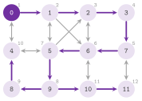

# 14. Graphs {#ch-14}

[Source: `include/ADS/graph/Graph.h`, `MatrixGraph.h`, `ListGraph.h`,
`ArrayGraph.h`, `StaticGraph.h`, `GraphBuilder.h`, `PointerGraph.h`,
`IncidenceGraph.h`, `PackedGraph.h`, `Visit.h`, `StrongComponents.h`,
`Grid.h`, `GridGraph.h`, `Paths.h`, `Properties.h`, `ShortestPaths.h`,
`AllPairsShortestPaths.h`, `MinimumSpanningTree.h`, `MaxFlow.h`,
`PushRelabel.h`, `FlowApplications.h`, `Matching.h`, `BlossomMatching.h`,
`Assignment.h`, `EulerianCycle.h`, `Observable.h`, `Reoptimization.h`, and
`include/ADS/interop/lemon/Heaps.h`, `Maps.h`, `Digraphs.h`, `Observers.h`,
`Parallel.h`, `include/ADS/interop/Csr.h`, `metis/Metis.h`, `kahip/KaHIP.h`,
`graphblas/GraphBLAS.h`, and `networkit/NetworKit.h`]

We are concerned in this chapter with the *graph*, i.e., a set of nodes
together with a set of pairs of nodes (the edges). A graph models any binary
relation on a finite set: the links of a network, the streets between the
crossings of a town, the precedences among the jobs of a project, or the
pairs of courses that some student attends (whose exams must therefore
fall on different days). The headers of `ADS/graph` realize the GRAPH of
[Montresor 2025, chapter 9](Z-bibliography.md#ref-montresor2025) in eight
representations, which differ in the space they take and in the cost of
their operations ([§14.1](14-graph.md#sec-14-1) to
[§14.4](14-graph.md#sec-14-4)). They also give the algorithms that work on
it: the visits and the problems that they solve
([§14.5](14-graph.md#sec-14-5) to [§14.7](14-graph.md#sec-14-7)), the
shortest paths ([§14.8](14-graph.md#sec-14-8)), the minimum spanning trees
([§14.9](14-graph.md#sec-14-9)), the flows and the cuts
([§14.10](14-graph.md#sec-14-10)), the matchings and the assignment
([§14.11](14-graph.md#sec-14-11)) and the Eulerian cycles and trails
([§14.12](14-graph.md#sec-14-12)). Finally, in [§14.13](14-graph.md#sec-14-13)
we describe a wrapper that turns each change of a graph into an event, and
the observers that keep a shortest path tree, a minimum
spanning forest, a maximum flow and an assignment optimal through such
changes, often by a test of the certificate of the previous solution alone,
and in [§14.14](14-graph.md#sec-14-14) the headers by which the structures,
the graphs and the changes pass between ADS and LEMON.
The adjacency matrix, the lists of adjacency, the matrix of incidence and
the two visits of [Morin 2013, chapter 12](Z-bibliography.md#ref-morin-cpp)
are all here, with each of his exercises solved on the code of the library
([§14.16](14-graph.md#sec-14-16)). In the sets of
[§1.9](01-introduction.md#sec-1-9), `Assignment.h`, `BlossomMatching.h`
(the blossoms of `Matching.h`, which includes it), `GraphBuilder.h`,
`GridGraph.h`, `Observable.h`, `PackedGraph.h`, `PointerGraph.h`,
`PushRelabel.h` (the push-relabel of `MaxFlow.h`, which includes it),
`Reoptimization.h`, `StaticGraph.h`, `StrongComponents.h` (the components
of `Visit.h` by one visit, which `Visit.h` includes) and `Biconnectivity.h`
are advanced and the other headers of this chapter are base; the headers of
`interop/lemon/` ([§14.14](14-graph.md#sec-14-14)) are of the set interop.

## 14.1 Definitions and the interface {#sec-14-1}

A graph $G = ( V , E )$ has a set $V$ of $n$ nodes and a set $E$ of $m$
edges. An edge of an *oriented* graph is an ordered pair $( u , v )$, which
*leaves* $u$ (its tail, or source) and *enters* $v$ (its head, or target).
An edge of an *unoriented* graph is instead an unordered pair $[ u , v ]$,
which the library stores as the two pairs $( u , v )$ and $( v , u )$
([Montresor 2025, §9.2](Z-bibliography.md#ref-montresor2025)). Thus, in the
terms of [Morin 2013, chapter 12](Z-bibliography.md#ref-morin-cpp), an
unoriented graph is one in which $( i , j )$ is an edge if and only if $( j
, i )$ is. There are no loops $( u , u )$, and hence $0 \le m \le n ( n - 1
)$. We say that a graph is *sparse* when $m$ is of the order of $n$ and
*dense* when it is of the order of $n^2$; this distinction decides among the
representations. A *path* from $u$ to $v$ is a sequence of nodes $u = x_0 ,
x_1 , \ldots , x_k = v$ with $( x_{i-1} , x_i ) \in E$ for $1 \le i \le k$.
It is *simple* if its nodes are distinct, and it is a *cycle* if $k \ge 1$
and $u = v$ ($k \ge 3$ for an unoriented graph); when there is a path from
$u$ to $v$, $v$ is *reachable* from $u$. A graph with no cycle is *acyclic*
(a DAG if oriented, a forest if not, and a free tree if it is also
connected). With the orientation ignored, the nodes reachable from one
another form the *connected components*, and those reachable from one
another along the orientation the *strongly connected components*. In [Figure
14.1](14-graph.md#fig-14-1) we show the oriented graph of twelve nodes that
the first sections of the chapter use as their example (the graph of [Morin
2013, figure 12.1](Z-bibliography.md#ref-morin-cpp)).

{#fig-14-1}

The nodes of each graph of the library are named by the integers in
$[ 0 , \mathrm{bound}() )$: `insertNode()` gives the next name, and
`deleteNode()` leaves the name of the node unused. Hence a vector indexed
by the nodes (the distances or the parents of a visit, say) has
$\mathrm{bound}() \ge n$ places, while $n$ itself is `n()`, i.e., the size
of `V()`. Any other datum of a node is kept in such a vector, as
[Morin 2013, chapter 12](Z-bibliography.md#ref-morin-cpp) also suggests,
or in its *label*, of a type `T`. Also, the edges may have a *weight* (a
cost, a length, a capacity) of a type `W`; both types are `std::monostate`
when there is none. In [Table 14.1](14-graph.md#tab-14-1) we collect the
symbols that the chapter shares with the headers.

<span id="tab-14-1"></span>**Table 14.1.** The symbols of the chapter and
of the headers of `ADS/graph`.

| Symbol | Meaning |
|---|---|
| $\mathrm{adj}( u )$, $d( u )$ | the nodes $v$ with $( u , v ) \in E$, and the (out)degree $d( u ) = \lvert \mathrm{adj}( u ) \rvert$, with $\sum_u d( u ) = m$ ($2 m$ if unoriented) |
| $w( u , v )$ | the weight (cost, length) of the edge $( u , v )$, of the type `W` |
| $\delta( r , v )$, $d[ v ]$ | the distance from $r$ to $v$ (the fewest edges, or the least cost, of a path), and the value an algorithm keeps for it; $\infty$ (`INF`, `infinity()`) if $v$ is not reachable |
| $p[ v ]$, $T[ v ]$ | the parent of $v$ in a tree rooted at the source, `NIL` ($-1$) for the root and for the nodes not reached |
| $\mathit{dt}[ u ]$, $\mathit{ft}[ u ]$ | the discovery and the finish times of $u$ in a visit in depth, on one clock that each event advances by 1 |
| $\mathit{low}[ u ]$, $B[ u ]$ | the least $\mathit{dt}$ that the subtree of $u$ reaches by one edge out of the tree of a visit in depth, and the block of the edge from $u$ to its parent |
| $\mathit{low}[ u ]$, $B[ u ]$ | the least $\mathit{dt}$ that the subtree of $u$ reaches by one edge out of the tree of a visit in depth, and the block of the edge from $u$ to its parent |
| $c( u , v )$, $f( u , v )$, $c_f( u , v )$ | the capacity of an edge of a network, its flow, and its residual capacity $c( u , v ) - f( u , v )$ |
| $( S , V \setminus S )$ | a cut, i.e., the edges with one end in $S$ and the other out of it |

The GRAPH of [Montresor 2025, §9.2](Z-bibliography.md#ref-montresor2025) has
the operations `insertNode()`, `insertEdge( u , v )`, `deleteNode( u )`,
`deleteEdge( u , v )`, `adj( u )`, `V()` and `n()`, and the interface of
[Morin 2013, chapter 12](Z-bibliography.md#ref-morin-cpp) adds
`hasEdge( i , j )`, `outEdges( i )` and `inEdges( i )`. Of these, we call the
last two `adj( u )` and `inAdj( u )`, and its realizations give all of them
where they make sense. However, we require much less of a graph in the
algorithms. Indeed, the concept `Graph` of `Graph.h` requires `n()`,
`bound()`, `directed()`, `hasNode( u )`, `V()`, `adj( u )` (the adjacent nodes
in a vector, as the SET of the book) and `forEachAdj( u , f )`, which calls
$f( v )$ on each adjacent node without building the vector; the concept
`DynamicGraph` adds the four insertions and deletions:

```cpp
// declarations of <ADS/graph/Graph.h>
template< class G >
concept Graph = requires( const G g , int u )
{
 { g.n() } -> std::convertible_to< int >;
 { g.bound() } -> std::convertible_to< int >;
 { g.directed() } -> std::same_as< bool >;
 { g.hasNode( u ) } -> std::same_as< bool >;
 { g.V() } -> std::same_as< std::vector< int > >;
 { g.adj( u ) } -> std::same_as< std::vector< int > >;
 g.forEachAdj( u , []( int ) { } );
 };

template< class G >
concept DynamicGraph = Graph< G > && requires( G g , int u , int v )
{
 { g.insertNode() } -> std::same_as< int >;
 g.insertEdge( u , v );
 g.deleteNode( u );
 g.deleteEdge( u , v );
 };
```

We write all the algorithms of the chapter on these concepts, so that they
run on any of the realizations (and on any type of another library that
models them), and we state their bounds on the lists or the vectors of
adjacency, where the scan of $\mathrm{adj}( u )$ costs $\Theta( d( u ) + 1
)$.

We remark that the realizations relax three preconditions of the
specification, which requires an edge not there in `insertEdge()`, one there
in `deleteEdge()` and an isolated node in `deleteNode()`. In `MatrixGraph` and
`ListGraph`, `insertEdge()` of an edge already there replaces its weight,
whereas `PointerGraph` keeps the old weight and `IncidenceGraph`, which has no
weights, adds a parallel edge; in all of them `deleteEdge()` of an edge not
there has no effect, and `deleteNode()` also deletes the edges of the node
(only `PointerGraph` keeps the strict `deleteNode()`). Their contracts
(cf. `Contract.h`) check that an operation on a node finds one of the graph
and that an edge joins two distinct nodes. Their invariants, checked on the
rows or the lists that an operation touches, state that the counts `n()` and
`m()` agree with the representation. The class `GraphNodes< T >`, from which
`MatrixGraph` and `ListGraph` derive, holds what these two share: the flag
`directed()`, the counts, the vector of the names in use, and the labels, with
`label( u )` and `setLabel( u , t )`; to the classes derived from it it gives
the checks of a node and of an edge (`check( u )` and `edge( u , v )`),
`addNode( t )`, and `nodesCounted()`, the invariant that `n()` counts the
names in use, each with its label. On that vector, the iterator `nodes()`
visits the nodes in increasing order with no vector built, through the slots
of `Alive` (whose `size()`, `occupied()` and `read()` give the number of the
names, whether a name is in use and its node). The realizations name the types
of their weights and of their labels `Weight` and `Label`.

## 14.2 The adjacency matrix {#sec-14-2}

The adjacency matrix of a graph of $n$ nodes is the $n \times n$ matrix $M$
whose entry $M[ u ][ v ]$ is the weight of $( u , v )$, or empty when there is
no such edge (the infinity of [Montresor 2025,
§9.3](Z-bibliography.md#ref-montresor2025), or the false of the boolean matrix
of [Morin 2013, §12.1](Z-bibliography.md#ref-morin-cpp)).
`MatrixGraph< W , T >` keeps it as a vector of rows of `std::optional< W >`,
with $\mathrm{bound}()$ rows and columns. Its invariants are that there is no
entry on the diagonal nor in the rows and the columns of the names not in use,
and that $M$ is symmetric for an unoriented graph; an operation checks them on
the rows and the columns that it touches, in $O( n )$. In [Figure
14.2](14-graph.md#fig-14-2) we show the matrix of the graph of [Figure
14.1](14-graph.md#fig-14-1). The operations `insertEdge( u , v , w )`,
`deleteEdge( u , v )`, `hasEdge( u , v )` and `weight( u , v )` read or write
a single entry, and the first two also the symmetric one when the graph is
unoriented ([Algorithm 14.1](14-graph.md#alg-14-1)). Hence each of them costs
$O( 1 )$ time. The public members of the class, beside those of `GraphNodes`
([§14.1](14-graph.md#sec-14-1)), are

```cpp
// declarations of <ADS/graph/MatrixGraph.h>
template< class W = std::monostate , class T = std::monostate >
class MatrixGraph : public GraphNodes< T >
{
 public:
 using Weight = W;
 using Label = T;
 explicit MatrixGraph( int n = 0 , bool directed = true );
 int insertNode( const T & t = T() );
 void insertEdge( int u , int v , const W & w = W() );
 void deleteEdge( int u , int v );
 void deleteNode( int u );
 [[nodiscard]] bool hasEdge( int u , int v ) const;
 [[nodiscard]] std::optional< W > weight( int u , int v ) const;
 [[nodiscard]] std::vector< int > adj( int u ) const;
 [[nodiscard]] std::vector< int > inAdj( int u ) const;
 template< class F >
 void forEachAdj( int u , F && f ) const;
 template< class F >
 void forEachEdge( int u , F && f ) const;
 [[nodiscard]] auto neighbors( int u ) const;
 };
```

where `forEachEdge( u , f )` calls $f( v , w )$ on each edge $( u , v )$ of
weight $w$, and `neighbors( u )` is a range of the adjacent nodes. For
instance, with the header `ADS/graph/MatrixGraph.h`,

```cpp
ADS::MatrixGraph< int > g( 4 );  // 4 nodes, oriented, no edge
g.insertEdge( 0 , 1 , 5 );
g.insertEdge( 1 , 2 , 7 );
g.insertEdge( 0 , 1 , 3 );                    // a new weight, still m() = 2
std::optional< int > w = g.weight( 0 , 1 );  // w is 3
std::vector< int > A = g.inAdj( 2 );        // A is ( 1 )
g.deleteNode( 1 );                          // n() = 3 and m() = 0
```

{#fig-14-2}

<span id="alg-14-1"></span>**Algorithm 14.1.** The insertion of an edge in
`MatrixGraph`, and the nodes with an edge to $u$ (the `inEdges( i )` of [Morin
2013, §12.1](Z-bibliography.md#ref-morin-cpp)).

--8<-- "generated/MatrixGraph-insertEdge.pseudo.md"

--8<-- "generated/MatrixGraph-inAdj.pseudo.md"

Thus `insertEdge()` writes the entry, counts the edge only when the entry
was empty (so that a second insertion only replaces the weight), and mirrors
it for an unoriented graph.

However, the adjacent nodes are another matter, since `adj( u )` must scan the
whole row of $u$ to find its $d( u )$ entries, and `inAdj( u )` the whole
column. Also `forEachAdj()`, `forEachEdge()` and the iterator `neighbors( u )`
(through the slots of `Present`) scan the row in the same way. A new node adds
a row and a column, i.e., $\Theta( n )$ time, and `deleteNode( u )` empties
both before it marks the name unused, again in $\Theta( n )$.

<span id="thm-14-1"></span>**Theorem 14.1.** *Let $N = \mathrm{bound}()$,
which is $n$ when no node has been deleted. `MatrixGraph` realizes the
GRAPH in $\Theta( N^2 )$ space, with `insertEdge()`, `deleteEdge()`,
`hasEdge()` and `weight()` in $O( 1 )$ time, `adj()`, `inAdj()` and
`deleteNode()` in $\Theta( N )$ time, and `insertNode()` in $\Theta( N )$
amortized time.*

*Proof.* The matrix has $N^2$ places, one optional weight each, and we obtain
the costs from the number of entries that each operation reads or writes, as
described above. A new node appends a row of $N + 1$ places and one place to
each of the $N$ rows, each append amortized $O( 1 )$ since the rows are vectors
that double. $\square$

Its main defect is the space: $n^2$ places for any number of edges, i.e.,
$n^2$ optional weights (at least $n^2$ bytes even without weights), where
a matrix of bits would take $n^2 / w$ words of $w$ bits
([Morin 2013, §12.1](Z-bibliography.md#ref-morin-cpp)). On a dense graph
this is no waste, and a matrix is usually preferable whenever `hasEdge()`
dominates; e.g., the universal sink of [§14.7](14-graph.md#sec-14-7) is
found by at most $3 ( n - 1 )$ entries read out of the $n^2$
([Lemma 14.28](14-graph.md#lem-14-28)). On a sparse graph, instead, a
visit on the matrix costs $\Theta( n^2 )$ against the $\Theta( n + m )$
of the lists, since each row is read whole. A further use of the matrix is
algebraic. If the entries are taken as integers, 1 for an edge and 0
otherwise, the square of $M$ has

$$
M^2[ u ][ v ] = \sum_{k} M[ u ][ k ] \, M[ k ][ v ] , \tag{14.1}
$$

i.e., the number of paths of exactly two edges from $u$ to $v$, and in
general $M^\ell[ u ][ v ]$ counts the paths of $\ell$ edges. Therefore the
powers of $M$ (by repeated squaring, $O( \log n )$ products) give the
distances in edges between all the pairs; with a fast product of matrices
(cf. [chapter 17](17-numeric.md#ch-17)) this may beat the $n$ visits of
[§14.5](14-graph.md#sec-14-5) on dense graphs ([Seidel
1995](Z-bibliography.md#ref-seidel1995)). Also, the functions `incidence()`
and `adjFromIncidence()` of `Graph.h`, which build and read the matrix of
incidence, belong to the same algebraic view, and we describe them in
[§14.4](14-graph.md#sec-14-4).

## 14.3 The lists of adjacency {#sec-14-3}

The lists of adjacency take the view of the nodes: for each node $u$ a list
holds its adjacent nodes, i.e., every $v$ with $( u , v ) \in E$ ([Montresor
2025, §9.4](Z-bibliography.md#ref-montresor2025); [Morin 2013,
§12.2](Z-bibliography.md#ref-morin-cpp)). `ListGraph< W , T >` keeps a vector
of $\mathrm{bound}()$ lists, each a `List` of [chapter 2](02-sequence.md#ch-2)
of pairs (the adjacent node, the weight of the edge), the nodes of a list in
the order in which their edges were inserted. Its invariant is that the lists
hold only nodes of the graph, with no loops nor repetitions and $m$ edges in
all (counted twice if unoriented), and that an unoriented edge is in the lists
of both its ends with the same weight. An insertion or a deletion checks it on
the lists of the two ends, in $O( d \log d )$ for $d$ adjacent nodes. In
[Figure 14.3](14-graph.md#fig-14-3) we show the lists of the graph of [Figure
14.1](14-graph.md#fig-14-1), in the order of [Morin 2013, figure
12.4](Z-bibliography.md#ref-morin-cpp).

{#fig-14-3}

In [Morin 2013, §12.2](Z-bibliography.md#ref-morin-cpp) the insertion appends
to the list in $O( 1 )$, and leaves to the caller the precondition that the
edge is not there. Instead, the insertion of `ListGraph` searches the list
first, and an edge already there only gets its new weight ([Algorithm
14.2](14-graph.md#alg-14-2)); the price is $O( d( u ) )$ time
($O( d( u ) + d( v ) )$ if unoriented). Also `deleteEdge()` and `hasEdge()`
make the same search, while `adj( u )` copies the list.

<span id="alg-14-2"></span>**Algorithm 14.2.** The insertion of an edge in
`ListGraph`, and the nodes with an edge to $u$ in an oriented graph (the
`inEdges( i )` of [Morin 2013, §12.2](Z-bibliography.md#ref-morin-cpp)).

--8<-- "generated/ListGraph-insertEdge.pseudo.md"

--8<-- "generated/ListGraph-inAdj.pseudo.md"

`ListGraph< W , T >` has the same public members as `MatrixGraph< W , T >`,
with the same meaning, and can replace it in the example above. When the search
of line 2 finds $v$ in $L_u$, line 3 writes the weight, and otherwise the new
pair goes after the tail of the list (line 4). In this representation, the
edges that enter a node are its defect, since no link leads from them to their
head. Thus `inAdj( u )` of an oriented graph scans all the lists ([Algorithm
14.2](14-graph.md#alg-14-2)); in an unoriented one they are the edges that
leave $u$, which the list of $u$ gives in $O( d( u ) )$. For the same reason
`deleteNode( u )` removes $u$ from the list of each node before it empties the
list of $u$, in $O( \mathrm{bound}() + m )$ time.

--8<-- "generated/ListGraph-deleteNode.pseudo.md"

<span id="thm-14-2"></span>**Theorem 14.2.** *With $N = \mathrm{bound}()$,
`ListGraph` realizes the GRAPH in $\Theta( N + m )$ space, with `insertNode()`
in $O( 1 )$ amortized time, `insertEdge( u , v )`, `deleteEdge( u , v )`,
`hasEdge( u , v )` and `weight( u , v )` in $O( d( u ) )$ time
($O( d( u ) + d( v ) )$ for the first two if the graph is unoriented),
`adj( u )` in $\Theta( d( u ) + 1 )$ time, `inAdj( u )` in $O( N + m )$ time
($O( d( u ) \log d( u ) )$ if unoriented, since the result is sorted), and
`deleteNode()` in $O( N + m )$ time.*

*Proof.* We count first the space: each list has a node per adjacent node,
i.e., $m$ list nodes (or $2 m$) besides the vector of the $\mathrm{bound}()$
heads. The insertion, the deletion and the search of an edge scan the list of
$u$ once (and that of $v$ if unoriented), and an insertion at the tail of a
`List` costs $O( 1 )$. Also, `inAdj()` of an oriented graph scans each list
once, and that of an unoriented graph copies and sorts the list of $u$. A new
node appends an empty list to the vector, $O( 1 )$ amortized. $\square$

[Morin 2013, §12.2](Z-bibliography.md#ref-morin-cpp) ends with four design
choices of a representation by lists, and we take each of them somewhere
in the library. First, the list may be a linked list (`ListGraph`), an array
(`ArrayGraph` and `StaticGraph`, in [§14.4](14-graph.md#sec-14-4)) or a
hash table (the copy of the edges of `SpanningForestObserver`, in
[§14.13](14-graph.md#sec-14-13)). Second, an extra list of the entering edges
makes `inAdj()` fast at the price of a second update per change (cf. the
lists that `ShortestPathsObserver` builds after the first raise of a
weight). Third, the entry of $( u , v )$ in the list of $u$ may be linked
to its twin in the list of $v$ (the residual twins of `FlowNetwork`, in
[§14.10](14-graph.md#sec-14-10)). Finally, the edges may be objects of
their own (the `Edge` of `PointerGraph`, and the numbered edges of
`FlowNetwork`). Each choice trades space and the cost of the updates for
the speed of some query, and none is best for all uses.

## 14.4 Other representations {#sec-14-4}

### 14.4.1 Vectors of adjacency {#sec-14-4-1}

When a graph does not change after it is built, one may pack its lists into
one vector. The adjacent nodes of all the nodes go in a vector $\mathit{to}$
of $a$ places ($a = m$ arcs if oriented and $a = 2 m$ if not). Those of $u$
are in the places $\mathit{off}[ u ] \le k < \mathit{off}[ u + 1 ]$ of a
vector of $n + 1$ offsets, with $\mathit{off}[ 0 ] = 0$ and
$\mathit{off}[ n ] = a$ ([Montresor 2025,
§9.4](Z-bibliography.md#ref-montresor2025)). This is the format of the
compressed sparse rows of the sparse matrices (cf. [chapter
17](17-numeric.md#ch-17) and [Saad 2003,
§3.4](Z-bibliography.md#ref-saad2003)): no pointer, $\Theta( n + a )$ space,
and the adjacent nodes of $u$ in one contiguous run, which a visit reads with
no jump in memory. `ArrayGraph< W >` keeps it with the weights in a vector
parallel to $\mathit{to}$. It builds it from a list of edges by a counting
sort on the tails ([Algorithm 14.3](14-graph.md#alg-14-3)), in
$\Theta( n + a )$ time, since the keys are names of nodes, i.e., integers in
$[ 0 , n )$, and each row keeps the order in which its edges were given ([Lemma
14.1](14-graph.md#lem-14-1)). Also, the constructor from any `Graph` copies its
edges, and the names that are not nodes become isolated nodes; thus each node
keeps its name. There is no insertion nor deletion, but
`setWeight( u , v , w )` changes the weight of an edge (of both its arcs if
unoriented) in $O( d( u ) + d( v ) )$, and `weight( u , v )` reads it in
$O( d( u ) )$. Also, `neighbors( u )` gives the row as a `std::span` and
`nodes()` the names as a view of `std::views::iota`. Besides the members of
the concept `Graph`, which it models, the class has

```cpp
// declarations of <ADS/graph/ArrayGraph.h>
template< class W = std::monostate >
class ArrayGraph
{
 public:
 using Weight = W;
 ArrayGraph( int n , const std::vector< std::tuple< int , int , W > > & E ,
             bool directed = true );
 template< Graph G >
 explicit ArrayGraph( const G & g );
 [[nodiscard]] int m( void ) const;
 template< class F >
 void forEachEdge( int u , F && f ) const;
 [[nodiscard]] std::optional< W > weight( int u , int v ) const;
 bool setWeight( int u , int v , const W & w );
 [[nodiscard]] auto nodes( void ) const;
 [[nodiscard]] std::span< const int > neighbors( int u ) const;
 };
```

where `setWeight()` returns false, and changes nothing, when $( u , v )$ is
not an edge.

<span id="alg-14-3"></span>**Algorithm 14.3.** The vectors of adjacency
of `ArrayGraph` by a counting sort on the tails
([Montresor 2025, §9.4](Z-bibliography.md#ref-montresor2025)).

--8<-- "generated/ArrayGraph-build.pseudo.md"

<span id="lem-14-1"></span>**Lemma 14.1.** *Let $E$ be a list of edges
on the nodes $0 , \ldots , n - 1$, each joining two distinct nodes, and
let $a = | E |$ if the graph is oriented and $a = 2 | E |$ if not. The
constructor of `ArrayGraph` takes $\Theta( n + a )$ time and space, and at
its end, for each node $u$, the places $\mathit{off}[ u ] \le k <
\mathit{off}[ u + 1 ]$ of $\mathit{to}$ hold, with their weights, the heads
of the arcs out of $u$ (the other ends of the edges of $u$, if the graph is
unoriented) in the order of $E$, and the offsets do not decrease from
$\mathit{off}[ 0 ] = 0$ to $\mathit{off}[ n ] = a$.*

*Proof.* After line 2 of [Algorithm 14.3](14-graph.md#alg-14-3),
$\mathit{off}[ u + 1 ]$ is the number $d( u )$ of the arcs out of $u$, and
after line 3 $\mathit{off}[ u ]$ is the sum of $d( w )$ over the nodes
$w < u$; hence the ranges of the nodes are consecutive, of $d( u )$ places
each, and the last one ends at $a$. Line 4 writes each arc of $u$, in the
order of $E$, in the first free place of the range of $u$ (a counter that
starts at $\mathit{off}[ u ]$ and grows by one per arc, as in the counting
sort of [§12.10](12-sort.md#sec-12-10)), and exactly $d( u )$ arcs leave
$u$; hence the range is filled in that order, and no write leaves it.
Lines 2 and 4 scan $E$ once, and line 3 the $n + 1$ offsets. $\square$

On two parallel edges, `setWeight( u , v , w )` changes the first of them in
the row of $u$ (and, if the graph is unoriented, the first twin in the row of
$v$).

`StaticGraph< W , L >` is the same format engineered for the algorithms that
scan the arcs many times. First, the graph is three plain arrays (a structure
of arrays): the offsets of the rows, the heads of the arcs and, when the graph
is weighted, their weights in the same places. A visit that needs only the
heads thus reads no weight, and a library that takes a graph in compressed rows
(`xadj`, `adjncy` and `adjwgt` of METIS, the arrays `Ap`, `Aj` and `Ax` of
GraphBLAS) receives the pointers `offsets()`, `heads()` and `weightData()`
without a copy. In all, the graph takes $4 ( n + 1 ) + ( 4 + s ) a$ bytes, $s$
the size of a weight (0 if unweighted), with no padding between a head and its
weight; an interleaved pair would round 12 bytes up to 16 for a `double`.
Second, the arcs of each node are sorted by head. This makes the reads of a
visit that follows them go forward in memory, and lets `weight( u , v )` and
`setWeight()` find an arc by a binary search of the heads, in $O( \log d( u )
)$. The rows come out sorted from two passes of counting sort, the first by
head and the second, stable, by tail ([Algorithm 14.4](14-graph.md#alg-14-4)),
again in $\Theta( n + a )$ time. An unoriented edge $[ u , v ]$ gives the two
arcs $( u , v )$ and $( v , u )$, and parallel arcs are kept. [Figure
14.4](14-graph.md#fig-14-4) compares the two forms on the same edges. The
members that `StaticGraph` adds to those of the concept `Graph` are

```cpp
// declarations of <ADS/graph/StaticGraph.h>
template< class W >
struct WeightedArc
{
 int to;
 W w;
 };

enum class ArcLayout
{
 Separate ,
 Interleaved
 };

template< class W = std::monostate , ArcLayout L = ArcLayout::Separate >
class StaticGraph
{
 public:
 using Weight = W;
 static constexpr bool weighted = ! std::is_same_v< W , std::monostate >;
 static constexpr ArcLayout layout = L;
 static constexpr bool interleaved =
   weighted && ( L == ArcLayout::Interleaved );
 using Arc = std::conditional_t< weighted , WeightedArc< W > , int >;
 using ArcCursor = std::conditional_t<
   ! weighted , const int * ,
   std::conditional_t< interleaved , const WeightedArc< W > * ,
                       detail::WeightedArcCursor< W > > >;
 using ArcRange = std::conditional_t<
   ! weighted , std::span< const int > ,
   std::conditional_t< interleaved , std::span< const WeightedArc< W > > ,
                       std::ranges::subrange< ArcCursor > > >;
 using HeadArray =
   std::conditional_t< interleaved ,
                       detail::ArcMember< W , int , &WeightedArc< W >::to > ,
                       const int * >;
 using WeightArray =
   std::conditional_t< interleaved ,
                       detail::ArcMember< W , W , &WeightedArc< W >::w > ,
                       const W * >;
 StaticGraph( int n , const std::vector< std::tuple< int , int , W > > & E ,
              bool directed = true );
 StaticGraph( int n , const std::vector< std::pair< int , int > > & E ,
              bool directed = true )
  requires( ! weighted );
 template< Graph G >
 explicit StaticGraph( const G & g );
 [[nodiscard]] int m( void ) const;
 [[nodiscard]] int arcs( void ) const;
 [[nodiscard]] int degree( int u ) const;
 template< class F >
 void forEachEdge( int u , F && f ) const
  requires( weighted );
 [[nodiscard]] std::optional< W > weight( int u , int v ) const
  requires( weighted );
 bool setWeight( int u , int v , const W & w )
  requires( weighted );
 [[nodiscard]] ArcRange out( int u ) const;
 [[nodiscard]] const int * offsets( void ) const;
 [[nodiscard]] const int * heads( void ) const
  requires( ! interleaved );
 [[nodiscard]] const W * weightData( void ) const
  requires( weighted && ( ! interleaved ) );
 [[nodiscard]] HeadArray arcHeads( void ) const;
 [[nodiscard]] WeightArray arcWeights( void ) const
  requires( weighted );
 [[nodiscard]] ArcCursor arcData( void ) const;
 static int head( const Arc & a );
 [[nodiscard]] StaticGraph transpose( void ) const;
 [[nodiscard]] StaticGraph relabel( const std::vector< int > & p ) const;
 [[nodiscard]] auto nodes( void ) const;
 };

template< class G >
concept CsrArrays =
  requires( const G & g ) {
   { g.offsets() } -> std::same_as< const int * >;
   { g.heads() } -> std::same_as< const int * >;
   } &&
  ( ( ! requires { requires G::weighted; } ) ||
    requires( const G & g ) {
     { g.weightData() } -> std::same_as< const typename G::Weight * >;
     } );

template< class W , ArcLayout L >
std::vector< int > bfsOrder( const StaticGraph< W , L > & g , int r = 0 );
```

with `arcs()` the number $a$ of the arcs and a default constructor that
makes the graph with no node.

<span id="alg-14-4"></span>**Algorithm 14.4.** The compressed rows of
`StaticGraph`, sorted by two passes of counting sort.

--8<-- "generated/StaticGraph-build.pseudo.md"

![Figure 14.4. The vectors of adjacency of `ArrayGraph` and of `StaticGraph` built from the same eight edges $E$: the former keeps the order of $E$ in each row, the latter sorts each row by head; the row of the node 2, between $\mathit{off}[ 2 ] = 3$ and $\mathit{off}[ 3 ] = 5$, is in violet.](../figures/graph-csr.svg){#fig-14-4}

`StaticGraph` also gives what the engineered algorithms read directly: the
three arrays (`offsets()`, `heads()` and `weightData()`), the arcs of $u$ as a
range of random access (`out( u )`), the cursor at the first arc
(`arcData()`), the head of an arc (`head()`) and the degree (`degree( u )`).
An arc is still read as a pair: on a weighted graph an element of `out( u )`,
or the place $k$ of `arcData()`, is the `WeightedArc` made from the place $k$
of the two arrays as it is read, and the cursor takes the indexing and the
arithmetic of a pointer. On an unweighted graph `out( u )` is a `std::span`
of the heads and `arcData()` is `heads()`. We remark that the two arrays cost
something to the algorithms that read a head with its weight. We counted by
callgrind, with a simulated last-level cache of 2 MB, Dijkstra on an indexed
4-ary heap and the stepping algorithms of
[§25.12](25-parallel.md#sec-25-12) on one thread, on random graphs of 800000
arcs and degree 8. Against the pairs they execute 0.2% to 6% more
instructions, and they miss the last level 24% to 36% more often with `int`
weights and 6% to 12% more often with `double` weights, since a short row
spans two lines instead of one. With degree 32 the misses fall by 12% to 14%
with `double` weights and still grow by 15% to 17% with `int` weights, while
a visit in breadth, which reads only the heads, misses 36% to 77% less often
on all these graphs.

For this reason the layout of a weighted graph is the second parameter $L$
of `StaticGraph`: the two arrays (`ArcLayout::Separate`, the default), or one
array of the pairs `WeightedArc` (`ArcLayout::Interleaved`), which takes
$4 ( n + 1 ) + s' a$ bytes, $s'$ being the size of a pair with its padding.
The two layouts give the same interface, so that an algorithm written on one
runs on the other. In both, `out( u )` is a range of random access of
`WeightedArc` (a `std::span` of the pairs if interleaved, whose cursor
`arcData()` is then a plain pointer). The members `arcHeads()` and
`arcWeights()` read the head and the weight of the place $k$ where they lie,
and the parallel visits, the stepping algorithms and the adapters of
Boost.Graph and LEMON read the arcs through them. Only the separate layout has
`heads()` and `weightData()`, the plain arrays that a library in compressed
rows takes without a copy; the concept `CsrArrays`, which `ArrayGraph` also
satisfies, is what such a call requires of its graph. Of course, the default
stays the separate layout until a campaign on an idle machine has compared
the times of the two. The benchmarks of Dijkstra and of the stepping
algorithms (`bench/graphs.cpp` and `bench/parallel.cpp`) run both layouts,
with the separate one run again as the row A/A, which measures the noise.
`transpose()` builds the graph with the arcs reversed, which the visits from
the bottom up and the strongly connected components of a reversed graph need,
and `relabel( p )` the same graph with the node $u$ renamed $p[ u ]$. Both
rebuild the rows by [Algorithm 14.4](14-graph.md#alg-14-4), in
$\Theta( n + a )$ time.

--8<-- "generated/StaticGraph-transpose.pseudo.md"

--8<-- "generated/StaticGraph-relabel.pseudo.md"

The adapters of the partitioners METIS and KaHIP
([§C.15](C-libraries.md#sec-C-15)) read the rows through `CsrInput< X , Y >` of
`interop/Csr.h`, with `X` the type of the indices of the library and `Y` that
of its weights, and a partitioner gives back a `Partition`, the part of each
node and the weight of the edges cut, whose `order()` is the renaming that
`relabel()` takes to make the nodes of each part consecutive.
`metis::partition( g , k )` of `interop/metis/Metis.h` is such a partitioner,
on the k-way or on the recursive bisection of METIS ([Karypis and Kumar
1998](Z-bibliography.md#ref-karypis1998)).

<span id="lem-14-2"></span>**Lemma 14.2.** *Let $g$ be a `StaticGraph`
of $n$ nodes and $a$ arcs. `CsrInput< X , Y >( g )` gives the offsets and
the heads of $g$ as arrays of `X`, and its weights (if $g$ is weighted and
they are asked) as an array of `Y`. The offsets are those of $g$ itself when
`X` is `int`; the heads are those of $g$ when, besides, $g$ has the separate
layout, and so are the weights when, besides, `Y` is the type of the weights
of $g$. Each other array is a copy, converted place by place, made in $O( n )$
time for the offsets and in $O( a )$ for the heads and the weights. For a
`Partition` of $k$ parts, `order()` gives in $O( n + k )$ time the
permutation $p$ that numbers first the nodes of the part 0, then those of the
part 1, and so on, each part in the increasing order of the names.*

*Proof.* The three cases are the three tests `if constexpr` of the
constructor, in which the type `int` of the offsets and of the heads of $g$,
and `CsrArrays`, which holds on the separate layout alone, decide whether a
pointer into $g$ is taken; a copy is one loop over the array. `order()` is a
counting sort of the nodes by their parts ([§12.10](12-sort.md#sec-12-10)):
after the prefix sums, the part $q$ starts at the number of the nodes in the
parts below $q$, and the scan of the nodes in increasing order gives each
node the next name of its part, which fills the $k$ disjoint ranges.
$\square$

<span id="lem-14-3"></span>**Lemma 14.3.** *Let $g$ be unoriented,
without loops, with positive integral weights if any, and let
$1 \le k \le n$. Then `metis::partition( g , k )` returns the partition into
$k$ parts that METIS computes on the arrays of `CsrInput< idx_t , idx_t >`,
numbered from 0, and as `cut` the weight of the cut that METIS reports; it
writes none of the arrays of $g$, and it throws `std::runtime_error` when
METIS fails. With $k = 1$ it does not call METIS, and puts all the nodes in
the part 0 with `cut` 0.*

*Proof.* `partition()` sets the numbering of C (`METIS_OPTION_NUMBERING` 0),
passes the arrays of [Lemma 14.2](14-graph.md#lem-14-2), which METIS reads
only, and copies the parts and the cut of the result; any return value but
`METIS_OK` throws. For $k = 1$ the vector of the parts keeps its zeros.
$\square$

The lemma bounds neither the size of the cut nor the balance of the parts
(within the factor `imbalance` of the options, which METIS aims at), both
being those of its multilevel heuristic.

A renaming may pay for its cost when it puts close together the nodes that an
algorithm visits close in time. `bfsOrder( g , r )` gives the order of a visit
in breadth from $r$, then from the least node not reached, and so on, as a
permutation of the names. This is the ordering of [Cuthill and McKee
1969](Z-bibliography.md#ref-cuthill1969) without its sort by degree; on the
relabelled graph the nodes of one level of a visit, and their rows, are
contiguous.

--8<-- "generated/StaticGraph-bfsOrder.pseudo.md"

`GraphBuilder< W >` covers the case of a graph whose edges come one at a time
and whose number of nodes may grow: `addNode()` gives the next name,
`addEdge( u , v , w )` appends an `Edge` (a tuple of the two ends and the
weight) after those already there, even if parallel to one of them, and
`reserve()`, `edges()`, `n()`, `m()` and `directed()` do what their names
suggest:

```cpp
// declarations of <ADS/graph/GraphBuilder.h>
template< class W = std::monostate >
class GraphBuilder
{
 public:
 using Weight = W;
 using Edge = std::tuple< int , int , W >;
 explicit GraphBuilder( int n = 0 , bool directed = true );
 [[nodiscard]] bool directed( void ) const;
 [[nodiscard]] int n( void ) const;
 [[nodiscard]] int m( void ) const;
 [[nodiscard]] const std::vector< Edge > & edges( void ) const;
 void reserve( std::size_t m );
 int addNode( void );
 void addEdge( int u , int v , const W & w = W() );
 [[nodiscard]] StaticGraph< W > toStaticGraph( void ) const;
 [[nodiscard]] ArrayGraph< W > toArrayGraph( void ) const;
 };
```

When the graph is complete, `toStaticGraph()` and `toArrayGraph()` freeze it
into either form in $\Theta( n + a )$ time, by the constructors above. We
remark that the two keep a different order of the arcs of a node (the order of
insertion and the order of the heads). One may give a graph whose edges are
already in a vector to the constructors directly: the builder adds only the
growth of the nodes and the checks at each insertion, where the error is made.
For instance, with the header `ADS/graph/GraphBuilder.h`,

```cpp
ADS::GraphBuilder< double > b;  // oriented, no node yet
const int x = b.addNode() , y = b.addNode() , z = b.addNode();
b.addEdge( x , z , 2.5 );
b.addEdge( x , y , 1.0 );
ADS::StaticGraph< double > g = b.toStaticGraph();
ADS::StaticGraph< double >::ArcRange A = g.out( x );
// the arcs to y and to z, sorted: A[ 0 ].to is y, A[ 1 ].w is 2.5
std::optional< double > w = g.weight( x , z );  // w is 2.5
```

--8<-- "generated/GraphBuilder-toStaticGraph.pseudo.md"

--8<-- "generated/GraphBuilder-toArrayGraph.pseudo.md"

<span id="lem-14-4"></span>**Lemma 14.4.** *`addNode()` takes $O( 1 )$
time, and `addEdge()` $O( 1 )$ amortized time ($O( 1 )$ in the worst case
while the room given by `reserve()` lasts). After any sequence of these
calls on a builder of $n$ nodes, `toArrayGraph()` and `toStaticGraph()`
return in $\Theta( n + a )$ time a graph on the nodes $0 , \ldots , n - 1$
whose arcs are those of the edges added, parallel ones included, each row in
the order of insertion for `ArrayGraph` and sorted by head for
`StaticGraph`.*

*Proof.* `addNode()` increments the number of the nodes, and `addEdge()`
appends a tuple to a `std::vector`, whose growth by doubling gives the
amortized bound ([§2.2](02-sequence.md#sec-2-2)). The two conversions pass
$n$, the vector of the edges and the orientation to the constructors, whose
rows are those of [Lemma 14.1](14-graph.md#lem-14-1) and of the two
passes of [Algorithm 14.4](14-graph.md#alg-14-4), the second of which is
stable. $\square$

### 14.4.2 A graph of objects linked by pointers {#sec-14-4-2}

`PointerGraph< T , W >` is the oriented graph of the textbooks that draw a
node as a record: each `Node` holds its label, the number of edges that enter
or leave it (`degree`), a flag for the visits (`seen`) and the `std::list` of
its edges, each an `Edge` that points to its other end and carries a weight
([Montresor 2025, §9.2](Z-bibliography.md#ref-montresor2025)). A node is
reached by its address, which stays valid until the node is deleted (the nodes
are themselves in a `std::list`, and hence never move), and found by its label
in $O( n )$ by `find()`. Since its nodes point to one another, the graph
cannot be copied. It has neither names nor a bound, and therefore it does not
model the concept `Graph`: its visits `dfs()` and `bfs()` are its own, and
mark the nodes by their flags, cleared at the start of each visit.
`deleteNode( u )` deletes only an isolated node (the strict precondition of
the specification, and returns false otherwise). Instead,
`forceDeleteNode( u )` first removes the edges that enter $u$ from the lists
of the other nodes and the edges of $u$, in $O( n + m )$ ([Figure
14.5](14-graph.md#fig-14-5)). Also, `insertEdge()`, `deleteEdge()`,
`hasEdge()` and `adjacent()` scan the list of the tail. Its invariant and the
costs of its operations are in [Lemma 14.5](14-graph.md#lem-14-5); whether a
node belongs to the graph costs $O( n )$, and is checked only at the level of
the audits. We remark that `insertEdge()`
of an edge already there leaves its weight unchanged. The class is

```cpp
// declarations of <ADS/graph/PointerGraph.h>
template< class T , class W = int >
class PointerGraph
{
 public:
 struct Node;
 struct Edge
 {
  Node * to;
  W weight;
  };
 struct Node
 {
  T label;
  int degree = 0;
  bool seen = false;
  std::list< Edge > out;
  };
 PointerGraph( void ) = default;
 [[nodiscard]] int n( void ) const;
 Node * insertNode( const T & t );
 [[nodiscard]] Node * find( const T & t );
 [[nodiscard]] bool hasEdge( const Node * u , const Node * v ) const;
 void insertEdge( Node * u , Node * v , const W & w = W() );
 void deleteEdge( Node * u , Node * v );
 bool deleteNode( Node * u );
 void forceDeleteNode( Node * u );
 [[nodiscard]] std::vector< Node * > adjacent( const Node * u ) const;
 template< class F >
 void dfs( Node * r , F && f );
 template< class F >
 void bfs( Node * r , F && f );
 };
```

where `dfs( r , f )` and `bfs( r , f )` call $f( u )$ on each node reached, in
the order of the visit.

{#fig-14-5}

--8<-- "generated/PointerGraph-forceDeleteNode.pseudo.md"

--8<-- "generated/PointerGraph-dfs.pseudo.md"

--8<-- "generated/PointerGraph-bfs.pseudo.md"

<span id="lem-14-5"></span>**Lemma 14.5.** *Let $d^+( u )$ be the length
of the list of the edges of $u$. The operations of `PointerGraph` keep its
invariant: the list of a node holds at most one edge to each node, the degree
of each node is the number of the edges that leave it plus that of the edges
that enter it, and each edge leads to a node of the graph. `insertNode()`
takes $O( 1 )$ time; `hasEdge()`, `insertEdge()`, `deleteEdge()` and
`adjacent()` take $O( d^+( u ) )$ on the tail $u$; `find()` and `deleteNode()`
take $O( n )$, and `forceDeleteNode()`, `dfs()` and `bfs()` take
$O( n + m )$.*

*Proof.* `insertEdge( u , v )` appends an edge only when `hasEdge( u , v )` is
false, and then increments the degrees of $u$ and of $v$; `deleteEdge()`
removes the first edge to $v$, if any, and decrements the same two degrees.
`deleteNode( u )` removes $u$ only when its degree is 0, i.e., by the
invariant, when no edge enters or leaves it, and `forceDeleteNode( u )` first
deletes the edges to $u$ from each list, in $O( n + m )$ in all, then the
edges of $u$, each at the front of its list, so that no edge is left that
leads to $u$. The removal of a node from the `std::list` of the nodes is a
scan for its address, in $O( n )$, as `find()` is. The two visits clear the
$n$ flags, then examine each edge of a node reached once. $\square$

### 14.4.3 The matrix of incidence {#sec-14-4-3}

The matrix of incidence of an oriented graph is the $n \times m$ matrix $A$
with a column per edge, and $A_{i,e} = -1$ if the node $i$ is the source of
the edge $e$, $+1$ if it is its target, and 0 otherwise ([Morin 2013, exercise
12.2](Z-bibliography.md#ref-morin-cpp); [Montresor 2025,
§9.3](Z-bibliography.md#ref-montresor2025), where an unoriented edge has 1 at
both ends). `incidence( g )` of `Graph.h` builds it from any graph, with the
edges in the order of `V()` and of `adj()` and an unoriented edge met from its
smaller end. Conversely, `adjFromIncidence( B , u , directed )` reads the
adjacent nodes of $u$ back from it: each column of an edge that leaves $u$ (or
touches it) leads to the other row with a nonzero entry.

--8<-- "generated/Graph-incidence.pseudo.md"

--8<-- "generated/Graph-adjFromIncidence.pseudo.md"

`IncidenceGraph` is the oriented graph kept on this matrix, which solves the
second part of [Morin 2013, exercise 12.2](Z-bibliography.md#ref-morin-cpp).
Here the matrix is stored by columns, one column of $n$ bytes (`std::int8_t`)
per edge; thus `bytes()` is $n m$, and `entry( i , e )` reads $A_{i,e}$. Its
nodes are $0 , \ldots , n - 1$, and it models the concept `Graph`; hence the
visits of [§14.5](14-graph.md#sec-14-5) run on it as on the others. A loop has
no column (its $-1$ and $+1$ would fall in one place), and two parallel edges
have two equal columns. Its invariant, one $-1$ and one $+1$ per column, is
checked on the columns that an operation writes. On this matrix the operations
of Morin's interface cost as follows. The insertion appends a column, in
$O( n )$ amortized time. The search of $( i , j )$ ([Algorithm
14.5](14-graph.md#alg-14-5)) reads the row $i$ and, at each $-1$ found there,
the entry $j$ of that column, i.e., $O( m )$ time. The deletion finds the
column in the same way and copies the last column over it ([Figure
14.6](14-graph.md#fig-14-6)), in $O( m + n )$ time. Finally, `adj( i )` reads
the row $i$ and searches the column of each $-1$ for its $+1$, in
$O( m + n \, d^+( i ) )$ time, and `inAdj( i )` does the same with the $+1$
and the $-1$ exchanged, in $O( m + n \, d^-( i ) )$. The class is

```cpp
// declarations of <ADS/graph/IncidenceGraph.h>
class IncidenceGraph
{
 public:
 explicit IncidenceGraph( int n = 0 );
 [[nodiscard]] int n( void ) const;
 [[nodiscard]] int bound( void ) const;
 [[nodiscard]] int m( void ) const;
 [[nodiscard]] bool directed( void ) const;
 [[nodiscard]] bool hasNode( int u ) const;
 [[nodiscard]] std::vector< int > V( void ) const;
 void insertEdge( int i , int j );
 void deleteEdge( int i , int j );
 [[nodiscard]] bool hasEdge( int i , int j ) const;
 [[nodiscard]] std::vector< int > adj( int i ) const;
 [[nodiscard]] std::vector< int > inAdj( int i ) const;
 template< class F >
 void forEachAdj( int i , F && f ) const;
 [[nodiscard]] int entry( int i , int e ) const;
 [[nodiscard]] std::size_t bytes( void ) const;
 };
```

and the two functions of `Graph.h` are

```cpp
// declarations of <ADS/graph/Graph.h>
template< Graph G >
std::vector< std::vector< int > > incidence( const G & g );

inline std::vector< int >
adjFromIncidence( const std::vector< std::vector< int > > & B , int u ,
                  bool directed );
```

<span id="alg-14-5"></span>**Algorithm 14.5.** The search of an edge and
the adjacent nodes in `IncidenceGraph` ([Morin 2013, exercise
12.2](Z-bibliography.md#ref-morin-cpp)).

--8<-- "generated/IncidenceGraph-hasEdge.pseudo.md"

--8<-- "generated/IncidenceGraph-adj.pseudo.md"

The column of an edge is found by the scan of `hasEdge()`, which reads the
entry of the source in each column, and the deletion overwrites that column
with the last one (lines 2 and 4 of `deleteEdge()`):

--8<-- "generated/IncidenceGraph-deleteEdge.pseudo.md"

{#fig-14-6}

In all, the matrix takes $n m$ bytes, i.e., $\Theta( n m )$ space, which
exceeds the $\Theta( n^2 )$ of the adjacency matrix as soon as $m > n$. Also,
no operation is faster than on the adjacency matrix or on the lists. Hence we
see the matrix of incidence as a tool of the algebra of the graph (its rank,
its cycles and cuts, and the flows as the solutions of $A x = b$), rather than
of its visits. We summarize the costs of all the representations in [Table
14.2](14-graph.md#tab-14-2).

<span id="tab-14-2"></span>**Table 14.2.** The realizations of the GRAPH
and the cost of their operations; $d( u )$ is the degree of $u$, and
`GridGraph` is described in [§14.6](14-graph.md#sec-14-6).

| Realization | Space | `hasEdge(u,v)` or `weight(u,v)` | scan of `adj(u)` | insert or delete an edge |
|---|---|---|---|---|
| `MatrixGraph` | $\Theta( n^2 )$ | $O( 1 )$ | $\Theta( n )$ | $O( 1 )$ |
| `ListGraph` | $\Theta( n + m )$ | $O( d( u ) )$ | $\Theta( d( u ) + 1 )$ | $O( d( u ) )$ |
| `ArrayGraph` | $\Theta( n + m )$ | $O( d( u ) )$ | $\Theta( d( u ) + 1 )$, contiguous | none |
| `StaticGraph` | $\Theta( n + m )$ | $O( \log d( u ) )$ | $\Theta( d( u ) + 1 )$, contiguous | none |
| `PointerGraph` | $\Theta( n + m )$ | $O( d( u ) )$ | $\Theta( d( u ) + 1 )$ | $O( d( u ) )$ |
| `IncidenceGraph` | $\Theta( n m )$ | $O( m )$ | $O( m + n \, d( u ) )$ | $O( n )$ amortized, $O( m + n )$ |
| `GridGraph` | one cost per cell, or none | $O( 1 )$ | $O( 1 )$, at most 8 cells | none |

### 14.4.4 A graph in a packed memory array {#sec-14-4-4}

The vectors of adjacency of [§14.4.1](14-graph.md#sec-14-4-1) are read at the
speed of the memory, but a new edge shifts all the arcs after it, and the
lists of [§14.3](14-graph.md#sec-14-3) change in constant time, but their
cells are scattered in the memory. `PackedGraph< T >` of
`ADS/graph/PackedGraph.h` is the F-Graph of [Wheatman et al.
2024](Z-bibliography.md#ref-wheatman2024), which keeps both properties within
a logarithmic factor: its arcs are the keys of one compressed packed memory
array of 64 bits ([§6.11](06-search.md#sec-6-11)), the arc $( u , v )$ being
the key $2^{32} u + v$, and an unoriented edge the two arcs $( u , v )$ and
$( v , u )$. Sorted, the keys are the arcs by tail and then by head, as the
vector $\mathit{to}$ of the compressed rows holds them; the offsets are
implicit, since the adjacent nodes of $u$ are the keys in
$[ 2^{32} u , 2^{32} ( u + 1 ) )$, found by one search of the array and then
read in order (by `forEachAdj()`, whose pseudocode follows), and the delta
encoding of the
leaves stores the tail of an arc only at the first arc of a node in a leaf,
the next ones taking the bytes of the difference of their heads (usually 1
or 2 bytes for a node of large degree).

--8<-- "generated/PackedGraph-forEachAdj.pseudo.md"

Hence `hasEdge()` and the start of `forEachAdj()` cost a search of the packed
memory array, $O( \log m )$ time, after which `forEachAdj( u )` reads
$O( 1 + \deg( u ) / B )$ lines of cache, and `adj( u )` gives the adjacent
nodes in increasing order; `insertEdge()` and `deleteEdge()` are an insertion
and a removal of the array, $O( \log^2 m / B + \log m )$ amortized transfers,
while `insertEdges()` and `deleteEdges()` insert and remove a vector of edges
by one batch of the array on an executor (cf.
[§25.2](25-parallel.md#sec-25-2)), with the arcs of both directions of an
unoriented edge in the same batch.
`deleteNode( u )` removes the arcs of $u$ by a batch, after a visit of all
the arcs when the graph is oriented (since the arcs that enter $u$ are spread
over the array), $O( m )$ time as for `ListGraph`; the nodes are those of
`GraphNodes`, as in the other representations, and fewer than $2^{31}$. The
class models `DynamicGraph`, and the visits and the other algorithms of this
chapter run on it unchanged (a test runs those of
[§14.5](14-graph.md#sec-14-5) on it against `ListGraph`).

--8<-- "generated/PackedGraph-insertEdges.pseudo.md"

The arcs carry no weight, since the keys of the packed memory array carry no
value, as in F-Graph. Two other containers of dynamic graphs differ from it in
the layout: Terrace of [Pandey et al. 2021](Z-bibliography.md#ref-pandey2021)
keeps the adjacent nodes of a node of small degree in the node, those of medium
degree in a packed memory array that these nodes share, and those of large
degree in a B-tree of their own, while Aspen of [Dhulipala et al.
2019](Z-bibliography.md#ref-dhulipala2019) keeps a functional tree of the
nodes, each with a compressed tree of its arcs. The flat layout favors the
visits that read the arcs in order (e.g., an iteration of PageRank, or the
first rounds of the connected components), and costs a search for each node
visited in an arbitrary order; [Wheatman et al.
2024](Z-bibliography.md#ref-wheatman2024) report the balance of the two on
their graphs, and our comparison belongs to [Appendix
B](B-benchmarks.md#app-B). The declarations are

```cpp
// declarations of <ADS/graph/PackedGraph.h>
template< class T = std::monostate >
class PackedGraph : public GraphNodes< T >
{
 public:
 using Label = T;
 explicit PackedGraph( int n = 0 , bool directed = true );
 int insertNode( const T & t = T() );
 void insertEdge( int u , int v );
 void deleteEdge( int u , int v );
 void deleteNode( int u );
 [[nodiscard]] bool hasEdge( int u , int v ) const;
 [[nodiscard]] std::vector< int > adj( int u ) const;
 template< class F >
 void forEachAdj( int u , F && f ) const;
 template< Executor E >
 std::size_t insertEdges( E & ex ,
                          const std::vector< std::pair< int , int > > & A );
 std::size_t insertEdges( const std::vector< std::pair< int , int > > & A );
 template< Executor E >
 std::size_t deleteEdges( E & ex ,
                          const std::vector< std::pair< int , int > > & A );
 std::size_t deleteEdges( const std::vector< std::pair< int , int > > & A );
 [[nodiscard]] const CompressedPackedMemoryArray< std::uint64_t > &
 arcs( void ) const;
 [[nodiscard]] std::size_t bytes( void ) const;
 };
```

## 14.5 Visits {#sec-14-5}

### 14.5.1 The generic visit {#sec-14-5-1}

We call *visit* from a node $r$ a process that finds all the nodes reachable
from $r$, each once, along the edges of the graph. The generic visit of
[Montresor 2025, §9.5](Z-bibliography.md#ref-montresor2025)
(`genericVisit( g , r , c )` of `Visit.h`) keeps the set $R$ of the nodes
reached, the set $Q \subseteq R$ of the *open* ones, whose edges may still
lead to new nodes, and a tree $B$. At each step it takes a node $j$ of $Q$ and
either reaches a node $k \in \mathrm{adj}( j ) \setminus R$, which joins $R$
and $Q$ while $( j , k )$ joins $B$, or closes $j$, which leaves $Q$
([Algorithm 14.6](14-graph.md#alg-14-6)). The choice of $j$ is the parameter
`Choice`: the newest node of $Q$ (`NEWEST`) gives the visit in depth, the
oldest (`OLDEST`) the visit in breadth. It returns the nodes in the order in
which they join $R$ and the edges of $B$ in the order in which they join it. A
cursor in the list of each node, which never goes back, makes each edge
examined once from its tail. The function and the constants that the visits
share are

```cpp
// declarations of <ADS/graph/Visit.h>
inline constexpr int INF = std::numeric_limits< int >::max();
inline constexpr int NIL = -1;
enum class Choice { NEWEST , OLDEST };

template< Graph G >
std::pair< std::vector< int > , std::vector< std::pair< int , int > > >
genericVisit( const G & g , int r , Choice c );
```

<span id="alg-14-6"></span>**Algorithm 14.6.** The generic visit
([Montresor 2025, §9.5](Z-bibliography.md#ref-montresor2025)).

--8<-- "generated/Visit-genericVisit.pseudo.md"

<span id="lem-14-6"></span>**Lemma 14.6.** *At the end of the generic
visit from $r$, $R$ is the set of the nodes reachable from $r$ and $B$ is a
tree rooted in $r$ that spans them, with $\lvert B \rvert = \lvert R
\rvert - 1$; on lists or vectors of adjacency the visit costs
$\Theta( n_r + m_r )$ steps, $n_r$ the nodes reachable from $r$ and $m_r$
the edges that leave them.*

*Proof.* Each edge added to $B$ goes from a node already in $R$ to a node
that joins $R$ at that moment, and hence $B$ is a tree on $R$ with one
edge fewer than $R$ (an invariant of the loop, which the post-condition of
the function checks). Each node of $R$ is reachable, along the edges of
$B$. Conversely, if some reachable node were not in $R$ at the end, some
edge $( x , y )$ of a path from $r$ to it would have $x \in R$ and
$y \notin R$; but $x$ left $Q$ only when all of $\mathrm{adj}( x )$ was in
$R$, a contradiction. A node enters $R$ once, and is taken from $Q$ at
most $1 + d( j )$ times, since each time either its cursor advances or it
is closed; this gives the bound. $\square$

We remark that the functions of `Visit.h` allocate their vectors of
$\mathrm{bound}()$ places (the marks, the distances, the parents) before
they start. Hence we bound a call by $\Theta( n + n_r + m_r )$, i.e.,
$\Theta( n + m )$ in the worst case. Instead, the finer bound of [Lemma
14.6](14-graph.md#lem-14-6), which [Morin 2013,
§12.4](Z-bibliography.md#ref-morin-cpp) states for his visits as $O( n_r +
m_r )$, holds for the loop of the visit, and we use it when a
sequence of visits shares its marks, as `cc()` and the other functions that
start a visit from each node not yet reached do. The visits in breadth and
in depth below are cases of the generic visit. Therefore each costs $\Theta(
n + m )$ on lists or vectors of adjacency ([Morin 2013, Theorems 12.3 and
12.4](Z-bibliography.md#ref-morin-cpp)), but $\Theta( n^2 )$ on the
adjacency matrix, whose rows are read whole.

### 14.5.2 The visit in breadth {#sec-14-5-2}

We first take the oldest node of $Q$, i.e., we make $Q$ a QUEUE, which gives
the visit in breadth. Thus `bfs( g , r , node , edge )` calls `node( u )` when
$u$ leaves the queue and `edge( u , v )` on each edge it examines, and marks a
node when it enters the queue; hence no node enters it twice ([Algorithm
14.7](14-graph.md#alg-14-7)). It visits first the neighbors of $r$, then the
neighbors of the neighbors, and so on, i.e., in the order of the distances
from $r$. For each node $v$ reached from $u$, `distance( g , r )` records the
distance $d[ v ] = d[ u ] + 1$ and the parent $p[ v ] = u$; the tree of the
parents is then a tree of shortest paths ([Lemma 14.7](14-graph.md#lem-14-7)).
[Figure 14.7](14-graph.md#fig-14-7) shows it on the graph of [Figure
14.1](14-graph.md#fig-14-1), with the lists of [Figure
14.3](14-graph.md#fig-14-3), which fix the order in which the neighbors of a
node enter the queue.

<span id="alg-14-7"></span>**Algorithm 14.7.** The visit in breadth, and
the distances and the parents of `distance()`
([Montresor 2025, §9.5](Z-bibliography.md#ref-montresor2025)).

--8<-- "generated/Visit-bfs.pseudo.md"

--8<-- "generated/Visit-distance.pseudo.md"

{#fig-14-7}

<span id="lem-14-7"></span>**Lemma 14.7.** *At the end of
`distance( g , r )`,*

$$
d[ v ] = \delta( r , v ) \qquad \forall v \in V , \tag{14.2}
$$

*and the parents $p$ form a tree of shortest paths from $r$; the same holds
with a set of sources, all of them at distance 0 in the queue at the
start.*

*Proof.* First, a node $v \ne r$ gets $d[ v ] = d[ p[ v ] ] + 1$ when it enters
the queue, and neither value changes afterwards; hence the parents lead from
$v$ back to $r$ along $d[ v ]$ edges, and $d[ v ] \ge \delta( r , v )$. Second,
the values of $d$ in the queue never decrease from its head to its tail and
differ by at most 1. This holds at the start, and a step removes the head, of
value $k$, and appends nodes of value $k + 1$, which is at least the value of
the tail and exceeds by 1 that of the new head. Hence the nodes leave the queue
in the order of their values. We now show by induction on $k$ that $d[ v ] = k$
for each node with $\delta( r , v ) = k$, the case $k = 0$ being $r$ itself.
Let $\delta( r , v ) = k + 1$, and let $u$ precede $v$ on a shortest path, so
that $\delta( r , u ) = k$ and, by the induction, $d[ u ] = k$. When $u$ leaves
the queue, either $v$ is not marked yet, and gets $d[ v ] = k + 1$, or it was
marked from a node $x$ that left the queue before $u$, and hence $d[ v ] = d[ x
] + 1 \le d[ u ] + 1 = k + 1$. With the first point, we obtain $d[ v ] = k +
1$. Thus the path of the parents from $r$ to $v$ has $\delta( r , v )$ edges,
and it is a shortest path. The nodes not reachable keep $\infty$ by [Lemma
14.6](14-graph.md#lem-14-6), and a set of sources at distance 0 changes only
the base of the induction. $\square$

In `distance()` the queue is an `ArrayQueue` of [chapter 4](04-queue.md#ch-4)
by default, and one can give any queue with `enqueue()` and `dequeue()` in its
place. One may also give a `VisitCounts`, which records the nodes taken out of
the queue and the edges examined (these are the same on all queues).
`path( r , s , p )` reads the path from $r$ to $s$ backwards on the tree of
the parents, as the procedure printPath of [Montresor 2025,
§9.5](Z-bibliography.md#ref-montresor2025) does. It returns the path from $r$
to $s$, or an empty one if $s$ is not reached (with a guard against a vector
of parents that holds a cycle). We declare these functions as

```cpp
// declarations of <ADS/graph/Visit.h>
template< Graph G , class FN , class FE >
void bfs( const G & g , int r , FN && node , FE && edge );

template< Graph G >
std::pair< std::vector< int > , std::vector< int > > distance( const G & g ,
                                                              int r );

struct VisitCounts
{
 long long nodes = 0 , edges = 0;
 };

template< Graph G , class Q >
 requires requires( Q q , int v )
{
  q.enqueue( v );
  { q.dequeue() } -> std::convertible_to< int >;
  }
std::pair< std::vector< int > , std::vector< int > >
distance( const G & g , int r , Q & S , VisitCounts * c = nullptr );

inline std::vector< int > path( int r , int s , const std::vector< int > & p );
```

where `distance()` returns the pair $( d , p )$, $d[ v ] = $ `INF` and
$p[ v ] = $ `NIL` for a node not reached. For instance, with the headers
`ADS/graph/ListGraph.h` and `ADS/graph/Visit.h`,

```cpp
ADS::ListGraph<> g( 4 );  // oriented, no weights
g.insertEdge( 0 , 1 );
g.insertEdge( 1 , 2 );
g.insertEdge( 0 , 2 );
auto [ d , p ] = ADS::distance( g , 0 );        // d is ( 0 , 1 , 1 , INF )
std::vector< int > P = ADS::path( 0 , 2 , p );  // P is ( 0 , 2 )
```

--8<-- "generated/Visit-path.pseudo.md"

### 14.5.3 The visit in depth {#sec-14-5-3}

We now take the newest node of $Q$, which gives the visit in depth, in the
order of a recursion. Thus `dfs( g , u , visited , pre , edge , post )` marks
$u$ and calls `pre( u )`. It then examines the edges of $u$, calling
`edge( u , v )` on each and recursing on each $v$ not yet visited, and calls
`post( u )` when all the edges of $u$ are examined ([Algorithm
14.8](14-graph.md#alg-14-8)). However, the recursion may be as deep as the
longest simple path reached, and a chain of $10^5$ nodes would overflow the
stack of the calls. Therefore we keep it on an explicit stack, each frame
holding a node, its adjacent nodes and the position of the next one to
examine.

<span id="alg-14-8"></span>**Algorithm 14.8.** The visit in depth
([Montresor 2025, §9.5](Z-bibliography.md#ref-montresor2025)), recursive
as in the book and on the explicit stack of the code.

--8<-- "generated/Visit-dfs.pseudo.md"

--8<-- "generated/Visit-dfs-2.pseudo.md"

A frame is popped (the return of the recursion) when its position reaches
the end of its list, and a new frame is pushed (the call) when the edge
examined leads to a node not visited.

<span id="lem-14-8"></span>**Lemma 14.8.** *The two procedures of
[Algorithm 14.8](14-graph.md#alg-14-8) make the same calls of
$\mathrm{pre}$, $\mathrm{edge}$ and $\mathrm{post}$, in the same order.*

*Proof.* We show, by induction on the number of steps, that before each
iteration of the loop of line 3 of the second procedure the frames of $S$,
from the bottom, are $( x_1 , A_1 , i_1 ) , \ldots , ( x_k , A_k , i_k )$
exactly when the recursion of the first procedure is in the nested calls
$\mathrm{dfs}( G , x_1 ) , \ldots , \mathrm{dfs}( G , x_k )$, the call on
$x_h$ having examined the first $i_h$ nodes of $A_h = G.\mathrm{adj}(
x_h )$ (for $h < k$, the last of them being $x_{h+1}$), and when the two
have made the same calls so far and hold the same $\mathit{visited}$.
After line 2 this holds with $k = 1$, $x_1 = u$ and $i_1 = 0$, since the
first procedure starts by line 2 too. If $i_k = \lvert A_k \rvert$, the
call on $x_k$ has finished its loop and calls $\mathrm{post}( x_k )$
before it returns to that on $x_{k-1}$, as line 5 does when it pops the
top frame. Otherwise both examine the edge $( x_k , A_k[ i_k ] )$ with
the same $\mathit{visited}$ (lines 6 and 4), and either $v$ is visited,
and both go on with the next node of $A_k$, or it is not, and the
recursive call of line 4, which starts with its line 2, matches line 8,
which pushes $( v , G.\mathrm{adj}( v ) , 0 )$. The loop stops when $S$
is empty, i.e., when the call on $u$ has returned. $\square$

Hence the previsits, the edges and the postvisits come in the order of the
recursion, while the depth of the recursion becomes the size of a vector on the
heap. This is not the case for the second visit of [Morin 2013,
§12.3.2](Z-bibliography.md#ref-morin-cpp), which keeps only nodes on its stack
and replaces a node popped by all its neighbors. There the last neighbor pushed
is visited first: on the edges $( 0 , 1 )$, $( 0 , 2 )$, $( 1 , 2 )$ it visits
$0 , 2 , 1$ where the recursion visits $0 , 1 , 2$ ([Morin 2013, exercise
12.9](Z-bibliography.md#ref-morin-cpp)). A stack of pairs (the node, the
position in its list) makes the two orders the same. Since the frames copy the
list of their node, the stack holds $O( n + m )$ words in the worst case,
against the $O( n )$ of the stack of nodes (which, however, may hold a node
many times). In [Figure 14.8](14-graph.md#fig-14-8) we show the visit on the
graph of [Figure 14.1](14-graph.md#fig-14-1).

{#fig-14-8}

`DfsSchema< G >` is the procedure dfs-schema of [Montresor 2025,
§9.5.6](Z-bibliography.md#ref-montresor2025): it numbers the discovery time
$\mathit{dt}[ u ]$ and the finish time $\mathit{ft}[ u ]$ of each node on one
clock, which each of the two events advances by 1 (0 meaning not yet). It also
passes to `edge( u , v , k )` the kind $k$ of each edge examined, an
`EdgeKind` (`TREE`, `BACK`, `FORWARD` or `CROSS`) ([Algorithm
14.9](14-graph.md#alg-14-9)). Then `visit( u , edge )` visits from $u$,
`visitAll( edge )` from each node not yet discovered in increasing order, and
`dt( u )` and `ft( u )` read the times:

```cpp
// declarations of <ADS/graph/Visit.h>
template< Graph G , class Pre , class Edge , class Post >
void dfs( const G & g , int u , std::vector< bool > & visited , Pre && pre ,
          Edge && edge , Post && post );

enum class EdgeKind { TREE , BACK , FORWARD , CROSS };

template< Graph G >
class DfsSchema
{
 public:
 explicit DfsSchema( const G & g );
 template< class Edge >
 void visit( int u , Edge && edge );
 template< class Edge >
 void visitAll( Edge && edge );
 [[nodiscard]] int dt( int u ) const;
 [[nodiscard]] int ft( int u ) const;
 };
```

<span id="alg-14-9"></span>**Algorithm 14.9.** The visit in depth with the
times and the kinds of the edges
([Montresor 2025, §9.5.6](Z-bibliography.md#ref-montresor2025)).

--8<-- "generated/Visit-DfsSchema-visit.pseudo.md"

<span id="lem-14-9"></span>**Lemma 14.9.** *In a visit in depth the
intervals $[ \mathit{dt}[ u ] , \mathit{ft}[ u ] ]$ of two nodes are
either disjoint or nested, and $v$ descends from $u$ in the forest of the
visit if and only if its interval lies in that of $u$. Hence an edge
$( u , v )$, when it is examined, is*

$$
\begin{array}{ll}
\text{tree} & \text{if } \mathit{dt}[ v ] = 0 , \cr
\text{back} & \text{if } \mathit{dt}[ u ] > \mathit{dt}[ v ] \text{ and }
\mathit{ft}[ v ] = 0 , \cr
\text{forward} & \text{if } \mathit{dt}[ u ] < \mathit{dt}[ v ] \text{ and }
\mathit{ft}[ v ] \ne 0 , \cr
\text{cross} & \text{otherwise} ,
\end{array} \tag{14.3}
$$

*i.e., it goes to a node not discovered, to an ancestor still on the stack,
to a descendant already finished, or between two subtrees (or two
trees).*

*Proof.* The visit of $v$ either starts and ends while $u$ is on the stack,
when $v$ is discovered after $u$, and then
$\mathit{dt}[ u ] < \mathit{dt}[ v ] < \mathit{ft}[ v ] < \mathit{ft}[ u ]$,
or it does not start before $u$ is finished, when the two intervals are
disjoint. Also, the nodes on the stack at the discovery of $v$ are exactly
its ancestors. When $( u , v )$ is examined $u$ is on the stack. If $v$ is
too ($\mathit{ft}[ v ] = 0$, $\mathit{dt}[ v ] < \mathit{dt}[ u ]$) it is
an ancestor of $u$; if it was discovered after $u$ and is finished it is a
descendant; otherwise its interval ended before that of $u$ began.
$\square$

<span id="lem-14-10"></span>**Lemma 14.10.** *If, when a node $i$ is
discovered, a path of nodes not yet discovered leads from $i$ to $j$, then
$j$ is discovered and finished before $i$ is finished (the white path of
[Tarjan 1972](Z-bibliography.md#ref-tarjan1972)). Hence an oriented graph
has a cycle if and only if a visit in depth finds a back edge.*

*Proof.* If some node of the path were not discovered before $i$ is
finished, let $y$ be the first such node and $x$ its predecessor on the
path, which is discovered after $i$ and hence finished before $i$. However,
$x$ examines $( x , y )$ before it is finished, and $y$ is then
discovered, a contradiction. A back edge $( u , v )$ closes a cycle with
the path of the tree from $v$ down to $u$. Conversely, let $i$ be the first
node of a cycle $C$ to be discovered, and $j$ its predecessor on $C$. The
rest of $C$ is a path of nodes not discovered from $i$ to $j$, and so $j$
is discovered while $i$ is on the stack; thus $( j , i )$ is examined
while $i$ is still on the stack, i.e., it is a back edge. $\square$

In [Figure 14.9](14-graph.md#fig-14-9) we draw the second part of the proof,
which is the argument of [Morin 2013,
§12.3.2](Z-bibliography.md#ref-morin-cpp). `hasCycle( g )` runs the visits of
`DfsSchema` from each node not yet discovered and returns true at the first
back edge. We remark that on an unoriented graph each edge, met again from its
other end, is a back edge in the sense of (14.3). Hence `hasCycle()` is true
as soon as the graph has an edge, and `isTree()` of
[§14.7](14-graph.md#sec-14-7) decides the acyclicity of an unoriented graph
instead.

{#fig-14-9}

--8<-- "generated/Visit-hasCycle.pseudo.md"

### 14.5.4 Components and topological orders {#sec-14-5-4}

We find the connected components of an unoriented graph as the sets $R$ of the
visits started from a node not yet reached, each visit numbering the nodes it
reaches. In fact, `cc( g , S )` starts its visits from the nodes in the order
in which they leave the stack $S$ (its last item first), and `cc( g )` from
the nodes in increasing order. Components are numbered from 1, and the whole
costs $\Theta( n + m )$ by [Lemma 14.6](14-graph.md#lem-14-6), since the
visits share their marks. We remark that the order of $S$ matters for the
strongly connected components below.

--8<-- "generated/Visit-cc.pseudo.md"

--8<-- "generated/Visit-cc-2.pseudo.md"

We call *topological order* of an oriented graph an order of its nodes in
which each edge $( u , v )$ has $u$ before $v$; it exists if and only if the
graph is acyclic. `isTopologicalOrder( g , S )` checks that $S$ holds each
node once and puts the tail of each edge before its head.

--8<-- "generated/Visit-isTopologicalOrder.pseudo.md"

<span id="lem-14-11"></span>**Lemma 14.11.** *If an oriented graph is
acyclic, every edge $( u , v )$ has*

$$
\mathit{ft}[ v ] < \mathit{ft}[ u ] \tag{14.4}
$$

*in any visit in depth, and so the nodes by decreasing finish time are in a
topological order. Also, the algorithm of [Kahn
1962](Z-bibliography.md#ref-kahn1962), which removes at each step a node
with no entering edge, finds a topological order in $\Theta( n + m )$ time
if the graph is acyclic, and stops with fewer than $n$ nodes if and only if
it has a cycle.*

*Proof.* By [Lemma 14.10](14-graph.md#lem-14-10) there is no back edge, and
by (14.3) a tree edge and a forward edge go to a descendant, finished
before $u$, while a cross edge goes to a node already finished. An
acyclic graph always has a node with no entering edge (otherwise a walk
backwards along entering edges would repeat a node), and removing it
leaves an acyclic graph. With the counts of the entering edges in a
vector, each removal costs the scan of the edges of its node. If a cycle
remains, no node of it ever loses all its entering edges. $\square$

`topsort( g )` gives the nodes by decreasing finish time (the first one is the
top of the stack of [Montresor 2025,
§9.5.8](Z-bibliography.md#ref-montresor2025)). Instead, `topsortKahn( g )`
gives the order of Kahn: the sources in the order of `V()`, and the other
nodes in the order in which they lose their last entering edge. On a graph
with a cycle, `topsortKahn()` returns fewer than $n$ nodes (by [Lemma
14.11](14-graph.md#lem-14-11)), while the order of `topsort()` is not
topological, and `isTopologicalOrder()` decides which case holds. At the level
of the audits both check that their order is topological when the graph is
acyclic. We list their declarations:

```cpp
// declarations of <ADS/graph/Visit.h>
template< Graph G >
bool hasCycle( const G & g );
template< Graph G >
std::vector< int > cc( const G & g , std::vector< int > S );
template< Graph G >
std::vector< int > cc( const G & g );
template< Graph G >
bool isTopologicalOrder( const G & g , const std::vector< int > & S );
template< Graph G >
std::vector< int > topsort( const G & g );
template< Graph G >
std::vector< int > topsortKahn( const G & g );
```

where `cc()` gives the number of the component of each name (0 for a name
that is not a node).

--8<-- "generated/Visit-topsort.pseudo.md"

--8<-- "generated/Visit-topsortKahn.pseudo.md"

### 14.5.5 Strongly connected components {#sec-14-5-5}

The strongly connected components of an oriented graph are the classes of the
relation "$u$ reaches $v$ and $v$ reaches $u$". Also, the graph of the
components, with an edge from $C$ to $C'$ when some edge goes from a node of
$C$ to a node of $C'$, is acyclic. `scc( g )` finds them by the algorithm of
Kosaraju ([Sharir 1981](Z-bibliography.md#ref-sharir1981); [Montresor 2025,
§9.5.9](Z-bibliography.md#ref-montresor2025)). A first visit gives the nodes
by decreasing finish time; then the visits of `cc()` on the transposed graph
start from them in that order ([Algorithm 14.10](14-graph.md#alg-14-10)),
where `transpose( g )` builds that graph as a `ListGraph` with each edge
reversed.

<span id="alg-14-10"></span>**Algorithm 14.10.** The transposed graph and
the strongly connected components (Kosaraju's algorithm).

--8<-- "generated/Visit-transpose.pseudo.md"

--8<-- "generated/Visit-scc.pseudo.md"

<span id="lem-14-12"></span>**Lemma 14.12.** *Let $\mathit{ft}( C )$ be the
largest finish time of a node of the component $C$ in a visit in depth of
$G$. If an edge goes from the component $C$ to the component $C'$, then
$\mathit{ft}( C ) > \mathit{ft}( C' )$ ([Montresor 2025, Theorem
9.1](Z-bibliography.md#ref-montresor2025)); hence `scc()` numbers the
strongly connected components in $\Theta( n + m )$ time.*

*Proof.* If the visit reaches $C$ first, at a node $x$, all of $C$ and $C'$
is reachable from $x$ through nodes not discovered, and by
[Lemma 14.10](14-graph.md#lem-14-10) it is finished before $x$; hence
$\mathit{ft}( C ) = \mathit{ft}[ x ] > \mathit{ft}( C' )$. If it reaches
$C'$ first, it cannot reach $C$ from $C'$ (the graph of the components is
acyclic), and so all of $C'$ is finished before any node of $C$ is
discovered, whence again $\mathit{ft}( C ) > \mathit{ft}( C' )$. For
the second pass, we show by induction on the visits of `cc()` on the
transposed graph $G^T$ that each of them numbers exactly one component of
$G$. Let the visits so far have numbered whole components, and let the next
one start from the node $x$ of largest finish time among those not
numbered, in the component $D$, so that $\mathit{ft}( D ) = \mathit{ft}[ x ]
\ge \mathit{ft}( E )$ for each component $E$ not numbered. The visit
reaches all of $D$, which is strongly connected in $G^T$ too. An edge of
$G^T$ from $D$ to another component $E$ is an edge of $G$ from $E$ to $D$,
and hence $\mathit{ft}( E ) > \mathit{ft}( D )$ by the first part; thus $E$
is numbered already, and its nodes are not reached again. Hence the visit
numbers $D$ alone. Each of the two passes is a sequence of visits that share
their marks, $\Theta( n + m )$ in all by [Lemma 14.6](14-graph.md#lem-14-6).
$\square$

Also, the graph of the components decides a weaker connectivity:
`unilaterallyConnected( g )` is true if for any two nodes there is a path from
one to the other. Since the graph of the components is acyclic, this holds
exactly when it has a path through all of them, i.e., when its topological
order is unique. On that graph, the algorithm of Kahn finds it out by never
having two sources at once.

--8<-- "generated/Visit-unilaterallyConnected.pseudo.md"

<span id="lem-14-13"></span>**Lemma 14.13.** *An oriented graph $G$ is
unilaterally connected if and only if the graph $H$ of its strongly connected
components has a unique topological order; hence `unilaterallyConnected( g )`
is correct, and it takes $O( n + m \log n )$ time.*

*Proof.* Two nodes of one component reach each other, and a node of $C$
reaches a node of $C'$ if and only if $C$ reaches $C'$ in $H$. If $H$ has a
unique topological order $C_1 , \ldots , C_k$, then by [Lemma
14.29](14-graph.md#lem-14-29) each $( C_i , C_{i+1} )$ is an edge of $H$,
and so $C_i$ reaches $C_j$ for $i < j$. Otherwise, again by [Lemma
14.29](14-graph.md#lem-14-29), the algorithm of Kahn on $H$ finds two
sources $a \ne b$ of the graph left at some step. The components taken
before that step are closed under predecessors, since a component is taken
only after all those with an edge into it. If $a$ reached $b$, the last
edge $( x , b )$ of the path would come from a component taken before
(since $b$ has no entering edge from the others), and going back along the
path each component would be taken, $a$ included, which is false; by
symmetry neither reaches the other, and $G$ is not unilaterally connected.
The components cost $\Theta( n + m )$ ([Lemma 14.12](14-graph.md#lem-14-12)).
The function keeps the edges of $H$ out of each component in an ordered
set, to drop the repeated ones, i.e., $O( \log n )$ per edge of $G$, and
the algorithm of Kahn then costs $O( n + m )$ on the at most $m$ edges of
$H$. $\square$

One visit in depth suffices, if the components are recognized as the visit
finishes them ([Tarjan 1972](Z-bibliography.md#ref-tarjan1972); beyond the
book, in `StrongComponents.h`). We call *root* of a component $C$ its node
$r_C$ discovered first. By [Lemma 14.10](14-graph.md#lem-14-10) each node of
$C$ descends from $r_C$, since all of them are undiscovered when $r_C$ is
discovered and reachable from it. The visit of `sccTarjan( g )` pushes each
node it discovers on a stack $S$, and keeps $\mathit{low}[ u ]$, the least
$\mathit{dt}$ of a node of $S$ that the subtree of $u$ reaches by its tree
edges and one more edge ($\mathit{dt}[ u ]$ itself included).

<span id="lem-14-14"></span>**Lemma 14.14.** *When $u$ finishes, $u$ is a
root if and only if $\mathit{low}[ u ] = \mathit{dt}[ u ]$; the nodes above
$u$ on $S$ are then exactly the nodes of its component.*

*Proof.* If $u$ is not a root, the root $r$ of its component is a proper
ancestor of $u$, still open and on $S$. A path from $u$ to $r$ leaves the
subtree of $u$ by an edge $( x , y )$ whose head $y$ reaches $r$; the
component of $y$ is that of $r$, which is not closed, and so $y$ is on $S$
with $\mathit{dt}[ y ] < \mathit{dt}[ u ]$, whence
$\mathit{low}[ u ] < \mathit{dt}[ u ]$. Conversely, if
$\mathit{low}[ u ] < \mathit{dt}[ u ]$, the subtree of $u$ reaches a node
$y$ of $S$ discovered before $u$. The nodes of $S$ discovered before $u$
are in components still open, whose roots are ancestors of $u$; hence the
root of the component of $y$ reaches $u$ by the tree and is reached from
$u$ through $y$, i.e., $u$ is in a component opened before it, and is not
a root. Finally, when the root $u$ finishes, the nodes above it on $S$ are
its descendants not yet closed, and a descendant in another component would
have a root between $u$ and itself, which would have closed it before.
$\square$

The test of $y \in S$ is that $y$ has no component yet, and so the visit costs
$\Theta( n + m )$: each node is pushed and popped once, and each edge is
examined once. When a component closes, each component that it reaches is
closed already; hence the components close in the reverse of a topological
order of their graph, and `sccTarjan()` numbers them backwards, as `scc()`
numbers them (an edge from $C$ to $C' \ne C$ gives $C < C'$, a post-condition
that both check at the level of the audits). We show a run in [Figure
14.10](14-graph.md#fig-14-10). The recursion is kept on a stack of the pairs
(node, next edge), and the adjacencies are read once into compressed rows (the
internal class `Rows` of `Graph.h`, which reads the rows of a `StaticGraph`
where they are and copies those of any other model); thus the cost holds on
each model of `Graph`, and a path of $10^6$ nodes does not overflow the stack
of the calls. We list the declarations of the section:

```cpp
// declarations of <ADS/graph/Visit.h>
template< Graph G >
ListGraph<> transpose( const G & g );
template< Graph G >
std::vector< int > scc( const G & g );
template< Graph G >
bool unilaterallyConnected( const G & g );
```

in `Visit.h`, and those of `StrongComponents.h`, which `Visit.h` includes:

```cpp
// declarations of <ADS/graph/StrongComponents.h>
template< Graph G >
std::vector< int > sccTarjan( const G & g );
template< Graph G >
std::vector< int > sccPearce( const G & g );
```

where the three functions of the components give the number of the
component of each name, from 1, as `cc()` does.

<span id="alg-14-11"></span>**Algorithm 14.11.** The strongly connected
components in one visit (Tarjan's algorithm and Pearce's variant, beyond
the book).

--8<-- "generated/StrongComponents-sccTarjan.pseudo.md"

--8<-- "generated/StrongComponents-sccPearce.pseudo.md"

{#fig-14-10}

The visit of Tarjan keeps three integers per node ($\mathit{dt}$,
$\mathit{low}$ and the component), whereas the variant of [Pearce
2016](Z-bibliography.md#ref-pearce2016) (`sccPearce( g )`) keeps one integer
and a bit. The integer $\mathit{rindex}[ u ]$ starts as the order of discovery
and takes, in place of $\mathit{low}[ u ]$, each smaller $\mathit{rindex}$
met, the bit recording whether it took one. When $u$ closes its component, the
nodes of the component take its number $c$, which counts down from $N - 1$
($N$ the `bound()`), and the counter $i$ of the discoveries goes back by one
per node closed.

<span id="lem-14-15"></span>**Lemma 14.15.** *In the visit of
`sccPearce()` the numbers of the open nodes are at most $c + 1$, and those
of the closed nodes at least $c + 1$; hence a comparison of the numbers
alone makes the choices of [Lemma 14.14](14-graph.md#lem-14-14).*

*Proof.* An open node has a number below $i$, and $i - 1$ counts the open
nodes, which are at most the $c + 1$ names of the $N$ not closed, the
closed ones being $N - 1 - c$; the closed nodes have the numbers
$c + 1 , \ldots , N - 1$ of their components. The two ranges meet at most
in $c + 1$, and the test $\mathit{rindex}[ v ] < \mathit{rindex}[ u ]$ is
strict; thus a closed node never lowers an open one, as the test $y \in S$ of
[Lemma 14.14](14-graph.md#lem-14-14) ensures, and a node of $S$ belongs to
the component of the root $u$ if and only if its number is at least
$\mathit{rindex}[ u ]$. $\square$

The visit therefore makes the same choices as that of Tarjan, in the same
time, with $N$ words and $N$ bits besides the two stacks, and the
components, numbered $\mathit{rindex}[ u ] - c$ at the end, come out in
the order of `sccTarjan()`.

### 14.5.6 Biconnected components {#sec-14-5-6}

We now turn to the 2-connectivity of an unoriented graph $G$, in which we allow
parallel edges and loops. Two edges are *equivalent* if they are equal or lie
on a common simple cycle (two parallel edges form a cycle of length 2), and the
classes of this relation are the *blocks*, or biconnected components, of $G$. A
*cut node* (an articulation point) is a node whose removal leaves more
connected components than $G$ has (not counting the node itself when it is
isolated), and a *bridge* is an edge whose removal does the same. Also, the
classes of the nodes joined by two paths with no edge in common are the
2-edge-connected components. Since a loop is on no cycle with another edge, we
leave it out of every block. With that proviso, the blocks partition the edges;
furthermore, a node is a cut node if and only if it lies in two blocks or more,
and an edge is a bridge if and only if its block has no other edge ([Tarjan
1972](Z-bibliography.md#ref-tarjan1972); beyond the book, in
`Biconnectivity.h`). Each block has a *head*: this is the node of the block
nearest to the least node $r$ of its connected component, through which every
path from the other nodes of the block to $r$ goes ($r$ itself for the blocks
that hold it).

The algorithm of [Hopcroft and Tarjan
1973](Z-bibliography.md#ref-hopcroft1973graph) finds the blocks by one visit in
depth, which keeps the order of discovery $\mathit{dt}$, the parent $p$ and the
*lowpoint* $\mathit{low}[ u ]$, i.e., the least $\mathit{dt}$ that the subtree
of $u$ reaches by one edge out of the tree ($\mathit{dt}[ u ]$ itself
included). The edge to the parent is skipped only once; hence, a parallel copy
of it counts as any other edge. In the original algorithm each edge is pushed
on a stack, and the edges of a block are popped when the visit returns to its
head, as `biconnected_components()` of Boost.Graph does. We need no stack of
edges, since each edge of a block that is not in the tree lies in the block of
an edge of the tree. Hence, a pass over the nodes in the order of discovery
gives the edge from each node to its parent a block, and the block of every
other edge is read from its ends ([Algorithm 14.12](14-graph.md#alg-14-12)). We
justify the pass by the following lemma.

<span id="lem-14-16"></span>**Lemma 14.16.** *Let a visit in depth of an
unoriented graph $G$ give $\mathit{dt}$, $p$ and $\mathit{low}$ as above. Then
(i) each edge $[ v , w ]$ of $G$ that is not a loop nor in the forest of the
visit joins a node to a proper ancestor of it; (ii) for a node $u$ whose parent
$p( u )$ is not a root, the edges $[ p( u ) , u ]$ and $[ p( p( u ) ) , p( u )
]$ are in the same block if and only if $\mathit{low}[ u ] < \mathit{dt}[ p( u
) ]$; (iii) an edge $[ v , w ]$ of (i), with $v$ the ancestor, is in the block
of $[ p( w ) , w ]$.*

*Proof.* For (i), let $\mathit{dt}[ v ] < \mathit{dt}[ w ]$. When $v$ is
discovered $w$ is not, and the edge is a path of nodes not discovered; hence
$w$ is discovered and finished before $v$ is finished ([Lemma
14.10](14-graph.md#lem-14-10)), i.e., $w$ descends from $v$ ([Lemma
14.9](14-graph.md#lem-14-9)). For (iii), the path of the tree from $v$ down to
$w$ and the edge $[ v , w ]$ form a simple cycle through $[ p( w ) , w ]$ (the
two parallel edges, if $v = p( w )$). For (ii), let $q = p( u )$. If
$\mathit{low}[ u ] < \mathit{dt}[ q ]$, an edge $[ x , y ]$ other than the edge
of the tree from $u$ to $q$ has $x$ in the subtree of $u$ and $\mathit{dt}[ y ]
< \mathit{dt}[ q ]$, and $y$ is an ancestor of $x$ by (i), hence a proper
ancestor of $q$. The path of the tree from $y$ down to $x$ and $[ x , y ]$ form
a simple cycle through $[ p( q ) , q ]$ and $[ q , u ]$. Conversely, if
$\mathit{low}[ u ] \ge \mathit{dt}[ q ]$, by (i) every edge that leaves the
subtree of $u$, but for the edge of the tree, ends in $q$; a simple cycle
through $[ q , u ]$ then stays in the subtree of $u$ and $q$, and it cannot
hold $[ p( q ) , q ]$ without passing twice through $q$. $\square$

By (ii), the edge above $u$ opens a new block exactly when $\mathit{low}[ u ]
\ge \mathit{dt}[ p( u ) ]$, and otherwise it is in the block of the edge above
$p( u )$. Thus, a pass in the order of discovery (in which each parent comes
before its children) gives each node $u$ that is not a root the block $B[ u ]$
of $[ p( u ) , u ]$. By (i) and (iii), the block of any other edge $[ v , w ]$
that is not a loop is $B$ of its end of larger $\mathit{dt}$, which `block( u ,
v )` reads in $O( 1 )$ time. Therefore, the result takes two integers and one
byte per node (the block and the rank, and whether the node is a cut node), two
integers and one byte per block (its head, its least node, and whether it is a
bridge), and nothing per edge; when a vector of the blocks of the arcs is
needed, `arcBlocks( g )` writes it out. We number the blocks by the least of
their nodes other than the head, and hence the numbers do not depend on the
order of the visit.

<span id="alg-14-12"></span>**Algorithm 14.12.** The blocks by one visit in
depth with no stack of edges (Hopcroft and Tarjan), the 2-edge-connected
components and the block-cut tree (beyond the book).

--8<-- "generated/Biconnectivity-biconnectedComponents.pseudo.md"

--8<-- "generated/Biconnectivity-twoEdgeConnectedComponents.pseudo.md"

--8<-- "generated/Biconnectivity-blockCutTree.pseudo.md"

<span id="lem-14-17"></span>**Lemma 14.17.** *`biconnectedComponents( g )`
gives each edge that is not a loop its block in $\Theta( n + m )$ time. The
block opened at $u$ has the head $p( u )$, it is a bridge if and only if
$\mathit{low}[ u ] > \mathit{dt}[ p( u ) ]$, and a node is a cut node if and
only if it is the head of a block and is not a root, or it is the head of two
blocks.*

*Proof.* The blocks follow from [Lemma 14.16](14-graph.md#lem-14-16) as above.
Other than $p( u )$, the nodes of the block opened at $u$ lie in the subtree of
$u$, and every edge out of that subtree ends in $p( u )$ (cf. the converse part
of the proof of (ii)). Hence every path from the block to the root goes through
$p( u )$, which is the head. If $\mathit{low}[ u ] > \mathit{dt}[ p( u ) ]$,
the edge of the tree from $u$ is the only edge out of the subtree of $u$, and
its removal then disconnects $u$ from $p( u )$. If $\mathit{low}[ u ] =
\mathit{dt}[ p( u ) ]$, another edge joins the subtree of $u$ to $p( u )$ and
closes a cycle with the edge of the tree, which is in the block. Furthermore,
the nodes of the block opened at $u$ are $p( u )$ and the nodes $w$ with $B[ w
]$ equal to it, since each of its edges is in it through the lower end of an
edge of the tree (by (iii)), and those edges form a subtree under $p( u )$ (by
(ii)). Hence, a node is in the block of the edge above it (if it is not a root)
and in the blocks that it heads, and in no other one; the count of these blocks
gives the cut nodes. Each edge is examined twice by the visit, each node once
by the pass, and the numbering by the least nodes reads $B$ once, whence
$\Theta( n + m )$. $\square$

A node $u$ starts a new 2-edge-connected component exactly when the edge above
it is a bridge, since removing the bridges cuts the forest of the visit into
subtrees and each other edge joins two nodes of one of them (by (iii)). Thus,
after the same visit, `twoEdgeConnectedComponents( g )` labels each node with
the least node of its component. The *block-cut tree* has a node for each
block, one for each cut node, and an edge between a block and each cut node in
it. `blockCutTree( b )` builds it from the heads and the blocks of a
decomposition, as a `StaticGraph` whose first nodes are the blocks.

<span id="lem-14-18"></span>**Lemma 14.18.** *`twoEdgeConnectedComponents( g )`
labels two nodes alike if and only if they are joined by two paths with no edge
in common, in $\Theta( n + m )$ time; the block-cut tree is a forest with one
tree for each connected component of $G$ that has an edge.*

*Proof.* Two nodes are joined by two paths with no common edge if and only if
no bridge separates them (Menger's theorem for the edges), i.e., if and only if
they are in one connected component of $G$ less its bridges, which is the
subtree of the forest of the visit above. In the block-cut tree, give the block
opened at $u$ the rank $\mathit{dt}[ u ] - 1 / 2$ and a cut node $x$ the rank
$\mathit{dt}[ x ]$. A block has one neighbor of smaller rank, its head (if it
is a cut node), since its other cut nodes lie below its first node. A cut node
$x$ that is not a root has one, the block of the edge above it, since the
blocks that it heads are opened below it. Hence each node of the tree has at
most one neighbor of smaller rank, and there is no cycle. In each connected
component of $G$ with an edge, only the root (if it is a cut node), or else the
block that it heads, has none, whence one tree for each. $\square$

The visit takes four integers per node besides the result ($\mathit{dt}$,
$\mathit{low}$, the parent and the order of discovery), and its stack holds at
most one frame (two integers and a size) per node of the current path (in the
worst case, that of a path, $n$ of them). As the visits of
[§14.5.5](14-graph.md#sec-14-5-5), it keeps its recursion on that explicit
stack of the frames (node, the parent whose edge is still to skip, next arc),
and therefore a path of $10^8$ nodes does not overflow the stack of the calls.
On a `StaticGraph` and an `ArrayGraph` it reads the rows where they are, and
for any other model of `Graph` it copies them once. In turn,
`biconnected_components()` of Boost.Graph pushes and pops each edge, and it
writes a property per edge through a map, on its `adjacency_list`. Against it,
we expect the visit to save the $m$ moves of the stack of edges and the
indirections of the lists. This gain should be the largest on the sparse graphs
of large diameter (e.g., the roads and the grids), and the smallest on those
whose arcs are read from the memory at random, where the reads of the visit
itself typically dominate (the benchmark `graphs` of
[§B.1](B-benchmarks.md#sec-B-1) measures them). From the same visit, the chain
decomposition of [Schmidt 2013](Z-bibliography.md#ref-schmidt2013) gives the
same tests of 2-connectivity by a second pass over the edges out of the tree;
here, it would therefore only add a pass. A parallel algorithm with the same
results, which needs no visit in depth, is in [§25.9](25-parallel.md#sec-25-9).
We list the declarations:

```cpp
// declarations of <ADS/graph/Biconnectivity.h>
class BiconnectedComponents
{
 public:
 int blocks( void ) const;
 int bound( void ) const;
 int block( int u , int v ) const;
 int blockOf( int u ) const;
 int head( int k ) const;
 int least( int k ) const;
 bool isBridge( int k ) const;
 bool isCut( int u ) const;
 std::vector< int > cutNodes( void ) const;
 std::vector< std::pair< int , int > > bridges( void ) const;
 template< Graph G >
 std::vector< int > arcBlocks( const G & g ) const;
 };
struct BlockCutTree
{
 StaticGraph<> tree;
 std::vector< int > cuts;
 };
template< Graph G >
BiconnectedComponents biconnectedComponents( const G & g );
template< Graph G >
std::vector< int > twoEdgeConnectedComponents( const G & g );
BlockCutTree blockCutTree( const BiconnectedComponents & b );
```

where `blockOf( u )` is the block in which $u$ is not the head ($-1$ for the
least node of a connected component and for an isolated node), `head( k )` and
`least( k )` the head and the least other node of the block $k$, and the cut
node `cuts[ i ]` is the node `blocks() + i` of the tree.

## 14.6 Graphs on grid maps {#sec-14-6}

### 14.6.1 The visits of a grid {#sec-14-6-1}

We call *grid* of $R \times C$ cells, each free or blocked, the implicit graph
whose nodes are the cells $( r , c )$ and whose edges are the moves from a
cell to the free cells at given differences $( \mathit{dr} , \mathit{dc} )$
inside the grid. A `GridCell` is such a pair, and
`insideGrid( rows , cols , x )` is true if a cell is in the grid. `Grid.h` has
the moves to the four sides of a cell (`FOUR_MOVES`, whose type is
`FourMoves`, the default), to the sides and the corners (`EIGHT_MOVES`, those
of the king) and those of the knight (`KNIGHT_MOVES`). Its functions take the
grid as its size, a predicate of the free cells and any range of moves. In
fact, the graph is never built: the cells are its nodes and the vector of the
moves its adjacency. Thus each visit takes $\Theta( R C )$ time (with $k$
moves per cell taken as a constant), and saves the $\Theta( R C k )$ space of
the lists of adjacency. `gridDistances()` is the visit in breadth of
[§14.5.2](14-graph.md#sec-14-5-2) from several sources at once, all of them at
distance 0 in the queue. It gives each cell its distance in moves from the
nearest source, `INF` if none reaches it ([Algorithm
14.13](14-graph.md#alg-14-13)). This is the algorithm of [Lee
1961](Z-bibliography.md#ref-lee1961) for the routing of the wires on a board,
after the maze of [Moore 1959](Z-bibliography.md#ref-moore1959). With the
sources a whole set of pixels it is the distance transform of an image; with
no obstacles, the two raster passes of [Rosenfeld and Pfaltz
1966](Z-bibliography.md#ref-rosenfeld1966) compute it for four and eight moves
in the same time with no queue.

<span id="alg-14-13"></span>**Algorithm 14.13.** The distances in moves on
a grid from several sources, and from one cell to another.

--8<-- "generated/Grid-gridDistances.pseudo.md"

--8<-- "generated/Grid-gridDistance.pseudo.md"

`gridDistance()` stops the same visit, from one source, when the target leaves
the queue. The A* of [Hart, Nilsson and Raphael
1968](Z-bibliography.md#ref-hart1968), with the distance of Manhattan as its
heuristic, usually examines fewer cells when the target is far from the
obstacles, with the same bound in the worst case.
`floodFill( M , r , c , color )` is the paint bucket: the cell $( r , c )$ of
the matrix $M$ and each cell joined to it by moves through cells of its color
get the new color. It returns the number of cells painted (0 if the color is
already that of the cell). This visit paints a cell when it enters the queue;
hence the color itself marks the cells reached, and no other matrix is
needed. The fill by spans of [Smith 1979](Z-bibliography.md#ref-smith1979)
pushes a run of a row at a time instead of a cell, with fewer operations on
the queue for the same bound. Finally, `knightDistance( n , s , t )` gives the
fewest moves of a knight between two squares of an $n \times n$ board by a
visit of the graph of the knight moves, in $\Theta( n^2 )$. It returns `INF`
when there is no way, e.g., between two distinct squares of the board of 2
squares a side, where no move stays on the board, and from the center of the
board of 3, which no move reaches. On the infinite board the distance has a
closed form computable in $O( 1 )$, which differs from that of a finite board
near its corners.

--8<-- "generated/Grid-floodFill.pseudo.md"

--8<-- "generated/Grid-knightDistance.pseudo.md"

In `Grid.h` we declare

```cpp
// declarations of <ADS/graph/Grid.h>
using GridCell = std::pair< int , int >;
inline constexpr std::array< GridCell , 4 > FOUR_MOVES = {
 GridCell( -1 , 0 ) , GridCell( 0 , -1 ) , GridCell( 1 , 0 ) ,
 GridCell( 0 , 1 )
 };
using FourMoves = std::remove_cv_t< decltype( FOUR_MOVES ) >;

inline bool insideGrid( int rows , int cols , GridCell x );

template< class Free , class Moves = FourMoves >
std::vector< std::vector< int > >
gridDistances( int rows , int cols , const std::vector< GridCell > & sources ,
               Free && free , const Moves & moves = FOUR_MOVES );
template< class Free , class Moves = FourMoves >
int gridDistance( int rows , int cols , GridCell s , GridCell t ,
                  Free && free ,
                  const Moves & moves = FOUR_MOVES );
template< class T , class Moves = FourMoves >
std::size_t floodFill( std::vector< std::vector< T > > & M , int r , int c ,
                       const std::type_identity_t< T > & color ,
                       const Moves & moves = FOUR_MOVES );
inline int knightDistance( int n , GridCell s , GridCell t );
```

with `EIGHT_MOVES` and `KNIGHT_MOVES` arrays of 8 `GridCell` like
`FOUR_MOVES`, and `free( r , c )` true on the free cells.

<span id="lem-14-19"></span>**Lemma 14.19.** *Let $M$ be a range of $k$
moves, and let $G$ be the oriented graph whose nodes are the free cells of
the $R \times C$ grid and whose arcs are the pairs $( x , x + \delta )$,
$\delta \in M$, of two free cells. Then `gridDistances()` gives each cell
$x$ the least $\delta_G( s , x )$ over the sources $s$, and `INF` if no
source reaches $x$ (in particular, if $x$ is not free);
`gridDistance( s , t )` gives $\delta_G( s , t )$, or `INF`; and
`knightDistance( n , s , t )` gives the distance in the graph of the knight
moves on the $n \times n$ board. If the new color differs from the color $a$
of $( r , c )$, `floodFill()` paints exactly the cells that a sequence of
moves through cells of color $a$ reaches from $( r , c )$, and returns their
number. Each function takes $O( R C ( 1 + k ) )$ time and $O( R C )$ space
besides its result.*

*Proof.* `gridDistances()` is the visit in breadth of
[Algorithm 14.13](14-graph.md#alg-14-13) on $G$, with all the sources at
distance 0 in the queue, and [Lemma 14.7](14-graph.md#lem-14-7) gives its
distances; the cells not reached keep `INF`, and a cell not free never
enters the queue. `gridDistance()` is the same visit from $s$ alone, stopped
when $t$ leaves the queue, i.e., after $t$ has its final distance, and
`knightDistance()` calls it on a board of free cells with the knight moves.
`floodFill()` is a visit in breadth of the graph of the cells of color $a$,
which paints a cell when it enters the queue; since the new color is not
$a$, a painted cell is never entered again, and the queue holds the painted
cells, which gives the count. Each cell enters the queue at most once and
examines $k$ moves, and the matrix of the distances and the queue take
$O( R C )$ places. $\square$

### 14.6.2 The grid map as a graph {#sec-14-6-2}

The programs of best-first search on grid maps do not build the graph either.
In particular, the maps of the benchmarks of [Sturtevant
2012](Z-bibliography.md#ref-sturtevant2012) are text files: a header with the
height and the width, followed by one character per cell. The fast searchers
keep them as one flat array of the cells in the order of the rows (a byte or a
bit per cell), name the cell $( r , c )$ by its index $r C + c$, and compute
the neighbors by the offsets $\pm 1$, $\pm C$ and $\pm C \pm 1$. Jump point
search ([Harabor and Grastien 2011](Z-bibliography.md#ref-harabor2011)) prunes
the neighbors of a cell by the direction of the move that reached it, reading
only whether a cell is free. Its improved version reads a word of cells of a
row at once from a bitmap of the map ([Harabor and Grastien
2014](Z-bibliography.md#ref-harabor2014)). Lists of adjacency would hold up to
$8 n$ arcs that the offsets give for free, and would typically add a read of
memory to each neighbor. `GridGraph< W , C >` is this representation as a
GRAPH of the library, with eight moves or four as the enumeration `GridMoves`
names (`EIGHT`, `FOUR`). Here the map is one vector of the costs of the cells,
of type `C` (the alias `Cost`; one byte per cell for the maps of the
benchmarks, and no vector at all for a map of free cells of unit cost), and a
cell is blocked when its cost is not positive. The cell $( r , c )$ is the
node $u = r C + c$, with no border, and hence the names are those of the map
(`node( r , c )` and `cell( u )` convert, `cost( u )` and `minCost()` read the
costs). The neighbors of $u$ come from its row and its column, one division,
and from at most 8 reads of the vector. Thus the graph takes $s \, R \, C$
bytes ($s$ the size of a cost, 0 without the vector), against the
$4 ( n + 1 ) + b a$ bytes of a `StaticGraph` of the same grid
([§14.4.1](14-graph.md#sec-14-4-1)) with $a \le 8 n$ arcs.

A move from $u$ into $v$ costs, with $\gamma( x )$ the cost of the cell $x$,
either $\gamma( v )$ (the cell entered pays, `MoveCost::ENTERED`, the default)
or $\gamma( u )$ (the cell left pays, `MoveCost::LEFT`, which `moveCost()`
returns) times the cost of the move on a map of unit costs. This unit cost is
$a$ = `straight()` for a side and $b$ = `diagonal()` for a corner, by default 1
and $\sqrt{2}$ (the octile costs of the benchmarks). A move to a corner passes
by two sides of the cell. The enumeration `Corners` states whether it may
always cut the corner (`CUT`, as in the first jump point search), whether one
of the two sides must be free (`NO_SQUEEZE`), or whether both must (`NO_CUT`,
the rule of the benchmarks since 2012). In [Figure
14.11](14-graph.md#fig-14-11) we show the moves of a cell under the last rule.
All three rules are symmetric in the two ends of a move. Hence the graph is
unoriented when the free cells cost the same and oriented otherwise
(`directed()`), since under either model one of $( u , v )$ and $( v , u )$ is
weighed by the cost of $u$ and the other by that of $v$. A path $x_0 , \ldots ,
x_k$ costs $\sum_i \gamma( x_i ) \, w_1( x_{i-1} , x_i )$ when the cell entered
pays and $\sum_i \gamma( x_{i-1} ) \, w_1( x_{i-1} , x_i )$ when the cell left
pays, $w_1 \in \{ a , b \}$ the unit cost of a move. Note that the second is
the cost of the reversed path in the first model, and so the distances from $s$
in the second model are the distances to $s$ in the first. With four moves each
$w_1$ is $a$, and the two costs of a path from $s$ to $t$ differ by $a (
\gamma( s ) - \gamma( t ) )$, the same for all such paths; thus the two models
have the same shortest paths. With eight moves, instead, the weight $b$ of a
corner falls on a different cell in the two models, and their shortest paths
may differ.

{#fig-14-11}

The nodes are the free cells: `hasNode( u )` is true if $u$ is a cell and
free, `n()` counts the free cells (the invariant), and `bound()` is $R C$.
Hence the visits of [§14.5](14-graph.md#sec-14-5) and the shortest paths of
[§14.8](14-graph.md#sec-14-8) run on the grid unchanged, with vectors of $R C$
places. `forEachAdj()`, `forEachEdge()` and `forEachMove()` (which also states
whether a move is to a corner) call their function on the neighbors in
increasing order of name, as the rows of a `StaticGraph` are sorted, and
allocate no memory. Also, `adj()` and `V()` build the vectors of the concept,
and `nodes()` is a view of the names that skips the blocked cells. Since a
node is an `int`, the grid has at most $2^{31} - 1$ cells. Also, the
neighbors of $u$ are computed from its row and its column before any offset
is added, and hence no sum leaves $[ 0 , R C )$. `gridDistances( g , S )` is
the visit in breadth from the set $S$ on such a grid, with its distances in a
vector indexed by the names. Finally, `readGridMap( in )` reads a map in the
format of the benchmarks (the lines `type octile`, `height`, `width` and
`map`, then one character per cell, of which the dot, `G` and `S` are free
cells of cost 1 and the others blocked). The costs of the cells may change
afterwards by `setCost( u , c )`, whose events go to the observers of the
subject policy `Policy`, the third parameter of the class (`NoObservers` by
default); we describe it in [§14.13.3](14-graph.md#sec-14-13-3), together with
`forEachAffected()`.

In all, the class and the functions of `GridGraph.h` are

```cpp
// declarations of <ADS/graph/GridGraph.h>
enum class GridMoves { FOUR , EIGHT };
enum class Corners { CUT , NO_SQUEEZE , NO_CUT };
enum class MoveCost { ENTERED , LEFT };

template< class W = int , class C = W , class Policy = NoObservers >
class GridGraph
{
 public:
 using Weight = W;
 using Cost = C;
 using CellChanged = mod::Changed< mod::Value , int , C >;
 using modifications = mod::list< CellChanged >;
 using Subject = typename Policy::template bind< modifications >;
 using Batch = ADS::Batch< GridGraph >;
 GridGraph( int rows , int cols , GridMoves moves = GridMoves::FOUR ,
            Corners corners = Corners::NO_CUT , W straight = W( 1 ) ,
            std::optional< W > diagonal = std::nullopt ,
            MoveCost model = MoveCost::ENTERED );
 GridGraph( int rows , int cols , std::vector< C > cost ,
            GridMoves moves = GridMoves::FOUR ,
            Corners corners = Corners::NO_CUT , W straight = W( 1 ) ,
            std::optional< W > diagonal = std::nullopt ,
            MoveCost model = MoveCost::ENTERED );
 template< class... O >
  requires( sizeof...( O ) > 0 )
 GridGraph( int rows , int cols , std::vector< C > cost , GridMoves moves ,
            Corners corners , W straight , std::optional< W > diagonal ,
            MoveCost model , O &... o );
 [[nodiscard]] int rows( void ) const;
 [[nodiscard]] int cols( void ) const;
 [[nodiscard]] GridMoves moves( void ) const;
 [[nodiscard]] Corners corners( void ) const;
 [[nodiscard]] MoveCost moveCost( void ) const;
 [[nodiscard]] W straight( void ) const;
 [[nodiscard]] W diagonal( void ) const;
 [[nodiscard]] int node( int r , int c ) const;
 [[nodiscard]] GridCell cell( int u ) const;
 [[nodiscard]] C cost( int u ) const;
 [[nodiscard]] C minCost( void ) const;
 void setCost( int u , const C & c );
 template< class F >
 void forEachAffected( int u , const C & from , const C & to , F && f ) const;
 template< class F >
 void forEachEdge( int u , F && f ) const;
 template< class F >
 void forEachMove( int u , F && f ) const;
 template< class D >
 int attach( D & o )
  requires( Subject::dynamic );
 void detach( int id )
  requires( Subject::dynamic );
 [[nodiscard]] Batch batch( void );
 [[nodiscard]] Subject & subject( void );
 [[nodiscard]] auto nodes( void ) const;
 };

template< class W , class C , class P >
std::vector< int > gridDistances( const GridGraph< W , C , P > & g ,
                                  const std::vector< int > & S );
template< class W = int >
W manhattan( GridCell a , GridCell b , W straight = W( 1 ) );
template< class W >
W octile( GridCell a , GridCell b , W straight , W diagonal );
template< class W = int >
W chebyshev( GridCell a , GridCell b , W straight = W( 1 ) );
template< class W , class C , class P >
W gridHeuristic( const GridGraph< W , C , P > & g , int u , int t );
template< class W = double , class C = unsigned char >
GridGraph< W , C > readGridMap( std::istream & in ,
                               GridMoves moves = GridMoves::EIGHT ,
                               Corners corners = Corners::NO_CUT );
```

beside the members of the concept `Graph`, where the diagonal cost
`std::nullopt` stands for $\sqrt{2}$ times the straight one. For instance,
with the headers `ADS/graph/GridGraph.h` and `ADS/graph/Visit.h`,

```cpp
std::istringstream in( "type octile\nheight 2\nwidth 3\nmap\n.@.\n...\n" );
ADS::GridGraph< double , unsigned char > g = ADS::readGridMap( in );
int s = g.node( 0 , 0 ) , t = g.node( 0 , 2 );
auto [ d , p ] = ADS::distance( g , s );  // d[ t ] is 4 moves, since the
                                        // rule NO_CUT forbids the corners
                                        // by the blocked cell ( 0 , 1 )
```

--8<-- "generated/GridGraph-gridDistances.pseudo.md"

--8<-- "generated/GridGraph-readGridMap.pseudo.md"

The functions `manhattan( a , b , straight )`,
`octile( a , b , straight , diagonal )` and `chebyshev( a , b , straight )`
are the lower bounds on the cost between two cells that the A* takes as
heuristics, and `gridHeuristic( g , u , t )` is the one of the moves and of
the costs of a grid ([Yap 2002](Z-bibliography.md#ref-yap2002)).

<span id="lem-14-20"></span>**Lemma 14.20.** *On a grid with no blocked
cell and eight moves of costs $a$ and $b$ with $a \le b \le 2 a$, let $M$
and $\mu$ be the larger and the smaller of $\lvert r - r' \rvert$ and
$\lvert c - c' \rvert$; the least cost of a path from $( r , c )$ to
$( r' , c' )$ is*

$$
h = a ( M - \mu ) + b \, \mu , \tag{14.5}
$$

*and on any grid of the same moves, with costs
$\gamma( v ) \ge \gamma_{\mathrm{min}}$ of the cells, some of them blocked
and either the cell entered or the cell left paying for a move,
$\gamma_{\mathrm{min}} h$ is a consistent lower bound on the cost to
$( r' , c' )$.*

*Proof.* A path of $x$ moves to a side and $y$ to a corner has
$x + y \ge M$, since each move brings the larger gap down by at most 1, and
$x + 2 y \ge M + \mu$, since a move to a corner brings the sum of the two
gaps down by at most 2 and one to a side by at most 1. The least of
$a x + b y$ on these constraints is at one of the vertices
$( M - \mu , \mu )$, $( M + \mu , 0 )$ and $( 0 , M )$, and
$a \le b \le 2 a$ makes the first one the least; a path of $\mu$ diagonal
moves and $M - \mu$ straight ones attains it. Hence (14.5) is the distance
of a graph, which satisfies the triangle inequality
$h( u ) \le w_1( u , v ) + h( v )$ for each move of unit cost $w_1$. A move
of the weighted grid costs $\gamma( x ) \, w_1( u , v ) \ge
\gamma_{\mathrm{min}} \, w_1( u , v )$, $x$ the cell that pays, and the
blocked cells only remove moves. Thus $\gamma_{\mathrm{min}} h$ is
consistent, and so admissible. $\square$

With $b = a$ (the king) (14.5) is the distance of Chebyshev $a M$, and with
four moves the same argument with $y = 0$ gives that of Manhattan
$a ( M + \mu )$. `gridHeuristic()` takes $\min\{ b , 2 a \}$ as the cost
of a corner; hence the condition of [Lemma 14.20](14-graph.md#lem-14-20)
holds for any diagonal cost at least $a$. An A* with a consistent bound
never takes a node out of its queue twice, and with (14.5) on a map with
few obstacles it usually examines far fewer cells than the algorithm of
Dijkstra, with the same bound in the worst case.

--8<-- "generated/GridGraph-gridHeuristic.pseudo.md"

## 14.7 Problems solved by the visits {#sec-14-7}

### 14.7.1 Paths {#sec-14-7-1}

The functions of `Paths.h` solve problems on the paths of a graph by the
visits and by the topological order, each in $O( n + m )$ time on lists or
vectors of adjacency unless stated otherwise. Also, the type of the lengths of
their paths, `PathLength< G >`, is the weight of the graph, or `int` (each
edge of length 1) when it has none. `countShortestPaths( g , s )` counts the
distinct shortest paths in edges from $s$ to each node by a visit in breadth.
In this visit the count of a node $v$ is the sum of the counts of the nodes
$u$ with an edge $( u , v )$ and $d[ u ] + 1 = d[ v ]$, each added when $u$
leaves the queue.

<span id="lem-14-21"></span>**Lemma 14.21.** *At the end of
`countShortestPaths( g , s )`, $c[ v ]$ is the number of the shortest paths
from $s$ to $v$ modulo $2^{64}$, for each node $v$, in $O( n + m )$ time.*

*Proof.* The distances are those of [Lemma 14.7](14-graph.md#lem-14-7),
and the nodes leave the queue by nondecreasing distance. A shortest path to
$v \ne s$ is a shortest path to its last node but one, $u$, followed by
$( u , v )$, where $\delta( s , u ) = \delta( s , v ) - 1$; hence the
number $\sigma( v )$ of these paths is the sum of $\sigma( u )$ over such
edges, and $\sigma( s ) = 1$. We show by induction on $\delta( s , u )$
that $c[ u ] = \sigma( u )$ when $u$ leaves the queue. Each $u$ with an
edge $( u , v )$ and $d[ u ] = d[ v ] - 1$ adds $c[ u ]$ to $c[ v ]$ once,
when it leaves the queue, and all such $u$, being nearer to $s$, leave it
before $v$, each with its final count by the induction; no other node adds
to $c[ v ]$. The sums are taken in `std::uint64_t`, i.e., modulo $2^{64}$,
and the visit makes $O( 1 )$ steps per edge. $\square$

These counts grow as $2^{( n - 1 ) / 3}$ on a chain of diamonds (each
diamond adds three nodes and doubles the count), which is why they are
given modulo $2^{64}$. They are the first pass of the algorithm of [Brandes
2001](Z-bibliography.md#ref-brandes2001) for the betweenness centrality,
which adds a second pass in the reverse order of the visit.

--8<-- "generated/Paths-countShortestPaths.pseudo.md"

We compute by `multiSourceDistance( g , S )` the visit in breadth from all the
nodes of $S$ at once (the visit from a new node joined to the sources, without
the node). It gives the distance from the nearest source and a forest of
shortest paths rooted at the sources. `setDistance( g , A , B )` gives the
fewest edges of a path from a node of $A$ to one of $B$, by the visit from $A$
stopped at the first node of $B$ (0 if the sets meet); here the sets are
characteristic vectors with a place per name.

--8<-- "generated/Paths-multiSourceDistance.pseudo.md"

--8<-- "generated/Paths-setDistance.pseudo.md"

On an acyclic graph the order of Kahn gives the longest paths.
`longestPathLayering( g )` assigns each node a layer when its last entering
edge is removed, one more than the largest layer of its predecessors (0 for a
node with no entering edge).

<span id="lem-14-22"></span>**Lemma 14.22.** *On an acyclic graph, the
layer of each node $v$ is the number $\lambda( v )$ of the edges of a
longest path that ends at $v$, it grows along each edge, and the layers
partition the nodes into $1 + \max_v \lambda( v )$ antichains of the order
of reachability, the fewest antichains that cover the nodes; the time is
$O( n + m )$.*

*Proof.* When $v$ leaves the queue all its predecessors have left it, each
having raised the layer of $v$ to at least its own plus 1; hence
$\mathit{layer}[ v ] = \max_{( u , v )} ( \mathit{layer}[ u ] + 1 )$, or 0 with
no entering edge, the recurrence of $\lambda$, since a longest path that ends
at $v$ is one that ends at a predecessor $u$ followed by $( u , v )$. Thus the
layer grows by at least 1 along each edge, and so along each path; two nodes of
a layer are therefore not reachable from one another, i.e., each layer is an
antichain. Conversely, a longest path has $1 + \max_v \lambda( v )$ nodes,
which are pairwise comparable and so lie in distinct antichains of any cover.
The algorithm of Kahn costs $O( n + m )$ by [Lemma
14.11](14-graph.md#lem-14-11). $\square$

The number of layers is thus the least number of antichains that cover the
nodes, as the theorem of [Mirsky 1971](Z-bibliography.md#ref-mirsky1971) (the
dual of that of Dilworth) states for any finite partial order, e.g., the
fewest rounds of jobs with precedences, or the levels of the drawing of
[Sugiyama, Tagawa and Toda 1981](Z-bibliography.md#ref-sugiyama1981). A cycle
would leave some node with an entering edge forever, and breaks the
precondition. `dagLongestPaths( g , keep )` gives for each node the largest
total length of a path leaving it along the edges kept by a predicate (all of
them by default). It uses the recurrence
$L[ u ] = \max\{ 0 , \max_{( u , v )} ( w( u , v ) + L[ v ] ) \}$ over the
kept edges, computed by a memoized visit in depth on an explicit stack. We
remark that the kept edges must make no cycle, which the predicate can ensure
on an unoriented graph (e.g., by keeping the edges that go downhill on a map
of altitudes). This is the critical path method of [Kelley and Walker
1959](Z-bibliography.md#ref-kelley1959); the longest path of a graph with
cycles is NP-hard (cf. [chapter 20](20-complexity.md#ch-20)).

--8<-- "generated/Paths-longestPathLayering.pseudo.md"

--8<-- "generated/Paths-dagLongestPaths.pseudo.md"

--8<-- "generated/Paths-dagLongestPaths-2.pseudo.md"

`simpleCycles( g , s , f )` calls $f( C )$ on each simple oriented cycle
through $s$, by the algorithm of [Johnson
1975](Z-bibliography.md#ref-johnson1975): a visit in depth that blocks the
nodes on its stack. It keeps a node blocked, with the list $B$ of the nodes
waiting on it, while no path from it to $s$ avoids the stack; hence no branch
is explored without a cycle at its end. [Johnson
1975](Z-bibliography.md#ref-johnson1975) proves that the search makes
$O( ( n + m ) ( c + 1 ) )$ steps for $c$ cycles; since the lists $B$ are
ordered sets here, to drop the repeated entries, a step costs up to
$O( \log n )$, and the time is $O( ( n + m ) ( c + 1 ) \log n )$, against the
$O( n m ( c + 1 ) )$ of [Tarjan 1973](Z-bibliography.md#ref-tarjan1973) and
the backtracking of [chapter 19](19-backtrack.md#ch-19). This backtracking
tries each simple path from $s$, and may take exponential time between two
cycles; note that the complete oriented graph of $n$ nodes has
$\lfloor e ( n - 1 )! \rfloor - 1$ cycles through a node.

--8<-- "generated/Paths-circuit.pseudo.md"

By `refuelingStops( D , L , R )` we find the fewest stops of a trip from 0 to
$L$ along a line with stations at the sorted positions $D$, where a full tank
lasts $R$, or we find that the trip cannot be made. This is a shortest path in
the graph whose edges join the points at distance at most $R$. The greedy of
[chapter 13](13-algorithm.md#ch-13) finds it in $O( n )$ by stopping, when the
next station is out of reach, at the last one in reach.

<span id="lem-14-23"></span>**Lemma 14.23.** *`refuelingStops( D , L , R )`
returns a sequence of the fewest stops if the trip can be made, and no value
otherwise, in $O( n )$ time for $n$ stations.*

*Proof.* We call the reach after $j$ stops the position of the $j$-th stop
plus $R$ (and $R$ for $j = 0$). For any sequence $o_1 < \cdots < o_k$ of
stops that makes the trip, we show by induction on $j$ that the reach
$\rho_j$ of the greedy after $j$ stops, if it makes them, is at least the
reach $\rho'_j$ of $o$ after $j$ stops. This holds for $j = 0$. If
$\rho_j < L$, the station $o_{j+1}$ is at most $\rho'_j \le \rho_j$, and
hence in reach of the greedy, which stops at the last station in reach;
thus its position is at least $D[ o_{j+1} ]$, and
$\rho_{j+1} \ge \rho'_{j+1}$. Hence the greedy reaches $L$ after at most
$k$ stops, and it never finds no station in reach while a trip exists. If it
finds none, i.e., the stations in reach are all behind it, the same
induction shows that no sequence can go further with as many stops, and
the trip cannot be made. The index $i$ of the scan only grows, which gives
the time. $\square$

--8<-- "generated/Paths-refuelingStops.pseudo.md"

We list the declarations of `Paths.h`:

```cpp
// declarations of <ADS/graph/Paths.h>
template< class G >
using PathLength = typename detail::EdgeLength< G >::type;

template< Graph G >
std::vector< std::uint64_t > countShortestPaths( const G & g , int s );
template< Graph G >
std::pair< std::vector< int > , std::vector< int > >
multiSourceDistance( const G & g , const std::vector< int > & S );
template< Graph G >
int setDistance( const G & g , const std::vector< bool > & A ,
                 const std::vector< bool > & B );
template< Graph G >
std::vector< int > longestPathLayering( const G & g );
template< Graph G , class Keep >
std::vector< PathLength< G > > dagLongestPaths( const G & g , Keep && keep );
template< Graph G >
std::vector< PathLength< G > > dagLongestPaths( const G & g );
template< Graph G , class F >
void simpleCycles( const G & g , int s , F && f );
template< class T >
std::optional< std::vector< std::size_t > >
refuelingStops( const std::vector< T > & D , T L , T R );
```

where `keep( u , v )` is true if the edge $( u , v )$ is kept,
`simpleCycles()` passes each cycle to $f$ as the vector of its nodes from $s$
back to $s$, and `refuelingStops()` returns the places in $D$ of the stops.

### 14.7.2 Properties of graphs and trees {#sec-14-7-2}

The functions of `Properties.h` decide or measure properties of a graph by the
visits. `isTree( g )` is true if an unoriented graph is a free tree, i.e.,
connected with $n - 1$ edges, and needs one visit. `diameter( g )` gives the
largest distance in edges between two nodes by a visit in breadth from each
node, in $O( n ( n + m ) )$; each node is required to reach all the others. On
an unoriented graph one visit from any node $u$ gives the diameter $D$ within
a factor 2, since the eccentricity $e( u )$, the largest distance from $u$,
has $e( u ) \le D$, and $d( x , y ) \le d( x , u ) + d( u , y ) \le 2 e( u )$
for any two nodes. Also, the product of matrices of [Seidel
1995](Z-bibliography.md#ref-seidel1995) gives all the distances in
$O( n^{\omega} \log n )$, and the iFUB of [Crescenzi et
al. 2013](Z-bibliography.md#ref-crescenzi2013) often finds the diameter of
real graphs with few visits.

--8<-- "generated/Properties-isTree.pseudo.md"

--8<-- "generated/Properties-diameter.pseudo.md"

<span id="lem-14-24"></span>**Lemma 14.24.** *In a free tree, the node
$a$ farthest from any node is an end of a longest path, and the node $b$
farthest from $a$ is its other end; hence two visits give the diameter of a
free tree in $O( n )$ time (the double sweep, proved by [Bulterman et al.
2002](Z-bibliography.md#ref-bulterman2002)).*

*Proof.* In a tree the path between two nodes is unique, and $d$ is its
length. Let $x$ be the start, $a$ the farthest node from $x$, $P$ a longest
path, from $p$ to $q$, of length $D$, and $y$ the node of $P$ nearest to
$x$, through which the path from $x$ to any node of $P$ passes. Let $z$ be
the last node that the paths from $x$ to $a$ and from $x$ to $y$ share.
If $z = y$, then $d( x , a ) \ge d( x , p )$ gives
$d( y , a ) \ge d( y , p )$, and likewise $d( y , a ) \ge d( y , q )$.
The path from $y$ to $a$ shares with $P$ at most a part of one of its two
halves, say that toward $p$; then the path from $a$ to $q$ passes through
$y$ and has length $d( a , y ) + d( y , q ) \ge d( y , p ) + d( y , q ) = D$,
i.e., it is a longest path that ends at $a$. If $z \ne y$, the path from
$x$ to $a$ leaves that to $y$ at $z$, before $P$, and
$d( x , a ) \ge d( x , p )$ gives $d( z , a ) \ge d( z , y ) + d( y , p )$;
then the path from $a$ through $z$ and $y$ to $q$ has length at least
$2 d( z , y ) + d( y , p ) + d( y , q ) > D$, which is impossible. Hence
$a$ is an end of a path of length $D$, its eccentricity is $D$, and the
node $b$ farthest from $a$ is at distance $D$. Each of the two visits costs
$O( n )$ on a tree of $n - 1$ edges. $\square$

`treeDiameter( g )` is the double sweep on a free tree. On a binary tree of
[chapter 8](08-tree.md#ch-8), `treeDiameter( t )` returns its height and the
edges of its longest path in a postvisit, in $O( n )$; the longest path is
either within a subtree or through the root, $( h_l + 1 ) + ( h_r + 1 )$.
`treeVertexCover( g )` gives a minimum vertex cover of a forest, i.e., the
fewest nodes that touch all the edges, by the greedy on the leaves. On the
nodes $u$ in the reverse order of a visit in breadth from a root of each tree,
the parent $p[ u ]$ is taken when neither $u$ nor $p[ u ]$ is taken yet, since
a cover has $u$ or its parent and the parent covers more.

<span id="lem-14-25"></span>**Lemma 14.25.** *`treeVertexCover( g )` returns a
minimum vertex cover of a forest, in $O( n )$ time.*

*Proof.* Each edge of a forest is $( u , p[ u ] )$ for exactly one $u$,
and when $u$ is examined either one of its ends is taken or $p[ u ]$ is;
thus the result $C$ is a cover. Let $M$ be the set of the edges
$( u , p[ u ] )$ at which $p[ u ]$ is taken, so that $\lvert M \rvert =
\lvert C \rvert$. Two edges of $M$ share no node: after
$( u , p[ u ] )$ joins $M$, any later edge that touches $p[ u ]$ finds it
taken, and one that touches $u$ is $( u' , u )$ with $p[ u' ] = u$ (the
parent of $u$ is $p[ u ]$), examined before $u$ in the reverse order of the
visit, which would have taken $u$. Thus $M$ is a matching, and any cover,
which has an end of each of its edges, has at least $\lvert M \rvert$
nodes. The visit and the scan cost $O( n )$. $\square$

The complement of a vertex cover is an independent set and conversely, and
hence the complement of $C$ is a maximum independent set. A vertex cover is
NP-hard on general graphs ([Karp 1972](Z-bibliography.md#ref-karp1972));
however, on a tree with weights on the nodes a dynamic programming on the
subtrees, with the root taken or not, solves it in $O( n )$.

--8<-- "generated/Properties-treeDiameter.pseudo.md"

--8<-- "generated/Properties-treeDiameter-2.pseudo.md"

--8<-- "generated/Properties-treeVertexCover.pseudo.md"

We count the triangles of an unoriented graph by `countTriangles( g )`, with
the ordering of [Chiba and Nishizeki 1985](Z-bibliography.md#ref-chiba1985):
each edge goes from the end of smaller degree (the ties by name) to the other,
and each triangle is counted once, at its first node, as an edge between two
of its out-neighbors. Each node then has $O( \sqrt{m} )$ out-neighbors.

<span id="lem-14-26"></span>**Lemma 14.26.** *`countTriangles( g )` counts
each triangle of an unoriented graph once, in $O( m \sqrt{m} )$ time.*

*Proof.* We order the nodes by degree, the ties by name, and orient each
edge from its smaller end. A triangle $a < b < c$ in this order is counted when
$u = a$, $v = b$ and $w = c$, since $b$ and $c$ are out-neighbors of $a$,
which are marked, and $c$ is an out-neighbor of $b$; any other choice of
$u$, $v$, $w$ among its nodes breaks one of these edges. A node $v$ with
$k$ out-neighbors has $\deg( v ) \ge k$, and each of them has degree at
least $\deg( v )$; hence we have $k^2 \le \sum_x \deg( x ) = 2 m$, i.e.,
$k \le \sqrt{2 m}$. The loops make $\sum_u \sum_{v \in \mathrm{out}( u )}
( 1 + \lvert \mathrm{out}( v ) \rvert ) \le m ( 1 + \sqrt{2 m} )$ steps,
besides the $O( n + m )$ of the degrees and of the lists. $\square$

The time is thus $O( m \sqrt{m} )$, against the $O( m n )$ of the merge of the
lists of the two ends of each edge and the $\Theta( n^3 )$ on the matrix; the
product of matrices of [Itai and Rodeh 1978](Z-bibliography.md#ref-itai1978)
takes $O( n^{\omega} )$. By `twoColoring( g )` we give a color 0 or 1 to each
node of an unoriented graph with the ends of each edge apart, or no value if
there is none. By the theorem of [König 1931](Z-bibliography.md#ref-konig1931)
this is possible if and only if the graph has no odd cycle. A visit in breadth
from each node not colored gives each node the parity of its level, and finds
such a cycle as an edge between two nodes of the same color (the
`twoColoring()` of `EasyCases.h`, in [chapter 20](20-complexity.md#ch-20),
takes an adjacency matrix, in $\Theta( n^2 )$).

<span id="lem-14-27"></span>**Lemma 14.27.** *`twoColoring( g )` returns a
coloring of the nodes with the two ends of each edge apart if one exists, and
no value otherwise, in $O( n + m )$ time.*

*Proof.* Each node gets, when it enters the queue, the color opposite to
that of the node that reaches it, i.e., the parity of its level in the tree
of the visit. If the function returns a coloring, each edge $[ u , v ]$
was examined from $u$ after both ends were colored, and found them apart.
Otherwise an edge $[ u , v ]$ joins two nodes of levels of the same
parity, in the same tree; with $z$ their last common ancestor, the paths of
the tree from $z$ to $u$ and to $v$ and the edge close a cycle of
$\ell( u ) - \ell( z ) + \ell( v ) - \ell( z ) + 1$ edges, an odd number,
and the nodes of an odd cycle cannot alternate two colors. Each node
enters the queue once and each edge is examined twice. $\square$

--8<-- "generated/Properties-countTriangles.pseudo.md"

--8<-- "generated/Properties-twoColoring.pseudo.md"

We call *universal sink* of an oriented graph a node that is the target of
$n - 1$ edges and the source of none (a "celebrity", whom everyone knows
and who knows no one). Computing the in-degrees and the out-degrees takes
$\Theta( n^2 )$ on the matrix, but one can rule out the candidates
one at a time ([King and Smith-Thomas 1982](Z-bibliography.md#ref-king1982)).

<span id="lem-14-28"></span>**Lemma 14.28.** *A universal sink is found,
or shown not to exist, with at most $3 ( n - 1 )$ calls of `hasEdge()`,
i.e., $O( n )$ time on the adjacency matrix ([Morin 2013, exercise
12.10](Z-bibliography.md#ref-morin-cpp)).*

*Proof.* The test of $( c , j )$ rules out $c$ if the edge is there, since
a sink has no edge out, and $j$ otherwise, since the sink has an edge from
each other node. A scan of $j = 1 , \ldots , n - 1$ that moves the
candidate $c$ to $j$ at each edge found leaves one candidate after $n - 1$
tests. Then the other $n - 1$ entries of its row and of its column, at most
$2 ( n - 1 )$ more tests, check it. $\square$

`universalSink( A )` makes the elimination on a matrix of entries that convert
to bool (the diagonal is not read), and `universalSink( g )` on any oriented
graph with `hasEdge()`, which is $O( 1 )$ on `MatrixGraph`:

--8<-- "generated/Properties-universalSink.pseudo.md"

Finally, `uniqueTopologicalOrder( g )` gives the topological order of an
oriented graph if it is the only one, and no value if there is a cycle or more
orders. It runs the algorithm of Kahn while the set $S$ of the nodes with no
entering edge left holds one node, in $O( n + m )$ time.

<span id="lem-14-29"></span>**Lemma 14.29.** *An oriented graph has exactly
one topological order if and only if the algorithm of Kahn never finds two
nodes in $S$, i.e., if and only if `uniqueTopologicalOrder( g )` returns a
sequence of $n$ nodes; that sequence is then the order, and any two
consecutive nodes of it are joined by an edge.*

*Proof.* If $S$ holds one node at each of the $n$ steps, the sequence
$L$ is a topological order, as in the algorithm of Kahn. Let $L'$ be any
topological order, and suppose that $L$ and $L'$ agree on their first $h$
nodes. In the graph without them, the first node of the rest of $L'$ has no
entering edge, and therefore it is in $S$ at step $h + 1$, which holds only
the node $L[ h ]$ (indices from 0); thus the two agree on $h + 1$ nodes,
and $L' = L$. Moreover, the node $L[ h + 1 ]$ enters $S$ when the edges of
$L[ h ]$ are deleted, since otherwise it would have been in $S$ together
with $L[ h ]$; hence $( L[ h ] , L[ h + 1 ] )$ is an edge. Conversely, if
$S$ holds two nodes $a \ne b$ at the step $h + 1$, the nodes taken so far
followed by $a$, $b$ and a topological order of the rest, and the same with
$b$ before $a$, are two topological orders, since neither $a$ nor $b$ has
an entering edge from the nodes not yet taken; if $S$ becomes empty with
nodes left, these hold a cycle and there is no topological order. In both
cases the function returns no value. $\square$

--8<-- "generated/Properties-uniqueTopologicalOrder.pseudo.md"

In `Properties.h` we declare

```cpp
// declarations of <ADS/graph/Properties.h>
template< Graph G >
bool isTree( const G & g );
template< Graph G >
int diameter( const G & g );
template< Graph G >
int treeDiameter( const G & g );
template< class T >
std::pair< int , int > treeDiameter( const BinaryTree< T > * t );
template< Graph G >
std::vector< int > treeVertexCover( const G & g );
template< Graph G >
std::int64_t countTriangles( const G & g );
template< Graph G >
std::optional< std::vector< int > > twoColoring( const G & g );
template< class T >
int universalSink( const std::vector< std::vector< T > > & A );
template< Graph G >
 requires requires( const G g , int u , int v )
{
  { g.hasEdge( u , v ) } -> std::convertible_to< bool >;
  }
int universalSink( const G & g );
template< Graph G >
std::optional< std::vector< int > > uniqueTopologicalOrder( const G & g );
```

where `universalSink()` returns the sink, or `NIL` if there is none.

## 14.8 Shortest paths {#sec-14-8}

### 14.8.1 The prototype and its frontiers {#sec-14-8-1}

We now consider a cost $w( u , v )$ on each edge and a source $r$. A tree $T$
rooted in $r$ that spans the nodes reachable from $r$, with $d[ v ]$ the
cost of its path from $r$ to $v$, is a *tree of shortest paths* if no path
from $r$ to any node costs less than its path in $T$
([Montresor 2025, chapter 11](Z-bibliography.md#ref-montresor2025)). With
a cycle of negative cost reachable from $r$ no shortest path exists, since
one can repeat the cycle at will; without one, optimality is a local condition.

<span id="thm-14-3"></span>**Theorem 14.3.** *If no cycle of negative
cost is reachable from $r$, a tree $T$ rooted in $r$ is a tree of shortest
paths if and only if*

$$
d[ v ] = d[ u ] + w( u , v ) \quad \forall ( u , v ) \in T , \qquad
d[ u ] + w( u , v ) \ge d[ v ] \quad \forall ( u , v ) \in E \tag{14.6}
$$

*(the theorem of [Bellman 1958](Z-bibliography.md#ref-bellman1958);
[Montresor 2025, Theorem 11.1](Z-bibliography.md#ref-montresor2025)).*

*Proof.* By the first condition, $d[ v ]$ is the cost of the path of $T$. If
an edge violated the second, the path to $u$ followed by $( u , v )$ would
cost less than $d[ v ]$. Conversely, along any path $r = x_0 , \ldots , x_k
= v$ the second condition gives $d[ x_i ] \le d[ x_{i-1} ] + w( x_{i-1} ,
x_i )$, and summing, $d[ v ] \le d[ r ] + \sum_i w( x_{i-1} , x_i )$, the
cost of the path ($d[ r ] = 0$, since the root has the empty path and no
negative cycle lowers it). $\square$

The *prototype* of [Montresor 2025,
§11.2](Z-bibliography.md#ref-montresor2025) (`shortestPaths( g , r , S )` of
`ShortestPaths.h`) starts from $d[ r ] = 0$ and $d[ v ] = \infty$ elsewhere.
While some edge violates (14.6), it sets $d[ v ] = d[ u ] + w( u , v )$ and
makes $u$ the parent of $v$; a structure $S$, the *frontier*, holds the nodes
whose edges have to be checked again ([Algorithm
14.14](14-graph.md#alg-14-14)). The kind of $S$ decides how many times a node
is extracted, and therefore the cost ([Table 14.3](14-graph.md#tab-14-3)), but
not the result.

<span id="lem-14-30"></span>**Lemma 14.30.** *If no cycle of negative
cost is reachable from $r$, the prototype stops with any frontier, and then
$d$ and the parents $T$ form a tree of shortest paths from $r$, which
spans the nodes reachable from $r$.*

*Proof.* We use three invariants. (i) Each finite $d[ v ]$ is the cost of a
walk from $r$ to $v$, since $d[ u ] + w( u , v )$ extends a walk to $u$ by
an edge. (ii) Each edge $( u , v )$ with $d[ u ] + w( u , v ) < d[ v ]$
has $u \in S$: a node enters $S$ whenever its $d$ falls, and when it
leaves $S$ all its edges are relaxed, after which a fall of $d[ v ]$ only
helps the inequality. (iii) Each node $v \ne r$ with a finite $d[ v ]$ has
$d[ v ] \ge d[ T[ v ] ] + w( T[ v ] , v )$, with equality when $T[ v ]$ was
set, since $d[ T[ v ] ]$ can only fall afterwards. The parents never close
a cycle: if setting $T[ v ] = u$, with $d[ u ] + w( u , v ) < d[ v ]$, closed
one through the parents from $u$ back to $v$, summing (iii) along the other
edges of the cycle and this strict inequality would give a cycle of
negative cost reachable from $r$. Each relaxation lowers some $d[ v ]$,
and by (i) to the cost of a walk; a walk is a simple path with cycles
added, all of nonnegative cost, so that the costs of the walks to $v$
below any bound take finitely many values, and $d[ v ]$ falls finitely
many times. Each extraction without a fall follows an insertion, and so the
prototype stops. Then $S$ is empty, and by (ii) the second condition of
(14.6) holds; with it and (iii), $d[ v ] = d[ T[ v ] ] + w( T[ v ] , v )$
on the tree, which is the first. A node reachable from $r$ and never
reached would give, on a path from $r$, an edge from a reached node to an
unreached one, against the second condition. [Theorem
14.3](14-graph.md#thm-14-3) concludes. $\square$

The proof uses the start $d[ r ] = 0$, $S = \{ r \}$ only to have the three
invariants at the outset. Hence we may apply the lemma also when the prototype
starts from any $d$ with $d[ r ] = 0$ whose finite entries are costs of
walks from $r$, with parents that satisfy (iii) and form a tree, and with
$S$ holding the tail of each edge that violates (14.6); the repairs of
[§14.13](14-graph.md#sec-14-13) start it so.

<span id="alg-14-14"></span>**Algorithm 14.14.** The prototype of the
shortest paths ([Montresor 2025, §11.2](Z-bibliography.md#ref-montresor2025)).

--8<-- "generated/ShortestPaths-shortestPaths-2.pseudo.md"

--8<-- "generated/ShortestPaths-shortestPaths.pseudo.md"

In the library, we make the frontier a type that models the concept
`PrototypeFrontier`: `add( v , d , first )` puts $v$ into $S$ at the distance
$d$ (`first` if $v$ was never reached), and `extract()` takes a node out.
Also, `update( v , d )` records in $S$ that the distance of $v$, already in
$S$, fell to $d$ (line 10), and `empty()` completes the concept.
`PriorityFrontier` (whose static `key( v , d )` builds the priority of a node)
adapts any priority queue of [chapter 9](09-priority.md#ch-9). It keeps the
handle of each node for its decrease when the queue has handles, and otherwise
it inserts the node again at each fall of its distance and skips the stale
copies when they come out, as `decrease_key_of()` chooses
([§1.14](01-introduction.md#sec-1-14)). When the priority is a pair, it is the
pair $( d , v )$, which breaks the ties by the names of the nodes; a queue
without a priority of its own (`std::priority_queue`, or a heap of
Boost.Heap, [§1.8.1](01-introduction.md#sec-1-8-1)) holds these pairs as its
items, with the order that puts the least on top. The frontier reaches the
queue only through the customization points of `QueueCustomization.h`
(`queue_insert()`, `queue_deleteMin()` and `queue_decrease()`), so that a
queue of another library needs no wrapper, and the queues it takes are
those of the concept `FrontierQueue`, which Prim's algorithm takes as well.
Thus all the priority queues extract the same nodes in the same order,
and a `FrontierCounts` (the additions, the extractions, the decreases and the
edges examined) measures the same work on any of them. `QueueFrontier`,
`StackFrontier` and `DequeFrontier` adapt a queue, a stack and a deque, whose
order does not depend on the distances. `DequeFrontier` follows the rule of
Pape and D'Esopo: a node goes to the tail of $S$ the first time and to its
head afterwards. The enumeration `Frontier` names the six structures of
[Montresor 2025, chapter 11](Z-bibliography.md#ref-montresor2025), and
`shortestPaths( g , r , how )` builds the one named; `dijkstra()`,
`johnson()`, `fredmanTarjan()`, `bellmanFordMoore()` and `papeDEsopo()` are
the prototype with each of them. The result is a `ShortestPathTree` with the
distances, the parents, the nodes in the order of extraction and the flag of a
negative cycle. In it, `infinity< D >()` is the infinite distance of the type
`D` (the infinity of a floating type, the largest value of an integral one).
We remark that the distances are sums in `D` not checked for overflow; hence
the cost of each path from $r$ must stay strictly within
$\pm$`infinity< D >()`. The declarations are

```cpp
// declarations of <ADS/graph/ShortestPaths.h>
enum class Frontier { LIST , HEAP , FIBONACCI , QUEUE , STACK , DEQUE };

template< class D >
constexpr D infinity( void );

template< class D >
struct ShortestPathTree
{
 std::vector< D > d;
 std::vector< int > T;
 std::vector< int > order;
 bool negativeCycle = false;
 };

struct FrontierCounts
{
 long long adds = 0 , extracts = 0 , decreases = 0 , edges = 0;
 };

template< class S , class D >
concept PrototypeFrontier = requires( S s , int v , const D & d , bool b )
{
 s.add( v , d , b );
 { s.extract() } -> std::convertible_to< int >;
 s.update( v , d );
 { s.empty() } -> std::same_as< bool >;
 };

template< Graph G >
ShortestPathTree< typename G::Weight > shortestPaths( const G & g , int r ,
                                                      Frontier how );
template< Graph G , class S >
 requires PrototypeFrontier< S , typename G::Weight >
ShortestPathTree< typename G::Weight >
shortestPaths( const G & g , int r , S & frontier ,
               FrontierCounts * c = nullptr );
template< Graph G >
auto dijkstra( const G & g , int r );
template< Graph G >
auto bellmanFordMoore( const G & g , int r );
template< Graph G >
ShortestPathTree< typename G::Weight > dagShortestPaths( const G & g , int r );
template< Graph G >
bool isShortestPathTree( const G & g , int r ,
                         const ShortestPathTree< typename G::Weight > & R );
template< Graph G >
bool reachesNegativeCycle( const G & g , int r );
```

with `johnson()`, `fredmanTarjan()` and `papeDEsopo()` declared as
`dijkstra()`. The frontiers are built on a structure of the caller, i.e.,
`PriorityFrontier< Q >( q , n )` on a priority queue `q` and a bound $n$ of
the names, `QueueFrontier< Q >( q )`, `StackFrontier< Q >( q )` and
`DequeFrontier< Q >( q )` on a queue, a stack and a deque. For instance, with
the headers `ADS/graph/ListGraph.h` and `ADS/graph/ShortestPaths.h`,

```cpp
ADS::ListGraph< int > g( 4 );  // oriented, weights int
g.insertEdge( 0 , 1 , 4 );
g.insertEdge( 0 , 2 , 1 );
g.insertEdge( 2 , 1 , 2 );
g.insertEdge( 1 , 3 , 5 );
auto R = ADS::dijkstra( g , 0 );  // R.d is ( 0 , 3 , 1 , 8 )
                                 // R.T is ( NIL , 2 , 0 , 1 )
```

<span id="tab-14-3"></span>**Table 14.3.** The frontier $S$ of the
prototype and its cost ([Montresor 2025, §11.3 to
§11.8](Z-bibliography.md#ref-montresor2025)).

| $S$ | `Frontier` | Algorithm | Time | Negative costs |
|---|---|---|---|---|
| priority queue on an unsorted list | `LIST` | [Dijkstra 1959](Z-bibliography.md#ref-dijkstra1959) | $O( n^2 )$ | correct, a node possibly extracted more than once |
| binary heap | `HEAP` | [Johnson 1977](Z-bibliography.md#ref-johnson1977) | $O( m \log n )$ | as above |
| Fibonacci heap | `FIBONACCI` | [Fredman and Tarjan 1987](Z-bibliography.md#ref-fredman1987) | $O( m + n \log n )$ | as above |
| queue | `QUEUE` | Bellman, [Ford 1956](Z-bibliography.md#ref-ford1956b) and [Moore 1959](Z-bibliography.md#ref-moore1959) | $O( n m )$ | a negative cycle detected |
| stack | `STACK` | | exponential in the worst case | no negative cycle allowed |
| deque | `DEQUE` | Pape and D'Esopo ([Pape 1974](Z-bibliography.md#ref-pape1974)) | exponential in the worst case | no negative cycle allowed |

<span id="lem-14-31"></span>**Lemma 14.31.** *With nonnegative costs and
$S$ a priority queue on $d$, each node extracted has
$d[ u ] = \delta( r , u )$, and so it is extracted once; the prototype then
costs $n$ extractions and at most $m$ decreases, i.e., $O( n^2 )$ on the
unsorted list, $O( ( n + m ) \log n )$ on the binary heap and
$O( m + n \log n )$ amortized on the Fibonacci heap.*

*Proof.* We argue by induction on the extractions. Let $u$ be extracted,
and consider a shortest path to $u$. It
leaves the set of the nodes already extracted (whose distances are final,
by induction) at some node $y$; this node is in $S$ with
$d[ y ] = \delta( r , y )$, since its predecessor was extracted with its
final distance. Since the costs are not negative,
$\delta( r , u ) \ge \delta( r , y ) = d[ y ] \ge d[ u ]$, the last by the
choice of $u$ as a node of least priority; and $d[ u ] \ge \delta( r , u )$
always. Finally, the costs of the operations are those of the three queues
([chapter 9](09-priority.md#ch-9)). $\square$

<span id="lem-14-32"></span>**Lemma 14.32.** *With $S$ a queue and no
negative cycle reachable from $r$, the nodes extracted in the $k$-th round
(those that entered $S$ in the round before) have their final distance if
one of their shortest paths has at most $k$ edges; hence each node leaves
the queue at most $n$ times, the time is $O( n m )$, and a node extracted
more than $n$ times proves that a negative cycle is reachable from $r$
([Montresor 2025, exercise 11.2](Z-bibliography.md#ref-montresor2025)).*

*Proof.* Round 0 extracts $r$, and round $k + 1$ the nodes that entered
$S$ during round $k$; a node is in $S$ at most once at a time, and so a
round extracts it at most once. We show by induction on $k$ that at the end
of round $k$ each node $v$ with a shortest path of at most $k$ edges has
$d[ v ] = \delta( r , v )$, the case $k = 0$ being $d[ r ] = 0$. Let such a
path to $v$ have $k + 1$ edges, the last one $( u , v )$. By the induction
$d[ u ] = \delta( r , u )$ at the end of round $k$; when $d[ u ]$ took
that value, in some round $j \le k$, $u$ was in $S$ or entered it, and it
is extracted in round $j + 1$ at the latest, when it relaxes $( u , v )$;
thus $d[ v ] \le \delta( r , u ) + w( u , v ) = \delta( r , v )$, and
equality holds since $d[ v ]$ is the cost of a walk. A shortest path has
at most $n - 1$ edges, and so no $d$ falls after round $n - 1$; a node
$v \ne r$ is then extracted only in rounds $1 , \ldots , n$, and $r$,
whose $d$ never falls, only in round 0. Each round costs $O( n + m )$,
which gives the time. If a negative cycle is reachable, the prototype never
stops: at its end the second condition of (14.6) would hold on the cycle,
whose nodes all have finite $d$, and summed along it would give a
nonnegative cost; hence some node is extracted more than $n$ times.
$\square$

`bellmanFordMoore()` therefore returns with the flag `negativeCycle` set when
it finds one, and `reachesNegativeCycle( g , r )` uses it to decide whether a
negative cycle is reachable. With the other frontiers there must be no
negative cycle (a precondition checked at the level of the audits, by the same
algorithm). Of these, the priority queues are still correct with negative
costs and no negative cycle, but may extract a node more than once. Instead,
the stack and the deque are superpolynomial in the worst case ([Montresor
2025, §11.7 and §11.8](Z-bibliography.md#ref-montresor2025)); the deque is,
however, often among the fastest in practice on road networks.
`isShortestPathTree( g , r , R )` checks the conditions (14.6) on a result,
together with $d[ r ] = 0$ and no parent for the nodes not reached, in
$O( n + m )$ on lists.

--8<-- "generated/ShortestPaths-dijkstra.pseudo.md"

--8<-- "generated/ShortestPaths-bellmanFordMoore.pseudo.md"

--8<-- "generated/ShortestPaths-reachesNegativeCycle.pseudo.md"

--8<-- "generated/ShortestPaths-isShortestPathTree.pseudo.md"

The other three wrappers (`johnson()`, `fredmanTarjan()` and `papeDEsopo()`)
differ from `dijkstra()` only in the frontier they name:

--8<-- "generated/ShortestPaths-johnson.pseudo.md"

--8<-- "generated/ShortestPaths-fredmanTarjan.pseudo.md"

--8<-- "generated/ShortestPaths-papeDEsopo.pseudo.md"

On an acyclic graph we can do better, whatever the signs of the costs. Indeed,
`dagShortestPaths( g , r )` scans the nodes in topological order and relaxes
the edges of each node once, after all the edges that enter it ([Montresor
2025, §11.2](Z-bibliography.md#ref-montresor2025)).

<span id="lem-14-33"></span>**Lemma 14.33.** *On an acyclic graph,
`dagShortestPaths( g , r )` gives a tree of shortest paths from $r$, whatever
the signs of the costs, in $O( n + m )$ time.*

*Proof.* When a node $u$ is scanned, all the nodes with an edge into it
have been scanned before, and so $d[ u ]$ never changes afterwards; the
relaxation of each edge $( u , v )$ then makes
$d[ u ] + w( u , v ) \ge d[ v ]$, which stays true since $d[ v ]$ can only
fall. Hence we have the second condition of (14.6) at the end, and the first
holds by the invariant (iii) of [Lemma 14.30](14-graph.md#lem-14-30),
whose proof holds for any order of the relaxations; an acyclic graph has
no cycle of negative cost, and [Theorem 14.3](14-graph.md#thm-14-3)
concludes. The topological order and the scan cost $O( n + m )$.
$\square$ Similarly, the longest paths
of `dagLongestPaths()` ([§14.7](14-graph.md#sec-14-7)) follow the same
recurrence with the maximum.

--8<-- "generated/ShortestPaths-dagShortestPaths.pseudo.md"

### 14.8.2 All the pairs {#sec-14-8-2}

Between all the pairs of nodes $v_0 , \ldots , v_{n-1}$, a path is
$k$-bound if no node of $\{ v_k , \ldots , v_{n-1} \}$ is on it but its
ends, and $d^k[ u ][ v ]$ is the least cost of a $k$-bound path from $u$
to $v$ ([Montresor 2025, §13.5](Z-bibliography.md#ref-montresor2025)).

<span id="lem-14-34"></span>**Lemma 14.34.** *If no cycle is negative,
$d^0[ u ][ v ]$ is the cost of the edge $( u , v )$ (0 if $u = v$,
$\infty$ if there is no edge) and*

$$
d^k[ u ][ v ] = \min\{ d^{k-1}[ u ][ v ] ,
d^{k-1}[ u ][ k - 1 ] + d^{k-1}[ k - 1 ][ v ] \} \tag{14.7}
$$

*for $k = 1 , \ldots , n$; $d^n$ gives the distances. With negative
cycles, the recurrence gives $d^n[ u ][ u ] < 0$ for each node $u$ of a
negative cycle, and some $d^n[ u ][ u ] < 0$ only if there is a negative
cycle.*

*Proof.* A $k$-bound path either avoids $v_{k-1}$, and is $( k - 1 )$-bound,
or passes through it once (twice would close a cycle, which is not
negative and one can remove it), and then splits there into two
$( k - 1 )$-bound paths. For the second part, an induction on $k$ on
(14.7) shows that, whatever the signs, each $d^k[ u ][ v ]$ is the cost of a
walk from $u$ to $v$ and is at most the cost of each $k$-bound simple path
or simple cycle from $u$ to $v$ (split as above at its node $v_{k-1}$, if
it has one inside). A negative simple cycle through $u$ is $n$-bound from
$u$ to $u$, and so $d^n[ u ][ u ] < 0$. Conversely, a closed walk of
negative cost is made of simple cycles, one of which is negative.
$\square$

`floydWarshall( g )` ([Floyd 1962](Z-bibliography.md#ref-floyd1962), on the
closure of [Warshall 1962](Z-bibliography.md#ref-warshall1962)) fills (14.7)
in place, overwriting $d$ and the predecessors $p$ for $k = 1 , \ldots , n$,
in $\Theta( n^3 )$ time and $\Theta( n^2 )$ space, with costs of any sign. The
result is an `AllPairs`, whose row $u$ of $p$ is the tree of the shortest
paths from $u$ as a vector of parents, and whose flag `negativeCycle` is set
when some $d[ u ][ u ] < 0$. Its matrices have $\mathrm{bound}()$ rows, and
those of a deleted name stay at $\infty$ and `NIL`. After the insertion of an
edge $( a , b )$ of cost $w$ a path that improves uses it once. Hence
`addEdge( R , a , b , w )` updates the matrices by
$d[ u ][ v ] \gets \min\{ d[ u ][ v ] , d[ u ][ a ] + w + d[ b ][ v ] \}$ in
$O( n^2 )$, provided the edge closes no negative cycle, i.e.,
$w + d[ b ][ a ] \ge 0$ ([Montresor 2025, exercise
13.5](Z-bibliography.md#ref-montresor2025)).

<span id="lem-14-35"></span>**Lemma 14.35.** *If $d$ holds the
distances of a graph with no negative cycle and $w + d[ b ][ a ] \ge 0$,
the update gives the distances of the graph with the edge $( a , b )$ of
cost $w$ added, and the predecessors of their shortest paths, in
$\Theta( n^2 )$ time.*

*Proof.* A shortest walk from $u$ to $v$ in the new graph that uses the
new edge twice contains a closed walk from $b$ back to $a$ followed by the
edge, of cost at least $d[ b ][ a ] + w \ge 0$, which one can remove; hence
some shortest one uses it at most once. If it does not use it, it costs
$d[ u ][ v ]$; otherwise it is a shortest path from $u$ to $a$ of the old
graph, the edge and a shortest path from $b$ to $v$, of cost
$d[ u ][ a ] + w + d[ b ][ v ]$. The function reads these terms from a copy
of the old matrices, so that the order of the updates does not matter, and
sets the predecessor of $v$ to $a$ when $v = b$ and to its predecessor on
the old path from $b$ otherwise. $\square$

A deletion has no such update, since the paths that used the edge may need
any other one. We declare the structure and the two functions as

```cpp
// declarations of <ADS/graph/AllPairsShortestPaths.h>
template< class D >
struct AllPairs
{
 std::vector< std::vector< D > > d;
 std::vector< std::vector< int > > p;
 bool negativeCycle = false;
 };

template< Graph G >
AllPairs< typename G::Weight > floydWarshall( const G & g );
template< class D >
void addEdge( AllPairs< D > & R , int a , int b , const D & w );
```

--8<-- "generated/AllPairsShortestPaths-floydWarshall.pseudo.md"

--8<-- "generated/AllPairsShortestPaths-addEdge.pseudo.md"

## 14.9 Minimum spanning trees {#sec-14-9}

On an unoriented connected graph with weights on the edges, a spanning
tree has $n - 1$ edges, and a minimum one has the least total weight
([Montresor 2025, §14.3](Z-bibliography.md#ref-montresor2025)). On a graph
that is not connected the same holds for a spanning forest, one tree per
component. Both algorithms of `MinimumSpanningTree.h` are greedy, and rest
on one property.

<span id="lem-14-36"></span>**Lemma 14.36.** *If $A$ is contained in a
minimum spanning tree and no edge of $A$ crosses the cut
$( S , V \setminus S )$, then*

$$
A \cup \{ e \} \text{ is contained in a minimum spanning tree, }
e \text{ a lightest edge across } ( S , V \setminus S ) \tag{14.8}
$$

*([Montresor 2025, Theorem 14.1](Z-bibliography.md#ref-montresor2025)).*

*Proof.* We take a minimum tree that contains $A$; if it holds $e$ there is
nothing to show. Otherwise, in it the path between
the ends of $e$ crosses the cut on some edge $e'$, not in $A$, with
$w( e ) \le w( e' )$; swapping $e'$ for $e$ gives another spanning tree,
no heavier, that contains $A \cup \{ e \}$. $\square$

In `kruskal( n , A , k )` we take the edges `WeightedEdge` of $A$ by
increasing weight, and keep one if its ends are in two components of the
forest built so far, i.e., if it is a lightest edge across the cut around one
of them; we stop after $n - 1$ edges ([Kruskal
1956](Z-bibliography.md#ref-kruskal1956)). The sort costs $O( m \log n )$ (or
$O( m + n + k )$ by a counting sort, with integer weights in $[ 0 , k )$ and
$k > 0$, [Montresor 2025, exercise
14.2](Z-bibliography.md#ref-montresor2025)). With an MFSET of [chapter
11](11-mfset.md#ch-11), with the union by rank and the compression of the
paths, the rest costs $O( m \, \alpha( m , n ) )$, with $\alpha$ the inverse
of the function of Ackermann, at most 4 for any input that one may store. The
MFSET may be given (any type with `merge( u , v )` that joins the two
components and returns whether they were apart, the concept `Mergeable`), with
a `MergeCounts` of the merges tried and of those that joined two components.
Also, `kruskal( g , k )` runs on the edges of an unoriented graph, which
`edges( g )` lists once each, from their smaller end.

<span id="lem-14-37"></span>**Lemma 14.37.** *`kruskal( n , A , k )` returns a
minimum spanning forest of the graph of the edges $A$ on $n$ nodes, in
$O( m \log n + m \, \alpha( m , n ) )$ time, or
$O( m + n + k + m \, \alpha( m , n ) )$ with $k > 0$.*

*Proof.* We show by induction on the edges kept that the forest $F$ kept so
far is contained in a minimum spanning forest. Let $e = [ u , v ]$ be kept,
and $C$ the tree of $F$ that holds $u$, which does not hold $v$. The edges
lighter than $e$, or as light and before it in the stable order, have been
examined already, and each was kept or had its ends in one tree of $F$;
hence none crosses the cut $( C , V \setminus C )$, and $e$ is a lightest
edge across it, which no edge of $F$ crosses. [Lemma
14.36](14-graph.md#lem-14-36), applied in the component of $u$, gives the
induction. The edges dropped have their ends in one tree, and so the final
forest has a tree per component, i.e., it is spanning (the stop after
$n - 1$ edges only ends a scan that would keep nothing more). The sort and
the MFSET give the time. $\square$

--8<-- "generated/MinimumSpanningTree-kruskal.pseudo.md"

--8<-- "generated/MinimumSpanningTree-kruskal-2.pseudo.md"

--8<-- "generated/MinimumSpanningTree-kruskal-3.pseudo.md"

--8<-- "generated/MinimumSpanningTree-edges.pseudo.md"

`prim( g , r , how )` grows one tree from $r$, the cut being the tree itself,
and keeps the nodes out of it in a priority queue by the weight of their
lightest edge to it ([Prim 1957](Z-bibliography.md#ref-prim1957)). This gives
the three bounds of the shortest paths ($O( n^2 )$ on the unsorted list,
usually preferable on dense graphs, $O( m \log n )$ on the binary heap and
$O( m + n \log n )$ on the Fibonacci heap, [Montresor 2025, exercise
14.4](Z-bibliography.md#ref-montresor2025)), with `how` one of the three
priority queues of `Frontier`. It returns the parents of the tree of the
component of $r$. Also, `prim( g , r , q )` takes any priority queue, with
handles or without them as the frontier of the shortest paths, whose priority
may again be the pair (weight, node); thus all the queues give the same tree
with the same counts. By [Lemma 14.36](14-graph.md#lem-14-36) with $S$ the
tree grown so far, each edge that `prim()` adds keeps the tree within a
minimum spanning tree of the component of $r$, and the bounds are those of
[Lemma 14.31](14-graph.md#lem-14-31), the decrease of a key standing for the
fall of a distance. Dually, a spanning forest is minimum if and only if no
edge out of it weighs less than the heaviest edge of the path of the forest
between its ends (the property of the cycles).

<span id="lem-14-38"></span>**Lemma 14.38.** *A spanning forest $F$ of
a graph is minimum if and only if each edge $e \notin F$ whose ends are
joined by the path $P_e$ of $F$ has $w( e ) \ge w( g )$ for each
$g \in P_e$.*

*Proof.* If $w( e ) < w( g )$ for some $g \in P_e$, replacing $g$ by $e$
gives a spanning forest lighter than $F$. Conversely, let the condition
hold, and let $F^*$ be a minimum spanning forest with the most edges in
common with $F$. If $F^* \ne F$, since both have $n$ minus the number of
the components edges, some $e \in F^* \setminus F$ exists. Removing $e$
splits a tree of $F^*$ in two, and $P_e$, which joins the ends of $e$,
crosses this cut on some edge $g \notin F^*$ (otherwise $P_e$ and $e$
would be a cycle of $F^*$). Then $F^* - e + g$ is a spanning forest of
weight at most that of $F^*$, since $w( g ) \le w( e )$, hence minimum, with
one edge more in common with $F$, a contradiction. $\square$

`isMinimumSpanningForest( n , A , T )` checks this condition in $O( m n )$,
reading each $P_e$ by a visit of $T$, together with the edges of $T$ being in
$A$, acyclic and as many as $n$ minus the components. The declarations of
`MinimumSpanningTree.h` are

```cpp
// declarations of <ADS/graph/MinimumSpanningTree.h>
template< class W >
struct WeightedEdge
{
 int u , v;
 W w;
 bool operator==( const WeightedEdge & ) const = default;
 };

template< class M >
concept Mergeable = requires( M m , int u , int v )
{
 { m.merge( u , v ) } -> std::convertible_to< bool >;
 };

struct MergeCounts
{
 long long merges = 0 , unions = 0;
 };

template< Graph G >
std::vector< WeightedEdge< typename G::Weight > > edges( const G & g );
template< class W >
std::vector< WeightedEdge< W > >
kruskal( int n , std::vector< WeightedEdge< W > > A , long k = 0 );
template< class W , Mergeable M >
std::vector< WeightedEdge< W > >
kruskal( int n , std::vector< WeightedEdge< W > > A , M & sets , long k = 0 ,
         MergeCounts * c = nullptr );
template< Graph G >
auto kruskal( const G & g , long k = 0 );
template< Graph G >
std::vector< int > prim( const G & g , int r , Frontier how = Frontier::HEAP );
template< Graph G , FrontierQueue Q >
std::vector< int > prim( const G & g , int r , Q & q ,
                         FrontierCounts * c = nullptr );
template< class W >
bool isMinimumSpanningForest( int n ,
                              const std::vector< WeightedEdge< W > > & A ,
                              const std::vector< WeightedEdge< W > > & T );
```

--8<-- "generated/MinimumSpanningTree-prim.pseudo.md"

--8<-- "generated/MinimumSpanningTree-prim-2.pseudo.md"

--8<-- "generated/MinimumSpanningTree-isMinimumSpanningForest.pseudo.md"

## 14.10 Flows and cuts {#sec-14-10}

### 14.10.1 The network and the maximum flow {#sec-14-10-1}

We now consider a network, with a source $s$, a sink $t$ and an integer
capacity $c( u , v ) \ge 0$ on each edge. A *flow* satisfies
$0 \le f( u , v ) \le c( u , v )$ and is conserved at each node but $s$ and
$t$; its value $\lvert f \rvert$ is the net flow into $t$ ([Montresor 2025,
§15.2](Z-bibliography.md#ref-montresor2025)). The *residual network* has the
edges with $c_f( u , v ) > 0$, where a reverse edge $( v , u )$ of residual
capacity $f( u , v )$ stands for the flow that can be sent back. `FlowNetwork`
keeps for each edge its residual twin in the opposite direction, the two
numbered $e$ and $e \oplus 1$ (`addEdge( u , v , c )` returns the even number
$e$), with $f( v , u ) = - f( u , v )$. The lists of the nodes hold an
`Incidence`, i.e., the number of an edge and its head, kept together so that a
visit reads the edge only when its head is of use. Also, the residual
capacities are in a separate array; hence a visit reads 8 bytes per edge. Its
invariant is the skew symmetry of the flow on each edge and its twin, within
the capacity. In [Figure 14.12](14-graph.md#fig-14-12) we show a network, a
maximum flow and the arrays.

{#fig-14-12}

<span id="thm-14-4"></span>**Theorem 14.4.** *The following are
equivalent: (i) $f$ is a maximum flow; (ii) the residual network has no
path from $s$ to $t$ (an augmenting path); (iii)
$\lvert f \rvert = c( S , V \setminus S )$ for some cut with $s \in S$ and
$t \notin S$ ([Ford and Fulkerson 1956](Z-bibliography.md#ref-ford1956);
[Montresor 2025, Theorem 15.1](Z-bibliography.md#ref-montresor2025)).*

*Proof.* We recall that the value of a flow is at most the capacity of any cut,
since all of it crosses the cut; hence (iii) gives (i). (i) gives (ii), since
an augmenting path would increase the flow by its least residual capacity. For
(ii) to (iii), let $S$ be the nodes reached from $s$ in the residual network.
Then $t \notin S$, each edge from $S$ out of it is saturated, and each edge
into $S$ carries no flow; hence the net flow across the cut, which is $\lvert f
\rvert$, equals its capacity. $\square$

`minCut( s )` returns that side $S$ after `maxFlow()`, by a visit of the
residual network. `maxFlow( s , t , how )` augments the flow along augmenting
paths until (ii) holds, the paths chosen as the enumeration `Augment`
prescribes ([Algorithm 14.15](14-graph.md#alg-14-15)). It starts from the flow
there is, and returns the change of its value (and the number of the paths
found in `*paths`, if given).

<span id="alg-14-15"></span>**Algorithm 14.15.** The maximum flow
([Montresor 2025, §15.2](Z-bibliography.md#ref-montresor2025)), and the
minimum cut.

--8<-- "generated/MaxFlow-FlowNetwork-maxFlow.pseudo.md"

--8<-- "generated/MaxFlow-FlowNetwork-minCut.pseudo.md"

<span id="lem-14-39"></span>**Lemma 14.39.** *With integer capacities,
`FORD_FULKERSON` (any augmenting path, by a visit in depth) takes
$O( ( n + m ) \lvert f^* \rvert )$ time; `EDMONDS_KARP` (a shortest path,
by a visit in breadth) $O( n m^2 )$; `DINIC` (a blocking flow on the levels
of a visit in breadth) $O( n^2 m )$.*

*Proof.* Each augmentation adds at least 1 to the flow and costs a visit,
which gives the first bound, a function of the values of the capacities
([Ford and Fulkerson 1956](Z-bibliography.md#ref-ford1956)). A shortest
augmenting path never decreases the distances in edges from $s$ in the
residual network, since the edges it adds go back by one level. The
critical edge of an augmentation (the one that saturates) can be critical
again only after its reverse has been on a shortest path, which raises the
distance of its tail by 2. Hence each edge is critical at most $n / 2$
times, and there are $O( n m )$ augmentations of $O( m )$ each ([Edmonds
and Karp 1972](Z-bibliography.md#ref-edmonds1972)). A phase of `DINIC`
saturates at least one edge of each shortest path, and thus the distance
of $t$ grows at each phase. A phase finds its blocking flow in $O( n m )$,
since each path costs $O( n )$ and each dead end is passed once by the
cursor of its tail; also, there are at most $n$ phases ([Dinic
1970](Z-bibliography.md#ref-dinic1970)). $\square$

On the unit networks, whose capacities are 1 and whose nodes other than $s$ and
$t$ have either one entering edge or one leaving edge (e.g., those of the
bipartite matching), the phases of `DINIC` are $O( \sqrt{n} )$ and the bound
falls to $O( m \sqrt{n} )$ ([Even and Tarjan
1975](Z-bibliography.md#ref-even1975)). This is the bound that [Montresor 2025,
§15.2](Z-bibliography.md#ref-montresor2025) gives for the algorithm of
[Karzanov 1974](Z-bibliography.md#ref-karzanov1974) and of [Malhotra, Kumar and
Maheshwari 1978](Z-bibliography.md#ref-malhotra1978), of which this is the
forerunner; in practice the phases are often far fewer than $n$. The blocking
flow of a phase follows the levels iteratively, since they may be as deep as
$n$, with the edges of the current path on a stack $P$ and a cursor
$\mathit{next}[ x ]$ per node ($\deg( x )$ its edges in the residual network)
that passes each edge into a dead end once, and `maxFlow()` repeats it from $s$
until it returns 0 (line 8 of `maxFlow()`, the cursors set to 0 at the start of
the phase):

--8<-- "generated/MaxFlow-FlowNetwork-blocking.pseudo.md"

### 14.10.2 The push-relabel {#sec-14-10-2}

The push-relabel of [Goldberg and Tarjan
1988](Z-bibliography.md#ref-goldberg1988) (`PUSH_RELABEL`, beyond the book,
defined in `PushRelabel.h`, which `MaxFlow.h` includes) gives up the
conservation while it runs. It keeps a *preflow*, in which each
node but $s$ has an excess $e( v ) \ge 0$ of entering flow over leaving
flow. It also keeps a label $d( v )$ with $d( t ) = 0$ and $d( u ) \le d( v
) + 1$ on each edge with $c_f( u , v ) > 0$; hence $d( v )$ is a lower bound
of the distance in edges from $v$ to $t$ in the residual network. It starts
by saturating the edges that leave $s$. Then a node $u$ with an excess
either pushes it on an edge with $c_f( u , v ) > 0$ and $d( v ) = d( u ) -
1$, or, if there is none, raises $d( u )$ to the least $d( v ) + 1$ over its
residual edges, which keeps the labels valid ([Algorithm
14.16](14-graph.md#alg-14-16)).

<span id="lem-14-40"></span>**Lemma 14.40.** *A label never decreases and
stays below $2 n$; hence there are $O( n^2 )$ relabelings and $O( n m )$
pushes that saturate their edge, and taking the node of the highest label
bounds the other pushes by $O( n^2 \sqrt{m} )$. When no node with an excess
has a label below $n$, the preflow is maximum.*

*Proof.* We first bound the labels. A node with an excess has a residual path
back to $s$ (the flow that reached it can be sent back), of fewer than $n$
edges, along which the labels fall by at most 1 per edge from $d( s ) = n$;
hence its label is below $2 n$. Between two saturating pushes on the same edge
both its ends are relabeled, which gives the second bound. Also, the bound of
the non-saturating pushes with the highest label first is that of [Cheriyan and
Maheshwari 1989](Z-bibliography.md#ref-cheriyan1989). A residual path from $s$
to $t$ would descend from $d( s ) = n$ to $d( t ) = 0$ by at most 1 per edge in
fewer than $n$ edges, which is impossible. Hence no augmenting path exists.
Finally, the excesses left at the nodes of label $n$ or more are sent back to
$s$ by the same pushes, with the labels of the distances from $s$, which leaves
a flow of the same value. $\square$

This bound gives little indication of the speed, which comes from two
heuristics of [Cherkassky and Goldberg
1997](Z-bibliography.md#ref-cherkassky1997). The first is the *global
relabeling*, a visit in breadth backwards from $t$ that sets each label to its
distance, made again in the first phase whenever the relabelings since the last
one, each of which counts 12 plus the degree of its node, cost more than half
of $6 n + m$. The second is the *gap*: when no node is left with some label
$k$, it puts out of the game all the nodes of label above $k$, since none of
them reaches $t$ any more. We stop each global relabeling at the last node with
an excess, we run the algorithm in two phases (the first finds the minimum cut,
the second returns the excesses left to $s$), and a node that pushes finds its
new label in the same scan of its edges.

<span id="alg-14-16"></span>**Algorithm 14.16.** The push-relabel, the
highest label first, with the global relabelings and the gaps (beyond the
book).

--8<-- "generated/PushRelabel-pushRelabel.pseudo.md"

The best bound that [Montresor 2025,
§15.2](Z-bibliography.md#ref-montresor2025) attributes to [Karmarkar
1984](Z-bibliography.md#ref-karmarkar1984), $O( n m \log( n^2 / m ) )$, is
the one of the push-relabel of [Goldberg and Tarjan
1988](Z-bibliography.md#ref-goldberg1988) with the dynamic trees; the paper
of Karmarkar is the interior point method for linear programming.

### 14.10.3 Changes of the capacities {#sec-14-10-3}

All the ways of `maxFlow()` start from the flow there is. When a capacity
falls below the flow of its edge $( u , v )$, `setCapacity( e , c )` cuts the
flow to the new capacity, and leaves an excess at $u$ and a deficit at $v$ of
the difference (the reparametrization of the dynamic cuts of [Kohli and Torr
2007](Z-bibliography.md#ref-kohli2007)). The next `maxFlow()` first sends each
excess along a residual path to $s$, to $t$ or to a deficit. Then it fills
each deficit from $s$ or $t$, both of which give and take any amount
(`rebalance()`, [Algorithm 14.17](14-graph.md#alg-14-17)).

<span id="alg-14-17"></span>**Algorithm 14.17.** The routing of the
excesses and of the deficits left by `setCapacity()` (beyond the book).

--8<-- "generated/MaxFlow-FlowNetwork-rebalance.pseudo.md"

<span id="lem-14-41"></span>**Lemma 14.41.** *The paths that
[Algorithm 14.17](14-graph.md#alg-14-17) needs always exist, and at its
end the network carries a flow again.*

*Proof.* The flow before the cut decomposes into paths from $s$ to $t$ and
cycles, and the units removed from $( u , v )$ lay on some of them. Each
of these gives, backwards from $u$ to $s$ (or along the rest of a cycle to
$v$) and forwards from $v$ to $t$, the residual paths that carry the
excess of $u$ and fill the deficit of $v$. When all the excesses and
deficits of the inner nodes are zero the conservation holds. $\square$

Here the two ways of increasing the flow differ. The augmenting paths of
`DINIC` start from the flow and stop at the first visit from $s$ that misses
$t$, which explores the side of $s$ alone. Similarly, the push-relabel makes
the same visit first when there is a flow, and stops too if $t$ is not
reached. Otherwise, however, it labels the network by a visit from $t$ before
it pushes the excesses, which it takes where `setCapacity()` left them. Both
repair a change for less than a computation from scratch, and on a large
network with few paths to find `DINIC` is usually, though perhaps not always,
the cheaper; the observer of [§14.13](14-graph.md#sec-14-13) takes it unless
instructed otherwise. Finally, the other functions of the class are the
obvious ones: `addNode()`, `n()`, `flow( e )` and `capacity( e )`. In all, we
list the declarations of `MaxFlow.h`:

```cpp
// declarations of <ADS/graph/MaxFlow.h>
enum class Augment { FORD_FULKERSON , EDMONDS_KARP , DINIC , PUSH_RELABEL };

class FlowNetwork
{
 public:
 explicit FlowNetwork( int n );
 [[nodiscard]] int n( void ) const;
 int addEdge( int u , int v , long long c );
 int addNode( void );
 void setCapacity( int e , long long c );
 [[nodiscard]] long long flow( int e ) const;
 [[nodiscard]] long long capacity( int e ) const;
 [[nodiscard]] int places( void ) const;
 [[nodiscard]] int tail( int e ) const;
 [[nodiscard]] int head( int e ) const;
 void assignFlow( const std::vector< long long > & F );
 long long maxFlow( int s , int t , Augment how = Augment::DINIC ,
                    long long * paths = nullptr );
 [[nodiscard]] std::vector< bool > minCut( int s ) const;
 };

struct BoundedEdge
{
 int u , v;
 long long low , high;
 };

inline bool feasibleCirculation( int n , const std::vector< BoundedEdge > & E ,
                                 std::vector< long long > * flows = nullptr );
```

and, for instance, with the header `ADS/graph/MaxFlow.h`,

```cpp
ADS::FlowNetwork N( 4 );  // s = 0, a = 1, b = 2, t = 3
N.addEdge( 0 , 1 , 4 );
N.addEdge( 0 , 2 , 2 );
const int e = N.addEdge( 1 , 2 , 3 );
N.addEdge( 1 , 3 , 1 );
N.addEdge( 2 , 3 , 4 );
long long v = N.maxFlow( 0 , 3 );        // v is 5, the network of
                                        // Figure 14.12
std::vector< bool > S = N.minCut( 0 );  // S holds s, a and b
N.setCapacity( e , 1 );                  // the flow of 2 on ( a , b ) is cut
v = N.maxFlow( 0 , 3 );                  // v is -1: the value is now 4
```

### 14.10.4 Reductions to the maximum flow {#sec-14-10-4}

The flow found is integral when the capacities are (the integrality theorem),
since each augmentation, push and rerouting moves an integral amount, and this
makes three reductions exact. A *circulation* with lower and upper bounds on
the edges (`BoundedEdge`, with `low` and `high`) is a flow conserved at each
node with $\mathit{low} \le f( e ) \le \mathit{high}$.
`feasibleCirculation( n , E )` decides whether one exists by sending the lower
bounds first, which leaves each node an excess, positive or negative. Then a
maximum flow from a new source to a new sink must balance all of them within
the capacities $\mathit{high} - \mathit{low}$; the flows go to `*flows` when
given.

<span id="lem-14-42"></span>**Lemma 14.42.** *Let
$b( v ) = \sum_{( u , v )} \mathit{low} - \sum_{( v , x )} \mathit{low}$,
and let $N$ have the edges $( u , v )$ of capacity
$\mathit{high} - \mathit{low}$, an edge $( s' , v )$ of capacity $b( v )$
for each $b( v ) > 0$ and $( v , t' )$ of capacity $- b( v )$ for each
$b( v ) < 0$. A circulation exists if and only if the maximum flow of $N$
from $s'$ to $t'$ is $B = \sum_{b( v ) > 0} b( v )$, and then
$\mathit{low} + g$ is one, $g$ that flow on the edges of the graph.*

*Proof.* Given a flow $g$ of $N$ of value $B$, all the edges of $s'$ and
of $t'$ are saturated (their capacities sum to $B$ on each side, since
$\sum_v b( v ) = 0$). At a node $v$ with $b( v ) > 0$, the flow $g$ on the
edges of the graph leaves $b( v )$ more than it enters, which balances the
$b( v )$ that the lower bounds bring in more than they take out; the same
holds with the signs exchanged when $b( v ) < 0$, and with nothing to
balance when $b( v ) = 0$. Hence $f = \mathit{low} + g$ is conserved, and
$\mathit{low} \le f \le \mathit{high}$. Conversely, a circulation $f$ gives
$g = f - \mathit{low}$ within the capacities, and the edges of $s'$ and of
$t'$ saturated complete it to a flow of $N$ of value $B$, which is the
largest since the edges of $s'$ form a cut of capacity $B$. $\square$

--8<-- "generated/MaxFlow-feasibleCirculation.pseudo.md"

`edgeDisjointPaths( g , s , t , k )` of `FlowApplications.h` gives at most $k$
paths from $s$ to $t$ with no edge in common, as many as there can be. By the
theorem of [Menger 1927](Z-bibliography.md#ref-menger1927) their largest
number is the maximum flow from $s$ to $t$ with capacity 1 on each edge, which
equals the fewest edges whose removal separates $t$ from $s$; a new source
joined to $s$ by capacity $k$ stops the flow at $k$. Then the flow is
decomposed into paths by walking from $s$ along the edges of flow 1 not used
yet, and a cycle met on the way is cut out of the walk; hence the paths are
simple. On an unoriented graph each edge gives two opposite edges of capacity
1, whose flows, if both are 1, cancel out before the walks. With `DINIC` the
flow takes $O( m \min\{ \sqrt{m} , n^{2/3} \} )$ on these networks ([Even and
Tarjan 1975](Z-bibliography.md#ref-even1975)), and the walks $O( n + m )$
more.

<span id="lem-14-43"></span>**Lemma 14.43.**
*`edgeDisjointPaths( g , s , t , k )` returns $\min\{ k , \lambda \}$ simple
paths from $s$ to $t$ with no edge in common, $\lambda$ the largest number of
such paths.*

*Proof.* Paths with no edge in common give a flow of capacity 1 per edge
of value their number, and conversely; hence $\lambda$ is the maximum flow
of the network of unit capacities, and the edge of capacity $k$ into $s$
makes it $\min\{ k , \lambda \}$. The flow is integral, i.e., of 0 or 1 on
each edge, and the canceling of two opposite units on an unoriented edge
keeps it conserved. A walk from $s$ along unused edges of flow 1 can
always go on at a node $x \ne t$, since the units that enter $x$ and those
that leave it are as many, and the walk has used one more entering edge
than leaving ones; thus it ends at $t$. Cutting out a cycle that the walk
closes removes as many units into each of its nodes as out of it, and the
rest of the flow stays conserved; each path removes one unit of the value,
so that the walks give as many paths as the value. $\square$

--8<-- "generated/FlowApplications-edgeDisjointPaths.pseudo.md"

We keep a maximum flow $f$ by `decreaseCapacity( c , f , s , t , u , v )`, on
matrices of the capacities and of the flows with $f( y , x ) = - f( x , y )$,
after the capacity of $( u , v )$ falls by 1, without starting over. If the
edge is not saturated $f$ is still maximum (`SLACK`). Otherwise one unit less
goes on $( u , v )$, which leaves an excess at $u$ and a deficit at $v$. By
the decomposition of $f$ that unit lies on a cycle of flow, closed by a path
of flow from $v$ to $u$, or on a path from $s$ to $t$. One unit less on the
cycle keeps the value (`CYCLE`). One unit less on the two pieces of the path
lowers it by 1; since a capacity lowered by 1 lowers the maximum by at most 1,
one search of an augmenting path makes the flow maximum again (`PATH`). In
each case the answer is a `CapacityDecrease`, after at most four visits (the
search of the cycle, the two pieces of the path and the augmenting path),
$O( n^2 )$ on the matrices, against $O( n^2 m )$ or more for a new maximum
flow.

<span id="lem-14-44"></span>**Lemma 14.44.** *If $f$ is a maximum
integral flow and $c( u , v )$ falls by 1, `decreaseCapacity()` leaves a
maximum flow of the new network.*

*Proof.* If $f( u , v ) \le c( u , v ) - 1$ the flow is feasible, and still
maximum since no capacity grew. Otherwise $f( u , v ) = c( u , v )$, and
one unit less on $( u , v )$ leaves $u$ with one unit entering more than
leaving and $v$ with one unit leaving more than entering. If a path of
flow from $v$ to $u$ exists, one unit less along it restores the
conservation at $v$ and at $u$ and changes nothing at the other nodes, $s$
and $t$ included, which keeps the value (`CYCLE`). Otherwise, decompose the
old flow into paths from $s$ to $t$ and cycles, one of which carries the
unit removed: it is not a cycle, whose rest would be a path of flow from
$v$ to $u$, and so it is a path from $s$ to $t$, whose parts from $s$ to
$u$ and from $v$ to $t$ still carry flow; one unit less on each restores
the conservation and lowers the value by 1.
A cut that $( u , v )$ crosses loses 1 of capacity and the others none, and
so the maximum flow falls by at most 1, by [Theorem
14.4](14-graph.md#thm-14-4); since the flow is integral, one augmenting
path, if one exists, brings it back to the maximum. $\square$

We remark that an increase of a capacity by 1 needs one augmenting path. The
declarations of `FlowApplications.h` are

```cpp
// declarations of <ADS/graph/FlowApplications.h>
enum class CapacityDecrease { SLACK , CYCLE , PATH };

template< Graph G >
std::vector< std::vector< int > >
edgeDisjointPaths( const G & g , int s , int t ,
                   long long k = std::numeric_limits< long long >::max() );
template< class T >
CapacityDecrease decreaseCapacity( std::vector< std::vector< T > > & c ,
                                   std::vector< std::vector< T > > & f ,
                                   int s ,
                                   int t , int u , int v );
```

--8<-- "generated/FlowApplications-decreaseCapacity.pseudo.md"

## 14.11 Matchings and the assignment {#sec-14-11}

### 14.11.1 Bipartite matchings {#sec-14-11-1}

We call *matching* a set of edges no two of which share an end, and
$b$-matching one in which each node $x$ is in at most $b( x )$ of them.
`bipartiteBMatching( A , nr , capL , capR )` of `Matching.h` gives a
$b$-matching of largest size of a bipartite graph, $A[ u ]$ the nodes on the
right adjacent to the node $u$ on the left, each $u$ in at most
$\mathit{capL}[ u ]$ pairs and each $v$ in at most $\mathit{capR}[ v ]$. It is
a maximum flow from a source joined to each $u$ by $\mathit{capL}[ u ]$,
through the edges of capacity 1, to a sink joined from each $v$ by
$\mathit{capR}[ v ]$; the edges of flow 1 between the two sides are the pairs.
With `DINIC` it takes $O( N^2 M )$ for the $N = n + 2$ nodes and the
$M = m + n$ edges of the network, and less on such layered networks. With all
the capacities 1 it is the `bipartiteMatching()` of `EasyCases.h` ([chapter
20](20-complexity.md#ch-20)), for which the algorithm of [Hopcroft and Karp
1973](Z-bibliography.md#ref-hopcroft1973karp) takes $O( m \sqrt{n} )$. Copying
each node as many times as its capacity reduces the general case to it, and
[Gabow 1983](Z-bibliography.md#ref-gabow1983) shows how to do so without the
blow up of the copies. It decides, e.g., whether the tasks can all be given to
workers who can do them, each worker taking a bounded number of them.

--8<-- "generated/Matching-bipartiteBMatching.pseudo.md"

### 14.11.2 Matchings in general graphs {#sec-14-11-2}

A matching of a graph that is not bipartite is beyond the flows of
[§14.10](14-graph.md#sec-14-10): no orientation of a network turns its
paths into the alternating paths of a general graph. Let $M$ be a
matching. A node is *free* if no edge of $M$ touches it, and a path is
*alternating* if its edges are in turn out of $M$ and in it, and
*augmenting* if it is alternating and joins two free nodes; its symmetric
difference with $M$ is then a matching with one edge more.

<span id="lem-14-45"></span>**Lemma 14.45.** *A matching is of largest
size if and only if no path augments it ([Berge
1957](Z-bibliography.md#ref-berge1957)).*

*Proof.* An augmenting path gives a larger matching. Conversely, if
$\lvert M' \rvert > \lvert M \rvert$, the symmetric difference of the two
is made of paths and of even cycles in which the edges of $M$ and of $M'$
alternate, and one of its paths has more edges of $M'$ than of $M$, so
that it starts and ends with edges of $M'$. Each end of that path is free
in $M$, since an edge of $M$ at it would be either in the symmetric
difference, and then in the path, or in $M'$ too, and then the end would
have two edges of $M'$; hence the path augments $M$. $\square$

A search for such a path from a free node $r$ grows an alternating tree.
The nodes at an even distance from $r$ along the tree are *even*, the
others *odd*, and each odd node has its mate as its only child. An edge
from an even node to a free node not in the tree ends an augmenting path,
and one to a matched node not in the tree adds it and its mate. An edge
between two even nodes, instead, closes an odd cycle, a *blossom*, whose
node nearest to $r$, its *base*, is even and is the only node of the cycle
matched outside it, if at all ([Figure 14.13](14-graph.md#fig-14-13)).

<span id="lem-14-46"></span>**Lemma 14.46.** *Let $G / C$ be the graph in
which the blossom $C$ is shrunk to one node, and $M / C$ the matching
left. Then $M$ has an augmenting path in $G$ if and only if $M / C$ has one
in $G / C$ ([Edmonds 1965](Z-bibliography.md#ref-edmonds1965b)).*

*Proof.* A path of $G / C$ through the shrunk node enters it by an edge to
some node of $C$, and goes on from the base: one of the two ways around
the cycle from that node to the base has an even number of edges and
alternates, and lifts the path to $G$. Conversely, let the stem, the
alternating path of the tree from $r$ to the base, be exchanged with the
matching in $G$ and in $G / C$: this gives matchings $M'$ and $M' / C$ of
the same sizes as $M$ and $M / C$, and in them the base and the shrunk node
are free. If $M$ has an augmenting path, it is not of largest size, and by
[Lemma 14.45](14-graph.md#lem-14-45) neither is $M'$, which then has an
augmenting path $P$. At most one end of $P$ lies in $C$, whose only free
node is now the base; if $P$ misses $C$ it augments $M' / C$ as it is,
and otherwise its part from an end out of $C$ to its first node in $C$
ends, in $G / C$, at the free shrunk node, and augments $M' / C$. Thus
$M' / C$, and with it $M / C$, is not of largest size in $G / C$, and
[Lemma 14.45](14-graph.md#lem-14-45) gives an augmenting path of
$M / C$. $\square$

![Figure 14.13. A blossom shrunk by `maxCardinalityMatching()`: the tree of the search from the free node $r$, the matched edges in violet, and the edge $[ d , e ]$ between two even nodes, which closes the odd cycle $b , c , d , e , f$ of base $b$ (in violet); the cycle becomes the node $B$ (in orange), and the edge $[ B , g ]$ to the free node $g$ ends an augmenting path, which lifts to $r , a , b , c , d , g$, the even way from $d$ to the base $b$ around the cycle starting with the matched edge $[ d , c ]$.](../figures/graph-blossom.svg){#fig-14-13}

Thus the search of `maxCardinalityMatching( g )` (beyond the book, in
`BlossomMatching.h`) shrinks
each blossom it closes, each node of the cycle becoming even (the odd ones are
then searched too). It stops at the first augmenting path, which it lifts
through the blossoms, or with a tree in which each edge from an even node goes
to an odd one. Such a tree is *Hungarian*: no augmenting path can ever use its
nodes, since its odd nodes cover all the edges of its even nodes, and so they
are left out of each later search (a free root that failed is never reached
again). A greedy matching starts the searches. The blossoms are the sets of a
union-find with the union by rank and the halving of the paths ([Tarjan and
van Leeuwen 1984](Z-bibliography.md#ref-tarjan1984)), whose representative
stores the base; the base common to two even nodes is found by walking from
both toward the root one step at a time, which costs no more than twice the
cycle shrunk. For each odd node that a blossom makes even, the search records
the edge $( a , b )$ that closed the blossom, its own side first, as the
labels of [Gabow 1976](Z-bibliography.md#ref-gabow1976) do. The path from such
a node to the root goes back along the path of $a$ down to $a$ and then
follows that of $b$, and the augmentation rematches the two parts in turn,
each stopping at the node whose mate it has changed already ([Algorithm
14.18](14-graph.md#alg-14-18)). The result gives the mate of each node, `NIL`
for a node left unmatched.

<span id="alg-14-18"></span>**Algorithm 14.18.** The matching of largest
size by the blossoms (Edmonds' algorithm, beyond the book).

--8<-- "generated/BlossomMatching-maxCardinalityMatching.pseudo.md"

--8<-- "generated/BlossomMatching-augment.pseudo.md"

<span id="lem-14-47"></span>**Lemma 14.47.** *Let a search from the
free node $r$ fail, and let $T$ be the set of the nodes of its tree, the
blossoms expanded, and $M_T$ the edges of $M$ within $T$. Then the largest
matchings of $G$ have $\lvert M_T \rvert$ edges more than those of
$G - T$, and $M_T$ with any largest matching of $G - T$ is a largest
matching of $G$; hence one can leave the nodes of $T$ out of the later
searches.*

*Proof.* When the search fails, its even nodes form blossoms
$B_0 , \ldots , B_k$ (a single even node being a blossom of one node), each
of an odd number of nodes, and its odd nodes, which no blossom holds, are
$k$, since each of them has a single child, its mate, and the root has
none. Every edge of $G$ that leaves a blossom $B_i$ goes to an odd node,
since an edge to a node out of the tree would extend it, and one to another
even blossom would close a blossom or an augmenting path. Also $M$ matches
every node of $T$ but $r$, within $T$, and so
$\lvert T \rvert = 2 \lvert M_T \rvert + 1$. Let $N$ be any matching of
$G$. Its edges with an end in $T$ either lie within one blossom, at most
$( \lvert B_i \rvert - 1 ) / 2$ in $B_i$ since $\lvert B_i \rvert$ is
odd, or touch an odd node, at most $k$ of them; in all, at most
$( \lvert T \rvert - ( k + 1 ) - k ) / 2 + k = \lvert M_T \rvert$. Hence
$\lvert N \rvert$ is at most $\lvert M_T \rvert$ plus a matching of
$G - T$, and $M_T$ with a largest matching of $G - T$ attains the bound.
$\square$

<span id="lem-14-48"></span>**Lemma 14.48.** *`maxCardinalityMatching( g )`
returns a matching of largest size in $O( n m \, \alpha( m , n ) )$ time.*

*Proof.* A search that succeeds augments the matching by an augmenting
path of $G$, lifted from the graph with the blossoms shrunk by [Lemma
14.46](14-graph.md#lem-14-46) applied once per blossom. A search that fails
leaves out its tree, which by [Lemma 14.47](14-graph.md#lem-14-47) loses
no matching edge that a largest matching needs; at the end no free node
is left whose search can succeed, and so, by [Lemma
14.46](14-graph.md#lem-14-46) and [Lemma 14.45](14-graph.md#lem-14-45),
no augmenting path exists in the graph left, and the matching is largest
there and, with the trees left out, in $G$. A search examines each edge of
its tree at most twice and merges each node once, i.e., it costs
$O( m \, \alpha( m , n ) )$ besides the walks to the common base, each of
which costs at most twice the cycle it shrinks and is paid by the merges
of its nodes. At most $n / 2$ searches succeed, and each node is the root
of at most one search that fails, which gives the bound. $\square$

The bound is $O( n m )$ for any practical $n$, and within the $O( n^3 )$
of the implementation of Gabow. [Gabow and Tarjan
1985](Z-bibliography.md#ref-gabow1985) remove the factor $\alpha$ with a
union-find for the trees of the search, and [Micali and Vazirani
1980](Z-bibliography.md#ref-micali1980) reach $O( m \sqrt{n} )$ by
augmenting along a maximal set of the shortest disjoint paths at once, as
Hopcroft and Karp do on the bipartite graphs, at the price of a much more
delicate search.

With a weight $w( e )$ on each edge, a matching of largest total weight is
a linear program over the matchings, whose polytope [Edmonds
1965](Z-bibliography.md#ref-edmonds1965) described: the vectors $x \ge 0$
with $x( \delta( v ) ) \le 1$ at each node and
$x( E( B ) ) \le ( \lvert B \rvert - 1 ) / 2$ on each set $B$ of an odd
number of nodes. Its dual has a variable $y_v \ge 0$ per node and
$z_B \ge 0$ per odd set, and requires the *slack* of each edge
$e = [ u , v ]$ to be nonnegative,

$$
\pi( e ) = y_u + y_v - 2 w( e ) + 2 \sum_{B \ni u , v} z_B \ge 0 ,
$$

with the duals doubled, so that integer weights keep them integer.

<span id="thm-14-5"></span>**Theorem 14.5.** *A matching $M$ is of
largest weight if there are duals as above such that (i) $\pi( e ) = 0$
on each edge of $M$, (ii) $y_v = 0$ at each free node, and (iii) each odd
set with $z_B > 0$ holds $( \lvert B \rvert - 1 ) / 2$ edges of $M$
([Edmonds 1965](Z-bibliography.md#ref-edmonds1965)).*

*Proof.* We remark that the conditions are the complementary slackness of the
two programs. For any matching $M'$, summing $\pi( e ) \ge 0$ over its edges
gives $2 w( M' ) \le \sum_{[ u , v ] \in M'} ( y_u + y_v ) + 2 \sum_B z_B
\lvert M' \cap E( B ) \rvert \le \sum_v y_v + \sum_B z_B ( \lvert B \rvert - 1
)$, since $y \ge 0$, $z \ge 0$, each node touches at most one edge of $M'$ and
$\lvert M' \cap E( B ) \rvert \le ( \lvert B \rvert - 1 ) / 2$. For $M$ the
first inequality is an equality by (i), and the second by (ii) and (iii); hence
$w( M' ) \le w( M )$. $\square$

Among the matchings of largest size, condition (ii) is dropped and the $y_v$
may be shifted by a constant, the free nodes having the least dual.
`maxWeightMatching( n , E , maxCardinality )` (beyond the book) is the
primal-dual algorithm of Edmonds in the $O( n^3 )$ of Gabow and of [Lawler
1976](Z-bibliography.md#ref-lawler1976), as [Galil
1986](Z-bibliography.md#ref-galil1986) surveys it ([Algorithm
14.19](14-graph.md#alg-14-19)). It keeps the conditions (i) and (iii), and
approaches (ii): each $y_v$ starts at the largest weight (0 if no weight is
positive) and the matching empty, and the free nodes, whose duals are always
equal and the least, are the roots of the trees grown on the edges of slack 0
alone, the blossoms with $z_B > 0$ being the odd sets of (iii). When no tight
edge extends a tree, the duals change by $\delta$: down on the outer nodes $S$
and up on the inner ones $T$, up on the outer blossoms and down on the inner
ones, which keeps the slack of each edge of a tree. Here $\delta$ is the least
of the free duals (then (ii) holds and the matching is optimal), of the slacks
from $S$ to a node out of the trees, of half the slacks between two outer
blossoms, and of the duals of the inner blossoms, one of which is then
expanded.

<span id="alg-14-19"></span>**Algorithm 14.19.** The matching of largest
weight (the primal-dual algorithm of Edmonds in the form of Galil, beyond
the book).

--8<-- "generated/BlossomMatching-maxWeightMatching.pseudo.md"

<span id="lem-14-49"></span>**Lemma 14.49.** *A stage, which ends at the
first augmentation, makes $O( n )$ changes of the duals, and costs
$O( n^2 + m )$; hence `maxWeightMatching()` takes $O( n^3 )$ time.*

*Proof.* Each change makes an edge tight or a blossom expandable, and each
event of the four kinds either grows the trees, or shrinks or expands a
blossom, all of which happen $O( n )$ times before an augmentation. The
least slack toward each outer blossom is kept per blossom and merged when
blossoms are shrunk, so that a change of the duals costs $O( n )$. There are
at most $n / 2$ augmentations. $\square$

<span id="lem-14-50"></span>**Lemma 14.50.** *With integer weights,
the slack of an edge between two outer nodes is even, and so every
$\delta$ and every dual stays an integer.*

*Proof.* We assume that the duals are integers so far. An edge of slack 0 joins
two nodes whose duals have the same parity, since $y_u + y_v = 2 w( e ) - 2
\sum_B z_B$. Each outer node is joined to the free root of its tree by a path
of tight edges (those of the tree and of the cycles of its blossoms), and the
free nodes have equal duals; hence all the outer nodes have duals of the same
parity, and the slack $y_u + y_v - 2 w( e ) + 2 \sum_B z_B$ of an edge between
two of them is even. The four terms of $\delta$ are then integers, and so are
the duals after the change. $\square$

Thus all the arithmetic is on integers; at the end the duals certify the
optimum by [Theorem 14.5](14-graph.md#thm-14-5), which the audits check. With
`maxCardinality` the first term of $\delta$ is left out, and a stage that finds
no augmenting path ends the search, which gives the largest weight among the
matchings of largest size (e.g., a perfect matching of least cost, with the
costs negated); otherwise the edges of weight at most 0 are left out, since
they cannot make a matching heavier. The result is the weight and the places in
$E$ of the edges of the matching, in increasing order. [Gabow
1990](Z-bibliography.md#ref-gabow1990) reaches $O( n m + n^2 \log n )$ with
mergeable heaps of the slacks and the nearest common ancestors of the blossoms,
a structure whose constants perhaps pay off only on large sparse graphs.

We also solve the same problem on a graph of a few nodes by
`branchAndBoundMatching( n , E )`, a branch and bound sharing no code with the
blossoms, and the tests use it as an independent oracle. In this search the
first node not yet decided is left unmatched or matched to each later
neighbor still free, and a branch is cut when twice its weight plus the best
weight at each node left cannot beat twice the best matching found (each edge
touches two nodes). In the worst case it takes time proportional to the number
of matchings of the graph, which on the complete graph are the telephone
numbers $\sum_k \binom{n}{2k} ( 2k - 1 )!!$; it therefore suits graphs of some
tens of nodes, perhaps a few more on sparse ones. By comparison, the dynamic
programming on the subsets of the nodes takes $\Theta( 2^n n )$.

--8<-- "generated/Matching-search.pseudo.md"

In `Matching.h` we declare the matchings of the book,

```cpp
// declarations of <ADS/graph/Matching.h>
inline std::vector< std::pair< int , int > >
bipartiteBMatching( const std::vector< std::vector< int > > & A , int nr ,
                    const std::vector< long long > & capL ,
                    const std::vector< long long > & capR );
template< class W >
std::pair< W , std::vector< std::size_t > >
branchAndBoundMatching( int n ,
                        const std::vector< std::tuple< int , int , W > > & E );
```

and in `BlossomMatching.h`, which `Matching.h` includes, those of the
blossoms,

```cpp
// declarations of <ADS/graph/BlossomMatching.h>
template< Graph G >
std::vector< int > maxCardinalityMatching( const G & g );
template< class W >
 requires std::is_arithmetic_v< W > && std::is_signed_v< W >
std::pair< W , std::vector< std::size_t > >
maxWeightMatching( int n ,
                   const std::vector< std::tuple< int , int , W > > & E ,
                   bool maxCardinality = false );
```

where `bipartiteBMatching()` returns the pairs $( u , v )$ of the
$b$-matching. For instance, with the header `ADS/graph/Matching.h`,

```cpp
std::vector< std::tuple< int , int , int > > E = {
 { 0 , 1 , 4 } , { 1 , 2 , 5 } , { 2 , 3 , 4 } , { 0 , 3 , 1 }
 };
auto [ w , K ] = ADS::maxWeightMatching( 4 , E );  // w is 8, K is ( 0 , 2 )
auto [ v , L ] = ADS::maxWeightMatching( 4 , E , true );  // the same
```

### 14.11.3 The assignment {#sec-14-11-3}

We now turn to the *assignment problem* (beyond the book), which has $n$ rows
and $n$ columns (the workers and the tasks, the two sides of a complete
bipartite graph) and a cost $c( i , j )$ for each pair, $\infty$ (`infinity()`)
forbidding it. It requires a perfect matching of the rows to the columns of
least total cost. Its dual gives a potential $u_i$ to each row and $v_j$ to
each column, and maximizes $\sum_i u_i + \sum_j v_j$ subject to

$$
\bar{c}( i , j ) = c( i , j ) - u_i - v_j \ge 0
\quad \forall ( i , j ) , \tag{14.9}
$$

the *reduced costs*. A perfect matching $M$ whose pairs have
$\bar{c}( i , j ) = 0$ is then optimal, since its cost is
$\sum_i u_i + \sum_j v_j$, a lower bound of the cost of any perfect matching
by (14.9) (the complementary slackness of the Hungarian method of [Kuhn
1955](Z-bibliography.md#ref-kuhn1955) and [Munkres
1957](Z-bibliography.md#ref-munkres1957)). `Assignment< W >` keeps (14.9) and
the zeros on a partial matching, and adds one row at a time by the shortest
augmenting path ([Jonker and Volgenant
1987](Z-bibliography.md#ref-jonker1987), in the form of [Crouse
2016](Z-bibliography.md#ref-crouse2016)). From a free row $i_0$ it finds a
shortest path to a free column, of length $\mu$, by the algorithm of Dijkstra
on the reduced costs of the complete bipartite graph (alternating between a
column reached and the row matched to it). It then raises $u$ and lowers $v$
along the tree of the search by $\mu - \delta_j$, $\delta_j$ the distance of
each column $j$ scanned, which keeps (14.9) and makes the edges of the path
tight; finally, it flips the pairs along the path ([Algorithm
14.20](14-graph.md#alg-14-20)). On the dense matrix a search costs $O( n^2 )$,
with an array in place of the heap, and $n$ of them give $O( n^3 )$. Its
potentials start from $u_i = \min_j c( i , j )$ and $v = 0$, which satisfy
(14.9) whatever the signs of the costs.

<span id="lem-14-51"></span>**Lemma 14.51.** *Let $( u , v , M )$
satisfy (14.9) with the pairs of $M$ tight, let $\delta_j$ be the
distances from the free row $i_0$ of the columns scanned before the free
column $j^*$ of distance $\mu$, $d_i$ that of each row reached ($0$ for
$i_0$, $\delta_j$ for the row matched to $j$), and let $u_i$ grow by
$\mu - d_i$ on the rows reached and $v_j$ fall by $\mu - \delta_j$ on the
columns scanned. Then (14.9) still holds, the pairs of $M$ and the edges of
the path from $i_0$ to $j^*$ are tight, and the flip of the path gives a
matching with one pair more, again with its pairs tight.*

*Proof.* The new reduced cost of $( i , j )$ is
$\bar{c}( i , j ) - ( \mu - d_i ) + ( \mu - \delta_j )$, each term present
only if $i$ is reached or $j$ scanned. If both, it is
$\bar{c}( i , j ) + d_i - \delta_j \ge 0$, since the search relaxed
$( i , j )$ from $i$; if only $i$ is reached, it is
$\bar{c}( i , j ) + d_i - \mu \ge 0$, since the column $j$, not scanned,
had a tentative distance at most $d_i + \bar{c}( i , j )$ and at least
$\mu$; if only $j$ is scanned, it grows; otherwise it does not change. A
pair $( i , j )$ of $M$ with $j$ scanned has $d_i = \delta_j$ and stays at
0, and the others are untouched. An edge of the tree of the search from
$i$ to $j$ has $\delta_j = d_i + \bar{c}( i , j )$ and becomes tight, the
last one with $\delta_{j^*} = \mu$ included. The flip exchanges along the
path the pairs of $M$ with edges of the path, all of them tight. $\square$

<span id="alg-14-20"></span>**Algorithm 14.20.** The shortest augmenting
path from a free row (Jonker and Volgenant, in the form of Crouse), and
the query that brings the assignment up to date (beyond the book).

--8<-- "generated/Assignment-augment.pseudo.md"

--8<-- "generated/Assignment-solve.pseudo.md"

<span id="lem-14-52"></span>**Lemma 14.52.** *Let $( u , v , M )$ satisfy
(14.9) with the pairs of $M$ tight, and let the costs of the row $i$
change. Removing the pair of $i$ from $M$ and setting*

$$
u_i = \min_j \{ c( i , j ) - v_j \} \tag{14.10}
$$

*gives again a triple that satisfies (14.9) with the pairs tight and one
free row, so that one augmentation, $O( n^2 )$, gives an optimal
assignment for the new costs; the same holds for a column $j$, with
$v_j = \min_i \{ c( i , j ) - u_i \}$, and for any set of rows and
columns, one augmentation for each pair removed.*

*Proof.* (14.10) makes the reduced costs of the row $i$ nonnegative, and
those of the other rows did not change. The pairs left in $M$ are outside
the row $i$, and so they stay tight. A column is the same with the roles
exchanged, and when the rows are set first the minimum of the columns sees
their new potentials. $\square$

This is the incremental assignment of [Toroslu and Üçoluk
2007](Z-bibliography.md#ref-toroslu2007), i.e., a row and a column added to a
solved problem and solved by one augmentation (which, as [Volgenant
2008](Z-bibliography.md#ref-volgenant2008) remarks, is a step of the method of
Jonker and Volgenant). It is also the dynamic Hungarian algorithm of
[Mills-Tettey, Stentz and Dias 2007](Z-bibliography.md#ref-millstettey2007)
for the costs that change, here with the shortest augmenting path in place of
the labels of the Hungarian method. In `Assignment`, the changes are queued by
`setCost( i , j , c )`, `setRow( i , R )` and `setColumn( j , K )`, and worked
at the next query (`solve()`, or any read: `column( i )`, `row( j )`,
`perfect()`, `total()`, `rowPotential( i )`, `columnPotential( j )`), as the
observers of [§14.13](14-graph.md#sec-14-13) do. A change of a single cost
$c( i , j )$ off $M$ that leaves $\bar{c}( i , j ) \ge 0$ (a raise, or a fall
that the potentials allow) requires no work beyond $O( 1 )$, and any other
frees the row $i$. With $k$ rows and columns changed the repair costs
$O( k n^2 )$ against the $O( n^3 )$ of a solution from scratch, which
`solve()` chooses when $2 k > n$. `outcome()` records how the last query did
it (0 from scratch, 1 by the augmentations of the rows freed, 2 with no work),
and `count( o )` gives the queries of each outcome. Also, `augmentations()`
gives the augmentations so far, while `cost( i , j )` and `n()` read the
problem. In [Figure 14.14](14-graph.md#fig-14-14) we show the reduced costs
before and after the change of a row. Other libraries of graphs solve the
assignment from scratch (LEMON by its minimum cost flows, SciPy by the
algorithm of Crouse), and, as far as we know, none keeps the potentials for a
warm start. The class is

```cpp
// declarations of <ADS/graph/Assignment.h>
template< class E , class W >
concept AssignmentEngine =
  std::default_initializable< E > &&
  requires( E & x , int n , const std::vector< W > & C , bool all ,
            const std::vector< std::pair< int , int > > & D ,
            std::vector< int > & col , std::vector< W > & u ,
            std::vector< W > & v )
{
   { x.solve( n , C , all , D , col , u , v ) } -> std::convertible_to< int >;
   };

template< class W = long long , ReoptPolicy P = RatioPolicy , class E = void >
 requires std::is_arithmetic_v< W > &&
          ( std::is_void_v< E > || AssignmentEngine< E , W > )
class Assignment
{
 public:
 using Weight = W;
 Assignment( int n , std::vector< W > C );
 [[nodiscard]] int n( void ) const;
 [[nodiscard]] W cost( int i , int j ) const;
 void setCost( int i , int j , W c );
 void setRow( int i , const std::vector< W > & R );
 void setColumn( int j , const std::vector< W > & K );
 void solve( void );
 [[nodiscard]] int column( int i );
 [[nodiscard]] int row( int j );
 [[nodiscard]] bool perfect( void );
 [[nodiscard]] W total( void );
 [[nodiscard]] W rowPotential( int i );
 [[nodiscard]] W columnPotential( int j );
 [[nodiscard]] int outcome( void ) const;
 [[nodiscard]] long long count( int outcome ) const;
 [[nodiscard]] int cause( void ) const;
 [[nodiscard]] long long byCause( int c ) const;
 [[nodiscard]] P & policy( void );
 [[nodiscard]] long long augmentations( void ) const;
 };
```

with the costs $C$ by rows, and the run of [Figure
14.14](14-graph.md#fig-14-14) is, with the header `ADS/graph/Assignment.h`,

```cpp
ADS::Assignment<> A( 3 , { 4 , 1 , 3 , 2 , 0 , 5 , 3 , 2 , 2 } );
long long t = A.total();  // t is 5, outcome() is 0
A.setRow( 1 , { 8 , 0 , 7 } );
t = A.total();  // t is 6, by one augmentation:
                // outcome() is 1
```

{#fig-14-14}

## 14.12 Eulerian cycles and trails {#sec-14-12}

### 14.12.1 The theorem of Euler {#sec-14-12-1}

We call *trail* a path that uses each edge exactly once, and *Eulerian
cycle* a closed trail. Let the excess $x( u )$ of a node of an oriented
graph be the number of the edges leaving it minus that of the edges
entering it, and call a node of an unoriented graph odd when its degree
is.

<span id="lem-14-53"></span>**Lemma 14.53.** *Let the edges of $G$ lie in
one component, the orientation ignored. An oriented $G$ has an Eulerian
cycle if and only if $x( u ) = 0$ at each node, and an open trail if and
only if one node $s$ has $x( s ) = 1$, one node $t$ has $x( t ) = - 1$ and
the others have excess 0, the trail going from $s$ to $t$. An unoriented
$G$ has an Eulerian cycle if and only if no node is odd, and an open trail
if and only if exactly two nodes are odd, the trail joining them. Without
the connection there is no trail.*

*Proof.* A trail enters and leaves each node that it passes through, which
gives the conditions, and connects its edges. Conversely, under them, a
walk along unused edges from $s$ (from any node with an edge, if all are
balanced) can stop only at $t$ (at its start), since each other node it
enters has an unused edge to leave by. If the walk does not use all the
edges, some node on it has an unused edge (by the connection); the unused
edges leave each node balanced (each node of even degree, if unoriented),
since the walk takes from every node as many edges entering as leaving,
apart from $s$ and $t$, and so the walk along them from that node can stop
only where it started, and the closed walk, spliced into the first, gives
a longer trail. $\square$

### 14.12.2 The walk of Hierholzer {#sec-14-12-2}

The algorithm of [Hierholzer and Wiener
1873](Z-bibliography.md#ref-hierholzer1873) keeps the walk on a stack: a
node with an unused edge pushes its other end, and a node with none is
popped and written, so that the closed walks found from the nodes of the
walk are spliced into it, and the trail comes out backwards
([Algorithm 14.21](14-graph.md#alg-14-21)). Each edge is followed once,
and a cursor per node never goes back. An unoriented edge is listed at
both its ends with one mark of use, the two arcs of the adjacency paired in
their order (so that parallel edges are distinct edges), and the cursor
skips the edges used from the other end.

<span id="lem-14-54"></span>**Lemma 14.54.** *Under the conditions of
[Lemma 14.53](14-graph.md#lem-14-53), the nodes in the order in which the
walk pops them, read backwards, form a trail from the start of the edges
that it follows, in $O( n + m )$ time.*

*Proof.* Each node pushed but the first is pushed along an unused edge from
the node below it, which then becomes used; we call that edge the edge of
the copy pushed. The first node popped is the end of the first walk, which
is $t$ in the open case and the start in the closed one, since a walk
along unused edges can stop elsewhere only at a node with no unused edge
left, which the balance of [Lemma 14.53](14-graph.md#lem-14-53) excludes.
After it, the unused edges leave every node balanced (each node of even
degree, if unoriented), since the used ones form a trail from the start to
the node popped; pops do not change this, and a later walk from a node $q$
therefore stops only at $q$. We show that the node popped after a copy $p$
is the tail of the edge of $p$. When $p$ is popped the top becomes the node
$q$ below it, the tail of its edge; either $q$ has no unused edge and is
popped next, or a walk from $q$ is pushed, which stops at $q$, and that
copy of $q$ is popped next. Hence, read backwards, consecutive nodes popped
are joined by the edge of the later one, each edge followed exactly once,
since each copy is pushed and popped once. A cursor per node passes each
edge of the adjacency once, which gives the time. $\square$

<span id="lem-14-55"></span>**Lemma 14.55.** *Under the conditions of
[Lemma 14.53](14-graph.md#lem-14-53) on the excesses (or on the odd
nodes), the walk from the start of the trail uses all the edges if and only
if they lie in one component; hence a walk of fewer than $m$ edges proves
that there is no trail, and the connection needs no other visit.*

*Proof.* The walk uses each edge reachable from its start, by the splicing
argument of [Lemma 14.53](14-graph.md#lem-14-53). A component in which each
node is balanced is strongly connected (with the edge $( t , s )$ added in
the open case): if an edge $( u , v )$ had $u$ not reachable from $v$, the
set $R$ of the nodes reachable from $v$ would have the edge $( u , v )$
entering it and no edge leaving it, and the sum of the excesses over $R$,
the edges leaving $R$ minus those entering it, would be negative instead
of 0. Hence each of its edges is reachable from any of its nodes, while
the edges of another component are not reachable at all; for an
unoriented graph, the component is connected by definition. $\square$

`eulerianTrail( g )` returns the nodes of a trail of a graph, oriented or not:
closed (the first node repeated at the end) if there is an Eulerian cycle, and
open otherwise, from the node with $x( s ) = 1$ (the first of the two odd
nodes, if unoriented); it returns no value if there is no trail, and an empty
trail if the graph has no edge. `eulerianTrail( g , s )` starts from a given
node, and returns no value if no trail starts from it. `eulerianCycle( g )`
returns only a closed trail, for an oriented or an unoriented graph, and
`isEulerianTrail( g , c )` and `isEulerianCycle( g , c )` check that a
sequence of nodes is a trail, open or closed, or a cycle, using each edge
exactly once (an unoriented edge in either direction). An unoriented graph
must have no loop. In [Figure 14.15](14-graph.md#fig-14-15) we show an open
trail. [Montresor 2025, exercise 15.3](Z-bibliography.md#ref-montresor2025)
finds the cycle of an oriented graph by a local search on the partitions of
the edges into closed paths, where each edge chooses its successor and a swap
of two successors merges two paths; the walk of Hierholzer reaches it
directly.

<span id="alg-14-21"></span>**Algorithm 14.21.** The Eulerian cycle and
the Eulerian trail (Hierholzer's algorithm, beyond the book).

--8<-- "generated/EulerianCycle-eulerianCycle.pseudo.md"

--8<-- "generated/EulerianCycle-eulerianTrail.pseudo.md"

--8<-- "generated/EulerianCycle-eulerianTrail-2.pseudo.md"

{#fig-14-15}

--8<-- "generated/EulerianCycle-isEulerianTrail.pseudo.md"

--8<-- "generated/EulerianCycle-isEulerianCycle.pseudo.md"

In `EulerianCycle.h` we declare

```cpp
// declarations of <ADS/graph/EulerianCycle.h>
template< Graph G >
std::optional< std::vector< int > > eulerianCycle( const G & g );
template< Graph G >
std::optional< std::vector< int > > eulerianTrail( const G & g );
template< Graph G >
std::optional< std::vector< int > > eulerianTrail( const G & g , int s );
template< Graph G >
bool isEulerianCycle( const G & g , const std::vector< int > & c );
template< Graph G >
bool isEulerianTrail( const G & g , const std::vector< int > & c );
```

and the trail of [Figure 14.15](14-graph.md#fig-14-15) comes from, with the
headers `ADS/graph/ListGraph.h` and `ADS/graph/EulerianCycle.h`,

```cpp
ADS::ListGraph<> g( 5 , false );  // unoriented
for( auto [ a , b ] : std::vector< std::pair< int , int > >{
       { 2 , 1 } , { 1 , 0 } , { 0 , 3 } , { 3 , 2 } , { 2 , 4 } ,
       { 4 , 3 } } )
 g.insertEdge( a , b );
std::optional< std::vector< int > > T = ADS::eulerianTrail( g );
// *T is 2, 1, 0, 3, 2, 4, 3
```

## 14.13 Changes of the graph and reoptimization {#sec-14-13}

### 14.13.1 A graph that tells its changes {#sec-14-13-1}

The algorithms of the previous sections compute a solution on a graph that
does not change. When the graph changes, a solution may often be repaired, or
even proved still optimal, for much less than a new computation, but only if
the algorithm learns what changed. In the literature, the dynamic algorithms
take a sequence of updates (cf. the survey of [Hanauer, Henzinger and Schulz
2022](Z-bibliography.md#ref-hanauer2022)). A library that has them leaves it
to the caller to inform each algorithm of what changed, e.g., NetworKit, whose
dynamic algorithms the caller feeds by `update()` and `updateBatch()` after
changing the graph ([Angriman et
al. 2022](Z-bibliography.md#ref-angriman2022)). `Observable< G , O... >`
(beyond the book) does it instead. It wraps a graph of any model and routes
its changes, turning each into an *event*, a value of the `std::variant`
`GraphEvent< W >`; it sends the event to the *observers* that want its kind
(the pattern Observer of [Gamma et
al. 1994](Z-bibliography.md#ref-gamma1994)). The events are `NodeInserted` and
`NodeDeleted`, sent by `insertNode()` and `deleteNode()`; `EdgeInserted` and
`EdgeDeleted`, by `insertEdge()` of an edge that is not there and by
`deleteEdge()`, with the weight that the edge gets or had; and
`WeightChanged`, by `setWeight()` or by `insertEdge()` of an edge already
there (which, in `ListGraph` and `MatrixGraph`, only replaces its weight).
`deleteNode( u )` first sends the deletion of each edge of $u$; hence an
observer never sees an edge whose end is gone. In an unoriented graph the ends
of an edge in an event are in increasing order. The kind of an event is its
index in the variant, and `kindOf( e )` gives it as a bit of the masks of
`GraphEvents` (`NODE_INSERT`, `NODE_DELETE`, `EDGE_INSERT`, `EDGE_DELETE`,
`WEIGHT`, and the unions `EDGES` and `ALL`). Also, `endsOf( e )` gives the
ends of the edge of an event, $( -1 , -1 )$ for an event on a node, and the
wrapper names the type of its events `Event`.

The wrapper is `ObservedGraph< G , Policy >`, whose events are the list
`GraphModifications< W >` of the typed modifications of
[§1.13](01-introduction.md#sec-1-13) and whose subject is one of their
policies, `NoObservers` by default, so that a change through
`ObservedGraph< G >` compiles to the code of the change on the graph; an
observer of it is any object with an `on( e )` for one of the five events.
`Observable< G , O... >` is `ObservedGraph` with the policy
`Both< Static< O... > , Dynamic<> >`, for the observers of the first form of
the library, i.e., any object with `mask()`, the set of the kinds that it
wants, and with `notify( e )` for one event and `notify( s )` for a
`std::span` of them (the concept `GraphObserver`), which the subject calls
through an adapter. Those given to the constructor are static, kept in a
`std::tuple` and called directly, with no indirection. Those attached later by
`attach()`, of either form, are dynamic, kept as a pointer and pointers to
functions that restore their type (an erasure of the type with no allocation),
and they can leave by `detach()`. Its design follows four rules. (i) No event
is built when no one listens: a change of kind $k$ tests whether someone wants
$k$, at compile time and then in the union $M$ of the masks (`mask()`,
`listening( k )`), before it reads any datum that only the event needs (the
old weight of an edge, the edges of a node to delete). (ii) Each observer gets
only the kinds in its mask, within a batch too. (iii) `batch()` opens a
channel (a `Batch`, the batch of [§1.13](01-introduction.md#sec-1-13), closed
by its destructor or by `close()`); the events of the channels, which nest
(`depth()`), are collected and sent as one span, coalesced into their net
effect per edge, when the outermost one closes. (iv) An observer may defer its
work to the next query, as those of [§14.13.2](14-graph.md#sec-14-13-2) do.
`built()` counts the events built, and the other functions of the wrapper
(`graph()`, `n()`, `bound()`, `V()`, `adj()`, `forEachAdj()`, `forEachEdge()`,
`weight()`, `directed()`, `hasNode()`) read the graph, while `subject()` gives
the subject (of the type `Subject`, the policy bound to the events), which
`ADS::batch()` and `ADS::quiet()` take, and `observed()` gives the graph to
the audits of the observers. We remark that a change made on the graph
directly, not through the wrapper, is not seen. The declarations of
`Observable.h` are, besides the five events (each a `struct` with the ends `u`
and `v` of its edge and its weight `w`, or `from` and `to` for
`WeightChanged`, or the node `u`) and the members of the concept `Graph`,

```cpp
// declarations of <ADS/graph/Observable.h>
template< class W >
using GraphModifications =
  mod::list< NodeInserted , NodeDeleted , EdgeInserted< W > ,
             EdgeDeleted< W > ,
             WeightChanged< W > >;
template< class W >
using GraphEvent = std::variant< NodeInserted , NodeDeleted ,
                                 EdgeInserted< W > ,
                                 EdgeDeleted< W > , WeightChanged< W > >;
struct GraphEvents
{
 static constexpr unsigned NODE_INSERT = 1u;
 static constexpr unsigned NODE_DELETE = 2u;
 static constexpr unsigned EDGE_INSERT = 4u;
 static constexpr unsigned EDGE_DELETE = 8u;
 static constexpr unsigned WEIGHT = 16u;
 static constexpr unsigned EDGES = 28u;
 static constexpr unsigned ALL = 31u;
 };
template< class W >
[[nodiscard]] constexpr unsigned kindOf( const GraphEvent< W > & e );
template< class W >
[[nodiscard]] std::pair< int , int > endsOf( const GraphEvent< W > & e );
template< class W >
[[nodiscard]] std::vector< GraphEvent< W > >
coalesce( std::span< const GraphEvent< W > > E );
template< class O , class W >
concept GraphObserver = requires( O & o , const GraphEvent< W > & e ,
                                  std::span< const GraphEvent< W > > s )
{
 { o.mask() } -> std::convertible_to< unsigned >;
 o.notify( e );
 o.notify( s );
 };

template< Graph G , class Policy = NoObservers >
class ObservedGraph
{
 public:
 using Weight = typename G::Weight;
 using Event = GraphEvent< Weight >;
 using modifications = GraphModifications< Weight >;
 using Subject = typename Policy::template bind< modifications , G >;
 using Batch = ADS::Batch< ObservedGraph >;
 template< class... O >
 explicit ObservedGraph( G & g , O &... o );
 [[nodiscard]] const G & graph( void ) const;
 [[nodiscard]] unsigned mask( void ) const;
 [[nodiscard]] bool listening( unsigned k = GraphEvents::ALL ) const;
 [[nodiscard]] std::size_t built( void ) const;
 [[nodiscard]] Subject & subject( void );
 [[nodiscard]] const G & observed( void ) const;
 [[nodiscard]] std::optional< Weight > weight( int u , int v ) const;
 int insertNode( void )
  requires DynamicGraph< G >;
 void insertEdge( int u , int v , const Weight & w = Weight() )
  requires DynamicGraph< G >;
 void deleteEdge( int u , int v )
  requires DynamicGraph< G >;
 void deleteNode( int u )
  requires DynamicGraph< G >;
 bool setWeight( int u , int v , const Weight & w );
 template< class D >
 int attach( D & o )
  requires( Subject::dynamic );
 void detach( int id )
  requires( Subject::dynamic );
 [[nodiscard]] Batch batch( void );
 [[nodiscard]] int depth( void ) const;
 };

template< Graph G , class... O >
using Observable = ObservedGraph<
  G ,
  Both< Static< mod::Via< O ,
                          detail::GraphNotify< typename G::Weight > >... > ,
        Dynamic<> > >;
```

For instance, with the headers `ADS/graph/ListGraph.h` and
`ADS/graph/Observable.h`, an observer of the first form that counts the
events of the edges sees

```cpp
struct Counter
{
 int k = 0;
 unsigned mask( void ) const { return( ADS::GraphEvents::EDGES ); }
 void notify( const ADS::GraphEvent< int > & ) { ++k; }
 void notify( std::span< const ADS::GraphEvent< int > > s ) {
  k += int( s.size() );
  }
 };
ADS::ListGraph< int > g( 3 , false );  // unoriented
Counter c;
ADS::Observable< ADS::ListGraph< int > , Counter > G( g , c );
G.insertEdge( 0 , 1 , 5 );  // c.k is 1
G.insertEdge( 0 , 1 , 7 );  // a WeightChanged: c.k is 2
{
 auto b = G.batch();
 G.insertEdge( 1 , 2 , 1 );
 G.deleteEdge( 1 , 2 );
 }  // the two cancel: c.k is still 2
```

--8<-- "generated/Observable-ObservedGraph-setWeight.pseudo.md"

--8<-- "generated/Modification-Batch-close.pseudo.md"

The net effect of a batch on an edge depends on its state $s_0$ before its
first event and $s_1$ after its last one, both either $\bot$ (absent) or a
weight:

$$
( s_0 , s_1 ) \mapsto \left\{ \begin{array}{ll}
\emptyset & \text{if } s_0 = s_1 , \cr
\mathrm{EdgeInserted}( s_1 ) & \text{if } s_0 = \bot \ne s_1 , \cr
\mathrm{EdgeDeleted}( s_0 ) & \text{if } s_0 \ne \bot = s_1 , \cr
\mathrm{WeightChanged}( s_0 , s_1 ) & \text{otherwise} ,
\end{array} \right. \tag{14.11}
$$

the weights compared by `==` when their type has it (never equal
otherwise). A node both inserted and deleted within the batch vanishes
with all its edges. Finally, the batch is sent as one span made of the
nodes inserted, then of the net events of the edges in the order of their
first event, then of the nodes deleted ([Figure 14.16](14-graph.md#fig-14-16)).

{#fig-14-16}

<span id="lem-14-56"></span>**Lemma 14.56.** *Let $B$ be the sequence of
the events of a batch on a graph $G$, and $C$ the sequence that (14.11)
gives. Replaying $C$ on $G$ gives the graph that replaying $B$ gives, and
$\lvert C \rvert \le \lvert B \rvert$; `coalesce()` builds $C$ in
$O( \lvert B \rvert )$ expected time.*

*Proof.* We observe that the state of an edge after $B$ depends on its last
event only, and (14.11) gives an event that leads from $s_0$ to $s_1$, or none
if the two are equal. The nodes inserted come first, and thus each edge of $C$
finds its ends; the nodes deleted come last, after the deletions of their
edges, which the wrapper sends before the deletion of a node. Each event of $C$
stands for at least one of $B$, and a hash table on the edges gives the pair $(
s_0 , s_1 )$ of each edge in one scan of $B$. $\square$

--8<-- "generated/Observable-coalesce.pseudo.md"

A change sent at once costs $O( 1 )$ per observer that wants it, and a
change that no one listens to costs what it costs on the graph plus one
test. A batch of $k$ events costs $O( k )$ expected time to coalesce, plus
$O( k )$ for each observer that does not want all its kinds (which gets a
filtered copy). The coalescing of the batches is that of the parallel
batch-dynamic algorithms of [Acar et al. 2019](Z-bibliography.md#ref-acar2019)
and of [Tseng, Dhulipala and Shun 2022](Z-bibliography.md#ref-tseng2022),
and the masks are the sets of interest of an event service. The
graph uses the coalescing (14.11) of its own, specialized in
`coalesce_traits`, in place of the general rule of
[§1.13](01-introduction.md#sec-1-13), since the events of the edges of a node
deleted must vanish with it.

### 14.13.2 Solutions with a certificate {#sec-14-13-2}

An observer of `Reoptimization.h` keeps the solution of a problem on the graph
together with a *certificate* of its optimality, i.e., data that prove the
solution optimal by conditions each of which touches a single edge. It models
the concept `Reoptimizable`: `apply( e )` and `apply( s )` give it one event
or a span of them (`notify()` is the same, for the wrapper), and `solve()`
brings the solution up to date. Then `outcome()` records how the last
`solve()` with events to apply did it, as a value of `Reopt` (of
`Modification.h`): `SCRATCH` (0) by the algorithm of the earlier sections,
`WARM` (1) by repairing the previous solution, and `CERTIFIED` (2) with no
computation at all. Events are queued, and the work is done at the next query
(the lazy flush), which the base class `EventQueue< W , P >` organizes, `P`
the recompute policy of the observer ([§14.13.4](14-graph.md#sec-14-13-4)).
First, the queue $Q$ is coalesced by (14.11) into $P$. If the policy says so
(by default, if $\lvert P \rvert > \rho \max( m , 1 )$, $\rho$ the ratio of
`setRecomputeRatio()`, $1 / 4$ by default), the solution is computed from
scratch, since a repair that touches a large part of the graph costs about as
much and is often slower by a constant. Otherwise each event of $P$ is tested
against the certificate of the previous solution and found *harmless*,
*repairable* or *fatal* ([Algorithm 14.22](14-graph.md#alg-14-22)). Hence the
outcome is from scratch if one event is fatal, by a repair if one is
repairable, and certified if all are harmless. `pending()` counts the events
waiting, `count( o )` the queries of each outcome, `byCause( c )` those of
each cause (`cause()` the last one), and `mask()` contains all the kinds.

<span id="alg-14-22"></span>**Algorithm 14.22.** The query of every
observer (beyond the book).

--8<-- "generated/Reoptimization-EventQueue-solve.pseudo.md"

<span id="lem-14-57"></span>**Lemma 14.57.** *If each condition of the
certificate involves the weight of a single edge, and each event of $P$ is
tested on the certificate of the solution before $P$, then the events of
$P$ found harmless leave the solution optimal all together.*

*Proof.* The events of $P$ are on distinct edges by
[Lemma 14.56](14-graph.md#lem-14-56); hence each condition is touched by
at most one of them. A harmless event keeps true the conditions that it
touches, and the conditions that no event touches stay as they were.
$\square$

For the shortest paths from $r$ (`ShortestPathsObserver( g , r , how )`, with
`tree()` and `distance( v )`) the certificate is the tree $T$ with the
distances $d$, i.e., the reduced costs
$\bar{w}( u , v ) = d[ u ] + w( u , v ) - d[ v ]$, zero on the edges of $T$
and nonnegative on all the edges by (14.6). A new weight $w'$ of an edge
$( u , v ) \notin T$ with $d[ u ] + w' \ge d[ v ]$, or the deletion of an edge
out of $T$, is harmless. A new weight with $d[ u ] + w' < d[ v ]$, or a
decrease of an edge of $T$, is repairable. Indeed, $d$ is still the cost of
real paths, an upper bound of the distances, and the prototype started with
$S$ made of the tails of all such edges, instead of $S = \{ r \}$, makes it
exact by [Lemma 14.30](14-graph.md#lem-14-30) and the remark after it (the
algorithm of [Ramalingam and Reps 1996](Z-bibliography.md#ref-ramalingam1996)
for the decreases). This takes $O( ( n_\delta + m_\delta ) \log n_\delta )$
with nonnegative weights, $n_\delta$ and $m_\delta$ the nodes whose distance
falls and their edges. An increase or the deletion of an edge $( u , v )$ of
$T$ is repairable too, at a higher price. Indeed, the distances of the nodes
of the subtree of $T$ under $v$ may grow, and the certificate gives no bound
of them; those of the other nodes are still the costs of their paths in $T$,
which no raised edge touches.

<span id="lem-14-58"></span>**Lemma 14.58.** *Let $A$ be the union of the
subtrees of $T$ under the heads of the edges of $T$ raised or deleted by
$P$. Set $d[ x ] = \infty$ for $x \in A$, then*

$$
d[ x ] = \min_{( u , x ) \in E} \{ d[ u ] + w( u , x ) \} \quad
\forall x \in A \tag{14.12}
$$

*on the weights after $P$, and run the prototype with $S$ made of the
nodes of $A$ with $d[ x ] < \infty$ and of the tails of the edges that
violate (14.6); at the end $d$ holds the distances after $P$ and $T$ is a
tree of shortest paths.*

*Proof.* A node out of $A$ keeps its path in $T$, whose edges were not
raised; hence $d$ stays an upper bound of its distance. The nodes of $A$
get $\infty$ or, by (14.12), the cost of a path, again an upper bound. The
prototype keeps the upper bounds, and it stops when no edge violates
(14.6). In fact, the edges between two nodes out of $A$ whose weight did
not fall satisfied (14.6) before $P$ and still do, and the edges that
enter $A$ satisfy it after (14.12). Also, the edges out of the nodes whose
$d$ changes are examined when these leave $S$, and the lowered ones are in
$S$ by their tails. Hence (14.6) holds with $d[ r ] = 0$, and by
[Theorem 14.3](14-graph.md#thm-14-3) $d$ is at most each distance and
at least it. $\square$

<span id="alg-14-23"></span>**Algorithm 14.23.** The repair of the
shortest paths (the algorithms of Ramalingam and Reps, in the batch form of
Bauer and Wagner, beyond the book).

--8<-- "generated/Reoptimization-ShortestPathsObserver-solve.pseudo.md"

{#fig-14-17}

The repair costs the scan of the edges that enter $A$, plus the prototype on
the nodes whose distance changes. An oriented graph keeps those edges in
separate lists from the first increase on (the graphs of the library give
only the edges that leave a node). This is the algorithm of Ramalingam and
Reps with the subtree of $T$ in place of the graph of all the shortest
paths. The experiments of [Bauer and Wagner
2009](Z-bibliography.md#ref-bauer2009) on batches of changes found this
variant the most robust, since it needs no count of the tight edges and no
order among the nodes of $A$ (cf. also [Frigioni, Marchetti-Spaccamela and
Nanni 2000](Z-bibliography.md#ref-frigioni2000)). Also, the subtrees are
found by lists of the children of $T$, updated whenever a parent changes;
thus a batch that touches few nodes costs no $\Theta( n )$. When $\lvert A
\rvert > n / 2$ the tree is computed from scratch, which then costs about as
much. Only that threshold, the threshold $\rho$ of the events and a negative
cycle are still fatal (the threshold of $n / 2$ is the `abandon()` of the
policy, see [§14.13.4](14-graph.md#sec-14-13-4)).

For the minimum spanning forest $F$ of an unoriented graph
(`SpanningForestObserver( g )`, with `forest()`, `weight()` and
`inForest( u , v )`) the certificate is the pair of conditions of optimality
of [Montresor 2025, §14.3](Z-bibliography.md#ref-montresor2025), i.e., with
$F( u , v )$ the path of $F$ between $u$ and $v$, the property of the cycles
and that of the cuts (14.8):

$$
w( f ) \ge \max_{e \in F( u , v )} w( e ) \quad
\forall f = [ u , v ] \notin F , \qquad
w( e ) \le w( \rho( e ) ) \quad \forall e \in F , \tag{14.13}
$$

$\rho( e )$ the *replacement* of $e$, the lightest edge out of $F$ whose
path holds $e$ (the sensitivity analysis of [Tarjan
1982](Z-bibliography.md#ref-tarjan1982); [Spira and Pan
1975](Z-bibliography.md#ref-spira1975); [Chin and Houck
1978](Z-bibliography.md#ref-chin1978)). The forest is kept by a link-cut
tree of [chapter 8](08-tree.md#ch-8) ([Sleator and Tarjan
1983](Z-bibliography.md#ref-sleator1983)), with a node in the middle of
each of its edges that carries its weight (a `Heavy`, aggregated by
`Heavier`). Hence the maximum of (14.13) on a path, and the edge that
attains it, take $O( \log n )$ amortized time, and an edge enters or
leaves $F$ by two links or two cuts, in the same time. The events of $P$
are applied one at a time, each keeping $F$ minimum for the graph after it
([Algorithm 14.24](14-graph.md#alg-14-24)). Raising an edge out of $F$,
lowering one of $F$ and deleting one out of $F$ keep (14.13), and change
only a weight. Lowering or inserting an edge $f = [ u , v ]$ out of
$F$ is harmless if $w( f )$ is at least the maximum on $F( u , v )$. If it
is less, the edge of that maximum leaves and $f$ enters, by (14.8) on the
cut that the removal of the former leaves; if $u$ and $v$ are in two
trees, $f$ enters. Raising or deleting an edge $e$ of $F$ splits its tree
in two. The lightest edge between the two parts ($e$ itself among them,
with its new weight, unless deleted) joins them again, by (14.8); if there
is no such edge, the forest stays split (a bridge deleted).

<span id="lem-14-59"></span>**Lemma 14.59.** *If $F$ is a minimum
spanning forest before an event on one edge, the rule above leaves a
minimum spanning forest of the graph after it.*

*Proof.* We check the condition of [Lemma 14.38](14-graph.md#lem-14-38)
on the new forest $F'$, with $P_g$ and $P'_g$ the paths of $F$ and of $F'$
between the ends of an edge $g$. A raise or a deletion off $F$, and a fall
of an edge of $F$, change no path and only help the condition. Let an edge
$f = [ u , v ]$ off $F$ fall or be inserted. If $u$ and $v$ lie in two
trees, $F' = F + f$; an edge $g$ off $F'$ has its ends in one tree of $F$,
since $F$ spanned the components, and so $P'_g = P_g$. If they lie in one
tree and $w( f )$ is at least the maximum on $P_f$, $F' = F$ and the
condition holds for $f$. Otherwise $F' = F - g + f$, $g$ the edge of the
maximum, and $C = P_f + f$ is a cycle. For $g$, $P'_g = C - g$, whose edges
weigh at most $w( g )$. For another edge $h$, $P'_h = P_h$ if $g \notin
P_h$; otherwise $P'_h$ lies in $( P_h - g ) \cup ( C - g )$, whose edges
weigh at most $\max\{ w( h ) , w( g ) \} = w( h )$, since $g \in P_h$
gave $w( g ) \le w( h )$. Finally, let an edge $e$ of $F$ rise or be
deleted, splitting its tree into $X$ and $Y$, let $h$ be the lightest edge
across, if any, and $F' = F - e + h$. An edge $g$ off $F'$ whose $P_g$
misses $e$ has $P'_g = P_g$. If $P_g$ holds $e$, then $g$ crosses from $X$
to $Y$ and $w( g ) \ge w( h )$; the part of $P'_g$ in $X$ lies on the paths
of $F$ from the ends of $g$ and of $h$ to the end of $e$ in $X$, which are
parts of $P_g$ and of $P_h$ (or empty when $h = e$), and likewise in $Y$.
The edges of $P_g$ weigh at most $w( g )$, those of $P_h$ at most
$w( h ) \le w( g )$ by the condition on $F$, and so does $h$. With no edge
across, no $P_g$ holds $e$. $\square$

<span id="alg-14-24"></span>**Algorithm 14.24.** The repair of the
minimum spanning forest, the replacement of a cut edge, and the joining of
the trees after a batch of cuts (beyond the book).

--8<-- "generated/Reoptimization-SpanningForestObserver-solve.pseudo.md"

--8<-- "generated/Reoptimization-SpanningForestObserver-replacement.pseudo.md"

--8<-- "generated/Reoptimization-SpanningForestObserver-join.pseudo.md"

The replacement is sought by two searches run in turn, a few steps each, and
the first one that ends gives it. The first search is made of two visits of $F$
from the ends of $e$, one node of each in turn; they stop when one of them
ends, and then scan the edges at the nodes of the smaller part, in time
proportional to that part and to its edges. The second is a scan of the edges
out of $F$ by increasing weight, kept in a balanced tree, and the first one
whose ends have two distinct roots in the link-cut tree is the answer. With $s$
the nodes of the smaller part and $\bar{d}$ their mean degree, the first costs
about $s \bar{d}$. The second, when the ends of the edges out of $F$ are spread
at random, costs about $n / s$ edges of $O( \log n )$ each. Together they cost
at most twice the cheaper of the two, i.e., about $\sqrt{ n \bar{d} \log n }$
in that model, which is perhaps optimistic on real graphs, though $\Theta( m )$
in the worst case (two large parts with no edge between them). A batch with
many cuts is joined again at once, instead. First, the edges raised or deleted
leave $F$, and the edges lowered or inserted off $F$ are set aside. Then the
trees left are joined by the algorithm of Kruskal on the trees contracted,
whose edges are those between two trees. These are found in the lists of the
edges at the nodes out of the largest tree, and taken by blocks of the lightest
ones (the filter-Kruskal of [Osipov, Sanders and Singler
2009](Z-bibliography.md#ref-osipov2009)). Finally, the edges set aside are
taken one at a time, by the cycles. This is correct since the forest so joined
is minimum for the graph without the edges set aside (the remaining edges of
$F$ are lightest across the cuts that their removal leaves, as they were), and
each edge taken by its cycle afterwards keeps it minimum. Such a batch costs
$O( n )$ plus the edges between two trees, against $O( m \log m )$ for Kruskal
from scratch. The observer takes it when the cuts times the mean work of its
replacements so far exceed $n$ plus the edges off $F$. The structures that
answer the replacement in polylogarithmic time ([Holm, de Lichtenberg and
Thorup 2001](Z-bibliography.md#ref-holm2001)) keep $O( \log n )$ copies of the
forest. They typically lose in practice to the simpler scans on graphs that are
not adversarial (the experiments surveyed by [Hanauer, Henzinger and Schulz
2022](Z-bibliography.md#ref-hanauer2022)). Each event costs $O( \log n )$
amortized but the raises and the deletions of the edges of $F$, with no
structure built again; the binary lifting that a static forest would use costs
$O( n \log n )$ at each change of its shape.

For the maximum flow from $s$ to $t$ (`MaxFlowObserver( g , s , t , how )`,
with `value()` and `minCut()`, on a graph whose integral weights are the
capacities) the certificate is the side $S$ of a minimum cut with
$\lvert f \rvert = c( S , V \setminus S )$, by (iii) of [Theorem
14.4](14-graph.md#thm-14-4). A new capacity $c'$ of $( u , v )$ with
$c' \ge f( u , v )$ is harmless unless $( u , v )$ leaves $S$ and grows.
Indeed, the flow stays feasible, and the capacity of the cut neither falls
below $\lvert f \rvert$ nor rises (an edge of the cut is saturated, and hence
lowering it below its flow is caught by the other test). If $( u , v )$
crosses the cut and grows, the flow is still feasible, and the maximum is
sought from it rather than from zero. If $c' < f( u , v )$ the flow is cut to
$c'$, its excess and its deficit are routed as in
[§14.10.3](14-graph.md#sec-14-10-3), and the maximum is sought from the flow
so obtained ([Kumar and Gupta 2003](Z-bibliography.md#ref-kumar2003);
[Goldberg et al. 2015](Z-bibliography.md#ref-goldberg2015)). Only the
threshold of the events is fatal.

<span id="lem-14-60"></span>**Lemma 14.60.** *Let $f$ be a maximum flow
and $S$ the side of a minimum cut with $\lvert f \rvert = c( S , V
\setminus S )$. After new capacities $c' \ge f$ on edges none of which
goes from $S$ out of it with $c' > c$, the flow $f$ is still maximum.*

*Proof.* We first note that the flow is feasible, since $f \le c'$. An edge
from $S$ out of it was saturated, $f( u , v ) = c( u , v )$, and so its new
capacity, neither below $f( u , v )$ nor above $c( u , v )$, is $c( u , v )$;
the other edges do not count in the capacity of the cut. Hence
$c'( S , V \setminus S ) = \lvert f \rvert$, and $f$ is maximum by (iii) of
[Theorem 14.4](14-graph.md#thm-14-4). $\square$ Finally,
`AssignmentObserver( g , k )` keeps the `Assignment` of
[§14.11.3](14-graph.md#sec-14-11-3) of the $k$ rows $0 , \ldots , k - 1$ of
the graph to its $k$ columns $k , \ldots , 2 k - 1$. The weights of the edges
between them are the costs, a pair with no edge is forbidden, and the observer
gives the `Assignment` the events coalesced (`assignment()`, `partner( i )`,
`total()`). We summarize the tests in [Table 14.4](14-graph.md#tab-14-4), and
the declarations are

```cpp
// declarations of <ADS/graph/Reoptimization.h>
template< class R , class W >
concept Reoptimizable =
  GraphObserver< R , W > && requires( R & r , const GraphEvent< W > & e ,
                                     std::span< const GraphEvent< W > > s )
{
   r.apply( e );
   r.apply( s );
   r.solve();
   { r.outcome() } -> std::convertible_to< int >;
   };

template< class W , ReoptPolicy P = RatioPolicy >
class EventQueue
{
 public:
 using Event = GraphEvent< W >;
 using Policy = P;
 [[nodiscard]] static constexpr unsigned mask( void );
 void apply( const Event & e );
 void apply( std::span< const Event > s );
 void notify( const Event & e );
 void notify( std::span< const Event > s );
 void on( const mod::Rebuilt & ) noexcept;
 [[nodiscard]] std::size_t pending( void ) const;
 [[nodiscard]] int outcome( void ) const;
 [[nodiscard]] int cause( void ) const;
 [[nodiscard]] long long count( int outcome ) const;
 [[nodiscard]] long long byCause( int c ) const;
 [[nodiscard]] P & policy( void );
 void setRecomputeRatio( double ratio )
  requires requires( P & p ) { p.rho = 0.0; };
 };

template< Graph G , ReoptPolicy P = RatioPolicy >
class ShortestPathsObserver : public EventQueue< typename G::Weight , P >
{
 public:
 using Weight = typename G::Weight;
 ShortestPathsObserver( const G & g , int r , Frontier how = Frontier::HEAP );
 void solve( void );
 [[nodiscard]] const ShortestPathTree< Weight > & tree( void );
 [[nodiscard]] Weight distance( int v );
 [[nodiscard]] ReoptStats reoptStats( std::size_t k ) const;
 };

template< Graph G , ReoptPolicy P = RatioPolicy >
class SpanningForestObserver : public EventQueue< typename G::Weight , P >
{
 public:
 using Weight = typename G::Weight;
 explicit SpanningForestObserver( const G & g );
 void solve( void );
 [[nodiscard]] std::vector< WeightedEdge< Weight > > forest( void );
 [[nodiscard]] Weight weight( void );
 [[nodiscard]] bool inForest( int u , int v );
 [[nodiscard]] ReoptStats reoptStats( std::size_t k ) const;
 };

template< class E >
concept FlowEngine =
  std::default_initializable< E > &&
  requires( E & x , FlowNetwork & net , int s , int t , Augment how ,
            long long v )
{
   { x.scratch( net , s , t , how ) } -> std::convertible_to< long long >;
   { x.warm( net , s , t , how , v ) } -> std::convertible_to< long long >;
   };

struct AugmentEngine
{
 static long long scratch( FlowNetwork & net , int s , int t , Augment how ) {
  ...
  }
 static long long warm( FlowNetwork & net , int s , int t , Augment how ,
                        long long v ) {
  ...
  }
 };

template< Graph G , ReoptPolicy P = RatioPolicy ,
          FlowEngine E = AugmentEngine >
 requires std::is_integral_v< typename G::Weight >
class MaxFlowObserver : public EventQueue< typename G::Weight , P >
{
 public:
 using Weight = typename G::Weight;
 MaxFlowObserver( const G & g , int s , int t , Augment how = Augment::DINIC );
 void solve( void );
 [[nodiscard]] long long value( void );
 [[nodiscard]] const std::vector< bool > & minCut( void );
 [[nodiscard]] ReoptStats reoptStats( std::size_t k ) const;
 };

template< Graph G , ReoptPolicy P = RatioPolicy >
 requires std::is_arithmetic_v< typename G::Weight >
class AssignmentObserver : public EventQueue< typename G::Weight , P >
{
 public:
 using Weight = typename G::Weight;
 AssignmentObserver( const G & g , int k );
 void solve( void );
 [[nodiscard]] Assignment< Weight > & assignment( void );
 [[nodiscard]] int partner( int i );
 [[nodiscard]] Weight total( void );
 [[nodiscard]] P & policy( void );
 [[nodiscard]] ReoptStats reoptStats( std::size_t k ) const;
 };
```

For instance, with the headers `ADS/graph/ListGraph.h`,
`ADS/graph/Observable.h` and `ADS/graph/Reoptimization.h`,

```cpp
ADS::ListGraph< int > g( 3 );  // oriented
g.insertEdge( 0 , 1 , 2 );
g.insertEdge( 1 , 2 , 2 );
g.insertEdge( 0 , 2 , 5 );
using SP = ADS::ShortestPathsObserver< ADS::ListGraph< int > >;
SP P( g , 0 );
ADS::Observable< ADS::ListGraph< int > , SP > G( g , P );
P.setRecomputeRatio( 1.0 );  // a repair for up to m events
int d = P.distance( 2 );     // d is 4
G.setWeight( 0 , 2 , 6 );      // off the tree, harmless
d = P.distance( 2 );         // d is 4, outcome() is CERTIFIED
G.setWeight( 1 , 2 , 9 );      // an edge of the tree raised
d = P.distance( 2 );         // d is 6, outcome() is WARM
```

--8<-- "generated/Reoptimization-MaxFlowObserver-solve.pseudo.md"

--8<-- "generated/Reoptimization-AssignmentObserver-solve.pseudo.md"

<span id="tab-14-4"></span>**Table 14.4.** The tests of the observers on a
change of the edge $( u , v )$, and the work of each outcome.

| Observer | Harmless | Repairable | Fatal |
|---|---|---|---|
| `ShortestPathsObserver` | off $T$ with $d[ u ] + w' \ge d[ v ]$, $O( 1 )$ | an improving edge, the prototype from its tail; an edge of $T$ raised or deleted, (14.12) on its subtree and the prototype | a subtree of more than $n / 2$ nodes |
| `SpanningForestObserver` | (14.13) still true, $O( \log n )$ | a swap on a cycle, $O( \log n )$; an edge of $F$ raised or deleted, the lightest edge out of the smaller part | more than $\rho m$ events |
| `MaxFlowObserver` | $c' \ge f( u , v )$ off the cut, $O( 1 )$ | an edge of the cut raised, the maximum from $f$; $c' < f( u , v )$, the excess and the deficit routed first | more than $\rho m$ events |
| `AssignmentObserver` | a cost off the assignment with reduced cost still $\ge 0$, $O( 1 )$ | a row or a column changed, one augmentation | more than $n / 2$ rows and columns changed |

### 14.13.3 A grid map that tells its changes {#sec-14-13-3}

The incremental searches on grid maps (e.g., LPA* and D* Lite) repair a
shortest path when some cells are blocked, freed or change their cost. They
need to know which cells changed, and which nodes have arcs into them that the
change created, removed or weighed differently, since they recompute the
right-hand side of each such head. `GridGraph` ([§14.6](14-graph.md#sec-14-6))
holds the subject of the typed modifications of
[§1.13](01-introduction.md#sec-1-13) as its third parameter `Policy`, and its
member `setCost( u , c )` sets the cost of the cell $u$ to $c$, blocking the
cell when $c$ is not positive and freeing it otherwise. If the cost was not
already $c$, it sends the event `CellChanged`, i.e.,
`Changed< Value , int , C >` with the cell as its handle and the two costs as
`from` and `to`. With `NoObservers` the test of the event is false at compile
time, and the change is the code of the grid alone. With `Static< O... >` the
observers are given to a constructor that takes every parameter of the grid
before them, and with `Dynamic<>` they come and go by `attach()` and
`detach()`. A `batch()` collects the changes and sends them coalesced, one
event per cell with its first cost and its last one, by the default rule of
[§1.13](01-introduction.md#sec-1-13). A grid with no vector of the costs takes
one, of $R C$ places of cost 1, at its first change to a cost other than 1.
Since `n()`, `minCost()` and `directed()` must stay true after a change (the
last two decide the weights that `forEachEdge()` gives,
cf. [§14.6](14-graph.md#sec-14-6)), the grid keeps also the number $m$ of the
free cells of the least cost $\gamma_{\mathrm{min}}$ (the invariant checked
after each change), with which `setCost()` follows them as follows.

--8<-- "generated/GridGraph-setCost.pseudo.md"

<span id="lem-14-61"></span>**Lemma 14.61.** *After each `setCost( u , c )`,
$n$ is the number of the free cells, $\gamma_{\mathrm{min}}$ their least cost
(1 if there is none), $m$ the number of the free cells of cost
$\gamma_{\mathrm{min}}$, and `directed()` is true exactly when two free cells
cost differently. The call costs $O( 1 )$ time when the cell $u$ is not the
last free cell of the least cost to leave it, and $O( R C )$ otherwise,
besides the first change of a grid with no vector and the observers.*

*Proof.* By induction on the calls, the base being the count of the
constructor, which line 7 repeats. Line 4 takes the cell out of the counts
as it was: it was counted in $n$ if its old cost $a$ was positive, and in
$m$ if moreover $a = \gamma_{\mathrm{min}}$. After it, if $m > 0$ then
$\gamma_{\mathrm{min}}$ is still the least cost of the other free cells,
and if $m = 0$ (but $n > 0$) every other free cell costs more than
$\gamma_{\mathrm{min}}$. Lines 5 and 6 put the cell back with its new cost $c$:
if it is the only free cell, or $c < \gamma_{\mathrm{min}}$, then $c$ is
the least cost (in the second case, the others cost at least
$\gamma_{\mathrm{min}} > c$), with $m = 1$. If $c = \gamma_{\mathrm{min}}$
it joins the cells of the least cost; otherwise the counts stay right
whenever $m > 0$. The only case left, $m = 0$ with $n > 0$, is that in which
the cell was the last one of the least cost and its new cost is larger, and
line 7 counts both again on the whole grid in $O( R C )$ time. With no free
cell, the least cost is set to 1, as in the constructor. Finally, all the
free cells cost the same exactly when those of the least cost are all of
them, i.e., $m = n$, which line 8 tests. Lines 2 to 6 and 8 take $O( 1 )$
time. $\square$

We remark that `gridHeuristic()` reads $\gamma_{\mathrm{min}}$, and hence it
changes when the least cost does. An incremental search, whose keys must
stay those of one consistent heuristic across the changes, takes a lower
bound of the costs that the cells may receive instead (e.g., the least cost
of the model of the changes).

`forEachAffected( u , from , to , f )` calls $f$, in increasing order and at
most nine times, on the heads of the moves that the change of the cell $u$
from the cost `from` to the cost `to` may have touched. They depend on the
model of the costs and on whether the cell changes between free and blocked.
There is none if the cell is blocked before and after, and there is the cell
itself when it stays free and the cell entered pays, or its neighbors when it
stays free and the cell left pays. When the cell is blocked or freed, they are
the cell and its free neighbors at a move, since a cell is also a side of the
corners that the diagonal moves between two of its neighbors cut (which the
rules `NO_SQUEEZE` and `NO_CUT` allow or forbid by the side). The function
reads the grid after the change; on the events of a batch, read after the
batch, the union of its calls is still a superset of the heads of the arcs
that the batch changed, as we now show.

--8<-- "generated/GridGraph-forEachAffected.pseudo.md"

<span id="lem-14-62"></span>**Lemma 14.62.** *Let a sequence of changes of
the costs of a `GridGraph` turn its arcs $A$ (each with its weight) into
the arcs $A'$, and let $E$ be its events coalesced, one per cell whose cost
differs at the end, with the first cost and the last one. Then every head
$v$ of an arc in the symmetric difference of $A$ and $A'$ (an arc created,
removed, or of another weight) is given by `forEachAffected()` called on
some event of $E$ on the grid after the changes. With one change, $E$ is
that change.*

*Proof.* An arc $( x , v )$ exists when $x$ and $v$ are free and, for a
move to a corner, the rule on the corners holds on its two sides, and it
weighs the cost of $v$ (`ENTERED`) or of $x$ (`LEFT`) times its unit cost.
Its existence and its weight are thus functions of the final costs of at
most four cells, $x$, $v$ and the two sides, and if the arc changed, then
one of them changed its cost, i.e., has an event in $E$. Suppose first that
the arc exists both before and after, with another weight. Then $x$ and
$v$ are free in both, and the cell that pays has an event. Under `ENTERED`
this is $v$, which stays free, and its call gives $v$; under `LEFT` it is
$x$, which stays free, and its call gives the neighbors of $x$ in the grid
after the changes, among which is $v$, since the arc exists then. Suppose
now that the arc exists only on one side. Then one of its cells changed
between free and blocked, and if $v$ did, its call gives $v$ itself.
Otherwise $v$ is free both before and after, since it is free on the side
where the arc exists and did not change. The cell that changed is then $x$
or a side of the corner, both at a move of $v$ (a side of a corner is at a
side of both
ends); its call gives the free neighbors at a move, among which is $v$.
$\square$

Of course, a head given need not have changed; for instance, a cell
blocked or freed under the rule `NO_CUT` gives a free diagonal neighbor
also when a blocked side forbids the move between the two before and
after. An observer that patches the keys of a search on the grid
(e.g., the right-hand sides of LPA*) thus recomputes at most nine of them per
event, with no rebuilding of the adjacency, and needs the grid only after
the change, as the events arrive. With the headers `ADS/graph/GridGraph.h`
and `ADS/Modification.h`,

```cpp
using G = ADS::GridGraph< int , int , ADS::Dynamic<> >;
struct Heads
{  // the heads to repair
 const G * g = nullptr;
 std::vector< int > h;
 void on( const G::CellChanged & e ) {
  g->forEachAffected( e.h , e.from , e.to ,
                      [ & ]( int v ) { h.push_back( v ); } );
  }
 };
G g( 3 , 3 , std::vector< int >( 9 , 1 ) );
Heads o{ &g };
g.attach( o );
g.setCost( 4 , 0 );  // the center blocked: o.h is
                    // 1 3 4 5 7, the cell and its
                    // free neighbors
g.setCost( 0 , 5 );  // a cost raised: o.h adds 0
```

### 14.13.4 The recompute policy {#sec-14-13-4}

We now make explicit the thresholds of [§14.13.2](14-graph.md#sec-14-13-2),
which are the answers of an object owned by each observer, its *recompute
policy*. This is a model of the concept `ReoptPolicy` of `Modification.h`,
which the observer consults at three points: before the repair, by
`scratch( s )`, with the net events and the size of the instance in a
`ReoptStats` $s$; while the repair runs, by `abandon( s , w )`, with its work
$w$ so far and the work of a computation from scratch; after it, by
`record( c , w )`, with the cause $c$ of the outcome. The work is a count of
elementary operations that the observer typically keeps anyway (e.g., nodes,
edges, extractions, rows), never a time; hence, a policy decides in the same
way on any machine, and its thresholds may be tuned on a busy one. This
follows the dynamic algorithms that stop a reconstruction on its measured
work, instead of on the number of the events (cf. the survey of [Hanauer,
Henzinger and Schulz 2022](Z-bibliography.md#ref-hanauer2022)).

The default `RatioPolicy` computes from scratch when $k > \rho \max( s , 1 )$,
with $k$ the events and $s$ the size, and abandons a repair when
$w > \alpha \ell$, with $\ell$ the work of a computation from scratch, or (for
the shortest paths) when a node is extracted more than $\beta > 0$ times
beyond its first. Its defaults are $\rho = 1 / 4$, $\alpha = 1 / 2$ and
$\beta = 0$, i.e., no limit on the extractions, and the forest sets
$\alpha = 1$ in its object. Thus, the shortest paths consult `abandon()` with
$w = \lvert A \rvert$ of [Lemma 14.58](14-graph.md#lem-14-58) and $\ell = n$,
the nodes that a computation from scratch settles at most, when $A$ is not
empty, and again whenever a node is extracted twice or more. In the forest,
$w$ is the cuts times the mean work of its replacements so far, and $\ell$ is
the nodes plus the edges off $F$, which is the work of the join of the trees
(done, on a yes, in place of the replacements one at a time). For the
assignment $w = \lvert D_r \rvert + \lvert D_c \rvert$ and $\ell = n$, while
the maximum flow uses only `scratch()`. Also, each observer counts its queries
by cause (`byCause( c )`): `CERTIFIED` and `WARM` as the outcomes,
`SCRATCH_BY_SIZE` after a yes of `scratch()`, `SCRATCH_BY_ABORT` after a yes
of `abandon()`, and `SCRATCH_BY_EVENT` with no solution yet, after a `Rebuilt`
or on a negative cycle. A last cause, `PARTIAL`, is for a repair stopped by a
budget, which none of these observers has (at least for now). Summed by
`Reopt::outcomeOf()`, the causes give the counts of `count()`.

<span id="lem-14-63"></span>**Lemma 14.63.** *With `RatioPolicy` and its
default values, each observer computes from scratch at the same queries as
with the fixed thresholds of [§14.13.2](14-graph.md#sec-14-13-2) and of
[§14.11.3](14-graph.md#sec-14-11-3), and repairs or certifies at the
others; hence, it gives the same solutions with the same counts of the
outcomes.*

*Proof.* As for the events, the test is the same expression of floating
point as before. For the others, $w > \ell / 2$ with $w$ and $\ell$ integers
below $2^{53}$ is the same as $2 w > \ell$, since $\ell / 2$ is exact in
floating point, and $w > 1 \cdot \ell$ is the same as $w > \ell$. This
gives $2 \lvert A \rvert > n$, the batch of the forest when its cuts times
the mean work exceed $n$ plus the edges off $F$, and $2 ( \lvert D_r
\rvert + \lvert D_c \rvert ) > n$. Also, the shortest paths skip the test when
$A = \emptyset$, where $2 \lvert A \rvert > n$ is false anyway. At an
extraction beyond the first the answer is no, since $\beta = 0$ switches
off the second part of the test and its first part is
$2 \lvert A \rvert > n$, already false; also, the detection of a negative
cycle (more than $n$ extractions) comes before it, as before. At the close
of a batch `scratch()` is called with `closing` set, and it answers no
unless `early` is set; hence, the subject sends the events as before.
Finally, the policy keeps no state (its `record()` is empty), the
tests come in the order of the old ones, each cause maps to the outcome of
before, and the periodic sum of the floating total of the forest changes
that total only (it is skipped for exact weights). $\square$

We also checked the counts by running the observers of before and of now
on the same sequences of changes and queries (the shortest paths with and
without damage to the tree, the forest with one and with forty changes at a
time, the flow and the assignment, at five values of $\rho$), which gave
the same counts of each outcome and the same answers. By the next lemma, a
policy written by the user may change the work, but not the solutions.

<span id="lem-14-64"></span>**Lemma 14.64.** *At any query of an
observer, and at any point of its repair, a computation from scratch in
place of the repair gives an optimal solution of the graph of now, whatever
the policy answered, and also after a `Rebuilt` that made the observer
drop its queue.*

*Proof.* A computation from scratch reads only the graph, or a copy of it
updated by the events of the query, and it overwrites the state that the
repair may have touched. Indeed, the shortest paths compute the tree by the
algorithm of [§14.8.1](14-graph.md#sec-14-8-1) on the graph, and rebuild
the lists of the children of $T$ (the marks of $A$ are cleared before, the
counts of the extractions are reset by the repair before it returns, and
the lists of the entering edges are dropped, to be built again when
needed). The forest runs Kruskal on its copy of the edges, to which the
query has already applied the events of $P$, or on a copy made again from
the graph after `Rebuilt`. The maximum flow builds its network again from
the graph. The assignment computes from its costs, into which the events of
$P$ were written (or which are read again from the graph after `Rebuilt`).
In each case the solution is optimal by the correctness of the algorithm of
the earlier sections, and its certificate is the one that the next query
tests. $\square$

On floating weights the total weight of the forest, kept by additions and
subtractions, drifts: after $k$ terms a plain sum has an error of the order
of $k \varepsilon$ times the largest magnitude added ([Higham 2002, chapter
4](Z-bibliography.md#ref-higham2002)), and an edge raised to $10^{17}$ and
lowered back may make it larger than the total of the other edges. The
policy bounds the drift in two ways. First, the total is summed again from
$F$ after `period` times $\lvert F \rvert$ changes (`period` $= 1$ by
default), at an amortized cost of $O( 1 )$ per change. Second, with
`compensated` the sum is that of [Neumaier
1974](Z-bibliography.md#ref-neumaier1974) (`NeumaierSum`), whose error is
of the order of $\varepsilon$ times the sum of the absolute values of the
terms, independently of $k$. At the level of the audits, the observer
compares its total with the sum over $F$ within $10^{-9}$ times the sum of
the absolute weights of $F$. Of course, the default periodic sum may fail
this test on adversarial magnitudes between two sums, and the tests rely on
the audit to catch such cases.

With `early`, a yes of `scratch()` at the close of a batch makes the
subject send `Rebuilt` to that observer instead of the events (the early
stop of [Hammer et al. 2014](Z-bibliography.md#ref-hammer2014)). The
observer then forgets its queue, ignores the events until its next query,
and computes from scratch there, correctly by [Lemma
14.64](14-graph.md#lem-14-64). This saves the copy and the coalescing of a
batch that would be thrown away anyway. However, it may change the counts,
since the events after the batch might cancel enough of it to fall below the
threshold at the query, and for this reason it is not the default. We also
made the wrapper undoable within its batches (`checkpoint()` and
`rollback()`), which gives the strong guarantee to a batch that exits by
an exception, as follows.

<span id="lem-14-65"></span>**Lemma 14.65.** *Let a batch collect the
events $e_1 , \ldots , e_k$ of changes of edges only, with every kind
listened to. Applying the inverses $e_k^{-1} , \ldots , e_1^{-1}$ under a
mute gives back the weight of each edge (or its absence), and the
observers, which receive nothing, are as before the batch.*

*Proof.* A change of an edge through the wrapper emits its event, since
all the kinds are wanted, and the batch collects it with the old value. The
inverse $e_i^{-1}$ restores the state of the edge of $e_i$ before $e_i$;
hence, by induction from $i = k$ down to $1$, each edge gets back its state
before the batch. The inverses emit no event under the mute, and the events
of the batch are dropped. $\square$

The graph is then the same up to the order of the edges in its lists,
which the observers read only to break ties. A node inserted or deleted has
no such inverse, since the numbers of the nodes are not reused; a batch
that holds one is therefore sent to the observers, as on a structure that
cannot be undone. Speculative changes outside a batch are undone by an
`UndoLog` attached to the wrapper, whose `rollback()` applies the inverses
through `apply()` in one batch, and the observers then repair by its net
effect (a change of a node is a hole in the log). The declarations are

```cpp
// declarations of <ADS/Modification.h>
struct Reopt
{
 static constexpr int SCRATCH = 0;
 static constexpr int WARM = 1;
 static constexpr int CERTIFIED = 2;
 static constexpr int SCRATCH_BY_SIZE = 3;
 static constexpr int SCRATCH_BY_ABORT = 4;
 static constexpr int SCRATCH_BY_EVENT = 5;
 static constexpr int PARTIAL = 6;
 static constexpr int CAUSES = 7;
 [[nodiscard]] static constexpr int outcomeOf( int c );
 };

struct ReoptStats
{
 std::size_t events = 0;
 std::size_t size = 0;
 double work = 0;
 double lastScratch = 0;
 std::size_t reinsertions = 0;
 bool closing = false;
 };

template< class P >
concept ReoptPolicy =
  requires( P & p , const ReoptStats & s , int outcome , double w )
{
   { p.scratch( s ) } -> std::convertible_to< bool >;
   { p.abandon( s , w ) } -> std::convertible_to< bool >;
   p.record( outcome , w );
   };

struct RatioPolicy
{
 double rho = 0.25;
 double alpha = 0.5;
 int beta = 0;
 bool early = false;
 double period = 1;
 bool compensated = false;
 [[nodiscard]] bool scratch( const ReoptStats & s ) const;
 [[nodiscard]] bool abandon( const ReoptStats & s , double w ) const;
 void record( int , double ) const;
 [[nodiscard]] bool refresh( std::size_t c , std::size_t n ) const;
 };

template< class T >
class NeumaierSum
{
 public:
 explicit NeumaierSum( bool compensated = false );
 void add( const T & x );
 void sub( const T & x );
 [[nodiscard]] T value( void ) const;
 void reset( const T & x = T() );
 void compensate( bool on );
 [[nodiscard]] bool compensated( void ) const;
 };
```

--8<-- "generated/Modification-NeumaierSum-add.pseudo.md"

For instance, with the headers of the example of
[§14.13.2](14-graph.md#sec-14-13-2),

```cpp
ADS::ListGraph< int > g( 3 );  // oriented
g.insertEdge( 0 , 1 , 2 );
g.insertEdge( 1 , 2 , 2 );
using SP = ADS::ShortestPathsObserver< ADS::ListGraph< int > >;
SP P( g , 0 );
ADS::Observable< ADS::ListGraph< int > , SP > G( g , P );
int d = P.distance( 2 );  // d is 4, by SCRATCH_BY_EVENT
P.policy().rho = 0;       // every event too many
G.setWeight( 1 , 2 , 1 );
d = P.distance( 2 );  // d is 3, by SCRATCH_BY_SIZE
try {
 auto b = G.batch();
 G.setWeight( 0 , 1 , 9 );
 throw( std::runtime_error( "abort" ) );  // the weight is 2 again,
 }  // and P told nothing
catch( const std::runtime_error & ) {
 }
long long k = P.byCause( ADS::Reopt::SCRATCH_BY_SIZE );  // k is 1
```

## 14.14 Interoperation with LEMON {#sec-14-14}

We are concerned here with two users. One has a program written on LEMON
([Dezső, Jüttner and Kovács 2011](Z-bibliography.md#ref-dezso2011)) and
wants a structure of ADS where it does better, without changing the rest of
the program; the other has a program written on ADS and wants the algorithms
of LEMON on its graphs. Both are served by the headers of
`ADS/interop/lemon` (beyond the book), and they are optional, since a
program includes them with LEMON and with `ADS_WITH_LEMON` defined, as the
target `ADS::LEMON` of CMake does. `ADS::ADS` never includes LEMON, and thus
a program that does not need it compiles none of it. By LEMON we mean here
abLEMON, the maintained fork, or any LEMON whose headers compile in C++20;
LEMON 1.3 does not, since its maps call members of `std::allocator` that
C++20 removed, and the configuration then leaves the option off.
The other libraries of graphs that run on the graphs of ADS (the
partitioners METIS and KaHIP, SuiteSparse:GraphBLAS and the dynamic
algorithms of NetworKit) have adapters of the same kind, beyond the book,
each behind its own option ([§C.15](C-libraries.md#sec-C-15) to
[§C.17](C-libraries.md#sec-C-17)). These read the rows of a
`StaticGraph` of the separate layout in place wherever the types of the
library agree, and a `NetworKitMirror` is an observer of the changes of
[§14.13](14-graph.md#sec-14-13), as `LemonMirror` is.

### 14.14.1 The structures of ADS in LEMON {#sec-14-14-1}

The algorithms of LEMON take their heap by their traits, e.g., `Dijkstra< GR
, LM >::SetStandardHeap< H >`, and their output maps by named parameters,
`SetPredMap`, `SetDistMap` and `SetHeap< H , CR >`; the change for the user
is therefore one template argument. `DaryHeap< PR , IM , CMP , D , Policy >`
of `Heaps.h` puts the `IndexedDaryHeap` of [chapter 9](09-priority.md#ch-9)
under the concept of the heaps of LEMON, in which the cross-reference map
belongs to the caller and the algorithm writes it directly. Here the map
holds a slot of the heap of ADS for an item in the heap, and the state
`PRE_HEAP` or `POST_HEAP` otherwise, as in the `FibHeap` of LEMON. Since the
freed slots are taken again, the heap of ADS has as many ids as the largest
frontier (Lemma 20 of the theory page of the graphs). Each operation costs
one read of the map more than in the heap of ADS, i.e., one dependent load
more than `BinHeap` makes, which may or may not be visible (we have not
measured it). In exchange, it brings to LEMON the subject of ADS, and with
`Policy = Dynamic<>` an observer of `subject()` receives every insertion,
erasure and change of key that the algorithm of LEMON makes on its frontier.

`MonotoneHeap< Q , PR , IM >` puts `DialQueue` and `RadixHeap` under the
same concept, although they have no decrease-key. A decrease pushes a second
copy of the item, and the stale copies are skipped when they reach the top;
this is valid while no key pushed is below the last one popped, which holds
for Dijkstra's algorithm with nonnegative integer lengths (Lemma 21). In
this use the window of the queue of [Dial
1969](Z-bibliography.md#ref-dial1969) then takes $O( C )$ buckets for the
lengths at most $C$, against the bucket per distance of the `BucketHeap` of
LEMON.

Three maps are in `Maps.h`. First, `DenseMap< GR , T , Item >` is a
`ReferenceMap` of LEMON on an array, by the ids of the items, which does not
attach to the notifier of the graph. A map of LEMON instead attaches at its
construction, under the lock of the notifier, and $k$ runs started at once
on one graph would serialize on that lock. With `DenseMap` the runs share no
mutable state, and `dijkstraFrom( ex , g , l , S )` of `Parallel.h` runs one
`Dijkstra` of LEMON per source of $S$ on the threads of an executor of
[chapter 25](25-parallel.md#ch-25):

--8<-- "generated/Parallel-dijkstraFrom.pseudo.md"

`IndexMap< GR , S , Item >` is a
`ReadWriteMap` over a structure of ADS indexed by the ids; on an
`ObservableArray` of [§1.13](01-introduction.md#sec-1-13) each write reaches
the observers of the array, and on a `Fenwick` of [Fenwick
1994](Z-bibliography.md#ref-fenwick1994) `prefix()` gives the sum of the
values of the ids up to an item. Finally, `ObservedMap< GR , Map , A ,
Policy >` wraps a map of LEMON, whose writes cannot be observed, and its
`set()` emits `Changed< A , int , V >` with the old and the new value. Thus
a change of a cost or of a capacity that the observers must see goes through
it. Besides the maps, `sortedArcs( ex , g , c )` sorts the pairs ( edge ,
cost ) of a graph of LEMON by the parallel sort of [chapter
25](25-parallel.md#ch-25). Since `kruskal()` of LEMON takes such a sequence
as already sorted, the sort, which dominates the algorithm of [Kruskal
1956](Z-bibliography.md#ref-kruskal1956) on a sparse graph, then runs on the
threads.

In `Digraphs.h` the graphs cross in both directions. `StaticDigraphView< W
>` is a digraph of LEMON over a `StaticGraph< W >` of
[§14.4.1](14-graph.md#sec-14-4-1), with no copy of its rows. The arc $k$ is
the place $k$ of the rows, `OutArcIt` walks a row in memory, and `weights()`
reads the weights stored next to the heads; the tails and the lists of the
arcs into each node, which the rows lack, take $8 a + 4 n$ bytes, built
once. `Dijkstra`, `Bfs`, `Preflow` and `NetworkSimplex` of LEMON then
run on the graph of ADS, replacing the graph and the length map. Conversely,
`GraphView< GR , LM >` is a GRAPH of ADS over a digraph of LEMON and a
length map, with no copy. Its nodes are named by the ids of LEMON, and
`bound()` is `maxNodeId() + 1`, so that the algorithms of this chapter run
on it unchanged. `toStatic( g , l )` copies such a digraph into a
`StaticGraph` once, in $\Theta( n + m )$ time, and the parallel shortest
paths of [chapter 25](25-parallel.md#ch-25) take their fast path on its
compressed rows.

### 14.14.2 The changes passed between the libraries {#sec-14-14-2}

`LemonTap< GR , Item , CostMap , Policy >` of `Observers.h` is an observer
of the notifier of LEMON, for the nodes or for the arcs. It turns `add()`,
`erase()`, `build()` and `clear()` into the events `Inserted`, `Erased`,
`Rebuilt` and `Cleared` of [§1.13](01-introduction.md#sec-1-13). The handle
of an event is the id of the item, which keeps the parallel arcs of LEMON
apart, and the key of an arc is the pair of its ends. In LEMON an insertion
is notified after it and an erasure before it, and the notifier calls its
observers from the oldest on `add()` and from the newest on `erase()`, an
order that we read in the code of the notifier, since its header does not
state it. Hence a tap constructed after the map of the costs reads the cost
of an arc before LEMON removes it. However, the idiom of LEMON sets the cost
after inserting the arc, and the insertion thus carries the default cost;
the write that follows reaches the observers only through an `ObservedMap`.
An insertion is emitted with the strong guarantee of `emit()`, i.e., if an
observer of ADS throws, those that received the insertion receive the
erasure, and abLEMON removes the arc again. LEMON forbids an exception
within an erasure, and the tap catches it and becomes `spoiled()`. We remark
that the tap does not see what the notifier does not notify, i.e.,
`changeTarget()`, `changeSource()`, `reverseArc()`, the moves of
`contract()` and `split()`, the writes that bypass the observed maps, and
the changes through an adaptor of LEMON.

`LemonMirror< G >` goes the other way. It is an observer of the
`ObservedGraph` of [§14.13.1](14-graph.md#sec-14-13-1), and keeps a
`ListDigraph` and its weights in step with the graph of ADS, in $O( 1 )$
expected time per event. It also records the kinds of the events since the
last `clearKinds()`, from which an algorithm of LEMON that keeps a state
learns whether it must be built again.

### 14.14.3 The solves delegated to LEMON {#sec-14-14-3}

With `ADS_WITH_LEMON`, `maxCardinalityMatching()` and `maxWeightMatching()`
of [§14.11.2](14-graph.md#sec-14-11-2) copy the graph into a `SmartGraph`,
and solve it by the `MaxMatching` and the `MaxWeightedMatching` of LEMON.
Contracts and audits are the same, and the matching has the size or the
weight of that of ADS, though not necessarily the same edges. The largest
weight among the matchings of largest size stays with ADS, since LEMON lacks
it, and so do `bipartiteBMatching()` and `branchAndBoundMatching()`, the
book's part. Similarly, the solve from scratch of the `Assignment` of
[§14.11.3](14-graph.md#sec-14-11-3) runs the `MinCostAssignment` of abLEMON,
whose potentials, with the sign of the rows changed, are a dual solution of
the assignment (Lemma 22 of the theory page); from them the repairs after
`setCost()`, `setRow()` and `setColumn()` go on as before. These warm
repairs stay with ADS by default. Defining `ADS_MATCHING_LEMON` or
`ADS_ASSIGNMENT_LEMON` to 0 keeps the code of ADS, as the benchmarks do.

### 14.14.4 The warm starts of LEMON {#sec-14-14-4}

LEMON has no warm start of its minimum cost flows nor of its maximum flow,
and ADS writes one into private copies of six of its headers
(`network_simplex.h`, `cost_scaling.h`, `cycle_canceling.h`,
`capacity_scaling.h`, `bits/mcf_feasible_flow.h` and `preflow.h`). The
copies are rewritten at configure time by the rules of
`ADS/interop/lemon/shim/rewrites.txt`, and put on the include path before
LEMON, which defines `ADS_LEMON_SHIM`; CMake applies the rules by
`ads_lemon_shim()` of `ADSLemonShim.cmake`, and the makefiles by
`rewrite.awk`, so that the two agree by construction. Each rule has the form
`header|anchor|what`, where the anchor is a whole line of the header of
LEMON, and `what` either inserts a block of the shim before it, or appends a
text to it, or replaces it. The anchor must occur exactly once, and
otherwise the rewrite stops and names the line, rather than go on with a
header rewritten in part; CMake then leaves the warm start off when
`ADS_WITH_LEMON` is `AUTO`. The rules give `runWarm()` to the four minimum
cost flows. `NetworkSimplex` goes on from the basis of the last run, whose
tree flow is computed again and repaired after a change of the bounds or of
the supplies, while `CostScaling` and `CycleCanceling` start from the flow
of the last run, put within the new bounds and made feasible again, and
`CapacityScaling` from the last flow and potentials. The rules also give the
setters of one arc or of one node, `warmCost()`, `warmUpper()` and
`warmSupply()`, in $O( 1 )$ time instead of the $\Theta( m )$ of the setters
of a map. Finally, `Preflow` gets `initWarm( flow )`, which repairs a flow
with deficits by moving each deficit forward along the arcs that carry flow
out of its node, and `runWarm()`, which does so from the last flow.

`Warm.h` builds three solvers on them. `MaxFlowObserver` of
[§14.13.2](14-graph.md#sec-14-13-2) takes its solves from an engine, the
concept `FlowEngine`, whose default `AugmentEngine` runs the augmentations
of ADS from scratch and from the flow that the network keeps.
`PreflowEngine` is the engine on the `Preflow` of LEMON, on a copy of the
network of ADS whose flow is given back by `FlowNetwork::assignFlow()`, and
the default stays that of ADS until the measures decide (we have not taken
them). `NetworkSimplexAssignment< W >` is an engine of `Assignment`, the
third template argument, which after changes of finite costs gives one
`warmCost()` per pair to a `NetworkSimplex` and runs it warm. Finally,
`MinCostFlowObserver< GR , A , CM , UM , SM >` keeps a minimum cost flow of
a digraph of LEMON by any of the four algorithms. It observes the
`ObservedMap`s of the costs, of the upper bounds and of the supplies and a
`LemonTap`, and it runs `runWarm()` or, after a change of the digraph,
`run()`.

The one constraint is on the build of a program. A program must see one
rewritten copy of each of these headers, i.e., it may not compile some
translation units on the copies of ADS and others on the plain headers of
LEMON, or on a copy rewritten by other rules. Two layouts of one class in
one binary violate the one definition rule, which compilers and linkers do
not diagnose. The same holds for a module of C++20 of LEMON, which must be
built from the rewritten headers, the shim first on its include path.


## 14.15 Discussion and references {#sec-14-15}

The representations of [§14.2](14-graph.md#sec-14-2) to
[§14.4](14-graph.md#sec-14-4) and the visits of [§14.5](14-graph.md#sec-14-5)
are those of [Montresor 2025, chapter 9](Z-bibliography.md#ref-montresor2025)
and of [Morin 2013, chapter 12](Z-bibliography.md#ref-morin-cpp), but for the
graph in a packed memory array of [§14.4.4](14-graph.md#sec-14-4-4), which is
the F-Graph of [Wheatman et al. 2024](Z-bibliography.md#ref-wheatman2024),
after the packed compressed sparse rows of [Wheatman and Xu
2018](Z-bibliography.md#ref-wheatman2018) and next to Terrace ([Pandey et al.
2021](Z-bibliography.md#ref-pandey2021)) and Aspen ([Dhulipala et al.
2019](Z-bibliography.md#ref-dhulipala2019)). The lists of
adjacency were presented by [Hopcroft and Tarjan
1973](Z-bibliography.md#ref-hopcroft1973graph) as an alternative to the
adjacency matrix, more common at the time. Together with the visit in depth
they are at the core of the planarity test of [Hopcroft and Tarjan
1974](Z-bibliography.md#ref-hopcroft1974), which decides in $O( n )$ time
whether a graph can be drawn in the plane with no two edges crossing. The visit
in breadth was found independently by [Moore
1959](Z-bibliography.md#ref-moore1959), for the mazes, and by [Lee
1961](Z-bibliography.md#ref-lee1961), for the routing of circuits. The
classification of the edges, the white path and the linear algorithms on the
visit in depth are those of [Tarjan 1972](Z-bibliography.md#ref-tarjan1972),
and the topological order by the sources is that of [Kahn
1962](Z-bibliography.md#ref-kahn1962). The two visits of the strongly connected
components are the algorithm of Kosaraju, published by [Sharir
1981](Z-bibliography.md#ref-sharir1981), while the single visit is that of
[Tarjan 1972](Z-bibliography.md#ref-tarjan1972) in the space of [Pearce
2016](Z-bibliography.md#ref-pearce2016). The compressed rows of `StaticGraph`
are those of the sparse matrices ([Saad 2003](Z-bibliography.md#ref-saad2003)),
and the renaming by the visit in breadth comes from the reduction of the
bandwidth of [Cuthill and McKee 1969](Z-bibliography.md#ref-cuthill1969).
Finally, the representation of the grid maps is that of the benchmarks of
[Sturtevant 2012](Z-bibliography.md#ref-sturtevant2012) and of the jump point
search ([Harabor and Grastien 2011](Z-bibliography.md#ref-harabor2011);
[Harabor and Grastien 2014](Z-bibliography.md#ref-harabor2014)).

The shortest paths follow the prototype of [Montresor 2025, chapter
11](Z-bibliography.md#ref-montresor2025), whose frontiers give the
algorithms of [Dijkstra 1959](Z-bibliography.md#ref-dijkstra1959), [Johnson
1977](Z-bibliography.md#ref-johnson1977), [Fredman and Tarjan
1987](Z-bibliography.md#ref-fredman1987), Bellman, [Ford
1956](Z-bibliography.md#ref-ford1956b) and [Moore
1959](Z-bibliography.md#ref-moore1959), and [Pape
1974](Z-bibliography.md#ref-pape1974). Also, the optimality conditions are
those of [Bellman 1958](Z-bibliography.md#ref-bellman1958), and the shortest
paths between all the pairs those of [Floyd
1962](Z-bibliography.md#ref-floyd1962) on the transitive closure of
[Warshall 1962](Z-bibliography.md#ref-warshall1962). The minimum spanning
trees are those of [Kruskal 1956](Z-bibliography.md#ref-kruskal1956) and
[Prim 1957](Z-bibliography.md#ref-prim1957), and the flows those of [Ford
and Fulkerson 1956](Z-bibliography.md#ref-ford1956), [Edmonds and Karp
1972](Z-bibliography.md#ref-edmonds1972) and [Dinic
1970](Z-bibliography.md#ref-dinic1970). Finally, the push-relabel is that of
[Goldberg and Tarjan 1988](Z-bibliography.md#ref-goldberg1988) with the
heuristics of [Cherkassky and Goldberg
1997](Z-bibliography.md#ref-cherkassky1997). The general matchings of
[§14.11.2](14-graph.md#sec-14-11-2) rest on the lemma of [Berge
1957](Z-bibliography.md#ref-berge1957) and on the blossoms of [Edmonds
1965](Z-bibliography.md#ref-edmonds1965b), for the cardinality, and of
[Edmonds 1965](Z-bibliography.md#ref-edmonds1965), for the weights, in the
implementations of [Gabow 1976](Z-bibliography.md#ref-gabow1976) and of
[Lawler 1976](Z-bibliography.md#ref-lawler1976) surveyed by [Galil
1986](Z-bibliography.md#ref-galil1986). The assignment follows [Jonker and
Volgenant 1987](Z-bibliography.md#ref-jonker1987) and [Crouse
2016](Z-bibliography.md#ref-crouse2016), and its reoptimization [Toroslu and
Üçoluk 2007](Z-bibliography.md#ref-toroslu2007) and [Mills-Tettey, Stentz
and Dias 2007](Z-bibliography.md#ref-millstettey2007).

The observers of [§14.13](14-graph.md#sec-14-13) are, in the terms of
[Ramalingam and Reps 1996](Z-bibliography.md#ref-ramalingam1996a),
algorithms whose cost is measured on the part of the solution that changes.
In particular, the shortest paths follow [Ramalingam and Reps
1996](Z-bibliography.md#ref-ramalingam1996) in the batch form of [Bauer and
Wagner 2009](Z-bibliography.md#ref-bauer2009), the forest the sensitivity
analysis of [Tarjan 1982](Z-bibliography.md#ref-tarjan1982) on the dynamic
trees of [Sleator and Tarjan 1983](Z-bibliography.md#ref-sleator1983), and
the flow the dynamic cuts of [Kohli and Torr
2007](Z-bibliography.md#ref-kohli2007). The concepts of the heaps, of the
maps and of the digraphs of [§14.14](14-graph.md#sec-14-14), and the
notifier whose observers keep the maps of a graph in step with it, are
those of LEMON ([Dezső, Jüttner and Kovács
2011](Z-bibliography.md#ref-dezso2011)), and the queue of the buckets on a
window of [§14.14.1](14-graph.md#sec-14-14-1) is that of [Dial
1969](Z-bibliography.md#ref-dial1969).

A `StaticGraph` is persistent ([§23.7](23-external.md#sec-23-7)): `store()`
writes its offsets, its heads and its weights, and `restoreMapped()` makes
the three arrays views of the file, aligned to the lines of the cache.
Hence a graph of some billions of arcs, built once, is opened in place and
still passed without a copy to METIS, KaHIP or GraphBLAS, which take the
same three arrays. The interleaved layout writes the same file, its pairs
split into the two arrays, so that a file saved in one layout is read in the
other; its `restoreMapped()` joins the two arrays of the file into its pairs
in $\Theta( a )$ time, since the pairs are not in the file.

## 14.16 Exercises {#sec-14-16}

The exercises of [Morin 2013, chapter 12](Z-bibliography.md#ref-morin-cpp)
use the unoriented graph of [Figure 14.18](14-graph.md#fig-14-18) (the
Petersen graph). Its lists of adjacency, in increasing order, are those of
[Table 14.5](14-graph.md#tab-14-5). Its adjacency matrix has a 1 in the
row $u$ at the three columns of the list of $u$ and 0 elsewhere, and is
symmetric since the graph is unoriented; [Table 14.6](14-graph.md#tab-14-6)
is the matrix of incidence that `incidence()` gives.

{#fig-14-18}

<span id="tab-14-5"></span>**Table 14.5.** The lists of adjacency of the
graph of [Figure 14.18](14-graph.md#fig-14-18).

| $u$ | 0 | 1 | 2 | 3 | 4 | 5 | 6 | 7 | 8 | 9 |
|---|---|---|---|---|---|---|---|---|---|---|
| $\mathrm{adj}( u )$ | 2, 3, 5 | 3, 4, 6 | 0, 4, 7 | 0, 1, 8 | 1, 2, 9 | 0, 6, 9 | 1, 5, 7 | 2, 6, 8 | 3, 7, 9 | 4, 5, 8 |

<span id="tab-14-6"></span>**Table 14.6.** The matrix of incidence of the
graph of [Figure 14.18](14-graph.md#fig-14-18) given by `incidence()`, a
column per edge, met from its smaller end; in the oriented matrix of
[Morin 2013, exercise 12.2](Z-bibliography.md#ref-morin-cpp) each column
$[ u , v ]$ becomes two, $( u , v )$ with $-1$ in the row $u$ and $+1$ in
the row $v$, and its reverse.

| | 02 | 03 | 05 | 13 | 14 | 16 | 24 | 27 | 38 | 49 | 56 | 59 | 67 | 78 | 89 |
|---|---|---|---|---|---|---|---|---|---|---|---|---|---|---|---|
| 0 | 1 | 1 | 1 | 0 | 0 | 0 | 0 | 0 | 0 | 0 | 0 | 0 | 0 | 0 | 0 |
| 1 | 0 | 0 | 0 | 1 | 1 | 1 | 0 | 0 | 0 | 0 | 0 | 0 | 0 | 0 | 0 |
| 2 | 1 | 0 | 0 | 0 | 0 | 0 | 1 | 1 | 0 | 0 | 0 | 0 | 0 | 0 | 0 |
| 3 | 0 | 1 | 0 | 1 | 0 | 0 | 0 | 0 | 1 | 0 | 0 | 0 | 0 | 0 | 0 |
| 4 | 0 | 0 | 0 | 0 | 1 | 0 | 1 | 0 | 0 | 1 | 0 | 0 | 0 | 0 | 0 |
| 5 | 0 | 0 | 1 | 0 | 0 | 0 | 0 | 0 | 0 | 0 | 1 | 1 | 0 | 0 | 0 |
| 6 | 0 | 0 | 0 | 0 | 0 | 1 | 0 | 0 | 0 | 0 | 1 | 0 | 1 | 0 | 0 |
| 7 | 0 | 0 | 0 | 0 | 0 | 0 | 0 | 1 | 0 | 0 | 0 | 0 | 1 | 1 | 0 |
| 8 | 0 | 0 | 0 | 0 | 0 | 0 | 0 | 0 | 1 | 0 | 0 | 0 | 0 | 1 | 1 |
| 9 | 0 | 0 | 0 | 0 | 0 | 0 | 0 | 0 | 0 | 1 | 0 | 1 | 0 | 0 | 1 |

Each exercise names the test of the library that solves it (run it with
`ctest -R <name>`).

1. Draw the lists of adjacency and the adjacency matrix of the graph of
   [Figure 14.18](14-graph.md#fig-14-18), and realize the two
   representations with the operations `insertEdge()`, `deleteEdge()`,
   `hasEdge()`, `adj()` and `inAdj()` ([Morin 2013, exercise
   12.1](Z-bibliography.md#ref-morin-cpp)). Test:
   `ods_ints.ods12.1.adjacency`.
2. Draw the matrix of incidence of the same graph, and design, analyze
   and implement the representation of a graph by its matrix of incidence,
   with the space and the cost of each operation of the interface
   ([Morin 2013, exercise 12.2](Z-bibliography.md#ref-morin-cpp);
   [§14.4.3](14-graph.md#sec-14-4-3)). Test:
   `ods_ints.ods.ex12.2.incidence-matrix`.
3. Illustrate the visits in breadth and in depth from 0 of the graph of
   [Figure 14.18](14-graph.md#fig-14-18) ([Morin 2013, exercise
   12.3](Z-bibliography.md#ref-morin-cpp)); the figure is the solution.
   Test: `ods_ints.ods12.3.visits`.
4. Test whether an unoriented graph is connected, compute the labels of
   its connected components and a spanning forest, and test whether an
   oriented graph is strongly connected, each in $O( n + m )$ time
   ([Morin 2013, exercises 12.4 to 12.7](Z-bibliography.md#ref-morin-cpp)):
   the graph is connected if `cc()` gives one component, the parents of
   `distance()` from one node of each component are the $n - c$ edges of a
   spanning forest for $c$ components, and the graph is strongly connected
   if `scc()` gives one component (or if every node is reached from a
   node $r$ in $G$ and in its transpose). Test:
   `ods_ints.ods.ex12.4.components`.
5. Compute the length of the shortest path from $r$ to every node
   ([Morin 2013, exercise 12.8](Z-bibliography.md#ref-morin-cpp);
   [Lemma 14.7](14-graph.md#lem-14-7)). Test: `ods_ints.ods12.3.visits`.
6. Give a graph on which the visit in depth by recursion and the visit by
   a stack of nodes visit the nodes in different orders, and write the
   second so that it visits them in the order of the first ([Morin 2013,
   exercise 12.9](Z-bibliography.md#ref-morin-cpp);
   [§14.5.3](14-graph.md#sec-14-5-3)). Test: `ods_ints.ods12.3.visits`.
7. Decide in $O( n )$ time whether a graph on an adjacency matrix has a
   universal sink ([Morin 2013, exercise
   12.10](Z-bibliography.md#ref-morin-cpp); [Lemma
   14.28](14-graph.md#lem-14-28)). Tests:
   `ods_ints.ods.ex12.10.universal-sink`, `lib_graphs.universal-sink`.
8. Compare the memory of the adjacency matrix and of the lists with $d$
   bits per pointer and per integer, and find the number of edges below
   which the lists take less ([Montresor 2025, exercise
   9.1](Z-bibliography.md#ref-montresor2025)). Test: `ch09.ex9.1`.
9. Write the visit in depth with no recursion, in the order of the recursive
   one ([Montresor 2025, exercise 9.2](Z-bibliography.md#ref-montresor2025)).
   Test: `ch09.ex9.2`.
10. Decide whether a graph is bipartite, and show that it is if and only if it
    has no odd cycle; then do it with a visit in breadth ([Montresor 2025,
    exercises 9.3 and 9.4](Z-bibliography.md#ref-montresor2025)). Tests:
    `ch09.ex9.3`, `ch09.ex9.4`, `lib_graphs.two-coloring`.
11. Compute the width of a rooted tree, the largest number of nodes on a level,
    and decide whether an unoriented graph is a free tree ([Montresor 2025,
    exercises 9.5 and 9.6](Z-bibliography.md#ref-montresor2025)). Tests:
    `ch09.ex9.5`, `ch09.ex9.6`, `lib_graphs.trees-and-diameters`.
12. Compute the earliest start of each job of a project with durations
    and precedences, by the topological order ([Montresor 2025, exercise
    9.7](Z-bibliography.md#ref-montresor2025)). Test: `ch09.ex9.7`.
13. Find the point covered by the most intervals of a family
    ([Montresor 2025, exercise 9.8](Z-bibliography.md#ref-montresor2025)).
    Test: `ch09.ex9.8`.
14. Count the nodes at the largest distance from a node, build the square
    of a graph (an edge between two nodes at distance at most 2), and
    compute the diameter of a graph ([Montresor 2025, exercises 9.9 to
    9.11](Z-bibliography.md#ref-montresor2025)). Tests: `ch09.ex9.9`,
    `ch09.ex9.10`, `ch09.ex9.11`.
15. Show that the algorithm of Dijkstra that never extracts a node again is
    wrong with negative costs, while the prototype stays correct, and detect a
    negative cycle reachable from $r$ in $O( n m )$ ([Montresor 2025, exercises
    11.1 and 11.2](Z-bibliography.md#ref-montresor2025); [Lemma
    14.32](14-graph.md#lem-14-32)). Tests: `ch11.ex11.1`, `ch11.ex11.2`.
16. Find the most reliable path, i.e., the largest product of the
    reliabilities of its edges, as a shortest path with the costs
    $- \log r( u , v )$ ([Montresor 2025, exercise
    11.3](Z-bibliography.md#ref-montresor2025)). Test: `ch11.ex11.3`.
17. Solve the largest independent set, the smallest dominating set and
    the total dominating set of least weight of a family of intervals as
    shortest paths on acyclic graphs ([Montresor 2025, exercises 11.4 to
    11.6](Z-bibliography.md#ref-montresor2025)). Tests: `ch11.ex11.4`,
    `ch11.ex11.5`, `ch11.ex11.6`.
18. Count the shortest paths from $s$, in edges and with positive costs
    ([Montresor 2025, exercise 11.7](Z-bibliography.md#ref-montresor2025);
    [§14.7.1](14-graph.md#sec-14-7-1)). Tests: `ch11.ex11.7`,
    `lib_graphs.count-shortest-paths`.
19. Find for each node the path from $r$ whose shortest edge is the shortest,
    solve the shortest paths with costs on the nodes, and show that squaring
    the costs does not keep the shortest paths ([Montresor 2025, exercises 11.8
    to 11.10](Z-bibliography.md#ref-montresor2025)). Tests: `ch11.ex11.8`,
    `ch11.ex11.9`, `ch11.ex11.10`.
20. Write the algorithm of Bellman, Ford and Moore as a dynamic
    programming on the number of edges, and the shortest paths of a graph
    with edges $( u , v )$ only for $u < v$ in $O( n + m )$ ([Montresor
    2025, exercises 13.3 and 13.4](Z-bibliography.md#ref-montresor2025)).
    Tests: `ch13.ex13.3`, `ch13.ex13.4`.
21. Update all the distances of `floydWarshall()` after the insertion of an
    edge in $O( n^2 )$ ([Montresor 2025, exercise
    13.5](Z-bibliography.md#ref-montresor2025);
    [§14.8.2](14-graph.md#sec-14-8-2)). Tests: `ch13.ex13.5`,
    `ch13.sec13.5.floyd-warshall`.
22. Run the algorithm of Kruskal with integer weights in $[ 0 , n )$ in $O( m +
    n )$, find the spanning tree with the fewest red edges, and run the
    algorithm of Prim with a Fibonacci heap in $O( m + n \log n )$ ([Montresor
    2025, exercises 14.2 to 14.4](Z-bibliography.md#ref-montresor2025)). Tests:
    `ch14.ex14.2`, `ch14.ex14.3`, `ch14.ex14.4`.
23. Show that with distinct weights the two lightest edges are in every
    minimum spanning tree, and that the maximum spanning tree is the
    minimum one with the weights negated while the longest path is not the
    shortest one with the costs negated ([Montresor 2025, exercises 14.9
    and 14.10](Z-bibliography.md#ref-montresor2025)). Tests: `ch14.ex14.9`,
    `ch14.ex14.10`.
24. Check the property of the cuts (14.8) on random cuts, and the
    minimum spanning trees of the algorithms of Kruskal and Prim against
    all the sets of $n - 1$ edges ([Lemma 14.36](14-graph.md#lem-14-36)).
    Tests: `ch14.sec14.3.3.cut`, `ch14.sec14.3.mst`.
25. Find all the minimum cuts of a network, and its maximum flow by every way
    of augmenting ([Montresor 2025, exercise
    15.1](Z-bibliography.md#ref-montresor2025); [Theorem
    14.4](14-graph.md#thm-14-4)). Tests: `ch15.ex15.1`,
    `ch15.sec15.2.max-flow`.
26. Find an Eulerian cycle of an oriented graph, or show that there is
    none ([Montresor 2025, exercise 15.3](Z-bibliography.md#ref-montresor2025);
    [Lemma 14.53](14-graph.md#lem-14-53)). Test: `ch15.ex15.3`.
    Then find an Eulerian trail, open or closed, of an oriented or an
    unoriented graph, telling a disconnected graph by the length of the
    walk ([Lemma 14.55](14-graph.md#lem-14-55)). Test:
    `engineered_graph.euler-trails`.
27. Fill a matrix with given sums of its rows and of its columns, and a
    matrix within given bounds, by a maximum flow and by a circulation
    with lower bounds ([Montresor 2025, exercises 15.4 and
    15.5](Z-bibliography.md#ref-montresor2025)). Tests: `ch15.ex15.4`,
    `ch15.ex15.5`.
28. Reduce to a maximum flow the networks with many sources and sinks,
    with capacities on the nodes and unoriented ones, and find the edge
    independent paths between two nodes and the edge connectivity of a
    graph ([Montresor 2025, exercises 15.6, 15.7 and
    15.10](Z-bibliography.md#ref-montresor2025)). Tests: `ch15.ex15.6`,
    `ch15.ex15.7`, `ch15.ex15.10`, `lib_graphs.edge-disjoint-paths`.
29. Find a maximum matching of a bipartite graph by a local search on the
    augmenting chains and by a flow with unit capacities in
    $O( m \sqrt{n} )$, and a $b$-matching of largest size ([Montresor
    2025, exercises 15.8 and 15.9](Z-bibliography.md#ref-montresor2025)).
    Tests: `ch15.ex15.8`, `ch15.ex15.9`, `lib_graphs.bipartite-b-matching`.
30. Keep a maximum flow after the capacity of an edge falls by 1, with at
    most one augmenting path ([§14.10.4](14-graph.md#sec-14-10-4)). Test:
    `lib_graphs.decrease-capacity`.
31. Find a matching of largest size of a general graph by the blossoms of
    Edmonds, and a matching of largest weight (or of largest weight among
    those of largest size) by his primal-dual algorithm in $O( n^3 )$,
    checking both against a branch and bound on the graphs of a few tens of
    nodes ([§14.11.2](14-graph.md#sec-14-11-2)). Tests:
    `engineered_graph.blossom-matching`, `engineered_graph.weighted-blossom`,
    `lib_graphs.max-weight-matching`.
32. Compute the distances on a grid from several sources, fill a region of
    a matrix, and the fewest moves of a knight on a board
    ([§14.6.1](14-graph.md#sec-14-6-1)). Tests:
    `lib_graphs.grid-distances`, `lib_graphs.flood-fill`,
    `lib_graphs.knight-distance`.
33. Compute the distances from a set and between two sets, the layers of
    the longest paths of an acyclic graph, the longest weighted paths of
    an acyclic graph, the simple cycles through a node, and the fewest
    stops of a trip ([§14.7.1](14-graph.md#sec-14-7-1)). Tests:
    `lib_graphs.multi-source-distance`,
    `lib_graphs.longest-path-layering`, `lib_graphs.dag-longest-paths`,
    `lib_graphs.simple-cycles`, `lib_graphs.refueling-stops`.
34. Compute a minimum vertex cover of a forest, count the triangles of a
    graph in $O( m \sqrt{m} )$, and decide whether the topological order
    is unique ([§14.7.2](14-graph.md#sec-14-7-2)). Tests:
    `lib_graphs.tree-vertex-cover`, `lib_graphs.count-triangles`,
    `lib_graphs.unique-topological-order`.
35. Build a graph in compressed rows by two counting sorts, rename its
    nodes by a visit in breadth, and freeze a graph built one edge at a
    time ([§14.4.1](14-graph.md#sec-14-4-1)). Tests:
    `engineered_graph.static-graph`, `engineered_graph.graph-builder`.
36. Run the algorithms of the book on every structure (the frontiers of
    the prototype, the priority queues of Prim, the MFSET of Kruskal) and
    check that the counts of the work are the same on all of them
    ([§14.8.1](14-graph.md#sec-14-8-1), [§14.9](14-graph.md#sec-14-9)).
    Test: `engineered_graph.book-on-structures`.
37. Represent a grid map with no lists of adjacency, with its moves and
    rules on the corners, its two models of the costs, its heuristics and
    its maps of the benchmarks, also with $2^{31} - 1$ cells
    ([§14.6.2](14-graph.md#sec-14-6-2)). Tests:
    `engineered_graph.grid-graph`, `engineered_graph.grid-graph-paths`,
    `engineered_graph.grid-graph-huge`,
    `engineered_graph.grid-graph-cost-models`, `engineered_graph.grid-map`.
38. Turn the changes of a graph into events with masks, coalesce a batch
    by (14.11), and keep the shortest paths, the minimum spanning forest,
    the maximum flow and the assignment through the changes
    ([§14.13](14-graph.md#sec-14-13), [§14.11.3](14-graph.md#sec-14-11-3)).
    Tests: `engineered_dynamic.observable-events`,
    `engineered_dynamic.observable-batch`,
    `engineered_dynamic.reopt-shortest-paths`,
    `engineered_dynamic.reopt-shortest-paths-increase`,
    `engineered_dynamic.reopt-spanning-forest`,
    `engineered_dynamic.reopt-max-flow`,
    `engineered_dynamic.max-flow-warm`, `engineered_dynamic.reopt-lazy`,
    `engineered_dynamic.assignment`, `engineered_dynamic.reopt-assignment`.
39. Realize a graph of objects linked by pointers, with the strict and the
    forced deletion of a node ([§14.4.2](14-graph.md#sec-14-4-2)). Test:
    `beyond.pointer-graph`.
40. Run the generic visit with the newest and the oldest node of $Q$, and
    check its tree against the visits in depth and in breadth
    ([§14.5.1](14-graph.md#sec-14-5-1)); decide whether a graph is
    unilaterally connected ([§14.5.5](14-graph.md#sec-14-5-5)). Tests:
    `beyond.generic-visit`, `beyond.unilateral-incidence`.
41. Find the strongly connected components in one visit in depth, with the
    three integers per node of Tarjan and with the one integer and one bit
    of Pearce, numbered in a topological order of the graph of the
    components ([§14.5.5](14-graph.md#sec-14-5-5)). Test:
    `engineered_graph.scc-one-pass`.
42. Keep the arcs of a graph as the keys of one compressed packed memory
    array, insert and remove them one at a time and by batches on a pool,
    and run the visits of the book on it ([§14.4.4](14-graph.md#sec-14-4-4)).
    Test: `engineered_graph.packed-graph`.
