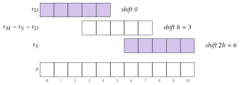
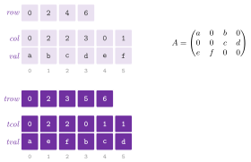

# 17. Numerical algorithms {#ch-17}

[Source: `include/ADS/numeric/BinaryInteger.h`, `Polynomial.h`,
`BigInteger.h`, `Rational.h`, `Combinatorics.h`, `Catalan.h`,
`MatrixChain.h`, `Matrix.h`, `DenseMatrix.h`, `SparseMatrix.h`,
`CsrMatrix.h`, `SellMatrix.h`, `DynamicCsr.h`, `SparseAssembly.h`,
`NumberTheory.h`, `RSA.h`, `RandomNumbers.h`, `RandomGenerators.h`,
`RandomSampling.h`, and `impl/ZigguratTables.tpp`]

We are concerned in this chapter with the algorithms whose objects are
numbers, i.e., the integers of a fixed or of any length, the fractions, the
polynomials and the matrices, together with the arithmetic of the residues
modulo an integer and the numbers drawn at random. From [Montresor 2025,
§2.6 and §12.3](Z-bibliography.md#ref-montresor2025) come the integers of
$n$ bits and the polynomials, multiplied by divide et impera, and from the
rest of the book the product of matrices (§12.4), the recurrences
(chapter 13) and the number theory (chapter 17). Beyond the book, the
headers of `ADS/numeric` add the integers and the fractions of any length
of [Knuth 1998, §4.3 to §4.6](Z-bibliography.md#ref-knuth1998v2), the
sparse matrices, and the generators of random numbers with their tests
and the samplings. We follow the order in which the objects build on each
other: the integers of $n$ bits and the polynomials
([§17.2](17-numeric.md#sec-17-2)), the integers of any length
([§17.3](17-numeric.md#sec-17-3)) and the fractions
([§17.4](17-numeric.md#sec-17-4)), the recurrences that count
([§17.5](17-numeric.md#sec-17-5)), the dense and the sparse matrices
([§17.6](17-numeric.md#sec-17-6) and [§17.7](17-numeric.md#sec-17-7)),
the number theory ([§17.8](17-numeric.md#sec-17-8)), and the random
numbers and samplings ([§17.9](17-numeric.md#sec-17-9) and
[§17.10](17-numeric.md#sec-17-10)). Some functions are handed to a mature
library (GMP for the integers and the fractions, a CBLAS for the dense
products); each backend is discussed with the operation it replaces, and
[Lemma 17.11](17-numeric.md#lem-17-11) states what it changes in the
results.

## 17.1 Notation and representations {#sec-17-1}

An integer is written in a base $\beta$ as its digits
$x_0 , x_1 , \ldots , x_{n-1} \in [ 0 , \beta )$, the least significant
first, i.e.,

$$
x = \sum_{i<n} x_i \beta^i , \tag{17.1}
$$

where $\beta = 2$ for the vectors of bits of `BinaryInteger.h` and
$\beta = 2^{64}$ for the digits (the *limbs*) of `BigInteger.h`. In
[§17.2](17-numeric.md#sec-17-2) to [§17.4](17-numeric.md#sec-17-4), the
length $n$ of the operands is the measure of the costs. A polynomial is
the vector of its coefficients from the constant one; hence
the product of two integers is the product of their polynomials in
$x = \beta$, followed by the propagation of the carries. We write $M( n )$
for the time of the product of two integers of $n$ digits, the unit in
which the costs of the quotients, of the roots and of the conversions are
usually measured. Also, $\gcd( a , b )$ is the greatest common divisor
and $a \bmod m \in [ 0 , m )$ the remainder. A matrix is $m \times n$,
and a sparse one has $\mathit{nnz}$ nonzero entries, the others being 0,
which are not stored. In the sections on the random numbers, $g$ is a generator
of words of 64 bits, uniform and independent by assumption, and $U$ a
real uniform in $[ 0 , 1 )$ or in $( 0 , 1 )$.
[Table 17.1](17-numeric.md#tab-17-1) lists the representations of the
area with the cost of their main operations.

<span id="tab-17-1"></span>**Table 17.1.** Representations of
`ADS/numeric` and the cost of their main operations; $n$ is the length of
an operand in digits, bits or rows, and the costs of `BigInteger` are those
of the code of ADS (those of GMP, its backend, are lower for the long
operands).

| Representation | Space | Main operations |
|---|---|---|
| `Bits` of `BinaryInteger.h` | $\Theta( n )$ | sum $\Theta( n )$, product $\Theta( n^2 )$ or $\Theta( n^{\log_2 3} )$ |
| `BigInteger` | $\Theta( n )$ words | sum $\Theta( n )$, product from $\Theta( n^2 )$ to $O( n \log n )$, quotient, conversion and gcd $O( n^2 )$ |
| `Rational` | two `BigInteger` in lowest terms | a few products and gcds of the terms |
| `Matrix`, `DenseMatrix` | $\Theta( m n )$ | product $\Theta( n^3 )$, or $O( n^{\log_2 7} )$ by Strassen |
| `SparseMatrix` | $\Theta( m + n + \mathit{nnz} )$ | entry $O( \text{its row} )$, insertion and deletion $O( \text{its row and column} )$ |
| `CsrMatrix`, `SellMatrix` | $\Theta( m + \mathit{nnz} )$, plus the padding of SELL | product by a vector $\Theta( m + \mathit{nnz} )$, transpose $\Theta( m + n + \mathit{nnz} )$ |
| `DynamicCsr` | $\Theta( m + \mathit{nnz} )$ | append of a row linear in its entries, removal of rows in one pass |

Orthogonal lists (`SparseMatrix`) are preferable when the pattern of the
nonzeros changes, as in the elimination by pivots, whose fill-in enters
the lists where it appears. Compressed rows are preferable when the
pattern is fixed and the matrix is read, since a product by a vector then
streams the values and the columns from memory in one pass. Among the
dense representations, the vector of rows of `Matrix` follows the book,
while `DenseMatrix` keeps the entries in one block (the layout by rows of
the CBLAS).

## 17.2 Integers of n bits and polynomials {#sec-17-2}

`BinaryInteger.h` represents an integer as the vector `Bits` of its bits,
the least significant first, i.e., (17.1) with $\beta = 2$. In
`Polynomial.h`, a polynomial $p$ of degree $n - 1$ is the vector
$p [ 0 .. n - 1 ]$ of its coefficients. Both headers run the same
algorithms on two readings of the same vector: a product of integers is
the product of their polynomials in $x = 2$, followed by `carry()`, which
turns coefficients of any size and sign into bits of the same value.

In [Algorithm 17.1](17-numeric.md#alg-17-1), the sum `binaryAdd()` reads
the bits of the two operands from the least significant one, with a carry
$r \in \{ 0 , 1 \}$, in $\Theta( n )$ time. We cannot do better, since each
bit of the operands must be read. As for the product of the school,
`multiplyBinarySchool()` adds one partial product per bit of a factor:
it is `carry()` applied to `multiplyNaive()` of `Polynomial.h`, i.e., to
$r_{h+k} \mathrel{+}= p_h q_k$ for all $h$ and $k$, in $\Theta( n^2 )$
time.

<span id="alg-17-1"></span>**Algorithm 17.1.** Sum of two integers of
$n$ bits ([Montresor 2025, §2.6](Z-bibliography.md#ref-montresor2025)),
and the carries that turn coefficients of any sign into bits; $X_i = Y_i
= 0$ beyond the bits of $X$ and $Y$.

--8<-- "generated/BinaryInteger-binaryAdd.pseudo.md"

--8<-- "generated/BinaryInteger-carry.pseudo.md"

By divide et impera we split both factors at $h = \lfloor n / 2 \rfloor$. Let
$p = x^h p_S + p_D$ and $q = x^h q_S + q_D$, where $p_D$ and $q_D$ are the
$h$ lowest coefficients and $p_S$ and $q_S$ the others; then one has

$$
p q = x^{2h} p_S q_S + x^h ( p_S q_D + p_D q_S ) + p_D q_D , \tag{17.2}
$$

four products of half size and $\Theta( n )$ sums, whence
$T( n ) = 4 T( n / 2 ) + \Theta( n ) = \Theta( n^2 )$: no gain on the
school (`multiplyFour()`, the Prodotto4() of [Montresor 2025,
§2.6](Z-bibliography.md#ref-montresor2025)). Yet, one of the four
products can be spared, by the method of [Karatsuba and Ofman
1963](Z-bibliography.md#ref-karatsuba1963).

<span id="lem-17-1"></span>**Lemma 17.1 (Karatsuba).** *With
$r_S = p_S q_S$, $r_D = p_D q_D$ and $r_M = ( p_S + p_D ) ( q_S + q_D )$,*

$$
p q = x^{2h} r_S + x^h ( r_M - r_S - r_D ) + r_D , \tag{17.3}
$$

*and the product of two polynomials of $n$ coefficients by (17.3), applied
recursively, costs $T( n ) = 3 T( n / 2 ) + \Theta( n ) =
\Theta( n^{\log_2 3} )$, where $\log_2 3 < 1.59$.*

*Proof.* In (17.2), the middle term is $p_S q_D + p_D q_S = r_M - r_S -
r_D$, an identity of the polynomials, and hence (17.3) follows. At the
level $k$, the recursion tree has $3^k$ calls of size $n / 2^k$, whose total work $( 3 / 2 )^k n$ grows geometrically with $k$; thus
the $3^{\log_2 n} = n^{\log_2 3}$ leaves dominate the sum. $\square$

We obtain by the same argument the cost of any split of this kind: a product cut
in $k$ pieces and rebuilt from $r$ products of the pieces costs
$\Theta( n^{\log_k r} )$ when $r > k$. Hence Toom-3, which rebuilds the
product from five products of a third (the values of the polynomials at
$0 , \pm 1 , 2 , \infty$ and an interpolation), costs
$\Theta( n^{\log_3 5} ) = O( n^{1.47} )$, with constants that grow with
$k$ ([Knuth 1998, §4.3.3](Z-bibliography.md#ref-knuth1998v2)). ADS does
not realize the methods of Toom, which GMP has (cf.
[§17.3](17-numeric.md#sec-17-3)). [Figure 17.1](17-numeric.md#fig-17-1)
shows where the three products of (17.3) land in the result, and
[Algorithm 17.2](17-numeric.md#alg-17-2) gives the recursion.

{#fig-17-1}

<span id="alg-17-2"></span>**Algorithm 17.2.** Product of two
polynomials of $n$ coefficients by the method of Karatsuba
([Montresor 2025, §12.3](Z-bibliography.md#ref-montresor2025)).

--8<-- "generated/Polynomial-multiplyKaratsuba.pseudo.md"

In the recursion of `Polynomial.tpp` we split at $h = \lfloor n / 2 \rfloor$,
and $n$ need not be a power of two. Here we let the higher halves have $m = n - h
\ge h$ coefficients, and the lower halves are padded with zeros to $m$ before
they are multiplied, which gives the two factors of each call the same
length (the precondition of the recursion). We remark that the same function
makes the four products of (17.2) when `three` is false.

In `*mults`, if it is given, the functions count the products of two
coefficients: $n^2$ for the school and for the four halves when $n$ is a
power of two, and $3^{\log_2 n}$ for Karatsuba. Also, in the audits of the
contracts we check that the products of the four and of the three halves
equal that of `multiplyNaive()`. On the bits, `multiplyBinaryFour()` and
`multiplyBinaryKaratsuba()` are these products followed by `carry()`.
Their intermediate coefficients are therefore `long`, possibly negative
(as $r_M - r_S - r_D$ may be before the sums), and only the final
`carry()` makes them bits.

Arguably the oldest product of the header is that of the papyrus of Ahmes
(about 1650 BC), `ahmes()`, which multiplies $a$ by $b$ by halvings and
doublings, the shift and add of the arithmetic units
([Montresor 2025, §1.4](Z-bibliography.md#ref-montresor2025)).

--8<-- "generated/BinaryInteger-ahmes.pseudo.md"

<span id="lem-17-2"></span>**Lemma 17.2.** *`ahmes( a , b )` returns
$a b \bmod 2^{64}$ after $\lfloor \log_2 a \rfloor + 1$ halvings when
$a > 0$.*

*Proof.* At a step, the quantity $p + a b$ does not change (modulo
$2^{64}$, the arithmetic of the words). Indeed, if $a$ is even, $a b = (
a / 2 ) ( 2 b )$, and if it is odd, $a b = ( ( a - 1 ) / 2 ) ( 2 b ) +
b$, the $b$ being moved into $p$. It equals $a b$ at the start and $p$
when $a = 0$, and each step removes one bit of $a$. $\square$

Finally, `toBits()` and `fromBits()` convert between a word and its bits
(by the remainders of the halvings, and by the rule of Horner from the
most significant bit). Also, `widen()` reads the bits as the coefficients
of a polynomial in $x = 2$. We declare the functions of the two headers as

```cpp
// declarations of <ADS/numeric/BinaryInteger.h> <ADS/numeric/Polynomial.h>
using Bits = std::vector< int >;
inline Bits toBits( std::uint64_t x , std::size_t n = 0 );
inline std::uint64_t fromBits( const Bits & b );
inline Bits carry( const std::vector< long > & c );
inline Bits binaryAdd( const Bits & X , const Bits & Y );
inline std::vector< long > widen( const Bits & X );
inline Bits multiplyBinarySchool( const Bits & X , const Bits & Y ,
                                  long * mults = nullptr );
inline Bits multiplyBinaryFour( const Bits & X , const Bits & Y ,
                                long * mults = nullptr );
inline Bits multiplyBinaryKaratsuba( const Bits & X , const Bits & Y ,
                                     long * mults = nullptr );
inline std::uint64_t ahmes( std::uint64_t a , std::uint64_t b ,
                            long * steps = nullptr );

template< class T >
std::vector< T > multiplyNaive( const std::vector< T > & p ,
                                const std::vector< T > & q ,
                                long * mults = nullptr );
template< class T >
std::vector< T > multiplyFour( const std::vector< T > & p ,
                               const std::vector< T > & q ,
                               long * mults = nullptr );
template< class T >
std::vector< T > multiplyKaratsuba( const std::vector< T > & p ,
                                    const std::vector< T > & q ,
                                    long * mults = nullptr );
```

For instance, with the headers `ADS/numeric/BinaryInteger.h` and
`ADS/numeric/Polynomial.h`,

```cpp
long k = 0;
std::vector< long > p = { 1 , 2 , 3 , 4 } , q = { 5 , 6 , 7 , 8 };
std::vector< long > r = ADS::multiplyKaratsuba( p , q , &k );
// r is ( 5 , 16 , 34 , 60 , 61 ,
// 52 , 32 ), k is 9 = 3^2
ADS::Bits b =
  ADS::multiplyBinaryKaratsuba( ADS::toBits( 13 ) , ADS::toBits( 11 ) );
std::uint64_t x = ADS::fromBits( b );  // x is 143
```

## 17.3 Integers of any length {#sec-17-3}

`BigInteger` is the integer of any length of [Knuth 1998,
§4.3.1](Z-bibliography.md#ref-knuth1998v2): a sign and the magnitude, as
the vector of its digits in base $\beta = 2^{64}$, the least significant
first, i.e., (17.1). Its invariant is the normal form: no leading zero
digit, and 0 not negative. Each integer then has one representation, and
two magnitudes compare by their lengths first and by their digits from
the most significant one next. We keep the digits in `detail::Limbs`, a
vector of words whose first two places are in the object. A number of one
or two digits, and the result of an operation that fits there, are made
with no allocation, while a longer one takes a block of the heap whose
capacity at least doubles when it grows ([Figure 17.2](17-numeric.md#fig-17-2)).
In many uses the small numbers are perhaps the majority (e.g., the counters, the
terms of a small fraction, the quotients of a gcd), and for them an
operation costs a few instructions instead of a call to the allocator.

{#fig-17-2}

**Sum and difference.** On the magnitudes, the sum and the difference are
Algorithms 4.3.1A and 4.3.1S of [Knuth 1998](Z-bibliography.md#ref-knuth1998v2),
one carry or one borrow per digit, in $\Theta( n )$ time. In the code, we let
`addN()` add a shorter span $b$ to a span $a$, the carry running through
the digits of $a$ beyond $b$ only while it is 1, and it works in place
when $r = a$.

We compute a sum of two numbers of opposite signs as the difference of the
magnitudes, the larger minus the smaller (`compareMag()` decides), with
the sign of the larger.

**Product.** In `operator*()`, the method depends on the length $n_b$ of
the shorter factor ([Algorithm 17.3](17-numeric.md#alg-17-3)). Below
`kKaratsuba` $= 32$ digits it is the product of the school (Algorithm
4.3.1M), from `kFFT` $= 4096$ digits a convolution of the digits by the
Number Theoretic Transform (NTT), and in between the method of Karatsuba.
Both thresholds are round lengths near where each method overtakes the
one before, not tuned to a processor, since the fast route is the backend
discussed below. Each method can also be called by name
(`multiplySchool()`, `multiplyKaratsuba()`, `multiplyFFT()`), and the
audits of the contracts compare them with each other. We remark that these
three run the code of ADS also when the backend below is present, and that
a factor of fewer than 4 digits goes to the school whatever the method
named.

<span id="alg-17-3"></span>**Algorithm 17.3.** Product of
`BigInteger` without the backend: the dispatch, the school ([Knuth 1998,
Algorithm 4.3.1M](Z-bibliography.md#ref-knuth1998v2)) and Karatsuba,
where $( c , w )$ is the pair of the high and the low word of a product of
128 bits and $l$ the length at which the longer factor is split.

--8<-- "generated/BigInteger-multiply.pseudo.md"

--8<-- "generated/BigInteger-multiplySchool.pseudo.md"

--8<-- "generated/BigInteger-karatsuba.pseudo.md"

Karatsuba in `BigInteger` differs from that of
[§17.2](17-numeric.md#sec-17-2) in two points. First, the factors may
have very different lengths. When the shorter one has at most $l$ digits,
the longer one is cut at $l$ and each part is multiplied by the shorter
factor (line 3); hence the recursion never splits a short factor into a
half that is empty. Second, all the levels share one block of scratch
space, allocated once by `mulScratch()`. A level of $n$ digits takes at
most $4 ( n / 2 + 2 )$ digits and leaves factors of at most $n / 2 + 2$
digits to the next one, and the total is bounded by a geometric series.

**Number theoretic transform.** Let $p$ be a prime with $N \mid p -
1$, and $\omega$ an element of order $N$ modulo $p$; the transform of
$a_0 , \ldots , a_{N-1}$ is

$$
\hat a_k = \sum_{j<N} a_j \omega^{j k} \bmod p , \qquad 0 \le k < N ,
\tag{17.4}
$$

i.e., the values of the polynomial $a( x ) = \sum_j a_j x^j$ at the $N$
roots of unity $\omega^k$. Its inverse interpolates them, with
$\omega^{-1}$ in place of $\omega$ and a factor $N^{-1} \bmod p$, since
$\sum_k \omega^{j k} \equiv 0 \pmod{p}$ unless $N \mid j$ ([Pollard
1971](Z-bibliography.md#ref-pollard1971)).

<span id="lem-17-3"></span>**Lemma 17.3 (the convolution).** *If $c$ is
the cyclic convolution of $a$ and $b$, $c_k = \sum_j a_j b_{( k - j )
\bmod N}$, then $\hat c_k = \hat a_k \hat b_k$ for every $k$. Hence, if
$N$ is at least the number of coefficients of the product $a( x ) b( x )$
and $p$ exceeds its largest coefficient, the inverse transform of
$\hat a_k \hat b_k$ gives the coefficients of $a( x ) b( x )$ exactly.*

*Proof.* One has $c( x ) \equiv a( x ) b( x )$ modulo $x^N - 1$, and each
$\omega^k$ is a root of $x^N - 1$; hence $c( \omega^k ) = a( \omega^k )
b( \omega^k )$, which is the first claim. When $N$ is at least the number
of coefficients of the product, the reduction modulo $x^N - 1$ wraps
nothing around, and the coefficients of $c$ are those of $a b$ reduced
modulo $p$, i.e., the coefficients themselves when they are below $p$.
$\square$

The transform is fast because it factors ([Cooley and Tukey
1965](Z-bibliography.md#ref-cooley1965)). For $N$ a power of 2, the sum
(17.4) over the even and the odd $j$ gives

$$
\hat a_k = E_{k \bmod N / 2} + \omega^k O_{k \bmod N / 2} , \tag{17.5}
$$

where $E$ and $O$ are the transforms of length $N / 2$ (with the root
$\omega^2$) of the coefficients of even and of odd place. Since
$\omega^{N / 2} = -1$, the outputs $k$ and $k + N / 2$ are $E_k \pm
\omega^k O_k$, a *butterfly*. Hence $T( N ) = 2 T( N / 2 ) + \Theta( N )
= \Theta( N \log N )$, against the $\Theta( N^2 )$ products of (17.4).
In `detail::Ntt`, (17.5) runs in place and without recursion: the items
first go to the places of the reversed bits of their indices, and then the
rounds of butterflies on the blocks of length $2 , 4 , \ldots , N$
combine the transforms of each length into those of the double length:

--8<-- "generated/BigInteger-transform.pseudo.md"

As for `multiplyFFT()` ([Algorithm 17.4](17-numeric.md#alg-17-4)), it
cuts each digit into two pieces of 32 bits and pads the pieces to a length
$N$, a power of 2 at least the $2 n_a + 2 n_b - 1$ coefficients of the
product. It then computes the convolution modulo three primes below
$2^{31}$, $p_1 = 7 \cdot 2^{26} + 1$, $p_2 = 27 \cdot 2^{26} + 1$ and
$p_3 = 15 \cdot 2^{27} + 1$, each of which has the roots of unity of
order $2^{26}$. A coefficient of the product is a sum of at most
$2 \min( n_a , n_b ) \le 2^{25}$ products of two pieces, i.e., it is
below $2^{25} \cdot 2^{64} = 2^{89}$, and $p_1 p_2 p_3 > 2^{89}$; hence,
by the Chinese remainder theorem, the three residues determine it. They
are combined in the form of Garner ([Knuth 1998,
§4.3.2](Z-bibliography.md#ref-knuth1998v2)), $c = x_1 + p_1 t_2 + p_1 p_2
t_3$ with $t_2$ and $t_3$ computed modulo $p_2$ and $p_3$, which needs no
arithmetic beyond 128 bits. Each coefficient is then added at its place,
$32 k$ bits, the carries going with the sums. This costs $O( n \log n )$
operations on words for factors of up to $2^{25}$ digits in all, the limit
set by the roots of order $2^{26}$; beyond it, `operator*()` lets
Karatsuba split the factors until the parts fit.

<span id="alg-17-4"></span>**Algorithm 17.4.** Product by the NTT
([Knuth 1998, §4.3.3 and §4.6.4](Z-bibliography.md#ref-knuth1998v2);
[Pollard 1971](Z-bibliography.md#ref-pollard1971)).

--8<-- "generated/BigInteger-multiplyFFT.pseudo.md"

**Quotient and remainder.** In `BigInteger`, `divMod()` gives the quotient
and the remainder of the truncated division, $a = q b + r$ with
$| r | < | b |$ and $r$ of the sign of $a$ (as `/` and `%` of C++). Its
method by name, `divModSchool()`, is Algorithm 4.3.1D ([Algorithm
17.5](17-numeric.md#alg-17-5)). First, the divisor $v$ of $n$ digits is
shifted, together with $u$, until the top bit of its leading digit is
set. Then each digit of the quotient, from the most significant one, is
guessed from the two leading digits of the remainder and the leading digit
of $v$, corrected by the test of step D3 on the next digit, and verified
by the subtraction of $\hat q v$; in the rare case in which the result is
negative, $v$ is added back.

<span id="alg-17-5"></span>**Algorithm 17.5.** Long division
([Knuth 1998, Algorithm 4.3.1D](Z-bibliography.md#ref-knuth1998v2)),
$\beta = 2^{64}$, for $u$ of $m + n$ digits and $v$ of $n \ge 2$.

--8<-- "generated/BigInteger-divModSchool.pseudo.md"

<span id="lem-17-4"></span>**Lemma 17.4.** *Let $v_{n-1} \ge \beta / 2$.
The trial quotient of line 4 is at least the true digit $q_j$ of the
quotient and, after the test of line 5, at most $q_j + 1$; hence the
add back of line 7 happens at most once per digit, and the division costs
$O( m n )$ operations on words.*

*Proof.* For the first claim, Theorem 4.3.1B of [Knuth
1998](Z-bibliography.md#ref-knuth1998v2) shows that, with $v_{n-1} \ge
\lfloor \beta / 2 \rfloor$, which the shift ensures, $\hat q - 2 \le q_j
\le \hat q$ before the test. The second is the property of step D3 shown in
the same section, i.e., that the test on $v_{n-2}$ removes all the excesses of
2 (and most excesses of 1). Each digit then costs one
multiplication and subtraction of $n$ digits and possibly one addition,
i.e., $O( n )$. $\square$

Knuth estimates the probability of the add back at about $2 / \beta$ per
digit, i.e., about $2^{-63}$ here; random operands would thus (almost)
never meet it, and the tests of the library force it on chosen operands. A
divisor of one digit goes instead by the short division of [Knuth 1998,
exercise 4.3.1-16](Z-bibliography.md#ref-knuth1998v2) (`divSmall()`), one
division of 128 by 64 bits per digit. Finally, `divExact()`, for a
division known to be exact, is the quotient of Algorithm D.

**Conversions, powers, roots and gcd.** We convert to and from the bases
2 to 36 as in [Knuth 1998, §4.4](Z-bibliography.md#ref-knuth1998v2).
In a base that is a power of 2 each figure is a slice of bits, in
$O( n )$. In the others, `toString()` divides by the largest power $P$ of
the base that fits a digit ($P = 10^{19}$ for the base 10), each short
division giving a chunk of figures; the constructor from a string reads
chunks of figures and accumulates $x \gets x P + c$. Both conversions cost
$O( n^2 )$ ([Algorithm 17.6](17-numeric.md#alg-17-6)). Finally, `pow()`
is the binary method of [Knuth 1998, §4.6.3](Z-bibliography.md#ref-knuth1998v2),
from left to right, with $\lfloor \log_2 n \rfloor$ squarings and at most
as many products by $x$.

<span id="alg-17-6"></span>**Algorithm 17.6.** Conversions of
[Knuth 1998, §4.4](Z-bibliography.md#ref-knuth1998v2), where a chunk has
$c$ figures and $P = \beta^c$ is the largest such power in a digit, and
the power by the binary method.

--8<-- "generated/BigInteger-toString.pseudo.md"

--8<-- "generated/BigInteger-fromString.pseudo.md"

--8<-- "generated/BigInteger-pow.pseudo.md"

For the integer square root, `sqrtNewton()` is Newton's method from above,
from a power of 2 at least the root ([Algorithm
17.7](17-numeric.md#alg-17-7)); `sqrtRem()` and `sqrt()` return the root
$s$ and the remainder $a - s^2$.

<span id="alg-17-7"></span>**Algorithm 17.7.** Integer square root
by Newton's method; $\ell$ is the number of bits of $a$.

--8<-- "generated/BigInteger-sqrtNewton.pseudo.md"

<span id="lem-17-5"></span>**Lemma 17.5.** *For $a > 0$, `sqrtNewton( a )`
returns $s = \lfloor \sqrt{a} \rfloor$; its iterates decrease strictly until
they reach $s$.*

*Proof.* For an integer $x > 0$, $y = \lfloor ( x + \lfloor a / x \rfloor
) / 2 \rfloor = \lfloor ( x + a / x ) / 2 \rfloor \ge \lfloor \sqrt{a}
\rfloor$, since $( x + a / x ) / 2 \ge \sqrt{a}$ (the inequality of the
means); the first iterate $2^{\lceil \ell / 2 \rceil}$ is also at least
$s$, since $a < 2^\ell$. If $x > s$, then $x^2 > a$, i.e., $a / x < x$,
and hence $y < x$; if $x = s$, then $a / s \ge s$, and hence $y \ge x$,
which stops the loop with $x = s$. $\square$

For the greatest common divisor `gcd()` we take the algorithm of Lehmer ([Lehmer
1938](Z-bibliography.md#ref-lehmer1938); [Knuth 1998, Algorithm
4.5.2L](Z-bibliography.md#ref-knuth1998v2)), [Algorithm
17.8](17-numeric.md#alg-17-8). Most quotients of the algorithm of Euclid
on long numbers are usually small, and they depend only on the leading digits of
the two numbers. Hence we run on the leading 60 bits $\hat u$ and $\hat v$ the
algorithm of Euclid on two pairs, $( \hat u + A , \hat v + C )$ and
$( \hat u + B , \hat v + D )$, which bracket the true ratio, for as long
as the two quotients agree. Then the matrix $\begin{pmatrix} A & B \cr C &
D \end{pmatrix}$ of the steps made is applied to the long numbers at
once, $( u , v ) \gets ( A u + B v , C u + D v )$, which typically takes
about 30 bits off both. A pass in which the leading bits cannot decide
even one step ($B = 0$) is a long division (Algorithm 4.5.2A), and the
last digit goes by the binary algorithm on words
([§17.8](17-numeric.md#sec-17-8)).

<span id="alg-17-8"></span>**Algorithm 17.8.** Gcd of Lehmer, and
that of Euclid, `gcdEuclid()`, which the audits compare with it.

--8<-- "generated/BigInteger-gcd.pseudo.md"

--8<-- "generated/BigInteger-gcdEuclid.pseudo.md"

<span id="lem-17-6"></span>**Lemma 17.6.** *`gcd()` of two numbers
of at most $n$ digits makes $O( n^2 )$ operations on words.*

*Proof.* A pass with $B \ne 0$ applies the steps of Euclid that it made on
the leading bits, at least one, by two products of the long numbers by
words and two sums, i.e., $O( n )$ operations; a pass with $B = 0$ is one
step of Euclid by a long division, of $O( n ( 1 + \log_\beta q ) )$
operations for a quotient $q$ ([Lemma 17.4](17-numeric.md#lem-17-4)). The numbers of
the pairs reached are those of the algorithm of Euclid, since the matrix
reproduces its steps exactly, and by the theorem of Lamé ([Knuth 1998,
§4.5.3](Z-bibliography.md#ref-knuth1998v2)) that algorithm makes
$O( \log ( \beta^n ) ) = O( 64 n )$ steps; hence $O( n )$ passes of the
first kind, of $O( n )$ each. The quotients of the long divisions have
product at most the first number, and so
$\sum \log_\beta q \le n$, which bounds their total by $O( n^2 )$; the
last digit costs $O( 64 )$ steps of the binary algorithm. $\square$

The gcd thus costs $O( n^2 )$ in all, with a constant smaller than that of
Euclid by a factor of the order of the steps per pass.

**Backend of GMP.** With `ADS_WITH_GMP` defined (by the option of
CMake of the same name, which defines it whenever GMP is found, by the
makefile, which does the same, or by hand), the operations of
`BigInteger` go to GMP ([Granlund 2023](Z-bibliography.md#ref-granlund2023)),
at all lengths. Since the digits of `BigInteger` are those of the layer
`mpn` of GMP (words of 64 bits, the least significant first), the sum, the
difference, the comparison, the product, the quotient with the remainder,
the square root and the conversion from a string go to `mpn_add()`,
`mpn_sub()`, `mpn_cmp()`, `mpn_mul()` (or `mpn_sqr()`), `mpn_tdiv_qr()`,
`mpn_sqrtrem()` and `mpn_set_str()`, which read the digits in place and
write the result in place too. Instead, the quotient alone, the exact
quotient, the gcd, the power and the conversion to a string go to the
layer `mpz`
(`mpz_tdiv_q()`, `mpz_divexact()`, `mpz_gcd()`, `mpz_pow_ui()`,
`mpz_get_str()`) on read-only views of the digits (`mpz_roinit_n()`).
Their result is copied from the number of GMP, in $O( n )$ time against
the superlinear cost of the operation, except where it fits the digits in
place (`mpn_tdiv_qr()` for a divisor of one or two digits, `mpn_gcd_1()`
for a gcd with a number of one digit). GMP chooses its own algorithms and
thresholds for the processor it was built for, among which the methods of
Toom, a product by the FFT for the longest operands, and quotients, roots
and conversions by divide et impera and Newton's method (see [Brent and
Zimmermann 2010](Z-bibliography.md#ref-brent2010)), subquadratic where the
code of ADS is quadratic. All this holds where a word of GMP is a word of 64 bits
(`GMP_LIMB_BITS` equal to 64 and no nail bits); elsewhere, and with `ADS_BIGINT_GMP` defined to 0,
`BigInteger` keeps the code above. We remark that GMP aborts the program
where it cannot allocate, while the code of ADS throws `std::bad_alloc`.
[Lemma 17.11](17-numeric.md#lem-17-11) states that the route does not
change the results.

**Interface.** A `BigInteger` is built from a `long long` (0 by default) or
from a string in a base from 2 to 36, with an optional sign; `sign()` returns
$-1$, 0 or 1, `abs()` the absolute value and `limbs()` the number of digits.
The operators `+`, `-`, `*`, `/` and `%` (the last two those of `divMod()`),
the unary `-`, the compound `+=`, `-=` and `*=`, the equality and the
three-way comparison (by the signs, the lengths and the digits from the most
significant one) complete the arithmetic, and `addMul( r , a , b )` makes
$r \gets r + a b$. Next to the conversions, `toStringSchool()` and
`fromStringSchool()` are those of [Algorithm 17.6](17-numeric.md#alg-17-6)
with no backend, with which the audits of `toString()` and of the constructor
compare. Finally, the product of two words of 64 bits into 128, on which the
school, the short division and the steps of Lehmer rest, is `wideProduct()` of
`Portable.h` ([§1.6](01-introduction.md#sec-1-6)): the type
`unsigned __int128` where it exists, the intrinsics of MSVC on x64 otherwise,
and four products of halves of 32 bits (`wideProductHalves()`) where neither
is available, or with `ADS_BIGINT_PORTABLE` defined; the macro
`ADS_BIGINT_WIDE`, which records the choice as 128, 64 or 0, can also be set
by hand. The class is

```cpp
// declarations of <ADS/numeric/BigInteger.h>
class BigInteger
{
 public:
 using Limb = std::uint64_t;
 static constexpr std::size_t kKaratsuba = 32;
 static constexpr std::size_t kFFT = 4096;
 BigInteger( long long v = 0 );
 explicit BigInteger( const std::string & s , int base = 10 );
 [[nodiscard]] std::string toString( int base = 10 ) const;
 [[nodiscard]] std::string toStringSchool( int base = 10 ) const;
 static BigInteger fromStringSchool( const std::string & s , int base = 10 );
 [[nodiscard]] int sign( void ) const;
 [[nodiscard]] BigInteger abs( void ) const;
 [[nodiscard]] std::size_t limbs( void ) const;
 BigInteger operator-( void ) const;
 friend BigInteger operator+( const BigInteger & a , const BigInteger & b );
 friend BigInteger operator-( const BigInteger & a , const BigInteger & b );
 friend BigInteger operator*( const BigInteger & a , const BigInteger & b );
 friend BigInteger operator/( const BigInteger & a , const BigInteger & b );
 friend BigInteger operator%( const BigInteger & a , const BigInteger & b );
 BigInteger & operator+=( const BigInteger & b );
 BigInteger & operator-=( const BigInteger & b );
 BigInteger & operator*=( const BigInteger & b );
 friend std::strong_ordering operator<=>( const BigInteger & a ,
                                          const BigInteger & b );
 static std::pair< BigInteger , BigInteger > divMod( const BigInteger & a ,
                                                    const BigInteger & b );
 static std::pair< BigInteger , BigInteger >
 divModSchool( const BigInteger & a , const BigInteger & b );
 static BigInteger multiplySchool( const BigInteger & a ,
                                   const BigInteger & b );
 static BigInteger multiplyKaratsuba( const BigInteger & a ,
                                      const BigInteger & b );
 static BigInteger multiplyFFT( const BigInteger & a , const BigInteger & b );
 static BigInteger divExact( BigInteger a , const BigInteger & b );
 static void addMul( BigInteger & r , const BigInteger & a ,
                     const BigInteger & b );
 static BigInteger pow( const BigInteger & x , unsigned long n );
 static std::pair< BigInteger , BigInteger > sqrtRem( const BigInteger & a );
 static BigInteger sqrt( const BigInteger & a );
 static BigInteger sqrtNewton( const BigInteger & a );
 static BigInteger gcd( const BigInteger & a , const BigInteger & b );
 static BigInteger gcdEuclid( BigInteger a , BigInteger b );
 };
```

with the equality defaulted. For instance, with the header
`ADS/numeric/BigInteger.h`,

```cpp
ADS::BigInteger f( 1 );
for( int k = 2 ; k <= 30 ; ++k )
 f *= k;                       // 30!
std::string s = f.toString();  // the 33 figures of 30!,
                               // "2652528598...0000000"
auto [ q , r ] = ADS::BigInteger::divMod( f , ADS::BigInteger( 1000003 ) );
ADS::BigInteger g =
  ADS::BigInteger::gcd( f ,
                        ADS::BigInteger( "1" + std::string( 20 , '0' ) ) );
// g is 2^20 5^7 = 81920000000
```

## 17.4 Rational numbers {#sec-17-4}

`Rational` is the exact rational number of [Knuth 1998,
§4.5.1](Z-bibliography.md#ref-knuth1998v2): a fraction $u / u'$ of two
`BigInteger`, kept in lowest terms with a positive denominator. Its
invariant, $u' > 0$ and $\gcd( u , u' ) = 1$, makes the representation of
a rational number unique (and the equality that of the two terms). While
the constructor reduces the fraction it is given by the gcd of its terms,
the operations never compute the gcd of a result as large as the
product of the terms, since the method of Henrici, which Knuth gives,
reduces by the gcds of the smaller numbers ([Algorithm
17.9](17-numeric.md#alg-17-9)).

<span id="alg-17-9"></span>**Algorithm 17.9.** Sum and the product of
$u / u'$ and $v / v'$ in lowest terms ([Knuth 1998,
§4.5.1](Z-bibliography.md#ref-knuth1998v2)).

--8<-- "generated/Rational-operator.pseudo.md"

--8<-- "generated/Rational-operator-2.pseudo.md"

<span id="lem-17-7"></span>**Lemma 17.7 (Henrici).** *If $u / u'$ and
$v / v'$ are in lowest terms, the sum and the product of
[Algorithm 17.9](17-numeric.md#alg-17-9) are in lowest terms.*

*Proof.* For the product, $u / d_1$ and $v' / d_1$ are coprime, and so are
$v / d_2$ and $u' / d_2$. Furthermore, $u$ is coprime with $u'$ and $v$
with $v'$; hence no prime divides both the numerator $( u / d_1 ) ( v /
d_2 )$ and the denominator $( u' / d_2 ) ( v' / d_1 )$. For the sum, let
$u' = d_1 a$ and $v' = d_1 b$, with $\gcd( a , b ) = 1$, so that
$t = u b + v a$. One has $\gcd( u , a ) = 1$ (as $a$ divides $u'$) and
$\gcd( b , a ) = 1$, and hence $\gcd( t , a ) = \gcd( u b , a ) = 1$; in
the same way $\gcd( t , b ) = 1$, and thus $t / d_2$ is coprime with
$a b$. Now the denominator is $( u' / d_1 ) ( v' / d_2 ) = a b ( d_1 /
d_2 )$, and a prime $\rho$ that divided both $t / d_2$ and $d_1 / d_2$ would make
$\rho d_2$ a common divisor of $t$ and $d_1$ larger than their gcd $d_2$.
$\square$

We gain by the method in the size of the numbers whose gcd is
computed: $d_1$ is the gcd of the two denominators and $d_2$ that of $t$
with $d_1$, instead of the gcd of $t$ with the product $u' v'$. Moreover,
two random integers are coprime with probability $6 / \pi^2 \approx 0.61$
([Knuth 1998, §4.5.2](Z-bibliography.md#ref-knuth1998v2)), and when
$d_1 = 1$ the second gcd and the divisions by a gcd are skipped (line 3
of the sum). [Table 17.2](17-numeric.md#tab-17-2) follows the sum on a
small example.

<span id="tab-17-2"></span>**Table 17.2.** Sum $7 / 12 + 5 / 18$ by
the method of Henrici: no number larger than the result is reduced.

| Step | Value |
|---|---|
| $d_1 = \gcd( 12 , 18 )$ | 6 |
| $t = 7 \cdot ( 18 / 6 ) + 5 \cdot ( 12 / 6 )$ | $21 + 10 = 31$ |
| $d_2 = \gcd( 31 , 6 )$ | 1 |
| result $( 31 / 1 ) / ( ( 12 / 6 ) ( 18 / 1 ) )$ | $31 / 36$ |

Since a `Rational` is a pair of `BigInteger`, a figure of its memory would be
that of [Figure 17.2](17-numeric.md#fig-17-2) twice, and we leave it out. With
`ADS_WITH_GMP` (cf. [§17.3](17-numeric.md#sec-17-3)), the sum, the difference,
the product, the quotient and the comparison of two fractions go to
`mpq_add()`, `mpq_sub()`, `mpq_mul()`, `mpq_div()` and `mpq_cmp()` of GMP.
These follow the same method of Henrici at all lengths, on the terms read in
place, and the terms of the result are copied from the fraction of GMP that
receives it; the reductions of the constructor go to GMP through the gcd and
the exact quotient of `BigInteger`. With `ADS_RATIONAL_GMP` defined to 0,
`Rational` keeps the code of [Algorithm 17.9](17-numeric.md#alg-17-9) on the
operations of `BigInteger`. As for the interface, `Rational( u , u' )`
requires $u' \ne 0$ and reduces the fraction by one gcd (the defaults give 0
and, with one argument, the integers), `num()` and `den()` return the terms,
and `toString()` writes `u/u'`, or `u` when $u' = 1$. The operators are `+`,
`-`, `*` and `/`, the last one being the product by the reciprocal, which is
in lowest terms already, together with the unary `-`, the equality of the
terms and the three-way comparison:

```cpp
// declarations of <ADS/numeric/Rational.h>
class Rational
{
 public:
 Rational( BigInteger num = 0 , BigInteger den = 1 );
 [[nodiscard]] const BigInteger & num( void ) const;
 [[nodiscard]] const BigInteger & den( void ) const;
 [[nodiscard]] std::string toString( void ) const;
 friend Rational operator+( const Rational & a , const Rational & b );
 friend Rational operator-( const Rational & a , const Rational & b );
 friend Rational operator*( const Rational & a , const Rational & b );
 friend Rational operator/( const Rational & a , const Rational & b );
 Rational operator-( void ) const;
 friend bool operator==( const Rational & a , const Rational & b ) = default;
 friend std::strong_ordering operator<=>( const Rational & a ,
                                          const Rational & b );
 };
```

For instance, with the header `ADS/numeric/Rational.h`, the sum of [Table
17.2](17-numeric.md#tab-17-2) is

```cpp
ADS::Rational x( 7 , 12 ) , y( 5 , 18 );
std::string s = ( x + y ).toString();     // "31/36"
bool lt = x * y < ADS::Rational( 1 , 6 );  // 35/216 < 1/6: lt is true
```

## 17.5 Recurrences that count {#sec-17-5}

In the headers `Combinatorics.h`, `Catalan.h` and `MatrixChain.h` we collect the
recurrences of [Montresor 2025, chapter 13](Z-bibliography.md#ref-montresor2025),
the examples with which the book introduces dynamic programming, on
integers of 64 bits whose ranges the contracts check (for instance,
$0 \le k \le n \le 67$ for the binomial coefficients and $n \le 92$ for the
numbers of Fibonacci, which are the largest that fit).

**Binomial coefficients.** `binomial()` computes $\binom{n}{k}$ by its
recursive definition

$$
\binom{n}{k} = \binom{n-1}{k-1} + \binom{n-1}{k} , \qquad \binom{n}{0} =
\binom{n}{n} = 1 , \tag{17.6}
$$

and `tartaglia()` fills the triangle of Tartaglia, all the $\binom{m}{j}$
with $j \le m \le n$, by rows, in $\Theta( n^2 )$ time, after which one
can read each coefficient in $O( 1 )$ ([Algorithm 17.10](17-numeric.md#alg-17-10)).

<span id="alg-17-10"></span>**Algorithm 17.10.** Binomial
coefficients by the recursion (17.6) and by the triangle ([Montresor 2025,
chapter 13](Z-bibliography.md#ref-montresor2025)).

--8<-- "generated/Combinatorics-binomial.pseudo.md"

--8<-- "generated/Combinatorics-tartaglia.pseudo.md"

<span id="lem-17-8"></span>**Lemma 17.8.** *`binomial( n , k )` makes
$2 \binom{n}{k} - 1$ calls.*

*Proof.* Each leaf of the tree of the calls returns 1, and the value of an
inner call is the sum of the values of its two children; hence there are
$\binom{n}{k}$ leaves. A tree whose inner nodes have two children has one
inner node fewer than its leaves, and therefore $2 \binom{n}{k} - 1$
nodes. $\square$

Hence the recursion, which recomputes the same coefficients many times,
takes time exponential in $n$ for $k$ near $n / 2$ (as $\binom{n}{n / 2}
\ge 2^n / ( n + 1 )$), while the triangle computes each of them once. A
third route, `binomialByFactorials()`, i.e., $n! / ( k! ( n - k )! )$, is
exact only while $n!$ fits 64 bits, i.e., for $n \le 20$. By contrast, the
recursion and the triangle, whose intermediate values never exceed the
result, reach $n = 67$. We remark that we give the factorial both by a loop
and by a recursion (`factorial()` and `factorialRec()`), two realizations of
one specification.

**Numbers of Fibonacci.** Let $F_0 = F_1 = 1$ and $F_n = F_{n-1} +
F_{n-2}$. Written as it is, the recursion makes a number of calls that
satisfies the same recurrence, i.e., $\Theta( \phi^n )$ with $\phi = ( 1 +
\sqrt{5} ) / 2 \approx 1.618$. Instead, `fibonacciTable()` fills a vector
of $n + 1$ places in $O( n )$ time, and `fibonacci()` keeps only the last
two values, in $O( n )$ time and $O( 1 )$ space ([Algorithm
17.11](17-numeric.md#alg-17-11)). A `FibonacciCache` keeps the numbers
already computed between the calls, in a mutable member: a number requested
before costs $O( 1 )$, and a new one only the steps from the largest
one known (a memoization that survives the calls); its `size()` returns the
number of the values kept, $F_0 , \ldots , F_{\mathrm{size}() - 1}$, two at
the start.

<span id="alg-17-11"></span>**Algorithm 17.11.** Numbers of Fibonacci
with a table, with three variables, and with a cache between the calls.

--8<-- "generated/Combinatorics-fibonacciTable.pseudo.md"

--8<-- "generated/Combinatorics-fibonacci.pseudo.md"

--8<-- "generated/Combinatorics-FibonacciCache-value.pseudo.md"

**Numbers of Catalan.** By definition, $C_n$ counts the binary trees of $n$
nodes, and hence the binary search trees on $n$ keys. It also counts the
strings of $n$ pairs of balanced parentheses, the full binary trees of
$n + 1$ leaves (i.e., the parenthesizations of a product of $n + 1$
factors), the triangulations of a convex polygon of $n + 2$ sides and the
monotone lattice paths that never cross the diagonal ([Stanley
2015](Z-bibliography.md#ref-stanley2015)). A binary tree of $n \ge 1$
nodes has a left subtree of some $k$ nodes and a right one of $n - 1 - k$,
whence

$$
C_0 = 1 , \qquad C_n = \sum_{k=0}^{n-1} C_k C_{n-1-k} , \tag{17.7}
$$

which `catalan()` fills in $\Theta( n^2 )$ operations on numbers of
$\Theta( n )$ bits ([Algorithm 17.12](17-numeric.md#alg-17-12)). Both the
closed form $C_n = \binom{2n}{n} / ( n + 1 )$ and the recurrence
$C_{n+1} = 2 ( 2 n + 1 ) C_n / ( n + 2 )$ take only $O( n )$ operations. Yet,
their intermediate values exceed the result, and in 64 bits they stop before
the table does, which reaches $C_{36}$ with the default type
`T = std::uint64_t` of `catalan< T >()`; with `T` a `BigInteger`, the table
has no limit. Asymptotically, $C_n \sim 4^n / ( n^{3/2} \sqrt{\pi} )$ ([Knuth
1997, §2.3.4.4](Z-bibliography.md#ref-knuth1997)).

<span id="alg-17-12"></span>**Algorithm 17.12.** Numbers of Catalan by
the recurrence (17.7) ([Montresor 2025, exercises of chapter
13](Z-bibliography.md#ref-montresor2025)).

--8<-- "generated/Catalan-catalan.pseudo.md"

**Chain of matrices.** Let $A_i$ be a matrix of $c_i \times c_{i+1}$
entries, $0 \le i < n$. In scalar multiplications, the cost of the
product $A_0 A_1 \cdots A_{n-1}$ depends on the order of the products,
i.e., on the parenthesization, and there are $C_{n-1}$ parenthesizations,
i.e., $\Omega( 4^n / n^{3/2} )$ by the asymptotic form above. Yet, the
problem has optimal substructure: the last product of an optimal order
splits the chain at some $k$, and both sides must then be ordered
optimally, since a better order of a side would give a better order of
the chain ([Montresor 2025, §13.3](Z-bibliography.md#ref-montresor2025)).
Hence the cost $\mathit{DP}[ i ][ j ]$ of the chain $A_i \cdots A_j$
satisfies

$$
\mathit{DP}[ i ][ j ] = \min_{i \le k < j} \{ \mathit{DP}[ i ][ k ] +
\mathit{DP}[ k + 1 ][ j ] + c_i c_{k+1} c_{j+1} \} , \qquad
\mathit{DP}[ i ][ i ] = 0 , \tag{17.8}
$$

i.e., $\Theta( n^2 )$ subproblems of $O( n )$ choices each.

<span id="lem-17-9"></span>**Lemma 17.9.** *$\mathit{DP}[ i ][ j ]$ of
(17.8) is the least number of scalar multiplications of a
parenthesization of $A_i \cdots A_j$.*

*Proof.* By induction on $j - i$, the case $i = j$ needing no product. The
last product of a parenthesization of $A_i \cdots A_j$ multiplies a
matrix of $c_i \times c_{k+1}$ entries by one of $c_{k+1} \times c_{j+1}$,
the products of $A_i \cdots A_k$ and of $A_{k+1} \cdots A_j$, at the cost
of $c_i c_{k+1} c_{j+1}$, for some $i \le k < j$; the two sides are
parenthesized independently, at least at the costs $\mathit{DP}[ i ][ k ]$
and $\mathit{DP}[ k + 1 ][ j ]$ by the induction, and they attain them
with optimal orders. The minimum over $k$ is (17.8). $\square$
`matrixChain()` fills them by increasing length $h = j - i + 1$, in
$O( n^3 )$ time and $\Theta( n^2 )$ space, and thus both sides are known
when a chain is solved. In $S[ i ][ j ]$ we keep the best $k$, from
which `parenthesization()` (the stampaPar() of the book) writes the order
in $O( n )$ ([Algorithm 17.13](17-numeric.md#alg-17-13) and
[Table 17.3](17-numeric.md#tab-17-3)).

<span id="alg-17-13"></span>**Algorithm 17.13.** Chain of matrices
([Montresor 2025, §13.3](Z-bibliography.md#ref-montresor2025)).

--8<-- "generated/MatrixChain-matrixChain.pseudo.md"

--8<-- "generated/MatrixChain-parenthesization.pseudo.md"

<span id="tab-17-3"></span>**Table 17.3.** Values $\mathit{DP}[ i ][ j ]$
and, in parentheses, $S[ i ][ j ]$ of (17.8) for the sizes $c = ( 30 , 35 ,
15 , 5 , 10 )$ of four matrices; the optimal order is
$( ( A_0 ( A_1 A_2 ) ) A_3 )$, of 9375 multiplications.

| $i \backslash j$ | 0 | 1 | 2 | 3 |
|---|---|---|---|---|
| 0 | 0 | 15750 (0) | 7875 (0) | 9375 (2) |
| 1 | | 0 | 2625 (1) | 4375 (2) |
| 2 | | | 0 | 750 (2) |
| 3 | | | | 0 |

Hu and Shing solve the same problem in $O( n \log n )$
time through a reduction to the optimal partition of a polygon ([Hu and
Shing 1982](Z-bibliography.md#ref-hu1982)), which ADS does not realize;
the table of (17.8) is the one of the book. We declare the functions of the
three headers as

```cpp
// declarations of <ADS/numeric/Combinatorics.h> <ADS/numeric/Catalan.h>
//                  <ADS/numeric/MatrixChain.h>
inline std::uint64_t binomial( int n , int k , long * calls = nullptr );
inline std::vector< std::vector< std::uint64_t > > tartaglia( int n );
inline std::uint64_t fibonacciTable( int n );
inline std::uint64_t fibonacci( int n );
class FibonacciCache
{
 public:
 [[nodiscard]] std::uint64_t value( int n ) const;
 [[nodiscard]] int size( void ) const;
 };
inline std::uint64_t factorial( int n );
inline std::uint64_t factorialRec( int n );
inline std::uint64_t binomialByFactorials( int n , int k );

template< class T = std::uint64_t >
T catalan( int n );

inline std::pair< long , std::vector< std::vector< std::size_t > > >
matrixChain( const std::vector< long > & c );
inline std::string
parenthesization( const std::vector< std::vector< std::size_t > > & S ,
                  std::size_t i , std::size_t j );
```

and, e.g., with the header `ADS/numeric/MatrixChain.h`, the example of
[Table 17.3](17-numeric.md#tab-17-3) is

```cpp
auto [ cost , S ] = ADS::matrixChain( { 30 , 35 , 15 , 5 , 10 } );
std::string p = ADS::parenthesization( S , 0 , 3 );  // cost is 9375, and
                                                   // p is "((A0·(A1·A2))·A3)"
```

## 17.6 Dense matrices {#sec-17-6}

`Matrix.h` represents a matrix as the vector of its rows,
`std::vector< std::vector< T > >`, as [Montresor 2025,
§12.4](Z-bibliography.md#ref-montresor2025) does. A `DenseMatrix`,
instead, keeps the $m \times n$ entries by rows in one contiguous vector,
the entry $( i , j )$ in the place $i n + j$. A block of it, e.g., a
quadrant, is then addressed by its first entry and by the *leading
dimension*, the distance between the starts of two rows, with no copy
([Figure 17.3](17-numeric.md#fig-17-3)). We follow the layout of the CBLAS
([Blackford et al. 2002](Z-bibliography.md#ref-blackford2002)), to which
`gemm()` hands its products when there is one, and it spares one
indirection per row and the scattering of the rows over the heap.

{#fig-17-3}

**Products by the definition and by Strassen.** In `Matrix.h`,
`multiplyNaive()` computes $c_{ij} = \sum_k a_{ik} b_{kj}$ by three loops,
in the order $i , k , j$ (the innermost one running along a row of $B$
and of $C$), in $\Theta( n^3 )$ time; `multiply()` does the same for a
product of $p \times q$ by $q \times r$. Split in blocks of $n / 2$, the
product is eight products of blocks, again $\Theta( n^3 )$. Strassen
rebuilds it from seven ([Strassen 1969](Z-bibliography.md#ref-strassen1969)),

$$
\begin{array}{ll}
X_1 = ( A_{11} + A_{22} ) ( B_{11} + B_{22} ) , & X_2 = ( A_{21} + A_{22} ) B_{11} , \cr
X_3 = A_{11} ( B_{12} - B_{22} ) , & X_4 = A_{22} ( B_{21} - B_{11} ) , \cr
X_5 = ( A_{11} + A_{12} ) B_{22} , & X_6 = ( A_{21} - A_{11} ) ( B_{11} + B_{12} ) , \cr
X_7 = ( A_{12} - A_{22} ) ( B_{21} + B_{22} ) , &
\end{array} \tag{17.9}
$$

from which $C_{11} = X_1 + X_4 - X_5 + X_7$, $C_{12} = X_3 + X_5$,
$C_{21} = X_2 + X_4$ and $C_{22} = X_1 + X_3 - X_2 + X_6$, as one checks
by expanding the products ([Algorithm 17.14](17-numeric.md#alg-17-14)).

<span id="alg-17-14"></span>**Algorithm 17.14.** Product of Strassen
of `Matrix.h` ([Montresor 2025, §12.4](Z-bibliography.md#ref-montresor2025)).

--8<-- "generated/Matrix-strassenRec.pseudo.md"

<span id="lem-17-10"></span>**Lemma 17.10.** *The product of two
$n \times n$ matrices by (17.9), applied recursively down to blocks of
constant size, costs $T( n ) = 7 T( n / 2 ) + \Theta( n^2 ) =
\Theta( n^{\log_2 7} )$, where $\log_2 7 < 2.81$.*

*Proof.* A level makes seven products of half size and 18 sums of blocks
of $n^2 / 4$ entries. At the level $k$, the recursion tree has $7^k$
calls of size $n / 2^k$, whose sums cost $( 7 / 4 )^k \Theta( n^2 )$,
a geometric series dominated by the $7^{\log_2 n} = n^{\log_2 7}$ leaves.
$\square$

In `Matrix.h`, `strassen()` borders the matrices with zeros up to a power
of two, and it multiplies by `multiplyNaive()` the blocks of at most
$\mathit{cutoff}$ rows (1 by default, i.e., the recursion of the book down
to the scalars). It counts in `*mults` the products of two entries, and
an audit checks that its result equals that of `multiplyNaive()`. Besides
the products, the header has `transpose()` and `scale()` of a rectangular
matrix:

```cpp
// declarations of <ADS/numeric/Matrix.h>
template< class T >
using Matrix = std::vector< std::vector< T > >;
template< class T >
Matrix< T > multiplyNaive( const Matrix< T > & A , const Matrix< T > & B ,
                           long * mults = nullptr );
template< class T >
Matrix< T > multiply( const Matrix< T > & A , const Matrix< T > & B );
template< class T >
Matrix< T > transpose( const Matrix< T > & A );
template< class T >
Matrix< T > scale( Matrix< T > A , const T & s );
template< class T >
Matrix< T > strassen( const Matrix< T > & A , const Matrix< T > & B ,
                      std::size_t cutoff = 1 , long * mults = nullptr );
```

**Engineered product.** In `DenseMatrix.h`, `gemm()` is the routine of the
BLAS, $C \gets \alpha A B + \beta C$, on matrices by rows with leading
dimensions ([Algorithm 17.15](17-numeric.md#alg-17-15)). Its macro
`ADS_WITH_BLAS` is defined by the option of CMake of the same name whenever a
CBLAS is found, by the makefile, or by hand (with `ADS_BLAS_ACCELERATE` for
the framework Accelerate of macOS). With it, the products of `double` and of
`float` go to `cblas_dgemm()` and `cblas_sgemm()` at all the sizes that fit
the `int` of the CBLAS, which chooses its own kernels, blocks and threads for
the processor. Only the product with $k = 0$, a mere $C \gets \beta C$, stays
on the loops of ADS, since a CBLAS may refuse its leading dimension 0.
Otherwise, and for the other types, `gemm()` is the product of the definition,
$2 m n k$ operations, by the loops in the order $i , p , j$. These are blocked
on $j$ and on $p$ by $L$ = `kGemmBlock` $= 256$, and a block of $L \times L$
entries of $B$ thus stays in the cache while the rows of $C$ run over it. We
choose the route by the macro `ADS_GEMM_BLAS`, which is 1 when `ADS_WITH_BLAS`
is defined and which, defined to 0, keeps the loops of ADS even with a CBLAS.
On the class, `DenseMatrix( m , n , v )` fills the entries with $v$ (0 by
default), `uninitialized( m , n )` leaves them unwritten for an output that
will be overwritten, and the constructor from a `Matrix` and `toMatrix()`
convert between the two layouts; `rows()`, `cols()`, the entry `A( i , j )`,
the pointer `data()` to the first entry (the leading dimension being `cols()`)
and the equality complete it, and `multiply( A , B )` is `gemm()` with
$\alpha = 1$ and $\beta = 0$ on a new matrix.

<span id="alg-17-15"></span>**Algorithm 17.15.** Product of the BLAS
in `DenseMatrix.h`, by blocks of $L$ columns and rows of $B$.

--8<-- "generated/DenseMatrix-gemm.pseudo.md"

The innermost loop is an update $c \gets c + a \, b$ of a row of $C$ by a
row of $B$, with no dependence between its iterations, which the compiler
may vectorize. Each entry of $C$ is the sum of its terms in the order of
$p$, whatever the split of the rows; hence the parallel `gemm()` of
`ParallelNumeric.h`, which splits the rows among the threads, returns the
same bits. We remark that $C$ is not read when $\beta = 0$, as in the
BLAS, and a $C$ of garbage (even of NaNs) is thus overwritten. As for
`transpose()`, it moves blocks of $32 \times 32$ entries, which stay in the cache of the first level both read by columns
and written by rows. Its cost is $\Theta( m n )$ time and $O( m n / L )$
misses for lines of $L$ entries when a block of $32 L$ entries fits the
cache, the bound of the cache-oblivious transposition ([Frigo et al.
2012](Z-bibliography.md#ref-frigo2012)).

--8<-- "generated/DenseMatrix-transpose.pseudo.md"

For the product `multiplyStrassen()` we take the variant of Winograd of the
algorithm of Strassen ([Winograd 1971](Z-bibliography.md#ref-winograd1971)),
on the views of the quadrants: with

$$
\begin{array}{llll}
S_1 = A_{21} + A_{22} , & S_2 = S_1 - A_{11} , & S_3 = A_{11} - A_{21} , & S_4 = A_{12} - S_2 , \cr
T_1 = B_{12} - B_{11} , & T_2 = B_{22} - T_1 , & T_3 = B_{22} - B_{12} , & T_4 = T_2 - B_{21} ,
\end{array}
$$

and the products $P_1 = A_{11} B_{11}$, $P_2 = A_{12} B_{21}$,
$P_3 = S_4 B_{22}$, $P_4 = A_{22} T_4$, $P_5 = S_1 T_1$, $P_6 = S_2 T_2$,
$P_7 = S_3 T_3$, the quadrants of $C$ are $C_{11} = P_1 + P_2$,
$C_{12} = U + P_5 + P_3$, $C_{21} = U + P_7 - P_4$ and
$C_{22} = U + P_7 + P_5$, with $U = P_1 + P_6$. These are seven products
and 15 sums of halves instead of 18, with the cost of
[Lemma 17.10](17-numeric.md#lem-17-10). The recursion stops when a
dimension falls below the cutoff (3072 by default), where `gemm()` takes
over; an odd dimension leaves its last row, column or inner term to
`gemm()` (the dynamic peeling), and the schedule of the sums needs three
temporaries of a quadrant ([Algorithm 17.16](17-numeric.md#alg-17-16)).

<span id="alg-17-16"></span>**Algorithm 17.16.** Product of
Strassen and Winograd on `DenseMatrix` ([Higham
1990](Z-bibliography.md#ref-higham1990); [Huang et al.
2016](Z-bibliography.md#ref-huang2016)).

--8<-- "generated/DenseMatrix-strassenRec.pseudo.md"

In all, `DenseMatrix.h` declares

```cpp
// declarations of <ADS/numeric/DenseMatrix.h>
template< class T >
class DenseMatrix
{
 public:
 using value_type = T;
 DenseMatrix( void ) = default;
 DenseMatrix( std::size_t m , std::size_t n , const T & v = T( 0 ) );
 static DenseMatrix uninitialized( std::size_t m , std::size_t n );
 explicit DenseMatrix( const Matrix< T > & A );
 [[nodiscard]] std::size_t rows( void ) const;
 [[nodiscard]] std::size_t cols( void ) const;
 [[nodiscard]] T & operator()( std::size_t i , std::size_t j );
 [[nodiscard]] const T & operator()( std::size_t i , std::size_t j ) const;
 [[nodiscard]] T * data( void );
 [[nodiscard]] Matrix< T > toMatrix( void ) const;
 bool operator==( const DenseMatrix & ) const = default;
 };

inline constexpr std::size_t kGemmBlock = 256;
template< class T >
void gemm( std::size_t m , std::size_t n , std::size_t k , T alpha ,
           const T * A ,
           std::size_t lda , const T * B , std::size_t ldb , T beta , T * C ,
           std::size_t ldc );
template< class T >
DenseMatrix< T > multiply( const DenseMatrix< T > & A ,
                           const DenseMatrix< T > & B );
template< class T >
DenseMatrix< T > transpose( const DenseMatrix< T > & A );
template< class T >
DenseMatrix< T > multiplyStrassen( const DenseMatrix< T > & A ,
                                   const DenseMatrix< T > & B ,
                                   std::size_t cutoff = 3072 );
```

and, for instance, with the header `ADS/numeric/DenseMatrix.h`, the product
of a quadrant into another, through the leading dimension, is

```cpp
ADS::DenseMatrix< double > A( 4 , 4 , 1.0 ) , C( 4 , 4 );
const double * A22 = A.data() + 2 * 4 + 2;  // the view of Figure 17.3
ADS::gemm( 2 , 2 , 2 , 1.0 , A22 , 4 , A22 , 4 , 0.0 , C.data() , 4 );
double c = C( 0 , 0 );  // c is 2.0
```

Fewer products are paid for by the accuracy in floating point: the bound
of the error grows as $( n / n_0 )^{\log_2 18} n_0^2 u \| A \| \| B
\|$ for the cutoff $n_0$ and the unit roundoff $u$, against the
$n u | A | | B |$ of the classical product ([Higham
2002](Z-bibliography.md#ref-higham2002); [Higham
1990](Z-bibliography.md#ref-higham1990)), and this is the reason why the
cutoff is large. With the default one, a product of 4096 makes one level,
which spares $1 / 8$ of the products of entries, and the error grows by a
constant factor only.

<span id="lem-17-11"></span>**Lemma 17.11 (the backends change no
result).** *For each operation of `BigInteger` and `Rational`, the result
on GMP equals that of the code of ADS. For `gemm()`, both routes compute
$\alpha A B + \beta C$ by the classical product (as the reference CBLAS
does, and as we assume of any other), each entry a sum of $k$
products in some order, so that both results $\hat C$ satisfy*

$$
| \hat C - ( \alpha A B + \beta C ) | \le \gamma_{k + 2} \, ( | \alpha |
| A | | B | + | \beta | | C | ) , \qquad \gamma_j = \frac{j u}{1 - j u} ,
\tag{17.10}
$$

*with the inequality entrywise, though the two results may differ in the
last bits.*

*Proof.* The integers and the fractions of GMP are exact, as are those of
ADS, and a fraction in lowest terms with a positive denominator is
unique. Hence the two routes return the same numbers, and the same digits,
since both are words of 64 bits from the least significant one. For the
matrices, (17.10) is the bound of the classical product whatever the order
of the sums ([Higham 2002, §3.5](Z-bibliography.md#ref-higham2002)), and
the order differs between the loops of ADS and the kernels of the CBLAS.
$\square$

Accordingly, the tests compare the two routes exactly on the integers and
the fractions. On the matrices they compare them exactly on small
integers (which both products compute without rounding), and within
(17.10) on the others. The lemma justifies the design of the area:
where a mature library computes the same function, the headers hand the
operation to it at all sizes, instead of keeping kernels of their own
that each processor would need to tune again. Written with no assembly,
no vector instructions and no constant measured on a processor, the code
of ADS remains as the route without the backend and as the reference of the
tests.

## 17.7 Sparse matrices {#sec-17-7}

A matrix is *sparse* when most of its entries are 0, and it then pays to
store only the $\mathit{nnz}$ nonzero ones together with their places.
In the area there are two families of representations. In the orthogonal
lists of
`SparseMatrix`, an entry can be inserted or deleted where it appears; in
the compressed rows (or columns) of `CsrMatrix`, `SellMatrix`,
`DynamicCsr` and `SparseAssembly.h`, the entries are packed in arrays,
read in order by the products and taken as they are by the solvers of
linear programs.

**Orthogonal lists.** `SparseMatrix` is the representation of [Knuth 1997,
§2.2.6](Z-bibliography.md#ref-knuth1997): each nonzero entry is a node
that lies on the circular list of its row, sorted by column, and on that
of its column, sorted by row, and each list has a head node
([Figure 17.4](17-numeric.md#fig-17-4)). The nodes are the items of one
vector (the heads of the $m$ rows first, then those of the $n$ columns,
then the entries), linked by indices, `right` along the row and `down`
along the column; the nodes of the entries removed go to a free list, from
which the new entries are taken. In space $\Theta( m + n + \mathit{nnz}
)$, an entry is found by walking its row, in time linear
in the nonzeros before it. In [Algorithm 17.17](17-numeric.md#alg-17-17),
`set()` writes a value in place, or unlinks from its row and its column
the node of an entry that becomes 0, or links a new node into both (after
the node $p$ that precedes it on the row and the node $u$ that precedes
it on the column). An audit checks the invariant, i.e., that the lists are
sorted and that each node is on the lists of its row and of its column.
Besides `get()`, `set()` and `pivot()`, the class has `rows()`, `cols()`
and `nonzeros()`, and it gives the nonzeros of a row or of a column either
as a vector of pairs (column or row, value), by `row()` and `col()`, or as
a range that walks the list with no copy, by `rowEntries()` and
`colEntries()`, whose `const_iterator` is a forward iterator.

{#fig-17-4}

<span id="alg-17-17"></span>**Algorithm 17.17.** Update of an entry
and the pivot step on the orthogonal lists ([Knuth 1997, Algorithm
2.2.6S](Z-bibliography.md#ref-knuth1997)); $R$ and $C$ are the nonzeros
of the pivot row and of the pivot column, and $\varepsilon$ the tolerance
under which a result is taken as 0.

--8<-- "generated/SparseMatrix-set.pseudo.md"

--8<-- "generated/SparseMatrix-pivot.pseudo.md"

We regard a pivot step as the core of the elimination by exchange of [Knuth 1997,
§2.2.6](Z-bibliography.md#ref-knuth1997). Let the pivot $a$ be in the row
$r$ and the column $c$. An entry $d$ with a nonzero $b$ in its column of
the pivot row and $c'$ in its row of the pivot column becomes $d - b c' /
a$; the rest of the pivot row is divided by $a$, the rest of the pivot
column by $- a$, and the pivot becomes $1 / a$. Only the entries at the
crossings of the rows of $C$ and the columns of $R$ change, and the
entries that become zero leave the lists while those that appear enter
them. A pivot on each diagonal place in turn inverts a matrix whose pivots
are not zero, which is how the test of the library uses it. We remark that
Knuth's step walks the rows of the pivot column side by side with the
pivot row, in time proportional to the nonzeros that it touches. Instead,
`pivot()` reads and writes each of the $| R | \cdot | C |$ entries by
`get()` and `set()`, each a walk of a row and of a column; the result is
the same, and the cost is higher by the length of those walks. Besides the
ranges `rowEntries()` and `colEntries()`, the class is

```cpp
// declarations of <ADS/numeric/SparseMatrix.h>
class SparseMatrix
{
 public:
 SparseMatrix( std::size_t m , std::size_t n );
 [[nodiscard]] std::size_t rows( void ) const;
 [[nodiscard]] std::size_t cols( void ) const;
 [[nodiscard]] std::size_t nonzeros( void ) const;
 [[nodiscard]] double get( std::size_t i , std::size_t j ) const;
 void set( std::size_t i , std::size_t j , double v );
 [[nodiscard]] std::vector< std::pair< std::size_t , double > >
 row( std::size_t i ) const;
 [[nodiscard]] std::vector< std::pair< std::size_t , double > >
 col( std::size_t j ) const;
 void pivot( std::size_t r , std::size_t c , double eps = 0 );
 };
```

**Compressed sparse rows.** A `CsrMatrix` keeps the nonzeros of each row, by
increasing column, in one vector of values $\mathit{val}$ and one of columns
$\mathit{col}$, the rows one after the other. A vector $\mathit{row}$ of
$m + 1$ offsets holds the place where each row begins, the last one being
$\mathit{nnz}$ ([Saad 2003, §3.4](Z-bibliography.md#ref-saad2003); [Figure
17.5](17-numeric.md#fig-17-5)). With doubles, columns of 32 bits and offsets
of 64, the matrix takes $12 \, \mathit{nnz} + 8 ( m + 1 )$ bytes, read in
order by a product with a vector; by contrast, the nodes of the orthogonal
lists are scattered, and more than three times as large (40 bytes each). We
build the matrix either from a `SparseMatrix` or from triplets $( i , j , v )$
in any order (each a `Triplet`, the tuple of two `std::size_t` and a
`double`). In the latter case a counting sort on the rows, a sort of the
columns of each row and the sum of the entries in the same place take
$O( \mathit{nnz} + m )$ time plus the sorts of the rows; the columns of 32
bits require $n \le 2^{32}$. The default constructor makes the $m \times n$
zero matrix (0 by 0 by default), and `get()` finds an entry by a binary search
in its row, in $O( \log ( 1 + \text{the length of the row} ) )$ time. The
product exists both on vectors and on pointers, `multiply( x , y )` writing
$y$ in place, and the three arrays are read by `rowStart()`, `columns()` and
`values()`, as a solver takes them; two matrices are equal when their arrays
are.

{#fig-17-5}

In [Algorithm 17.18](17-numeric.md#alg-17-18), the product $y = A x$
runs through the rows, the index $p$ of the nonzeros running through all of
them once, in $\Theta( m + \mathit{nnz} )$ time:

<span id="alg-17-18"></span>**Algorithm 17.18.** Product of a matrix
in compressed sparse rows by a vector, and its transpose.

--8<-- "generated/CsrMatrix-multiply.pseudo.md"

--8<-- "generated/CsrMatrix-transpose.pseudo.md"

Such a product makes $2 \, \mathit{nnz}$ floating-point operations on
$12 \, \mathit{nnz} + 8 ( m + 1 )$ bytes of the matrix, with $8 m$ bytes
written and up to $8 \, \mathit{nnz}$ read of $x$. We thus have less than one
operation per byte moved, and the product is therefore bound by the
bandwidth of the memory rather than by the processor ([Williams et al.
2009](Z-bibliography.md#ref-williams2009)), and more arithmetic per row,
such as more accumulators, can hardly speed it up.

We build the transpose, i.e., the matrix by columns, by a counting sort on the
columns: the counts of the columns, summed, give the offsets of the rows
of the transpose, and each entry, scanned by row, is written at the cursor
of its column, which then advances.

<span id="lem-17-12"></span>**Lemma 17.12.** *`transpose()` returns the
transpose in compressed sparse rows, each of its rows sorted by
increasing column, in $\Theta( m + n + \mathit{nnz} )$ time.*

*Proof.* Each entry of the column $j$ lands in one of the places
$\mathit{trow}[ j ] , \ldots , \mathit{trow}[ j + 1 ] - 1$, since there
are as many entries as the count of $j$; they are written in the order in
which they are scanned, i.e., by increasing row, since the rows are
scanned in order (the counting sort is stable). Finally, the counts, the
prefix sums and the scan cost $\Theta( \mathit{nnz} )$, $\Theta( n )$ and
$\Theta( m + \mathit{nnz} )$. $\square$

We remark that the writes of the scan go to $n$ cursors at once, scattered over the
transpose, and on a large matrix whose rows span columns far apart
most writes may miss the cache. Therefore `transpose()` samples
blocks of 64 rows to decide whether the matrix is of that kind. If so, it
first distributes the entries, in the order of the rows, into 256 buckets
of consecutive columns, and then each bucket into its slice of the
transpose (the partitioned radix sort of the databases, cf. [Polychroniou
and Ross 2014](Z-bibliography.md#ref-polychroniou2014)). This makes
$2 \, \mathit{nnz}$ moves instead of $\mathit{nnz}$, but, since the writes
of each pass stay in few streams, $O( \mathit{nnz} / L )$ misses instead
of up to $\mathit{nnz}$ for lines of $L$ items, when a slice of
$\mathit{nnz} / 256$ items fits the cache. Both passes are stable, and the
result is that of [Lemma 17.12](17-numeric.md#lem-17-12). The class is

```cpp
// declarations of <ADS/numeric/CsrMatrix.h>
class CsrMatrix
{
 public:
 using Triplet = std::tuple< std::size_t , std::size_t , double >;
 CsrMatrix( std::size_t m = 0 , std::size_t n = 0 );
 CsrMatrix( std::size_t m , std::size_t n , std::vector< Triplet > T );
 explicit CsrMatrix( const SparseMatrix & S );
 [[nodiscard]] std::size_t rows( void ) const;
 [[nodiscard]] std::size_t cols( void ) const;
 [[nodiscard]] std::size_t nonzeros( void ) const;
 [[nodiscard]] double get( std::size_t i , std::size_t j ) const;
 [[nodiscard]] std::vector< double >
 multiply( const std::vector< double > & x ) const;
 void multiply( const double * x , double * y ) const;
 [[nodiscard]] CsrMatrix transpose( void ) const;
 [[nodiscard]] const std::size_t * rowStart( void ) const;
 [[nodiscard]] const std::uint32_t * columns( void ) const;
 [[nodiscard]] const double * values( void ) const;
 bool operator==( const CsrMatrix & ) const = default;
 };
```

and, for instance, with the header `ADS/numeric/CsrMatrix.h`, the matrix of
[Figure 17.5](17-numeric.md#fig-17-5) with $a , \ldots , f = 1 , \ldots ,
6$ is

```cpp
ADS::CsrMatrix A( 3 , 4 ,
                  { { 0 , 0 , 1.0 } ,
                    { 0 , 2 , 2.0 } ,
                    { 1 , 2 , 3.0 } ,
                    { 1 , 3 , 4.0 } ,
                    { 2 , 0 , 5.0 } ,
                    { 2 , 1 , 6.0 } } );
std::vector< double > y = A.multiply( { 1.0 , 1.0 , 1.0 , 1.0 } );
// y is ( 3 , 7 , 11 )
ADS::CsrMatrix B = A.transpose();  // 4 rows, B.get( 3 , 1 ) is 4
```

**SELL-$C$-$\sigma$.** In CSR, the product computes one row at a time,
with a sum that the vector lanes split and then reduce at the end of each
row, which may be wasteful on short rows. The format SELL-$C$-$\sigma$ of
[Kreutzer et al. 2014](Z-bibliography.md#ref-kreutzer2014) (`SellMatrix`)
stores the rows in chunks of $C$, and each chunk by columns of the chunk:
the $k$-th nonzeros of its $C$ rows are side by side, padded with zeros to
the longest of its rows ([Figure 17.6](17-numeric.md#fig-17-6)). Hence the
product runs the $C$ rows of a chunk in the $C$ lanes of the vector
registers, the values and the columns of a step loaded in one stream and
$x$ gathered ($C = 4$ doubles for AVX2, the default, and 8 for AVX-512).
Its cost is the padding,

$$
\mathit{pad} = \sum_c C \max_{i \in c} r_i - \mathit{nnz} , \tag{17.11}
$$

for the chunks $c$ and the row lengths $r_i$. Sorting the rows by
decreasing length within windows of $\sigma$ consecutive rows keeps it
small (there is none on the rows of equal length of a stencil). Also, a
window of $\sigma \ll m$ rows (256 by default) keeps the rows near their
place, and hence the reads of $x$ and the writes of $y$ near each other.

{#fig-17-6}

<span id="alg-17-19"></span>**Algorithm 17.19.** Construction of
SELL-$C$-$\sigma$ from a `CsrMatrix`, where $\pi$ is the permutation of
the rows and $w_c$ the width of the chunk $c$, and its product by a vector
on the chunks from $\mathit{first}$ to $\mathit{last} - 1$.

--8<-- "generated/SellMatrix-SellMatrix.pseudo.md"

--8<-- "generated/SellMatrix-multiply.pseudo.md"

Building the format costs $O( \mathit{nnz} + m \log \sigma )$ time: the
stable sort of each window (the rows of equal length keep their order),
the widths of the chunks, and the placement of the nonzeros. In memory,
the matrix takes $12 ( \mathit{nnz} + \mathit{pad} ) + 8 m / C + 4 m$
bytes, for the values and the columns, the offset of each chunk, and the
permutation of the rows. Its product makes $2 ( \mathit{nnz} +
\mathit{pad} )$ operations, all of them in full vectors. We remark that the
slots of the last chunk beyond the $m$ rows carry no row (line 6), and
that the bounds `first` and
`last` let the parallel product of `ADS/parallel` split the chunks among
the threads, which find their number in `chunks()` and the first place of
a chunk in `chunkStart()`. The class also has `rows()`, `cols()`,
`nonzeros()` and `places()`, the last being $\mathit{nnz} +
\mathit{pad}$; its parameter $C$, 4 by default, must be a power of 2, and
the default $\sigma$ of the constructor is 256:

```cpp
// declarations of <ADS/numeric/SellMatrix.h>
template< std::size_t C = 4 >
class SellMatrix
{
 public:
 explicit SellMatrix( const CsrMatrix & A , std::size_t sigma = 256 );
 [[nodiscard]] std::size_t rows( void ) const;
 [[nodiscard]] std::size_t cols( void ) const;
 [[nodiscard]] std::size_t nonzeros( void ) const;
 [[nodiscard]] std::size_t places( void ) const;
 void multiply( const double * x , double * y ) const;
 void multiply( const double * x , double * y , std::size_t first ,
                std::size_t last ) const;
 [[nodiscard]] std::size_t chunks( void ) const;
 [[nodiscard]] std::size_t chunkStart( std::size_t c ) const;
 [[nodiscard]] std::vector< double >
 multiply( const std::vector< double > & x ) const;
 };
```

**A compressed matrix that grows by rows.** A `DynamicCsr` is a compressed
sparse matrix that grows and shrinks by whole rows (or by whole columns, as
`DynamicCsc`, when the major index is a column). We keep it at all times in
the three arrays $\mathit{beg}$, $\mathit{ind}$ and $\mathit{val}$ that the
solvers of linear programs take ([Gustavson
1978](Z-bibliography.md#ref-gustavson1978)), and handing it over thus costs
nothing. Its typical use is the bundle of the cuts of a decomposition, whose
rows come in batches and go away in batches. Here $\mathit{beg}$ has one entry
more than the rows, $\mathit{beg}[ i ]$ being the first entry of the row $i$
and its last entry the number of the entries, and $\mathit{ind}$ and
$\mathit{val}$ hold the minor index and the value of each entry, the rows one
after the other. Its invariant is that $\mathit{beg}$ starts at 0, never
decreases, and ends at the number of the entries. At the end, `append()` adds
a row, or a block of $r$ rows given in the same form, in time linear in its
entries amortized over the growth of the vectors. Conversely, `remove()` takes
a strictly increasing set $E$ of rows and closes the gaps in one pass
([Algorithm 17.20](17-numeric.md#alg-17-20) and [Figure
17.7](17-numeric.md#fig-17-7)), while `remove( first , last )` erases a range
of consecutive rows at once. Each `append()` returns the index of the first
row that it adds. The types of the indices and of the values are the
parameters `I` (`int` by default, the `Index` of the class) and `V` (`double`,
its `Value`), and the vectors that hold them are not zeroed when they grow.
The rest of the interface reads and sizes the matrix: `rows()`, `nonzeros()`
and `empty()`, `reserve( r , z )` for $r$ rows and $z$ entries, `clear()`,
which keeps the memory, the spans `indices( i )` and `values( i )` of a row
(the values writable), and the pointers `beg()`, `ind()` and `val()` that a
solver takes:

```cpp
// declarations of <ADS/numeric/DynamicCsr.h>
template< class I = int , class V = double >
class DynamicCsr
{
 public:
 using Index = I;
 using Value = V;
 [[nodiscard]] std::size_t rows( void ) const;
 [[nodiscard]] std::size_t nonzeros( void ) const;
 [[nodiscard]] bool empty( void ) const;
 void reserve( std::size_t r , std::size_t z );
 void clear( void );
 std::size_t append( std::span< const I > ind , std::span< const V > val );
 std::size_t append( std::size_t r , const I * beg , const I * ind ,
                     const V * val );
 template< std::ranges::contiguous_range R >
 void remove( const R & E );
 void remove( std::size_t first , std::size_t last );
 [[nodiscard]] std::span< const I > indices( std::size_t i ) const;
 [[nodiscard]] std::span< const V > values( std::size_t i ) const;
 [[nodiscard]] std::span< V > values( std::size_t i );
 [[nodiscard]] const I * beg( void ) const;
 [[nodiscard]] const I * ind( void ) const;
 [[nodiscard]] const V * val( void ) const;
 };

template< class I = int , class V = double >
using DynamicCsc = DynamicCsr< I , V >;
```

For instance, with the header `ADS/numeric/DynamicCsr.h`, the run of
[Figure 17.7](17-numeric.md#fig-17-7) on the indices of the entries is

```cpp
ADS::DynamicCsr<> D;
for( std::vector< int > r :
     { std::vector< int >{ 0 , 1 } , { 2 } , { 3 , 4 , 5 } , { 6 , 7 } } )
 D.append( r , std::vector< double >( r.size() , 1.0 ) );
D.remove( std::vector< int >{ 1 , 3 } );  // two rows left, ( 0 , 1 ) and
                                         // ( 3 , 4 , 5 ), 5 entries
```

<span id="alg-17-20"></span>**Algorithm 17.20.** Append of a row and
of a block of rows ($\delta$ the shift of the offsets of the block), and
the removal of a set of rows, of `DynamicCsr`.

--8<-- "generated/DynamicCsr-append.pseudo.md"

--8<-- "generated/DynamicCsr-append-2.pseudo.md"

--8<-- "generated/DynamicCsr-remove.pseudo.md"

{#fig-17-7}

<span id="lem-17-13"></span>**Lemma 17.13.** *`remove( E )` leaves the rows
not in $E$ in their order, with their entries, in $O( r + z' )$ time and no
memory beyond the arrays, where $r$ is the number of the rows from the first
one of $E$ on and $z'$ the number of the entries after the start of that row.*

*Proof.* No row before $E[ 0 ]$ moves. From $E[ 0 ]$ on, the loop visits
the rows in order, and it moves a row kept to the place $o$. This is
the start of the row $E[ 0 ]$ plus the entries of the rows kept so far,
all of which come before the row; hence $o$ is never beyond its start,
and the move, done from the left, never overwrites an entry not yet
moved. Each row costs $O( 1 )$ besides its entries, and each entry after
$\mathit{beg}[ E[ 0 ] ]$ is moved at most once. $\square$

**Assembly from triplets.** In `SparseAssembly.h`, two functions turn the
entries $( i , j , v )$ of a matrix, in any order and with repetitions,
into the arrays $\mathit{beg}$, $\mathit{ind}$ and $\mathit{val}$ of the
compressed form, by columns (`assembleCsc()`) or by rows
(`assembleCsr()`), written straight into the arrays of the caller, with
no matrix object in between and no other allocation than a workspace that
a caller may keep from one assembly to the next. Both call
`compressTriplets()` with the major index (the column, or
the row) and the minor one ([Algorithm 17.21](17-numeric.md#alg-17-21)).

<span id="alg-17-21"></span>**Algorithm 17.21.** Compression of the
triplets ([Knuth 1998, vol. 3, §5.2](Z-bibliography.md#ref-knuth1998v3); [Davis
2006, chapter 2](Z-bibliography.md#ref-davis2006)), where $z$ is the
number of the triplets and $\mathit{at}$ the cursors of the major
indices, starting at $\mathit{beg}$.

--8<-- "generated/SparseAssembly-compressTriplets.pseudo.md"

--8<-- "generated/SparseAssembly-assembleCsr.pseudo.md"

--8<-- "generated/SparseAssembly-assembleCsc.pseudo.md"

<span id="lem-17-14"></span>**Lemma 17.14.** *`compressTriplets()`
returns in $\mathit{beg}$, $\mathit{ind}$ and $\mathit{val}$ the
compressed form in which each major index has one entry per distinct minor
index, sorted, with the sum of the values of its triplets in the order of
the input, in $O( z + m + n + \sum_i \min( k_i^2 , k_i \log k_i ) )$ time,
for $z$ triplets of an $m \times n$ matrix whose major index $i$ has $k_i$
distinct entries.*

*Proof.* Together, the first two loops are the counting sort of the
triplets on the
major index ([Knuth 1998, vol. 3, §5.2](Z-bibliography.md#ref-knuth1998v3)),
which leaves the triplets of each major index in its range, in the order
of the input. In the third loop, $f$ is the first place of the major index
$i$ and $o$ the next free place. Since the places of the earlier major
indices come before $f$, $\mathit{mark}[ j ] > f$ holds exactly when $j$
already has a place in $i$, namely $\mathit{mark}[ j ] - 1$, to which the
value is added; otherwise $j$ takes the place $o$. At the end of the
major index, the places $f , \ldots , o - 1$ hold the distinct entries of $i$, each summed in the
order of the input. These are sorted by insertion when they are at most
32 (at most $k_i ( k_i - 1 ) / 2$ moves, none if they come in order), and
by the sort of the library otherwise. Note that $o$ never exceeds the
place of the next triplet of $i$ to be read, and the compaction thus never
overwrites a triplet not yet read. $\square$

We thus scatter the entries over memory in one pass only. By contrast, the
sort by the least significant index first, or the transposition of a matrix
built by the other index (as `setFromTriplets()` of Eigen does), scatters them
twice. For rows or columns of bounded length the time is $O( z + m + n )$, and
the workspace holds a cursor per major index, a mark per minor one and the
pairs of the longest major index past 32 entries. Entries summed to 0 stay, as
the solvers accept them. We remark that the mark of a minor index (a place
plus 1) never needs to be cleared between the major indices, since the
comparison with $f$ makes the marks of the earlier ones stale by themselves.
The workspace is an `AssemblyWorkspace< I , V >`, whose vectors grow to the
largest assembly seen; a form of `compressTriplets()` without it allocates a
temporary one. All three functions return the number of the entries written,
i.e., $\mathit{beg}[ \mathit{nmajor} ]$. We declare them as

```cpp
// declarations of <ADS/numeric/SparseAssembly.h>
template< class I , class V >
struct AssemblyWorkspace
{
 template< class U >
 using Vector = std::vector< U , detail::DefaultInitAllocator< U > >;
 Vector< I > cursor;
 Vector< I > mark;
 std::vector< std::pair< I , V > > pairs;
 };

template< class I , class V , class J >
std::size_t compressTriplets( std::size_t nmajor , std::size_t nminor ,
                              std::size_t z , const J * major ,
                              const J * minor ,
                              const V * value , I * beg , I * ind , V * val ,
                              AssemblyWorkspace< I , V > & work );
template< class I , class V , class J >
std::size_t assembleCsc( std::size_t m , std::size_t n , std::size_t z ,
                         const J * row , const J * col , const V * value ,
                         I * beg , I * ind , V * val ,
                         AssemblyWorkspace< I , V > & work );
template< class I , class V , class J >
std::size_t assembleCsr( std::size_t m , std::size_t n , std::size_t z ,
                         const J * row , const J * col , const V * value ,
                         I * beg , I * ind , V * val ,
                         AssemblyWorkspace< I , V > & work );
```

with a form of `compressTriplets()` without the workspace.

## 17.8 Number theory {#sec-17-8}

`NumberTheory.h` is the arithmetic of [Montresor 2025, §17.2 and
exercises 17.1 to 17.3](Z-bibliography.md#ref-montresor2025) on unsigned
integers of 64 bits, extended beyond the book with the binary gcd, the
arithmetic of Montgomery, a test of primality that is exact on 64 bits and
the factorization of a word; `RSA.h` builds on it the cryptosystem of the
reality check of the same chapter.

**Algorithm of Euclid.** For $m > 0$, `gcd()` applies

$$
\gcd( s , m ) = \gcd( m , s \bmod m ) , \tag{17.12}
$$

until $m = 0$. Indeed, $s \bmod m = s - \lfloor s / m \rfloor m$, and the
two pairs have the same common divisors. In [Algorithm
17.22](17-numeric.md#alg-17-22), `extendedEuclid()` also gives the coefficients of Bézout, $p$ and $q$ with $s p + m q = \gcd( s ,
m )$: if $m p' + ( s \bmod m ) q' = d$, then $s q' + m ( p' - \lfloor s /
m \rfloor q' ) = d$. When $d = 1$, the coefficient $p$ of $s$ is its
inverse modulo $m$, which `modInverse()` returns in $[ 0 , m )$ (exercise
17.3 of the book). We remark that the solution of exercise 17.2 printed in
the book swaps the two coefficients, which the header corrects.

<span id="alg-17-22"></span>**Algorithm 17.22.** Extended algorithm
of Euclid ([Montresor 2025, exercise 17.2](Z-bibliography.md#ref-montresor2025)).

--8<-- "generated/NumberTheory-extendedEuclid.pseudo.md"

<span id="lem-17-15"></span>**Lemma 17.15 (Lamé).** *The algorithm of
Euclid on $s \ge m > 0$ makes at most $2 \log_2 m + 2$ steps, i.e.,
$O( \log m )$. Moreover, if $s > m$ and the algorithm makes $k$ steps,
then $s \ge F_{k+1}$ and $m \ge F_k$ (with the indexing of
[§17.5](17-numeric.md#sec-17-5)), and the pair $( F_{k+1} , F_k )$ needs
$k$ steps; hence two consecutive numbers of Fibonacci are the worst
case.*

*Proof.* After two steps the pair $( s , m )$ has become
$( r , m \bmod r )$, $r = s \bmod m$, and $r < s / 2$: if $m \le s / 2$,
since $r < m$, and otherwise since $r = s - m$. Hence the first number,
which is $m$ after the first step, halves at least every two steps, and it
reaches 0 after at most $2 \log_2 m + 2$ steps in all. For the second
claim we proceed by induction on $k$. If $k = 1$, then $m \ge 1 = F_1$ and
$s > m$ gives $s \ge 2 = F_2$. If $k \ge 2$, the pair $( m , r )$, with
$m > r > 0$, makes $k - 1$ steps, so that $m \ge F_k$ and $r \ge F_{k-1}$
by the inductive hypothesis; then $s = \lfloor s / m \rfloor m + r \ge m + r
\ge F_k + F_{k-1} = F_{k+1}$. Finally, for $j \ge 2$ the pair
$( F_{j+1} , F_j )$ has the quotient 1 and becomes $( F_j , F_{j-1} )$,
while $( F_2 , F_1 ) = ( 2 , 1 )$ becomes $( 1 , 0 )$; hence
$( F_{k+1} , F_k )$ needs $k - 1$ steps to reach $( F_2 , F_1 )$ and one
more to end ([Knuth 1998, §4.5.3](Z-bibliography.md#ref-knuth1998v2)).
$\square$

**Binary gcd.** `binaryGcd()` is the algorithm of Stein ([Stein
1967](Z-bibliography.md#ref-stein1967); [Knuth 1998, Algorithm
4.5.2B](Z-bibliography.md#ref-knuth1998v2)), which replaces the divisions
by shifts and subtractions: with $k$ the trailing zeros of $a \lor b$,
$\gcd( a , b ) = 2^k \gcd( a' , b' )$ for the odd parts, and for $a$ and
$b$ odd $\gcd( a , b ) = \gcd( \min( a , b ) , | a - b | )$, where
$| a - b |$ is even and loses its trailing zeros by one shift
([Algorithm 17.23](17-numeric.md#alg-17-23)).

<span id="alg-17-23"></span>**Algorithm 17.23.** Binary gcd ([Knuth
1998, Algorithm 4.5.2B](Z-bibliography.md#ref-knuth1998v2)); $\mathrm{tz}$
counts the trailing zeros of a word.

--8<-- "generated/NumberTheory-binaryGcd.pseudo.md"

<span id="lem-17-16"></span>**Lemma 17.16.** *For $a , b > 0$,
`binaryGcd( a , b )` returns $\gcd( a , b )$ after at most
$\log_2 a + \log_2 b + 2$ iterations of its loop.*

*Proof.* At an iteration, the value of $\gcd$ does not change, by the two
identities above and since the shifts remove factors 2 from one number
only, while the other is odd. From the second iteration on, $b = | a - b
|$ of the iteration before is even and nonzero, and the shift removes at
least one bit from it; since $| a - b | < \max( a , b )$, the product of
the two numbers after the shift is at most half of what it was. Since this
product is at most $a b$ after the first iteration and at least 1 while
the loop runs, there are at most
$\log_2 ( a b ) + 2$ iterations, counting the first one and the last.
$\square$

In the code we compute the minimum and the difference by conditional
moves, with no branch to mispredict. On x86-64 with GCC or Clang, the
count of the trailing zeros starts from $b - a$ (whose trailing zeros are
those of $| a - b |$), and an iteration is then a subtraction, a count and
a shift, with the two conditional moves beside them.

**Products and powers modulo $m$.** In `mulMod()`, the product $a b \bmod
m$ is exact for any modulus of 64 bits, and it is the modular
product of all of ADS. It uses the product of 64 bits for $m \le 2^{32}$,
`mulMod61()` for the Mersenne prime $p = 2^{61} - 1$ (`kMersenne61`) of the universal
hashing (four products of 32 bits folded by $2^{61} \equiv 1 \pmod{p}$,
typically faster than a division of 128 bits), and the product of 128 bits where the
compiler has one (e.g., GCC and Clang on 64-bit processors). Where it has not (MSVC), it uses the doubling of Ahmes
of [Lemma 17.2](17-numeric.md#lem-17-2), i.e., $O( \log b )$ additions
modulo $m$. As for $x^v \bmod m$, `powMod()` computes it by repeated
squaring (exercise 17.1 of the book). With $v = \sum_i v_i 2^i$, one has
$x^v = \prod_{i : v_i = 1} x^{2^i}$, whose factors are squares of one
another; the time is thus $\lfloor \log_2 v \rfloor + 1$ squarings and at
most as many products modulo $m$ ([Algorithm 17.24](17-numeric.md#alg-17-24)).

<span id="alg-17-24"></span>**Algorithm 17.24.** Product modulo $m$
and the power by repeated squaring ([Montresor 2025, exercise
17.1](Z-bibliography.md#ref-montresor2025)).

--8<-- "generated/NumberTheory-mulMod.pseudo.md"

--8<-- "generated/NumberTheory-powMod.pseudo.md"

A division of 128 by 64 bits typically costs tens of cycles. For an odd
$m$, the products of `powMod()` go instead in the form of Montgomery
([Montgomery 1985](Z-bibliography.md#ref-montgomery1985)), $\bar x = x R
\bmod m$ with $R = 2^{64}$, in which the reduction of a product $T = \bar
a \bar b < m R$ is

$$
\mathrm{REDC}( T ) = \frac{T - q m}{R} \equiv T R^{-1} \pmod{m} , \qquad
q = T m^{-1} \bmod R . \tag{17.13}
$$

<span id="lem-17-17"></span>**Lemma 17.17 (Montgomery).** *For $T = h R
+ l < m R$, (17.13) is an integer in $( - m , m )$, equal to $h - \lfloor q
m / R \rfloor$; hence one addition of $m$ when it is negative gives $T
R^{-1} \bmod m$, with two products and no division.*

*Proof.* With $q = l m^{-1} \bmod R$, the low half of $q m$ is $l$, so that
$T - q m$ is a multiple of $R$ and $( T - q m ) / R = h - \lfloor q m / R
\rfloor$, congruent to $T R^{-1}$ modulo $m$. Since $0 \le T < m R$ and
$0 \le q m < m R$, the quotient lies in $( - m , m )$. $\square$

In the class `Montgomery64` we keep $m$ (written $n$ in the code),
$m^{-1} \bmod 2^{64}$, $R \bmod m$ and $R^2 \bmod m$. Its inverse comes
from $x_0 = 3 m \oplus 2$ ($\oplus$ the exclusive or of the bits) by 4
steps of Newton $x_{i+1} = x_i ( 2 - m x_i ) \bmod 2^{64}$, while each of
the two residues takes one division of 128 by 64 bits.

<span id="lem-17-18"></span>**Lemma 17.18.** *For an odd $m$,
$m x_0 \equiv 1 \pmod{2^5}$, and $m x_i \equiv 1 \pmod{2^k}$ implies
$m x_{i+1} \equiv 1 \pmod{2^{2 k}}$; hence $x_4 = m^{-1} \bmod 2^{64}$.*

*Proof.* The value of $x_0 \bmod 2^5$ depends only on $m \bmod 2^5$,
since the exclusive or with 2 changes only the bit 1, and the 16 odd
residues modulo $2^5$ satisfy $m x_0 \equiv 1$, as one checks one by one.
If $m x_i = 1 - e$ with $2^k \mid e$, then $m x_{i+1} = ( 1 - e ) ( 1 + e )
= 1 - e^2$, and $2^{2 k} \mid e^2$; the reduction modulo $2^{64}$ does not
change the residue modulo $2^{2 k}$ while $2 k \le 64$, and the last step
only needs it modulo $2^{64}$. Thus the bits that are right grow as $5 \to
10 \to 20 \to 40 \to 64$. $\square$

The members of `Montgomery64` are those of the arithmetic in the forms: `to()` gives the form of a number,
`from()` the number of a form (one REDC), `one()` the form of 1,
`mul()` the form of a product and `pow()` that of a power, while
`modulus()` returns $m$; an odd $m$ is required. Throughout the header the
words are the alias `U64` of `std::uint64_t`.

The function `powMod()` refines this further. First, the products and the
squarings are two chains that do not depend on each other (from the
lowest bit up), which the processor overlaps, and the bit selects the
product with no branch. Below $2^{62}$, the forms are kept in $[ 0 , 2 m
)$ (the lazy reduction): for $a , b < 2 m$, $T = a b < 4 m^2 < m R$, and
hence $( T - q m ) / R + m \in ( 0 , 2 m )$, which spares the comparison
that ends each product. Below $2^{32}$, the forms are those of
$R = 2^{32}$, with products of 64 bits.

**Primality.** Our test of Miller and Rabin rests on the following
theorem ([Miller 1976](Z-bibliography.md#ref-miller1976); [Rabin
1980](Z-bibliography.md#ref-rabin1980)).

<span id="thm-17-1"></span>**Theorem 17.1 (Miller and Rabin).** *Let
$n > 2$ be odd and $n - 1 = 2^v m$ with $m$ odd. If $n$ is prime, every
base $b \in [ 1 , n )$ satisfies*

$$
b^m \equiv 1 \quad \text{or} \quad b^{2^i m} \equiv -1 \pmod{n} \text{
for some } 0 \le i < v , \tag{17.14}
$$

*and if $n$ is composite, at most a quarter of the bases in $[ 1 , n )$
satisfy (17.14).*

*Proof.* If $n$ is prime, $b^{n-1} \equiv 1$ (Fermat), and modulo a prime
the only square roots of 1 are $\pm 1$. Hence the sequence $b^m , b^{2m}
, \ldots , b^{2^v m} = b^{n-1}$, each term the square of the one before,
either starts at 1 or reaches 1 right after $-1$. The bound for a
composite $n$ is the theorem of [Rabin 1980](Z-bibliography.md#ref-rabin1980),
whose proof counts the bases in the group of the units modulo $n$.
$\square$

We call *witness* that $n$ is composite a base that violates (17.14), or
shares a factor with $n$ (`witness()`), and `millerRabin()` tries $K$ bases
drawn at random in $[ 2 , n - 2 ]$; by [Theorem 17.1](17-numeric.md#thm-17-1),
a composite $n$ escapes all of them with probability at most $4^{-K}$, and
the test errs only by saying prime ([Algorithm 17.25](17-numeric.md#alg-17-25)).

<span id="alg-17-25"></span>**Algorithm 17.25.** Witness and the test
of Miller and Rabin ([Montresor 2025, §17.2](Z-bibliography.md#ref-montresor2025)).

--8<-- "generated/NumberTheory-witness.pseudo.md"

--8<-- "generated/NumberTheory-millerRabin.pseudo.md"

Beyond the book, `isPrime()` is exact on 64 bits ([Algorithm
17.26](17-numeric.md#alg-17-26)). It first divides by the 46 odd primes up
to 211, by one product each with no branch, all at once on vectors. For
an odd $p$, in fact, $p \mid n$ if and only if $n p^{-1} \bmod 2^{64} \le
\lfloor ( 2^{64} - 1 ) / p \rfloor$, since $x \mapsto x p^{-1}$ is a
bijection of the words that sends the multiples of $p$ onto $[ 0 ,
\lfloor ( 2^{64} - 1 ) / p \rfloor ]$ ([Granlund and Montgomery
1994](Z-bibliography.md#ref-granlund1994)). These divisions leave about
$\prod_{3 \le p \le 211} ( 1 - 1 / p ) \approx 0.21$ of the odd numbers.
Then it applies the test of Miller and Rabin to the fewest bases known to
have no strong pseudoprime below $n$. Below $2^{32}$, this is a single
base read in a table of 1024 at the hash $\lfloor ( n \cdot 2654435761
\bmod 2^{32} ) / 2^{22} \rfloor$ (the hashed bases of [Forišek and Jančina
2015](Z-bibliography.md#ref-forisek2015)). Each entry, at most 67, is the
least base of which no odd composite of the bucket with no prime factor up
to 211 is a strong pseudoprime, and the table was computed for ADS by an
exhaustive search over the $2^{31}$ odd numbers below $2^{32}$. Above
$2^{32}$, there are
from 3 to 7 bases, according to the thresholds of the sets of bases found
by computation and collected by [Sinclair and
others](Z-bibliography.md#ref-sinclair), in the line of the bounds of
[Jaeschke 1993](Z-bibliography.md#ref-jaeschke1993) for the first prime
bases.

<span id="alg-17-26"></span>**Algorithm 17.26.** Exact test of
primality on 64 bits.

--8<-- "generated/NumberTheory-isPrime.pseudo.md"

We run the bases of one $n$ in lockstep, as $k$ chains of products that the
processor overlaps, and 2 bases may cost about as much as 1. With 3 or more,
the exponent goes by windows of 4 bits with a table of $b^0 , \ldots ,
b^{15}$ (14 products), and then 4 squarings and one product for each
window but the first. For the odd part $d$ of $n - 1$, of $\ell_d$ bits,
this makes at most $\ell_d + \lceil \ell_d / 4 \rceil + 12$ products per
base, against the $2 \ell_d$ of the method from the lowest bit, which
runs when there are only 1 or 2 bases. The arithmetic is that of Montgomery of 32 bits below
$2^{32}$, the lazy one below $2^{62}$, and `Montgomery64` above. Finally,
`isPrimeTrial()`, the divisions up to $\sqrt{n}$, is the reference that
the audits compare with; it costs $O( 2^{\ell / 2} )$ for $n$ of $\ell$
bits.

**Factorization.** By `factorize()`, one gets the prime factors of
a word ([Algorithm 17.27](17-numeric.md#alg-17-27)). It divides by the
primes below 256, and then, on a composite cofactor $m$ (`isPrime()`
decides), it runs the rho of [Pollard 1975](Z-bibliography.md#ref-pollard1975)
with the cycle detection of [Brent 1980](Z-bibliography.md#ref-brent1980),
in the arithmetic of Montgomery of $m$. The sequence $x_{i+1} = x_i^2 + c
\bmod m$, taken modulo the least prime $p$ of $m$, falls into a cycle
after $O( \sqrt{p} ) = O( m^{1/4} )$ steps in expectation, if one takes
the map as random (the birthday paradox), and $\gcd( | x_i - x_j | , m
)$ then finds $p$ (or a multiple of it) when $x_i \equiv x_j \pmod{p}$. In batches, the
differences are multiplied together, 128 at a time, before each gcd,
which spares 127 gcds in 128. If the gcd of a batch is $m$ itself, the
batch is gone through again one difference at a time, and if even that
gives $m$, the rho starts again with another $c$. Its expected cost is
thus $O( n^{1/4} )$ products for $n$ of 64 bits, under the heuristic
assumption above (which is not a theorem).

<span id="alg-17-27"></span>**Algorithm 17.27.** Factorization of a
word by the rho of Pollard and Brent.

--8<-- "generated/NumberTheory-factorize.pseudo.md"

**Sieve of Eratosthenes.** `sieve()` is the sieve of Eratosthenes on a SET of the
integers from 2 to $n$ (`BoolSet` of `ADS/set`): the least item $p$ left in
the set is a prime, and its multiples are removed from $p^2$ on, since the
smaller ones are multiples of smaller primes already removed
([Algorithm 17.28](17-numeric.md#alg-17-28)).

<span id="alg-17-28"></span>**Algorithm 17.28.** Sieve of
Eratosthenes.

--8<-- "generated/NumberTheory-sieve.pseudo.md"

<span id="lem-17-19"></span>**Lemma 17.19.** *`sieve( n )` returns the primes
up to $n$ in increasing order, in $O( n \log \log n )$ time.*

*Proof.* A number $p$ left in the set when the loop reaches it has no
prime factor below it, since each prime $p' < p$ removed its multiples
from $p'^2$ on, and each composite $c \le n$ with least prime factor $p'$
satisfies $c \ge p'^2$; hence $p$ is a prime, and no prime is removed. The
removals cost $\sum_{p \le \sqrt{n}} n / p = O( n \log \log n )$ by the
theorem of Mertens on the sum of the reciprocals of the primes, and the
scan $O( n )$. $\square$

**RSA.** The cryptosystem of [Rivest, Shamir and Adleman
1978](Z-bibliography.md#ref-rivest1978), as [Montresor 2025,
§17.3](Z-bibliography.md#ref-montresor2025) presents it, is in `RSA.h` on
integers of 64 bits. We give it as a toy that shows the method and is not
secure, since real keys need some thousand bits. In it, `rsaKeys()`
draws three primes by `randomPrime()`, $x$ and $y$ of 31 bits and $s$ of
24 ([Algorithm 17.29](17-numeric.md#alg-17-29)); `randomPrime()` draws odd
numbers of the given number of bits (from 2 to 63, the top bit set) until
`millerRabin()` with 40 bases accepts one. The draw is repeated when
$x = y$, or when $s$ divides $( x - 1 ) ( y - 1 )$ and has no inverse
modulo it. Then $N = x y$, the private exponent is $s$, and the public
one is $p = s^{-1} \bmod ( x - 1 ) ( y - 1 )$, the two keys being the
pairs `RsaKey` $( N , p )$ and $( N , s )$ that `rsaKeys()` returns, in
this order. One encrypts by $C = M^p
\bmod N$ and decrypts by $M = C^s \bmod N$; signing is decrypting with
the private key, and checking is encrypting with the public one.

<span id="alg-17-29"></span>**Algorithm 17.29.** Keys of RSA
([Montresor 2025, §17.3](Z-bibliography.md#ref-montresor2025)).

--8<-- "generated/RSA-randomPrime.pseudo.md"

--8<-- "generated/RSA-rsaKeys.pseudo.md"

<span id="thm-17-2"></span>**Theorem 17.2.** *With $N = x y$, $x \ne y$
primes, and $p s \equiv 1 \pmod{( x - 1 ) ( y - 1 )}$, one has $M^{p s}
\equiv M \pmod{N}$ for every $M < N$; hence the decryption undoes the
encryption.*

*Proof.* Let $p s = 1 + t ( x - 1 ) ( y - 1 )$. If $x \nmid M$, then
$M^{x - 1} \equiv 1 \pmod{x}$ by Fermat, and hence $M^{p s} \equiv M
\pmod{x}$; if $x \mid M$, both sides are $0$ modulo $x$. The same holds
modulo $y$. Since $x$ and $y$ are distinct primes, the congruence then
holds modulo $N$ by the Chinese remainder theorem. $\square$

We check the keys on the message 2 before we return them (a
postcondition), and `rsa()` requires $M < N$, since a larger message would
come back reduced modulo $N$. We declare the functions of the two headers
as

```cpp
// declarations of <ADS/numeric/NumberTheory.h> <ADS/numeric/RSA.h>
using U64 = std::uint64_t;
inline U64 gcd( U64 s , U64 m );
[[nodiscard]] constexpr U64 binaryGcd( U64 a , U64 b );
inline std::tuple< long long , long long , long long >
extendedEuclid( long long s , long long m );
inline long long modInverse( long long s , long long m );
inline constexpr U64 kMersenne61 = ( U64( 1 ) << 61 ) - 1;
[[nodiscard]] constexpr U64 mulMod61( U64 a , U64 b );
[[nodiscard]] constexpr U64 mulMod( U64 a , U64 b , U64 m );

class Montgomery64
{
 public:
 explicit constexpr Montgomery64( U64 n );
 [[nodiscard]] constexpr U64 modulus( void ) const;
 [[nodiscard]] constexpr U64 to( U64 x ) const;
 [[nodiscard]] constexpr U64 from( U64 x ) const;
 [[nodiscard]] constexpr U64 one( void ) const;
 [[nodiscard]] constexpr U64 mul( U64 a , U64 b ) const;
 [[nodiscard]] constexpr U64 pow( U64 x , U64 v ) const;
 };

inline U64 powMod( U64 x , U64 v , U64 m );
inline bool isPrimeTrial( U64 n );
inline bool witness( U64 n , U64 b );
template< class R >
bool millerRabin( U64 n , int K , R & rng );
inline bool isPrime( U64 n );
inline std::vector< U64 > sieve( U64 n );
inline std::vector< U64 > factorize( U64 n );

struct RsaKey
{
 U64 N , e;
 };
template< class R >
U64 randomPrime( int bits , R & rng );
template< class R >
std::pair< RsaKey , RsaKey > rsaKeys( R & rng );
inline U64 rsa( U64 M , const RsaKey & k );
```

where `extendedEuclid()` returns the triple $( d , p , q )$, `factorize()`
the prime factors in increasing order with their multiplicities, and the
generators `R` are those of [§17.9](17-numeric.md#sec-17-9). For instance,
with the headers `ADS/numeric/NumberTheory.h`, `ADS/numeric/RSA.h` and
`ADS/numeric/RandomGenerators.h`,

```cpp
bool p = ADS::isPrime( 18446744073709551557ULL );  // true, 2^64 - 59
std::vector< ADS::U64 > F = ADS::factorize( 600851475143ULL );
// F is ( 71 , 839 , 1471 , 6857 )
ADS::Xoshiro256 g( 42 );
auto [ pub , priv ] = ADS::rsaKeys( g );
ADS::U64 c = ADS::rsa( 1234567 , pub );
ADS::U64 m = ADS::rsa( c , priv );  // m is 1234567
```

## 17.9 Random numbers {#sec-17-9}

The generators of the area produce words that are not random, but that
pass, by design and by test, the statistical tests that a sequence of
independent uniform words would pass. `RandomNumbers.h` follows [Knuth
1998, chapter 3](Z-bibliography.md#ref-knuth1998v2): the linear
congruential generators, the tests, and the shuffle; `RandomGenerators.h`
adds the engineered generators of today, with the uses of a word that need
no division.

**Linear congruential generators.** `LinearCongruential` is
$X_{k+1} = ( a X_k + c ) \bmod m$ ([Knuth 1998,
§3.2.1](Z-bibliography.md#ref-knuth1998v2)), whose period is at most $m$,
since the next number depends on the current one only.

<span id="thm-17-3"></span>**Theorem 17.3 (Hull and Dobell).** *The
period of $X_{k+1} = ( a X_k + c ) \bmod m$ is $m$ if and only if (i) $c$
and $m$ are coprime, (ii) $a - 1$ is a multiple of every prime factor of
$m$, and (iii) $a - 1$ is a multiple of 4 if $m$ is.*

We refer to [Hull and Dobell 1962](Z-bibliography.md#ref-hull1962) and to
[Knuth 1998, Theorem 3.2.1.2A](Z-bibliography.md#ref-knuth1998v2) for the
proof, which counts the period modulo each prime power of $m$. In the code,
`minstd()` gives the multiplicative generator of [Park and Miller
1988](Z-bibliography.md#ref-park1988) ($c = 0$, $m = 2^{31} - 1$, $a = 16807$,
of period $m - 1$ for $X_0 \ne 0$, since $m$ is prime and $16807 = 7^5$ is a
primitive root modulo $m$, which [Knuth 1998, Theorem
3.2.1.2B](Z-bibliography.md#ref-knuth1998v2) shows to be the condition of the
largest period when $c = 0$, a case that the theorem does not cover), and
`mmix()` that of Knuth for MMIX, with $m = 2^{64}$. In `LinearCongruential`
the parameters are values at run time, and so are its `min()` and `max()`,
which a UniformRandomBitGenerator of the standard library must have constant.
Hence `LinearCongruentialT` is the same generator with $a$, $c$ and $m$ fixed
at compile time, which the distributions of `std` take, and `MinStd` and
`Mmix` are those of Park and Miller and of Knuth. One can measure the period
of a generator by `period()`, with the cycle detection of [Brent
1980](Z-bibliography.md#ref-brent1980): a tortoise jumps to the hare at each
power of 2, and the hare counts its steps from the last jump, in
$O( \lambda + \mu )$ steps for a period $\lambda$ after $\mu$ numbers;
`period( limit )` returns 0 when the period exceeds the limit. The constructor
takes $a$, $c$, $m$ (0 standing for $2^{64}$) and the seed $X_0$, and `min()`
is 1 when $c = 0$, since a multiplicative generator never gives 0.

--8<-- "generated/RandomNumbers-LinearCongruential-period.pseudo.md"

**Statistical tests.** In `chiSquare()`, one compares the counts $Y_s$
of $k$ categories of probabilities $p_s$ with the expected ones,

$$
V = \sum_s \frac{( Y_s - n p_s )^2}{n p_s} , \tag{17.15}
$$

which for large $n$ follows the $\chi^2$ distribution with $k - 1$
degrees of freedom; `serialTest()` applies it to the pairs of consecutive
numbers, in $d^2$ categories ([Knuth 1998, §3.3.1 and
§3.3.2B](Z-bibliography.md#ref-knuth1998v2)). Also, `kolmogorovSmirnov()`
gives the statistics $K^+_n$ and $K^-_n$ of the
largest deviations of the empirical distribution of $n$ reals from the
uniform one. Instead, the *spectral test* (`spectralTest2()`, [Knuth 1998,
§3.3.4](Z-bibliography.md#ref-knuth1998v2)) looks at the structure of a
linear congruential generator rather than at its output: its pairs $( X_k
, X_{k+1} )$ lie on parallel lines at the distance $1 / \nu_2$, where
$\nu_2$ is the length of the shortest nonzero vector $( u , v )$ with
$u + a v \equiv 0 \pmod{m}$, i.e., of the lattice of basis $( m , 0 )$,
$( - a , 1 )$, which the reduction of Gauss and Lagrange finds
([Algorithm 17.30](17-numeric.md#alg-17-30)). A good generator has
$\nu_2$ near $\sqrt{m}$ (the lines then cover the square evenly).

<span id="alg-17-30"></span>**Algorithm 17.30.** Tests of [Knuth
1998, §3.3](Z-bibliography.md#ref-knuth1998v2), and the spectral test in
two dimensions; $\lfloor \cdot \rceil$ rounds to the nearest integer.

--8<-- "generated/RandomNumbers-chiSquare.pseudo.md"

--8<-- "generated/RandomNumbers-serialTest.pseudo.md"

--8<-- "generated/RandomNumbers-kolmogorovSmirnov.pseudo.md"

--8<-- "generated/RandomNumbers-spectralTest2.pseudo.md"

**Engineered generators.** In `RandomGenerators.h`, the generators have
64 bits, cost a few instructions, and pass the batteries of statistical
tests (BigCrush of TestU01, PractRand) on which the linear congruential
ones usually fail. They meet `std::uniform_random_bit_generator`, with
$\min() = 0$ and $\max() = 2^{64} - 1$, and hence serve the distributions
of the standard library ([Algorithm 17.31](17-numeric.md#alg-17-31)). The
concept `FullWordGenerator` names exactly these generators, whose words are
uniform on all the $2^{64}$ values, and it is the requirement of the
functions below that use a word without a reduction (`uniformBelow()`,
`uniformReal()`, the ziggurats, `shuffleFast()` and `AliasTable`); each
generator also compares equal to another in the same state.

- `Xoshiro256` is xoshiro256++ of [Blackman and Vigna
  2021](Z-bibliography.md#ref-blackman2021): the state $s \in
  \mathbb{F}_2^{256}$ goes by a linear map of xors, shifts and rotations of
  full period $2^{256} - 1$ (all the states but 0), and the output
  $\mathrm{rotl}( s_0 + s_3 , 23 ) + s_0$ scrambles it; `jump()` advances
  the state by $2^{128}$ steps, as the product of the state by a fixed
  polynomial of the map (256 steps of the generator), so that each of
  $2^{128}$ streams of $2^{128}$ numbers can serve a thread.
  `Xoshiro256StarStar` is xoshiro256** on the same state, with the output
  $\mathrm{rotl}( 5 s_1 , 7 ) \cdot 9$. The seed fills the state by
  SplitMix64 ([Steele et al. 2014](Z-bibliography.md#ref-steele2014)).
- `WyRand` is the generator of [Wang Yi](Z-bibliography.md#ref-wangyi):
  the Weyl sequence $s_{i+1} = s_i + c \bmod 2^{64}$, $c$ odd, of period
  $2^{64}$, hashed by the folding of a product of 128 bits, $h \oplus l$
  for $h 2^{64} + l = s ( s \oplus c' )$.
- `Philox4x32` and `Philox4x64` are the counter-based generators Philox4xW-10
  of [Salmon et al. 2011](Z-bibliography.md#ref-salmon2011): the output for
  the counter $c$ (4 words of $W$ bits) and the key $k$ (2 words) is 10 rounds
  of the bijection
  $( c_0 , c_1 , c_2 , c_3 ) \mapsto ( h( M_1 c_2 ) \oplus c_1 \oplus k_0 , l( M_1 c_2 ) , h( M_0 c_0 ) \oplus c_3 \oplus k_1 , l( M_0 c_0 ) )$,
  $h$ and $l$ the high and the low word of a product of $2 W$ bits, the key
  bumped by the Weyl constants $w_0$ and $w_1$ between the rounds. Since the
  counter only increases, `discard( z )` costs $O( 1 )$, and any block of the
  stream is computed on its own, as a parallel computation needs; this
  sequence is that of `std::philox4x32` and `std::philox4x64` of C++26. Two
  blocks are computed at once, their rounds interleaved, and the products of
  one may thus fill the latency of those of the other. The seed $\sigma$ gives
  the key $( \sigma , 0 )$ and the counter 0 (the default seed is 20111115,
  that of C++26), `setCounter()` moves to the counter of a given `Block`,
  whose block then gives the next outputs, and the static `block( c , k )`
  computes the bijection for a counter and a `Key`.

<span id="alg-17-31"></span>**Algorithm 17.31.** Steps of xoshiro256++,
of the jump, of WyRand and of Philox.

--8<-- "generated/RandomGenerators-Xoshiro256T-next.pseudo.md"

--8<-- "generated/RandomGenerators-Xoshiro256T-jump.pseudo.md"

--8<-- "generated/RandomGenerators-WyRand-next.pseudo.md"

--8<-- "generated/RandomGenerators-PhiloxT-block.pseudo.md"

--8<-- "generated/RandomGenerators-PhiloxT-discard.pseudo.md"

**Integers in a range.** Drawing $g() \bmod s$, as usual, is biased (the
residues below $2^{64} \bmod s$ come once more than the others) and costs a
division. `uniformBelow( g , s )` is the method of [Lemire
2019](Z-bibliography.md#ref-lemire2019): for the word $x$,
$x s = h 2^{64} + l$, and the result is $h$, once the $l$ below
$t = 2^{64} \bmod s$ are rejected ([Algorithm
17.32](17-numeric.md#alg-17-32)).

<span id="alg-17-32"></span>**Algorithm 17.32.** Integer uniform in
$[ 0 , s )$ of [Lemire 2019](Z-bibliography.md#ref-lemire2019).

--8<-- "generated/RandomGenerators-uniformBelow.pseudo.md"

<span id="lem-17-20"></span>**Lemma 17.20 (Lemire).** *If $x$ is uniform on
the words, the result of `uniformBelow( g , s )` is uniform in $[ 0 , s )$; a
word is rejected with probability $t / 2^{64} < s / 2^{64}$, and the division
that computes $t$ is made only when $l < s$, i.e., with probability
$s / 2^{64}$.*

*Proof.* For a given $h$, the $x$ with $\lfloor x s / 2^{64} \rfloor = h$
give $l = x s - h 2^{64}$, which runs through the integers of $[ 0 ,
2^{64} )$ congruent to $- h 2^{64}$ modulo $s$ (one per $x$). Now the
interval $[ t , 2^{64} )$ has length $2^{64} - t$, a multiple of $s$, and
it therefore holds $( 2^{64} - t ) / s$ integers of each residue class
modulo $s$. Hence each $h$ is accepted for $\lfloor 2^{64} / s \rfloor$
words, the same number for all. As for the counts, let $g = \gcd( s ,
2^{64} )$: the low words $l = x s \bmod 2^{64}$ are the multiples of $g$,
each reached by $g$ words $x$, and both $t$ and $s$ are multiples of $g$
(as $g$ divides $2^{64}$ and $s$). Hence exactly $t$ words have $l < t$
and are rejected, and exactly $s$ words have $l < s$; since $t < s$, the
test $l < s$ is necessary for a rejection. $\square$

`uniformReal()` is $\lfloor x / 2^{11} \rfloor 2^{-53}$, uniform on the
$2^{53}$ doubles $k 2^{-53}$ of $[ 0 , 1 )$.

**Shuffles.** `shuffle()` of `RandomNumbers.h` is Algorithm 3.4.2P of
[Knuth 1998](Z-bibliography.md#ref-knuth1998v2), the shuffle of Fisher and
Yates in the form of [Durstenfeld 1964](Z-bibliography.md#ref-durstenfeld1964)
([Fisher and Yates 1938](Z-bibliography.md#ref-fisher1938)).

--8<-- "generated/RandomNumbers-shuffle.pseudo.md"

<span id="lem-17-21"></span>**Lemma 17.21.** *If each $k$ is uniform in
$[ 0 , j )$, the shuffle gives each of the $n!$ permutations of $n$ items
with probability $1 / n!$.*

*Proof.* There are $n ( n - 1 ) \cdots 2 = n!$ equally likely
sequences, and two distinct sequences give distinct permutations, since
the item put in the place $j - 1$ is never moved again and it differs
between the two sequences at the first draw in which they differ.
$\square$

The draw $g() \bmod j$ of the book is off the uniform by at most
$j / 2^{64}$ for a generator of 64 bits, and by much more on a narrow
range (with a generator of the three numbers 1, 2, 3 and $j = 2$, one
index comes twice as often as the other). Instead, `shuffle()` draws each
index by `detail::uniformIndex()`, which is exact on any generator $g$ of
the $r + 1$ numbers from `g.min()` to `g.max()`, by three cases: (i) on a
full word, $r + 1 = 2^{64}$, it is the method of Lemire of
[Lemma 17.20](17-numeric.md#lem-17-20); (ii) when $j \le r + 1 < 2^{64}$,
it returns $\lfloor x / q \rfloor$ for $q = \lfloor ( r + 1 ) / j
\rfloor$ and the offset $x$ of the number from `g.min()`, rejecting the
$x \ge q j$, so that each result has exactly $q$ values of $x$; (iii) when
$j > r + 1$, it returns $( r + 1 ) y + x$, with $y$ drawn recursively below
$\lceil j / ( r + 1 ) \rceil$ and $x$ a fresh offset, rejecting the
results from $j$ on. In (iii) the pair $( y , x )$ is uniform, and it is
the pair of digits in base $r + 1$ of a number uniform below $( r + 1 )
\lceil j / ( r + 1 ) \rceil$, whose restriction to $[ 0 , j )$ is uniform;
a sum that wraps around $2^{64}$ is detected as smaller than $( r + 1 ) y$
and rejected too. Each case thus gives the uniform $k$ that
[Lemma 17.21](17-numeric.md#lem-17-21) assumes, and `reservoirSampling()`
draws in the same way. Moreover,
`shuffleFast()` of `RandomGenerators.h` draws exact indices, and
fewer words, after [Brackett-Rozinsky and Lemire
2025](Z-bibliography.md#ref-brackettrozinsky2025). One word $x$ gives the
indices of $k$ consecutive steps of bounds $b_1 , \ldots , b_k$ of product
$p \le 2^{64}$, the $j$-th being the high word of $l_{j-1} b_j$, with
$l_0 = x$ and $l_j$ its low word. By induction on $j$, $x b_1 \cdots b_j =
H_j 2^{64} + l_j$, where $H_j$ is the number of digits $h_1 , \ldots ,
h_j$ in the mixed radix $b_1 , \ldots , b_j$ (indeed, $H_j 2^{64} + l_j =
( H_{j-1} 2^{64} + l_{j-1} ) b_j = ( H_{j-1} b_j + h_j ) 2^{64} + l_j$).
Thus the tuple is the draw of Lemire below $p$ on the word $x$, and by
[Lemma 17.20](17-numeric.md#lem-17-20) it is uniform on the $p$ tuples
once $l_k < 2^{64} \bmod p$ is rejected, which happens with probability
below $p / 2^{64}$. In the header, 6 steps are taken per word while the bounds are below
$2^{10}$ ($p < 2^{60}$) and 2 below $2^{32}$; a shuffle of $n$ items thus
draws about $n / 2$ words instead of $n$.

--8<-- "generated/RandomGenerators-shuffleFast.pseudo.md"

**Ziggurat.** Both `normalZiggurat()` and `exponentialZiggurat()` draw a normal and an exponential variate by the
ziggurat of [Marsaglia and Tsang 2000](Z-bibliography.md#ref-marsaglia2000).
Under the decreasing density $f$, the area is covered by 256 layers of
equal area $v$: a base strip (a rectangle with the tail beyond $r$) and
255 rectangles stacked on it. Their right ends $x_i$ are fixed by $x_1 =
r$, $x_{i+1} = f^{-1}( f( x_i ) + v / x_i )$ and $x_{256} = 0$, with $x_0
= v / f( r )$ the width of a rectangle of the area of the base strip. One
word gives the layer $i$ (its low 8 bits) and a uniform $u$ of $[ -1 , 1
)$ or $[ 0 , 1 )$ (its top 53 bits, apart from the layer, as [Leong et al.
2005](Z-bibliography.md#ref-leong2005) recommend). We return $u x_i$
when $| u | < x_{i+1} / x_i$, i.e., when the point falls under the next
layer, which happens in about 98.8% (normal) and 98.9% (exponential) of
the draws, at the cost of a word, a product and a comparison. Otherwise, a
uniform height decides the wedge against the density, and in the base
strip the tail beyond $r$ is drawn by the exponentials of Marsaglia
(normal) or from $r$ again (exponential, which has no memory)
([Algorithm 17.33](17-numeric.md#alg-17-33)). Finally,
`impl/ZigguratTables.tpp` holds the tables $x_i$, $y_i = f( x_i )$ and
$k_i = x_{i+1} / x_i$ of both ziggurats. They were computed in decimal
arithmetic of 60 digits and rounded once to the nearest double, and the
recurrence thus does not pile up the roundings of the doubles. Since the
tables are constants and the functions are inlined, the state of the generator
may stay in the registers of the caller.

<span id="alg-17-33"></span>**Algorithm 17.33.** Normal ziggurat;
$U$, $U_1$ and $U_2$ are further uniforms.

--8<-- "generated/RandomGenerators-normalZiggurat.pseudo.md"

**Alias method.** An `AliasTable` draws from a discrete distribution
of weights $w_0 , \ldots , w_{n-1}$ in $O( 1 )$ time, by the alias method
of [Walker 1977](Z-bibliography.md#ref-walker1977) in the construction of
[Vose 1991](Z-bibliography.md#ref-vose1991). Each of $n$ cells of
probability $1 / n$ holds an item $i$ with a share $\mathit{keep}[ i ] \le
1$, and an alias for the rest ([Figure 17.8](17-numeric.md#fig-17-8)). A
draw is one word $x$, with $x n = h 2^{64} + l$: the cell $h$ and the coin
$l < \lfloor \mathit{keep}[ h ] 2^{64} \rfloor$ come from the same
product, at the cost of two loads, against the $O( \log n )$ of a binary
search in the cumulative sums ([Algorithm 17.34](17-numeric.md#alg-17-34)).

{#fig-17-8}

<span id="alg-17-34"></span>**Algorithm 17.34.** Construction of
Vose and the draw.

--8<-- "generated/RandomGenerators-AliasTable-AliasTable.pseudo.md"

--8<-- "generated/RandomGenerators-AliasTable-draw.pseudo.md"

<span id="lem-17-22"></span>**Lemma 17.22.** *The construction ends in
$O( n )$ time, and in exact arithmetic the draw returns $i$ with
probability $w_i / \sum_j w_j$.*

*Proof.* Each step finalizes one small item, and an item becomes small at
most once (it moves from $L$ to $S$ once); hence there are at most $n$
steps. As an invariant, the shares $p_i$ of the items not yet finalized
sum to their number, which holds at the start ($\sum_i p_i = n$)
and after a step, which removes $s$ with its share $p_s$ and $1 - p_s$ of
the share of $l$. Hence, when $S$ or $L$ is empty, the remaining items all
have $p_i = 1$ (they cannot all be above, or all below, 1), and they keep
their cell. In the end, the item $i$ has the mass $\mathit{keep}[ i ]$ of its own
cell plus the $1 - \mathit{keep}[ s ]$ of each cell whose alias it is,
i.e., its initial share $p_i = n w_i / \sum_j w_j$. Since each cell has
probability $1 / n$, the claim follows. $\square$

In floating point the remaining shares are 1 up to the rounding, and we set
them to 1; the cells and the coins drawn from a word are off the exact ones by
at most $n / 2^{64}$ each, as for the products of Lemire with no rejection.
The weights must be finite and nonnegative, with a positive sum, and at most
$2^{32} - 1$ in number; a draw is `table( g )`, `size()` returns $n$, and
`probability( i )` gives the probability of $i$ as the table holds it, which
the tests compare with $w_i / \sum_j w_j$. In `RandomNumbers.h` we declare

```cpp
// declarations of <ADS/numeric/RandomNumbers.h>
class LinearCongruential
{
 public:
 using result_type = std::uint64_t;
 LinearCongruential( std::uint64_t a , std::uint64_t c , std::uint64_t m ,
                     std::uint64_t seed );
 static LinearCongruential minstd( std::uint64_t seed = 1 );
 static LinearCongruential mmix( std::uint64_t seed = 1 );
 std::uint64_t operator()( void );
 [[nodiscard]] std::uint64_t min( void ) const;
 [[nodiscard]] std::uint64_t max( void ) const;
 [[nodiscard]] std::uint64_t period( std::uint64_t limit ) const;
 };

template< std::uint64_t a , std::uint64_t c , std::uint64_t m >
class LinearCongruentialT
{
 public:
 using result_type = std::uint64_t;
 explicit constexpr LinearCongruentialT( std::uint64_t seed = 1 );
 constexpr std::uint64_t operator()( void );
 static constexpr std::uint64_t min( void );
 static constexpr std::uint64_t max( void );
 bool operator==( const LinearCongruentialT & ) const = default;
 };
using MinStd = LinearCongruentialT< 16807 , 0 , 2147483647 >;
using Mmix =
  LinearCongruentialT< 6364136223846793005ULL , 1442695040888963407ULL , 0 >;

inline double chiSquare( const std::vector< long > & Y ,
                         const std::vector< double > & p );
inline std::pair< double , double >
kolmogorovSmirnov( std::vector< double > U );
inline double serialTest( const std::vector< double > & U , int d );
inline double spectralTest2( std::uint64_t a , std::uint64_t m );
template< class T , class R >
void shuffle( std::vector< T > & A , R & g );
template< class R >
std::vector< std::size_t > selectionSampling( std::size_t n , std::size_t N ,
                                              R & g );
template< class T , class R >
std::vector< T > reservoirSampling( const std::vector< T > & S ,
                                    std::size_t n ,
                                    R & g );
```

and in `RandomGenerators.h`

```cpp
// declarations of <ADS/numeric/RandomGenerators.h>
template< class G >
concept FullWordGenerator =
  std::uniform_random_bit_generator< std::remove_reference_t< G > > &&
  std::same_as< typename std::remove_reference_t< G >::result_type ,
                std::uint64_t > &&
  ( std::remove_reference_t< G >::min() == 0 ) &&
  ( std::remove_reference_t< G >::max() ==
    std::numeric_limits< std::uint64_t >::max() );

template< bool StarStar >
class Xoshiro256T
{
 public:
 using result_type = std::uint64_t;
 explicit constexpr Xoshiro256T( std::uint64_t seed = 1 );
 constexpr std::uint64_t operator()( void );
 constexpr void jump( void );
 static constexpr std::uint64_t min( void );
 static constexpr std::uint64_t max( void );
 bool operator==( const Xoshiro256T & ) const = default;
 };
using Xoshiro256 = Xoshiro256T< false >;
using Xoshiro256StarStar = Xoshiro256T< true >;

template< class W >
class PhiloxT
{
 public:
 using result_type = W;
 using Block = std::array< W , 4 >;
 using Key = std::array< W , 2 >;
 static constexpr W default_seed = 20111115u;
 explicit constexpr PhiloxT( W seed = default_seed );
 constexpr W operator()( void );
 constexpr void discard( unsigned long long z );
 constexpr void setCounter( const Block & c );
 static constexpr Block block( Block c , Key k );
 static constexpr W min( void );
 static constexpr W max( void );
 bool operator==( const PhiloxT & ) const = default;
 };
using Philox4x32 = PhiloxT< std::uint32_t >;
using Philox4x64 = PhiloxT< std::uint64_t >;

class AliasTable
{
 public:
 explicit AliasTable( const std::vector< double > & w );
 [[nodiscard]] std::size_t size( void ) const;
 template< FullWordGenerator G >
 std::size_t operator()( G && g ) const;
 [[nodiscard]] double probability( std::size_t i ) const;
 };

template< FullWordGenerator G >
std::uint64_t uniformBelow( G && g , std::uint64_t s );
template< FullWordGenerator G >
double uniformReal( G && g );
template< FullWordGenerator G >
ADS_RNG_INLINE double normalZiggurat( G && g );
template< FullWordGenerator G >
ADS_RNG_INLINE double exponentialZiggurat( G && g );
template< std::random_access_iterator I , FullWordGenerator G >
void shuffleFast( I first , I last , G && g );
```

with `WyRand`, whose seed is its state, declared as `Xoshiro256`. For
instance, with the header `ADS/numeric/RandomGenerators.h`,

```cpp
ADS::Xoshiro256 g( 2026 );
std::uint64_t d = ADS::uniformBelow( g , 6 ) + 1;  // a fair die
double z = ADS::normalZiggurat( g );              // a standard normal variate
std::normal_distribution< double > N( 0.0 , 1.0 );
double y = N( g );                    // the distributions of std too
ADS::AliasTable A( { 1 , 2 , 4 , 1 } );  // Figure 17.8
std::size_t i = A( g );               // 2 with probability 1/2
std::vector< int > v = { 1 , 2 , 3 , 4 , 5 };
ADS::shuffleFast( v.begin() , v.end() , g );
```

## 17.10 Random sampling {#sec-17-10}

A uniform sample of $n$ of $N$ items is a subset of $n$ items in which
each subset has probability $1 / \binom{N}{n}$. `RandomSampling.h`
realizes the methods of [Ferragina 2023, chapter
3](Z-bibliography.md#ref-ferragina2023) in its three settings (the items
on a disk with $N$ known, a stream with $N$ known, a stream with $N$
unknown), and `RandomNumbers.h` those of [Knuth 1998,
§3.4.2](Z-bibliography.md#ref-knuth1998v2); the samplings of positions
return them sorted, and the items can then be read by one pass, with at
most $\min\{ n , \lceil N / B \rceil \}$ transfers of blocks of $B$ items.

**$N$ known.** By swaps, `sampleBySwaps()` makes the first $n$ steps of
the shuffle of [Lemma 17.21](17-numeric.md#lem-17-21) on an array of the
$N$ positions: $n$ random numbers, but $\Theta( N )$ space. Alternatively,
`sampleByDictionary()` keeps the positions drawn in a hash table, and
draws again those already there. With $n \le N / 2$, a draw repeats with
probability below $1 / 2$, hence $O( n )$ expected time and space; for $n
> N / 2$, the $N - n$ positions left out are drawn instead. Finally,
`sampleBySorting()` draws at each round as many positions $k$ as are
still missing (the $N - n$ left out when $n > N / 2$, as above) and
sorts them by a
bucket sort ($k$ buckets of width $\lceil N / k \rceil$, $O( 1 )$
expected items each, sorted by insertion). It merges them with those
already drawn, removing the repetitions, and draws again only the
positions missing, instead of all $n$ as in the chapter of Ferragina. Its
distribution is the same ([Lemma 17.23](17-numeric.md#lem-17-23)
below), but it needs no luck when $n$ exceeds $\sqrt{N}$ and the
birthday paradox makes a repetition likely, with probability about $1 -
e^{-n ( n - 1 ) / 2 N}$ ([Algorithm 17.35](17-numeric.md#alg-17-35)).

<span id="alg-17-35"></span>**Algorithm 17.35.** Samplings of $n$ of
$N$ positions by swaps, by a dictionary and by sorting ([Ferragina 2023,
chapter 3](Z-bibliography.md#ref-ferragina2023)).

--8<-- "generated/RandomSampling-sampleBySwaps.pseudo.md"

--8<-- "generated/RandomSampling-sampleByDictionary.pseudo.md"

--8<-- "generated/RandomSampling-sampleBySorting.pseudo.md"

In one pass, `selectionSampling()` of `RandomNumbers.h` (Algorithm 3.4.2S
of [Knuth 1998](Z-bibliography.md#ref-knuth1998v2)) selects the position
$t$ with probability $( n - s ) / ( N - t )$, where $s$ is the number of
the positions selected among the $t$ seen; it draws $N$ random numbers in
the worst case.

<span id="lem-17-23"></span>**Lemma 17.23.** *`selectionSampling()`,
`sampleBySorting()` and `heapSampling()` give each subset of $n$ of the
$N$ positions (or items) with probability $1 / \binom{N}{n}$.*

*Proof.* In the selection, given the $t$ positions seen and the $s$
selected, we show by induction on $N - t$ that each of the
$\binom{N - t}{n - s}$ completions has the same probability. The next
position belongs to $\binom{N - t - 1}{n - s - 1}$ of them, a fraction
$( n - s ) / ( N - t )$, which is the probability of its selection, and
the completions of either choice are equally likely by the induction. In
`sampleBySorting()`, all the positions drawn, round after round, form a
sequence of independent uniform positions, and the result is the set of
its first $n$ distinct values, since a round that draws as many positions
as are missing cannot exceed $n$; a permutation of the $N$ positions maps
the distribution of the sequence onto itself, and with it the
distribution of that set, which is therefore uniform (the complement
taken when $n > N / 2$ is uniform when the set left out is). In
`heapSampling()` the keys are independent and, in exact arithmetic,
continuous, hence distinct
with probability 1, and their order is a uniform permutation of the items,
so that each set of $n$ items is equally likely to hold the $n$ largest.
$\square$ Instead, the method of [Vitter
1984](Z-bibliography.md#ref-vitter1984) and [Vitter
1987](Z-bibliography.md#ref-vitter1987), `sampleBySkips()`, draws the gaps
between the positions selected instead, with the distribution

$$
P( G = g ) = \binom{V - g - 1}{v - 1} \Big/ \binom{V}{v} \tag{17.16}
$$

for $v$ positions still to select among $V$. Its Algorithm D draws by
rejection with a continuous envelope, with about $n$ random numbers and
$O( n )$ expected time. It falls back to Algorithm A (the gap by the
sequential search of its distribution, $O( N )$ time but $n$ random
numbers) when $13 n \ge N$ at the start, or as soon as $13 v \ge V$ during
the draws, where A is usually faster ([Algorithm 17.36](17-numeric.md#alg-17-36)).
Its optional argument `randoms` receives the count of the random numbers
drawn, as `rounds` of `sampleBySorting()` receives the count of its
rounds; the tests bound both.

<span id="alg-17-36"></span>**Algorithm 17.36.** Selection of [Knuth
1998, Algorithm 3.4.2S](Z-bibliography.md#ref-knuth1998v2), and the skips
of Vitter.

--8<-- "generated/RandomNumbers-selectionSampling.pseudo.md"

--8<-- "generated/RandomSampling-sampleBySkips.pseudo.md"

**$N$ unknown.** For a stream of unknown length, `heapSampling()` gives a
random key to each item and keeps the $n$ items of the largest keys in a
heap (`DaryHeap` of `ADS/priority`), in $O( N \log n )$ time, and its keys
make the sample uniform ([Lemma 17.23](17-numeric.md#lem-17-23)). As for the reservoir, Algorithm 3.4.2R of
[Knuth 1998](Z-bibliography.md#ref-knuth1998v2), it is `reservoirSampling()` of
`RandomNumbers.h`, in $O( N )$ time and $n$ items of space, which is
optimal in this model ([Vitter 1985](Z-bibliography.md#ref-vitter1985);
[Algorithm 17.37](17-numeric.md#alg-17-37)).

<span id="lem-17-24"></span>**Lemma 17.24 (the reservoir).** *If the item
$t > n$ of a stream (counted from 1) replaces a uniform item of a
reservoir of $n$ with probability $n / t$, then after $N \ge n$ items each
of them is in the reservoir with probability $n / N$.*

*Proof.* By induction on $N$, the case $N = n$ being trivial: an item in
the reservoir after $N - 1$ items, with probability $n / ( N - 1 )$,
survives the item $N$ with probability $1 - ( n / N ) ( 1 / n ) = ( N - 1
) / N$, and the product is $n / N$; the item $N$ enters with probability
$n / N$. $\square$

We see by the same induction that each subset of $n$ items is equally likely,
with the probability of a subset in place of that of an item. Algorithm L
of [Li 1994](Z-bibliography.md#ref-li1994), `reservoirSampleL()`, draws
how many items to skip instead of a number per item. With a uniform key
per item, the reservoir holds the $n$ items of the smallest keys, and the
largest of them, $W$, is distributed as a product of $n$-th roots of
uniforms, $W \gets W U^{1/n}$ at each entry. Then the next item whose key
is below $W$ comes after a geometric number of items, $S = \lfloor \ln U' /
\ln( 1 - W ) \rfloor$ with $P( S = s ) = ( 1 - W )^s W$, and it replaces a
uniform item of the reservoir. Since the item $t > n$ enters with probability
$n / t$, about $n ( H_N - H_n ) \approx n \ln( N / n )$ items enter in
expectation, each for 3 random numbers; hence the method draws $O( n ( 1 +
\log( N / n ) ) )$ random numbers in all and, on a random access range,
takes as much time, the skipped items never being touched. On input
iterators, instead, the skipped items are read and passed over one by one,
and the function accepts any pair of an input iterator and a sentinel (a
stream read once, for instance); a stream of at most $n$ items is returned
whole, in its order, while a longer one gives the sample in no particular
order.

<span id="alg-17-37"></span>**Algorithm 17.37.** Samplings of a
stream of unknown length: by a heap, by Algorithm R, and by Algorithm L.

--8<-- "generated/RandomSampling-heapSampling.pseudo.md"

--8<-- "generated/RandomNumbers-reservoirSampling.pseudo.md"

--8<-- "generated/RandomSampling-reservoirSampleL.pseudo.md"

Compared with the literature, Algorithm D of Vitter is the method of
choice when $N$ is known; Algorithm Z of [Vitter
1985](Z-bibliography.md#ref-vitter1985) does for the reservoir what
Algorithm L does, with a rejection that is more complex and (arguably) no faster; and the random keys of
`heapSampling()` are the start of the weighted sampling of [Efraimidis and
Spirakis 2006](Z-bibliography.md#ref-efraimidis2006), where the key of an
item of weight $w$ is $U^{1 / w}$. We declare the functions of
`RandomSampling.h` as

```cpp
// declarations of <ADS/numeric/RandomSampling.h>
template< class R >
std::vector< std::size_t > sampleBySwaps( std::size_t n , std::size_t N ,
                                          R & g );
template< class R >
std::vector< std::size_t > sampleByDictionary( std::size_t n , std::size_t N ,
                                               R & g );
template< class R >
std::vector< std::size_t > sampleBySorting( std::size_t n , std::size_t N ,
                                            R & g ,
                                            std::size_t * rounds = nullptr );
template< class R >
std::vector< std::size_t > sampleBySkips( std::size_t n , std::size_t N ,
                                          R & g ,
                                          std::size_t * randoms = nullptr );
template< class T , class R >
std::vector< T > heapSampling( const std::vector< T > & S , std::size_t n ,
                               R & g );
template< std::input_iterator I , std::sentinel_for< I > S , class R >
std::vector< std::iter_value_t< I > > reservoirSampleL( I first , S last ,
                                                        std::size_t n ,
                                                        R & g );
```

and, for instance, with the headers `ADS/numeric/RandomSampling.h` and
`ADS/numeric/RandomGenerators.h`,

```cpp
ADS::Xoshiro256 g( 7 );
std::vector< std::size_t > P = ADS::sampleBySkips( 5 , 1000000 , g );
// 5 sorted positions
std::istringstream in( "a b c d e f g h" );
std::vector< std::string > R = ADS::reservoirSampleL(
  std::istream_iterator< std::string >( in ) ,
  std::istream_iterator< std::string >() , 3 , g );  // 3 words
```

## 17.11 Discussion and references {#sec-17-11}

The arithmetic of the integers of $n$ bits, the products of polynomials and
of matrices by divide et impera, the recurrences and the number theory are
those of [Montresor 2025, §2.6, §12.3, §12.4, chapter 13 and chapter
17](Z-bibliography.md#ref-montresor2025); [Knuth 1998, chapters 3 and
4](Z-bibliography.md#ref-knuth1998v2) is the reference for everything that
the area adds on the integers of any length, the fractions and the random
numbers, and [Brent and Zimmermann 2010](Z-bibliography.md#ref-brent2010)
for the subquadratic methods of GMP that the code of ADS leaves to its
backend. Karatsuba's product appeared in [Karatsuba and Ofman
1963](Z-bibliography.md#ref-karatsuba1963), the product of matrices in
seven multiplications in [Strassen 1969](Z-bibliography.md#ref-strassen1969)
and its variant with 15 additions in [Winograd
1971](Z-bibliography.md#ref-winograd1971); the use of the latter inside
the level 3 BLAS, with its analysis of the errors, is in [Higham
1990](Z-bibliography.md#ref-higham1990), and its engineering on the
blocks of the BLAS (where the products of Strassen pay off from sizes of
some thousands) in [Huang et al. 2016](Z-bibliography.md#ref-huang2016).
The transform of [Cooley and Tukey 1965](Z-bibliography.md#ref-cooley1965)
over a finite field is that of [Pollard 1971](Z-bibliography.md#ref-pollard1971),
and the gcd of long numbers that of [Lehmer
1938](Z-bibliography.md#ref-lehmer1938). On the sparse matrices, the
orthogonal lists are those of [Knuth 1997, §2.2.6](Z-bibliography.md#ref-knuth1997),
the compressed rows and their transposition by counting those of
[Gustavson 1978](Z-bibliography.md#ref-gustavson1978) (see also [Saad 2003,
§3.4](Z-bibliography.md#ref-saad2003) and, for the assembly, [Davis 2006,
chapter 2](Z-bibliography.md#ref-davis2006)), and SELL-$C$-$\sigma$ that
of [Kreutzer et al. 2014](Z-bibliography.md#ref-kreutzer2014). The test of
Miller and Rabin is in [Miller 1976](Z-bibliography.md#ref-miller1976) and
[Rabin 1980](Z-bibliography.md#ref-rabin1980), its deterministic sets of
bases in [Jaeschke 1993](Z-bibliography.md#ref-jaeschke1993), [Forišek and
Jančina 2015](Z-bibliography.md#ref-forisek2015) and the tables of
[Sinclair and others](Z-bibliography.md#ref-sinclair), the arithmetic
without divisions in [Montgomery 1985](Z-bibliography.md#ref-montgomery1985)
and [Granlund and Montgomery 1994](Z-bibliography.md#ref-granlund1994),
and the rho in [Pollard 1975](Z-bibliography.md#ref-pollard1975) and
[Brent 1980](Z-bibliography.md#ref-brent1980). Our generators are those of
[Blackman and Vigna 2021](Z-bibliography.md#ref-blackman2021), [Salmon et
al. 2011](Z-bibliography.md#ref-salmon2011) and [Wang
Yi](Z-bibliography.md#ref-wangyi), the integers in a range those of
[Lemire 2019](Z-bibliography.md#ref-lemire2019) and [Brackett-Rozinsky
and Lemire 2025](Z-bibliography.md#ref-brackettrozinsky2025), the
ziggurat that of [Marsaglia and Tsang 2000](Z-bibliography.md#ref-marsaglia2000),
and the samplings those of [Vitter 1984](Z-bibliography.md#ref-vitter1984),
[Vitter 1985](Z-bibliography.md#ref-vitter1985), [Li
1994](Z-bibliography.md#ref-li1994) and [Ferragina 2023, chapter
3](Z-bibliography.md#ref-ferragina2023). We leave the comparison of the
code of ADS with its backends (GMP, a CBLAS) and with the other libraries
to the benchmarks of the appendix B. By design, the code of ADS is not
tuned to any processor, and it is not expected to match the backends on
long operands.

## 17.12 Exercises {#sec-17-12}

Each exercise names the test of the library that solves it (run it with
`ctest -R <name>`).

1. Add two integers given as vectors of bits in $\Theta( n )$ time, and
   multiply them by the school, by four products of half size and by the
   three products of Karatsuba, counting the products of two bits. Tests:
   `ch02.sec2.6.binary-add`, `ch02.sec2.6.multiply`.
2. Multiply two integers by the method of Ahmes, by halvings and
   doublings. Test: `ch01.sec1.4.ahmes`.
3. Multiply two polynomials of $n$ coefficients, $n$ not necessarily a
   power of two, in $\Theta( n^{\log_2 3} )$ operations. Test:
   `ch12.sec12.3.polynomials`.
4. Realize the integers of any length with the sum, the product (by the
   school, by Karatsuba and by the NTT), the long division, the
   conversions to and from the bases 2 to 36, the integer square root and
   the gcd of Lehmer, each checked against a simpler method. Tests:
   `taocp.big-integer`, `taocp.big-integer-product`,
   `taocp.big-integer-division`, `taocp.big-integer-radix`,
   `taocp.big-integer-sqrt`, `taocp.big-integer-gcd`.
5. Keep the digits of the numbers of one or two digits in the object, and
   check that the operations on GMP give the same numbers as the code of
   the book. Tests: `taocp.big-integer-limbs`, `taocp.big-integer-gmp`.
6. Realize the exact rational numbers in lowest terms, with the sum and
   the product of Henrici. Test: `taocp.rational`.
7. Compute the binomial coefficients by the recursion and by the triangle
   of Tartaglia, and the numbers of Fibonacci in $O( n )$ time and
   $O( 1 )$ space. Tests: `ch13.sec13.binomial`, `ch13.sec13.4.fibonacci`,
   `beyond.factorial-fibonacci`.
8. Count the binary trees of $n$ nodes, with integers of any length.
   Test: `lib_optimization.catalan`.
9. Find the order of the products of a chain of matrices with the fewest
   multiplications, and print its parenthesization. Test:
   `ch13.sec13.3.matrix-chain`.
10. Multiply two square matrices by the algorithm of Strassen. Test:
    `ch12.sec12.4.strassen`.
11. Realize $C \gets \alpha A B + \beta C$ on matrices by rows with
    leading dimensions, the transposition by blocks and the product of
    Strassen and Winograd with a cutoff, and compare them with the
    product of the definition. Test: `engineered_numeric.dense-gemm`.
12. Realize a sparse matrix on orthogonal lists, and invert a matrix by a
    pivot step on each diagonal place. Tests: `taocp.sparse-matrix`,
    `taocp.sparse-pivot`.
13. Build a matrix in compressed sparse rows from triplets, multiply it by
    a vector and transpose it in $\Theta( m + n + \mathit{nnz} )$ time;
    store it as SELL-$C$-$\sigma$ and check that the product is the same.
    Tests: `engineered_numeric.csr-matrix`, `engineered_numeric.sell-matrix`.
14. Assemble the compressed form of a matrix from triplets with
    repetitions, in one pass that scatters the entries, and keep a
    compressed matrix whose rows are appended and removed in batches.
    Tests: `engineered_sparse.sparse-assembly`, `engineered_sparse.dynamic-csr`.
15. Compute $x^v \bmod m$ by repeated squaring, the extended algorithm of
    Euclid and the inverse modulo $m$ ([Montresor 2025, exercises 17.1 to
    17.3](Z-bibliography.md#ref-montresor2025)). Tests: `ch17.ex17.1`,
    `ch17.ex17.2`, `ch17.ex17.3`.
16. Decide whether a number is prime by the test of Miller and Rabin, and
    build the keys of RSA. Tests: `ch17.sec17.2.primality`,
    `ch17.sec17.3.rsa`.
17. Compute the gcd with no division, the products modulo an odd $m$ in
    the form of Montgomery, an exact test of primality on 64 bits and the
    prime factors of a word. Tests: `engineered_numeric.binary-gcd`,
    `engineered_numeric.montgomery`, `engineered_numeric.is-prime`,
    `engineered_numeric.factorize`.
18. List the primes up to $n$ by the sieve of Eratosthenes. Test:
    `beyond.sieve`.
19. Realize a linear congruential generator, measure its period, and apply
    to it the tests of $\chi^2$, of Kolmogorov and Smirnov, the serial test
    and the spectral test. Tests: `taocp.random-numbers`,
    `taocp.random-ranges`.
20. Realize xoshiro256++, WyRand and Philox, check them against their
    reference implementations, and use them with the distributions of the
    standard library. Tests: `engineered_numeric.generators`,
    `engineered_numeric.generator-concepts`, `engineered_numeric.philox`.
21. Draw an integer uniform in $[ 0 , s )$ with no division in almost all
    the draws, shuffle with the indices drawn in batches, and draw normal
    and exponential variates by the ziggurat. Tests:
    `engineered_numeric.bounded-integers`, `engineered_numeric.shuffle-fast`,
    `engineered_numeric.ziggurat`.
22. Draw from a discrete distribution in $O( 1 )$ time by the alias
    method. Test: `engineered_numeric.xoshiro-alias`.
23. Sample $n$ of $N$ positions by swaps, by a dictionary, by sorting and
    by the skips of Vitter, and $n$ items of a stream of unknown length by
    a heap and by Algorithm L. Tests: `pearls_io.ch3.samplers-uniform`,
    `pearls_io.ch3.heap-sampling`, `engineered_numeric.reservoir-l`.
24. Find the largest $n$ whose factorial fits a word of 64 bits, and show
    that $21!$ wraps around modulo $2^{64}$. Test: `ch02.sec2.10.factorial`.
25. Check the products of two words into 128 bits, the carries and the
    division of 128 by 64 bits on which `BigInteger` rests, also with
    the four products of halves of `ADS_BIGINT_PORTABLE`. Test:
    `taocp.big-integer-words`.
26. Multiply, transpose and scale rectangular matrices of `Matrix.h`, and
    check that $( A B )^T = B^T A^T$. Test: `beyond.rectangular-matrix`.
27. Sample a stream read once by Algorithm L, on input iterators and
    sentinels, and check the counts of the random numbers drawn by the
    skips of Vitter and of the rounds of the sampling by sorting, and the
    transfers of blocks that reading a sorted sample costs. Tests:
    `engineered_numeric.reservoir-l-input`, `pearls_io.ch3.sampler-costs`,
    `pearls_io.ch3.sample-ios`.
28. Check that the contracts of the area reject the arguments out of
    their ranges (e.g., $\binom{68}{1}$ and $F_{93}$ in 64 bits) and accept
    those at the bounds. Tests: `contract_numeric.binary-integer`,
    `contract_numeric.combinatorics`, `contract_numeric.matrix`,
    `contract_numeric.matrix-chain`, `contract_numeric.number-theory`,
    `contract_numeric.polynomial`, `contract_numeric.rsa`,
    `contract_numeric.other-numeric`.
