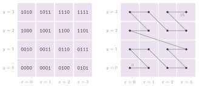

# 18. Combinatorial generation {#ch-18}

[Source: `include/ADS/combinatorial/Bitwise.h`, `FastBitwise.h`,
`Generation.h`, `FastGeneration.h`]

We are concerned in this chapter with two families of algorithms of volume
4A of [Knuth 2011](Z-bibliography.md#ref-knuth2011), which go beyond the
textbook course that the rest of the library follows. The first one is the
*broadword* computation of his section 7.1.3, which treats the 64 bits of a
word as a vector of bits (or as a set of at most 64 items) and replaces a
loop over the bits by a few operations on the word
([§18.2](18-combinatorial.md#sec-18-2)). Its engineered form works on
arrays of words and on the instructions of the recent processors
([§18.3](18-combinatorial.md#sec-18-3)). The second one is the
*generation* of the basic combinatorial objects of his section 7.2.1 (the
tuples, the permutations, the combinations, the partitions and the strings
of parentheses), each visited once in a fixed order
([§18.4](18-combinatorial.md#sec-18-4) to
[§18.7](18-combinatorial.md#sec-18-7)). Its engineered form brings the
work per object down to a few instructions
([§18.8](18-combinatorial.md#sec-18-8)). Each family therefore comes in
two headers, one that follows the text of Knuth and one written for speed,
and the tests check that the two give the same results. We leave to
[Chapter 19](19-backtrack.md#ch-19) the enumeration by backtracking of the
subsets, of the permutations and of the other configurations with
constraints.

## 18.1 Words as sets of bits {#sec-18-1}

A *word* $x$ is an unsigned integer of 64 bits (the type `Word` of
`Bitwise.h`), $x = \sum_{k=0}^{63} x_k 2^k$, with the bit $x_k$ in the
*place* $k$; the arithmetic on words is modulo $2^{64}$, and hence
$-x = \lnot x + 1$ (the complement plus 1). A word is also the set
$\{ k : x_k = 1 \} \subseteq \{ 0 , \ldots , 63 \}$, on which the
operations of C++ on the bits are those of the sets: $\&$ is the
intersection, $\mid$ the union, $\oplus$ the symmetric difference and
$\lnot$ the complement. The shifts $x \gg s = \lfloor x / 2^s \rfloor$
and $x \ll s = 2^s x \bmod 2^{64}$ translate the set by $s$ places. In
the following, $\nu( x )$ is the *sideways sum* of $x$ (the number of its
1 bits, i.e., the size of the set), $\rho( x )$ the *ruler function* (the
place of the lowest 1 of $x \ne 0$, i.e., the number of its trailing
zeros) and $\lambda( x ) = \lfloor \log_2 x \rfloor$ the place of its
highest 1. A constant written $\mathtt{0x5555 \ldots 55}$ is the word
whose 8 bytes are all $\mathtt{0x55}$. For the generation, the
numbers of the objects are written $\binom{n}{t}$ (the binomial
coefficient), $p( n )$ (the partitions of the integer $n$), $\varpi_n$
(the Bell number, i.e., the partitions of a set of $n$ items) and
$C_n = \binom{2 n}{n} / ( n + 1 )$ (the Catalan number).

## 18.2 Broadword computation {#sec-18-2}

We now describe the functions of `Bitwise.h`, which compute a property of
a word, or a new word, with a number of operations that does not depend on
the bits that are set, and with no branch but the few that their contracts
need. Each one rests on an identity of the arithmetic modulo $2^{64}$,
which we state with its proof. Since the functions are `constexpr`, the
compiler can evaluate them on constants.

**The sideways sum.** Counting the 1 bits one by one costs $\nu( x )$
iterations even with the trick $x \gets x \,\&\, ( x - 1 )$, which clears
the lowest 1 at each step. Instead, `sidewaysSum()` adds the bits in
parallel ([Algorithm 18.1](18-combinatorial.md#alg-18-1)). We see the word first as
32 fields of 2 bits, each of which receives the number of its 1 bits, then
as 16 fields of 4 bits and as 8 fields of 8 bits (the bytes), each holding
the sum of its two halves. Finally, a product adds the 8 bytes into the top
one ([Figure 18.1](18-combinatorial.md#fig-18-1)).

<span id="alg-18-1"></span>**Algorithm 18.1.** The sideways sum of a word
([Knuth 2011, §7.1.3](Z-bibliography.md#ref-knuth2011)).

--8<-- "generated/Bitwise-sidewaysSum.pseudo.md"

{#fig-18-1}

<span id="lem-18-1"></span>**Lemma 18.1.** *For any word $x$,
`sidewaysSum(x)` returns $\nu( x )$, with 12 operations on words and no
branch.*

*Proof.* A field of 2 bits with the value $2 a + b$ has $a + b$ ones, and
$x - ( ( x \gg 1 ) \,\&\, \mathtt{0x5555 \ldots 55} )$ subtracts $a$ from
each field. Since $2 a + b \ge a$, no subtraction borrows from the field
above, and line 2 therefore leaves in each field its count. Line 3
adds the fields in pairs into fields of 4 bits, whose sums are at most 4
and fit in 3 bits. Line 4 adds the fields of 4 bits in pairs, and it may
mask after the sum (instead of before, as line 3 does), since a sum is at
most 8 and fits in the lower half of its byte. Finally, the product by
$\mathtt{0x0101 \ldots 01}$ adds the byte $i$ to the bytes
$i , i + 1 , \ldots , 7$, and no partial sum exceeds 64, so that no carry
crosses a byte; hence the byte 7 of the product is the sum of the 8 bytes.
$\square$

**The lowest and the highest 1.** The lowest 1 of $x \ne 0$ is in the
place $\rho( x )$, and $x - 1$ has the same bits as $x$ above it, a 0 in
it and 1s below it; hence

$$
x \,\&\, -x = 2^{\rho( x )} , \qquad
x \mid ( x - 1 ) = x + 2^{\rho( x )} - 1 , \qquad
x \oplus ( x - 1 ) = 2^{\rho( x ) + 1} - 1 , \tag{18.1}
$$

which are, respectively, `rightmostOne()` (the lowest 1 alone),
`smearRight()` (the 0s below it set) and a run of $\rho( x ) + 1$ ones,
whose sideways sum minus 1 is `ruler()`. On $x = 0$, `rightmostOne()` and
`smearRight()` return 0, while `ruler()` and `lambda()`, which have no
value to give, require $x \ne 0$ by their contracts.

--8<-- "generated/Bitwise-ruler.pseudo.md"

The highest 1 has no such identity, and `lambda()` finds it by a binary
search on its place, halving the width of the search at each step. If
$x \gg 32 \ne 0$, the place is at least 32 and the search goes on in the
upper half; the shifts 16, 8, 4, 2 and 1 follow, 6 steps in all.

--8<-- "generated/Bitwise-lambda.pseudo.md"

By the same doubling, `reverseBits()` reverses the bits of a word. The
fields of 1 bit are swapped in pairs, then those of 2, 4, 8 and 16 bits,
and finally the two halves, in $\log_2 64 = 6$ rounds. Each of the first 5
takes two shifts, two masks and an or, and the last one needs no mask. In general, the functions of this kind cost
$O( \log w )$ operations on a word of $w$ bits (cf. [Knuth 2011,
§7.1.3](Z-bibliography.md#ref-knuth2011)).

--8<-- "generated/Bitwise-reverseBits.pseudo.md"

In line 3, $m_k$ is the word whose fields of $2^k$ bits are alternately
all 1 and all 0, from the field of the places $0 , \ldots , 2^k - 1$, which
is all 1 (i.e., $\mathtt{0x5555 \ldots 55}$, $\mathtt{0x3333 \ldots 33}$,
$\mathtt{0x0F0F \ldots 0F}$, $\mathtt{0x00FF \ldots 00FF}$ and
$\mathtt{0x0000FFFF0000FFFF}$ for $k = 0 , \ldots , 4$); hence $m_k$ has a
1 in the place $p$ if and only if the bit $k$ of $p$ is 0.

<span id="lem-18-2"></span>**Lemma 18.2.** *For any word $x \ne 0$,
`lambda( x )` returns $\lambda( x )$ after 6 steps; for any word $x$,
`reverseBits( x )` returns the word whose bit $63 - p$ is $x_p$ for each
place $p$.*

*Proof.* For `lambda()`, the invariant before the step of the shift $s$
is $\lambda( x_0 ) = r + \lambda( x )$, where $x_0$ is the argument and
$x < 2^{2 s}$: it holds before the first step, with $r = 0$ and $s = 32$.
If $x \gg s \ne 0$, then $\lambda( x ) \ge s$ and $\lambda( x \gg s ) =
\lambda( x ) - s$, and the step moves $s$ from $\lambda( x )$ to $r$;
otherwise $x < 2^s$, and nothing changes. In both cases $x < 2^s$ after the
step, which is the invariant for the next shift $s / 2$. After the step of
the shift 1 one has $x < 2$, i.e., $x = 1$ since $x$ never becomes 0, and
$r = \lambda( x_0 )$.

For `reverseBits()`, we show that the step $k$ of line 3 moves the bit in
the place $p$ to the place $p \oplus 2^k$, i.e., it complements the bit $k$
of the place. A bit whose place has the bit $k$ equal to 0 is kept by
$x \,\&\, m_k$ and shifted up by $2^k$, which sets the bit $k$ of its
place with no carry; a bit whose place has the bit $k$ equal to 1 is
shifted down by $2^k$, which clears it, and is then kept by the mask,
whose 1s are the places with the bit $k$ equal to 0. No other bit
survives the masks, and the two terms of the or have their 1s in disjoint
places. The exchange of the halves in line 4 complements the bit 5 of the
place in the same way. After the 6 steps the bit of the place $p$ is in
the place $p \oplus 63 = 63 - p$. $\square$

**The Gray code.** The binary *reflected Gray code* of [Gray
1953](Z-bibliography.md#ref-gray1953) orders the $2^{64}$ words in such a
way that two consecutive ones differ in one bit only. Then `gray()` gives
the $x$-th word of the order, and `grayInverse()` gives the rank of a word.

--8<-- "generated/Bitwise-gray.pseudo.md"

--8<-- "generated/Bitwise-grayInverse.pseudo.md"

<span id="lem-18-3"></span>**Lemma 18.3.** *Let $g( x ) = x \oplus ( x
\gg 1 )$. Then $g( x )$ and $g( x + 1 )$ differ in exactly one bit for
$x < 2^{64} - 1$, and $g$ is a bijection whose inverse gives the bit $k$ of
$x$ as $x_k = \bigoplus_{j \ge k} g_j$; `grayInverse()` computes it with 6
shifts.*

*Proof.* Adding 1 to $x$ flips the run of the trailing 1s of $x$ (say, $r$
bits) and the 0 above it, i.e., $x \oplus ( x + 1 ) = 2^{r + 1} - 1$. Then
$g( x ) \oplus g( x + 1 ) = ( 2^{r + 1} - 1 ) \oplus ( 2^r - 1 ) = 2^r$,
a single bit. Furthermore, since $g_k = x_k \oplus x_{k+1}$ (with $x_{64} = 0$), one has
$x_k = g_k \oplus x_{k+1}$, and unrolling from the top gives the
suffix exclusive or of the statement. The loop of `grayInverse()` computes
it by doubling: after the shifts by $1 , 2 , \ldots , 2^{i-1}$, the bit $k$
is the exclusive or of the bits $k , \ldots , k + 2^i - 1$ of $g$, and $i =
6$ covers the 64 bits. $\square$

**The next word with as many 1 bits.** One can visit the $t$-subsets of
$\{ 0 , \ldots , 63 \}$, taken as words, in increasing order by the trick
of Gosper ([Beeler et al. 1972, item
175](Z-bibliography.md#ref-beeler1972)). `nextSameWeight()` follows it,
and computes the successor of a word of $t$ ones with a constant number of
operations
([Algorithm 18.2](18-combinatorial.md#alg-18-2),
[Figure 18.2](18-combinatorial.md#fig-18-2)).

<span id="alg-18-2"></span>**Algorithm 18.2.** The trick of Gosper
([Beeler et al. 1972](Z-bibliography.md#ref-beeler1972); [Knuth 2011,
§7.1.3](Z-bibliography.md#ref-knuth2011)).

--8<-- "generated/Bitwise-nextSameWeight.pseudo.md"

 on $x = 01011100$: the lowest run of 1s of $x$, the bit that the carry sets, and the $r - 1 = 2$ bits that go back to the bottom (in colour).](../figures/combinatorial-gosper.svg){#fig-18-2}

<span id="lem-18-4"></span>**Lemma 18.4.** *For $x \ne 0$, with
$u = x \,\&\, -x$ and $v = x + u$, the next larger word with as many 1 bits
as $x$ is*

$$
v + ( ( ( v \oplus x ) / u ) \gg 2 ) , \tag{18.2}
$$

*provided that it is smaller than $2^{64}$, i.e., that $v \ne 0$.*

*Proof.* Let the lowest run of 1s of $x$ have $r \ge 1$ bits, from the
place $\rho( x )$ up to the place $\rho( x ) + r - 1$. A larger word with
as many 1 bits must change a 0 of $x$ into a 1. The least such word moves
the top bit of that run one place up (to the lowest 0 above a 1), and puts
the other $r - 1$ bits of the run in the places $0 , \ldots , r - 2$. By (18.1), $u = 2^{\rho( x )}$, and the carry
of $x + u$ clears the run and sets the bit above it; hence $v$ has the
bits of $x$ above the run and that bit, and $v \oplus x$ is a run of
$r + 1$ ones from the place $\rho( x )$. The division by $u$ brings it to
the place 0, and the shift by 2 shortens it to $r - 1$ ones, which the sum
adds to $v$ without carries. $\square$

Note that the contract on $v$ also catches $x = 2^{63}$, whose successor
would need a 65th bit. The engineered version of
[§18.8](18-combinatorial.md#sec-18-8) replaces the division by a shift.

**The Morton code.** `interleave( x , y )` puts the 32 bits of $x$ in the
even places of a word and those of $y$ in the odd ones, i.e., the *Morton
code* of the point $( x , y )$ ([Morton 1966](Z-bibliography.md#ref-morton1966)),
and `deinterleave()` takes them apart. In their order, the codes visit the plane by squares of side $2^k$ for each $k$
([Figure 18.3](18-combinatorial.md#fig-18-3)). Hence, points close in the
plane often (but not always: see the jump from 7 to 8 in the figure) have
close codes, a property that spatial indexes and the cache-friendly layouts
of matrices exploit. The spread of the 32 bits to the even
places moves blocks of 16, 8, 4, 2 and 1 bits, each by an or with a shifted
copy and a mask, and the gather undoes the steps in the reverse order.

<span id="alg-18-3"></span>**Algorithm 18.3.** The Morton code of two
coordinates of 32 bits ([Knuth 2011, §7.1.3](Z-bibliography.md#ref-knuth2011)).

--8<-- "generated/Bitwise-interleave.pseudo.md"

<span id="lem-18-5"></span>**Lemma 18.5.** *For any $x < 2^{32}$,
$\mathrm{spread}( x )$ of [Algorithm 18.3](18-combinatorial.md#alg-18-3)
returns the word whose bit $2 i$ is $x_i$ for $0 \le i < 32$ and whose odd
bits are 0; hence `interleave( x , y )` has $x_i$ in the place $2 i$ and
$y_i$ in the place $2 i + 1$, and `deinterleave()` is its inverse.*

*Proof.* Let $\sigma_k( i ) = i + \sum_{b \ge k} i_b 2^b$, where
$i_b$ is the bit $b$ of $i$; we show that after the step of the shift
$2^k$ the bit $x_i$ is in the place $\sigma_k( i )$ and all the other
places are 0. Before the first step this holds with $k = 5$, since
$\sigma_5( i ) = i$ for $i < 32$. The terms of $\sigma_{k+1}( i ) - i$ are
multiples of $2^{k+1}$; hence the bit $k$ of the place
$\sigma_{k+1}( i )$ is $i_k$, and the step of the shift $2^k$ treats the
bit $x_i$ as follows. The or with $x \ll 2^k$ makes a copy of it in the
place $\sigma_{k+1}( i ) + 2^k$, and the mask keeps the places whose bit
$k$ is 0 (as $m_k$ above). If $i_k = 0$, the bit stays where it is and its
copy, whose place has the bit $k$ equal to 1, is cleared; if $i_k = 1$,
the bit is cleared and its copy, in the place $\sigma_{k+1}( i ) + 2^k =
\sigma_k( i )$, is kept. A copy of another bit cannot land on a place
that is kept unless it is the copy kept above, since the places
$\sigma_k( i )$ are distinct for distinct $i$ (the map $i \mapsto
\sigma_k( i )$ is increasing). After the step of the shift 1, the bit
$x_i$ is in the place $\sigma_0( i ) = 2 i$. The gather of
`deinterleave()` clears the odd places and runs the steps of the spread
backwards, for the shifts $1 , 2 , \ldots , 16$ to the right, each with the
mask of the step that precedes it in the spread (and the low 32 bits at the
end); the same argument, read from $\sigma_0$ to $\sigma_5$, shows that the
step of the shift $2^k$ brings the bit from the place $\sigma_k( i )$ to
the place $\sigma_{k+1}( i )$, and hence the bit of the place $2 i$ back to
the place $i$. $\square$

{#fig-18-3}

**A zero byte.** `hasZeroByte()` decides whether one of the 8 bytes of a
word is 0 with four operations and a comparison, which is the test that
lets `strlen()` scan a string 8 bytes at a time.

--8<-- "generated/Bitwise-hasZeroByte.pseudo.md"

<span id="lem-18-6"></span>**Lemma 18.6.** *$( ( x - \mathtt{0x0101 \ldots
01} ) \,\&\, \lnot x \,\&\, \mathtt{0x8080 \ldots 80} ) \ne 0$ if and only if
one of the bytes of $x$ is 0.*

*Proof.* If no byte is 0, each byte $b \ge 1$ becomes $b - 1$ with no
borrow, and the top bit of $b - 1$ is set only if $b \ge \mathtt{0x81}$,
in which case the top bit of $b$ is set too and $\lnot x$ masks it. The
result is then 0. Otherwise, let the byte $i$ be the lowest one that is 0:
the bytes below it are not 0, and hence do not borrow, while the byte $i$
becomes $\mathtt{0xFF}$, whose top bit survives both masks. $\square$

We remark that the borrow from the byte $i$ may turn a byte above it that is 1 into a
byte whose top bit is set, i.e., a "false" zero byte. This does not change
the answer, since a zero byte exists anyway; yet, the word of the test
locates with certainty only the lowest zero byte.

## 18.3 Engineered operations on words and arrays {#sec-18-3}

The processors of the last fifteen years have instructions for some of the
functions of [§18.2](18-combinatorial.md#sec-18-2): the population count
(`popcnt`), the trailing and the leading zeros (`tzcnt`, `lzcnt`), and the
scatter and the gather of bits of BMI2 (`pdep`, `pext`). C++20 reaches the
first ones portably through `std::popcount`, `std::countr_zero` and
`std::countl_zero` of `<bit>`. `FastBitwise.h` builds on them, and on the
vectors of AVX2 and AVX-512 when the compiler may use them, for four
tasks: (i) the count of the 1 bits of an array, (ii) the scatter and the
gather, (iii) the selection of the 1 of a given rank, and (iv) the Morton
code. The choice of the instructions is made at compile time, by the
macros of the target, and never by a test of the processor at run time. Each function also has a portable
branch, which gives the same results on a machine without the
instructions; the test `engineered_combinatorial.fast-bitwise` checks them
against loops over the bits.

**The population count of an array.** The 1 bits of $n$ words are the sum
of their sideways sums, i.e., $n$ instructions `popcnt` and $n$ additions.
`popcount( w , n )` keeps four independent sums, and hence the additions
of consecutive words need not wait for one another. This is the algorithm
on a machine without AVX2, and on the arrays shorter than a block (64 words
with AVX2, 128 with AVX-512; the header uses AVX-512 only together with
its instructions on bytes, AVX-512BW, and AVX2 otherwise). On longer
arrays it uses the method of Harley and Seal in the form of [Muła et al.
2018](Z-bibliography.md#ref-mula2018), which counts once per 16 vectors. A *carry-save adder* takes three
vectors of bits $a$, $b$, $c$
and gives, place by place, two vectors

$$
\mathrm{sum} = a \oplus b \oplus c , \qquad
\mathrm{carry} = \mathrm{maj}( a , b , c ) , \qquad
a + b + c = \mathrm{sum} + 2 \, \mathrm{carry} , \tag{18.3}
$$

where the last identity holds place by place (the majority is 1 when at
least two of the three bits are). A tree of 15 such adders takes a block of 16
vectors $v_0 , \ldots , v_{15}$ together with four accumulators $o$, $t$,
$f$, $e$, whose bits weigh 1, 2, 4 and 8, and gives four new accumulators
and a vector $s$ of the sixteens
([Algorithm 18.4](18-combinatorial.md#alg-18-4)); only $s$ is counted.

<span id="alg-18-4"></span>**Algorithm 18.4.** The population count of an
array by the method of Harley and Seal ([Muła et al.
2018](Z-bibliography.md#ref-mula2018)); $V$ is the number of words of a
vector.

--8<-- "generated/FastBitwise-popcount.pseudo.md"

<span id="lem-18-7"></span>**Lemma 18.7.** *After each block, the 1 bits
of the vectors read so far are $16 T + 8 \nu( e ) + 4 \nu( f ) + 2 \nu( t )
+ \nu( o )$, where $T$ is the sum of the counts $\nu( s )$ of the blocks;
hence [Algorithm 18.4](18-combinatorial.md#alg-18-4) returns the 1 bits of
the array, with one count of a vector and 15 carry-save adders per block of
16 vectors.*

*Proof.* Before the first block all the terms are 0. In a block, each adder replaces three vectors of the same weight $2^i$ with a
vector of weight $2^i$ (the sum) and one of weight $2^{i+1}$ (the carry),
which by (18.3) keeps the weighted number of 1 bits. The adders of lines 5
to 7 take the 16 new vectors and the old $o$, $t$, $f$, $e$, and leave one
vector for each weight 1, 2, 4, 8 (the new accumulators) and one, $s$, of
weight 16, whose count enters $T$. Line 9 then adds the accumulators with
their weights and the vectors left after the last block with weight 1, and
line 10 adds the words left after the last vector, also with weight 1, so
that every bit of the array is counted once with its weight. $\square$

An adder costs five logical operations on AVX2 (two exclusive ors, two ands
and an or). It costs two on AVX-512, whose instruction `vpternlogq`
computes any function of three vectors of bits (the truth tables
$\mathtt{0x96}$ for the sum and $\mathtt{0xE8}$ for the majority).

A vector is counted by the instruction `vpopcntq` of AVX-512 when the
compiler may use it (AVX-512 VPOPCNTDQ). Otherwise, the method of [Muła et al.
2018](Z-bibliography.md#ref-mula2018) keeps the 16 counts of the nibbles as
a table of bytes in a register, looks up the counts of the two nibbles of
each byte by a shuffle of bytes (`vpshufb`), and adds the counts of the 8
bytes of each word by `vpsadbw`. With AVX2, a block of 16 vectors (64
words) thus costs 75 logical operations for the adders and about 10 for the
count of $s$, against 64 instructions `popcnt` and 64 additions for the
scalar loop. Whether this is faster may depend on the processor, although
it usually is on long arrays according to [Muła et al.
2018](Z-bibliography.md#ref-mula2018). We leave the comparison of the
running times to the campaign of [Appendix B](B-benchmarks.md#app-B).
`popcountAnd( a , b , n )` counts the 1 bits of $a \,\&\, b$ in the same
way, the and being formed when the vectors are loaded, which gives the
size of the intersection of two sets of bits with no array in between.

**Scatter, gather and select.** `pdep( x , m )` puts the low bits of $x$,
in order, in the places of the 1 bits of the mask $m$, and `pext( x , m )`
gathers the bits of $x$ in the places of the 1 bits of $m$ into the low
places. With BMI2 each is one instruction; otherwise it is a loop of
$\nu( m )$ iterations over the 1 bits of $m$. We remark that the two
instructions are microcoded on the processors of AMD before Zen 3, with a
time that grows with $\nu( m )$. Hence the portable branch may well be
faster there, and the header does not try to detect this case.

--8<-- "generated/FastBitwise-pdep.pseudo.md"

`select( x , r )` returns the place of the 1 of rank $r$ of $x$ (from 0),
i.e., the inverse of the rank $\nu( x \,\&\, ( 2^p - 1 ) )$ of a place
$p$, which the succinct structures of [Chapter 22](22-succinct.md#ch-22) need at each query. With
BMI2 it is the trailing zeros of $\mathrm{pdep}( 2^r , x )$, i.e.,
of the bit $r$ scattered to the place of the $r$-th 1 of $x$ ([Pandey et al.
2017](Z-bibliography.md#ref-pandey2017)). Without it, the broadword method
of [Vigna 2008](Z-bibliography.md#ref-vigna2008)
([Algorithm 18.5](18-combinatorial.md#alg-18-5)) computes the prefix sums
$s_j$ of the 1 bits of the bytes $0 , \ldots , j$ as in
[Lemma 18.1](18-combinatorial.md#lem-18-1), but keeps all of them (one per
byte) in the product by $\mathtt{0x0101 \ldots 01}$. It then compares $r$
with the 8 sums at once, as in [Lemma 18.6](18-combinatorial.md#lem-18-6):
the byte $j$ of $( ( r \cdot \mathtt{0x0101 \ldots 01} ) \mid
\mathtt{0x8080 \ldots 80} ) - s$ keeps its top bit if and only if
$s_j \le r$. Since the sums are nondecreasing, the bytes with
$s_j \le r$ are the lowest $k / 8$ ones, and the 1 of rank $r$ is the 1 of
rank $r - s_{k/8 - 1}$ of the byte $k / 8$. At most 7 steps of
$b \gets b \,\&\, ( b - 1 )$ and one count of the trailing zeros find it.

<span id="alg-18-5"></span>**Algorithm 18.5.** The 1 of rank $r$ of a word
([Vigna 2008](Z-bibliography.md#ref-vigna2008); [Pandey et al.
2017](Z-bibliography.md#ref-pandey2017) with BMI2).

--8<-- "generated/FastBitwise-select.pseudo.md"

<span id="lem-18-8"></span>**Lemma 18.8.** *For $0 \le r < \nu( x )$
(the contract of `select()`), [Algorithm 18.5](18-combinatorial.md#alg-18-5)
returns the place of the 1 of rank $r$ of $x$, with at most 7 iterations
of line 7.*

*Proof.* With BMI2, $\mathrm{pdep}( 2^r , x )$ deposits the bit $r$ of
$2^r$, its only 1, in the place of the $r$-th 1 of $x$ (from 0), which
exists since $r < \nu( x )$, and $\rho$ gives that place. Without BMI2,
line 3 forms the counts $c_j \le 8$ of the bytes $j$ of $x$ as in the
proof of [Lemma 18.1](18-combinatorial.md#lem-18-1), and the product by
$\mathtt{0x0101 \ldots 01}$ leaves in the byte $j$ the prefix sum $s_j =
c_0 + \cdots + c_j \le 64$, with no carry between the bytes. In line 4,
the byte $j$ of $r \cdot \mathtt{0x0101 \ldots 01} \mid \mathtt{0x8080
\ldots 80}$ is $r + 128$, since $r < 64$, and $r + 128 - s_j \ge 64$; hence
the subtraction borrows from no byte, and the top bit of the byte $j$ of
the difference is set if and only if $r + 128 - s_j \ge 128$, i.e.,
$s_j \le r$. Since $s_0 \le s_1 \le \cdots \le s_7 = \nu( x ) > r$, the
bytes with $s_j \le r$ are the bytes $0 , \ldots , c - 1$ for some $c \le
7$, and $k = 8 c$ in line 5. Then $s_{c-1} \le r < s_c$ (with $s_{-1} =
0$), i.e., the 1 of rank $r$ of $x$ is the 1 of rank $r' = r - s_{c-1}$ of
the byte $c$, which line 6 extracts as $b$. Since $r' < c_c \le 8$, the $r'
\le 7$ iterations of line 7 clear the $r'$ lowest 1s of $b$, and $\rho( b
)$ is the place of the next one in the byte, to which line 8 adds the place
$k$ of the byte. $\square$

Finally, `mortonEncode()` and `mortonDecode()` are `interleave()` and
`deinterleave()` of [§18.2](18-combinatorial.md#sec-18-2) by two
instructions `pdep` (resp. `pext`), with the masks $\mathtt{0x5555 \ldots
55}$ and $\mathtt{0xAAAA \ldots AA}$, and fall back on the functions of
`Bitwise.h` without BMI2.

## 18.4 The generation of combinatorial objects {#sec-18-4}

We now turn to the generation. A *generator* visits all the objects of a
kind, each once, in a fixed order. In `Generation.h` and
`FastGeneration.h` it is a function that receives a callable `visit` and
calls it on each object. If `visit` returns a value convertible to `bool`,
true stops the generation at once; a `visit` that returns `void` is never
tested (the choice is made at compile time). In both cases the function
returns the number of the objects visited, the last one included. The
objects of `Generation.h` are vectors of `int`, under the alias `Tuple` of
the header (a tuple, a permutation, a combination, a partition or a
restricted growth string), except the strings of parentheses, which are
of type `std::string`. Those of `FastGeneration.h` are the vector of the
caller, a vector of `int` and a `Word`. Each generator passes to `visit`
its own object by reference, never a copy (the words of
`forEachCombinationMask()` by value), and the visit must not change it;
`FastGeneration.h` passes it as `const`, while `Generation.h` relies on the
caller. We measure the cost of a generator per object, i.e., amortized
over the sequence, without the visits. A generator is *loopless* when the
work between two consecutive objects is bounded by a constant even in the
worst case ([Knuth 2011, §7.2.1.1](Z-bibliography.md#ref-knuth2011)).
[Table 18.1](18-combinatorial.md#tab-18-1) lists the objects, their number
and their orders, and the tests check each count of the table on small
sizes.

<span id="tab-18-1"></span>**Table 18.1.** The objects of the generators,
their number, the functions that visit them (those whose names begin with
`forEach` are in `FastGeneration.h`, the others in `Generation.h`), and
their order; $m_v$ is the multiplicity of the item $v$ of a multiset, and
the order of the set partitions is that of their strings
([§18.7](18-combinatorial.md#sec-18-7)).

| Objects | Number | Function | Order |
|--------------|-----------|-----------------|-------------|
| $n$-tuples, $0 \le a_j < m_j$ | $\prod_j m_j$ | `mixedRadix()` | lexicographic |
| | | `grayTuples()` | reflected Gray |
| permutations of a multiset | $n! / \prod_v m_v!$ | `permutationsLex()` | lexicographic |
| | | `forEachPermutationLex()` | lexicographic |
| permutations of $n$ items | $n!$ | `plainChanges()` | adjacent swaps |
| | | `heapPermutations()` | one swap |
| | | `forEachPermutation()` | one swap |
| $t$-combinations of $n$ | $\binom{n}{t}$ | `combinationsLex()` | lexicographic |
| | | `forEachCombination()` | lexicographic |
| | | `forEachCombinationMask()` | increasing words |
| | | `revolvingDoor()` | revolving door |
| partitions of $n$ | $p( n )$ | `integerPartitions()` | reverse lexicographic |
| partitions of a set | $\varpi_n$ | `setPartitions()` | lexicographic |
| parentheses, $n$ pairs | $C_n$ | `nestedParentheses()` | lexicographic |

We remark that most lexicographic generators of the area follow one scheme: from the
current object, find the last place that can grow, make it grow by the
least amount, and set the places after it to their least values. Each step costs the length of the suffix that it scans. The arguments of
[Lemma 18.9](18-combinatorial.md#lem-18-9),
[Lemma 18.13](18-combinatorial.md#lem-18-13) and
[Lemma 18.16](18-combinatorial.md#lem-18-16) are basically the same: a
long suffix changes rarely, and the objects whose scan reaches a given
place are counted as the objects of a smaller size.

## 18.5 Tuples {#sec-18-5}

The $n$-tuples $( a_0 , \ldots , a_{n-1} )$ with $0 \le a_j < m_j$ are the
numbers of $n$ digits in the mixed radix $( m_0 , \ldots , m_{n-1} )$.
`mixedRadix()` visits them in lexicographic order by adding 1 with the
carries, with the last place as the least significant one (Algorithm
7.2.1.1M of [Knuth 2011](Z-bibliography.md#ref-knuth2011)).

--8<-- "generated/Generation-mixedRadix.pseudo.md"

A place of radix 1, which the contract allows, holds 0 for ever and is
always at the end of its range. A plain carry would walk over it, and with
the radices $( 2 , 1 , \ldots , 1 )$ each of the two steps would scan all
the $n$ places. `mixedRadix()` therefore links each place $j$ to the last
place $b( j )$ of radix larger than 1 before it, and it starts the carries
from the last such place $\ell$. A carry then walks over the places of
radix larger than 1 only (lines 5 and 6), and the links cost $O( n )$ time
before the first visit.

<span id="lem-18-9"></span>**Lemma 18.9.** *For any radices
$m_j \ge 1$, `mixedRadix()` costs $O( n )$ time before its first visit and
$O( 1 )$ amortized time per tuple after it, with at most 4 evaluations of
the condition of line 6 per tuple on the average; the same
holds for `permutationsLex()` on $n$ distinct items, whose work per
permutation is at most proportional to $\sum_{k \ge 0} ( k + 1 ) / k! =
2 e$.*

*Proof.* Let $\ell_1 > \ell_2 > \cdots$ be the places of radix larger than
1, from the right. The step after a tuple clears exactly the places
$\ell_1 , \ldots , \ell_k$ when these are at the ends of their ranges and
$\ell_{k+1}$ (if any) is not, and it then evaluates that condition $k + 1$
times, since the links lead from $\ell_i$ to $\ell_{i+1}$ in one step. The tuples whose
places $\ell_1 , \ldots , \ell_k$ are at their ends are a fraction
$1 / ( m_{\ell_1} \cdots m_{\ell_k} ) \le 2^{-k}$ of all the tuples; hence
the evaluations per tuple are at most $\sum_{k \ge 0} ( k + 1 ) / 2^k = 4$
on the average. In a similar way, the step of `permutationsLex()` that
scans a suffix of length $k$ after the place of the ascent (in lines 5 and
7, and in the reversal of line 8) costs $O( k + 1 )$. It happens only
after a permutation whose last $k$ items are in decreasing order, i.e., at
most once every $k!$ permutations of distinct items, and the sum becomes
$\sum_{k \ge 0} ( k + 1 ) / k! = 2 e$. $\square$

In the *reflected Gray order* of the tuples, two consecutive tuples differ
by $\pm 1$ in one place. The order is the lexicographic one with a twist:
the last place runs up and down alternately, and each other place changes,
by 1 in its current direction, when all the places after it are at an end
of their ranges. These then reverse their direction instead of going back
to 0. `grayTuples()` is Algorithm 7.2.1.1H of [Knuth
2011](Z-bibliography.md#ref-knuth2011), which numbers the places from the
right (the place $j$ is `a[ n - 1 - j ]`) and keeps the direction $o_j$ of
each place. It adds the *focus pointers* $f_j$, so that the place to change
is read in $f_0$ instead of searched for
([Algorithm 18.6](18-combinatorial.md#alg-18-6)).

<span id="alg-18-6"></span>**Algorithm 18.6.** The loopless reflected
Gray order of the tuples (Algorithm 7.2.1.1H of [Knuth
2011](Z-bibliography.md#ref-knuth2011)).

--8<-- "generated/Generation-grayTuples.pseudo.md"

Roughly, the pointers skip the places that are at an end of their ranges
and wait for a place on their left to move. To state this precisely, we
call a place $j < n$ *passive* when its last move brought it to an end of
its range and no place $i > j$ has moved since (at the start no place is
passive, since all are at 0 and none has moved). The reflected order is
then the order in which each step moves the least place that is not
passive, by 1 in its direction, and makes the places below it no longer
passive; the generation ends when all the places are passive.

<span id="lem-18-10"></span>**Lemma 18.10.** *Let $P$ be the set of the
passive places, and $n \notin P$. Before each execution of line 5 of
[Algorithm 18.6](18-combinatorial.md#alg-18-6), for $0 \le j \le n$,
$f_j$ is the least place $i \ge j$ not in $P$ if $j = 0$ or $j - 1 \notin
P$, and $f_j = j$ otherwise. Hence $f_0$ is the place that the reflected
order changes next, and the algorithm is loopless.*

*Proof.* At the start $P$ is empty and $f_j = j$, as claimed. Let the
claim hold before line 5, and let $j = f_0$, the least place not in $P$;
the places $0 , \ldots , j - 1$ are then in $P$, and by the claim $f_i = i$
for $1 \le i \le j$. Line 7 moves the place $j$, and the places below it
leave $P$. If the place $j$ does not reach an end, the new set is $P' = P
\setminus \{ 0 , \ldots , j - 1 \}$, and the claim for $P'$ requires
$f_i = i$ for $i \le j$, which holds after $f_0 \gets 0$ of line 5; for
$i > j$ neither the membership of $i - 1$ nor the places from $i$ on have
changed. If the place $j$ reaches an end, then $P' = ( P \setminus \{ 0 ,
\ldots , j - 1 \} ) \cup \{ j \}$, and the claim for $P'$ requires three
things: $f_i = i$ for $i < j$, which holds as before; $f_j$ equal to the
least place $i \ge j + 1$
not in $P$, which was $f_{j+1}$ since $j \notin P$, and which line 9 copies
into $f_j$; and $f_{j+1} = j + 1$, since now $j \in P'$, which line 9 sets.
For $i > j + 1$, the values on which the claim depends have not changed.
Each step
costs a constant number of assignments, and line 6 stops when all the
places are passive. That the steps visit each tuple once follows by
induction on $n$: between two moves of the place $n - 1$, the places
$0 , \ldots , n - 2$ go through all their tuples in the reflected order of
$n - 1$ places, forwards or backwards, and the place $n - 1$ moves $m_{n-1}
- 1$ times. $\square$

The argument needs the precondition $m_j \ge 2$: a place of one value
would be at both ends of its range at once, and with $m_j = 1$, line 7
would move it to the value 1, out of its range. Only `mixedRadix()`
accepts the radices 1.

[Table 18.2](18-combinatorial.md#tab-18-2) follows the algorithm on
$m = ( 2 , 3 )$.

<span id="tab-18-2"></span>**Table 18.2.** `grayTuples()` on the radices
$m = ( 2 , 3 )$: the tuple $( a_0 , a_1 )$ visited, then the directions
$( o_0 , o_1 )$ and the focus pointers $( f_0 , f_1 , f_2 )$ in the
numbering of the places from the right (the place 0 is $a_1$).

| Tuple | $o$ | $f$ | Changed next |
|---|---|---|---|
| $( 0 , 0 )$ | $( 1 , 1 )$ | $( 0 , 1 , 2 )$ | $a_1$ up |
| $( 0 , 1 )$ | $( 1 , 1 )$ | $( 0 , 1 , 2 )$ | $a_1$ up, to its end |
| $( 0 , 2 )$ | $( -1 , 1 )$ | $( 1 , 1 , 2 )$ | $a_0$ up, to its end |
| $( 1 , 2 )$ | $( -1 , -1 )$ | $( 0 , 2 , 2 )$ | $a_1$ down |
| $( 1 , 1 )$ | $( -1 , -1 )$ | $( 0 , 2 , 2 )$ | $a_1$ down, to its end |
| $( 1 , 0 )$ | $( 1 , -1 )$ | $( 2 , 1 , 2 )$ | none: $f_0 = n$ |


## 18.6 Permutations {#sec-18-6}

`permutationsLex()` visits the permutations of a multiset in lexicographic
order, from the sorted one, by Algorithm 7.2.1.2L of [Knuth
2011](Z-bibliography.md#ref-knuth2011), which goes back to Narayana Pandita
in the fourteenth century. The suffix after the last ascent
$a_j < a_{j+1}$ is nonincreasing; the next permutation puts in the place $j$
the least item of the suffix larger than $a_j$, and reverses the suffix,
which makes it nondecreasing. Since the comparisons are $\ge$, equal items
are never swapped, and each distinct permutation of the multiset is visited
once, $n! / \prod_v m_v!$ in all (e.g., 12 for $( 1 , 1 , 2 , 3 )$).

--8<-- "generated/Generation-permutationsLex.pseudo.md"

The orders in which two consecutive permutations differ by one swap are
less obvious. The *plain changes* of Steinhaus, Johnson and Trotter
([Trotter 1962](Z-bibliography.md#ref-trotter1962); [Johnson
1963](Z-bibliography.md#ref-johnson1963)) swap two adjacent items at each
step. The largest item moves from one end of the permutation to the other
and back, by one place per step; between two of its sweeps, the other items
make one step of their plain changes, recursively. For $n = 3$ the order is
$012 , 021 , 201 , 210 , 120 , 102$, in which the item 2 goes left twice,
the items 0 and 1 swap, and 2 goes right twice. `plainChanges()` is
Algorithm 7.2.1.2P of [Knuth 2011](Z-bibliography.md#ref-knuth2011),
which numbers the items from 1, as we do in its analysis: the item $j$ is
the value $j - 1$ of the vector. It keeps a counter $c_j$ of the steps made
by the item $j$ in its sweep and its direction $o_j$
([Algorithm 18.7](18-combinatorial.md#alg-18-7)). In the inner loop, the offset $s$ counts the larger items that sit at the left end, since they shift the places of
the smaller ones by one.

<span id="alg-18-7"></span>**Algorithm 18.7.** The plain changes
(Algorithm 7.2.1.2P of [Knuth 2011](Z-bibliography.md#ref-knuth2011)), the
places from 1.

--8<-- "generated/Generation-plainChanges.pseudo.md"

<span id="lem-18-11"></span>**Lemma 18.11.** *`plainChanges( n )` visits
the $n!$ permutations of $0 , \ldots , n - 1$, each once, and two
consecutive ones differ by a swap of adjacent items. Its inner loop (lines
7 to 14) makes $\sum_{j=1}^{n} j!$ iterations over the whole generation,
i.e., fewer than $1 + 2 / n$ per permutation for $n \ge 2$.*

*Proof.* We show first that $c_j$ is always the number of the items
smaller than $j$ that lie to its right. This holds at the start, where the
vector is sorted and $c = 0$. Line 14 changes only $c_j$, by
$o_j = \pm 1$, and it is reached only when every item $k > j$ has $c_k$ at
an end of its range, 0 or $k - 1$, since otherwise the loop would have
stopped at $k$. By induction from $k = n$ down to $j + 1$, the items larger
than $j$ then lie at the two ends of the vector, $s$ of them at the left
end (those with $c_k = k - 1$, counted by line 12); hence the items
$1 , \ldots , j$ fill the places from $s + 1$ to $s + j$, in the numbering
from 1. The item $j$, with $c_j$ smaller items to its right among them, is
in the place $j - c_j + s$. Line 14 swaps it with its neighbour in the
place $j - q + s$, a smaller item, which brings its count to $q$ and
leaves the counts of the other items as they were.

The vector of the counts determines the permutation (it is its inversion
table: each item $j$ goes among the $j - 1$ smaller ones, with $c_j$ of
them to its right). It therefore suffices to show that the counts run
through all the tuples with $0 \le c_j < j$, each once. They do so in the
reflected Gray order of these tuples
([§18.5](18-combinatorial.md#sec-18-5)), with the place $n$ running
fastest: at each step the loop changes in its direction the last place
that is not at the end of its range, and it reverses the direction of the
places after it, as Algorithm H does with its focus pointers.

As for the cost, line 8 examines the place $j$ $j$ times in a sweep of
the item $j$: after each of the first $j - 1$ examinations the item moves,
and after the last one the loop goes down to the place $j - 1$. Hence the
examinations of the place $j - 1$ are those of the place $j$ divided by
$j$. The place $n$ is examined once per visit, $n!$ times in all, and
therefore the place $j$ is examined $j!$ times. The iterations are then
$\sum_{j=1}^{n} j! = n! ( 1 + 1 / n + 1 / ( n ( n - 1 ) ) + \cdots ) <
n! ( 1 + 2 / n )$, since each of the $n - 2$ terms after the second is at
most $1 / ( n ( n - 1 ) )$. $\square$

`plainChanges()` keeps the permutation from the index 0 of its vector,
i.e., $a_j$ at the index $j - 1$, and passes that vector to `visit`, as
`heapPermutations()` and `forEachPermutation()` do: a new vector of the $n$
items for each permutation would cost $\Theta( n )$ and hide the bound of
Lemma 18.11.

*Heap's method* ([Heap 1963](Z-bibliography.md#ref-heap1963)) relaxes the
adjacency and makes one swap per permutation with the least bookkeeping of
all the methods compared by [Sedgewick
1977](Z-bibliography.md#ref-sedgewick1977). In its recursive form, one
generates the arrangements of the first $k$ places by generating those of
the first $k - 1$ places $k$ times. After the $i$-th of these calls, the
place $k - 1$ is swapped with the place $i$ if $k$ is even, and with the
place 0 if $k$ is odd. `heapPermutations()` is the iterative form
([Algorithm 18.8](18-combinatorial.md#alg-18-8)), in which a counter $c_i$
of the swaps already made at the place $i$ replaces the stack of the
calls. Since the place $i$ closes a prefix of $i + 1$ items, the rule reads
"swap with $a_{c_i}$ if $i$ is odd, with $a_0$ if $i$ is even".

<span id="alg-18-8"></span>**Algorithm 18.8.** Heap's method, the
iterative form ([Heap 1963](Z-bibliography.md#ref-heap1963); [Sedgewick
1977](Z-bibliography.md#ref-sedgewick1977)).

--8<-- "generated/Generation-heapPermutations.pseudo.md"

<span id="tab-18-3"></span>**Table 18.3.** `heapPermutations( 4 )`: the
24 arrangements, by columns, the swap that produced each one (the places
swapped); each column is the block of the arrangements of the places
$0 , 1 , 2$ with one item in the place 3.

| | $a_3 = 3$ | | $a_3 = 2$ | | $a_3 = 1$ | | $a_3 = 0$ |
|---|---|---|---|---|---|---|---|
| | `0123` | 03 | `3102` | 13 | `0231` | 23 | `3210` |
| 01 | `1023` | 01 | `1302` | 01 | `2031` | 01 | `2310` |
| 02 | `2013` | 02 | `0312` | 02 | `3021` | 02 | `1320` |
| 01 | `0213` | 01 | `3012` | 01 | `0321` | 01 | `3120` |
| 02 | `1203` | 02 | `1032` | 02 | `2301` | 02 | `2130` |
| 01 | `2103` | 01 | `0132` | 01 | `3201` | 01 | `1230` |

In [Table 18.3](18-combinatorial.md#tab-18-3), inside each column the first
three places run through their 6 arrangements by the swaps
$01 , 02 , 01 , 02 , 01$, and the swaps between the columns bring each item
to the place 3 once. The proof that this happens for any $n$ hinges on the
net effect of a call, which depends on the parity of $k$.

<span id="lem-18-12"></span>**Lemma 18.12.** *Let $G( k )$ be the recursive
form of Heap's method on the places $0 , \ldots , k - 1$. Then $G( k )$
visits the $k!$ arrangements of those places, each once, with one swap
between two consecutive ones; furthermore, its net effect on the order of
the items is (i) the swap of the places 0 and $k - 1$ if $k$ is odd, and
(ii) if $k \ge 4$ is even, the arrangement*

$$
( a_{k-3} , a_{k-2} , a_1 , a_2 , \ldots , a_{k-4} , a_{k-1} , a_0 )
\tag{18.4}
$$

*of the initial items $a_0 , \ldots , a_{k-1}$ (and the swap of the two
places for $k = 2$).*

*Proof.* By induction on $k$; the cases $k \le 3$ are checked directly
([Table 18.3](18-combinatorial.md#tab-18-3), first column). It suffices to
show that the $k$ items that the place $k - 1$ holds during the $k$ calls
$G( k - 1 )$ are distinct, since each call visits all the arrangements of
the other $k - 1$ places by induction. Let $k \ge 4$ be even. By (i),
each call $G( k - 1 )$ swaps the places 0 and $k - 2$, and $G( k )$ is
the sequence of the swaps $( 0 , k - 2 )$ and $( i , k - 1 )$ for
$i = 0 , \ldots , k - 2$, followed by one more $( 0 , k - 2 )$. The places
$1 , \ldots , k - 3$ are untouched until the step $i$ that swaps them,
while the places 0 and $k - 2$ exchange $a_0$ and $a_{k-1}$ at each step
after the first. Following the items, one sees that the place $k - 1$
receives $a_{k-2} , a_1 , a_2 , \ldots , a_{k-3}$ and finally $a_0$, all
distinct from one another and from $a_{k-1}$, and that the final order is
(18.4). Let now $k \ge 5$ be odd, $m = k - 1$, and let $Q$ be the effect of a call
$G( m )$ followed by the swap $( 0 , m )$. By (18.4), $Q$ moves the items
along the single cycle of places $0 \to m - 1 \to m - 2 \to 1 \to 2 \to
\cdots \to m - 3 \to m \to 0$, of length $m + 1 = k$. After $j$
applications of $Q$, the place $m$ holds the item that was $j$ steps before
it along the cycle; hence the $m$ applications of $Q$ in $G( k )$ bring
$k - 1$ distinct items to the place $m$, none of them $a_m$. Finally,
$G( k )$ is $Q$ applied $m$ times followed by $G( m )$; since $Q$ is a
single cycle of length $k = m + 1$, $Q^{m+1}$ is the identity and $Q^m =
Q^{-1}$, and $G( k )$ is therefore $Q^{-1}$ followed by $G( m )$, which is
the swap $( 0 , m )$ since $Q$ is $G( m )$ followed by that swap.
$\square$

The counters of the iterative form run through the $n!$ values of a mixed
radix number with the radices $2 , 3 , \ldots , n$, and the place $i$
changes once every $i!$ arrangements. Thus, the loop of
[Algorithm 18.8](18-combinatorial.md#alg-18-8) makes one swap per
arrangement (cf. [Lemma 18.12](18-combinatorial.md#lem-18-12)), and resets $\sum_{i \ge 1} 1 / ( i + 1 )!
= e - 2$ counters per arrangement on the average, i.e., $e - 1$ iterations
in all.

## 18.7 Combinations, partitions and parentheses {#sec-18-7}

**Combinations.** A $t$-combination of $\{ 0 , \ldots , n - 1 \}$ is an
increasing tuple $c_0 < c_1 < \cdots < c_{t-1}$. The lexicographic
successor of `combinationsLex()` (the order of Algorithm 7.2.1.3L of
[Knuth 2011](Z-bibliography.md#ref-knuth2011)) finds the last place that
is not at its maximum $n - t + j$, increments it, and makes the places
after it consecutive.

--8<-- "generated/Generation-combinationsLex.pseudo.md"

<span id="lem-18-13"></span>**Lemma 18.13.** *The scans of line 5 of
`combinationsLex()` visit $\binom{n+1}{t}$ places over the whole
generation, i.e., $( n + 1 ) / ( n + 1 - t )$ per combination; hence the
cost is $O( 1 )$ amortized when $t \le \alpha n$ for a constant
$\alpha < 1$.*

*Proof.* The scan from a combination whose last $r$ places are at their
maxima, and the place before them is not, visits $r + 1$ places. The
combinations whose last $r$ places are at their maxima are
$\binom{n - r}{t - r}$ (the choices of the other $t - r$ items among the
$n - r$ below them). Summing the visits over the combinations gives
$\sum_{r=0}^{t} \binom{n - r}{t - r} = \binom{n+1}{t}$ by the
hockey-stick identity, and the ratio to $\binom{n}{t}$ is
$( n + 1 ) / ( n + 1 - t )$. Finally, the resets of line 7 are as many as the places scanned, minus one per step. $\square$

In the *revolving door* order $R( n , t )$, two consecutive combinations
differ by one item in and one item out. The order is defined by

$$
R( n , t ) = R( n - 1 , t ) , \;
R( n - 1 , t - 1 )^{\mathrm{rev}} \cup \{ n - 1 \} , \tag{18.5}
$$

where $R( n , 0 )$ and $R( t , t )$ have one object each, and the second
part is the order $R( n - 1 , t - 1 )$ reversed, with the item $n - 1$
added to each combination. `revolvingDoor()` follows (18.5) recursively,
with a flag for the reversed orders: the reversal of (18.5) is the second
part not reversed followed by the first part reversed
([Algorithm 18.9](18-combinatorial.md#alg-18-9)). Knuth's Algorithm
7.2.1.3R generates the same order without recursion; the header follows
the recursion, which is closer to (18.5).

<span id="alg-18-9"></span>**Algorithm 18.9.** The revolving door, by the
recursion (18.5) ([Knuth 2011, §7.2.1.3](Z-bibliography.md#ref-knuth2011)).

--8<-- "generated/Generation-door.pseudo.md"

For instance, we obtain for $R( 5 , 3 )$ the order $012 , 023 , 123 , 013 , 034 , 134 , 234 ,
024 , 124 , 014$.

<span id="lem-18-14"></span>**Lemma 18.14.** *Two consecutive combinations
of $R( n , t )$ differ by one item in and one out. The first one is
$\{ 0 , \ldots , t - 1 \}$ and the last one, for $0 < t < n$, is
$\{ 0 , \ldots , t - 2 , n - 1 \}$; `revolvingDoor()` costs $O( t )$ time
per combination and recursion depth $O( n )$.*

*Proof.* The first and the last combinations follow from (18.5) by
induction (the first of $R( n , t )$ is that of $R( n - 1 , t )$, the last
is the first of $R( n - 1 , t - 1 )$ with $n - 1$ added). Inside each part
of (18.5) the claim holds by induction. At the junction, the last
combination of $R( n - 1 , t )$ is $\{ 0 , \ldots , t - 2 , n - 2 \}$. It
is followed by the last of $R( n - 1 , t - 1 )$ with $n - 1$ added, i.e.,
$\{ 0 , \ldots , t - 3 , n - 2 , n - 1 \}$, which differs by $t - 2$ out
and $n - 1$ in; when $t - 1 = n - 1$ or $t = 1$, the same check on the
orders of one object is immediate. Finally, each node of the recursion with
$0 < t < n$ has two children; hence the nodes are $2 \binom{n}{t} - 1$,
each with $O( 1 )$ work but for the leaves $n = t$, which write $t$
places. $\square$

**Partitions of an integer.** `integerPartitions()` visits the partitions
of $n$, i.e., the nonincreasing sequences of positive parts with sum $n$,
in reverse lexicographic order, from $( n )$ to $( 1 , \ldots , 1 )$ (the
order of Algorithm 7.2.1.4P of [Knuth
2011](Z-bibliography.md#ref-knuth2011), which `integerPartitions()`
follows). The last part larger than 1, say $x + 1$, drops to $x$, and the
trailing 1s, with the unit taken from that part, are split again into
parts of $x$ and a remainder; a last part 2 becomes $1 + 1$ at once.
For $n = 6$ the order is $6 , 51 , 42 , 411 , 33 , 321 , 3111 , 222 ,
2211 , 21111 , 111111$.

--8<-- "generated/Generation-integerPartitions.pseudo.md"

<span id="lem-18-15"></span>**Lemma 18.15.** *`integerPartitions( n )`
visits the $p( n )$ partitions of $n$, each once, in reverse lexicographic
order, and writes fewer than $3 p( n )$ parts in all; hence it costs
$O( 1 )$ amortized time per partition.*

*Proof.* Let $a_q$ be the last part larger than 1 of the current
partition, $q = 0$ if there is none (line 5 sets $q$ so, since a last part
$r = 1$ is not larger than 1). If $q = 0$ the partition is $1^n$, the last
one, and line 10 stops. If $a_q = 2$, its successor in reverse
lexicographic order replaces the 2 by $1 + 1$, which line 9 does by writing
two parts, and the new last part larger than 1 is $a_{q-1}$, if any.
Otherwise $a_q \ge 3$, since a part 2 never leaves the loop of lines 6 to
9. The successor then keeps $a_1 , \ldots , a_{q-1}$, since no partition
with that prefix and a larger $q$-th part follows the current one, and it
lowers $a_q$ to $x = a_q - 1 \ge 2$. The remaining sum $r$ (the $m - q$
trailing 1s plus the unit taken from $a_q$) is written as the largest
partition with parts at most $x$, i.e., parts $x$ followed by one part
$r \le x$. Line 11 cuts the 1s by setting $m \gets q$ (the truncation of
the vector, which destroys no object for parts of type `int`), line 12
writes the parts $x$, and line 5 writes the last part. Each partition is therefore followed by its
successor, from $( n )$ to $1^n$, and each is visited once. As for the
cost, let $\Phi$ be the number of parts larger than 1. A step of line 9
lowers $\Phi$ by 1; a step of lines 11, 12 and 5 leaves $a_q \ge 2$ larger
than 1, cuts only 1s, and raises $\Phi$ by the $k$ parts $x$ that it writes,
plus 1 if the last part is larger than 1. Since $\Phi$ goes from 1, on
$( n )$, to 0, on $1^n$ (for $n \ge 2$), the parts $x$ written over the
run are fewer than the steps of line 9, hence fewer than $p( n )$. Besides
them, a step writes at most two parts ($a_q$ and the last part, or the two
1s of line 9), and the steps are $p( n ) - 1$; with the first part of line
5, the parts written are fewer than $p( n ) + 2 ( p( n ) - 1 ) + 1 <
3 p( n )$. $\square$

The two devices of Algorithm P, the index $q$ and the cut of the 1s by
the length $m$, are both needed for the bound. If one removed the 1s one by one, the cost over
the run would be the number of the 1s of all the partitions of $n$. These
are $\sum_{j \ge 1} p( n - j )$, about $p( n ) \sqrt{6 n} / \pi$, since
the partitions with at least $j$ ones are $p( n - j )$. Such pops would
cost $\Theta( \sqrt{n} )$ per partition on the average.

**Partitions of a set.** A partition of $\{ 0 , \ldots , n - 1 \}$ into
blocks is encoded by its *restricted growth string* $a_0 a_1 \cdots
a_{n-1}$, in which $a_j$ is the block of the item $j$ and the blocks are
numbered in the order of their least items. Hence $a_0 = 0$ and
$a_j \le b_j = 1 + \max( a_0 , \ldots , a_{j-1} )$, and any string with
these properties encodes one partition. `setPartitions()` visits the
strings in lexicographic order (as Algorithm 7.2.1.5H of [Knuth
2011](Z-bibliography.md#ref-knuth2011)), and keeps the bounds $b_j$ next to
the string, which makes the test of line 6 cost $O( 1 )$ per place. For
$n = 4$ the $\varpi_4 = 15$ strings are $0000 , 0001 , 0010 , 0011 , 0012
, 0100 , \ldots , 0122 , 0123$.

--8<-- "generated/Generation-setPartitions.pseudo.md"

A step that raises the place $j$ costs $O( n - j )$, i.e., $O( n )$ in the
worst case. The steps that reach far to the left are rare, however, since
a long scan needs a long run of new blocks at the end of the string.

<span id="lem-18-16"></span>**Lemma 18.16.** *Let $n \ge 1$. Over the
whole generation, `setPartitions( n )` evaluates the condition of line 6
$\sum_{k=1}^{n} \varpi_k$ times, fewer than $2 \varpi_n$, and the loop of
line 9 makes $\sum_{k=1}^{n-1} \varpi_k - ( n - 1 )$ iterations, fewer
than $\varpi_n$; hence it costs $O( 1 )$ amortized time per partition, and
the evaluations per partition tend to 1 as $n$ grows.*

*Proof.* Since $a_0 = 0 < b_0 = 1$, at most the last $n - 1$ places of a
string satisfy $a_j = b_j$. The scan of line 6 from a string whose last
$r$ places satisfy it, but not the last $r + 1$, evaluates the condition
$r + 1$ times (the last time on the place $n - 1 - r$, or on the place 0
for $r = n - 1$). If $r < n - 1$, line 8 raises the place $j = n - 1 - r$
and the loop of line 9 makes $n - 1 - j = r$ iterations; if $r = n - 1$,
the string is $0 1 \cdots ( n - 1 )$, the last one, and line 7 stops. A
place with $a_j = b_j$ opens a new block; hence the strings whose last $r$
places all do so are determined by their first $n - r$ places, which form
any restricted growth string of that length, and they are
$\varpi_{n-r}$. Summing over the strings the number of the places at the
end that satisfy the condition, plus 1, the evaluations are
$\varpi_n + \sum_{r=1}^{n-1} \varpi_{n-r} = \sum_{k=1}^{n} \varpi_k$; the
iterations of line 9 are the same sum without the $\varpi_n$ visits and
without the $n - 1$ places of the last string, i.e.,
$\sum_{k=1}^{n-1} \varpi_k - ( n - 1 )$.
Furthermore, $\varpi_k \ge 2 \varpi_{k-1}$ for $k \ge 2$: a partition of
the first $k - 1$ items gives two partitions of $k$ items, with the last
item in a block of its own or in the block of the item 0, and different
partitions give different ones, since removing the last item gives back
the first. Hence $\varpi_{n-i} \le 2^{-i} \varpi_n$ for
$0 \le i \le n - 1$, and $\sum_{k=1}^{n} \varpi_k \le \varpi_n
\sum_{i=0}^{n-1} 2^{-i} < 2 \varpi_n$; in the same way, the iterations of
line 9 are at most $\sum_{i=1}^{n-1} 2^{-i} \varpi_n < \varpi_n$. Finally,
$\varpi_{n-1} / \varpi_n \to 0$ (the ratio $\varpi_n / \varpi_{n-1}$ grows
roughly as $n / \ln n$), and the same bound on the terms gives
$\sum_{k \le n} \varpi_k / \varpi_n \le 1 + 2 \varpi_{n-1} / \varpi_n \to 1$.
$\square$

For instance, the evaluations per partition are $8 / 5 = 1.6$ for $n = 3$,
the largest value for $n \le 12$, and about $1.21$ for $n = 11$.

**Parentheses.** The strings of $n$ pairs of *balanced* parentheses (as
many opening as closing ones, and no prefix with more closing than opening
ones) are in bijection with the forests and with the binary trees of $n$
nodes ([Knuth 2011, §7.2.1.6](Z-bibliography.md#ref-knuth2011)), and
there are $C_n$ of them. `nestedParentheses()` builds them by a backtrack
([Chapter 19](19-backtrack.md#ch-19)) that appends an opening parenthesis
while fewer than $n$ are open, and a closing one while it closes an open
one. It tries the opening one first, which gives the lexicographic order
of the strings ($\mathtt{(} < \mathtt{)}$ in ASCII); for $n = 3$ the order
is
`((()))`, `(()())`, `(())()`, `()(())`, `()()()`.

--8<-- "generated/Generation-parentheses.pseudo.md"

<span id="lem-18-17"></span>**Lemma 18.17.** *Every leaf of the tree of
the calls of `nestedParentheses()` is at the depth $2 n$ and visits a
string; hence the generation costs $O( n )$ time per string and recursion
depth $2 n$.*

*Proof.* A node at the depth $i < 2 n$ has $o \le n$ and $c \le o$, and at
least one child: if $o < n$ the opening parenthesis is allowed, and
otherwise $o = n$ and $c < o$, since $c = o = n$ would mean $i = 2 n$.
Each node therefore lies on a path from the root to a leaf of depth $2 n$,
each leaf is one of the $C_n$ strings, and the nodes are at most
$2 n C_n + 1$, each with $O( 1 )$ work. $\square$

## 18.8 Engineered generation {#sec-18-8}

The generators of `FastGeneration.h` visit the same objects as their
counterparts of `Generation.h`, with the work per object brought down to a
few instructions; in a typical use, the visit then takes most of the time.
Their common device is to unroll the last places, which change at each step.
The general step of the algorithm then runs once every few objects, and
the straight-line code in between does one store or one swap per object.

**Permutations by Heap's method.** `forEachPermutation( a , visit )`
visits the $n!$ arrangements of a vector of any items (the duplicates are
not merged), by Heap's method with the arrangements of the first 3 places
written as the 5 fixed swaps $01 , 02 , 01 , 02 , 01$ of the first column
of [Table 18.3](18-combinatorial.md#tab-18-3). The counters $c_i$ drive
only the places $i \ge 3$ ([Algorithm 18.10](18-combinatorial.md#alg-18-10)).

<span id="alg-18-10"></span>**Algorithm 18.10.** Heap's method with its
first 3 places unrolled.

--8<-- "generated/FastGeneration-forEachPermutation.pseudo.md"

<span id="lem-18-18"></span>**Lemma 18.18.** *`forEachPermutation()` makes
one swap per arrangement, and the steps of the loop of its counters (the
resets of line 6 and the swaps of line 8) are
$\sum_{i \ge 3} 1 / i! = e - 5/2 < 0.22$ per arrangement on the average,
against $\sum_{i \ge 1} 1 / i! = e - 1$ for the loop of
[Algorithm 18.8](18-combinatorial.md#alg-18-8).*

*Proof.* The swaps are those of Heap's method in the same order
([Lemma 18.12](18-combinatorial.md#lem-18-12)), one per arrangement. The
counter of the place $i \ge 3$ goes through its $i + 1$ values once every
$( i + 1 )!$ arrangements, with $i$ swaps and one reset; hence the steps
per arrangement are $\sum_{i \ge 3} ( i + 1 ) / ( i + 1 )! = \sum_{i \ge
3} 1 / i!$. From $i = 1$, the same count gives the second sum. $\square$

**Permutations of a multiset.** `forEachPermutationLex( a , visit )`
visits the distinct permutations of a multiset in lexicographic order, as
`std::next_permutation` from the sorted vector does, and leaves the vector
sorted. Algorithm L handles the places up to $n - 4$. The last three items
$x \le y \le z$ are nondecreasing after each step of L (the reversal of
the suffix makes them so), and they are written directly in their 6 orders
if they are distinct, in 3 if two are equal and in 1 if all are. The step
of L then starts from the place $n - 4$, since the last three items are
nonincreasing after their last order.

--8<-- "generated/FastGeneration-forEachPermutationLex.pseudo.md"

**Combinations as tuples.** `forEachCombination( n , t , visit )` gives
the last place a loop of its own, which visits the combinations that
differ in it only by one increment each. The successor of
`combinationsLex()` then runs only when the last place passes $n - 1$,
i.e., once every $n - c_{t-2} - 1$ combinations.

--8<-- "generated/FastGeneration-forEachCombination.pseudo.md"

<span id="lem-18-19"></span>**Lemma 18.19.** *`forEachPermutationLex()`
visits the distinct permutations of its multiset in the order of
`permutationsLex()`, and `forEachCombination( n , t )` the
$t$-combinations in the order of `combinationsLex()`.*

*Proof.* For the permutations, let the vector be sorted, as after line 2,
or be the result of a step of Algorithm L (lines 9 to 12), which leaves
the suffix after the place of the ascent nondecreasing. In both cases the
last three items satisfy $x \le y \le z$, and the lexicographic successors
that change only the last three places are the distinct arrangements of
$x , y , z$ in increasing order, which lines 5 to 8 list in the three
cases (6, 3 and 1 of them). After the last of them the three places are
nonincreasing, so that they contain no ascent, and the last ascent of the
vector, if any, is at a place $j \le n - 4$: the scan of line 9 finds it
from $n - 4$, and lines 11 and 12 make the step of L, i.e., the next
permutation. For the combinations, the lexicographic successor of a
combination whose last place is below its maximum $n - 1$ increments that
place, which is what line 4 does, visiting each combination before the
increment. When $c_{t-1}$ reaches $n$, lines 5 to 7 are the successor of
`combinationsLex()` from the combination with $c_{t-1} = n - 1$: the
scan starts at the place $t - 2$, since the place $t - 1$ is at its
maximum, and the places after $j$ become consecutive. If no place can grow
($j < 0$), the last combination has been visited, and line 6 restores its
last place. $\square$

**Combinations as words.** `forEachCombinationMask( n , t , visit )`
visits the words of $t$ ones below $2^n$ (for $n \le 64$) in increasing
order, i.e., the $t$-subsets of $\{ 0 , \ldots , n - 1 \}$ ordered as
binary numbers. The successor is the trick of Gosper in the form of
[Warren 2012, §2-1](Z-bibliography.md#ref-warren2012), which replaces the
division of (18.2) by a shift by $\rho( x ) + 1$ (the trailing zeros are
one instruction of the processor), i.e.,

$$
u = x \mid ( x - 1 ) , \qquad
x' = ( u + 1 ) \mid \big( ( ( \lnot u \,\&\, ( u + 1 ) ) - 1 ) \gg
( \rho( x ) + 1 ) \big) . \tag{18.6}
$$

<span id="lem-18-20"></span>**Lemma 18.20.** *For $x \ne 0$ whose
successor $v$ of [Lemma 18.4](18-combinatorial.md#lem-18-4) is not 0 and
with $\rho( x ) < 63$, (18.6) gives the same word as (18.2), i.e., the next
larger word with as many 1 bits as $x$.*

*Proof.* Let the lowest run of 1s of $x$ have $r$ bits from the place
$\rho = \rho( x )$. By (18.1), $u = x + 2^{\rho} - 1$ is $x$ with the
places below $\rho$ set; its lowest run goes from the place 0 to the place
$\rho + r - 1$, and the carry of $u + 1$ clears it and sets the place $\rho
+ r$, so that $u + 1$ is $v = x + 2^{\rho}$ of Lemma 18.4. The only 1 of
$u + 1$ that is not in $u$ is the bit set by the carry, hence $\lnot u
\,\&\, ( u + 1 ) = 2^{\rho + r}$. Subtracting 1 gives the $\rho + r$ ones
of the places $0 , \ldots , \rho + r - 1$, and the shift by $\rho + 1$
(smaller than 64 by the hypothesis) leaves $2^{r-1} - 1$, the $r - 1$ ones
at the bottom. These lie below the place $\rho + r$, where $v$ has its
lowest 1, and the or equals the sum $v + 2^{r-1} - 1$, which is (18.2),
since $( ( v \oplus x ) / u ) \gg 2$ in (18.2) is the run of $r + 1$
ones brought to the place 0 and shortened by 2 bits. $\square$

The shift by $\rho( x ) + 1$ replaces the division of (18.2), which
typically costs a few tens of cycles, by a count of the trailing zeros,
one instruction of the processor.

Furthermore, while the lowest 1 of $x$ has a 0 above it (and is below the
place $n - 1$), the next word is simply $x + ( x \,\&\, -x )$, i.e., the
lowest 1 moves one place up. The generator makes these moves by a loop of
its own, with two operations each, and calls (18.6) only at the end of a
run of the lowest 1 ([Algorithm 18.11](18-combinatorial.md#alg-18-11), whose line 8 calls
`nextCombination()`, the function that computes (18.6)).

<span id="alg-18-11"></span>**Algorithm 18.11.** The $t$-subsets of
$n \le 64$ items as words, in increasing order.

--8<-- "generated/FastGeneration-forEachCombinationMask.pseudo.md"

<span id="lem-18-21"></span>**Lemma 18.21.** *For $0 \le t \le n \le
64$, [Algorithm 18.11](18-combinatorial.md#alg-18-11) visits the
$\binom{n}{t}$ words of $t$ ones below $2^n$, each once, in increasing
order.*

*Proof.* The first word $2^t - 1$ is the least one of $t$ ones, and
$\mathit{last}$ is the largest one below $2^n$. In line 6, $\ell$ is the
lowest 1 of $x$; when the place above it is 0, the lowest run of $x$ has
$r = 1$ bit, and by [Lemma 18.4](18-combinatorial.md#lem-18-4) the
successor of $x$ is $x + \ell$, with no bit going back to the bottom; the
test $\ell < \mathit{top}$ keeps the new 1 below the place $n$. When the
loop of line 6 stops, either $\ell = \mathit{top}$, in which case $x$ has
its lowest 1 in the place $n - 1$, so that $t = 1$ and $x = \mathit{last}$,
or the lowest run of $x$ has at least 2 bits. If $x \ne \mathit{last}$,
some word of $t$ ones below $2^n$ is larger than $x$; hence the successor
of $x$ is below $2^n$, so that $v \ne 0$; furthermore $\rho( x ) < n - 1
\le 63$, since $\ell < \mathit{top}$, and line 8 computes the successor by
[Lemma 18.20](18-combinatorial.md#lem-18-20). Each word is therefore
followed by its successor until $\mathit{last}$, after which line 7 stops.
For $t = 64$ the first word is $\mathit{last}$ itself. $\square$

The run of the lowest 1 ends when it reaches another 1 or the place
$n - 1$. For a random $t$-subset the 1 above the lowest one is at a
distance of about $n / t$ places, and hence (18.6) should run for a
fraction of about $t / n$ of the words. We remark that the case $t = 64$ is treated apart, since
$2^{64} - 1$ cannot be written as a shift of 1.

## 18.9 The interface {#sec-18-9}

We collect here, header by header, the declarations of the namespace `ADS`
that a user calls in this chapter, without the contracts, the documentation
and the members that only the implementation uses; each block points to the
section that describes its functions, and the example at the end shows the
main structures at work. The program of the example compiles against the
headers as it stands, and its assertions hold.

`Bitwise.h` ([§18.1](18-combinatorial.md#sec-18-1)).

```cpp
using Word = std::uint64_t;
constexpr int sidewaysSum( Word x );
constexpr int ruler( Word x );
constexpr int lambda( Word x );
constexpr Word rightmostOne( Word x );
constexpr Word smearRight( Word x );
constexpr Word reverseBits( Word x );
constexpr Word gray( Word x );
constexpr Word grayInverse( Word g );
constexpr Word nextSameWeight( Word x );
constexpr Word interleave( std::uint32_t x , std::uint32_t y );
constexpr std::pair< std::uint32_t , std::uint32_t > deinterleave( Word z );
constexpr bool hasZeroByte( Word x );
```

`FastBitwise.h` ([§18.3](18-combinatorial.md#sec-18-3)).

```cpp
std::uint64_t popcount( const Word * w , std::size_t n );
std::uint64_t popcountAnd( const Word * a , const Word * b ,
    std::size_t n );
Word pdep( Word x , Word mask );
Word pext( Word x , Word mask );
int select( Word x , int r );
Word mortonEncode( std::uint32_t x , std::uint32_t y );
std::pair< std::uint32_t , std::uint32_t > mortonDecode( Word z );
```

`FastGeneration.h` ([§18.4](18-combinatorial.md#sec-18-4)).

```cpp
template< class T , class F >
long forEachPermutation( std::vector< T > & a , F && visit );
template< class T , class F >
long forEachPermutationLex( std::vector< T > & a , F && visit );
template< class F > long forEachCombination( int n , int t , F && visit );
constexpr Word nextCombination( Word x );
template< class F >
long forEachCombinationMask( int n , int t , F && visit );
```

`Generation.h` ([§18.4](18-combinatorial.md#sec-18-4)).

```cpp
using Tuple = std::vector< int >;
template< class F >
long mixedRadix( const std::vector< int > & m , F && visit );
template< class F >
long grayTuples( const std::vector< int > & m , F && visit );
template< class F > long permutationsLex( Tuple a , F && visit );
template< class F > long plainChanges( int n , F && visit );
template< class F > long heapPermutations( int n , F && visit );
template< class F > long combinationsLex( int n , int t , F && visit );
template< class F > long revolvingDoor( int n , int t , F && visit );
template< class F > long integerPartitions( int n , F && visit );
template< class F > long setPartitions( int n , F && visit );
template< class F > long nestedParentheses( int n , F && visit );
```


```cpp
#include "ADS/combinatorial/Bitwise.h"
#include "ADS/combinatorial/FastGeneration.h"
#include "ADS/combinatorial/Generation.h"
#include <cassert>

int main( void )
{
 static_assert( ADS::sidewaysSum( 0xF0F0 ) == 8 );
 static_assert( ADS::nextSameWeight( 0b0101'1100 ) == 0b0110'0011 );
 long seen = ADS::combinationsLex( 5 , 3 , []( const ADS::Tuple & c ) {
  assert( c[ 0 ] < c[ 1 ] && c[ 1 ] < c[ 2 ] ); } );    // C( 5 , 3 ) = 10
 long upTo = ADS::forEachCombinationMask( 10 , 3 , []( ADS::Word x ) {
  return( x == 0b111'0000 ); } );                      // stops there
 assert( ( seen == 10 ) && ( upTo == 35 ) );
 }
```

## 18.10 Discussion and references {#sec-18-10}

The broadword tricks of [§18.2](18-combinatorial.md#sec-18-2) are collected
in [Knuth 2011, §7.1.3](Z-bibliography.md#ref-knuth2011) and in [Warren
2012](Z-bibliography.md#ref-warren2012); many of them circulated first in
the HAKMEM memo of [Beeler et al. 1972](Z-bibliography.md#ref-beeler1972),
whose item 175 is the trick of Gosper. The Gray code is in the patent of
[Gray 1953](Z-bibliography.md#ref-gray1953), and the interleaving of the
coordinates in the report of [Morton
1966](Z-bibliography.md#ref-morton1966). The population count of arrays by
carry-save adders is due to Harley and Seal, and [Muła et al.
2018](Z-bibliography.md#ref-mula2018) brought it to the vectors of AVX2,
together with the count of a vector by a shuffle of bytes. The broadword
select is that of [Vigna 2008](Z-bibliography.md#ref-vigna2008), and the
select by `pdep` that of [Pandey et al.
2017](Z-bibliography.md#ref-pandey2017). The generation of the tuples, the
permutations, the combinations and the partitions follows the algorithms
of [Knuth 2011, §7.2.1](Z-bibliography.md#ref-knuth2011), which also has
the history of each order; the plain changes are those of [Trotter
1962](Z-bibliography.md#ref-trotter1962) and [Johnson
1963](Z-bibliography.md#ref-johnson1963), and the method with one swap per
permutation is that of [Heap 1963](Z-bibliography.md#ref-heap1963), which
[Sedgewick 1977](Z-bibliography.md#ref-sedgewick1977) found to be the
fastest of the methods that he compared (on the machines of the time). The
comparison of the generators
of `FastGeneration.h` with `std::next_permutation` and with those of
`Generation.h`, and of `popcount()` with the scalar loop, belongs to the
campaign of [Appendix B](B-benchmarks.md#app-B); we give no number here.

## 18.11 Exercises {#sec-18-11}

Each exercise names the test of the library that solves it (run it with
`ctest -R <name>`).

1. Count the 1 bits of a word, find its lowest and its highest 1, reverse
   its bits and convert it to and from the Gray code, each without a loop
   over the bits; check the Gray property of consecutive words and the
   zero-byte test on random words. Test: `taocp.bitwise`.
2. Using the trick of Gosper, visit the 3-subsets of 10 items as words
   and check that they are $\binom{10}{3} = 120$; explain why the
   successor of $2^{63}$ is refused. Test: `taocp.bitwise`.
3. Count the 1 bits of an array, and of the intersection of two arrays,
   by the method of Harley and Seal, and check the result against the
   scalar count at every length and offset; implement `pdep`, `pext` and
   `select` without BMI2. Test: `engineered_combinatorial.fast-bitwise`.
4. Generate the tuples in lexicographic and in reflected Gray order, the
   permutations by plain changes and by Heap's method, the combinations in
   lexicographic and in revolving-door order, the partitions of an integer
   and of a set, and the strings of parentheses, and check their numbers
   against $\prod_j m_j$, $n!$, $\binom{n}{t}$, $p( n )$, $\varpi_n$ and
   $C_n$. Test: `taocp.generation`.
5. Let a generator accept a visit that returns `void` (never stopping) or
   `bool` (stopping when true), with the test resolved at compile time, and
   check both on the empty object of $n = 0$. Test:
   `taocp.generation-visits`.
6. Check that `plainChanges()` and `integerPartitions()` pass the same
   vector to every visit, never a copy, that `integerPartitions( n )`
   gives the partitions of a recursive generation in reverse lexicographic
   order for $n \le 25$ ([Lemma 18.15](18-combinatorial.md#lem-18-15)),
   and that `mixedRadix()` gives the tuples of the radices larger than 1
   with zeros in the places of radix 1, visiting the 2 tuples of the
   radices $( 2 , 1 , \ldots , 1 )$ of $10^5$ places in $O( n )$ time
   ([Lemma 18.9](18-combinatorial.md#lem-18-9)). Test:
   `taocp.generation-costs`.
7. Unroll the first 3 places of Heap's method and the last 3 places of
   Algorithm L, give the last place of a combination a loop of its own,
   and check the results against the generators of `Generation.h`. Test:
   `engineered_combinatorial.fast-generation`.
8. Find the best way to cut a rod of length $L$ into pieces of given
   prices by trying all the partitions of $L$, and compare it with the
   dynamic program. Test: `exam_dp1.dp-8`.
9. Generate the strings of $n$ pairs of balanced parentheses and compare
   them with the $2^{2 n}$ strings of parentheses filtered by a counter of
   the open ones. Test: `exam_backtracka.backtrack-3`.
