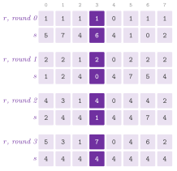

# 23. External memory {#ch-23}

[Source: `include/ADS/external/TwoLevelMemory.h`, `BlockStore.h`,
`BlockBTree.h`, `ExternalSorting.h`, `ListRanking.h`, `RecordFile.h`,
`MappedFile.h`, `Persistence.h`, and `interop/cereal/Cereal.h`]

We are concerned in this chapter with data too large for the internal memory
of a computer, which therefore live on a disk and are moved between the
disk and the memory in blocks. A random access to a disk is thousands of
times slower than one to the memory, and it brings a whole block, not a
single item. Hence the cost of an algorithm on such data is the number of
blocks that it moves, and an algorithm of the internal memory that follows
links may pay one block per link. The headers of `ADS/external` simulate the model of [Aggarwal and Vitter 1988](Z-bibliography.md#ref-aggarwal1988). Thus the blocks moved by a run are counted and compared with the bounds
([§23.1](23-external.md#sec-23-1)). On it they build the store of blocks
and the B-tree of [Morin 2013, chapter 14](Z-bibliography.md#ref-morin-cpp)
([§23.2](23-external.md#sec-23-2) and [§23.3](23-external.md#sec-23-3)),
and the algorithms of [Ferragina 2023](Z-bibliography.md#ref-ferragina2023),
chapters 4, List Ranking, and 5, Sorting Atomic Items: the sorts with their
lower bounds and the permutations ([§23.4](23-external.md#sec-23-4)), and
the ranking of a list ([§23.5](23-external.md#sec-23-5)). Finally,
[§23.6](23-external.md#sec-23-6) describes the files of records on the
disk of the machine, where the model meets the real one, and
[§23.7](23-external.md#sec-23-7) the files in which the static structures of
the library are saved and from which they are mapped back. Note that the B-trees and
the B+-trees kept in the internal memory (`BTree.h` and `BPlusTree.h`) are
in [chapter 8](08-tree.md#ch-8). In the sets of
[§1.9](01-introduction.md#sec-1-9), the headers of this chapter are all
base, while `RecordFile.h`, `MappedFile.h` and `Persistence.h` are in the
core that the two sets include, and `interop/cereal/Cereal.h` is in the set
interop.

## 23.1 The two-level memory {#sec-23-1}

The *two-level memory* has an internal memory of $M$ items and a disk of
unbounded size, divided into blocks of $B$ consecutive items. An *I/O*
moves one block between the disk and the memory, and the cost of an
algorithm is the number of its I/Os, the computation in memory being free
(chapter 1, Introduction, of [Ferragina 2023](Z-bibliography.md#ref-ferragina2023);
[Vitter 2001](Z-bibliography.md#ref-vitter2001)). An item is *atomic*: it
is moved and compared whole, and a pair or a triple of the algorithms
below counts as one item. The model needs $M \ge 2 B$, so that a block can
be read while another is kept; the algorithms of the area need
$M \ge 3 B$ (two inputs and an output) or more.
[Table 23.1](23-external.md#tab-23-1) collects the symbols of the chapter.

<span id="tab-23-1"></span>**Table 23.1.** The symbols of the chapter and
of the headers of `ADS/external`.

| Symbol | Meaning |
|---|---|
| $n$, $M$, $B$ | the items of the input, of the internal memory and of a block, with $M \ge 2 B$ (`memorySize()`, `blockSize()`) |
| $\lceil n / B \rceil$ | the blocks of a file of $n$ items, the last one possibly partial (`blocks()`) |
| $\mathrm{scan}( n )$, $\mathrm{sort}( n )$ | $\Theta( n / B )$ and $\Theta( ( n / B ) \log_{M / B} ( n / M ) )$, the I/Os of a scan and of a sort of $n$ items |
| $R$, $k$ | the items of a run formed in memory, $R = \lfloor M / B \rfloor B$, and the fan-in of a merge or the number of buckets of a distribution |
| $\pi$ | a permutation of $0 , \ldots , n - 1$, with $\mathit{out}[ i ] = \mathit{in}[ \pi( i ) ]$ |
| $\mathit{succ}[ i ]$, $r[ i ]$ | the successor of the item $i$ of a list, the tail $t$ having $\mathit{succ}[ t ] = t$, and its rank, the number of links from $i$ to the tail |
| $\tilde O( \cdot )$ | a bound up to the factor $\log_{M / B} ( n / M )$ of a sort, i.e., $\tilde O( n / B ) = O( \mathrm{sort}( n ) )$ |

`TwoLevelMemory` holds $B$ and $M$, the two counters of the I/Os (`reads()`,
`writes()` and their sum `ios()`) and the occupation of the memory. Each
buffer and each array that an algorithm keeps in memory is taken from it:
`allocate( k )` and `release( k )` move $k$ items, `used()` is the memory in
use and `peak()` its largest value since the construction or since
`resetCounters()`, which also zeroes the counters. An allocation beyond $M$
violates a precondition. A `MemoryLease` takes $k$ items at its construction
and gives them back at its destruction (its `size()` is $k$), and hence a
buffer cannot be forgotten. Thus, a test of an algorithm checks at once its
result, its I/Os and the memory it used, and a bound of this chapter is
verified on the run. The function `blocks( n )` is $\lceil n / B \rceil$, and
`countRead()` and `countWrite()` are called by the files only.

A `DiskFile< T >` is a file of the disk, i.e., a sequence of items laid out in
blocks of $B$ items, the last one possibly partial. Its only accesses to the
items are `readBlock( b , dest )`, which copies the block $b$ into a buffer of
$B$ items, and `appendBlock( src , n )`, which appends $n \le B$ items as a
new block after full blocks; each is one I/O. A file built from a vector holds
the input of a problem, laid out with no I/O; `contents()` reads the items
with no I/O, for the checks of the tests and never for the algorithms. Also,
the files cannot be copied, which would duplicate them without paying their
I/Os, and a move assignment is a rename on the disk (between two files on the
same memory). Note that the files are not containers with iterators on
purpose: an iterator would read the items without paying the I/Os. The
functions `size()`, `empty()`, `blocks()`, `clear()` and `memory()` complete
the class, with the aliases `value_type` and `size_type` of the standard
containers (which `RecordFile` of [§23.6](23-external.md#sec-23-6) has too).

A `DiskReader< T >` reads a file through a buffer of one block, leased from
the memory of the file. The function `next()` (with `peek()`, `hasNext()` and
`position()`) scans the file in order, $\lceil n / B \rceil$ reads for $n$
items; `at( i )` reads any item, loading its block only when it is not the one
in the buffer ([Algorithm 23.1](23-external.md#alg-23-1)), and the scan goes
on from $i + 1$. Also, a `DiskWriter< T >` appends to a file through a buffer
of one block: `push( x )` writes the buffer when it is full, and `close()` (or
the destructor) writes the last partial block. [Figure
23.1](23-external.md#fig-23-1) shows a read and a write.

<span id="alg-23-1"></span>**Algorithm 23.1.** The read of an item of a
file by `DiskReader` (chapter 1, Introduction, of
[Ferragina 2023](Z-bibliography.md#ref-ferragina2023)).

--8<-- "generated/TwoLevelMemory-DiskReader-at.pseudo.md"

{#fig-23-1}

An algorithm of the internal memory that follows links (a list, a tree of
pointers, the edges of a graph) pays up to one I/O per link on the disk,
since two consecutive links rarely fall in one block. The algorithms of the
area replace such links by scans and sorts, whose blocks are read whole
([Table 23.2](23-external.md#tab-23-2)). Note that reads at sorted
positions share a block whenever two of them fall in it, since `at()` loads
a block only when it is not the one in its buffer. Hence a *coordinated
scan*, i.e., a sorted file of requests read together with the file that
answers them, costs the scans of the two files, and no more.

<span id="lem-23-1"></span>**Lemma 23.1.** *A `DiskReader` that reads a
file of $n$ items in order, or a `DiskWriter` that appends $n$ items, makes
$\lceil n / B \rceil$ I/Os; $m$ calls of `at()` at nondecreasing positions
make at most $\min\{ m , \lceil n / B \rceil \}$ reads; hence a coordinated
scan of a sorted file of $m$ requests and of a file of $n$ items costs at
most $\lceil m / B \rceil + \lceil n / B \rceil$ reads.*

*Proof.* The reader loads a block only when the next item is not in its
buffer, which in a scan happens once per block; the writer stores its
buffer when it holds $B$ items and once more for the last partial block.
A call of `at( i )` reads only when the block of $i$ is not the one in the
buffer (Algorithm 23.1); with nondecreasing positions the blocks loaded are
nondecreasing too, and each block is loaded at most once, since a block
left behind is never needed again. Hence the reads are at most the calls
and at most the blocks of the file. The requests are read by a scan, and
the answers by such calls. $\square$

<span id="tab-23-2"></span>**Table 23.2.** The patterns of access of the
area and their I/Os (the scans and the reads by
[Lemma 23.1](23-external.md#lem-23-1), the sorts by
[Lemma 23.8](23-external.md#lem-23-8) and [Lemma 23.9](23-external.md#lem-23-9),
the permutations by [Theorem 23.4](23-external.md#thm-23-4), the ranking
by [§23.5](23-external.md#sec-23-5)).

| Pattern | I/Os | Realization |
|---|---|---|
| scan of $n$ items, read or written | $\lceil n / B \rceil$ | `DiskReader::next()`, `DiskWriter::push()` |
| $m$ reads at sorted positions | $\min\{ m , \lceil n / B \rceil \}$ | `DiskReader::at()` with nondecreasing positions |
| sort of $n$ items | $\Theta( \mathrm{sort}( n ) )$ | `multiwayMergeSort()`, `distributionSort()` (when its samples succeed) |
| permutation of $n$ items | $\Theta( \min\{ n , \mathrm{sort}( n ) \} )$ | `permuteDirect()` or `permuteBySorting()` |
| ranking of a list of $n$ items | $\Theta( \mathrm{sort}( n ) )$ | `externalListRank()` |

The data structures of [Morin 2013, chapter 14](Z-bibliography.md#ref-morin-cpp)
need less memory than the algorithms: a constant number of blocks and a
stack of height $O( \log_B n )$, i.e., $O( B + \log_B n )$ items. In most
cases the term $B$ dominates; for instance, $B \ge \log_B n$ holds with
$B = 32$ for all $n \le 2^{160}$.

## 23.2 The block store {#sec-23-2}

The devices of the external memory differ in their block size and in their
system calls. [Morin 2013, §14.1](Z-bibliography.md#ref-morin-cpp) hides them
behind a *block store*, a collection of blocks identified by their indices,
with four operations: `readBlock( i )` returns the content of the block $i$,
`writeBlock( i , b )` writes $b$ in it, `placeBlock( b )` stores $b$ in a new
block and returns its index, and `freeBlock( i )` gives the block back. One
may picture it as a file divided into blocks, whose free blocks form a list.
`BlockStore< T >` is this disk simulated in memory, an array of blocks of type
`T` in which `readBlock()` and `writeBlock()` are the I/Os of the model,
counted one each (by `reads()` and `writes()`, which `resetCounters()`
zeroes). The function `placeBlock( b )` writes the new block where a block
freed by `freeBlock()` was, on top of a stack of the free indices, or at the
end when there is none ([Algorithm 23.2](23-external.md#alg-23-2)). Thus the
array grows only when no block is free, and its length is the largest number
of blocks ever in use at once; `blocks()` counts those in use now. If a
`TwoLevelMemory` is given, its counters count the I/Os too, and the structures
on the blocks share one count with the algorithms on the files.

<span id="alg-23-2"></span>**Algorithm 23.2.** The placement of a new
block ([Morin 2013, §14.1](Z-bibliography.md#ref-morin-cpp)).

--8<-- "generated/BlockStore-placeBlock.pseudo.md"

{#fig-23-2}

A block is copied when it is read and when it is written, as it would be
between the disk and the memory ([Figure 23.2](23-external.md#fig-23-2)).
Thus, a structure keeps between two I/Os a copy of the block of its own, which
a test of the internal memory can count. In three points the code of [Morin
2013, §14.1](Z-bibliography.md#ref-morin-cpp) differs from ours. First, its
blocks are pointers to the nodes; hence a node changed after its read is
changed on the disk with no write, which hides I/Os that a test of the model
would count. Second, it does not count the I/Os. Third, its `placeBlock()`
takes the free index by `remove( size() )`, one past the last place of its
stack, and does not store the block there. The function `peek( i )` reads a
block with no I/O, for the checks of the contracts only, and a block read,
written, freed or peeked must be in use.

## 23.3 B-trees on the blocks {#sec-23-3}

### 23.3.1 The tree and the search {#sec-23-3-1}

A B-tree generalizes the binary search trees of [chapter 8](08-tree.md#ch-8)
to nodes of many keys, so that a node fills a block and a search reads few
blocks ([Bayer and McCreight 1972](Z-bibliography.md#ref-bayer1972);
[Morin 2013, §14.2](Z-bibliography.md#ref-morin-cpp)); the 2-4 trees are
the case $B = 2$. For an integer $B \ge 2$, a *B-tree* is a tree whose
leaves are all at the same depth and whose internal nodes but the root have
from $B$ to $2 B$ children. A node with $k$ children holds $k - 1$ keys,
and a leaf from $B - 1$ to $2 B - 1$; the root may have from 2 to $2 B$
children (from 0 to $2 B - 1$ keys when it is a leaf). The keys of a node
are increasing, and the key $i$ of an internal node $u$ is larger than the
keys of the subtree of its child $i$ and smaller than those of its child
$i + 1$. [Figure 23.3](23-external.md#fig-23-3) shows a B-tree with
$B = 2$.

<span id="lem-23-2"></span>**Lemma 23.2.** *A B-tree whose leaves are at
depth $h \ge 1$ (i.e., of $h + 1$ levels, as `height()` counts them) and
which has $\ell$ leaves satisfies $2 B^{h-1} \le \ell \le ( 2 B )^h$, and hence
$h \le \log_B \ell + 1$; since each leaf holds at least one key (when the
root is not a leaf), a B-tree of $n$ keys has height $O( \log_B n )$.*

*Proof.* The root has at least 2 children and each other internal node at least $B$. Hence the level at depth $d \ge 1$ has at least
$2 B^{d - 1}$ nodes, which gives the lower bound on $\ell$ for $d = h$;
each node has at most $2 B$ children, and the level at depth $d$ at most
$( 2 B )^d$ nodes, which gives the upper one. Taking the logarithm of the
first inequality, $h - 1 \le \log_B ( \ell / 2 ) \le \log_B \ell$.
$\square$

A node holds $O( B )$ data, and we choose $B$ so that a node fills a block;
the cost of an operation in the external memory is then the number of nodes
that it reads or writes. With keys and indices of 4 bytes each, for instance,
a node of $2 B$ keys and $2 B$ indices fills a block of 4096 bytes when
$B = 256$. `BlockBTree< K >` keeps its nodes as the blocks of a `BlockStore`,
each `Node` a vector of keys and a vector of the indices of its children (none
for a leaf), for any key type with a total order (the aliases `Key` and
`Item`). The code of [Morin 2013, §14.2](Z-bibliography.md#ref-morin-cpp)
keeps arrays of $2 B$ keys and marks the empty places by a null key instead.
In addition, the tree stores the index of its root, its parameter $B$
(`order()`) and its number of keys (`size()`, `empty()`). Its invariant, i.e.,
the order of the keys, their number in each node, the depth of the leaves and
the count, is checked with no I/O at the level 3 of the contracts while
$n \le 1024$.

The search for $x$ starts at the root and, at each node $u$, finds the first
place $i$ of a key $\ge x$ by a binary search (`place()`). If that key is $x$
the search ends; otherwise it remembers the key, the last one $\ge x$ met so
far, and goes on in the child $i$ of $u$. At a leaf it returns the key
remembered, i.e., the smallest key $\ge x$, or nothing ([Algorithm
23.3](23-external.md#alg-23-3)). This is `lowerBound( x )`, the `find( x )` of
the SSet of [Morin 2013, §14.2.1](Z-bibliography.md#ref-morin-cpp), and
`contains( x )` tests its result; [Figure 23.3](23-external.md#fig-23-3) shows
a search that finds its key and one that does not. Its result is a copy of the
key, since the blocks of the external memory are copied into the internal one,
not pointed to.

<span id="alg-23-3"></span>**Algorithm 23.3.** The search in a B-tree
([Morin 2013, §14.2.1](Z-bibliography.md#ref-morin-cpp)).

--8<-- "generated/BlockBTree-lowerBound.pseudo.md"

{#fig-23-3}

<span id="thm-23-1"></span>**Theorem 23.1.** *`lowerBound( x )` returns
the smallest key $\ge x$ of the tree, if any; it reads $O( \log_B n )$
blocks, and takes $O( \log n )$ time in the word-RAM model.*

*Proof.* Let $u$ be the node of the current step, $i$ the first place of a
key $\ge x$ in $u$, and $K$ the keys of the subtree of $u$. The keys of
$K$ that are $\ge x$ are the keys of $u$ from the place $i$ on and the keys of the subtrees of the children after $i$, which are larger than the key $i$ of $u$, besides those of the subtree of the child $i$, which are smaller than
the key $i$ (if any) and larger than the key $i - 1$. Hence the smallest
key $\ge x$ of $K$ is $x$ itself if the key $i$ is $x$, and otherwise the
smallest key $\ge x$ of the child $i$, if any, or else the key $i$. The
search keeps as its candidate the last key $i$ met, and by induction on the
levels the candidate at the leaf is the smallest key $\ge x$ of the
tree. As for the cost, it reads one node per level, and there are $O( \log_B n )$ levels by [Lemma 23.2](23-external.md#lem-23-2). The binary search in a node of at
most $2 B$ keys costs $O( \log B )$, and
$O( \log_B n ) \cdot O( \log B ) = O( \log n )$. $\square$

We remark that the time bound counts a read as the access to a node in
place, as in the model. `BlockStore` instead returns a copy of each block
read, of $O( B )$ words, and hence the simulation itself spends
$O( B \log_B n )$ time on a search.

The binary search of a node halves the range at each probe
([Figure 23.4](23-external.md#fig-23-4)); [Morin 2013,
§14.2.1](Z-bibliography.md#ref-morin-cpp) writes it on an array of $2 B$
places padded with null keys, `place()` on the vector of the keys of the
node, with `std::lower_bound`.

{#fig-23-4}

### 23.3.2 Insertion {#sec-23-3-2}

The insertion of $x$ goes down to the leaf $u$ where $x$ belongs, adds $x$
to it, and then goes back up. A node left with $2 B$ keys (an *overflow*)
is *split*: its $B$ smallest keys stay in it, its $B - 1$ largest keys go
to a new node, and the key between them goes up to the parent, which also
adopts the new node. In turn, the split may leave the parent with $2 B$ keys, and so
on up to the root, which may split and give a new root of one key
([Morin 2013, §14.2.2](Z-bibliography.md#ref-morin-cpp)). A split writes
three nodes: the node, the new one and the parent. This is why the nodes of
a B-tree keep no pointer to their parent: with one, the $B$ children
adopted by the new node would have to be rewritten too, i.e., $B + 3$ more
I/Os per split instead of 3.

The code of [Morin 2013, §14.2.2](Z-bibliography.md#ref-morin-cpp) is
recursive, and its recursion holds a node per level while it goes back up. The
function `insert( x )` keeps instead the path as the indices of its blocks and
of the children taken, and reads a parent again on the way up only when a
split reaches it ([Algorithm 23.4](23-external.md#alg-23-4)). It returns
false, with no write, if $x$ is already there. [Figure
23.5](23-external.md#fig-23-5) shows the two insertions of [Morin 2013,
exercise 14.1](Z-bibliography.md#ref-morin-cpp).

<span id="alg-23-4"></span>**Algorithm 23.4.** The insertion in a B-tree
([Morin 2013, §14.2.2](Z-bibliography.md#ref-morin-cpp)), with the path
kept instead of the nodes.

--8<-- "generated/BlockBTree-insert.pseudo.md"

{#fig-23-5}

### 23.3.3 Removal {#sec-23-3-3}

The removal of $x$ is reduced to the removal of a key from a leaf
([Morin 2013, §14.2.3](Z-bibliography.md#ref-morin-cpp)). If $x$ is in a
leaf, it is taken out of it. If it is in an internal node $t$, its
successor $y$, the first key of the leftmost leaf of the subtree to the
right of $x$, is taken out of that leaf and replaces $x$ in $t$. A leaf
left with $B - 2$ keys (an *underflow*) gets keys from a sibling, the one
on its left or, for the first child, the one on its right. If the sibling
has at least $B$ keys, the two share their keys so that both keep at least
$B - 1$ (a *borrow*); otherwise the sibling has $B - 1$ keys, and the two
nodes and the key between them are *merged* into a node of $2 B - 2$ keys.
A merge takes a key from the parent, which may underflow in turn, and so
on up to the root; a root left with no key and one child is replaced by
the child. Thus a removal makes zero or more merges and at most one borrow,
which ends it.

The function `remove( x )` keeps the path as `insert()` does, down to the leaf
of $x$ or, if $x$ is in an internal node, on to the leftmost leaf of its right
subtree ([Algorithm 23.5](23-external.md#alg-23-5)). The node $t$ of $x$ gets
$y$ when the restructurings on the way up reach it, and by one more read and
write if they stop below it. [Figure 23.6](23-external.md#fig-23-6) shows the
two removals of [Morin 2013, exercise 14.2](Z-bibliography.md#ref-morin-cpp).

<span id="alg-23-5"></span>**Algorithm 23.5.** The removal from a B-tree
([Morin 2013, §14.2.3](Z-bibliography.md#ref-morin-cpp)), with the path
kept instead of the nodes.

--8<-- "generated/BlockBTree-remove.pseudo.md"

{#fig-23-6}

### 23.3.4 One routine for the restructurings {#sec-23-3-4}

A split, a borrow and a merge all move keys between some consecutive
children of a node and the separators between them. The function `deal()` is the one
routine that does all of them: it gathers the keys of $k$ consecutive
children of $p$ with the separators of $p$ between them, and deals them out
again to $k'$ children, the first ones one key more when they do not
divide evenly ([Algorithm 23.6](23-external.md#alg-23-6)). A split is
$1 \to 2$, a borrow $2 \to 2$ and a merge $2 \to 1$
([Figure 23.7](23-external.md#fig-23-7)), and the three-node moves of
[§23.3.6](23-external.md#sec-23-3-6) are $2 \to 3$, $3 \to 3$ and
$3 \to 2$. The number $k'$ is a function of the number of keys gathered,
which `fixOverflow()` and `fixUnderflow()` choose by the policy. For the
rules of the book, a node of $2 B$ keys goes to two children, which then
have $B$ and $B - 1$ keys, and an underflow goes to two children when the
$2 B - 1$ keys or more gathered leave $B - 1$ to each, and to one
otherwise.

<span id="alg-23-6"></span>**Algorithm 23.6.** The restructuring of
$k$ consecutive children into $k'$ (beyond the book).

--8<-- "generated/BlockBTree-deal.pseudo.md"

{#fig-23-7}

We remark that the borrow of `BlockBTree` takes place when the sibling has
$B$ keys or more, as the text of [Morin 2013,
§14.2.3](Z-bibliography.md#ref-morin-cpp) states, whereas his code merges
unless the sibling has more than $B$. A restructuring writes the $k'$
children and the parent, and reads the $k - 1$ children not yet in memory;
it frees the blocks of the children it drops, or places the new ones.
The functions `splits()`, `merges()`, `borrows()` and their sum `restructures()` count
the restructurings so far.

<span id="lem-23-3"></span>**Lemma 23.3.** *With the rules of the
book, `insert()` and `remove()` keep the tree a B-tree of the keys after
the operation; a removal makes zero or more merges and at most one borrow,
after which it stops.*

*Proof.* A split deals the $2 B$ keys of a node into nodes of $B$ and $B -
1$ keys and the separator between them, which goes up; both new nodes are
within $[ B - 1 , 2 B - 1 ]$, and the parent gains one key and one child.
A root that splits gives a new root of one key and two children, which
deepens all the leaves by one. In an underflow, a node of $B - 2$ keys and
its sibling of $s \in [ B - 1 , 2 B - 1 ]$ keys gather $t = s + B - 1$
keys with their separator. If $s \ge B$, the borrow deals $t - 1$ keys to
two nodes of at least $\lfloor ( t - 1 ) / 2 \rfloor \ge B - 1$ and at
most $\lceil ( t - 1 ) / 2 \rceil \le \lceil ( 3 B - 3 ) / 2 \rceil \le 2
B - 1$ keys, and the parent keeps its number of keys; hence nothing above
changes and the removal stops. If $s = B - 1$, the merge makes one node of
$t = 2 B - 2$ keys and the parent loses one key, which may cause an
underflow above; a root left with no key is replaced by its only child,
which raises all the leaves by one. In each case `deal()` writes the keys
gathered back in their order, with the separators between the children,
and therefore the order of the keys is kept, and the leaves stay at one depth.
Replacing a key $x$ of an internal node by its successor $y$, the least key
of its right subtree, keeps the order. Indeed, $y$ is larger than the keys
on the left of $x$ and smaller than the other keys on its right. $\square$

<span id="thm-23-2"></span>**Theorem 23.2.** *`insert()` and `remove()`
read and write $O( \log_B n )$ blocks; in the word-RAM model they take
$O( B \log_B n )$ time, i.e., $O( B \log n / \log B )$, and $O( B + \log n )$
amortized time by [Lemma 23.4](23-external.md#lem-23-4) when a read gives
access to a node in place (the copies of `BlockStore` cost $O( B )$ more
per level).*

*Proof.* The descent reads one node per level. Each restructuring reads
and writes $O( 1 )$ nodes, and there is at most one per level, and hence
the way up costs $O( \log_B n )$ I/Os; the replacement of a removed key
costs at most one more read and write. In the word-RAM model each node
costs a binary search on the way down, and each restructuring, as well as
the insertion or the removal of a key in a leaf, moves $O( B )$ keys and
indices. By [Lemma 23.4](23-external.md#lem-23-4) the restructurings are
$O( 1 )$ per operation, amortized. $\square$

### 23.3.5 The amortized number of restructurings {#sec-23-3-5}

A single insertion may split a node at each level, but such cascades are
rare.

<span id="lem-23-4"></span>**Lemma 23.4.** *From the empty tree, $m$
insertions and removals make at most $3 m / 2$ splits, merges and borrows
([Morin 2013, Lemma 14.1](Z-bibliography.md#ref-morin-cpp)). Also, a
sequence of two insertions and two removals at a leaf of $2 B - 2$ keys
makes a split, a borrow and a merge, and therefore $\Theta( m )$ is reached for
any $B$.*

*Proof.* We keep one credit on each node but the root with $B - 1$ keys,
and three on each node with $2 B - 1$ keys; each restructuring is paid by
two credits, and each operation creates at most three. A split happens when
a key is added to a node of $2 B - 1$ keys, which holds three credits: the
two nodes of $B$ and $B - 1$ keys need one credit, and two pay the split.
The only other change of an insertion is the key added to the last node
reached, which may then need three new credits. A merge joins two nodes of
$B - 2$ and $B - 1$ keys, whose two credits pay it (the node in underflow
had $B - 1$ keys, and its credit, before the removal). The borrow that may
end a removal takes the credit of the node in underflow and one new credit. If the sibling had $B$ keys, both end with $B - 1$ keys, which
needs two more new credits, and three credits are created in all (a
sibling with more keys ends with $B$ or more, or gives back credits). A
removal that ends with no borrow creates at most one credit, for the last
node reached if it is left with $B - 1$ keys. Hence at
most $3 m$ credits pay all the restructurings, two each. For the second
claim, the two insertions make a leaf of $2 B$ keys, split into $B$ and
$B - 1$; the first removal leaves $B - 2$ keys beside a sibling of $B$,
which lends one, and the second leaves $B - 2$ beside $B - 1$, which
merges them back into a leaf of $2 B - 2$ keys. $\square$

[Figure 23.8](23-external.md#fig-23-8) draws the credits on the trees of
the insertion of 21 and of the removal of 4 of [Morin 2013, figures 14.5
and 14.6](Z-bibliography.md#ref-morin-cpp), as [Morin 2013, exercise
14.5](Z-bibliography.md#ref-morin-cpp) requires. The insertion creates no
credit, since the root that gets the last key has one key before; the
removal pays its merge by the credits of the two leaves of one key, and its
borrow by the credit of the parent in underflow and one new credit, the
sibling of three keys giving one of its credits to the node of one key that
it leaves.

{#fig-23-8}

### 23.3.6 Nodes far from their bounds {#sec-23-3-6}

The cycle of [Lemma 23.4](23-external.md#lem-23-4) costs a restructuring
per operation because each restructuring leaves its nodes at one key from a
bound. The enumeration `BTreePolicy` names the rules of the book (`STANDARD`,
the default) and two variants that leave each
node they touch at $\Omega( B )$ keys from both of its bounds
([Morin 2013, exercises 14.6 and 14.7](Z-bibliography.md#ref-morin-cpp)).
With `WIDE` a node holds from $B - 1$ to $3 B - 1$ keys: a node of $3 B$
keys is split into two of about $1.5 B$. A node in underflow is merged
with its sibling whenever the two have at most $2.5 B$ keys, before it is
needed, so that the merged node is at least $B / 2$ keys below the $3 B$ of
an overflow;
otherwise the two share their keys, about $1.25 B$ or more each. With `THREE` the bounds are those of the book. A node in overflow shares its
keys with a sibling, into two nodes if the two have at most about
$3.5 B$ keys (so that each keeps $B / 4$ keys of room) and into three
otherwise; a node in underflow shares them with two siblings, into two
nodes or three in the same way. Thus each node that these moves write has
between about $7 B / 6$ and $7 B / 4$ keys, as in the B*-trees of [Knuth
1998, §6.2.4](Z-bibliography.md#ref-knuth1998v3), whose overflow is shared
with a sibling. We give next the procedures that choose the restructuring of an
overflow and of an underflow by the policy, as calls of
`deal()` ([Algorithm 23.6](23-external.md#alg-23-6)); with `THREE`, the
two leaves of a root are merged into one only while it keeps $\lfloor B /
4 \rfloor$ keys of room.

--8<-- "generated/BlockBTree-fixOverflow.pseudo.md"

<span id="lem-23-5"></span>**Lemma 23.5.** *If each node that a
restructuring writes has at least $\alpha B$ keys more than its lower bound
and fewer than its upper bound, for a constant $\alpha > 0$, then $m$
operations make $O( m / B )$ restructurings.*

*Proof.* Let the potential be $\Phi = \sum_u \max\{ 0 , \alpha B - d( u ) \}$,
with $d( u )$ the signed distance of the number of keys of $u$ from its
nearer bound (negative for a node in overflow or in underflow); $\Phi$ is 0
on the empty tree and never negative. An operation adds or removes a key of
one leaf, which raises $\Phi$ by at most 1, and each restructuring adds or
removes a key of the parent, which raises $\Phi$ by at most 1 more. A
restructuring starts from a node beyond its bound, whose term is at least
$\alpha B$, and replaces it and the siblings it gathers by nodes whose terms
are 0; hence it lowers $\Phi$ by at least $\alpha B - 1$ in all. With $R$
restructurings in $m$ operations, $R ( \alpha B - 1 ) \le m$, i.e.,
$R \le m / ( \alpha B - 1 ) = O( m / B )$ for $B > 2 / \alpha$, say.
$\square$

<span id="lem-23-6"></span>**Lemma 23.6.** *There is a constant
$c$ such that each node that a restructuring of `WIDE` writes is at least $B / 4 - c$ keys from both of its bounds. Each node that a restructuring of `THREE` writes, but in a tree of two leaves, at least $B /
6 - c$ keys from its lower bound and $B / 4 - c$ from its upper one; hence
both policies meet the hypothesis of
[Lemma 23.5](23-external.md#lem-23-5) with $\alpha = 1 / 8$ for $B$ large
enough.*

*Proof.* We count the keys up to additive constants, which go into $c$.
With `WIDE` the bounds are $B$ and $3 B$. A split deals $3 B$ keys into two nodes of $1.5 B$. A merge happens when the two nodes gather at most $2.5
B$ keys, and gives a node of at least $( B - 2 ) + ( B - 1 ) \approx 2 B$
and at most $2.5 B$ keys. A share happens when they gather more than $2.5
B$, and gives two nodes of more than $1.25 B$ and at most $( ( B - 2 ) + 3
B ) / 2 \approx 2 B$ keys. With `THREE` the bounds are $B$ and $2 B$, and
$t$ is the number of keys gathered (line 3, 7 and 9 of the pseudocode
above). An overflow gathers $t \in [ 3 B , 4 B ]$ keys of a node and a
sibling: into two nodes when $t / 2 \le 2 B - B / 4$, each of $t / 2 \ge
1.5 B$ keys, and otherwise into three, each of $t / 3 \in ( 7 B / 6 , 4 B
/ 3 ]$ keys. An underflow gathers $t \in [ 3 B , 5 B ]$ keys of a node and
two siblings: into two nodes of $t / 2 \in [ 1.5 B , 1.75 B ]$ keys, or
into three of $t / 3 \in ( 7 B / 6 , 5 B / 3 ]$. The least distance from
a lower bound is thus $7 B / 6 - B = B / 6$, and from an upper bound $B /
4$ (the room that the test of $t$ keeps). $\square$

Hence the cycle of [Lemma 23.4](23-external.md#lem-23-4) costs them
nothing after its first round. The moves of `THREE` need a sibling for an overflow and two for an
underflow, which a tree of two leaves lacks. There the leaves may hold down
to $\lambda = \max( 1 , \lfloor B / 2 \rfloor )$ keys, and a leaf below
$\lambda$ is merged with the other one into a root leaf if that leaf has at
most $2 B - 1 - \lfloor B / 4 \rfloor$ keys, the two sharing their keys
otherwise, more than about $7 B / 8$ and at most about $5 B / 4$ each.
Thus the split of a root leaf of $2 B$ keys, into leaves of $B$ and
$B - 1$ keys, leaves them about $B / 2$ above $\lambda$. The root leaf of a merge is $B / 4$ below the top, so that the condition of the
lemma holds there too (a leaf changes its bound only when a restructuring
rewrites it), and the cycle from a root leaf of $2 B - 2$ keys costs a
single split (the test `ods_ints.ods.ex14.7.small-trees`). The internal
children of a root of two children follow the rules of the book; their
keys, however, change only by the restructurings below them, and so their
restructurings remain $O( m / B )$. The price is paid elsewhere: a restructuring of `THREE` also reads
the siblings with which it shares the keys, and a node of `WIDE` may hold
$3 B - 1$ keys, and so needs a larger block for the same $B$.

### 23.3.7 Internal nodes and internal memory {#sec-23-3-7}

<span id="lem-23-7"></span>**Lemma 23.7.** *A B-tree of $n$ keys whose
root is not a leaf has at most $( ( n + 1 ) / B + B - 3 ) / ( B - 1 )$
internal nodes, i.e., $O( n / B^2 )$ ([Morin 2013, exercise
14.3](Z-bibliography.md#ref-morin-cpp)).*

*Proof.* With $L$ leaves and $I$ internal nodes, the internal nodes hold
$L - 1$ keys (one fewer than their children, which are the $I + L - 1$
nodes but the root) and the leaves at least $( B - 1 ) L$, whence
$n \ge B L - 1$. The children are at least $2 + B ( I - 1 )$, and hence
$I + L - 1 \ge 2 + B ( I - 1 )$, i.e., $I \le ( L + B - 3 ) / ( B - 1 )$;
replacing $L \le ( n + 1 ) / B$ gives the bound. $\square$

Since $B$ is usually in the hundreds or the thousands, all but a fraction
of about $1 / B$ of the data are in the leaves, and a system with a large
memory may keep all the internal nodes there; a search then costs a fast
descent in memory and a single I/O for the leaf, which is one reason why
B-trees often perform better than their bound suggests. The function `internalNodes()`
counts them, and `height()` gives the number of levels (1 for a root that
is a leaf).

The introduction of [Morin 2013, chapter 14](Z-bibliography.md#ref-morin-cpp)
claims an internal memory of $O( B + \log_B n )$, but the recursion of his
code holds a node per level while it goes back up, i.e.,
$\Theta( B \log_B n )$ words ([Morin 2013, exercise
14.4](Z-bibliography.md#ref-morin-cpp)). `BlockBTree` keeps the path as pairs
of indices, $O( \log_B n )$ words, and at most five nodes counted in memory at
once: the node, its parent and the at most three children whose keys a
restructuring gathers (the node among them). A parent is read again on the way
up only when a restructuring or the successor of a removed key reaches it,
which [Lemma 23.4](23-external.md#lem-23-4) keeps at $O( 1 )$ reads per
operation, amortized, beyond the descent. The function `peakNodes()` gives the
most nodes held at once, and `peakPath()` the longest path kept, in pairs of
indices. Finally, the other functions read the tree with no I/O, for the
tests: `levels()` gives the keys level by level, `assign( L )` builds a tree
from its levels (the trees of the figures of the book), `forEach( f )` visits
the keys in increasing order, and `nodes()`, `reads()`, `writes()` and
`resetCounters()` read the store.

## 23.4 Sorting and permuting {#sec-23-4}

### 23.4.1 The lower bounds {#sec-23-4-1}

The functions of `ExternalSorting.h` sort $n$ atomic items of a
`DiskFile` into another, by merging and by distribution, after chapter 5,
Sorting Atomic Items, of [Ferragina 2023](Z-bibliography.md#ref-ferragina2023).
Both ways are optimal, by a bound that we state first.

<span id="thm-23-3"></span>**Theorem 23.3.** *A sort by comparisons of
$n$ atomic items in the two-level memory needs, for some $t$ reads,*

$$
\binom{M}{B}^t ( B! )^{\lceil n / B \rceil} \ge n! , \quad
\text{whence} \quad t = \Omega\Bigl( \frac{n}{B} \log_{M / B}
\frac{n}{M} \Bigr) , \tag{23.1}
$$

*plus the $\lceil n / B \rceil$ writes of the output ([Aggarwal and Vitter
1988](Z-bibliography.md#ref-aggarwal1988)).*

*Proof.* We consider the tree of the executions, each node a read and its
children the outcomes of the read. A read brings $B$ items into a memory
that holds $M - B$ others. Its outcome can only be the positions of the new
items among the old ones, at most $\binom{M}{B}$ outcomes, times the $B!$
orders of the new items among themselves when the block is read for the
first time, which happens $\lceil n / B \rceil$ times. The leaves must distinguish the $n!$ orders of the input, which gives (23.1). Taking the
logarithms, $t \log \binom{M}{B} \ge n \log ( n / B ) - O( n )$, and
$\log \binom{M}{B} = O( B \log ( M / B ) )$, which gives the bound on $t$.
$\square$

A permutation, whose order is known in advance, is no easier once the
writes are counted too, since a write can put its block in any of $n + 1$
places of the output.

<span id="thm-23-4"></span>**Theorem 23.4.** *A permutation of $n$
atomic items in the two-level memory needs $t$ I/Os with*

$$
\Bigl( ( n + 1 ) \binom{M}{B} \Bigr)^t ( B! )^{\lceil n / B \rceil}
\ge n! , \tag{23.2}
$$

*whence $t = \Omega( \min\{ n , \mathrm{sort}( n ) \} )$ ([Aggarwal and
Vitter 1988](Z-bibliography.md#ref-aggarwal1988)).*

*Proof.* As in the proof of [Theorem 23.3](23-external.md#thm-23-3), the executions of an algorithm that realizes each permutation form a tree whose leaves give the $n!$ outputs. A read has at most $\binom{M}{B}$
outcomes (and $B!$ more the first time each block is read), and a write
at most $n + 1$, the place of its block among the blocks of the output.
This gives (23.2). Taking the logarithms, $t ( \log( n + 1 ) + B \log( e
M / B ) ) \ge n \log( n / B ) - O( n )$, from which Aggarwal and Vitter
derive $t = \Omega( \min\{ n , \mathrm{sort}( n ) \} )$ by comparing the
two terms of the denominator: the first dominates when $B \log( M / B ) <
\log n$ and gives $\Omega( n )$, the second gives $\Omega(
\mathrm{sort}( n ) )$ otherwise. $\square$

The minimum is $n$, one I/O per item, only when $B$ is smaller than the
logarithm of the sort. Hence on the disk the cost of a sort lies in moving the
items, while finding their order costs no I/O. The function
`sortingLowerBound( n , M , B )` computes the least $t$ of (23.1) plus the
writes, with the logarithms of the factorials by the function $\Gamma$ (and
never fewer than $\lceil n / B \rceil$ reads), and
`permutingLowerBound( n , M , B )` the larger of $2 \lceil n / B \rceil$ and
the least $t$ of (23.2); a test compares them with the I/Os counted.

### 23.4.2 Mergesort {#sec-23-4-2}

The mergesort reaches (23.1). Its first pass forms the runs, reading
$R = \lfloor M / B \rfloor B$ items at a time and sorting them in memory,
which saves the $\log_2 M$ lowest levels of the recursion. Each further
pass merges groups of $k$ runs, with a block of each in memory and one for
the output, and reads and writes each block once
([Figure 23.9](23-external.md#fig-23-9)).

<span id="lem-23-8"></span>**Lemma 23.8.** *A mergesort of fan-in at most
$k$ makes at most*

$$
2 \lceil n / B \rceil \bigl( 1 + \lceil \log_k \lceil n / R \rceil
\rceil \bigr) \tag{23.3}
$$

*I/Os; with $k = M / B - 1$ this is $O( \mathrm{sort}( n ) )$, optimal by
[Theorem 23.3](23-external.md#thm-23-3).*

*Proof.* The first pass makes $\lceil n / R \rceil$ runs, and each pass of
merges divides their number by $k$, rounded up. Each pass reads and
writes each block once, and a lone run left at the end of a pass is not
copied; hence (23.3) is an upper bound. With $k = M / B - 1$,
$\log_k ( n / R ) = O( \log_{M / B} ( n / M ) )$. $\square$

The function `mergeSortIOs( n , M , B , k )` is the value of (23.3), usually
somewhat above the I/Os counted (cf. the lone runs in the proof). The function
`binaryMergeSort( in , out )` merges the runs two by two, with three blocks of
memory, i.e., $O( ( n / B ) \log_2 ( n / M ) )$ I/Os, and
`multiwayMergeSort( in , out )` merges $k = \lfloor M / B \rfloor - 1$ runs at
a time ([Algorithm 23.7](23-external.md#alg-23-7)); both need $M \ge 3 B$, an
empty output on the same memory, and an order `less` (`std::less` by default).
Choosing the least head among $k$ runs costs no I/O, and a tree of losers
(`LoserTree.h`, in [chapter 9](09-priority.md#ch-9)) makes it with
$\lceil \log_2 k \rceil$ comparisons, one per level on the path of the winner.
Since the selector is a parameter, the same algorithm runs on the trees and
the heaps of ADS and of other libraries, with the same I/Os.

<span id="alg-23-7"></span>**Algorithm 23.7.** The binary and the
multiway mergesort (chapter 5, Sorting Atomic Items, of
[Ferragina 2023](Z-bibliography.md#ref-ferragina2023)).

--8<-- "generated/ExternalSorting-binaryMergeSort.pseudo.md"

--8<-- "generated/ExternalSorting-multiwayMergeSort.pseudo.md"

The merge of a group reads each run through a `DiskReader`, keeps the
heads in the tree of losers, and writes the output through a `DiskWriter`.

{#fig-23-9}

With `snowPlow` the runs are made by replacement selection, the snow plow
of [Knuth 1998, §5.4.1](Z-bibliography.md#ref-knuth1998v3) (the same runs
as `replacementSelection()` of `ExternalSort.h` in memory, in
[chapter 12](12-sort.md#ch-12)). A heap of $M - 2 B$ items takes an item
larger than the last one written into the current run, and a smaller one
into the next run. On a random input the runs have $2 ( M - 2 B )$ items
on average, which saves a pass when the number $\lceil n / R \rceil$ of
the runs of the other way lies roughly between a power $k^p$ and $2 k^p$;
a sorted input is one run.

### 23.4.3 Distribution {#sec-23-4-3}

The function `distributionSort( in , out , g )` is the multiway quicksort of
the same chapter. It takes $k - 1$ pivots from a random sample drawn by `g`,
and distributes the items by one scan into the $k$ buckets between the pivots
and into one bucket per pivot for the items equal to it (the three-way
partition of quicksort, so that equal keys stop the recursion). Then it sorts
the buckets in turn, in memory once they fit ([Algorithm
23.8](23-external.md#alg-23-8)).

<span id="lem-23-9"></span>**Lemma 23.9.** *Let the $k - 1$ pivots be the
items of ranks $a + 1 , 2 ( a + 1 ) , \ldots$ of a sorted random sample of
$( a + 1 ) k - 1$ items, with $a + 1 = \lceil 12 \ln k \rceil$. Then with
probability at least $1 / 2$ each bucket between two consecutive pivots
has fewer than $4 n / k$ items.*

*Proof.* We cut the sorted input into $k / 2$ segments of $2 n / k$ items
each. A bucket with $4 n / k$ items or more contains a whole segment, and
then no more than $a$ items of the sample fall in that segment, since two
consecutive pivots have $a$ items of the sample between them. The number
$X$ of items of the sample in a segment has mean
$\mu = 2 ( ( a + 1 ) k - 1 ) / k = 2 ( a + 1 ) - 2 / k$, and $a \le \mu / 2$.
The bound of Chernoff $\Pr[ X \le ( 1 - \delta ) \mu ] \le e^{- \delta^2 \mu / 2}$,
which holds also for a sample drawn without replacement (Hoeffding), gives
with $\delta = 1 / 2$ a probability at most
$e^{- \mu / 8} \le e^{- ( a + 1 ) / 6} \le k^{-2}$, since $\mu \ge 4 ( a + 1 ) / 3$
for $k \ge 2$. The union over the $k / 2$ segments gives at most
$1 / ( 2 k ) \le 1 / 2$. $\square$

Hence `distributionSort()` draws the sample again when a bucket is too
large (at most twice), and with buckets of fewer than $4 n / k$ items the
recursion has $O( \log_{k / 4} ( n / M ) )$ levels, each of which reads
and writes each item once. The memory holds a block of the input, a block
for each of the $k$ buckets between the pivots and of the $k - 1$ buckets
of the items equal to a pivot, a block of the output and the pivots. Hence
$k = \lfloor ( M - B ) / ( 2 B + 1 ) \rfloor$, half the fan-in of the
merge, and the sort needs $M \ge 5 B + 2$. By
[Lemma 23.9](23-external.md#lem-23-9) each of the up to three samples of
a distribution succeeds with probability at least $1 / 2$, independently. Hence a distribution ends with buckets of fewer than $4 n / k$ items
with probability at least $7 / 8$; when all the distributions do so, the
I/Os are $O( ( n / B ) \log_{k / 4} ( n / M ) ) = O( \mathrm{sort}( n ) )$,
since each level reads and writes each item once. Its sample has
$s = \min\{ \lceil 12 \ln k \rceil k - 1 , ( M - 2 B ) / 2 , n \}$ items.

<span id="alg-23-8"></span>**Algorithm 23.8.** The distribution sort
(chapter 5, Sorting Atomic Items, of
[Ferragina 2023](Z-bibliography.md#ref-ferragina2023)).

--8<-- "generated/ExternalSorting-distribute.pseudo.md"

<span id="tab-23-3"></span>**Table 23.3.** The sorts of `ExternalSorting.h`.

| Sort | Memory | I/Os | Remarks |
|---|---|---|---|
| `binaryMergeSort()` | $M \ge 3 B$ | $O( ( n / B ) \log_2 ( n / M ) )$ | deterministic, the logarithm in base 2 |
| `multiwayMergeSort()` | $M \ge 3 B$ | $O( \mathrm{sort}( n ) )$ | deterministic, optimal; fewer runs with the snow plow |
| `distributionSort()` | $M \ge 5 B + 2$ | $O( \mathrm{sort}( n ) )$ when the samples succeed | randomized, fan-in about half that of the merge |

On $D$ disks read in parallel, the striping (the $D$ disks as one, with
blocks of $D B$ items) turns either sort into one of
$O( ( n / D B ) \log_{M / D B} ( n / M ) )$ I/Os. This loses a factor
$1 - \log_{M / B} D$ in the base of the logarithm, which the Greed Sort of
[Nodine and Vitter 1995](Z-bibliography.md#ref-nodine1995) recovers; the
functions of the area simulate one disk.

### 23.4.4 Permuting {#sec-23-4-4}

The function `permuteDirect( in , pi , out )` writes
$\mathit{out}[ i ] = \mathit{in}[ \pi[ i ] ]$ by reading
$\mathit{in}[ \pi[ i ] ]$ for $i = 0 , 1 , \ldots$ and writing the output by a
scan: at most $n$ reads, fewer when consecutive positions fall in one block.
The function `permuteBySorting( in , pi , out )` instead sorts the triples
$\langle i , \pi[ i ] , \cdot \rangle$ by $\pi[ i ]$, fills in
$\mathit{in}[ \pi[ i ] ]$ by one scan of the input, which is now read in
order, and sorts the triples back by $i$ ([Algorithm
23.9](23-external.md#alg-23-9)). This is two sorts and three scans, i.e.,
$O( \mathrm{sort}( n ) )$, and by (23.2) the better of the two is optimal, the
direct one only when $B$ is below the logarithm of the sort. Both check, at
the level of the audits, that $\pi$ is a permutation.

<span id="alg-23-9"></span>**Algorithm 23.9.** The permutation by two
sorts, and the direct one (chapter 5, Sorting Atomic Items, of
[Ferragina 2023](Z-bibliography.md#ref-ferragina2023)).

--8<-- "generated/ExternalSorting-permuteBySorting.pseudo.md"

--8<-- "generated/ExternalSorting-permuteDirect.pseudo.md"

## 23.5 Ranking a list {#sec-23-5}

### 23.5.1 Pointer jumping {#sec-23-5-1}

A list of $n$ items is here the vector $\mathit{succ}$ of their successors,
the items being $0 , \ldots , n - 1$ and the tail $t$ the only one with
$\mathit{succ}[ t ] = t$; `isList( succ )` checks it (one tail, and each item
reached from the only item that is no successor). The *rank* of an item is its
distance from the tail, after chapter 4, List Ranking, of [Ferragina
2023](Z-bibliography.md#ref-ferragina2023). In memory a list is ranked in
$O( n )$ time by the predecessors and a walk back from the tail
(`listRank()`), which on the disk costs up to one I/O per item, since the
links jump anywhere. The algorithms of `ListRanking.h` avoid the walk in two
ways, both taken from the parallel algorithms.

--8<-- "generated/ListRanking-listRank.pseudo.md"

<span id="lem-23-10"></span>**Lemma 23.10.** *Start from
$s[ i ] = \mathit{succ}[ i ]$, and $r[ i ] = 1$ but at the tail, where it
is 0. If each round sets, for all the items at once,*

$$
r[ i ] \gets r[ i ] + r[ s[ i ] ] , \qquad s[ i ] \gets s[ s[ i ] ] ,
\tag{23.4}
$$

*then after $j$ rounds $r[ i ]$ is the number of links from $i$ to $s[ i ]$,
which is $\min\{ 2^j , r( i ) \}$ links away, $r( i )$ the rank
([Wyllie 1979](Z-bibliography.md#ref-wyllie1979)).*

*Proof.* By induction on $j$ we show that after $j$ rounds
$s[ i ] = \mathit{succ}^{\ell}( i )$ and $r[ i ] = \ell$ with
$\ell = \min\{ 2^j , r( i ) \}$, which holds for $j = 0$. In the round
$j + 1$, if $r( i ) \le 2^j$ then $s[ i ]$ is the tail $t$, where
$s[ t ] = t$ and $r[ t ] = 0$, and nothing changes. Otherwise $s[ i ]$ is
the item $v$ at $2^j$ links from $i$, with $r( v ) = r( i ) - 2^j$, and
(23.4) sets $s[ i ] = \mathit{succ}^{\ell'}( v )$ and
$r[ i ] = 2^j + \ell'$ with $\ell' = \min\{ 2^j , r( v ) \}$, i.e., at
$\min\{ 2^{j+1} , r( i ) \}$ links from $i$. $\square$

Hence $\lceil \log_2 n \rceil$ rounds rank the list, with
$O( n \log n )$ operations (`listRankPointerJumping()`, which gives the
rounds in `*rounds`); the code skips the items whose successor is the tail
or that are the tail, whose jumps no longer change
([Figure 23.10](23-external.md#fig-23-10)).

--8<-- "generated/ListRanking-listRankPointerJumping.pseudo.md"

{#fig-23-10}

A round of (23.4) is a *parallel step*
$A[ a_i ] \gets \mathrm{op}( A[ a_i ] , A[ b_i ] )$, with distinct
destinations $a_i$ and the values of $A$ read before any change. The function
`parallelStep( A , ops , op , out )` makes it on the disk by sorting the
requests by $b_i$, answering them by one scan of $A$, sorting them back by
$a_i$ and applying them by a second scan, i.e., two sorts and three scans.
Thus any parallel algorithm of $T$ steps on $n$ processors costs
$\tilde O( ( n / B ) T )$ I/Os ([Chiang et
al. 1995](Z-bibliography.md#ref-chiang1995)). In particular,
`externalPointerJumping()`, the algorithm of Wyllie so simulated, the rank and
the successor carried in one record, costs $\tilde O( ( n / B ) \log n )$
I/Os.

--8<-- "generated/ListRanking-parallelStep.pseudo.md"

--8<-- "generated/ListRanking-externalPointerJumping.pseudo.md"

<span id="lem-23-11"></span>**Lemma 23.11.** *`parallelStep()` writes
$\mathit{out}[ a_i ] = \mathrm{op}( A[ a_i ] , A[ b_i ] )$ for each
request and $\mathit{out}[ j ] = A[ j ]$ elsewhere, with the values of
$A$ before the step, in two sorts and three scans; hence $T$ steps on $n$
items cost $O( T \, \mathrm{sort}( n ) )$ I/Os.*

*Proof.* After the sort of the requests by $b_i$, one scan of $A$ in step
with the requests attaches $A[ b_i ]$ to each of them
([Lemma 23.1](23-external.md#lem-23-1)), reading $A$ only. After the sort by $a_i$, a second scan of $A$ in step with the requests writes
$\mathit{out}$, applying to $A[ a_i ]$ the one request of destination
$a_i$ (the destinations are distinct) and copying the other items. The
values read are those of $A$, which the step does not change, and the
third scan is that of the output. $\square$

### 23.5.2 Independent sets {#sec-23-5-2}

The logarithm goes away by recursion. If $I$ is an *independent set*,
i.e., no item of $I$ is the successor of another item of $I$ nor the tail,
the items whose successor is in $I$ can jump over it, adding its rank to
theirs. Then the remaining list is ranked recursively, and each item of $I$
then gets the rank of its successor plus the rank of the item.

<span id="lem-23-12"></span>**Lemma 23.12.** *If each level removes an
independent set of at least $n / 8$ items, with a constant number of sorts
and scans, then*

$$
T( n ) = \tilde O( n / B ) + T( 7 n / 8 ) = \tilde O( n / B ) . \tag{23.5}
$$

*Proof.* The level $j$ works on at most $( 7 / 8 )^j n$ items, and its
sorts and scans cost $c \, \mathrm{sort}( ( 7 / 8 )^j n ) \le c \, ( 7 /
8 )^j \, \mathrm{sort}( n )$ I/Os for a constant $c$, since
$\mathrm{sort}( n ) / n$ does not decrease with $n$; the sum over $j$ is
at most $8 c \, \mathrm{sort}( n )$. $\square$

The function `randomIndependentSet( succ , g )` tosses a coin per item and
takes the heads whose successor shows tails. The function
`deterministicCoinTossing( succ )` is the technique of [Cole and Vishkin
1986](Z-bibliography.md#ref-cole1986). It starts from the colors $c[ i ] = i$,
which differ on adjacent items, and replaces at each round $c[ i ]$ by
$2 \pi + z$, with $\pi$ the lowest bit in which $c[ i ]$ and
$c[ \mathit{succ}[ i ] ]$ differ and $z$ the value of that bit in $c[ i ]$
(the tail compares with its bit 0).

<span id="lem-23-13"></span>**Lemma 23.13.** *If adjacent colors differ
before a round, they differ after it, and colors of $b$ bits become colors
of $\lceil \log_2 b \rceil + 1$ bits.*

*Proof.* If $i$ and its successor $j$ got the same new color, they would
have the same $\pi$ and the same bit $\pi$; but $\pi$ is a bit in which the
old colors of $i$ and $j$ differ, a contradiction. This covers the tail
$j$ too, whose $\pi$ is 0: then $i$ has $\pi = 0$ as well, i.e., its color
differs from that of $j$ in the bit 0. The new color is at most
$2 ( b - 1 ) + 1$, which has $\lceil \log_2 b \rceil + 1$ bits. $\square$

Hence after $O( \log^* n )$ rounds the colors are in $\{ 0 , \ldots , 5 \}$
(the rounds go to `*rounds`), and the items of the colors 5, 4 and 3 in turn
take the least color of $\{ 0 , 1 , 2 \}$ that neither neighbour has. This
keeps the colors proper, since the items of one color are not adjacent. The
function `independentSetOfColors( succ , color )` takes the local minima of
the three colors, the tail excluded and not counted as a neighbour; they are
independent and at least about $n / 4$ ([Lemma
23.14](23-external.md#lem-23-14) below). [Table 23.4](23-external.md#tab-23-4)
compares the two kinds.

--8<-- "generated/ListRanking-randomIndependentSet.pseudo.md"

--8<-- "generated/ListRanking-deterministicCoinTossing.pseudo.md"

--8<-- "generated/ListRanking-independentSetOfColors.pseudo.md"

<span id="lem-23-14"></span>**Lemma 23.14.** *(i) The set of
`randomIndependentSet()` is independent, has $( n - 1 ) / 4$ items on
average, and has at least $n / 8$ items with probability at least $( n - 2 ) / ( 4 (
n + 1 ) )$; hence, for $n \ge 4$, at most 10 attempts are needed on
average. (ii) The local minima of a proper coloring of the list with the
colors $\{ 0 , 1 , 2 \}$ are independent, and at most 3 items lie between
two consecutive ones, and hence they are at least $( n - 7 ) / 4$.*

*Proof.* (i) Two items of the set are not consecutive, since the successor
of one shows tails, and the tail, excluded, is no item of the set. Each of
the $n - 1$ items other than the tail enters with probability $1 / 4$ (its
coin heads, that of its successor tails), which gives the mean. Since no
two items of the set are consecutive, it has at most $\lceil n / 2 \rceil$
items, and with $p = \Pr[ X \ge n / 8 ]$ one has $( n - 1 ) / 4 \le n / 8
+ p \lceil n / 2 \rceil$ and $\lceil n / 2 \rceil \le ( n + 1 ) / 2$,
whence the bound on $p$, at least $1 / 10$ for $n \ge 4$. (ii) A local minimum is smaller than both its neighbours, and therefore
two local minima are not adjacent. Between two consecutive local minima
the colors first increase and then decrease (a stretch that went down and
then up would hold a local minimum), and with three colors each of the two
monotone parts has at most two items besides the ends; since the two parts
share their top, at most 3 items lie between. The stretches before the
first local minimum and after the last one have at most 3 items each in
the same way. $\square$

<span id="tab-23-4"></span>**Table 23.4.** The independent sets of
`ListRanking.h`.

| Set | Size | Rounds |
|---|---|---|
| `randomIndependentSet()`: a coin per item, the heads whose successor shows tails | $( n - 1 ) / 4$ on average, at least $n / 8$ after at most 10 attempts on average | 1 |
| `independentSetOfColors()` on `deterministicCoinTossing()`: the local minima of three colors | at least about $n / 4$ | $O( \log^* n )$ |

The function `listRankIndependentSet( succ , g , deterministic )` runs the
recursion in memory with either set, unrolled into a loop over the levels
(whose number goes to `*levels`). The function
`externalListRank( succ , rank , g )` runs it on the disk with the random
coins: each item is a record $\langle \mathit{id} , s , r \rangle$, the
records are sorted by $\mathit{id}$, and a join pairs each record with the
record of its successor by two sorts and two scans. Its coins are tossed again
until $\lvert I \rvert \ge n / 8$, and the list is ranked in memory once it
fits, and by (23.5) it costs $\tilde O( n / B )$ I/Os. On the disk the
deterministic sets would repeat the joins of their $O( \log^* n )$ rounds at
each level, and the area uses them only in memory. The optimal parallel
rankings of [Cole and Vishkin 1986](Z-bibliography.md#ref-cole1986) and of
[Anderson and Miller 1991](Z-bibliography.md#ref-anderson1991) use the same
sets to reach $O( n )$ operations in $O( \log n )$ time, and on the disk
$\Theta( \mathrm{sort}( n ) )$, the bound of (23.5), is optimal ([Chiang et
al. 1995](Z-bibliography.md#ref-chiang1995)). The files of
`externalPointerJumping()` and `externalListRank()` must share a memory of at
least $3 B$ items (and $B + 4$ for the second, which ranks a list of
$n \le ( M - B ) / 4$ items in memory), with empty outputs.

--8<-- "generated/ListRanking-listRankIndependentSet.pseudo.md"

--8<-- "generated/ListRanking-rankRecords.pseudo.md"

## 23.6 Files on the disk of the machine {#sec-23-6}

The structures of the model keep their blocks in memory and count the I/Os,
which is the measure of the bounds of this chapter. An algorithm whose data do
not fit in the memory of the machine needs instead files on its disk, e.g.,
the searches with delayed duplicate detection, whose open and closed lists are
kept on the disk and are read and written by sequential scans only.
`RecordFile.h` gives the least that such scans need. A `RecordFile< T >` is a
file of records of a trivially copyable type `T`, written as their bytes, and
hence readable only on a machine with the same layout of `T`. Its function
`append( src , n )` adds records at its end (making the file if it does not
exist), `forEach( f , buffer )` scans them in order through a buffer,
`readAll()` loads them, `clear()` empties the file, `remove()` deletes it, and
`size()`, `empty()` and `path()` describe it. A `RecordWriter< T >` appends to
a `RecordFile` through a buffer of records, which it writes when it is full
([Algorithm 23.10](23-external.md#alg-23-10) and [Figure
23.11](23-external.md#fig-23-11)) and at `flush()` or at its destruction;
`pending()` counts the records in the buffer and `file()` gives the file. A
`TempDirectory` is a new directory, made in the temporary directory of the
system (or in a given one), where the files of a run go: `path()` and
`operator/` name them, and the directory is removed with all that it holds
when the object is destroyed.

<span id="alg-23-10"></span>**Algorithm 23.10.** The insertion of a record
by `RecordWriter`.

--8<-- "generated/RecordFile-RecordWriter-push.pseudo.md"

{#fig-23-11}

With buffers of $b$ records, a scan of $n$ records makes $\lceil n / b
\rceil$ reads of the system, and a writer as many writes; thus $b$ plays
the part of $B$ in the model. A disk (and, to a lesser extent, an SSD)
moves a large contiguous piece of a file much faster than as many small
ones, and the default buffer (`defaultBuffer`) is therefore of 1 MB, i.e.,
some hundreds of the blocks of the file system. A writer opens its file
only to write a full buffer, and closes it after. Hence a program may keep
one writer for each of thousands of files, e.g., for the buckets of a search
with delayed duplicate detection, in which the successors of a bucket are
distributed among the files of the buckets they belong to, as in the
hash-based search of [Korf 2008](Z-bibliography.md#ref-korf2008). The price
is an opening of the file per buffer, which is small against the transfer
of 1 MB, although each writer holds a buffer of its own, and so many
writers take a smaller one. An error of the file system (a file that cannot be opened, a disk
that is full) throws `std::runtime_error` with the name of the file; the
destructor of a writer drops such an error, and a program that must see it
calls `flush()` before. Unlike STXXL ([Dementiev, Kettner and Sanders
2008](Z-bibliography.md#ref-dementiev2008)) the files have neither their
own blocks nor asynchronous I/O, which leaves the caching to the operating
system: the algorithms that use them read and write each file by long
sequential scans, the pattern on which the cache and the read-ahead of the
system usually work best.

## 23.7 Persistence and mapped files {#sec-23-7}

We now turn to the static structures of the library, i.e., the succinct
ones of [chapter 22](22-succinct.md#ch-22), the indexes of texts of
[chapter 21](21-compression.md#ch-21), the learned indexes of
[chapter 6](06-search.md#ch-6), the filters of [chapter 10](10-set.md#ch-10),
the perfect hash functions of [chapter 7](07-dictionary.md#ch-7), and the
graph and the matrix in compressed rows of [chapter 14](14-graph.md#ch-14)
and [chapter 17](17-numeric.md#ch-17). Such a
structure is usually built once and then queried for a long time, often by
a program that starts many times; building it again at each start may cost
far more than all of its queries. We therefore write it, by `Persistence.h`,
to a file, a stream or a buffer by `store()`, and read it back by
`restore()`. Also, `restoreMapped()` maps the file into the memory of the
process (`MappedFile.h`) and makes the large arrays of the structure views
over the bytes of the mapping; hence, a structure of any size is opened in
$O( 1 )$ time (cf. [Lemma 23.15](23-external.md#lem-23-15)), and its pages
are read from the disk at their first access.

A structure takes part when it names itself, by `persistName`, with a
`persistVersion` that is raised when its layout changes and a
`persistTag()` of its template parameters. It lists its members once, in a
member template `persist( a )`, which writes them when `a` is the writer
and reads them when `a` is the reader. On a reading, `a.require( c , what
)` rejects a file whose members break an invariant of the structure (e.g.,
the number of the words of a `BitVector` against its number of bits). These
checks look at sizes and at single numbers, and their time grows with the
number of the arrays (not with their length). In version 1, the format has
a header of 128 bytes, with a magic number, the version of the format,
the byte order of the payload, and the name, the version and the tag of the
structure. Next come the members, in the order of `persist()`, and a
trailer of 32 bytes with the size of the payload and a checksum of the
header and of the payload (the rounds of xxHash64 on four lanes of words).

Most choices of the format follow from the mapping. A number is written in
8 bytes, while an array of numbers is written with its size and the width
of its items, which start at the next multiple of 64 bytes of the file.
Since a mapping starts on a page, the view of an array is then aligned to a
line of the cache, as the words of a `BitVector` are in memory. Hence the
kernels of rank and select read it with no change. A view is made by the
allocator of the array (`MappableAllocator`, or the allocator of the words
of the succinct structures): the reader offers it the bytes of the array,
and the allocator returns them at its next allocation of that size,
constructs no item over them, and never gives back to the system a block
that lies in the mapping. This mapping is private (`MAP_PRIVATE`), and
therefore a page that the program writes is copied for the process and
does not reach the file. Also, a copy of a structure is made on new memory, a
move keeps the views, and the mapping is released with the last array that
views it.

In the file, the payload is in the byte order of the machine that wrote
it (or in the one given to `store()`), and a machine of the other order swaps the bytes
of each number while it reads. Thus a mapped file of the other order is
copied, as is an array whose allocator makes no views. This is the case
of some small arrays of the directories (e.g., the counts of the top
level), which `std::allocator` keeps; they usually hold a fraction of a
percent of the bits, and their copy is therefore somewhat cheap.

<span id="lem-23-15"></span>**Lemma 23.15.** *Let a file hold a structure
whose members are $k$ numbers and $m$ arrays of numbers, let the file be of
the byte order of the machine, and let each array be on an allocator that
makes views. Then `restoreMapped()`, without the checksum, opens the file
in $O( k + m )$ time and reads $O( k + m )$ of its bytes, whatever the
lengths of the arrays.*

*Proof.* Header and trailer have a fixed size and are read once, and the
size of the file is compared with the one of the payload in the trailer. A number is read in $O( 1 )$ time, and an array costs the reading
of its size and of its width and one allocation, which returns a pointer
into the mapping with no item constructed and no byte of the items read.
Finally, the invariants that `persist()` requires read sizes and numbers,
in $O( 1 )$ time each. $\square$

The price of [Lemma 23.15](23-external.md#lem-23-15) is paid in the
checks. In fact, `restore()` computes the checksum while it reads, and
rejects a file whose checksum differs from the one of the trailer. Instead,
`restoreMapped()` checks the magic numbers, the sizes of the header, of the
payload and of the trailer (which rejects a truncated file) and the
invariants of the structure, but computes the checksum only if `verify` is
true, since this reads all of the file. Hence a mapping that is not
verified trusts the items of its arrays, and one may want to open a file
that could have been damaged with `verify` at least once. Each failure throws
`PersistError`, with a message that names the cause: a file that is not of ADS,
another structure, another version or other parameters (e.g., a
`PGMIndex< std::uint64_t , 32 >` read as one with $\epsilon = 64$), a
truncation, a wrong checksum, or a broken invariant. In any case, no member
is read past the end of the payload. We remark that a filter or a perfect
hash function built on `std::hash` holds values that depend on the standard
library which computed them; its file is thus portable only between
programs on the same library, while one built on the hashes of ADS
(`FastHash`, the default) holds their seeds and is read in the same way on
any machine.

The same `persist()` serves the archives of cereal
(<https://uscilab.github.io/cereal/>), through the header
`interop/cereal/Cereal.h` of the set interop, which a program includes
next to those of cereal (CMake finds them when `ADS_WITH_CEREAL` is AUTO or
ON). A program may then write a `RankSelect`, an `EliasFano` or a
`BinaryFuseFilter` by `ar( x )` into binary, portable or JSON
archives, next to its other data, and the invariants are checked on the
reading as above. In such archives a `BitVector` is written as sdsl-lite
writes its `bit_vector` (the width 1, the factor of growth, the number of
bits and the words), and since the bit $i$ is the bit $i \bmod 64$ of the
word $\lfloor i / 64 \rfloor$ in both libraries, each reads the vectors of
bits of the other ([Gog et al. 2014](Z-bibliography.md#ref-gog2014b)).
However, the directories of rank and select of the two libraries have
different layouts, and `PackedArray`, whose fields never cross a word, differs from the
`int_vector` of sdsl. Finally, the containers that change (the sequences, the hash
tables, the trees and the heaps) are not persistent yet. We plan to make
them take part through the same `persist()` once their allocators are
parameters; they will write their items and rebuild their links on the
reading, since a pointer of one process is of no use in another.

```cpp
// declarations of <ADS/external/Persistence.h>
template< Persistent T >
void store( const T & x , std::ostream & s ,
	    ByteOrder o = ByteOrder::native );
template< Persistent T >
void store( const T & x , const std::filesystem::path & p ,
	    ByteOrder o = ByteOrder::native );
template< Persistent T >
[[nodiscard]] std::vector< std::byte > store( const T & x ,
					      ByteOrder o = ByteOrder::native );
template< Persistent T >
[[nodiscard]] T restore( std::istream & s );
template< Persistent T >
[[nodiscard]] T restore( std::span< const std::byte > b );
template< Persistent T >
[[nodiscard]] T restore( const std::filesystem::path & p );
template< Persistent T >
[[nodiscard]] T restoreMapped( const std::filesystem::path & p ,
			       bool verify = false );
```

```cpp
#include "ADS/succinct/RankSelect.h"
#include <cassert>
const ADS::BitVector b( "1011001110001111" );
const ADS::RankSelect r( b );
const ADS::TempDirectory d;
ADS::store( r , d.path() / "r.ads" );
const auto m = ADS::restoreMapped< ADS::RankSelect >( d.path() / "r.ads" );
assert( m.rank1( 8 ) == r.rank1( 8 ) && m.select1( 3 ) == r.select1( 3 ) );
```

## 23.8 The interface {#sec-23-8}

We collect here, header by header, the declarations of the namespace `ADS`
that a user calls in this chapter, without the contracts, the documentation
and the members that only the implementation uses; each block points to the
section that describes its functions, and the example at the end shows the
main structures at work. The program of the example compiles against the
headers as it stands, and its assertions hold.

`BlockBTree.h` ([§23.3](23-external.md#sec-23-3)).

```cpp
// declarations of <ADS/external/BlockBTree.h>
enum class BTreePolicy { STANDARD , WIDE , THREE };
template< std::totally_ordered K >
class BlockBTree
{
 public:
 using Key = K;
 using Item = K;
 explicit BlockBTree( int B , BTreePolicy p = BTreePolicy::STANDARD ,
                      TwoLevelMemory * mem = nullptr );
 std::optional< K > lowerBound( const K & x ) const;
 bool contains( const K & x ) const;
 bool insert( const K & x );
 bool remove( const K & x );
 std::size_t size( void ) const;
 bool empty( void ) const;
 int order( void ) const;
 int height( void ) const;
 std::size_t internalNodes( void ) const;
 std::uint64_t reads( void ) const;
 std::uint64_t writes( void ) const;
 void resetCounters( void );
 std::size_t nodes( void ) const;
 std::size_t restructures( void ) const;
 std::size_t splits( void ) const;
 std::size_t merges( void ) const;
 std::size_t borrows( void ) const;
 std::size_t peakNodes( void ) const;
 std::size_t peakPath( void ) const;
 std::vector< std::vector< std::vector< K > > > levels( void ) const;
 void assign( const std::vector< std::vector< std::vector< K > > > & L );
 template< class F >
 void forEach( F && f ) const;
 };
```

`BlockStore.h` ([§23.1](23-external.md#sec-23-1)).

```cpp
// declarations of <ADS/external/BlockStore.h>
template< class T >
class BlockStore
{
 public:
 explicit BlockStore( TwoLevelMemory * mem = nullptr );
 T readBlock( std::size_t i ) const;
 void writeBlock( std::size_t i , const T & b );
 std::size_t placeBlock( const T & b );
 void freeBlock( std::size_t i );
 const T & peek( std::size_t i ) const;
 std::size_t blocks( void ) const;
 std::uint64_t reads( void ) const;
 std::uint64_t writes( void ) const;
 void resetCounters( void );
 };
```

`ExternalSorting.h` ([§23.4](23-external.md#sec-23-4)).

```cpp
// declarations of <ADS/external/ExternalSorting.h>
std::uint64_t mergeSortIOs( std::size_t n , std::size_t M , std::size_t B ,
                            std::size_t k );
std::uint64_t sortingLowerBound( std::size_t n , std::size_t M ,
                                 std::size_t B );
std::uint64_t permutingLowerBound( std::size_t n , std::size_t M ,
                                   std::size_t B );
template< class T , class C = std::less<> >
void binaryMergeSort( const DiskFile< T > & in , DiskFile< T > & out ,
                      C less = C() );
template< class T , class C = std::less<> , class Sel = LoserTree< T , C > >
void multiwayMergeSort( const DiskFile< T > & in , DiskFile< T > & out ,
                        C less = C() , bool snowPlow = false );
template< class T , class R , class C = std::less<> >
void distributionSort( const DiskFile< T > & in , DiskFile< T > & out , R & g ,
                       C less = C() );
template< class T >
void permuteBySorting( const DiskFile< T > & in ,
                       const DiskFile< std::size_t > & pi ,
                       DiskFile< T > & out );
template< class T >
void permuteDirect( const DiskFile< T > & in ,
                    const DiskFile< std::size_t > & pi , DiskFile< T > & out );
```

`ListRanking.h` ([§23.5](23-external.md#sec-23-5)).

```cpp
// declarations of <ADS/external/ListRanking.h>
bool isList( const std::vector< std::size_t > & succ );
std::vector< std::size_t > listRank( const std::vector< std::size_t > & succ );
std::vector< std::size_t >
listRankPointerJumping( const std::vector< std::size_t > & succ ,
                        std::size_t * rounds = nullptr );
template< class R >
std::vector< bool >
randomIndependentSet( const std::vector< std::size_t > & succ , R & g );
std::vector< int >
deterministicCoinTossing( const std::vector< std::size_t > & succ ,
                          std::size_t * rounds = nullptr );
std::vector< bool >
independentSetOfColors( const std::vector< std::size_t > & succ ,
                        const std::vector< int > & color );
template< class R >
std::vector< std::size_t >
listRankIndependentSet( const std::vector< std::size_t > & succ , R & g ,
                        bool deterministic = false ,
                        std::size_t * levels = nullptr );
template< class T , class Op >
void parallelStep(
  const DiskFile< T > & A ,
  const DiskFile< std::pair< std::size_t , std::size_t > > & ops , Op op ,
  DiskFile< T > & out );
void externalPointerJumping( const DiskFile< std::size_t > & succ ,
                             DiskFile< std::size_t > & rank ,
                             std::size_t * rounds = nullptr );
template< class R >
void externalListRank( const DiskFile< std::size_t > & succ ,
                       DiskFile< std::size_t > & rank , R & g ,
                       std::size_t * levels = nullptr );
```

`RecordFile.h` ([§23.6](23-external.md#sec-23-6)).

```cpp
// declarations of <ADS/external/RecordFile.h>
template< class T >
 requires std::is_trivially_copyable_v< T >
class RecordFile
{
 public:
 static constexpr std::size_t defaultBuffer =
   sizeof( T ) >= ( std::size_t( 1 ) << 20 )
     ? 1
     : ( std::size_t( 1 ) << 20 ) / sizeof( T );
 explicit RecordFile( std::filesystem::path path );
 const std::filesystem::path & path( void ) const;
 std::size_t size( void ) const;
 bool empty( void ) const;
 void append( const T * src , std::size_t n );
 template< class F >
 void forEach( F && f , std::size_t buffer = defaultBuffer ) const;
 std::vector< T > readAll( void ) const;
 void clear( void );
 void remove( void );
 };
template< class T >
 requires std::is_trivially_copyable_v< T >
class RecordWriter
{
 public:
 explicit RecordWriter( RecordFile< T > & file ,
                        std::size_t buffer = RecordFile< T >::defaultBuffer );
 ~RecordWriter();
 void push( const T & x );
 void flush( void );
 std::size_t pending( void ) const;
 RecordFile< T > & file( void ) const;
 };
class TempDirectory
{
 public:
 explicit TempDirectory( const std::filesystem::path & parent = {} ,
                         const std::string & prefix = "ads-" );
 ~TempDirectory();
 const std::filesystem::path & path( void ) const;
 std::filesystem::path operator/( const std::string & name ) const;
 };
```

`TwoLevelMemory.h` ([§23.1](23-external.md#sec-23-1)).

```cpp
// declarations of <ADS/external/TwoLevelMemory.h>
class TwoLevelMemory
{
 public:
 TwoLevelMemory( std::size_t B , std::size_t M );
 std::size_t blockSize( void ) const;
 std::size_t memorySize( void ) const;
 std::size_t blocks( std::size_t n ) const;
 std::uint64_t reads( void ) const;
 std::uint64_t writes( void ) const;
 std::uint64_t ios( void ) const;
 void resetCounters( void );
 void allocate( std::size_t k );
 void release( std::size_t k );
 std::size_t used( void ) const;
 std::size_t peak( void ) const;
 void countRead( void );
 void countWrite( void );
 };
class MemoryLease
{
 public:
 MemoryLease( TwoLevelMemory & mem , std::size_t k );
 ~MemoryLease();
 std::size_t size( void ) const;
 };
template< class T >
class DiskFile
{
 public:
 explicit DiskFile( TwoLevelMemory & mem );
 DiskFile( TwoLevelMemory & mem , std::vector< T > items );
 TwoLevelMemory & memory( void ) const;
 std::size_t size( void ) const;
 bool empty( void ) const;
 std::size_t blocks( void ) const;
 std::size_t readBlock( std::size_t b , T * dest ) const;
 void appendBlock( const T * src , std::size_t n );
 void clear( void );
 const std::vector< T > & contents( void ) const;
 };
template< class T >
class DiskReader
{
 public:
 explicit DiskReader( const DiskFile< T > & f );
 bool hasNext( void ) const;
 const T & peek( void );
 T next( void );
 std::size_t position( void ) const;
 const T & at( std::size_t i );
 };
template< class T >
class DiskWriter
{
 public:
 explicit DiskWriter( DiskFile< T > & f );
 ~DiskWriter();
 void push( const T & x );
 void close( void );
 };
```


```cpp
#include "ADS/external/BlockBTree.h"
#include "ADS/external/ExternalSorting.h"
#include "ADS/external/TwoLevelMemory.h"
#include <cassert>

int main( void )
{
 ADS::TwoLevelMemory mem( 4 , 16 );  // B = 4 , M = 16 items
 ADS::DiskFile< int > in( mem , { 9 , 2 , 7 , 4 , 1 , 8 , 3 , 6 , 5 , 0 } );
 ADS::DiskFile< int > out( mem );
 ADS::multiwayMergeSort( in , out );
 assert( std::ranges::is_sorted( out.contents() ) && ( mem.ios() > 0 ) );
 ADS::BlockBTree< int > t( 3 );  // B = 3 , in memory
 for( int x : { 5 , 1 , 9 , 3 , 7 } )
  t.insert( x );
 assert( ( t.lowerBound( 4 ) == 5 ) && t.remove( 5 ) && ! t.contains( 5 ) );
 }
```

## 23.9 Discussion and references {#sec-23-9}

The external memory model is due to [Aggarwal and Vitter
1988](Z-bibliography.md#ref-aggarwal1988), and it is also called the I/O
model or the disk access model. [Vitter 2001](Z-bibliography.md#ref-vitter2001)
surveys its algorithms and data structures, and chapters 1, 4 and 5 of
[Ferragina 2023](Z-bibliography.md#ref-ferragina2023) are the source of
[§23.1](23-external.md#sec-23-1), [§23.4](23-external.md#sec-23-4) and
[§23.5](23-external.md#sec-23-5). B-trees were introduced by [Bayer and McCreight
1972](Z-bibliography.md#ref-bayer1972), and less than ten years later
[Comer 1979](Z-bibliography.md#ref-comer1979) could call them ubiquitous;
they are the main structure of many file systems and of most database
systems, and [Graefe 2011](Z-bibliography.md#ref-graefe2011) surveys their
modern variants and optimizations. The amortized bound on the
restructurings is that of the $( a , b )$-trees of [Huddleston and
Mehlhorn 1982](Z-bibliography.md#ref-huddleston1982), whose nodes far from
their bounds are those of the policies of
[§23.3.6](23-external.md#sec-23-3-6). The B+-trees, whose keys are all in
the leaves and whose leaves form a list, are realized in the internal
memory by `BPlusTree.h` ([chapter 8](08-tree.md#ch-8)), which also solves
[Morin 2013, exercise 14.8](Z-bibliography.md#ref-morin-cpp) with its
removal and its `findRange()`. When only the operations of an unsorted set
are needed, the external hashing of [Jensen and Pagh
2008](Z-bibliography.md#ref-jensen2008) gives them in $O( 1 )$ expected
I/Os, although many applications use B-trees all the same.

The merge with a tree of losers is the standard of the external sorters
([Knuth 1998, §5.4.1](Z-bibliography.md#ref-knuth1998v3); the STXXL of
[Dementiev, Kettner and Sanders 2008](Z-bibliography.md#ref-dementiev2008)),
and the distribution with oversampling is the sample sort of [Frazer and
McKellar 1970](Z-bibliography.md#ref-frazer1970), analyzed as in
[Vitter 2001](Z-bibliography.md#ref-vitter2001). The pointer jumping is
that of [Wyllie 1979](Z-bibliography.md#ref-wyllie1979), the deterministic
coin tossing that of [Cole and Vishkin 1986](Z-bibliography.md#ref-cole1986),
and the simulation of the parallel steps and the optimal ranking on the
disk those of [Chiang et al. 1995](Z-bibliography.md#ref-chiang1995). A
comparison of the sorts and of the rankings, in I/Os and in time on a real
disk, belongs here; it waits for a campaign of measures on an idle
machine.

## 23.10 Exercises {#sec-23-10}

Each exercise names the test of the library that solves it (run it with
`ctest -R <name>`).

1. Realize a store of blocks whose reads and writes are counted, which
   reuses the freed blocks ([Morin 2013, §14.1](Z-bibliography.md#ref-morin-cpp);
   [§23.2](23-external.md#sec-23-2)). Test: `ods_ints.ods14.1.block-store`.
2. Realize a B-tree on the store of blocks, with the search of the
   smallest key $\ge x$, the insertion and the removal in
   $O( \log_B n )$ I/Os, for the rules of the book and the two variants
   ([Morin 2013, §14.2](Z-bibliography.md#ref-morin-cpp);
   [§23.3](23-external.md#sec-23-3)). Test: `ods_ints.ods14.2.b-tree`.
3. Show what happens when the keys 1.5 and then 7.5 are added to the tree
   of [Figure 23.3](23-external.md#fig-23-3), and when the keys 3 and then 4
   are removed from it ([Morin 2013, exercises 14.1 and
   14.2](Z-bibliography.md#ref-morin-cpp)); Figures
   [23.5](23-external.md#fig-23-5) and [23.6](23-external.md#fig-23-6) are
   the solution. Test: `ods_ints.ods.ex14.1.figure`.
4. Find the largest number of internal nodes of a B-tree of $n$ keys
   ([Morin 2013, exercise 14.3](Z-bibliography.md#ref-morin-cpp);
   [Lemma 23.7](23-external.md#lem-23-7)). Test:
   `ods_ints.ods.ex14.3.internal-nodes`.
5. Show that the recursive insertion and removal hold
   $\Theta( B \log_B n )$ words of internal memory, and reduce it to
   $O( B + \log_B n )$ ([Morin 2013, exercise
   14.4](Z-bibliography.md#ref-morin-cpp); [§23.3.7](23-external.md#sec-23-3-7)).
   Test: `ods_ints.ods.ex14.4.memory`.
6. Draw the credits of the proof of [Lemma 23.4](23-external.md#lem-23-4)
   on the trees of an insertion and of a removal, and check that three new
   credits per operation pay the splits, the merges and the borrows
   ([Morin 2013, exercise 14.5](Z-bibliography.md#ref-morin-cpp));
   [Figure 23.8](23-external.md#fig-23-8) is the solution. Test:
   `ods_ints.ods.ex14.6.restructures`.
7. Design B-trees whose nodes have from $B$ to $3 B$ children, merging
   before it is needed, and B-trees that fix an overflow or an underflow
   with up to three nodes, and show that they make $O( m / B )$
   restructurings in $m$ operations, while the rules of the book make
   $\Theta( m )$ ([Morin 2013, exercises 14.6 and
   14.7](Z-bibliography.md#ref-morin-cpp); [Lemma 23.5](23-external.md#lem-23-5)).
   Test: `ods_ints.ods.ex14.6.restructures`.
8. Realize a B+-tree, with its removal, the search of the smallest key
   $\ge x$ and the report of the keys in $( x , y ]$, and explain why its
   duplicated keys cost little for a large $B$ ([Morin 2013, exercise
   14.8](Z-bibliography.md#ref-morin-cpp); [chapter 8](08-tree.md#ch-8)).
   Test: `ods_ints.ods.ex14.8.bplus-tree`.
9. Simulate the two-level memory, with its counters of the I/Os and the
   memory leased by the buffers, and check the cost of a scan and of the
   reads at sorted positions ([§23.1](23-external.md#sec-23-1)). Test:
   `pearls_io.ch5.two-level-memory`.
10. Choose the least of $k$ heads with $\lceil \log_2 k \rceil$
    comparisons by a tree of losers, and sort by the binary and the
    multiway mergesort, with and without the snow plow, within (23.3)
    I/Os ([§23.4.2](23-external.md#sec-23-4-2)). Tests:
    `pearls_io.ch5.loser-tree`, `pearls_io.ch5.merge-sorts`.
11. Compute the lower bounds (23.1) and (23.2), and compare them with the
    I/Os of the sorts and of the permutations ([§23.4.1](23-external.md#sec-23-4-1)).
    Test: `pearls_io.ch5.lower-bounds`.
12. Permute a file directly and by two sorts, and find when each is the
    better ([§23.4.4](23-external.md#sec-23-4-4)). Test:
    `pearls_io.ch5.permute`.
13. Sort by distribution with pivots from a random sample and a bucket for
    the items equal to each pivot ([§23.4.3](23-external.md#sec-23-4-3)).
    Test: `pearls_io.ch5.distribution-sort`.
14. Rank a list by the walk back from the tail and by pointer jumping, on
    an example and on random lists ([§23.5.1](23-external.md#sec-23-5-1)).
    Tests: `pearls_io.ch4.list-ranking-example`,
    `pearls_io.ch4.ranking-random`.
15. Compute an independent set of a list by random coins and by
    deterministic coin tossing, and rank the list by removing them
    ([§23.5.2](23-external.md#sec-23-5-2)). Test:
    `pearls_io.ch4.independent-sets`.
16. Simulate a parallel step on the disk by two sorts and three scans, and
    rank a list on the disk in $\tilde O( n / B )$ I/Os
    ([§23.5](23-external.md#sec-23-5)). Tests:
    `pearls_io.ch4.parallel-step`, `pearls_io.ch4.external-ranking`.
17. Realize files of records on the disk of the machine, read and written
    through buffers, with a writer that opens its file only to write a
    buffer and a temporary directory removed with its files
    ([§23.6](23-external.md#sec-23-6)). Tests:
    `engineered_external.record-file-empty`,
    `engineered_external.record-file-append`,
    `engineered_external.record-writer`,
    `engineered_external.record-writer-many-files`,
    `engineered_external.record-file-large-records`,
    `engineered_external.temp-directory`,
    `engineered_external.record-file-errors`.
